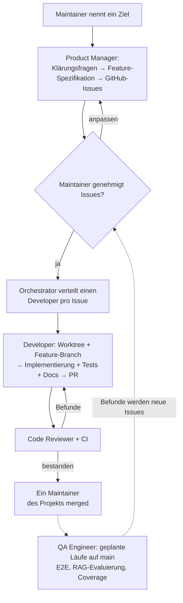

# Agenten-Organisation & Entwicklungs-Workflow

Wie OPAA von einem Team aus KI-Agenten mit Menschen in der Schleife entwickelt wird. Dieses Dokument beschreibt **wer was tut** (Agenten-Rollen), **wie Arbeit fließt** von der Idee bis zum Merge, und **welche Regeln gelten** für Menschen und Agenten. Es ergänzt [ADR-0001](./decisions/0001-collaboration-workflow.md) (Branching, Commits, PRs) — diese Konventionen gelten unverändert.

Menschen und Agenten verwenden denselben **Workflow**: dieselben Issues, dieselbe Branch-Benennung, dasselbe PR-Template. Ein Mensch, der ein Issue aufgreift, folgt genau den nachfolgend für den Entwickler-Agenten beschriebenen Schritten.

## Rollen

| Rolle | Verantwortung | Läuft als |
|---|---|---|
| **Orchestrator** | Einziger menschenzugewandter Einstiegspunkt. Nimmt Ziele vom Maintainer entgegen, priorisiert den Backlog (Projektmanager-Rolle), delegiert Arbeit an die nachfolgenden Agenten, überwacht PRs und eskaliert nur Entscheidungen, die einen Menschen erfordern. | Hauptsitzung |
| **Product Manager** | Verantwortlich für die funktionale Definition: hält Vision und Realität synchron (`docs/VISION.md`, `docs/fortschritt/gesamtstand.md`), schreibt Feature-Spezifikationen in `docs/features/`, erstellt und priorisiert GitHub-Issues. | Subagent `product-manager` |
| **Developer** | Implementiert ein Issue vollständig (Backend **und** Frontend) in einem isolierten Git-Worktree, auf einem `feature/<issue-id>_<desc>`-Branch, und öffnet einen PR. | Subagent `developer`, möglicherweise mehrere Instanzen parallel — eine pro Issue |
| **Code Reviewer** | Adversariales Review jedes PRs mit frischem Kontext (keine Implementierungs-Bias): Korrektheit, ADR-Compliance, Wiederverwendung, fehlende Dokumentation. Entwirft ADRs, wenn er eine Architekturentscheidung erkennt. | Subagent `code-reviewer` |
| **QA Engineer** | Produktqualität über das jeweilige PR-Review hinaus: alleiniger Eigentümer der E2E-Suite (implementiert die dedizierten `test(e2e)`-Issues, die zum Spezifikationszeitpunkt erstellt wurden), RAG-Antwortqualitäts-Evaluierung (Golden Dataset + Evaluatoren), Coverage-/Flakiness-Trends, Release-Bewertung. | Subagent `qa-engineer` |
| **Marketing** | Positionierung zuerst: schärft Pitch und Mission, pflegt die Messaging-Quelle der Wahrheit (`docs/market/MESSAGING.md`), leitet stakeholder-spezifische Assets davon ab — Landing Page (`page/`), Pitch-Decks, One-Pager, README-Messaging, Website-i18n. Positionierungsentscheidungen verbleiben beim Maintainer. | Subagent `marketing` |
| **UX-Designer** | Gestaltet die Bedienung vor der Implementierung: Interaktionskonzepte in `docs/design/` für Issues mit nennenswerter UI-Fläche, Begriffs- und Textkonventionen (`docs/design/GLOSSAR.md`), UX-Review nach dem Merge. Kein Produktivcode, keine Funktionsdefinition. | Subagent `ux-designer` |

Neben diesen Liefer-Rollen gibt es **Stakeholder-Rollen**, die nichts herstellen, sondern bewerten — siehe [Stakeholder-Review](#stakeholder-review) —, und die Prüfrolle **Behördenkontakt** (Subagent `behoerdenkontakt`): Sie liest vor jedem Release und gelegentlich Fakten-Manifest, Faktenblätter, Update-Paket und die Vorlagen unter `docs/behoerden/` aus Sicht einer Behörde, legt Befunde als Issues an und leistet **keine verbindliche Rechtsbeobachtung und keine Rechtsberatung** — siehe [Behördenkontakt vor dem Release](#behördenkontakt-vor-dem-release).

Designprinzip: Ein Agent hat eine Spur, Arbeit wird über Artefakte (Spezifikationen, Issues, PRs) statt Dialog übergeben, Schreibvorgänge sind single-threaded (Parallelität nur über *verschiedene* Issues), und der Reviewer ist immer vom Implementierer getrennt.

## Stakeholder-Review

Die Liefer-Rollen bewerten Konzepte aus der Perspektive derer, die sie entwerfen; die Stakeholder-Rollen vertreten die Menschen, die OPAA in einer Behörde benutzen, betreiben und verantworten, und liefern je eine schriftliche fachliche Bewertung aus dieser Perspektive.

| Rolle | Perspektive | Läuft als |
|---|---|---|
| **Sachbearbeiter** | Tagesgeschäft: Aufwand pro Vorgang, Verständlichkeit der Begriffe, Folgen von Fehlbedienung. Umgeht, was ihn ausbremst. | Subagent `stakeholder-sachbearbeiter` |
| **Referatsleitung** | Verantwortung für fachliche Richtigkeit, Nachvollziehbarkeit über Jahre, Kontrolle über das, was das Referat abgibt und aufnimmt. | Subagent `stakeholder-referatsleitung` |
| **KI-Champion** | Treibt die Einführung: Zeit bis zum ersten sichtbaren Nutzen, Verbreitungsfähigkeit, Selbstständigkeit der Fachbereiche, Umgehungswege. | Subagent `stakeholder-ki-champion` |
| **Betriebsverantwortlicher** | Betrieb und Informationssicherheit: Migrierbarkeit, Nachweisbarkeit gegenüber Prüfern, Rechteexplosion, Wiederherstellbarkeit, laufender Aufwand. | Subagent `stakeholder-betrieb` |
| **Skeptiker** | Notorischer Kritiker: wohin die Arbeit verschoben wird, was im dritten Jahr passiert, wer die unbezahlte Pflegearbeit macht. | Subagent `stakeholder-skeptiker` |
| **Personalrat** | Mitbestimmung: Eignung zur Leistungs- und Verhaltenskontrolle, Sichtbarkeit unter Kollegen, Aufbewahrung, Bedingungen für eine Dienstvereinbarung. | Subagent `stakeholder-personalrat` |

### Wann ein Stakeholder-Review läuft

Nach einer Konzept- oder Spezifikationsänderung von struktureller Tragweite und **bevor** der zugehörige Implementierungs-Backlog freigegeben wird. Ein Review nach der Implementierung erzeugt Nacharbeit statt Erkenntnis.

Pflichtanlass ist eine Spezifikation, deren Abschnitt „Wirkung auf Behördenunterlagen“ die Stufe **Zustimmung** vorschlägt: Der Product Manager fordert das Review an, Personalrat und Betriebsverantwortlicher laufen mindestens, und die Issues werden erst danach geschnitten ([Stufenregeln](features/behoerdenunterlagen.md#die-stufenregeln)).

Zweiter Pflichtanlass ist eine Änderung der Stufe **Zustimmung**, die der Behördenkontakt vor einem Release meldet ([Behördenkontakt vor dem Release](#behördenkontakt-vor-dem-release)): Geprüft werden das Update-Paket bzw., solange es keines gibt, das Manifest-Delta seit dem letzten Tag (`./gradlew complianceDelta`) und die Faktenblätter, mindestens durch Personalrat und Betriebsverantwortlichen.

Der Orchestrator startet die Rollen parallel gegen dieselbe Dokumentenmenge und legt dem Maintainer die Bewertungen gebündelt vor. Nicht jede Änderung braucht alle sechs — die Auswahl richtet sich danach, wessen Wirklichkeit betroffen ist.

### Was ein Stakeholder-Review liefert

Alle sechs Rollen liefern dasselbe Format: Gesamturteil, was funktioniert, was nicht funktioniert (jeweils mit einer konkreten Situation, in der es scheitert), die eine Änderung, die sie vornehmen würden, und was sie ausdrücklich nicht beurteilen können. Der Personalrat ergänzt die Bedingungen für eine Zustimmung.

### Grenzen

- Stakeholder-Agenten schreiben **keinen Produktivcode**, erstellen **keine Issues** und ändern **keine Spezifikationen**. Sie erzeugen ausschließlich Bewertungsberichte.
- Sie sind **beratend, nicht sperrend**. Ein negatives Urteil ist eine Stimme, keine Blockade; der Maintainer entscheidet.
- Sie ersetzen weder den Code Reviewer noch den QA Engineer. Diese prüfen die Umsetzung, die Stakeholder prüfen die Absicht.
- Sie simulieren echte Personengruppen und liegen deshalb manchmal falsch. Eine Bewertung ist ein Hinweis auf ein Risiko, kein Beleg dafür.

## Agenten-Definitionen und Client-Adapter

Die obige Tabelle beschreibt die Rollen der Organisation. Die gemeinsamen Rollenverträge in `agents/roles/` sind die Quelle der Wahrheit für das konkrete Agenten-Verhalten. Sie enthalten absichtlich keine anbieterspezifische Modell-, Tool-, Berechtigungs-, Speicher- oder Worktree-Konfiguration.

Jeder unterstützte Client hat einen dünnen projektlokalen Adapter, der auf den entsprechenden gemeinsamen Vertrag verweist:

| Client | Adapter-Pfad | Hinweise |
|---|---|---|
| Claude Code | `.claude/agents/` | YAML-Frontmatter liefert Claude Code-Tools, Modellauswahl, visuelle Einstellungen, Speicher und Worktree-Isolierung. |
| Codex | `.codex/agents/` | TOML-Dateien definieren Codex Custom Agents. Der Reviewer verwendet eine schreibgeschützte Sandbox. |
| OpenCode | `.opencode/agents/` | Markdown-Frontmatter definiert OpenCode-Subagenten und ihre Berechtigungen. Der Reviewer verweigert Bearbeitungen. |

Alle Adapter weisen ihren Agenten an, `AGENTS.md`, dieses Organisationsdokument und seinen gemeinsamen Rollenvertrag zu lesen, bevor er arbeitet. Eine Rolle muss in `agents/roles/` hinzugefügt werden, bevor sie Provider-Adapter erhält. Die sechs Liefer-Rollen sind Product Manager, Developer, Code Reviewer, QA Engineer, Marketing und UX-Designer (Letzterer noch ohne Provider-Adapter); hinzu kommen die Prüfrolle `behoerdenkontakt` und die sechs Stakeholder-Rollen `stakeholder-sachbearbeiter`, `stakeholder-referatsleitung`, `stakeholder-ki-champion`, `stakeholder-betrieb`, `stakeholder-skeptiker` und `stakeholder-personalrat`.

## Workflow: von der Idee bis zum Merge

1. **Ziel** — Der Maintainer gibt dem Orchestrator ein Ziel ("einen Confluence-Connector hinzufügen").
2. **Definition** — Der Product Manager recherchiert Repository-Kontext, stellt seine Klärungsfragen **einmal, gebündelt, im Voraus** (durch den Orchestrator weitergeleitet), schreibt dann die Feature-Spezifikation in `docs/features/` und erstellt beschriftete GitHub-Issues, bei Stufe Zustimmung erst nach dem [Stakeholder-Review](#wann-ein-stakeholder-review-läuft).
3. **Genehmigung** — Der Maintainer prüft die Issues, bevor die Implementierung beginnt.
4. **Implementierung** — Für jedes genehmigte Issue arbeitet ein Entwickler-Agent in einem isolierten Worktree auf einem `feature/<issue-id>_<desc>`-Branch und öffnet einen PR unter Verwendung des PR-Templates (einschließlich KI-Agenten-Offenlegung).
5. **Review** — Der Code Reviewer und CI agieren als Schranken. Befunde gehen zurück zum Entwickler; der PR ist nur bereit, wenn beide bestehen. Ein formales Approval in GitHub ist nicht erforderlich — die Schranke ist der Reviewer selbst, nicht der Klick darauf.
   - **Befunde werden im selben PR behoben — Folge-Issues sind die Ausnahme.** Das gilt auch für vorbestehende Defekte und benachbarte Kleinigkeiten, auf die Review oder Implementierung stoßen: Wer ohnehin an einer Stelle arbeitet, schaut links und rechts und nimmt mit, was dort liegt. Ein Folge-Issue ist nur zulässig, wenn der Befund einen sehr großen Umbau erfordert oder einen komplett anderen Scope hat. Lieber ein paar Issues weniger im Backlog als billige Korrekturen, die auf später verschoben werden.
6. **Merge** — Gemergt wird von einem Maintainer des Projekts oder vom **Koordinator mit ausdrücklicher Maintainer-Freigabe**: Er darf reviewte PRs per `gh pr merge --auto --squash` zum Auto-Merge freigeben; GitHub merged dann selbst, sobald die Required Checks grün sind. Entwickler- und Review-Agenten mergen nie. Jede weitere Änderung dieser Richtlinie wird hier festgehalten.

Auf `main` sind die Required Checks `changes` (der Pfadfilter-Job aus `ci.yml`, damit sein Fehlschlag die abhängigen Jobs nicht als „skipped = bestanden" durchwinkt), `backend`, `backend-integration` und `frontend`, das Auflösen offener Konversationen sowie der Schutz gegen Force-Push und Löschen technisch durchgesetzt. Ein PR muss nicht up to date mit `main` sein, weil der CI-Lauf auf `main` nach dem Merge den kombinierten Stand prüft; Schreibzugriff und damit Merge haben nur die Maintainer.

### Wo QA passt: zwei Qualitätsschleifen

Der QA Engineer ist bewusst **nicht** Teil des PR-Gates — das ist die Aufgabe des Code Reviewers und CI, und eine Verdoppelung würde beide Geltungsbereiche verwischen. QA arbeitet in einer zweiten, langsameren Schleife rund um den Merge:

- **Issue-getrieben, wie ein Entwickler, in einer eigenen Spur.** QA-Infrastruktur ist reguläre Backlog-Arbeit (E2E-Test-Suite, Coverage-Reporting, RAG-Antwortqualitäts-Evaluierung). Der Orchestrator verteilt solche Issues an den QA-Agenten statt an einen Entwickler; die resultierende Arbeit durchläuft denselben PR → Review → Merge-Pfad.
- **Wiederkehrender Hüter nach dem Merge.** Nach einem Zeitplan (geplante Routine oder CI-Job auf `main`) übt der QA-Agent den aktuellen Produktstand — E2E-Läufe, RAG-Evaluierung, Coverage-Trends. **Seine Befunde werden neue Issues** (Bug-Reports mit Reproduktionsschritten), die den Workflow bei Schritt 3 wieder eintreten.
- **Zum Definitionszeitpunkt** leitet der Product Manager E2E-relevante Szenarien aus den Abnahmekriterien ab und erstellt dedizierte `test(e2e)`-Issues; der QA Engineer implementiert sie in der Suite, sobald das Feature gelandet ist.

Es gibt also zwei Schleifen: die schnelle **PR-Schleife** (Code Reviewer + CI, vor dem Merge) und die langsame **Produkt-Schleife** (QA Engineer, nach dem Merge, produziert neue Issues).

### Behördenkontakt vor dem Release

Der Koordinator startet die Rolle `behoerdenkontakt` **vor jedem Release**, bevor der Maintainer das Tag setzt, und **gelegentlich** darüber hinaus, etwa nach einer Reihe von Merges mit Label `data-impact` oder wenn eine Vorlage unter `docs/behoerden/` ihre `naechste-durchsicht` erreicht. Die Rolle liest das Update-Paket des Release, solange es keines gibt das Manifest-Delta seit dem letzten Tag und die Faktenblätter, legt ihre Befunde als Issues an und liefert einen Bericht. Meldet sie eine Änderung der Stufe Zustimmung, startet der Koordinator ein [Stakeholder-Review](#stakeholder-review) mit mindestens Personalrat und Betriebsverantwortlichem. Der Maintainer klärt die Befunde vor dem Tag oder nimmt sie als bekannt in die Release-Notizen auf. Die wöchentliche Drift-Routine ([Behördenunterlagen, Schicht 3](features/behoerdenunterlagen.md#schicht-3-wöchentliche-drift-routine)) ersetzt den Lauf nicht: Sie prüft die Änderungen einer Woche, die Rolle den Stand eines Release.

## Regeln

### Issues

Issues sind die Arbeitseinheit und müssen ausreichend in sich geschlossen sein, damit jeder Entwickler — Mensch oder Agent — sie aufgreifen kann. Jedes Issue enthält:

- **Kontext / Warum** — Link zur Vision, zum Epic oder zur Feature-Spezifikation
- **Ziel / Ergebnis** — ein Satz, der beschreibt, was danach möglich ist
- **Abnahmekriterien** — einzeln testbare Checkboxen; "Dokumentation aktualisiert" ist ein ständiges Kriterium für nutzerseitige oder architektonische Änderungen. Ändert das Issue sichtbares Verhalten oder Konfiguration, benennt ein Kriterium das betroffene Handbuchkapitel und den Abschnitt („`docs/handbuch/suche.md`, Stufe 8 nachgezogen") oder stellt ausdrücklich fest: „kein Handbuchkapitel betroffen"
- **Umfang / Außerhalb des Umfangs** — explizite Grenzen
- **Betroffene Module** — z. B. `io.opaa.indexing`, Frontend, OpenAPI-Spezifikation (Spec-Änderungen sind ein Koordinationspunkt — siehe [ADR-0006](./decisions/0006-openapi-dto-generation.md))
- **Abhängigkeiten** — blockierende Issues
- **Labels** — einschließlich `size:S/M/L`

**Epics grob schneiden.** Ein Epic wird in wenige, größere Sub-Issues zerlegt, Richtwert höchstens acht, weil jedes Ticket denselben Fixaufwand kostet (Kontext, Worktree, PR, Review, CI) und dazu verleitet, Entscheidungen in Folge-Issues zu verschieben. Ein Sub-Issue umfasst einen zusammenhängenden Block, in dem der Entwickler kleinere Entscheidungen selbst trifft und miterledigt, was fachlich in derselben Ecke liegt (Schritt 5). Bereits angelegte Issues derselben Ecke darf der Koordinator einem Entwickler gebündelt geben (Koordinator-Betrieb, „Bündelung“).

#### Bearbeitung anzeigen: Issue selbst zuweisen

Wer ein Issue bearbeitet — Mensch oder Agent —, weist es sich **vor Arbeitsbeginn** selbst zu, auch jedes weitere Issue, das ein gebündelter PR mit `Closes` schließt. Vorher wird die Zuweisung geprüft: Ist das Issue einem anderen Account zugewiesen, wird nicht angefangen; ein Agent meldet das mit dem Namen des Accounts seinem Koordinator, der es an den Maintainer weitergibt, ein Mensch spricht die zugewiesene Person an. Weil Agenten unter dem Account ihres Betreibers arbeiten, prüft ein Agent bei einem schon dem eigenen Account zugewiesenen, aber nicht gerade zugeteilten Issue, ob es Branch oder PR dazu gibt, und meldet einen Fund, statt anzufangen. Bricht die Arbeit ohne PR ab, wird die Zuweisung entfernt; der Koordinator weist beim Verteilen zu, Renovate-PRs sind ausgenommen.

#### Befehle

- Zuweisung prüfen: `gh issue view <nr> --json assignees --jq '[.assignees[].login]'`; selbst zuweisen: `gh issue edit <nr> --add-assignee @me`; zurücknehmen: `--remove-assignee @me`
- Vorhandene Arbeit finden: `git ls-remote --heads origin "feature/<nr>_*"`, `gh pr list --search "<nr> in:body"`
- Sub-Issue an ein Epic hängen: `gh api -X POST repos/{owner}/{repo}/issues/{epic}/sub_issues -F sub_issue_id={id}`, wobei `{id}` die Objekt-ID des Kind-Issues ist (`gh api repos/{owner}/{repo}/issues/{nr} --jq .id`), nicht seine Nummer
- Offene Sub-Issues eines Epics zählen: `gh api repos/{owner}/{repo}/issues/{epic}/sub_issues --jq '[.[] | select(.state=="open")] | length'`

### Dokumentation

- **Feature-Dokumentation wird von demjenigen geschrieben, der das Feature baut, im selben PR.** Kein separater Dokumentationsdurchgang; dies wird durch die Abnahmekriterien durchgesetzt und vom Code Reviewer geprüft.
- **Das Produkthandbuch (`docs/handbuch/`) wird mit dem Code gepflegt.** Wer ein Verhalten oder eine Konfiguration ändert, die ein Kapitel beschreibt, zieht das Kapitel im selben PR nach — nach den Konventionen der [Einstiegsseite](./handbuch/README.md): Ist-Stand, Verweise nur innerhalb des Handbuchs, Zahlen nur in Konfigurationstabellen, Begriffe aus dem Glossar. Der Code Reviewer prüft bei jedem PR mit Verhaltens- oder Konfigurationsänderung, ob das betroffene Kapitel angefasst wurde, und hält die Änderung gegen den Code; ein fehlender Nachzug ist ein Merge-Blocker, kein Nit. Ein neues Kapitel trägt den Hinweis „Entwurf", bis der Maintainer es abnimmt und den Hinweis in einem eigenen PR entfernt; ein Nachzug in ein abgenommenes Kapitel setzt den Hinweis nicht zurück. Es gibt keinen periodischen Dokumentationsdurchgang und keinen eigenen Dokumentations-Agenten — ein Kapitel, das beim Bauen nicht mitgezogen wurde, wird bei einem späteren Durchgang nicht besser.
- **ADRs**: Wenn der Code Reviewer oder ein Entwickler eine echte Architekturentscheidung identifiziert, schreibt er einen ADR nach der Vorlage und den Regeln in [`docs/decisions/README.md`](./decisions/README.md) mit dem Status „Akzeptiert · zuletzt geändert <Datum>“ und hängt ihn an den PR. Der Maintainer entscheidet mit dem Merge; ein abgelehnter ADR wird nicht gemergt, einen Zwischenstatus gibt es nicht. Eine spätere Änderung an einer Entscheidung schreibt den Kerntext des ADR fort (kein Nachtrag, kein Änderungsverlauf); `git log` ist die Historie. Nichts Architektonisches wird implizit festgelegt.

### Koordinator-Betrieb

Regeln für den Koordinator/Orchestrator, unabhängig von der Umgebung, in der er läuft:

- **Vollbuilds staffeln:** Der Koordinator vergibt Build-Slots nacheinander, nach den Ressourcen der Maschine (Richtwert 2–3 parallele `./gradlew build`), statt alle Agenten gleichzeitig bauen zu lassen.
- **Modellwahl je Gewicht:** Entwickler-Agenten laufen auf Opus, wichtige oder komplexe Issues (Epic-Kernteile, Migrations-/Löschsemantik, verzahnte Verträge) wahlweise auf Fable, bei Störung eines Modells auf dem anderen, und Reviews immer auf einem der beiden.
- **Bündelung:** Eng zusammenhängende Issues desselben Subsystems darf der Koordinator einem Agenten als einen Auftrag geben, ein PR mit mehreren `Closes`, die Issues bleiben einzeln angelegt.
- **Review ab PR-Eröffnung:** Das Review startet, sobald ein PR eröffnet ist, nicht nach grüner CI; ein roter CI-Lauf und Review-Befunde gehen in dieselbe Nachbesserungsrunde.
- **Security-Arbeit wird delegiert:** Security-Analysen, -Fixes und -Issues führt der Koordinator nicht selbst aus, sondern gibt sie an Agenten, dieselbe Rollentrennung wie zwischen Implementierung und Review.
- **Handbuch nach Abhängigkeits-Updates:** Ändert ein gemergter Renovate-PR eine Version oder einen Default, den das Handbuch nennt (`betrieb.md`, `konfiguration.md`), zieht der Koordinator das Kapitel nach.
- **Behördenkontakt vor jedem Release:** Der Koordinator startet die Rolle `behoerdenkontakt` vor jedem Release und gelegentlich darüber hinaus ([Behördenkontakt vor dem Release](#behördenkontakt-vor-dem-release)).
- **Prozess- und Worktree-Hygiene:** Nie ein globales `gradlew --stop`, nur den eigenen Prozess beenden, und nach dem Merge zuerst Branch löschen und `git worktree prune`, ein gesperrtes Verzeichnis später entfernen.

### Autonomie und Eskalation

- Subagenten interagieren nie direkt mit dem Maintainer; Fragen werden gebündelt und vom Orchestrator weitergeleitet, vorzugsweise während des Definitionsschritts statt mitten in der Implementierung.
- Qualitätsgates sind deterministisch (CI, Hooks), keine Versprechen in Prompts: Tests müssen bestehen, bevor ein Agent ein Issue als erledigt melden darf.
- Agenten arbeiten unter einer Allow/Deny-Berechtigungsrichtlinie (`.claude/settings.json`); destruktive Befehle sind für Agenten verweigert. `gh pr merge` ist Subagenten verweigert; der Koordinator nutzt es im Rahmen der Merge-Freigabe (siehe Schritt 6).
