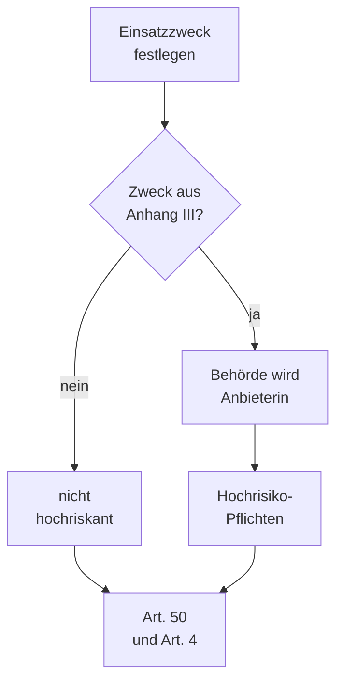

# Einstufungshilfe zur KI-Verordnung

> Nicht rechtlich geprüft. Kann als Vorlage dienen; die Verantwortung bleibt bei der Behörde.

Diese Hilfe führt eine Behörde in vier Fragen zur Einstufung ihres Einsatzes von OPAA nach der
KI-Verordnung (VO (EU) 2024/1689, im Folgenden KI-VO) in der Fassung des Digital-Omnibus
(VO (EU) 2026/1744): Welche Rolle hat die Behörde, ist der Einsatz hochriskant, was verlangt die
Transparenzpflicht nach Art. 50 und was Art. 4 zur KI-Kompetenz. Das Ergebnis hält die Behörde im
[Einstufungsvermerk](#einstufungsvermerk) fest.

Die Einstufung hängt am **Einsatzzweck**, den die Behörde festlegt, nicht an der Software allein. Sie
ist deshalb bei jeder Zweckänderung zu wiederholen ([Wann neu einstufen](#wann-neu-einstufen)).

Außerhalb dieser Hilfe liegen die Konformitätsbewertung eines Hochrisiko-Systems und die Pflichten
des Anbieters des angebundenen Sprachmodells (Kapitel V KI-VO). Welche Modelle eine Version
voreingestellt nutzt, steht im {{faktenblatt:voreinstellungen}}, welche Daten an einen Modellanbieter
gehen, im {{faktenblatt:datenfluesse}}.

## Quellen und Prüfstand

Grundlage ist die Rechtsrecherche vom 13.10.2026 (erster Kommentar in Epic
[#2542](https://github.com/criew/opaa/issues/2542)). Jede Fundstelle trägt ihre Herkunft:

- **Normtext** — Artikel der KI-VO in der Ursprungsfassung
  ([ELI 2024/1689](https://eur-lex.europa.eu/eli/reg/2024/1689/oj/deu)), die nach der Recherche
  durch den Digital-Omnibus nicht verändert wurden.
- **Fachbeitrag** — Aussagen zum Digital-Omnibus aus Fachbeiträgen, die bis zum `rechtsstand`
  **nicht** gegen den Normtext ([ELI 2026/1744](https://eur-lex.europa.eu/eli/reg/2026/1744/oj/deu))
  geprüft sind. Vor Verwendung in einer eigenen Unterlage prüft die Behörde sie im Amtsblatt nach.

## Fristen

| Datum | Was gilt | Fundstelle | Herkunft |
|---|---|---|---|
| 2.2.2025 | Kapitel I (darunter Art. 4) und Kapitel II (verbotene Praktiken, Art. 5) gelten | Art. 113 Unterabs. 3 lit. a KI-VO | Normtext |
| 27.7.2026 | Digital-Omnibus (VO (EU) 2026/1744) in Kraft; Art. 4 neu gefasst: Anbieter und Betreiber „unterstützen“ die KI-Kompetenz, nicht bußgeldbewehrt | [KPMG](https://kpmg.com/at/de/insights/2026/07/digital-omnibus-on-ai.html), [buzer.de, Art. 4 KI-VO](https://www.buzer.de/4_KI-VO.htm) | Fachbeitrag |
| 2.8.2026 | Art. 50 (Transparenzpflichten) gilt | Art. 113 Unterabs. 2 KI-VO; [mbkanzlei](https://mbkanzlei.digital/blog/digital-omnibus-ki-vo-was-verschoben-wurde/) | Normtext, Fachbeitrag |
| 2.12.2026 | Ende der Übergangsfrist für die maschinenlesbare Kennzeichnung nach Art. 50 Abs. 2, nur für Anbieter und nur für Systeme, die vor dem 2.8.2026 in Verkehr gebracht wurden | [mbkanzlei](https://mbkanzlei.digital/blog/digital-omnibus-ki-vo-was-verschoben-wurde/) | Fachbeitrag |
| 2.12.2027 | Pflichten für Hochrisiko-Systeme nach Anhang III gelten | [KPMG](https://kpmg.com/at/de/insights/2026/07/digital-omnibus-on-ai.html), [scheja](https://scheja-partners.de/insights/trends-and-takeaways/digital-omnibus-zur-ki-verordnung-mehr-zeit-fuer-hochrisiko-ki/) | Fachbeitrag |
| 2.8.2028 | Pflichten für Hochrisiko-Systeme nach Anhang I gelten | [KPMG](https://kpmg.com/at/de/insights/2026/07/digital-omnibus-on-ai.html) | Fachbeitrag |

## Frage 1: Welche Rolle hat die Behörde?

| Rolle | Begriff | Wann |
|---|---|---|
| **Anbieterin** | Art. 3 Nr. 3 KI-VO: entwickelt ein KI-System oder lässt es entwickeln und bringt es unter eigenem Namen oder eigener Marke in Verkehr oder nimmt es so in Betrieb, entgeltlich oder unentgeltlich | Die Behörde betreibt OPAA unter eigenem Namen, etwa als „Wissensassistent der Stadt …“ |
| **Betreiberin** | Art. 3 Nr. 4 KI-VO: verwendet ein KI-System in eigener Verantwortung | Die Behörde nutzt OPAA, ohne Anbieterin zu sein |

Nach der Recherche wird eine Behörde, die OPAA unter eigenem Namen in Betrieb nimmt, selbst
Anbieterin. Die Ausnahme für freie und quelloffene Software (Art. 2 Abs. 12 KI-VO) gilt für Art. 50
ausdrücklich nicht (Normtext).

Ein Anhaltspunkt aus dem Produkt: Unter **Administration → Branding** ersetzt die Behörde Produktname,
Claim und Logo; der eigene Name erscheint dann in Seitenleiste, Anmeldeseite und Fenstertitel
([Handbuch, Branding](../../handbuch/branding.md)). Ob der Betrieb unter dem unveränderten Namen
„OPAA“ an der Rolle etwas ändert, beantwortet die Recherche nicht. Wer die Frage nicht klären will,
plant die Pflichten des Anbieters aus Art. 50 Abs. 1 und 2 vorsorglich selbst ein.

**Festzuhalten:** Rolle, Name, unter dem OPAA im Haus erscheint, und die Begründung.

## Frage 2: Ist der Einsatz hochriskant?

Ein Wissensassistent, der Fragen zu Dokumenten der Behörde mit Belegen beantwortet, ist nach der
Recherche in der Regel nicht hochriskant. Das ändert sich, wenn die Behörde ihn für einen Zweck aus
Anhang III einsetzt.



**Prüfschritte:**

1. **Einsatzzweck schriftlich festlegen:** wofür, für wen, mit welchen Wissensbibliotheken, mit
   welchen Spaces. Die Nutzungsrichtlinie der Behörde ist der natürliche Ort dafür.
2. **Gegen Anhang III halten.** Für Behörden naheliegend:
   - **Nr. 4 Beschäftigung und Personalmanagement**, etwa Auswahl von Bewerbungen, Entscheidungen über
     Beförderung oder Kündigung, Zuweisung von Aufgaben nach Verhalten oder persönlichen Merkmalen,
     Überwachung und Bewertung von Leistung und Verhalten;
   - **Nr. 5 Zugang zu grundlegenden öffentlichen Leistungen**, etwa die Prüfung, ob eine Person
     Anspruch auf eine öffentliche Unterstützungsleistung hat.

   Anhang III nennt weitere Bereiche, in denen Behörden tätig sind (unter anderem Strafverfolgung,
   Migration, Asyl und Grenzkontrolle, Rechtspflege). Die Behörde liest die Liste im Normtext
   vollständig gegen ihren Einsatzzweck.
3. **Bei einem Treffer:** Setzt die Behörde ein nicht als hochriskant eingestuftes KI-System so ein,
   dass es zu einem Hochrisiko-System wird, gilt sie nach Art. 25 Abs. 1 lit. c KI-VO als Anbieterin
   dieses Hochrisiko-Systems (Normtext). Die Pflichten gelten ab 2.12.2027 (siehe [Fristen](#fristen)).
   Ob eine der Ausnahmen des Art. 6 Abs. 3 KI-VO greift, prüft die Behörde im Normtext; diese Hilfe
   deckt die Hochrisiko-Prüfung nicht ab.

**Festzuhalten:** Einsatzzweck, geprüfte Nummern des Anhangs III, Ergebnis und Begründung.

## Frage 3: Was verlangt Art. 50?

Art. 50 gilt seit 2.8.2026, auch für einen Einsatz, der nicht hochriskant ist.

| Absatz | Pflicht | Wen sie trifft | Bezug zu OPAA |
|---|---|---|---|
| Abs. 1 | Personen, die mit einem KI-System interagieren, werden darüber informiert, es sei denn, es ist für eine angemessen informierte, aufmerksame und verständige Person aus den Umständen offensichtlich | Anbieter | Chat-Oberfläche, siehe [Ist-Stand](#ist-stand-der-kennzeichnung-in-opaa) |
| Abs. 2 | Erzeugte Texte, Bilder, Audio- und Videoinhalte werden in maschinenlesbarem Format gekennzeichnet und als künstlich erzeugt erkennbar; Übergangsfrist für Altsysteme bis 2.12.2026 (Fachbeitrag) | Anbieter | Antworttexte im Chat und beim Kopieren |
| Abs. 4 | Ein künstlich erzeugter oder veränderter Text, der veröffentlicht wird, um die Öffentlichkeit über Angelegenheiten von öffentlichem Interesse zu informieren, wird offengelegt, es sei denn, er wurde menschlich überprüft oder redaktionell kontrolliert und eine Person trägt die redaktionelle Verantwortung | Betreiber | Übernimmt die Behörde eine Antwort in eine Veröffentlichung, liegt die Pflicht bei ihr, nicht in der Software |
| Abs. 5 | Die Information erfolgt klar und erkennbar spätestens bei der ersten Interaktion und entspricht den Anforderungen an die Barrierefreiheit | Anbieter und Betreiber | gilt für jeden Hinweis nach Abs. 1 bis 4 |

Wortlaut und Ausnahmen stehen in Art. 50 KI-VO (Normtext); die Ausnahmen nach Abs. 2 (unterstützende
Funktion bei Standardbearbeitung, keine wesentliche Veränderung der Eingabe) prüft die Behörde dort.

### Ist-Stand der Kennzeichnung in OPAA

Geprüft am Stand von `main` zum Datum im Feld `stand`:

| Stelle | Was die Oberfläche zeigt | Bewertung für Art. 50 |
|---|---|---|
| Leerer Chat | Roboter-Symbol, Überschrift „Womit kann ich Ihnen heute helfen?“ und „Stellen Sie eine Frage zu Ihren Projektdokumenten.“ | Kein ausdrücklicher Hinweis auf KI. Das Symbol ist rein grafisch und wird von Screenreadern nicht vorgelesen. |
| Antwort im Chat | Antworttext mit Belegen; je nach Lage Hinweise wie „Diese Antwort wurde ohne Wissensbasis erstellt.“ oder die Warnung bei abgeschnittener Antwort, die „das Modell“ nennt | Die Hinweise betreffen Herkunft und Vollständigkeit, nicht die Erzeugung durch KI. Eine Kennzeichnung je Antwort fehlt. |
| Kopieren einer Antwort | Text als Markdown, wahlweise mit Quellen als Fußnoten | Keine maschinenlesbare Kennzeichnung im kopierten Text. |
| Produktname, Anmeldeseite, „Info zu …“ | Produktname und Claim aus dem Branding, Version | Ersetzt die Behörde den Namen, entfällt auch der mittelbare Hinweis im Namen. |
| Eigener Hinweistext | Die Oberfläche bietet keinen Ort, an dem die Behörde einen eigenen Hinweis zur KI-Nutzung hinterlegen kann. | — |

**Folgerung für die Behörde:** Ob die Umstände des Einsatzes die KI-Interaktion offensichtlich machen
(Abs. 1), bewertet die Behörde selbst; eine Dienstanweisung oder Nutzungsrichtlinie allein ersetzt den
Hinweis in der Oberfläche nach Abs. 5 nicht ohne Weiteres. Bis die Software einen Hinweis bietet,
bleiben ihr organisatorische Mittel: Hinweis bei der Freischaltung des Zugangs, auf der Intranetseite
mit dem Einstieg, in der Nutzungsrichtlinie. Für Abs. 2 bietet OPAA derzeit keine maschinenlesbare
Kennzeichnung.

## Frage 4: Was verlangt Art. 4?

Nach der Neufassung durch den Digital-Omnibus unterstützen Anbieter und Betreiber die Entwicklung der
KI-Kompetenz ihres Personals; die Pflicht ist nicht bußgeldbewehrt (Fachbeitrag, siehe
[Fristen](#fristen)).

Das Projekt liefert **kein Schulungsmaterial**. Als Grundlage für eine eigene Einweisung taugen die
Kapitel des Handbuchs, die erklären, wie eine Antwort entsteht und wie Belege zu lesen sind:

- [Suche: Von der Frage zur belegten Antwort](../../handbuch/suche.md), besonders „Antwort erzeugen“
  und „Belege prüfen und Fundstellen bilden“
- [Spaces](../../handbuch/spaces.md) und [Prompt-Bibliotheken](../../handbuch/prompt-bibliotheken.md)

Diese Kapitel beschreiben das Produkt. Ihre Verwendung ist **keine Erfüllung** von Art. 4; welche
Maßnahmen die Behörde ergreift und wie sie sie nachweist, entscheidet sie selbst.

## Wann neu einstufen

Die Einstufung ist erneut zu prüfen, wenn

- der Einsatzzweck sich ändert, etwa wenn Spaces mit Personalakten, Beurteilungen oder Bewerbungen
  eingerichtet werden oder Antworten in Entscheidungen über Personen oder Leistungen einfließen,
- die Behörde OPAA unter anderem Namen betreibt oder an andere Stellen weitergibt,
- ein Update die KI-Funktionen ändert; das Update-Paket weist geänderte Standardmodelle und Prompts
  aus, das Stufenmodell führt eine geänderte KI-Einstufung als eigene Zustimmungsklasse
  ([Spezifikation, Stufenregeln](../../features/behoerdenunterlagen.md#die-stufenregeln)),
- sich die Rechtslage ändert, spätestens zum Datum im Feld `naechste-durchsicht`.

## Einstufungsvermerk

Die Behörde kann ihr Ergebnis in dieser Form festhalten:

```text
Einstufungsvermerk KI-Verordnung

Behörde / Organisationseinheit:
OPAA-Version (aus „Info zu …“):
Name, unter dem OPAA im Haus erscheint:
Einsatzzweck:

Frage 1 – Rolle (Anbieterin / Betreiberin), Begründung:
Frage 2 – geprüfte Nummern des Anhangs III, Ergebnis, Begründung:
Frage 3 – Hinweis auf KI-Interaktion (wo, ab wann, barrierefrei):
          maschinenlesbare Kennzeichnung (Stand, Maßnahme):
          Veröffentlichung von Antworten (Regel zur redaktionellen Kontrolle):
Frage 4 – Maßnahmen zur KI-Kompetenz:

Geprüft am:            durch:
Nächste Prüfung (spätestens bei Zweckänderung oder Update mit geänderter KI-Einstufung):
```
