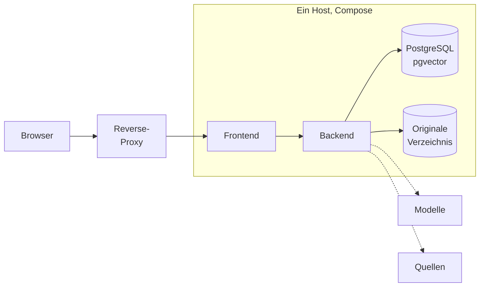
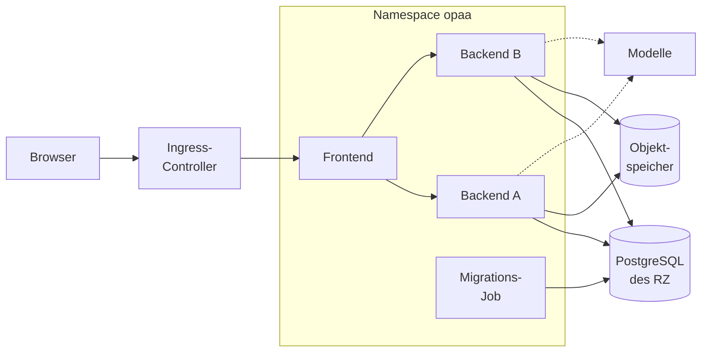
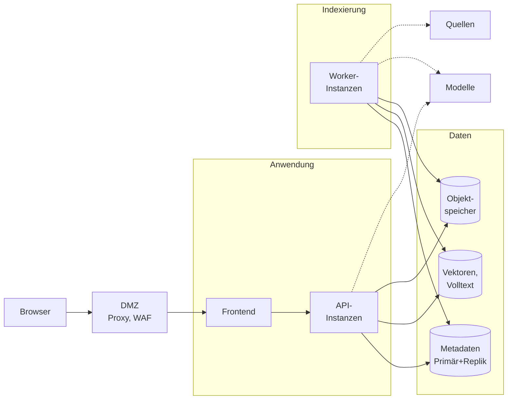

# ADR-0074: Betriebsarchitekturen klein, mittel und groß

## Status

Akzeptiert · zuletzt geändert 2026-11-12 · stützt sich auf [ADR-0042](0042-kubernetes-lieferung-mit-helm.md) und
[ADR-0053](0053-mehrinstanzbetrieb-aktiv-aktiv.md) · Konzept aus Epic #1439

## Kontext

Zwei Betriebswege sind gebaut und im Handbuch beschrieben: Docker Compose und der Helm-Chart, beide
mit einer oder mehreren Backend-Instanzen gegen eine PostgreSQL. Offen war, welche Aufbauten OPAA
für welche Häuser vorsieht, wie weit jeder heute trägt und was im Code einem größeren Aufbau
entgegensteht. Ein Haus, das Rechenzentrumsbetrieb für mehrere Behörden plant, fand dazu nur
verstreute Aussagen: „Millionen Vektoren“ als Grenze von pgvector im Handbuch, getrennte
Speicher-Backends und Hochverfügbarkeit über die Anwendung hinaus als Ziel in der Roadmap, Mandanten
als geparktes Epic (#1442).

Dieser ADR legt drei Betriebsarchitekturen als Zielbilder fest und führt je Architektur die
Hindernisse mit Beleg. Was das Handbuch zu Einrichtung und Betrieb schon beschreibt, wird verlinkt.
Die Entscheidung über getrennte Speicher-Backends trifft #3806, nicht dieser ADR.

## Entscheidung

### 1. Drei Architekturen, gewählt nach Verfügbarkeit und Betriebsverantwortung

| | Klein | Mittel | Groß |
|---|---|---|---|
| Betriebsweg | Docker Compose auf einem Host | Kubernetes mit dem Helm-Chart | Kubernetes, Dienste und Speicher getrennt |
| Backend | eine Instanz | zwei oder mehr gleichrangige Instanzen | Instanzen nach Rollen getrennt |
| Ausfall des Backends | Dienst steht bis zum Neustart | übrige Instanzen antworten | übrige Instanzen antworten |
| Ausfall der Datenbank | Dienst steht | Dienst steht, bis der Datenbankbetrieb sie wiederherstellt | Umschaltung auf eine Replik, Verhalten belegt (#3807) |
| Update | kurze Unterbrechung | ohne Ausfall im Versionsfenster | ohne Ausfall im Versionsfenster |
| Organisationen | eine | eine | mehrere (#1442) |
| Stand | gebaut | gebaut, Erprobung offen | Zielbild |

Gewählt wird nach der verlangten Verfügbarkeit und danach, wer Datenbank und Netz betreibt, nicht
nach der Kopfzahl allein: Auch ein kleines Haus mit eigenem Cluster fährt „mittel“. Die
Größenordnungen der folgenden Entscheidungen sind Richtwerte zur Einordnung, nicht gemessen;
belastbare Werte je Klasse liefert das Sizing (Epic #3492). Jede Architektur führt ihre Hindernisse
in einer Tabelle; „erledigt“ nennt den Baustein, auf dem sie aufsetzt, „hingenommen“ eine bewusste
Grenze mit beschriebener Folge, „offen“ einen fehlenden Baustein.

### 2. Klein: Docker Compose, eine Instanz

| Thema | Aufbau |
|---|---|
| Komponenten | Frontend, Backend, PostgreSQL mit pgvector im Stapel; zuschaltbar Objektspeicher, Texterkennung, Monitoring, Keycloak, Mailpit ([Docker Compose](../handbuch/betrieb/docker-compose.md#services)) |
| Netzbereiche | ein Compose-Netz; Host-Ports in der Vorgabe nur an `127.0.0.1`, davor der TLS-Proxy des Hauses ([Netzwerkzugang](../handbuch/betrieb/netz-und-sicherheit.md#netzwerkzugang)); Ausgang optional über den [Ausgangsproxy](../handbuch/betrieb/netz-und-sicherheit.md#ausgangsproxy); [Betrieb ohne Internet](../handbuch/betrieb/netz-und-sicherheit.md#betrieb-ohne-internet) möglich |
| Speicher | eine Datenbank für alles; Originale im Verzeichnis oder Objektspeicher ([Originalablage](../handbuch/betrieb/originalablage.md#die-drei-wege)) |
| Skalierung | senkrecht: CPU und Speicher des Hosts, Grenzen über die Konfiguration |
| Verfügbarkeit | die des Hosts; `restart: unless-stopped` startet nach einem Absturz neu |
| Sicherung | `pg_dump` und Kopie der Originale bei angehaltenem Backend ([Sicherung](../handbuch/betrieb/docker-compose.md#sicherung-und-wiederherstellung)) |
| Update | Release-Notizen, Sicherung, neue Images, Start migriert; kurze Unterbrechung, zurück über die Sicherung ([Aktualisierung](../handbuch/betrieb/aktualisierung.md#ablauf-eines-updates)) |
| Größenordnung | Pilot bis Amt: bis einige hundert Personen, bis etwa 50.000 Dokumente, bis etwa 1 Mio. Chunks |

| Hindernis | Beleg | Verweis | Stand |
|---|---|---|---|
| Versionierte Images und Releases | `.github/workflows/publish-images.yml` | #2350, ADR-0054 | erledigt |
| Betrieb ohne Internet belegt | `.github/workflows/offline.yml` | [Betrieb ohne Internet](../handbuch/betrieb/netz-und-sicherheit.md#betrieb-ohne-internet) | erledigt |
| Texterkennung als zuschaltbarer Dienst | `docker-compose.ocr.yml` | #3602, ADR-0069 | erledigt |
| Ausfall des Hosts oder Backends hält den Dienst an | eine Instanz ist die Vorgabe beider Wege | ADR-0053, Entscheidung 1 | hingenommen; mehr Verfügbarkeit bietet `docker-compose.multi.yml` auf demselben Host (#2951) oder „mittel“ |
| Keine Netztrennung im Stapel | ein Netz `default` in `docker-compose.yml` | [Härtung des Compose-Stapels](../handbuch/betrieb/docker-compose.md#härtung-des-compose-stapels) | hingenommen; Trennung über Host-Firewall und Ausgangsproxy |
| Keine belegte Größenplanung | Handbuch nennt nur Container-Grenzen ([Speicher und Container-Grenzen](../handbuch/betrieb/images-und-laufzeit.md#speicher-und-container-grenzen)) | #3492 | offen |

### 3. Mittel: Kubernetes, mehrere Instanzen, Objektspeicher

| Thema | Aufbau |
|---|---|
| Komponenten | Helm-Chart mit `backend.replicas` ab 2, Migrations-Job, PodDisruptionBudget; PostgreSQL mit pgvector und Objektspeicher stellt der Betreiber ([Kubernetes](../handbuch/betrieb/kubernetes.md#mehrere-backend-instanzen)) |
| Netzbereiche | Eingang über Ingress oder Gateway; Anwendung im eigenen Namespace mit Eingangs-Policies, Ausgangs-Policies je Ziel nach der Einrichtung ([NetworkPolicies](../handbuch/betrieb/kubernetes.md#networkpolicies)); Datenbank und Objektspeicher im Datenbereich des Rechenzentrums; Modelle in eigenem Namespace oder Netz |
| Speicher | eine Datenbank für Metadaten, Vektoren und Volltext; Originale im Objektspeicher oder auf einem Volume mit `ReadWriteMany` |
| Skalierung | waagerecht über die feste Zahl der Instanzen, kein automatisches Skalieren; Grenzen je Instanz rechnet der Chart aus dem Budget der Installation ([Grenzen und Budgets](../handbuch/betrieb/mehrere-instanzen.md#grenzen-und-budgets)); Verbindungen nach [Verbindungen bei mehreren Instanzen](../handbuch/betrieb/datenbank.md#verbindungen-bei-mehreren-instanzen) |
| Verfügbarkeit | Ausfall eines Pods oder Knotens ohne Unterbrechung; die Datenbank bleibt der einzige Punkt ohne Ausweichweg in OPAA, ihre Verfügbarkeit ist die des Datenbankbetriebs |
| Sicherung | Sicherung des Datenbankbetriebs, dann Kopie oder Replikation des Buckets ([Sicherung und Wiederherstellung](../handbuch/betrieb/sicherung-und-wiederherstellung.md#sicherung)) |
| Update | Migrations-Job, dann Pod für Pod ohne Ausfall, solange die neue Version die laufende neben sich zulässt ([Update ohne Ausfall](../handbuch/betrieb/mehrere-instanzen.md#update-ohne-ausfall), [Ablauf mit mehreren Backend-Pods](../handbuch/betrieb/kubernetes.md#ablauf-mit-mehreren-backend-pods)) |
| Größenordnung | Amt bis Landesbehörde: bis einige tausend Personen, bis etwa 500.000 Dokumente, einige Mio. Chunks; damit an der Grenze, die das Handbuch für pgvector nennt ([Vektorspeicher](../handbuch/betrieb/datenbank.md#vektorspeicher-pgvector)) |

| Hindernis | Beleg | Verweis | Stand |
|---|---|---|---|
| Mehrere gleichrangige Instanzen | Instanzregister, Invalidierungsbus, ShedLock, Laufbesitz | #1292, ADR-0053 | erledigt |
| Helm-Chart als Lieferbestandteil | `deploy/helm/opaa` | #2346, ADR-0042 | erledigt |
| Mehrere Instanzen unter Chart und Compose, Testaufbau | `deploy/helm/ci/multi-instance-test.sh`, `.github/workflows/multi-instance.yml` | #2951, #2952 | erledigt |
| Budgets und Anzeigen installationsweit | [Grenzen und Budgets](../handbuch/betrieb/mehrere-instanzen.md#grenzen-und-budgets) | #2950 | erledigt |
| Originale im Objektspeicher | `OPAA_UPLOAD_STORE=s3` | #1440, ADR-0030 | erledigt |
| Update ohne Ausfall erst ab dem ersten Release mit Versionsfenster | Grenze im Test `RollingUpdateBoundary`; Register `backend/docs/prozesslokaler-zustand.md`, Zeile „Brüche vor der Versionsgrenze `v0.1.0`“ | ADR-0053, Entscheidung 13 | offen bis zum Release `v0.1.0` |
| Nicht erprobt auf mehreren Knoten mit replizierter Datenbank | `multi-instance.yml` läuft auf kind mit einem Knoten und der Erprobungsdatenbank | #3807 | offen |
| Gespräche ohne gespeicherten Chat bleiben an der Instanz | Gesprächsspeicher je Instanz (Register, Zeile „Gesprächsspeicher vor `chat_messages`“) | ADR-0053, Entscheidung 10 | hingenommen ([Was man wissen sollte](../handbuch/betrieb/mehrere-instanzen.md#was-man-wissen-sollte)) |
| Grenzen je Instanz gelten über eine Formel | Rate-Limits je Adresse und Konto, Pools | ADR-0053, Entscheidung 12 | hingenommen |
| Dateisystem-Quellen in jedem Pod | `filesystemSources` braucht NFS oder `ReadOnlyMany` | [Mehrere Backend-Instanzen](../handbuch/betrieb/kubernetes.md#mehrere-backend-instanzen) | hingenommen |
| Keine belegte Größenplanung | wie „klein“ | #3492 | offen |

### 4. Groß: getrennte Dienste und Speicher, mehrere Organisationen

| Thema | Aufbau |
|---|---|
| Komponenten | API-Instanzen für Anfragen und Verwaltung, Worker-Instanzen für Indexierung und geplante Läufe (#3808); PostgreSQL mit Replikation und automatischer Umschaltung; Vektor- und Volltextspeicher getrennt oder in derselben Datenbank, wie #3806 entscheidet; Objektspeicher mit Replikation |
| Netzbereiche | DMZ mit Proxy des Hauses; Anwendungsbereich nur mit Eingang aus der DMZ; Indexierungsbereich mit Ausgang zu Quellen und Anbietern, ohne Eingang von außen; Datenbereich nur aus Anwendung und Indexierung; Modellbereich (GPU) nur aus Anwendung und Indexierung; Betriebsbereich für Monitoring und Sicherheitsmonitoring ([ADR-0055](0055-ausleitung-an-ein-sicherheitsmonitoring.md), [ADR-0071](0071-betriebsbeobachtung.md)) |
| Speicher | getrennt nach Last und Verantwortung, soweit #3806 das trägt; Datenhaltung je Organisation folgt #1442 |
| Skalierung | API und Worker unabhängig; Lesezugriffe auf Repliken nur nach #3806 |
| Verfügbarkeit | über die Anwendung hinaus: Datenbank mit Umschaltung, Objektspeicher repliziert, Instanzen über Zonen verteilt; Vorgaben für RTO und RPO sind offen (Roadmap, „Offene Betriebsfragen“) |
| Sicherung | Point-in-Time-Recovery des Datenbankbetriebs, Bucket-Replikation; Reihenfolge und Abgleich wie bei „mittel“, bei getrennten Speichern nach #3806 |
| Update | wie „mittel“ je Rolle; Blau-Grün mit zweiter Datenbank ist nicht vorgesehen (Entscheidung 5) |
| Größenordnung | Landesverwaltung oder Rechenzentrum für mehrere Häuser: zehntausende Personen, Millionen Dokumente, zehn Mio. Chunks und mehr |

| Hindernis | Beleg | Verweis | Stand |
|---|---|---|---|
| Helm, mehrere Instanzen, Objektspeicher | wie „mittel“ | #2346, #1292, #1440 | erledigt |
| Ausleitung an ein Sicherheitsmonitoring, Betriebsbeobachtung | Syslog-Ausleitung, Metriken und Dashboards | ADR-0055, ADR-0071 | erledigt |
| Metadaten, Vektoren und Volltext in einer Datenbank, über eine Verbindung | eine `spring.datasource` (`backend/src/main/resources/application.yml`); `vector_store` legt `InstallationService` an, `VectorStoreWriter#writeEmbeddedChunks` schreibt Vektoren und `chunk_full_text` in einer Transaktion; Handbuch nennt Millionen Vektoren als Grenze ([Vektorspeicher](../handbuch/betrieb/datenbank.md#vektorspeicher-pgvector)) | #3806 | offen |
| Jede Instanz macht alles, keine Rollen | `DatabaseMigrationMode.Mode` kennt nur `SERVE`, `MIGRATE`, `AWAIT_MIGRATION`; Läufe im Executor der annehmenden Instanz (`IndexingConfiguration#indexingTaskExecutor`) | #3808, ADR-0053 „Offen“, #106 | offen |
| Verhalten bei Umschaltung der Datenbank unbelegt | Handbuch nennt einen Operator, aber weder Anbindung einer replizierten Datenbank noch Verhalten bei Umschaltung ([Kubernetes, Datenbank](../handbuch/betrieb/kubernetes.md#datenbank)); die Hörverbindung braucht eine direkte Verbindung ([Voraussetzungen](../handbuch/betrieb/datenbank.md#voraussetzungen-einer-eigenen-postgresql)) | #3807 | offen |
| Eine Organisation je Installation | genau eine Organisation, Datenmodell vorbereitet ([Eine Organisation](../handbuch/betrieb/README.md#eine-organisation)); Modelle, Anbieter und Ausgangsproxy sind installationsweit | #1442, ADR-0014, Entscheidung 15 | offen, Epic geparkt |
| Ein Ausgangsweg für alle Ziele | genau ein [Ausgangsproxy](../handbuch/betrieb/netz-und-sicherheit.md#ausgangsproxy) je Installation; ohne Rollen tragen alle Instanzen alle Ausgangsregeln | #3808 | offen |
| Keine belegte Größenplanung | Klasse L ohne Messung | #3492 | offen |

### 5. Kein Blau-Grün mit zweiter Datenbank

Ein Update ohne Ausfall geht in allen Architekturen über das Rolling Update im Versionsfenster gegen
dieselbe Datenbank (ADR-0053, Entscheidungen 13 bis 15). Eine zweite Umgebung mit eigener Datenbank
je Farbe ist nicht vorgesehen. Beide Farben müssten den Schreibbestand aus der Zeit des Wechsels
abgleichen; dafür bräuchte es eine Replikation zwischen zwei Datenbanken über die Schemaänderung
hinweg, die OPAA weder liefert noch prüft. Eine zweite Farbe gegen dieselbe Datenbank ist ein Rolling
Update mit anderem Namen und braucht dieselben Regeln.

### 6. Fortschreibung

Wird ein Hindernis erledigt, steht in seiner Zeile „erledigt“ mit dem Verweis auf den liefernden
Vorgang; ein neu erkanntes Hindernis kommt mit Beleg in die Tabelle seiner Architektur. Entscheidet
#3806 oder #3808 anders als hier skizziert, ändern sich Skizze und Tabelle von „groß“ im selben PR.

## Konsequenzen

**Einfacher:** Ein Haus findet an einer Stelle, welcher Aufbau zu ihm passt, wie weit er heute trägt
und welches Issue den Rest liefert. Umsetzungs-Issues für große Installationen haben ein gemeinsames
Zielbild.

**Schwieriger:** Die Hindernistabellen müssen mit den Vorgängen mitgezogen werden. Die
Größenordnungen sind bis zum Sizing (#3492) nur Richtwerte und dürfen nicht als Zusage gelesen
werden.

**Restrisiken:** „Groß“ hängt an Entscheidungen, die noch ausstehen (#3806, #3808, #1442); fallen
sie gegen eine Trennung aus, bleibt „groß“ ein „mittel“ mit replizierter Datenbank und mehr
Instanzen.

## Verworfene Alternativen

- Größenklassen nach Kopfzahl allein — die Verfügbarkeit und der Betrieb der Datenbank entscheiden mehr als die Zahl der Personen.
- Eine eigene Architektur „Compose mit mehreren Instanzen“ — eine Variante von „klein“ ohne Ausfallschutz für den Host.
- Blau-Grün mit eigener Datenbank je Farbe — siehe Entscheidung 5.
- Architekturbeschreibung im Handbuch — das Handbuch beschreibt Gebautes und verweist nicht auf Issues.

## Offen

- Vorgaben für RTO und RPO je Architektur.
- Richtwerte der Größenordnung durch Messwerte ersetzen (#3492).
