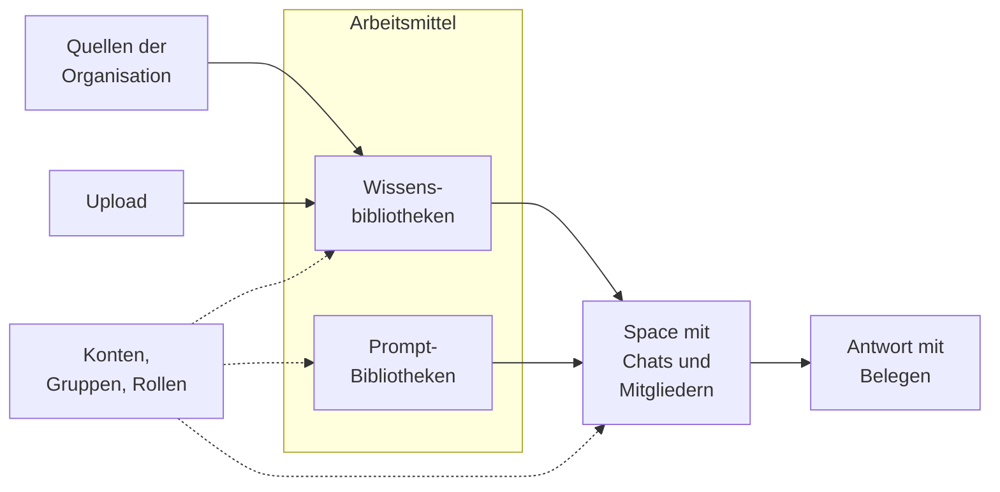

# OPAA-Handbuch: Betrieb und Verwaltung

Dieses Handbuch beschreibt, wie eine OPAA-Installation betrieben und verwaltet wird: was die
Software tut, wie sie konfiguriert wird und wo der Betrieb nachsieht, wenn etwas nicht wie erwartet
läuft. Es beschreibt den gebauten Ist-Stand, nicht Zielbilder.

## 1. Für wen das Handbuch ist

| Rolle | Typische Aufgaben | Einstieg |
|---|---|---|
| **Betrieb** | installiert, aktualisiert, sichert, überwacht; konfiguriert Modelle und Grenzwerte; geht Störungen nach | [Betriebsübersicht](betrieb.md), dann [Docker Compose](docker-compose.md) oder [Kubernetes](kubernetes.md), [Modelle](modelle.md), [Authentifizierung](authentifizierung.md); danach [Wissensbibliotheken](wissensbibliotheken.md) und [Suche](suche.md) |
| **Verwaltung** | legt Bibliotheken an, schließt Quellen an, vergibt Rechte, pflegt Metadaten, prüft Antworten mit dem Diagnosewerkzeug | [Wissensbibliotheken](wissensbibliotheken.md), die Konnektor-Kapitel, [Metadaten](metadaten.md), [Suche](suche.md) Abschnitt 8 |

Nicht Zielgruppe sind Entwickler (Spezifikationen und Entscheidungen liegen im Repository unter
`docs/features/` und `docs/decisions/`) und Endnutzende (die Oberfläche erklärt sich an Ort und
Stelle). Wer das Handbuch liest, braucht das Repository nicht.

## 2. Was OPAA ist

OPAA ist ein Assistent, der Fragen aus dem Wissen der Organisation beantwortet und jede Antwort
belegt. Gearbeitet wird in **Spaces**: In ihren Chats stellen Menschen Fragen, und der Space legt
fest, welche **Arbeitsmittel** dabei zur Verfügung stehen — Wissensbibliotheken, in denen gesucht
wird, und Prompt-Bibliotheken mit wiederkehrenden Formulierungshilfen. Wissensbibliotheken binden
Quellen der Organisation an oder nehmen hochgeladene Dokumente auf und halten sie durchsuchbar.
Wer was sehen und pflegen darf, regeln Konten, Gruppen und Rollen.

Technisch läuft alles in **einem oder mehreren gleichrangigen Backend-Prozessen** gegen **eine
PostgreSQL-Datenbank**; nach außen ruft das Backend nur die konfigurierten Modelle und die Quellen. Drei Eigenschaften prägen den
Betrieb:

- **Die Datenbank ist die einzige Wahrheit.** Dokumente, Chunks samt Vektoren, Volltext,
  Metadaten, Protokolle, Chats: alles liegt in PostgreSQL. Daneben steht genau ein zweiter Bestand:
  die Originale der hochgeladenen Dokumente. Eine Sicherung umfasst deshalb beides — die Datenbank
  und die [Originalablage](originalablage.md).
- **Instanzen stimmen sich über die Datenbank ab.** Eine Instanz genügt; mehrere teilen sich
  Anfragen, Läufe und Zeitpläne, überstehen den Ausfall einer von ihnen und lassen sich nacheinander
  aktualisieren, ohne dass die Oberfläche ausfällt. Eine weitere Infrastruktur brauchen sie nicht.
- **Rechte wirken in der Suche, nicht dahinter.** Jede Suchabfrage trägt den Filter auf die
  lesbaren Bibliotheken in sich; ein fremder Chunk wird nie geladen. Es gibt keinen
  Administrator-Durchgriff.

## 3. Aufbau des Handbuchs

Die Kapitel bilden einen Baum. Ein Kapitel verweist auf die Kapitel darunter; nach oben und zur
Seite nur dort, wo ein Begriff von dort gebraucht wird. Berechtigungen und die Konfiguration (alle
Umgebungsvariablen und Grenzwerte) sind Nachschlagekapitel, auf die alle verweisen dürfen.

- **Betrieb**
  - [Betriebsübersicht](betrieb.md) — Bausteine und ihr Zusammenspiel, eine oder mehrere Backend-Instanzen, Images,
    Bereitschaft, Härtung, Schlüssel, Sicherung, Aktualisierung, Logs und Metriken, Fehlerbehebung
    - [Docker Compose](docker-compose.md) — Schnellstart, Services, `.env.docker`, Ollama,
      Objektspeicher und Mailpit im Stapel, Aktualisierung
    - [Kubernetes](kubernetes.md) — Betrieb mit dem Helm-Chart
    - [Mehrere Backend-Instanzen](mehrere-instanzen.md) — wie mehrere Instanzen zusammenarbeiten:
      Abstimmung über die Datenbank, Instanzregister, Konfigurationsabdruck, Grenzen je Instanz,
      Update ohne Ausfall
    - [Datenbank](datenbank.md) — PostgreSQL und pgvector, eigenes Schema, Volltextindex
    - [Originalablage](originalablage.md) — wo die Originale der Uploads liegen, Sicherung, Umstellung
    - [E-Mail-Versand](e-mail.md) — Mailserver, Vorlagen, Fehlerbilder
  - [Konfiguration](konfiguration.md) — alle Umgebungsvariablen, Grenzwerte im Überblick
  - [Modelle](modelle.md) — Chat, Embedding, Reranking, Transkription (Spracheingabe), Modellverwaltung, Fehlerbilder
  - [Authentifizierung](authentifizierung.md) — Betriebsmodi, Identitätsanbieter und
    Verzeichnisabgleich, Härtung des Keycloak, Erststart, Notfallprozedur, Testkonten
  - [Branding](branding.md) — Produktname, Farben und Bilder der Installation
  - [Nachvollziehbarkeit](nachvollziehbarkeit.md) — was OPAA aus dem Code nachweist: Faktenblätter,
    wo sie liegen, das Update-Paket eines Release, wie man sie erzeugt, die Auskunft über die
    Datenerhebung einer Installation, was bei jeder Änderung geprüft wird
- **Konten und Rechte**
  - [Benutzerverwaltung](benutzerverwaltung.md) — lokale Konten, Rollen und Anlegerechte,
    Selbstregistrierung, verbundene Konten
  - [Berechtigungen](berechtigungen.md) — Rollen, Reichweite, Gruppen, Anlegerechte, Vollmachten,
    Herleitung, Rechtehistorie, Lebenszyklus
- **Arbeiten in Spaces**
  - [Spaces](spaces.md) — was ein Space enthält, Mitglieder und Rollen, Arbeitsmittel zuordnen,
    Einstellungen, anlegen, Chats
  - [Suche](suche.md) — wie eine Frage beantwortet wird: Suchbereich, Suchstrecke, Antwort, Belege,
    Diagnose
  - [Externe KI-Werkzeuge](fremdzugaenge.md) — freigegebenes Wissen in externen KI-Werkzeugen nutzen
- **Arbeitsmittel**
  - [Katalog](katalog.md) — was für jede Art gilt: finden, favorisieren, anlegen, Detailansicht,
    in einem Space verwenden
  - [Wissensbibliotheken](wissensbibliotheken.md) — Quelle anbinden oder hochladen, aktuell halten,
    wie ein Dokument gelesen wird
    - [Konnektoren](konnektoren/README.md) — alle Quellen im Überblick, je Konnektor ein Kapitel
    - [Formate](formate/README.md) — zugelassene Formate, je Format ein Kapitel
    - [Metadaten](metadaten.md) — Kernfelder, Bibliotheksfelder, Wirkung in Filter und Beleg
    - [Private Bibliotheken](private-bibliotheken.md) — Bibliotheken aus dem verbundenen Konto
      einer Person
  - [Prompt-Bibliotheken](prompt-bibliotheken.md) — Prompts anlegen, pflegen, im Chat einsetzen
  - [Zugänge](zugaenge.md) — technische Zugänge der Systemverwaltung zu Quellen

## 4. Lesewege nach Anlass

| Anlass | Reihenfolge |
|---|---|
| Erste Installation | [Betriebsübersicht](betrieb.md) → [Docker Compose](docker-compose.md): „Schnellstart" → [Authentifizierung](authentifizierung.md): „Erststart und Systemverwalter-Konto" → [Betriebsübersicht](betrieb.md): „Härtung" → [Wissensbibliotheken](wissensbibliotheken.md) |
| Erste Installation unter Kubernetes | [Kubernetes](kubernetes.md): „Voraussetzungen", „Installation", „Netz und Sicherheit" → [Authentifizierung](authentifizierung.md): „Erststart und Systemverwalter-Konto" |
| OPAA unter Kubernetes vorführen | [Kubernetes](kubernetes.md): „Erprobung mit dem Beispiel-Setup" |
| Konten anlegen oder entziehen | [Benutzerverwaltung](benutzerverwaltung.md) → [E-Mail-Versand](e-mail.md), falls Einladungen per Mail gehen |
| Niemand kommt mehr herein | [Authentifizierung](authentifizierung.md): „Notfallprozedur: wieder hereinkommen" → [Benutzerverwaltung](benutzerverwaltung.md) |
| Einen Space für ein Team einrichten | [Spaces](spaces.md) → [Katalog](katalog.md) |
| Rechte vergeben, Gruppen nutzen | [Berechtigungen](berechtigungen.md) |
| Eine Person scheidet aus, ein Referat wird aufgelöst | [Berechtigungen](berechtigungen.md): „Lebenszyklus" → [Benutzerverwaltung](benutzerverwaltung.md) |
| „Wer durfte das am 3. März lesen?" | [Berechtigungen](berechtigungen.md): „Nachweis: Rechtehistorie und Stichtagsauskunft" |
| Eine neue Quelle anschließen | [Konnektoren](konnektoren/README.md) → Kapitel des Konnektors → bei Bedarf [Zugänge](zugaenge.md) |
| Dokumente fehlen oder sind veraltet | [Wissensbibliotheken](wissensbibliotheken.md): „Protokoll und Fehler" → Laufprotokoll der Bibliothek → Kapitel des Formats |
| Eine Antwort ist schlecht | [Suche](suche.md): „Diagnose" und „Typische Befunde" → je nach Befund [Wissensbibliotheken](wissensbibliotheken.md) oder [Metadaten](metadaten.md) |
| Ein Update steht an | [Betriebsübersicht](betrieb.md): „Aktualisierung" → [Docker Compose](docker-compose.md) bzw. [Kubernetes](kubernetes.md): „Aktualisierung …" |
| Mehrere Backend-Instanzen planen oder einrichten | [Mehrere Backend-Instanzen](mehrere-instanzen.md) → [Docker Compose](docker-compose.md) bzw. [Kubernetes](kubernetes.md): „Mehrere Backend-Instanzen" → [Datenbank](datenbank.md): „Verbindungen bei mehreren Instanzen" |
| Formulierungshilfen für ein Referat bereitstellen | [Prompt-Bibliotheken](prompt-bibliotheken.md) → [Spaces](spaces.md) |
| Ein externes KI-Werkzeug anschließen | [Externe KI-Werkzeuge](fremdzugaenge.md) |
| Postfächer anbinden wollen | [Berechtigungen](berechtigungen.md): „Prüfliste vor einem Postfach-Konnektor" → [Private Bibliotheken](private-bibliotheken.md) |
| Originalablage wählen, sichern oder umstellen | [Originalablage](originalablage.md) |
| Sichern und wiederherstellen | [Betriebsübersicht](betrieb.md): „Sicherung und Wiederherstellung" → Kapitel des Betriebswegs → [Authentifizierung](authentifizierung.md): „Nacharbeit nach einer Rücksicherung" |
| Ein Modell anbinden oder wechseln | [Modelle](modelle.md) |
| Einen Identitätsanbieter anbinden | [Authentifizierung](authentifizierung.md): „OIDC (Keycloak)" → [Berechtigungen](berechtigungen.md): „Woher Gruppen kommen" |
| Eine Grenze greift, etwa `429` oder eine zu große Datei | [Konfiguration](konfiguration.md): „Grenzwerte im Überblick" |
| Datenschutz, Personalrat oder Informationssicherheit fragen, welche Daten anfallen und wohin sie gehen | [Nachvollziehbarkeit](nachvollziehbarkeit.md) |
| Die Installation zeigt eine Störung | [Betriebsübersicht](betrieb.md): „Fehlerbehebung", „Logs und Metriken" |

## 5. Glossar

Begriffe, die in allen Kapiteln in genau dieser Bedeutung verwendet werden.

| Begriff | Bedeutung |
|---|---|
| **Wissensbibliothek** (Bibliothek) | Verwaltungseinheit für Dokumente: gehört zu einer Organisation, trägt Berechtigungen und genau eine Quelle |
| **Prompt-Bibliothek** | Verwaltungseinheit für Prompts: gehört zu einer Organisation, trägt Berechtigungen wie eine Wissensbibliothek, bindet aber kein Wissen und ändert keinen Suchbereich; einem Space zugeordnet, bietet sie dessen Chat ihre Prompts an |
| **Arbeitsmittel** | Was angelegt, geteilt und einem Space zugeordnet wird, mit eigenen Rollen und einem Eigentümer: heute Wissens- und Prompt-Bibliotheken |
| **Katalog** | Der eine Einstieg der Hauptnavigation für Arbeitsmittel jeder Art, nur als Kacheln: genau die, die die Person lesen darf; was sie nicht lesen darf, erscheint dort nicht. Über „Neu" beginnt dort das Anlegen mit der Wahl der Art |
| **Prompt** | Eine benannte, wiederverwendbare Anweisung in genau einer Prompt-Bibliothek, mit Titel, Befehl (`/name`), Text und Variablen |
| **Variable** | Eine Stelle im Text eines Prompts, geschrieben als `{{name}}`, die beim Einsetzen gefüllt wird; `{{CURRENT_DATE}}` und `{{USER_NAME}}` füllt OPAA selbst |
| **Quelle** | Woher eine Bibliothek ihre Dokumente bezieht: Upload oder eine angebundene Quelle mit Konnektor, etwa Confluence oder ein Webverzeichnis ([Konnektoren](konnektoren/README.md)) |
| **Konnektor** | Der Teil der Indexierung, der die Eigenheiten eines Quellentyps kennt: Aufzählen, Abrufen, Betriebsarten |
| **Indexierungslauf** (Lauf) | Ein Durchgang über die Quelle einer Bibliothek mit Status, Zählern und Protokoll |
| **Betriebsart** | Ob ein Lauf die Quelle vollständig auflistet (und Verschwundenes entfernen darf) oder nur ergänzt |
| **Dokument** | Eine Datei, Seite oder ein Eintrag der Quelle, so wie OPAA ihn kennt; identifiziert über Bibliothek und Ort in der Quelle. Anhänge sind eigene Dokumente mit Verweis auf das Elterndokument |
| **Chunk** | Ein Textstück eines Dokuments mit Vektor, Volltext und Metadaten; die Einheit, auf der die Suche arbeitet |
| **Originalablage** | Der Ort, an dem die Originale hochgeladener Dokumente liegen: ein Verzeichnis (auch ein dorthin eingehängtes Netzlaufwerk) oder ein Objektspeicher; Dokumente aus einem Konnektor bleiben bei ihrer Quelle |
| **Format-Pipeline** | Die Verarbeitung eines Dateiformats: Parsen und Zuschnitt in Chunks, mit Kennung und Versionsnummer |
| **Nachzug** | Neuverarbeitung von Dokumenten, deren Chunks mit einer älteren Pipeline-Version oder Volltextfassung entstanden sind; von einem Systemadministrator angestoßen |
| **Kernfelder** | Titel, Dokumentart und Datum/Stand je Dokument |
| **Kontextpräfix** | Text, der jedem Chunk beim Einbetten und im Volltextindex vorangestellt wird (Titel, ausgewählte Felder, Gliederungspfad), ohne den gespeicherten Text zu ändern |
| **Space** | Arbeitsbereich, in dem Chats liegen; enthält genau die ihm zugeordneten Bibliotheken und Prompt-Bibliotheken — ohne Zuordnung sucht sein Chat nichts |
| **Suchbereich** | Die Bibliotheken, in denen eine Frage sucht; steht in der Chip-Leiste des Chats (Standard `@Space-Wissen`) und ist nie weiter als Zuordnung und Leserechte |
| **Fundstelle** (Beleg) | Eine Quellenangabe unter einer Antwort, eine je Dokument, mit Rang, Ortsangabe und Kernfeldern |
| **Ortsangabe** | Die Stelle eines Chunks im Dokument, etwa „S. 3 · Abschn. Fristen" |
| **Fakten-Manifest** | Die Beschreibung im Code, welche Daten OPAA speichert, protokolliert, wem es sie zeigt, wohin es sie sendet und was voreingestellt ist; Prüfungen im Build halten sie mit dem Code gleich |
| **Faktenblatt** | Ein aus dem Fakten-Manifest erzeugtes Dokument zu einem Thema, etwa Datenflüsse oder Fristen, mit Version und Commit im Kopf ([Nachvollziehbarkeit](nachvollziehbarkeit.md)) |
| **Modellrolle** | Eine der vier Aufgaben, für die ein externes Modell konfiguriert wird: Chat, Embedding, Reranking, Transkription |
| **Rechteprofil** | Eine Gruppe samt der Bibliotheken, die sie lesen darf; der voreingestellte Kontext des Diagnosewerkzeugs |
| **Diagnosesperre** | Grundzustand jeder Bibliothek, der sie aus einer Diagnose im Rechtekontext einer benannten Person heraushält |
| **Lokales Konto** | Ein Konto, das OPAA selbst führt: Anmeldung mit E-Mail-Adresse und Passwort, verwaltet unter Administration → Benutzer; Gegenstück zu einem Konto aus einem Identitätsanbieter |
| **Notanker-Konto** | Das eine lokale Systemverwalterkonto, das OPAA beim Erststart anlegt; Notfallzugangsmittel, kein Arbeitskonto |
| **Rolle** | Gestufte Berechtigung an genau einem Objekt — an einer Bibliothek Leser, Bearbeiter, Verwalter, Eigentümer; in einem Space Mitglied, Kurator, Administrator. Für eine Person oder eine Gruppe, unbefristet oder mit Ablaufdatum |
| **Anlegerecht** | Ein installationsweites Recht, etwas anzulegen (Spaces, Bibliotheken für Uploads, Konnektorbibliotheken, interne Gruppen, Prompt-Bibliotheken); vergeben an eine Person, eine Gruppe oder „Alle Konten", ohne Gegenstand und ohne Lesewirkung |
| **Vollmacht** | Eine befristete, begründungspflichtige Erlaubnis mit Gegenstand, an genau eine Person gebunden und an keine Gruppe vergebbar: „Sicht als" in der Suchdiagnose und der Geltungsbereich einer anlassbezogenen Klärung im Nachweisprotokoll |
| **Interne Gruppe** | Eine Gruppe, die in OPAA selbst entsteht und von benannten Verantwortlichen gepflegt wird; für andere erst wählbar, nachdem diese sie zur Verwendung freigegeben haben |
| **Geschützte Gruppe** | Eine Gruppe der Personalvertretung, der Schwerbehindertenvertretung, der Gleichstellung oder der Personalvorgänge: über die Suche nicht auffindbar, in fremden Listen ohne Namen, ohne Größenangabe. Über das Kennzeichen entscheidet die Systemverwaltung |
| **Wirksame Gruppe** | Eine Gruppe, der ein Recht erteilt werden darf: nicht aufgelöst, ihr Anbieter eingeschaltet, ihre Mitgliedschaft noch gepflegt. Sie darf leer sein; hat sie mindestens ein **aktives** Konto, ist sie zusätzlich **handlungsfähig** und kann Eigentümerin oder Space-Administratorin sein |
| **Nachfolge offen** | Der abgeleitete Zustand eines Objekts ohne handlungsfähige Verantwortliche: nutzbar wie bisher, alle Rechte bleiben, allein die Reichweite ist eingefroren |
| **Rechtehistorie** | Die Zeiträume, in denen ein Recht galt — die Grundlage der Stichtagsauskunft; getrennt vom Nachweisprotokoll, das Handlungen festhält |
| **Anlagegrund** | Pflichtangabe zu jedem lokalen Konto: der dienstliche Anlass und der Grund seiner Befristung; die betroffene Person kann ihn lesen |
| **Aktivitätsklasse** | Die einzige Angabe zur Nutzung eines lokalen Kontos in der Kontenliste („nie", „länger nicht genutzt", „aktiv") — kein Zeitstempel, nicht sortierbar |
| **Externe KI-Werkzeuge** | KI-Werkzeuge außerhalb von OPAA, die über einen eigenen, lesenden Zugriffsweg in freigegebenen Bibliotheken suchen; der Zugriffsweg ist installationsweit schaltbar und standardmäßig aus |
| **Zugangstoken** | Ein persönliches Zugangsmerkmal für externe KI-Werkzeuge, mit Name, unveränderlicher Bibliotheksauswahl und Pflicht-Ablaufdatum; Ausschnitt der Rechte seiner Person, nie mehr |
| **Freigabe für externe KI-Werkzeuge** | Das befristete Merkmal einer Wissensbibliothek „Für externe KI-Werkzeuge nutzbar"; wird wie die übrigen Reichweitenfelder historisiert |
| **Effektive Sicht** | Was ein Zugangstoken bei einem Aufruf sieht: die Schnittmenge aus Rechten der Person, gültiger Freigabe, Tokenauswahl und Installationsschalter, je Aufruf neu ausgewertet |

## 6. Für Schreibende

Wie Kapitel aufgebaut, verknüpft und geschrieben werden, steht in [AGENTS.md](AGENTS.md).
