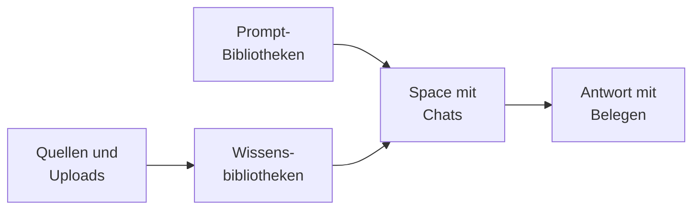

# OPAA-Handbuch

Dieses Handbuch beschreibt OPAA so, wie es gebaut ist: wie man damit arbeitet, es verwaltet und
betreibt.

## Zielgruppen

| Wer | Typische Aufgaben | Einstieg |
|---|---|---|
| **Benutzer** | fragt, prüft Belege, führt Chats, richtet Spaces und Bibliotheken ein | [Erste Schritte](benutzer/erste-schritte.md) |
| **Administration** | verwaltet Konten, Gruppen, Rechte, Modelle und Fristen; als Revision Auskünfte und Protokolle | [Einführung vorbereiten](administration/einfuehrung.md) |
| **Betrieb** | installiert, aktualisiert, sichert und überwacht | [Schnellstart](betrieb/schnellstart.md) |

## Was OPAA ist

OPAA beantwortet Fragen aus dem Wissen der Organisation und belegt jede Antwort. Gearbeitet wird in
**Spaces**: Dort stellen Menschen in Chats Fragen, und der Space legt fest, welche
**Arbeitsmittel** dabei zur Verfügung stehen, etwa Wissensbibliotheken, in denen gesucht wird, und
Prompt-Bibliotheken. Wissensbibliotheken binden Quellen der Organisation an oder nehmen
hochgeladene Dokumente auf. Wer was sehen darf, regeln Konten, Gruppen und Rollen; die Suche findet
nie mehr, als die fragende Person lesen darf.

## Aufbau des Handbuchs

- [Benutzer](benutzer/README.md): von der ersten Frage bis zu Spaces, Bibliotheken, Konnektoren
  und Gruppen
- [Administration](administration/README.md): Einstellungen der ganzen Installation, dazu die
  Aufgaben der Revision
- [Betrieb](betrieb/README.md): Installation, Docker Compose, Kubernetes, Sicherung,
  Aktualisierung, Überwachung
- [Referenz](referenz/README.md): Rechte-Matrix, Glossar, Konfiguration, Formate, wie Indexierung
  und Suche arbeiten

## Lesewege

| Anlass | Reihenfolge |
|---|---|
| OPAA ausprobieren | [Schnellstart](betrieb/schnellstart.md) → [Erste Schritte](benutzer/erste-schritte.md) |
| Für den Echtbetrieb installieren | [Betrieb](betrieb/README.md) → [Docker Compose](betrieb/docker-compose.md) oder [Kubernetes](betrieb/kubernetes.md) → [Einführung vorbereiten](administration/einfuehrung.md) |
| Space für ein Team einrichten | [Space anlegen](benutzer/space-anlegen.md) → [Mitglieder](benutzer/space-mitglieder.md) → [Inhalte zuordnen](benutzer/space-inhalte.md) |
| Neue Quelle anschließen | [Konnektoren](benutzer/konnektoren/README.md) → Seite des Konnektors |
| Eine Antwort ist schlecht | [Suche und Indexierung überwachen](administration/suche-und-indexierung.md) → [Wie die Suche arbeitet](referenz/wie-die-suche-arbeitet.md) |
| Update steht an | [Aktualisierung](betrieb/aktualisierung.md) |
