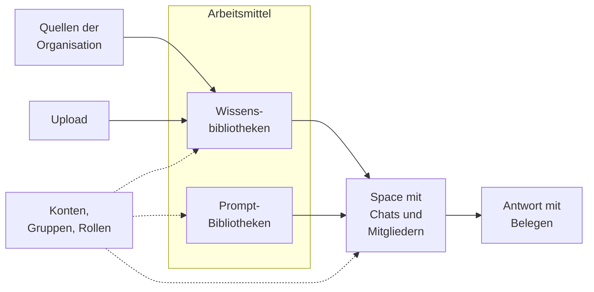

# OPAA-Handbuch: Betrieb und Verwaltung

Dieses Handbuch beschreibt, wie eine OPAA-Installation betrieben und verwaltet wird: was die
Software tut, wie sie konfiguriert wird und wo der Betrieb nachsieht, wenn etwas nicht wie erwartet
läuft. Es beschreibt den gebauten Ist-Stand, nicht Zielbilder.

## 1. Für wen das Handbuch ist

| Rolle | Typische Aufgaben | Einstieg |
|---|---|---|
| **Betrieb** | installiert, aktualisiert, sichert, überwacht; konfiguriert Modelle und Grenzwerte; geht Störungen nach | [Betriebsübersicht](betrieb/README.md), dann [Docker Compose](betrieb/docker-compose.md) oder [Kubernetes](betrieb/kubernetes.md), [Netz und Sicherheit](betrieb/netz-und-sicherheit.md), [Modelle](betrieb/modelle.md), [Authentifizierung](betrieb/authentifizierung.md); danach [Wissensbibliotheken](arbeitsmittel/wissensbibliotheken/README.md) und [Suche](spaces/suche.md) |
| **Verwaltung** | legt Bibliotheken an, schließt Quellen an, vergibt Rechte, pflegt Metadaten, prüft Antworten mit dem Diagnosewerkzeug | [Wissensbibliotheken](arbeitsmittel/wissensbibliotheken/README.md), die Konnektor-Kapitel, [Metadaten](arbeitsmittel/wissensbibliotheken/metadaten.md), [Suche](spaces/suche.md) Abschnitt 8 |

Nicht Zielgruppe sind Entwickler (Spezifikationen und Entscheidungen liegen im Repository unter
`docs/features/` und `docs/decisions/`) und Endnutzende (die Oberfläche erklärt sich an Ort und
Stelle). Wer das Handbuch liest, braucht das Repository nicht.

## 2. Was OPAA ist

OPAA ist ein Assistent, der Fragen aus dem Wissen der Organisation beantwortet und jede Antwort
belegt. Gearbeitet wird in **Spaces**: In ihren Chats stellen Menschen Fragen, und der Space legt
fest, welche **Arbeitsmittel** dabei zur Verfügung stehen — Wissensbibliotheken, in denen gesucht
wird, und Prompt-Bibliotheken mit wiederkehrenden Formulierungshilfen. Wissensbibliotheken binden
Quellen der Organisation an oder nehmen hochgeladene Dokumente auf und halten sie durchsuchbar.
Wer was sehen und pflegen darf, regeln Konten, Gruppen und Rollen.

Technisch läuft alles in **einem oder mehreren gleichrangigen Backend-Prozessen** gegen **eine
PostgreSQL-Datenbank**; nach außen ruft das Backend nur die konfigurierten Modelle und die Quellen. Drei Eigenschaften prägen den
Betrieb:

- **Die Datenbank ist die einzige Wahrheit.** Dokumente, Chunks samt Vektoren, Volltext,
  Metadaten, Protokolle, Chats: alles liegt in PostgreSQL. Daneben steht genau ein zweiter Bestand:
  die Originale der hochgeladenen Dokumente. Eine Sicherung umfasst deshalb beides — die Datenbank
  und die [Originalablage](betrieb/originalablage.md).
- **Instanzen stimmen sich über die Datenbank ab.** Eine Instanz genügt; mehrere teilen sich
  Anfragen, Läufe und Zeitpläne, überstehen den Ausfall einer von ihnen und lassen sich nacheinander
  aktualisieren, ohne dass die Oberfläche ausfällt. Eine weitere Infrastruktur brauchen sie nicht.
- **Rechte wirken in der Suche, nicht dahinter.** Jede Suchabfrage trägt den Filter auf die
  lesbaren Bibliotheken in sich; ein fremder Chunk wird nie geladen. Es gibt keinen
  Administrator-Durchgriff.

## 3. Aufbau des Handbuchs

Die Kapitel bilden einen Baum. Ein Kapitel verweist auf die Kapitel darunter; nach oben und zur
Seite nur dort, wo ein Begriff von dort gebraucht wird. Das Glossar, Berechtigungen und die
Konfiguration (alle Umgebungsvariablen und Grenzwerte) sind Nachschlagekapitel, auf die alle
verweisen dürfen. Die Ordner folgen dem Baum.

- **Betrieb**
  - [Betriebsübersicht](betrieb/README.md) — Bausteine und ihr Zusammenspiel, Zeitzone, eine
    Organisation, Wegweiser zu den Kapiteln darunter
    - [Docker Compose](betrieb/docker-compose.md) — Schnellstart, Services, `.env.docker`, Ollama,
      Objektspeicher und Mailpit im Stapel, Aktualisierung
    - [Kubernetes](betrieb/kubernetes.md) — Betrieb mit dem Helm-Chart
    - [Installation](betrieb/installation.md) — Installationsmodus, Installations-Token, Schritte,
      Antwortdatei
    - [Images und Laufzeit](betrieb/images-und-laufzeit.md) — Images und Versionen, Laufzeitimages
      von Backend und Frontend, Speicher und Container-Grenzen, Readiness und Liveness, Graceful
      Shutdown
    - [Netz und Sicherheit](betrieb/netz-und-sicherheit.md) — Netzwerkzugang, Sicherheits-Header,
      Härtung, vertraute Proxys, Zielprüfung, Ausgangsproxy, Betrieb ohne Internet, Virenprüfung,
      Schlüssel und Geheimnisse
    - [Sicherung und Wiederherstellung](betrieb/sicherung-und-wiederherstellung.md) — was gesichert
      wird, Zurückspielen, Wiederherstellungsprobe
    - [Aktualisierung](betrieb/aktualisierung.md) — Ablauf eines Updates, was ein Update mit dem
      Index macht
    - [Überwachung und Fehlerbehebung](betrieb/ueberwachung-und-fehlerbehebung.md) — Logs und
      Metriken, Ausleitung an ein Sicherheitsmonitoring, Diagnose ohne Shell, Fehlerbehebung
    - [Mehrere Backend-Instanzen](betrieb/mehrere-instanzen.md) — wie mehrere Instanzen
      zusammenarbeiten: Abstimmung über die Datenbank, Instanzregister, Konfigurationsabdruck,
      Grenzen je Instanz, Update ohne Ausfall
    - [Datenbank](betrieb/datenbank.md) — PostgreSQL und pgvector, eigenes Schema, Volltextindex
    - [Originalablage](betrieb/originalablage.md) — wo die Originale der Uploads liegen, Sicherung,
      Umstellung
    - [E-Mail-Versand](betrieb/e-mail.md) — Mailserver, Vorlagen, Fehlerbilder
  - [Konfiguration](betrieb/konfiguration.md) — alle Umgebungsvariablen, Grenzwerte im Überblick
  - [Modelle](betrieb/modelle.md) — Chat, Embedding, Reranking, Transkription (Spracheingabe),
    Modellverwaltung, Fehlerbilder
  - [Authentifizierung](betrieb/authentifizierung.md) — Betriebsmodi, Identitätsanbieter und
    Verzeichnisabgleich, Härtung des Keycloak, Erststart, Notfallprozedur, Testkonten
  - [Branding](betrieb/branding.md) — Produktname, Farben und Bilder der Installation
  - [Einstellungen übertragen](betrieb/einstellungen-uebertragen.md) — Einstellungen der Verwaltung
    exportieren und importieren, Nachweis jeder Änderung im Revisionsprotokoll
  - [Nachvollziehbarkeit](betrieb/nachvollziehbarkeit.md) — was OPAA aus dem Code nachweist:
    Faktenblätter, wo sie liegen, das Update-Paket eines Release, wie man sie erzeugt, die Auskunft
    über die Datenerhebung einer Installation, was bei jeder Änderung geprüft wird
  - [Releases und Nachweise](betrieb/releases-und-nachweise.md) — Versionen, Sicherheitsupdates, was
    ein Release liefert, Update-Paket prüfen, SBOM und Provenance, Schwachstellen, Lizenz und CLA
- **Konten und Rechte**
  - [Benutzerverwaltung](konten-und-rechte/benutzerverwaltung.md) — lokale Konten, Rollen und
    Anlegerechte, Selbstregistrierung, verbundene Konten
  - [Berechtigungen](konten-und-rechte/berechtigungen.md) — Rollen, Reichweite, Gruppen,
    Anlegerechte, Vollmachten, Herleitung, Rechtehistorie, Lebenszyklus
- **Arbeiten in Spaces**
  - [Spaces](spaces/README.md) — was ein Space enthält, Mitglieder und Rollen, Arbeitsmittel
    zuordnen, Einstellungen, anlegen, Chats
  - [Suche](spaces/suche.md) — wie eine Frage beantwortet wird: Suchbereich, Suchstrecke, Antwort,
    Belege, Diagnose
  - [Externe KI-Werkzeuge](spaces/fremdzugaenge.md) — freigegebenes Wissen in externen KI-Werkzeugen
    nutzen
- **Arbeitsmittel**
  - [Katalog](arbeitsmittel/katalog.md) — was für jede Art gilt: finden, favorisieren, anlegen,
    Detailansicht, in einem Space verwenden
  - [Wissensbibliotheken](arbeitsmittel/wissensbibliotheken/README.md) — Quelle anbinden oder
    hochladen, aktuell halten, wie ein Dokument gelesen wird
    - [Konnektoren](arbeitsmittel/wissensbibliotheken/konnektoren/README.md) — alle Quellen im
      Überblick, je Konnektor ein Kapitel
    - [Formate](arbeitsmittel/wissensbibliotheken/formate/README.md) — zugelassene Formate, je
      Format ein Kapitel
    - [Metadaten](arbeitsmittel/wissensbibliotheken/metadaten.md) — Kernfelder, Bibliotheksfelder,
      Wirkung in Filter und Beleg
    - [Private Bibliotheken](arbeitsmittel/wissensbibliotheken/private-bibliotheken.md) —
      Bibliotheken aus dem verbundenen Konto einer Person
  - [Prompt-Bibliotheken](arbeitsmittel/prompt-bibliotheken.md) — Prompts anlegen, pflegen, im Chat
    einsetzen
  - [Zugänge](arbeitsmittel/zugaenge.md) — technische Zugänge der Systemverwaltung zu Quellen
- **Nachschlagen**
  - [Glossar](glossar.md) — Begriffe, die in allen Kapiteln in genau einer Bedeutung verwendet
    werden

## 4. Lesewege nach Anlass

| Anlass | Reihenfolge |
|---|---|
| Erste Installation | [Betriebsübersicht](betrieb/README.md) → [Docker Compose](betrieb/docker-compose.md): „Schnellstart" → [Installation](betrieb/installation.md) → [Authentifizierung](betrieb/authentifizierung.md): „Erststart und Systemverwalter-Konto" → [Netz und Sicherheit](betrieb/netz-und-sicherheit.md): „Härtung für erreichbare Deployments" → [Wissensbibliotheken](arbeitsmittel/wissensbibliotheken/README.md) |
| Erste Installation unter Kubernetes | [Kubernetes](betrieb/kubernetes.md): „Voraussetzungen", „Installation", „Netz und Sicherheit" → [Authentifizierung](betrieb/authentifizierung.md): „Erststart und Systemverwalter-Konto" |
| OPAA unter Kubernetes vorführen | [Kubernetes](betrieb/kubernetes.md): „Erprobung mit dem Beispiel-Setup" |
| Konten anlegen oder entziehen | [Benutzerverwaltung](konten-und-rechte/benutzerverwaltung.md) → [E-Mail-Versand](betrieb/e-mail.md), falls Einladungen per Mail gehen |
| Niemand kommt mehr herein | [Authentifizierung](betrieb/authentifizierung.md): „Notfallprozedur: wieder hereinkommen" → [Benutzerverwaltung](konten-und-rechte/benutzerverwaltung.md) |
| Einen Space für ein Team einrichten | [Spaces](spaces/README.md) → [Katalog](arbeitsmittel/katalog.md) |
| Rechte vergeben, Gruppen nutzen | [Berechtigungen](konten-und-rechte/berechtigungen.md) |
| Eine Person scheidet aus, ein Referat wird aufgelöst | [Berechtigungen](konten-und-rechte/berechtigungen.md): „Lebenszyklus" → [Benutzerverwaltung](konten-und-rechte/benutzerverwaltung.md) |
| „Wer durfte das am 3. März lesen?" | [Berechtigungen](konten-und-rechte/berechtigungen.md): „Nachweis: Rechtehistorie und Stichtagsauskunft" |
| Eine neue Quelle anschließen | [Konnektoren](arbeitsmittel/wissensbibliotheken/konnektoren/README.md) → Kapitel des Konnektors → bei Bedarf [Zugänge](arbeitsmittel/zugaenge.md) |
| Dokumente fehlen oder sind veraltet | [Wissensbibliotheken](arbeitsmittel/wissensbibliotheken/README.md): „Protokoll und Fehler" → Laufprotokoll der Bibliothek → Kapitel des Formats |
| Eine Antwort ist schlecht | [Suche](spaces/suche.md): „Diagnose" und „Typische Befunde" → je nach Befund [Wissensbibliotheken](arbeitsmittel/wissensbibliotheken/README.md) oder [Metadaten](arbeitsmittel/wissensbibliotheken/metadaten.md) |
| Ein Update steht an | [Aktualisierung](betrieb/aktualisierung.md) → [Docker Compose](betrieb/docker-compose.md) bzw. [Kubernetes](betrieb/kubernetes.md): „Aktualisierung …" |
| Mehrere Backend-Instanzen planen oder einrichten | [Mehrere Backend-Instanzen](betrieb/mehrere-instanzen.md) → [Docker Compose](betrieb/docker-compose.md) bzw. [Kubernetes](betrieb/kubernetes.md): „Mehrere Backend-Instanzen" → [Datenbank](betrieb/datenbank.md): „Verbindungen bei mehreren Instanzen" |
| Formulierungshilfen für ein Referat bereitstellen | [Prompt-Bibliotheken](arbeitsmittel/prompt-bibliotheken.md) → [Spaces](spaces/README.md) |
| Ein externes KI-Werkzeug anschließen | [Externe KI-Werkzeuge](spaces/fremdzugaenge.md) |
| Postfächer anbinden wollen | [Berechtigungen](konten-und-rechte/berechtigungen.md): „Prüfliste vor einem Postfach-Konnektor" → [Private Bibliotheken](arbeitsmittel/wissensbibliotheken/private-bibliotheken.md) |
| Originalablage wählen, sichern oder umstellen | [Originalablage](betrieb/originalablage.md) |
| Sichern und wiederherstellen | [Sicherung und Wiederherstellung](betrieb/sicherung-und-wiederherstellung.md) → Kapitel des Betriebswegs → [Authentifizierung](betrieb/authentifizierung.md): „Nacharbeit nach einer Rücksicherung" |
| Ein Modell anbinden oder wechseln | [Modelle](betrieb/modelle.md) |
| Einen Identitätsanbieter anbinden | [Authentifizierung](betrieb/authentifizierung.md): „OIDC (Keycloak)" → [Berechtigungen](konten-und-rechte/berechtigungen.md): „Woher Gruppen kommen" |
| Eine Grenze greift, etwa `429` oder eine zu große Datei | [Konfiguration](betrieb/konfiguration.md): „Grenzwerte im Überblick" |
| Datenschutz, Personalrat oder Informationssicherheit fragen, welche Daten anfallen und wohin sie gehen | [Nachvollziehbarkeit](betrieb/nachvollziehbarkeit.md) |
| Beschaffung oder Informationssicherheit fragen nach Sicherheitsupdates, SBOM, Provenance oder Lizenz | [Releases und Nachweise](betrieb/releases-und-nachweise.md) |
| Die Installation zeigt eine Störung | [Überwachung und Fehlerbehebung](betrieb/ueberwachung-und-fehlerbehebung.md): „Fehlerbehebung", „Logs und Metriken" |

## 5. Für Schreibende

Wie Kapitel aufgebaut, verknüpft und geschrieben werden, steht in [AGENTS.md](AGENTS.md).
