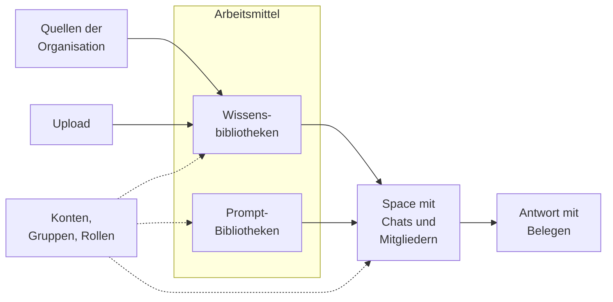

# OPAA-Handbuch

Dieses Handbuch beschreibt OPAA für alle, die damit arbeiten, es pflegen, verwalten oder betreiben:
was die Software tut, wie man sie bedient und einrichtet und wo man nachsieht, wenn etwas nicht wie
erwartet läuft. Es beschreibt den gebauten Ist-Stand, nicht Zielbilder.

## 1. Für wen das Handbuch ist

| Wer | Typische Aufgaben | Einstieg |
|---|---|---|
| **Jedes Konto** | fragt, prüft Belege, führt Chats, legt Spaces und eigene Bibliotheken an | [Arbeiten](arbeiten/README.md), zuerst [Erste Schritte](arbeiten/erste-schritte.md) |
| **Wer pflegt** | teilt Bibliotheken, bindet Quellen an, pflegt Metadaten, Spaces und Gruppen | [Pflegen](pflegen/README.md) |
| **Betrieb** | installiert, aktualisiert, sichert, überwacht; konfiguriert Modelle und Grenzwerte; geht Störungen nach | [Betriebsübersicht](betreiben/README.md), dann [Docker Compose](betreiben/docker-compose.md) oder [Kubernetes](betreiben/kubernetes.md), [Netz und Sicherheit](betreiben/netz-und-sicherheit.md), [Modelle betreiben](betreiben/modell-endpunkte.md), [Authentifizierung](betreiben/authentifizierung.md); danach [Wie die Indexierung arbeitet](nachschlagen/wie-indexierung-arbeitet.md) und [Wie die Suche arbeitet](nachschlagen/wie-die-suche-arbeitet.md) |
| **Systemverwaltung** | verwaltet Konten, Gruppen, Anlegerechte, Zugänge, Modelle und Fristen, geht fehlenden Treffern nach | [Verwalten](verwalten/README.md), zuerst [Einführung vorbereiten](verwalten/einfuehrung.md) |
| **Revision** | erstellt Stichtagsauskünfte, liest Nachweis- und Verbindungsprotokoll | [Verwalten](verwalten/README.md#prüfen) |

Wer das Handbuch liest, braucht das Repository nicht.

## 2. Was OPAA ist

OPAA ist ein Assistent, der Fragen aus dem Wissen der Organisation beantwortet und jede Antwort
belegt. Gearbeitet wird in **Spaces**: In ihren Chats stellen Menschen Fragen, und der Space legt
fest, welche **Arbeitsmittel** dabei zur Verfügung stehen — Wissensbibliotheken, in denen gesucht
wird, und Prompt-Bibliotheken mit wiederkehrenden Formulierungshilfen. Wissensbibliotheken binden
Quellen der Organisation an oder nehmen hochgeladene Dokumente auf und halten sie durchsuchbar.
Wer was sehen und pflegen darf, regeln Konten, Gruppen und Rollen.

Technisch läuft alles in **einem oder mehreren gleichrangigen Backend-Prozessen** gegen **eine
PostgreSQL-Datenbank**; nach außen ruft das Backend nur die konfigurierten Modelle und die Quellen. Drei Eigenschaften prägen den
Betrieb:

- **Die Datenbank ist die einzige Wahrheit.** Dokumente, Chunks samt Vektoren, Volltext,
  Metadaten, Protokolle, Chats: alles liegt in PostgreSQL. Daneben steht genau ein zweiter Bestand:
  die Originale der hochgeladenen Dokumente. Eine Sicherung umfasst deshalb beides — die Datenbank
  und die [Originalablage](betreiben/originalablage.md).
- **Instanzen stimmen sich über die Datenbank ab.** Eine Instanz genügt; mehrere teilen sich
  Anfragen, Läufe und Zeitpläne, überstehen den Ausfall einer von ihnen und lassen sich nacheinander
  aktualisieren, ohne dass die Oberfläche ausfällt. Eine weitere Infrastruktur brauchen sie nicht.
- **Rechte wirken in der Suche, nicht dahinter.** Jede Suchabfrage trägt den Filter auf die
  lesbaren Bibliotheken in sich; ein fremder Chunk wird nie geladen. Es gibt keinen
  Administrator-Durchgriff.

## 3. Aufbau des Handbuchs

Die Kapitel bilden einen Baum. Ein Kapitel verweist auf die Kapitel darunter; nach oben und zur
Seite nur dort, wo ein Begriff von dort gebraucht wird. Das Glossar, Berechtigungen und die
Konfiguration (alle Umgebungsvariablen und Grenzwerte) sind Nachschlagekapitel, auf die alle
verweisen dürfen. Die Ordner folgen dem Baum.

- **Arbeiten**
  - [Arbeiten](arbeiten/README.md) — was jedes Konto ab Werk kann, eine Seite je Aufgabe: erste
    Schritte, fragen, Belege prüfen, anhängen und Spracheingabe, Prompts, Antworten weitergeben,
    Chats, Katalog, Space und Bibliotheken anlegen, Konto verbinden, Zugangstoken und KI-Werkzeug,
    Meine Daten
- **Pflegen**
  - [Pflegen](pflegen/README.md) — eine Seite je Aufgabe für alle mit einer Rolle an Bibliothek,
    Space oder Gruppe: teilen, aktuell halten, Metadaten, für KI-Werkzeuge freigeben, Space-Inhalte,
    Mitglieder und Einstellungen, interne Gruppe pflegen
    - [Konnektoren](pflegen/konnektoren/README.md) — alle Quellen im Überblick, je Konnektor ein
      Kapitel
    - [Zugriff nachvollziehen](pflegen/zugriff-nachvollziehen.md) — Herleitung, Mitglieder einer
      Gruppe
- **Verwalten und Prüfen**
  - [Verwalten](verwalten/README.md) — eine Seite je Aufgabe der Systemverwaltung: Einführung,
    Konten, Anmeldung, Systemrollen, Gruppen, Anlegerechte, Ausscheiden, Zugänge, Modelle, Suche und
    Indexierung, externe KI-Werkzeuge, Datenschutz, Branding, E-Mail, Einstellungen übertragen;
    für die Revision Stichtagsauskunft, Nachweis- und Verbindungsprotokoll
- **Betreiben**
  - [Betriebsübersicht](betreiben/README.md) — Bausteine und ihr Zusammenspiel, Zeitzone, eine
    Organisation, Wegweiser zu den Kapiteln darunter
    - [Docker Compose](betreiben/docker-compose.md) — Schnellstart, Services, `.env.docker`, Ollama,
      Objektspeicher und Mailpit im Stapel, Aktualisierung
    - [Kubernetes](betreiben/kubernetes.md) — Betrieb mit dem Helm-Chart
    - [Installation](betreiben/installation.md) — Installationsmodus, Installations-Token, Schritte,
      Einrichtungs-Assistent im Browser, Antwortdatei
    - [Images und Laufzeit](betreiben/images-und-laufzeit.md) — Images und Versionen, Laufzeitimages
      von Backend und Frontend, Speicher und Container-Grenzen, Readiness und Liveness, Graceful
      Shutdown
    - [Netz und Sicherheit](betreiben/netz-und-sicherheit.md) — Netzwerkzugang, Sicherheits-Header,
      Härtung, vertraute Proxys, Zielprüfung, Ausgangsproxy, Betrieb ohne Internet, Virenprüfung,
      Schlüssel und Geheimnisse
    - [Sicherung und Wiederherstellung](betreiben/sicherung-und-wiederherstellung.md) — was gesichert
      wird, Zurückspielen, Wiederherstellungsprobe
    - [Aktualisierung](betreiben/aktualisierung.md) — Ablauf eines Updates, was ein Update mit dem
      Index macht
    - [Überwachung und Fehlerbehebung](betreiben/ueberwachung-und-fehlerbehebung.md) — Logs und
      Metriken, Ausleitung an ein Sicherheitsmonitoring, Diagnose ohne Shell, Fehlerbehebung
    - [Mehrere Backend-Instanzen](betreiben/mehrere-instanzen.md) — wie mehrere Instanzen
      zusammenarbeiten: Abstimmung über die Datenbank, Instanzregister, Konfigurationsabdruck,
      Grenzen je Instanz, Update ohne Ausfall
    - [Datenbank](betreiben/datenbank.md) — PostgreSQL und pgvector, eigenes Schema, Volltextindex
    - [Originalablage](betreiben/originalablage.md) — wo die Originale der Uploads liegen, Sicherung,
      Umstellung
  - [Modelle betreiben](betreiben/modell-endpunkte.md) — Chat, Embedding, Reranking, Transkription (Spracheingabe),
    Modellverwaltung, Fehlerbilder
  - [Authentifizierung](betreiben/authentifizierung.md) — Betriebsmodi, Identitätsanbieter und
    Verzeichnisabgleich, Härtung des Keycloak, Erststart, Notfallprozedur, Testkonten
  - [Nachvollziehbarkeit](betreiben/nachvollziehbarkeit.md) — was OPAA aus dem Code nachweist:
    Faktenblätter, wo sie liegen, das Update-Paket eines Release, wie man sie erzeugt, die Auskunft
    über die Datenerhebung einer Installation, was bei jeder Änderung geprüft wird
  - [Releases und Nachweise](betreiben/releases-und-nachweise.md) — Versionen, Sicherheitsupdates, was
    ein Release liefert, Update-Paket prüfen, SBOM und Provenance, Schwachstellen, Lizenz und CLA
- **Nachschlagen**
  - [Rechte-Matrix](nachschlagen/rechte-matrix.md) — wer welche Tätigkeit darf
  - [Glossar](nachschlagen/glossar.md) — Begriffe, die in allen Kapiteln in genau einer Bedeutung
    verwendet werden
  - [Konfiguration](nachschlagen/konfiguration.md) — alle Umgebungsvariablen, Grenzwerte im Überblick
  - [Formate](nachschlagen/formate/README.md) — zugelassene Formate, je Format ein Kapitel
  - [Metadaten](nachschlagen/metadaten.md) — Felder, Herkunft der Werte, Wirkung in Filter und Suche
  - [Wie die Indexierung arbeitet](nachschlagen/wie-indexierung-arbeitet.md) — Läufe, Chunks,
    Kontingent, Laufprotokoll
  - [Wie die Suche arbeitet](nachschlagen/wie-die-suche-arbeitet.md) — Suchstufen, Antwort,
    Belegprüfung, typische Befunde

## 4. Lesewege nach Anlass

| Anlass | Reihenfolge |
|---|---|
| Erste Installation | [Betriebsübersicht](betreiben/README.md) → [Docker Compose](betreiben/docker-compose.md): „Schnellstart" → [Installation](betreiben/installation.md) → [Authentifizierung](betreiben/authentifizierung.md): „Erststart und Systemverwalter-Konto" → [Netz und Sicherheit](betreiben/netz-und-sicherheit.md): „Härtung für erreichbare Deployments" → [Bibliothek anlegen](arbeiten/bibliothek-anlegen.md) |
| Erste Installation unter Kubernetes | [Kubernetes](betreiben/kubernetes.md): „Voraussetzungen", „Installation", „Netz und Sicherheit" → [Authentifizierung](betreiben/authentifizierung.md): „Erststart und Systemverwalter-Konto" |
| OPAA unter Kubernetes vorführen | [Kubernetes](betreiben/kubernetes.md): „Erprobung mit dem Beispiel-Setup" |
| Konten anlegen oder entziehen | [Lokale Konten verwalten](verwalten/konten.md) → [E-Mail-Versand](verwalten/e-mail.md), falls Einladungen per Mail gehen |
| Niemand kommt mehr herein | [Authentifizierung](betreiben/authentifizierung.md): „Notfallprozedur: wieder hereinkommen" → [Lokale Konten verwalten](verwalten/konten.md) |
| Space für ein Team einrichten | [Space anlegen](arbeiten/space-anlegen.md) → [Mitglieder verwalten](pflegen/space-mitglieder.md) → [Inhalte zuordnen](pflegen/space-inhalte.md) |
| Rechte vergeben, Gruppen nutzen | [Arbeitsmittel teilen](pflegen/arbeitsmittel-teilen.md) → [Gruppen](verwalten/gruppen.md) → [Rechte-Matrix](nachschlagen/rechte-matrix.md) |
| Eine Person scheidet aus, ein Referat wird aufgelöst | [Ausscheiden und Nachfolge regeln](verwalten/ausscheiden.md) |
| „Wer durfte das am 3. März lesen?" | [Stichtagsauskunft erstellen](verwalten/stichtagsauskunft.md) |
| Neue Quelle anschließen | [Konnektoren](pflegen/konnektoren/README.md) → Kapitel des Konnektors → bei Bedarf [Zugänge einrichten](verwalten/zugaenge.md) |
| Dokumente fehlen oder sind veraltet | [Bibliothek aktuell halten](pflegen/bibliothek-aktuell-halten.md) → [Wie die Indexierung arbeitet](nachschlagen/wie-indexierung-arbeitet.md): „Laufprotokoll“ → Kapitel des Formats |
| Eine Antwort ist schlecht | [Suche und Indexierung überwachen](verwalten/suche-und-indexierung.md) → [Wie die Suche arbeitet](nachschlagen/wie-die-suche-arbeitet.md): „Wenn etwas nicht gefunden wird“ → je nach Befund [Indexierung](nachschlagen/wie-indexierung-arbeitet.md) oder [Metadaten](nachschlagen/metadaten.md) |
| Update steht an | [Aktualisierung](betreiben/aktualisierung.md) → [Docker Compose](betreiben/docker-compose.md) bzw. [Kubernetes](betreiben/kubernetes.md): „Aktualisierung …" |
| Mehrere Backend-Instanzen planen oder einrichten | [Mehrere Backend-Instanzen](betreiben/mehrere-instanzen.md) → [Docker Compose](betreiben/docker-compose.md) bzw. [Kubernetes](betreiben/kubernetes.md): „Mehrere Backend-Instanzen" → [Datenbank](betreiben/datenbank.md): „Verbindungen bei mehreren Instanzen" |
| Formulierungshilfen für ein Referat bereitstellen | [Prompt-Bibliothek anlegen](arbeiten/prompt-bibliothek-anlegen.md) → [Inhalte zuordnen](pflegen/space-inhalte.md) |
| Externes KI-Werkzeug anschließen | [Externe KI-Werkzeuge zulassen](verwalten/externe-ki-werkzeuge.md) → [Zugangstoken anlegen](arbeiten/zugangstoken.md) |
| Originalablage wählen, sichern oder umstellen | [Originalablage](betreiben/originalablage.md) |
| Sichern und wiederherstellen | [Sicherung und Wiederherstellung](betreiben/sicherung-und-wiederherstellung.md) → Kapitel des Betriebswegs → [Authentifizierung](betreiben/authentifizierung.md): „Nacharbeit nach einer Rücksicherung" |
| Modell anbinden oder wechseln | [Modelle verwalten](verwalten/modelle.md) → [Modelle betreiben](betreiben/modell-endpunkte.md) |
| Identitätsanbieter anbinden | [Authentifizierung](betreiben/authentifizierung.md): „OIDC (Keycloak)" → [Gruppen](verwalten/gruppen.md#woher-gruppen-kommen) |
| Eine Grenze greift, etwa `429` oder eine zu große Datei | [Konfiguration](nachschlagen/konfiguration.md): „Grenzwerte im Überblick" |
| Datenschutz, Personalrat oder Informationssicherheit fragen, welche Daten anfallen und wohin sie gehen | [Nachvollziehbarkeit](betreiben/nachvollziehbarkeit.md) |
| Beschaffung oder Informationssicherheit fragen nach Sicherheitsupdates, SBOM, Provenance oder Lizenz | [Releases und Nachweise](betreiben/releases-und-nachweise.md) |
| Die Installation zeigt eine Störung | [Überwachung und Fehlerbehebung](betreiben/ueberwachung-und-fehlerbehebung.md): „Fehlerbehebung", „Logs und Metriken" |
