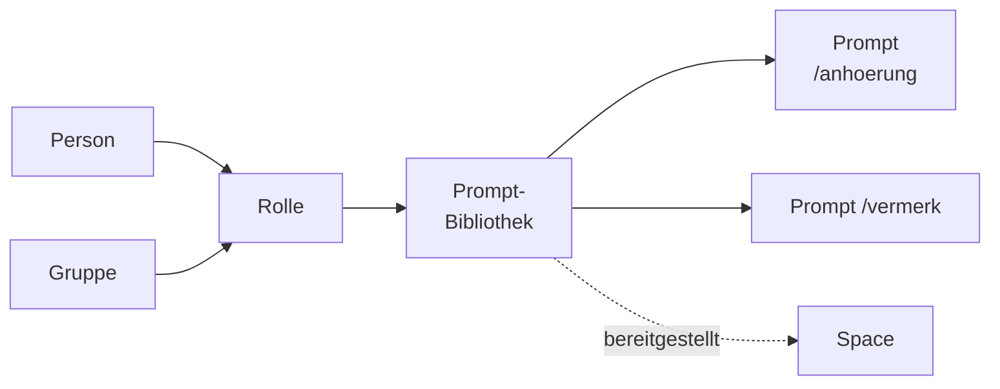

# Prompt-Bibliotheken

Dieses Kapitel beschreibt, wie Prompt-Bibliotheken angelegt, gefüllt und freigegeben
werden: wiederkehrende Formulierungshilfen — Anhörung, Vermerk, Ablehnung nach Hausstandard —, die
einmal benannt und beschrieben werden und dann allen zur Verfügung stehen, denen sie freigegeben
sind. Prompt-Bibliotheken sind Arbeitsmittel: Finden, Anlegen, Teilen und Zuordnen beschreibt das
Kapitel [Katalog](katalog.md), das Berechtigungsmodell das Kapitel
[Berechtigungen](../konten-und-rechte/berechtigungen.md); hier steht, was für Prompt-Bibliotheken eigens gilt.

## 1. Der Aufbau: Prompt-Bibliothek und Prompt

| Objekt | Was es ist | Was es an Rechten trägt |
|---|---|---|
| **Prompt-Bibliothek** | Eine benannte, beschriebene Sammlung von Prompts mit genau einem Eigentümer | Eigene Rollen (auch an „Alle Konten"), einen Eigentümer — wie eine Wissensbibliothek |
| **Prompt** | Eine benannte Anweisung in genau einer Prompt-Bibliothek, mit Titel, Befehl, Beschreibung, Text und Variablen | Keine eigenen — wer die Bibliothek lesen darf, liest alle ihre Prompts |

Eine Prompt-Bibliothek **bindet kein Wissen und erreicht keine Quelle**: Ein Prompt ist Text mit
einem Namen und benannten Platzhaltern, ohne Dokumente, ohne Werkzeuge und ohne eigene Modellwahl.
Deshalb ändert eine Prompt-Bibliothek, die einem Space zugeordnet ist, nichts an dessen
Suchbereich — den bestimmen nur die zugeordneten Wissensbibliotheken. Sie legt fest, welche Prompts
der Chat des Space anbietet.

Die Prompt-Bibliotheken, die eine Person lesen darf, stehen im [Katalog](katalog.md); der Filter
„Prompts" grenzt ihn auf sie ein.

## 2. Begriffe

| Begriff | Bedeutung |
|---|---|
| **Titel** | Die Bezeichnung für Menschen, etwa „Anhörungsschreiben" |
| **Befehl** | Der Name, unter dem ein Prompt aufgerufen wird: `/anhoerung`. Kleinbuchstaben, Ziffern und einzelne Bindestriche, eindeutig innerhalb der Prompt-Bibliothek |
| **Variable** | Eine Stelle im Text, die beim Einsetzen gefüllt wird, geschrieben als `{{name}}`, etwa `{{aktenzeichen}}` |
| **Systemvariable** | `{{CURRENT_DATE}}` und `{{USER_NAME}}`: das Datum des Tages und der Name der einsetzenden Person. OPAA füllt sie selbst; sie werden nicht definiert |

**Schreibweise.** Leerzeichen innerhalb der Klammern (`{{ aktenzeichen }}`) und Systemvariablen in
beliebiger Groß- und Kleinschreibung (`{{current_date}}`) sind erlaubt; OPAA speichert sie als
`{{aktenzeichen}}` und `{{CURRENT_DATE}}`. Jede andere Folge in doppelten geschweiften Klammern,
etwa `{{akten zeichen}}`, lehnt OPAA als ungültigen Platzhalter ab.

**Variablen sind keine Einstellungen der Bibliothek.** Eine Variable gehört zu dem, was ein Prompt
ist, und wird bei jedem Einsetzen neu gefüllt — von der Person, die ihn einsetzt.

## 3. Wem ein Recht gegeben werden kann

Genau wie bei einer Wissensbibliothek: einer **Person** oder einer **Gruppe**, unbefristet oder mit
Ablaufdatum, ausgewählt mit derselben Personen- und Gruppenauswahl, mit denselben Regeln für
geschützte Gruppen und derselben Rückfrage vor einer Freigabe an die Gruppe eines externen Anbieters
([Berechtigungen](../konten-und-rechte/berechtigungen.md), Abschnitte 3 und 8).
Dem ganzen Haus öffnet sie ein Recht an den Empfänger **„Alle Konten"** — im selben Abschnitt
„Berechtigungen", nach einer eigenen Rückfrage und höchstens mit der Rolle „Bearbeiter"
([Berechtigungen](../konten-und-rechte/berechtigungen.md), Abschnitt 4,
„Reichweite").

## 4. Rollen an einer Prompt-Bibliothek

| Rolle | Darf |
|---|---|
| **Leser** (`VIEWER`) | Die Prompt-Bibliothek und ihre Prompts lesen |
| **Bearbeiter** (`EDITOR`) | Zusätzlich Prompts anlegen, ändern und löschen |
| **Verwalter** (`MANAGER`) | Zusätzlich Name und Beschreibung ändern, Rechte vergeben und entziehen — auch an alle Konten |
| **Eigentümer** (`OWNER`) | Zusätzlich die Prompt-Bibliothek samt aller Prompts löschen |

**Verwalten ist nicht Lesen.** Die Systemverwaltung kann jede Prompt-Bibliothek verwalten, liest
ihre Prompts aber nur mit einer eigenen Rolle, einer Rolle über eine Gruppe oder einer
Freigabe an „Alle Konten". Ohne sie zeigt der Reiter „Prompts" statt der Liste den Hinweis, dass
der Zugriff fehlt.

### Anlegen

Angelegt wird über **„Neu"** im Katalog: Nach der Wahl der Art „Prompts" öffnet „Weiter" einen
Assistenten mit drei Schritten ([Katalog](katalog.md), Abschnitt 4). Er verwendet dieselben
Formularbausteine wie der Assistent einer Wissensbibliothek, schneidet sie aber anders zu: Es gibt
keine Schritte „Quellart" und „Quelle einrichten" — eine Prompt-Bibliothek bindet kein Wissen und
hat keine Quelle —, und Eigentümer und Rechte stehen in zwei eigenen Schritten statt zusammen in
einem Schritt „Freigaben":

1. **Stammdaten** — Name und, optional, Beschreibung.
2. **Eigentümer** — „Mein Konto" oder „Eine Gruppe". Angeboten werden nur Gruppen, in denen die
   anlegende Person Mitglied ist. Als persönliche Bibliothek erhält die anlegende Person die
   Eigentümerrolle, bei einer Gruppe als Eigentümerin erhält die Gruppe die Verwalterrolle.
   **Gruppeneigentum ist die haltbarere Wahl** für Prompts, die ein Referat gemeinsam pflegt.
3. **Rechte** — optional vorgemerkte Rollen für **Personen und Gruppen**, die gleich nach dem
   Anlegen erteilt werden. Den Empfänger „Alle Konten" bietet der Assistent **nicht** an; diese
   Freigabe wird erst an der fertigen Bibliothek erteilt, im Reiter „Freigaben" unter
   „Berechtigungen".

Anlegen darf, wer das Anlegerecht **„Prompt-Bibliotheken anlegen"** hat; ausgeliefert ist es an
„Alle Konten" ([Berechtigungen](../konten-und-rechte/berechtigungen.md), Abschnitt 9).
Fehlt es, bietet „Neu" im Katalog die Art „Prompts" nicht an; wer den Assistenten direkt
aufruft, liest das fehlende Recht beim Namen. Kann eine
vorgemerkte Rolle nicht erteilt werden, ist die Bibliothek trotzdem angelegt: Der Assistent führt
auf ihre Detailseite, nennt in einem Hinweis die betroffenen Personen oder Gruppen, und die Rolle
lässt sich dort im Reiter „Freigaben" unter „Berechtigungen" nachtragen. Ein zweites Anlegen
bietet er nicht an.

### Die Detailseite

Die Detailseite ist wie die jedes Arbeitsmittels aufgebaut
([Katalog](katalog.md), Abschnitt 5): Der Kopf
trägt Art, Welt-Symbol, eigene Rolle (für die Systemverwaltung ohne eigene Berechtigung zusätzlich „administrativ"), Stern und „⋯" mit „In Space verwenden" und — nur für den
Eigentümer — „Löschen", darunter Name und Beschreibung, die ab der Verwalterrolle über den Stift
geändert werden, und die Kennzahlen: Anzahl der Prompts, Zahl der Spaces, zuständige Stelle und
„Aktualisiert am". Ein „Zurück" gibt es nicht.

Darunter stehen drei Reiter, jeder mit eigener Adresse und für jede Rolle sichtbar; wer nur liest,
sieht sie schreibgeschützt:

| Reiter | Inhalt |
|---|---|
| **Prompts** | Die Prompts der Bibliothek, aufklappbar mit Text und Variablen; ab der Bearbeiterrolle oben „Neuer Prompt" und je Prompt „Bearbeiten" und „Löschen" |
| **Freigaben** | die Zeilen „Eigentümer" und „Herleitung" für jede Rolle, dazwischen ab der Verwalterrolle „Berechtigungen" |
| **Zuordnungen** | „In Space verwenden" und die Spaces, denen die Bibliothek zugeordnet ist |

Die Abschnitte der Reiter „Freigaben" und „Zuordnungen" sind dieselben Bausteine wie bei einer
Wissensbibliothek, und jeder speichert für sich. „Berechtigungen" führt Personen, Gruppen und
„Alle Konten" mit Rolle, Befristung und Entzug, dazu „Freigeben"; für „Alle Konten"
auch hier nur Leser und Bearbeiter. Über „Übergeben" reicht der Eigentümer die Bibliothek
an eine Person oder eine Gruppe weiter. Zwei Abschnitte der Wissensbibliothek fehlen hier:
**„Externer Zugang"** und **„Suchdiagnose"** — beides sind Eigenschaften eines durchsuchbaren
Bestands, den eine Prompt-Bibliothek nicht hat.

Die frühere Adresse des Reiters „Verwaltung" führt auf den Reiter „Freigaben".

Die **Herleitung** „Warum sehe ich das?" zeigt den eigenen Weg zur wirksamen Rolle, genau wie bei
der Wissensbibliothek ([Berechtigungen](../konten-und-rechte/berechtigungen.md),
Abschnitt 11).

### In einem Space bereitstellen

Prompt-Bibliotheken werden im Reiter **„Inhalte"** der Space-Einstellungen zugeordnet, in derselben
Kachelliste wie die Wissensbibliotheken; der Typfilter „Prompts" grenzt sie auf Prompt-Bibliotheken
ein. Dort ordnet, wer im Space mindestens Kurator ist, per Häkchen eine Prompt-Bibliothek zu, die er
selbst lesen darf, und löst Zuordnungen wieder; die Änderung wirkt sofort
([Spaces](../spaces/README.md), Abschnitt 3). **Der Chat eines Space bietet nur die Prompts zugeordneter Prompt-Bibliotheken an**; eine
Bibliothek, die nicht zugeordnet ist, steht dort nicht zur Verfügung, auch wenn die Person sie
lesen darf. Die Zuordnung **gewährt niemandem zusätzlichen Zugriff**: Wer die Bibliothek nicht
lesen darf, sieht sie im Space nicht. Auf der Übersichtsseite des Space stehen zugeordnete
Prompt-Bibliotheken unter „Datenquellen" zusammen mit den Wissensbibliotheken, jede mit ihrer Art
gekennzeichnet.

### Im Katalog finden

Im [Katalog](katalog.md) nennt die Kachel einer Prompt-Bibliothek die Zahl ihrer Prompts und
„Aktualisiert am" mit dem Datum der letzten Änderung, etwa eines Prompts.

## 5. Prompts pflegen

„Neuer Prompt" und „Bearbeiten" öffnen denselben Dialog:

| Feld | Inhalt |
|---|---|
| **Titel** | Die Bezeichnung für Menschen |
| **Befehl** | Folgt beim neuen Prompt dem Titel („Anhörung Bußgeld" wird `anhoerung-bussgeld`), bis er selbst geändert wird; darunter steht, wie der Prompt aufgerufen wird |
| **Beschreibung** | Optional, wofür der Prompt gedacht ist |
| **Text** | Die Anweisung selbst, mit Platzhaltern `{{name}}` |

Unter dem Text zeigt eine Hervorhebung, was OPAA als Platzhalter liest: eigene Variablen,
Systemvariablen und ungültige Platzhalter in je eigener Farbe, Systemvariablen zusätzlich
gepunktet und ungültige Platzhalter gewellt unterstrichen; eine Legende darunter nennt die
vorkommenden Arten. Feldfehler des Servers stehen mit dem Namen des Formularfelds, etwa
„Variable „frist“ – Beschriftung“.

**Die Variablentabelle folgt dem Text.** Jeder Platzhalter, der im Text steht, hat eine Zeile —
ein neuer Platzhalter fügt sie hinzu, ein gelöschter entfernt sie. Je Variable:

| Spalte | Inhalt |
|---|---|
| **Beschriftung** | Was beim Einsetzen über dem Eingabefeld steht; vorbelegt mit dem Namen |
| **Typ** | Text (eine Zeile), Text (mehrere Zeilen), Auswahl oder Datum |
| **Pflicht** | Ob beim Einsetzen ein Wert verlangt wird |
| **Vorbelegung** | Optional; bei einer Auswahl einer der Auswahlwerte, bei einem Datum ein Kalendertag |
| **Auswahlwerte** | Nur bei einer Auswahl: ein Wert je Zeile |

**Vor dem Speichern prüft der Dialog**, was der Server ablehnen würde — ungültiger Befehl, fehlender
Titel oder Text, ungültige Platzhalter, fehlende Beschriftung, eine Auswahl ohne Werte, eine
Vorbelegung, die nicht passt — und nennt alle Befunde auf einmal. Was der Server danach noch
ablehnt, etwa ein Befehl, den es in der Bibliothek schon gibt, steht mit seinem Wortlaut im selben
Hinweisfeld.

Die **Vorschau mit Beispielwerten** zeigt den Text, wie er beim Einsetzen herauskäme: mit den
eingegebenen Beispielwerten, sonst der Vorbelegung, sonst der Beschriftung in eckigen Klammern; die
Systemvariablen mit dem heutigen Datum und dem eigenen Namen. Beispielwerte werden nicht
gespeichert.

**Grenzen eines Prompts** — fest, nicht konfigurierbar:

| Angabe | Grenze |
|---|---|
| Befehl | 64 Zeichen |
| Titel | 255 Zeichen |
| Beschreibung | 2000 Zeichen |
| Text | 8000 Zeichen |
| Variablen je Prompt | 20 |
| Auswahlwerte je Variable | 1 bis 50 |

## 6. Im Chat verwenden

Im Eingabefeld des Chats öffnet ein `/` am Anfang einer Zeile die Auswahl der Prompts. Angeboten
wird jeder Prompt aus einer Prompt-Bibliothek, die dem Space zugeordnet ist (Abschnitt 4, „In einem
Space bereitstellen") und die die Person lesen darf, gruppiert nach Bibliothek. Eine zugeordnete
Bibliothek, die die Person nicht lesen darf, erscheint nicht, eine lesbare, die dem Space nicht
zugeordnet ist, ebenso wenig. Ist dem Space keine Prompt-Bibliothek zugeordnet, sagt die Auswahl
„Diesem Space sind keine Prompts zugeordnet". Die Systemverwaltung ohne eigenes Recht sieht keine
Prompts: Verwalten ist nicht Lesen. Weitertippen sucht in Befehl, Titel und Beschreibung.

- **Ohne Variablen** steht der Text sofort im Eingabefeld.
- **Mit Variablen** fragt ein Formular die Werte ab. Das Formular hat dieselben Felder wie die
  Vorschau (Abschnitt 5). Pflichtfelder sperren „Einsetzen", Vorbelegungen sind eingetragen, und ein
  Datum ohne Vorbelegung steht auf dem heutigen Tag.
- Eingesetzt wird genau der Text, den die Vorschau zeigt: Daten als `TT.MM.JJJJ`, die
  Systemvariablen mit dem heutigen Datum und dem eigenen Namen.

Der Text bleibt bearbeitbar. Gesendet wird er erst mit Enter oder der Senden-Schaltfläche. Ein Chip
„`Prompt: <Titel>`" am Eingabefeld markiert die Herkunft und lässt sich entfernen. Im Verlauf steht
an der Frage „`Prompt: <Titel>`", mit dem Titel zum Zeitpunkt des Sendens, ohne Verweis auf den
Prompt. Dieser Hinweis bleibt, wenn der Prompt später umbenannt oder gelöscht wird.

Wird der Prompt nach dem Einsetzen gelöscht, das Leserecht entzogen oder die Zuordnung zum Space
gelöst, lehnt OPAA die Frage ab; die Prüfung liegt im Backend, nicht nur in der Auswahl.
Sie steht dann ohne Chip wieder im Eingabefeld und lässt sich ohne Prompt senden. Für die Suche und
die Antwort macht ein Prompt keinen Unterschied ([Suche](../spaces/suche.md)).

Die **Verwendung** eines Prompts wird weder protokolliert noch gezählt. Es gibt keine Auswertung,
wer welchen Prompt wie oft verwendet hat.

## 7. Lebenszyklus: „Nachfolge offen"

Für Prompt-Bibliotheken gilt der Lebenszyklus aus
[Berechtigungen](../konten-und-rechte/berechtigungen.md), Abschnitt 13, ohne
Abweichung: Scheidet die Eigentümerin einer persönlichen Prompt-Bibliothek aus oder verliert eine
Eigentümergruppe ihr letztes aktives Mitglied, geht die Bibliothek in den Zustand **„Nachfolge
offen"**. Sie bleibt nutzbar, alle Rollen bleiben, nichts wird gelöscht — **nur ihre Reichweite ist
eingefroren**: keine neuen oder größeren Rollen, keine Freigabe an „Alle Konten", keine neue
Zuordnung zu einem Space. Prompts anlegen und ändern bleibt möglich.

Die Kennzeichnung „Nachfolge offen — zuständig: …" steht auf der Detailseite; im Katalog steht „Nachfolge offen" als Zustandszeile mit Punkt, und der Adressat steht als zuständige Stelle. In der Betriebsliste unter **Administration → Ohne Zuständigkeit** erscheint die
Prompt-Bibliothek als eigene Zeile; ihr Name führt auf ihre Detailseite, und der Ausgang ist
dieselbe Übertragung wie bei jeder anderen Bibliothek.

## 8. Protokoll

Anlegen, Ändern und Löschen einer Prompt-Bibliothek und eines Prompts schreiben je einen Eintrag ins
Nachweisprotokoll. Eine Änderung nennt nur, welche Felder sich geändert haben, nie deren Werte —
Titel und Text eines Prompts stehen nie im Protokoll. Rollen,
Eigentum und Nachfolge protokolliert und historisiert OPAA wie bei jeder Wissensbibliothek.

## 9. Abschalten

Eine Installation kann Prompt-Bibliotheken ganz abschalten, etwa für eine Demo, die nur Fragen und
Antworten zeigen soll (`OPAA_FEATURES_PROMPT_LIBRARIES_ENABLED=false`, siehe
[Konfiguration](../betrieb/konfiguration.md#funktionen-abschalten)). Danach erwähnt die Oberfläche sie im Arbeitsalltag nicht mehr:

- Der Katalog zeigt keine Prompt-Bibliothek und keinen Typfilter „Prompts", „Neu" bietet nur noch
  Wissen an, und das Anlegerecht „Prompt-Bibliotheken anlegen" fehlt in der Übersicht der
  Anlegerechte.
- Space-Inhalte, Zählungen und die Auswahl beim Anlegen und Zuordnen enthalten keine
  Prompt-Bibliotheken; die Liste „Ohne Zuständigkeit" nennt keine.
- Im Chat öffnet `/` keine Auswahl, und der Hinweis unter dem Eingabefeld nennt `/` nicht. Eine
  Frage, die noch einen Prompt nennt, lehnt OPAA ab. Frühere Fragen tragen keinen Hinweis
  „`Prompt: <Titel>`" mehr.
- Adressen von Prompt-Bibliotheken führen in den Katalog.

Vorhandene Prompt-Bibliotheken, Prompts, Rollen, Zuordnungen und Favoriten bleiben unverändert
gespeichert. Eigentumsübertragung, das Auflösen einer Gruppe und das Entfernen eines Kontos
erfassen sie weiter wie jedes Arbeitsmittel. Deshalb nennen die Meldungen beim Löschen und
Deaktivieren einer Gruppe, das Nachweisprotokoll und die Stichtagsauskunft vorhandene
Prompt-Bibliotheken auch dann. Wieder eingeschaltet, ist alles wie zuvor; nur ein Fall „Nachfolge
offen", dessen Ursache während der Abschaltung eintrat, erscheint erst ab dem Wiedereinschalten
und gilt von da an als neu.

## 10. Was nicht gebaut ist

- **Versionen, Freigabeweg und Nutzungszähler** für Prompts; der Katalog nennt deshalb weder einen
  Freigabestand noch Nutzungsangaben. Favoriten gibt es für die ganze Bibliothek im Katalog, nicht
  für einzelne Prompts.
- **Mitgelieferte Prompt-Bibliotheken** und **Export und Import** als Paket.
- **Eine eigene Reihenfolge der Prompts** in der Oberfläche; die Liste folgt der gespeicherten
  Reihenfolge, dann dem Befehl.

## 11. Weiterführende Kapitel

- Rollen, Gruppen, Anlegerechte, Herleitung, Rechtehistorie und Lebenszyklus im Einzelnen:
  [Berechtigungen](../konten-und-rechte/berechtigungen.md)
- Finden, anlegen und zuordnen wie jedes Arbeitsmittel: [Katalog](katalog.md)
- Wo Prompts eingesetzt werden: [Spaces](../spaces/README.md)
