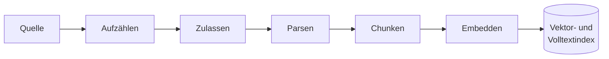
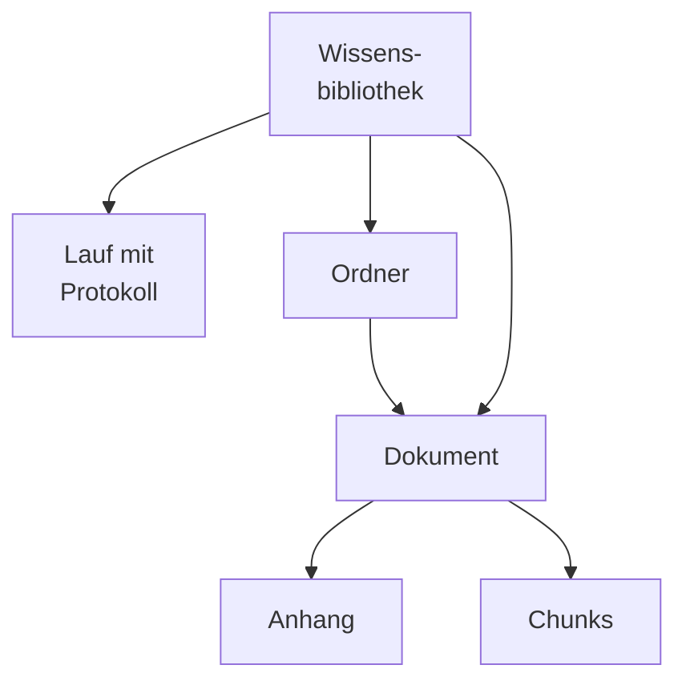
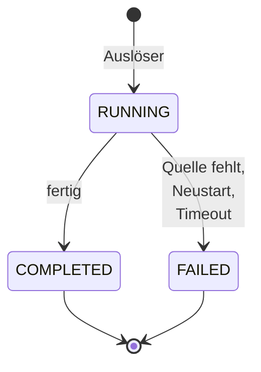
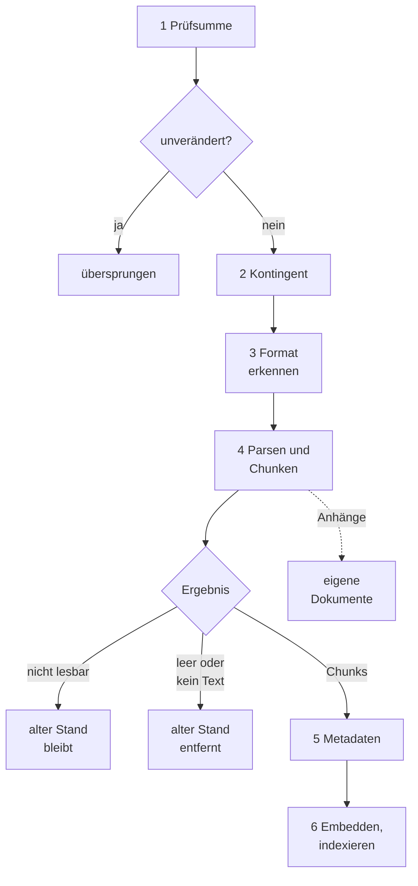
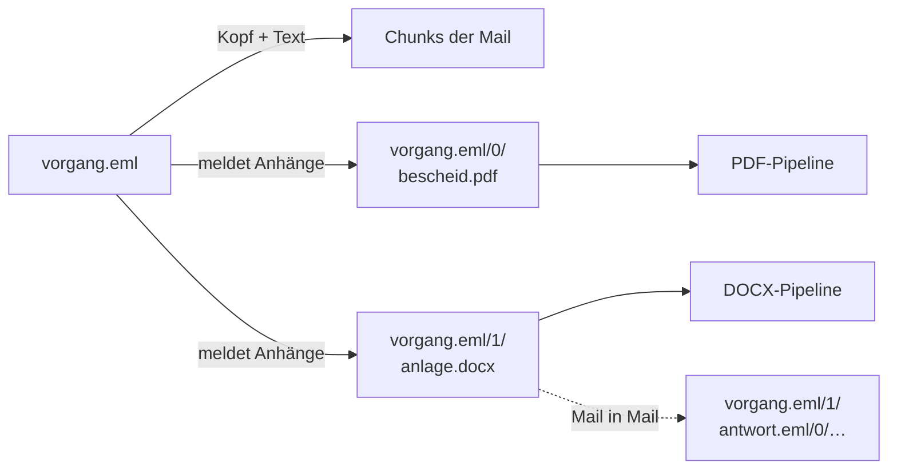
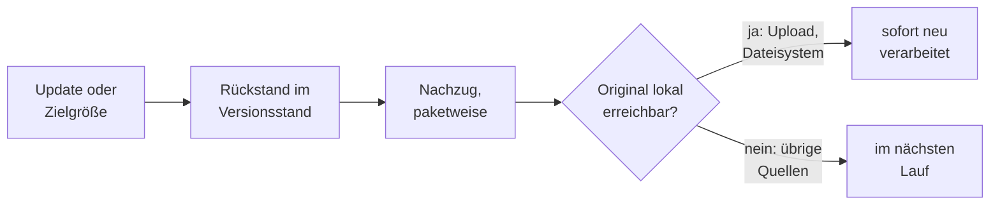

# Wissensbibliotheken: Das Wissen der Organisation verfügbar machen

OPAA beantwortet Fragen aus dem Wissen der Organisation. Dieses Wissen liegt in Dokumenten, und
das meiste davon liegt schon irgendwo: auf Netzlaufwerken, in einem Wiki, in einem Cloud-Speicher.
Eine **Wissensbibliothek** macht einen solchen Bestand für OPAA verfügbar, indem sie seine
Dokumente in einen durchsuchbaren Index aufnimmt und aktuell hält.

Wissensbibliotheken stehen neben anderen Arten im [Katalog](../katalog.md), etwa den
[Prompt-Bibliotheken](../prompt-bibliotheken.md). Was für alle Arten gleich ist — finden, anlegen,
teilen, favorisieren, einem Space zuordnen —, beschreiben die Kapitel [Katalog](../katalog.md) und
[Berechtigungen](../../konten-und-rechte/berechtigungen.md). Dieses Kapitel beschreibt,
was das Wissen besonders macht: woher es kommt, wie es aktuell bleibt und wie OPAA ein Dokument
liest. Tiefer gehen die Kapitel der [Konnektoren](konnektoren/README.md), der
[Formate](formate/README.md) und der [Zugänge](../zugaenge.md); Abschnitt 7 bündelt, was der Betrieb
wissen muss.

## 1. Woher das Wissen kommt

Eine Wissensbibliothek bezieht ihre Dokumente auf einem von zwei Wegen:

- **Eine Quelle anbinden.** Weil das meiste Wissen schon irgendwo liegt, ist das der Normalfall.
  Ein **Konnektor** bindet das System an, in dem die Dokumente liegen — etwa ein Confluence-Wiki
  oder ein Webverzeichnis —, liest es regelmäßig und hält die Bibliothek mit ihm in Einklang. Die
  Dokumente bleiben in ihrer Quelle. Wie ein Konnektor liest, hängt von der Technik des Systems ab;
  welche es gibt, zeigt die [Übersicht der Konnektoren](konnektoren/README.md).
- **Dokumente hochladen.** Wissen, das noch nirgends abgelegt ist, lädt eine Person direkt hoch.
  OPAA verarbeitet jede Datei sofort und bewahrt das Original selbst auf.

Damit das Wissen durchsuchbar wird, nimmt OPAA jedes Dokument in einen **Index** auf: eine
**Vektorablage**, die Textstücke nach ihrer Bedeutung findet, und einen **Volltextindex**, der
exakte Wörter, Aktenzeichen und Paragrafen trifft. Der Weg dorthin ist für jedes Dokument gleich,
unabhängig von Herkunft und Format:

| Schritt | Frage, die er beantwortet |
|---|---|
| Aufzählen | Welche Dokumente enthält die Quelle gerade? |
| Zulassen | Ist das ein Format, das OPAA verarbeiten kann? |
| Parsen | Welcher Text steckt im Dokument, und wie ist er gegliedert? |
| Chunken | In welche Stücke wird der Text zerlegt, damit die Suche sie einzeln treffen kann? |
| Embedden | Wie sieht jedes Stück als Bedeutungsvektor aus? |
| Indexieren | Wo liegt das Stück, und mit welchen Merkmalen ist es wiederzufinden? |

## 2. Grundbegriffe

**Wissensbibliothek.** Die Einheit, in der Wissen verwaltet und geteilt wird. Sie hat genau eine
**Quelle**: eine angebundene Quelle mit ihrem Konnektor oder den Upload. Meldet sich die Quelle
über einen Zugang der Systemverwaltung an, beschreibt das das Kapitel [Zugänge](../zugaenge.md).

**Lauf.** Ein Durchgang über die Quelle, mit Ergebnis, Zählern und Protokoll. Ein **vollständiger**
Lauf sieht die ganze Quelle und darf entfernen, was es dort nicht mehr gibt; ein **ergänzender**
sieht nur einen Ausschnitt, etwa die jüngsten Einträge eines Feeds, und entfernt nie etwas, nur
weil es fehlt. Welche Laufarten eine Quelle kennt, legt ihr Konnektor fest.

**Dokument.** Eine Datei, eine Seite oder ein Eintrag der Quelle, so wie OPAA es kennt: mit seinem
Ort in der Quelle, seinem Verarbeitungsstand und den Textstücken (**Chunks**), in die es zerlegt
wurde. Sein Ort in der Quelle ist zugleich seine Identität.

**Anhang.** Ein Dokument in einem Dokument, etwa die Anlage einer E-Mail oder die angehängte Datei
einer Confluence-Seite. OPAA nimmt es als eigenes Dokument auf (Abschnitt 5.7).

**Ordner.** Die Gliederung der Dokumente in der Bibliothek. Sie spiegelt, wie die Dokumente in der
Quelle abgelegt sind; beim Upload wird sie von Hand gepflegt. Ordner ordnen nur: Rechte gelten für
die ganze Bibliothek, und die Suche durchsucht immer den ganzen Bestand.

## 3. Mit Wissensbibliotheken arbeiten

### 3.1 Im Katalog

Wissensbibliotheken stehen im [Katalog](../katalog.md), der Filter „Wissen" grenzt ihn auf sie ein.
Die Kachel einer Wissensbibliothek nennt zusätzlich die Zahl ihrer Dokumente und in Worten, dass
sie gerade aktualisiert wird, dass das zuletzt gescheitert ist oder dass sie noch keinen Inhalt hat.
Das Datum des letzten erfolgreichen Abgleichs steht in der Detailansicht.

### 3.2 Die Detailansicht

Die Detailansicht einer Wissensbibliothek ist aufgebaut wie die jeder Art im Katalog
([Katalog](../katalog.md)). Sie zeigt in ihren Reitern:

| Reiter | Inhalt |
|---|---|
| Dokumente | die Dokumente der Bibliothek, nach Ordnern gegliedert und durchsuchbar |
| Quelle | woher die Dokumente kommen: die Zeilen „Verbindung", „Umfang" und „Zeitplan" wie beim Anlegen, darunter die Läufe; fehlt beim Upload |
| Metadaten | die Felder, mit denen die Bibliothek ihre Dokumente beschreibt ([Metadaten](metadaten.md)) |
| Freigaben | wer die Bibliothek sehen und pflegen darf ([Berechtigungen](../../konten-und-rechte/berechtigungen.md)) |
| Zuordnungen | in welchen Spaces sie verwendet wird |

Was man dort tun kann, hängt von der eigenen Rolle ab. **Wer liest**, sieht die Dokumente, den
Umfang der Quelle, die Metadaten und die Freigaben. **Wer pflegt**, stößt außerdem einen Lauf an
(„Jetzt indizieren"), setzt Metadatenfelder und lädt bei einer Upload-Bibliothek Dokumente hoch oder
löscht sie. **Wer verwaltet**, ändert darüber hinaus Verbindung, Umfang und Zeitplan, sieht das Laufprotokoll
und vergibt Rechte. In einer Bibliothek mit angebundener Quelle lassen sich Dokumente nicht löschen;
der nächste Lauf brächte sie zurück.

**Der Zustand im Kopf** ist ein einziges Wort mit Datum oder Fortschritt, etwa „Aktuell ·
23.10.2026", „Läuft · 40 %", „Teilweise fehlgeschlagen", „Anmeldung abgelehnt", „Nicht erreichbar",
„Zustimmung abgelaufen", „Noch nie indiziert" oder bei einem Upload „Hochgeladen" und „Kontingent
voll". Ist bei einem Upload die Verarbeitung von Dateien gescheitert, steht dort „Teilweise
fehlgeschlagen · 3 Fehler"; ein Klick darauf öffnet für jede Rolle den Reiter „Dokumente" mit genau
diesen Dateien. Die Zahl zählt jede Datei einzeln, Anhänge eingeschlossen, und steht deshalb nicht
neben der Zahl der Dokumente im Kopf, die Anhänge zu ihrer Mail zählt. Wird die Quelle nicht mehr
erreicht, nennt das Wort den Grund wie die Kachel im Katalog, etwa „Gesperrt", „Zugang entfernt",
„Verbindung getrennt" oder „Anmeldung abgelaufen". Wer verwaltet, kommt mit einem Klick auf das Wort
zur Ursache: zur Zeile „Verbindung" oder zum neuesten Lauf im Reiter „Quelle". Wer nur liest oder
bearbeitet, sieht das Wort ohne Verweis; den Verlauf der Läufe sehen erst Verwaltende. Das Wort
kommt dann aus dem Stand des letzten Laufs, mit fehlgeschlagenen Dokumenten und Unvollständigkeit;
den Grund eines Abbruchs, etwa eine abgelehnte Anmeldung oder ein erschöpftes Kontingent, erfahren
erst Verwaltende, darunter heißt er „Fehlgeschlagen“ bzw. „Teilweise fehlgeschlagen“. Bei einer
Quelle ohne Anmeldung (Verzeichnis, Web, Feed) heißt ein abgebrochener Lauf für alle Rollen „Nicht
erreichbar“.

**Nach dem Anlegen** zeigt die Detailansicht unter den Reitern „Nächste Schritte": „Zugang prüfen",
„In Space verwenden", bei Confluence und S3 „Live-Abgleich einrichten", „Feld anlegen", beim Upload
„Dateien hochladen". Ein Schritt ist abgehakt, sobald er erledigt ist, „Zugang prüfen" erst nach
einem Lauf, der die Quelle gelesen hat. „Ausblenden" blendet den Block dauerhaft aus; sind alle
Schritte erledigt, verschwindet er von selbst.

Im Reiter „Dokumente" sucht „Dateiname enthält …" in der ganzen Bibliothek, der Filter „Metadaten"
zeigt die Dokumente ohne Wert in einem Feld. Der Filter „Status" zeigt alle Dateien der Bibliothek,
die „Fehlgeschlagen" sind oder noch „Wird verarbeitet", mit ihrer Zahl, die während eines Laufs
dessen Fortschritt folgt; er erscheint ab fünf Dateien in der Bibliothek und nur, wenn er die Liste
kürzt. Beide Filter listen Anhänge als eigene Zeilen und nennen dazu das Dokument, an dem sie
hängen, etwa „Anhang von posteingang.eml". Die Aktionen einer Zeile, etwa „Löschen", stehen in ihrem
Menü „⋯". Einzeln löschen lässt sich ein Dokument nur in einer Upload-Bibliothek; in einer
Konnektorbibliothek folgt der Bestand der Quelle. Lehnt ein Upload Dateien ab, nennt eine Meldung
sie; „Schließen" faltet sie zu „Abgelehnte Dateien anzeigen (n)", bis zum nächsten Upload.

Im Reiter „Quelle" ändert, wer verwaltet, jede Zeile an Ort und Stelle: „Ändern" klappt sie auf,
„Speichern" übernimmt die Änderung, „Abbrechen" verwirft sie. Wo der Umfang nur im Auswahldialog
gewählt wird, wie bei SharePoint, öffnet „Ändern" gleich den Dialog, und „Übernehmen" speichert
sofort. Jede Zeile trägt, was die Läufe über sie wissen, etwa „Anmeldung ok · zuletzt 23.10.2026"
an der Verbindung oder „2 nicht lesbar" am Umfang. Bei Confluence und S3 folgt die Zeile
„Live-Abgleich" mit Webhook bzw. Ereignissen ([Konnektoren](konnektoren/README.md)). Bei Quellen wie
Confluence, S3 oder Nextcloud steht unter den Zeilen, auch für Lesende, dass alles daraus Indizierte
für alle Leseberechtigten der Bibliothek sichtbar ist.

Darunter stehen für die Verwaltenden die **Läufe** als Tabelle mit Zustand, Beginn, Dauer, Auslöser
und Ergebnis. Eine Zeile klappt auf und zeigt die Fundorte je Kategorie des Laufprotokolls
(Abschnitt 6.2), „alle n anzeigen" öffnet die vollständige Liste, „Technische Angaben" die
Kennzahlen. Ein an der Verbindung gescheiterter Lauf führt mit „Verbindung ändern" zur Zeile
„Verbindung". Ab fünf Läufen grenzt „Alle · Nur mit Fehlern (n)" die Tabelle ein, sofern das etwas
weglässt. Bei Quellen mit Vollabgleich steht dort auch „Vollabgleich starten".

### 3.3 Eine Wissensbibliothek anlegen

Angelegt wird über **„Neuer Katalogeintrag"** im Katalog mit der Art „Wissen". Ein Assistent führt durch fünf
Schritte:

| Schritt | Inhalt |
|---|---|
| 1. Quellart | die Quellart wählen, etwa Confluence oder Upload; angeboten wird nur, was die Person anlegen darf |
| 2. Quelle | die Zeilen „Verbindung", „Umfang" und „Zeitplan"; entfällt beim Upload |
| 3. Name | Name und Beschreibung, vorbelegt, wo die Quelle einen Namen hergibt |
| 4. Freigaben | Eigentümer und erste Freigaben an Personen und Gruppen; entfällt bei einer privaten Bibliothek |
| 5. Prüfen | alle Angaben auf einen Blick, je Angabe mit „Ändern", dann „Bibliothek anlegen" |

**Die drei Zeilen der Quelle.** Jede Quellart zeigt dieselben Zeilen, je mit Titel, einer kurzen
Zusammenfassung und dem Link „Ändern", der die Zeile aufklappt:

- **Verbindung** — Zugang oder eigene Adresse und die Zugangsdaten, benannt wie beim Anbieter
  (etwa „API-Token", „App-Passwort", „Access Key"). Beim Wechsel in die nächste Zeile testet OPAA
  die Verbindung; die Zusammenfassung nennt Ziel und Ergebnis, etwa „verbunden" oder „Test
  fehlgeschlagen" mit der Stufe, an der er scheiterte: „Adresse", „Anmeldung" oder „Rechte". Bei
  Quellarten mit fester Adresse, etwa OneDrive oder SharePoint, entfällt die Stufe „Adresse";
  scheitert der Test dort vor der Anmeldung (Zieladressprüfung, Netz, Serverfehler), nennt er keine
  Stufe, nur die Meldung.
  Nach einem gescheiterten Test geht es mit „Trotzdem fortfahren" weiter.
- **Umfang** — was die Bibliothek aus der Quelle liest. Bis zu sieben Einträge einer Ebene stehen
  als Kästchen direkt in der Zeile; bei mehr oder bei Unterebenen öffnet der Link
  „`<Objekte>` auswählen …" einen Auswahldialog mit Pfadleiste, Suche ab sieben Einträgen und
  „Übernehmen". Was sich nicht auflisten lässt, trägt man über „Von Hand eintragen …" ein. Bei
  Ordnerquellen wie Nextcloud oder einem Dateiserver steht davor die Wahl „Alle Ordner" oder „Nur
  ausgewählte Ordner"; bei den übrigen Quellen wählt man die Einträge immer ausdrücklich.
- **Zeitplan** — Häufigkeit und Uhrzeit, vorbelegt mit täglich um 02:00, und ob die erste
  Indizierung sofort nach dem Anlegen startet.

Fehlt etwas, nennt „Weiter" alle offenen Angaben auf einmal unter „Fehler: n Angaben prüfen", je
mit einem Link zum Feld. Was man hier einträgt, steht danach in denselben Zeilen im Reiter „Quelle"
der fertigen Bibliothek.

**Über einen Zugang.** Hat die Systemverwaltung für die Quelle einen [Zugang](../zugaenge.md)
eingerichtet, wählt man ihn in der Zeile „Verbindung": Stehen mehrere Wege offen, zeigt sie eine
Liste der Zugänge mit ihrer Adresse und „Eigene Adresse" als letzte Wahl; gibt es nur einen, ist er
gesetzt. Adresse und technische Einstellungen
kommen dann vom Zugang, und je nach Quelle trägt man nur noch die eigenen Zugangsdaten ein.
Später lässt sich der Zugang im Reiter „Quelle" wechseln, eine Bibliothek mit eigener Adresse einem
Zugang zuordnen oder vom Zugang lösen.

**Quelle verbinden.** Manche Quellen verlangen, dass man sich beim Anbieter anmeldet und OPAA den
Zugriff erlaubt. Dafür nimmt man ein Funktionskonto des Hauses, kein persönliches Konto: Die
Bibliothek liest danach mit diesem Konto weiter, auch wenn die Person, die verbunden hat, ausscheidet.
Für die Verbindung ist eine Person oder Gruppe verantwortlich; sie wird benachrichtigt, wenn der
Anbieter die Erlaubnis beendet, und kann neu verbinden.

## 4. Wie der Bestand aktuell bleibt

### 4.1 Auslöser

| Auslöser | Beschreibung |
|---|---|
| Manuell | „Jetzt indizieren" an der Bibliothek, ab der Rolle Bearbeiter. Wo die Quelle es kennt, zusätzlich „Vollabgleich starten": für Verwaltende über den Läufen im Reiter „Quelle", für Bearbeitende im Menü „Weitere Aktionen" |
| Zeitplan | je Bibliothek einstellbar (Abschnitt 4.2) |
| Ereignis der Quelle | manche Quellen melden Änderungen selbst, etwa Confluence per Webhook oder ein Objektspeicher per Benachrichtigung; OPAA holt kurz darauf genau die gemeldeten Dokumente. Ersetzt weder Zeitplan noch Vollabgleich |
| Nachzug | kein regulärer Lauf: Die Systemverwaltung lässt Dokumente neu verarbeiten, die mit einem älteren Verfahren entstanden sind (Abschnitt 7.2) |

### 4.2 Zeitplan

Jede Bibliothek mit angebundener Quelle kann einen Zeitplan tragen. Verwaltende setzen ihn im
Reiter „Quelle", beim Anlegen im Assistenten.

| Stufe | Einstellungen |
|---|---|
| aus | keine |
| stündlich | keine, jeweils zur vollen Stunde |
| täglich | Uhrzeit |
| wöchentlich | Wochentag und Uhrzeit |

Die Uhrzeit gilt in der Zeitzone des Servers. Drei Regeln:

- **Jeder Termin läuft einmal, verpasste nur kurz nachgeholt.** Auch mit mehreren
  Backend-Instanzen startet ein Termin genau einen Lauf. Kommt der Anstoß verspätet, etwa nach einem
  kurzen Neustart, startet der Lauf noch bis 15 Minuten nach dem Termin; war das Backend länger
  nicht in Betrieb, läuft die Bibliothek erst zum nächsten Termin. Ein neuer oder geänderter
  Zeitplan beginnt mit seinem nächsten Termin. Nach einer längeren Wartung lässt sich manuell
  anstoßen.
- **Läuft noch ein Lauf, entsteht kein zweiter.** Der laufende vermerkt „Geplanter Lauf
  übersprungen: Indizierung läuft bereits". Ein Erstlauf, der länger dauert als das Intervall,
  verschluckt so die Termine bis zu seinem Ende.
- **Ein gescheiterter Lauf schaltet den Zeitplan nicht ab.** Scheitern zwei geplante Läufe
  hintereinander, zeigt die Bibliothek ein Warnbanner; manuelle Läufe zählen nicht mit.

Welche Stufe passt, hängt von der Quelle ab: Ein unveränderter Feed kostet je Lauf eine Anfrage und
verträgt stündlich, ein großes Netzlaufwerk eher täglich oder wöchentlich. Quellen mit
Vollabgleich-Rhythmus stellen diesen im Zeitplan zusätzlich ein.

### 4.3 Zustände eines Laufs

Je Bibliothek läuft **höchstens ein Lauf**. Ein einzelnes Dokument, das nicht verarbeitet werden
kann, bricht den Lauf nicht ab; es wird gezählt, protokolliert und übersprungen. „Fehlgeschlagen"
heißt, dass der Lauf als Ganzes nicht zu Ende kam.

Während ein Lauf läuft, fragt die Detailansicht seinen Stand regelmäßig ab. Ein einzelner
Abruffehler, etwa während eines Updates, ändert die Anzeige nicht. Die Seite fragt danach in
wachsenden Abständen erneut. Scheitern mehrere Abrufe in Folge, heißt der Zustand im Kopf „Läuft ·
Stand unbekannt", daneben steht für jede Rolle „Stand erneut abrufen", nie „Fehlgeschlagen": Der
Lauf selbst kann weiterlaufen. Bricht ebenso das
automatische Aktualisieren der Dokumentliste ab, zeigt die Liste einen Hinweis mit „Aktualisieren".

Ein Lauf kann abgeschlossen und trotzdem **unvollständig** sein: wenn er sein Anfragebudget
verbraucht hat oder ein Dokument am Speicherkontingent abgelehnt wurde. Er endet dann geordnet, und
der nächste Lauf setzt fort; ein unvollständiger Lauf entfernt nichts wegen Abwesenheit. Wie die
Dateiablagen einen Abgleich über mehrere Läufe fortsetzen, beschreibt die Übersicht der
[Konnektoren](konnektoren/README.md#2-dateiablagen).

### 4.4 Änderungen und Löschungen

| In der Quelle | In OPAA |
|---|---|
| unverändert | übersprungen, nichts wird neu verarbeitet |
| geändert | neu verarbeitet; das Dokument behält seine Identität, Verweise aus Chats bleiben gültig |
| umbenannt oder verschoben | je nach Quelle: ein neues Dokument, und das alte gilt als entfernt, oder dasselbe Dokument an neuem Ort — das Kapitel der Quelle sagt, was gilt |
| verschwunden | entfernt nach einem vollständigen, erfolgreichen Lauf, oder sofort, wenn die Quelle die Löschung selbst meldet |
| nicht erreichbar oder nicht lesbar | **nichts** wird entfernt |

OPAA stellt sicher, dass nichts versehentlich gelöscht wird: Es entfernt ein Dokument nur nach
einem Lauf, der die Quelle vollständig gelesen hat. Wann genau das bei einer Quelle der Fall ist,
zeigt die Übersicht der [Konnektoren](konnektoren/README.md).

### 4.5 Wiederanlauf nach Störungen

Ein hängender Lauf würde seine Bibliothek dauerhaft blockieren. Zwei Aufräumer verhindern das:

- **Ist die Backend-Instanz beendet, die einen Lauf ausführt**, wird er mit „Durch Neustart oder
  Ausfall der ausführenden Instanz abgebrochen" beendet: beim Start des Backends und danach
  minütlich. Eine geordnet beendete Instanz gilt sofort als beendet, eine abgestürzte erst, wenn ihr
  Lebenszeichen länger als `OPAA_INSTANCE_DEAD_AFTER` ausbleibt
  ([Das Instanzregister](../../betrieb/mehrere-instanzen.md#das-instanzregister)). Läufe einer laufenden Instanz bleiben, gleich wann
  sie begonnen haben.
- **Regelmäßig** werden Läufe beendet, die länger als eine Frist (`stale-job-timeout`) keinen
  Fortschritt gemeldet haben. Maßgeblich ist der letzte Fortschritt, nicht der Start: Ein großer
  Erstlauf darf lange dauern, solange er arbeitet.

Ein so beendeter Lauf, der doch noch arbeitet, merkt es bei seinem nächsten Fortschritt und hört auf,
ohne weiter zu schreiben oder etwas aus dem Bestand zu entfernen; ebenso ein Lauf, dessen Instanz ihr
Lebenszeichen nicht mehr schreiben konnte. Ein neuer Lauf derselben Bibliothek überschreibt deshalb
nicht, was ein abgebrochener noch hinterlässt.

Ein abgebrochener Lauf lässt den Bestand stehen. Was er fertig verarbeitet hat, bleibt indiziert;
was er nicht erreicht hat, bleibt auf dem alten Stand. Das eine Dokument, das gerade in Arbeit war,
verarbeitet der nächste Lauf erneut.

Ebenso beim Upload: Eine hochgeladene Datei, deren verarbeitende Instanz beendet ist, steht danach
auf fehlgeschlagen („Die Verarbeitung wurde durch einen Neustart oder Ausfall der verarbeitenden
Instanz abgebrochen“), wie kurz vorher sie auch angenommen wurde, und lässt sich erneut hochladen.

## 5. Was mit jedem Dokument passiert

Jedes Dokument, gleich welcher Herkunft, durchläuft dieselben Schritte:

### 5.1 Prüfsumme und Identität

Über den Inhalt wird eine Prüfsumme gebildet. Ist der Inhalt unverändert und war das Dokument
zuletzt erfolgreich indiziert, wird es **übersprungen** — der Normalfall jedes Folgelaufs, und der
Grund, warum Folgeläufe schnell sind. Hat sich der Inhalt geändert, behält das Dokument seine
Identität, und nur seine Chunks werden ausgetauscht; scheitert das Lesen der neuen Fassung, bleibt
der alte Stand durchsuchbar.

### 5.2 Speicherkontingent

Jede Bibliothek hat ein Speicherkontingent; eine private Bibliothek zusätzlich das Kontingent ihrer
Besitzerin über alle ihre privaten Bibliotheken ([Private Bibliotheken](private-bibliotheken.md)). Geprüft wird der Zuwachs: Bei einer geänderten Datei zählt nur die
Größendifferenz.

Überschreitet ein Dokument ein Kontingent, wird es abgelehnt, und das Protokoll nennt den Grund.
Der Lauf geht weiter und endet als unvollständig. Das abgelehnte Dokument gilt als vorhanden: Eine
bereits aufgenommene Fassung bleibt stehen, und ein späterer Lauf versucht es erneut. Löschungen in
der Quelle werden dagegen übernommen — oft sind es gerade sie, die Platz schaffen. Solange ein
Dokument nicht passt, endet jeder Lauf, der es erreicht, wieder als unvollständig.

Dateiablagen prüfen das Kontingent schon vor dem Download
([Konnektoren](konnektoren/README.md#2-dateiablagen)). Was bei Confluence, beim Feed und bei
E-Mails mit Anhängen eigens gilt, steht in deren Kapiteln.

### 5.3 Format erkennen

Die Formaterkennung schaut in den **Inhalt**, nicht auf die Dateiendung: Eine als `.pdf` benannte
Word-Datei wird als Word-Datei verarbeitet, mit dem Protokollvermerk „Formatabweichung". Für jedes
Format gibt es genau eine **Format-Pipeline**, für Unbekanntes und Strukturloses eine
Auffang-Pipeline. Zugelassen sind grob Text und Markdown, PDF, die Office-Formate von Microsoft und
OpenDocument, Tabellen, HTML und E-Mails. Welche Endungen genau, welche Pipeline sie bedient und was
bewusst nicht aufgenommen wird, steht in der Übersicht der [Formate](formate/README.md).

### 5.4 Parsen und Chunken

Die Format-Pipeline liest den Text und zerlegt ihn entlang seiner Gliederung: nach Überschriften,
Seiten, Folien oder Zeilengruppen. Nur wer das Format kennt, weiß, wo diese Grenzen liegen.

- Jeder Chunk trägt eine **Ortsangabe**, etwa „S. 3 · Abschn. Fristen › Verlängerung", die später
  im Zitat erscheint, und einen **Fundstellen-Anker**: dieselbe Stelle maschinenlesbar (Seiten,
  Abschnittspfad, Folie, Blatt und Zeilen oder Nachricht, je nach Format) und je ein kurzes Zitat
  vom Anfang und Ende des Chunks. Ein Beleg im Chat hält den Anker fest, so wie er beim Antworten
  war.
- **Kein Text geht wegen seiner Länge verloren.** Ein zu langer Abschnitt wird geteilt, nie gekürzt;
  jedes Teilstück behält Überschrift und Ortsangabe.
- **Kleinstabschnitte werden zusammengefasst**, etwa viele einzeilige Haushaltstitel unter einer
  gemeinsamen Überschrift. Ein Abschnitt normaler Länge bleibt dagegen ein eigener Chunk, damit
  ein einzelner Paragraf gezielt auffindbar bleibt.
- Das Ergebnis ist entweder eine Liste von Chunks oder einer von drei Befunden: **nicht lesbar**
  (beschädigte Datei; der alte Stand bleibt), **leer** (der alte Stand wird entfernt) oder **kein
  extrahierbarer Text**, typisch für eingescannte PDFs (abgewiesen, der alte Stand wird entfernt).

**Bereinigung.** Direkt nach dem Format, für jedes Format und jeden Konnektor, entfernt OPAA aus
dem Text der Chunks, ihrem Fundort, dem Dateinamen, dem Titel und dem Pfad in der Quelle Zeichen, die
in gewöhnlichem Text nichts zu suchen haben, aber Text vor dem Auge verbergen können: Zeichen des
Unicode-Tag-Blocks, das Leerzeichen ohne Breite, eine Bytereihenfolge-Marke mitten im Text und
Steuerzeichen, die die Schreibrichtung einbetten oder überschreiben. Isolierzeichen der
Schreibrichtung ohne ihr Gegenstück werden nur gezählt, weil eine Chunk-Grenze ein Paar trennen
kann. Die Tag-Zeichen fallen ausnahmslos weg, auch in den Flaggen von Landesteilen wie England,
die danach als schwarze Flagge erscheinen. Weiche Trennstriche fallen ebenfalls weg, besondere
Leerzeichen werden zu normalen, und Rollen-Markierungen der Modellformate wie `<|im_start|>` oder
`<start_of_turn>` werden entschärft. Unverändert bleiben Verbinder und Nicht-Verbinder, die Emoji,
Persisch oder Devanagari brauchen, Variantenwähler und die Richtungsmarken in arabischem oder
hebräischem Text; ähnlich aussehende Buchstaben anderer Schriften werden nicht ersetzt. Ein Chunk,
der danach leer ist, entfällt; bleibt keiner, gilt das Dokument als ohne extrahierbaren Text. Index,
Kontextpräfix, Antwort-Prompt und Belegprüfung sehen so denselben bereinigten Text. Typische
Wendungen wie „ignoriere alle vorherigen Anweisungen“ und Adressen mit einem Platzhalter für Daten
bleiben im Text; sie werden nur gezählt und gemeldet (Abschnitt 6.1). Ein Restrisiko bleibt:
Verbinder, Nicht-Verbinder und Variantenwähler können ebenfalls versteckten Text tragen, werden aber
weder entfernt noch gezählt, weil normale Texte sie brauchen. Titel, Überschriften und Fundort
kürzt die Bereinigung auf 1.000 Zeichen, Dateiname und Pfad nicht.

Die Zielgrößen und Grenzen stehen in Abschnitt 7.1, die Regeln je Format in dessen Kapitel.

### 5.5 Metadaten anreichern

Jeder Chunk bekommt seinen Rahmen: Dokument, Bibliothek, Dateiname, Ortsangabe und die Merkmale aus
der Quelle, etwa Space und Gliederungspfad einer Confluence-Seite. Darüber filtert die Suche später,
zum Beispiel auf die Bibliotheken, die eine Person sehen darf. Hier werden auch die **Kernfelder**
ermittelt — Titel, Dokumentart, Datum ([Metadaten](metadaten.md)).

Für Embedding und Volltext, nicht für den gespeicherten Text, bekommt jeder Chunk einen
**Kontextpräfix**: den Titel des Dokuments, ausgewählte Feldwerte und seinen Gliederungspfad. Ein
Chunk aus `2024-03_Dienstanweisung_Homeoffice.pdf` wird als „Dienstanweisung Homeoffice › …"
eingebettet. So trägt auch ein Detail-Chunk — eine Gebührenzeile, ein einzelner Paragraf — Signal
darüber, wovon das Dokument handelt.

### 5.6 Embedden und in den Index schreiben

Die Chunks gehen paketweise an das Embedding-Modell; das ist der einzige Aufruf nach außen, der
nicht der Quelle gilt. Danach werden Vektor und Volltext jedes Chunks gemeinsam geschrieben, sodass
beide Suchen denselben Bestand sehen. Der Volltext wird mit deutscher Wortstammbildung aufgebaut und
um **Kennungen** wie Paragrafen und Aktenzeichen ergänzt, damit „§ 12 Abs. 3" exakt trifft
([Suche](../../spaces/suche.md), Stufe 5). Zuletzt wird das Dokument als „indiziert" markiert.

### 5.7 Anhänge

Anhänge entstehen auf zwei Arten und münden in denselben Weg: **aus dem Format**, wie die Anlagen
einer E-Mail — gleich, woher die Mail kommt —, oder **aus der Quelle**, wie die angehängten Dateien
einer Confluence-Seite. Wer einen Anhang findet, meldet ihn nur; verarbeitet wird er wie jedes
andere Dokument, mit eigener Prüfsumme, eigener Pipeline und eigenem Protokolleintrag.

- Der Ort eines Anhangs enthält den Ort seines Elterndokuments und seine Position darin; zwei
  gleichnamige Anhänge kollidieren nicht.
- Anhänge können selbst Anhänge haben (Mail in Mail). Die Tiefe ist begrenzt
  (`attachments.max-depth`); was darüber liegt, wird übersprungen und protokolliert. Über alle
  Ebenen zusammen begrenzt ein Budget je Ausgangsdokument Zahl (`attachments.max-per-root`) und
  Gesamtgröße (`attachments.max-bytes-per-root`) der Anhänge, damit eine Kette von Mails mit je
  vielen Mails nicht Tausende Dokumente erzeugt; was darüber liegt, wird ebenso übersprungen.
- Das Kontingent zählt Anhänge nur einmal: Eine Mail zählt nur Kopf und Text, ihre Anhänge zählen
  als eigene Dokumente.
- Wird das Elterndokument neu verarbeitet und meldet einen früheren Anhang nicht mehr, wird dieser
  entfernt. Bleibt das Elterndokument unverändert, bleiben auch seine Anhänge.
- Beim Löschen werden Anhänge vor ihrem Elterndokument entfernt.
- In der Dokumentliste steht ein Anhang unter seinem Elterndokument. Dokumentzahlen in Liste,
  Ordnern, Kachel und Kennzahlen zählen nur die oberste Ebene; Laufzähler und Bestandszahlen der
  Suchverwaltung zählen Anhänge mit.

## 6. Protokoll und Fehler

### 6.1 Ergebnis je Dokument

Jedes Dokument eines Laufs endet in genau einem von fünf Ergebnissen: **verarbeitet**,
**übersprungen**, **Kontingent überschritten**, **kein extrahierbarer Text** oder
**fehlgeschlagen**. Daraus ergeben sich die Zähler des Laufs; Anhänge zählen mit.

**Auffällige Muster.** Findet die Bereinigung (Abschnitt 5.4) in einem verarbeiteten Dokument Muster,
die typisch für untergeschobene Anweisungen an das Modell sind, bekommt das Dokument zusätzlich einen
Eintrag „Auffällige Muster“ im Laufprotokoll. Gezählt werden vier Arten: entfernte unsichtbare
Zeichen, entschärfte Rollen-Markierungen, Wendungen wie „ignoriere alle vorherigen Anweisungen“ und
Adressen mit einem Platzhalter für Daten. Weiche Trennstriche und eine Bytereihenfolge-Marke am
Textanfang werden entfernt, aber nicht gezählt, weil Textverarbeitungen sie üblicherweise setzen.
Der Eintrag nennt nur die Anzahl je Art, nie den Inhalt; das Dokument ist trotzdem aufgenommen und
zählt als verarbeitet. Ein Treffer ist ein Hinweis zum Nachsehen, kein Beleg für einen Angriff: Eine
Schulungsunterlage über Prompt-Injection enthält solche Wendungen ganz legitim. Diese Einträge haben
eine eigene Obergrenze je Lauf, damit sie Fehler und Ablehnungen nicht aus dem Protokoll verdrängen;
darüber hinaus fasst eine Zeile am Ende des Laufs zusammen, wie viele weitere Dokumente betroffen
sind. Ein Upload hat kein Laufprotokoll; dort erscheint der Befund nur in Log und Metrik. Die Metrik
zählt je Bibliothek und Art die Dokumente mit Treffer, private Bibliotheken gemeinsam unter einem
Wert ([Überwachung](../../betrieb/ueberwachung-und-fehlerbehebung.md#logs-und-metriken)).

### 6.2 Laufprotokoll

Jeder Lauf führt ein Protokoll mit einer lesbaren Begründung je Eintrag.

| Kategorie | Bedeutung |
|---|---|
| abgewiesen | nicht übernommen: Die Quelle hat es zurückgewiesen, ein Kontingent ist erschöpft, es enthält keinen extrahierbaren Text, oder sein Ort ist zu lang |
| nicht erreichbar | Verbindungsfehler oder Zeitüberschreitung |
| Format nicht unterstützt | das Format wird nicht indiziert |
| Formatabweichung | indiziert, aber Endung und Inhalt passen nicht zusammen |
| Allowlist | der Ort liegt außerhalb der Freigabe |
| Zeitplan übersprungen | fällig, aber ein Lauf lief bereits |
| in der Quelle entfernt | wegen Abwesenheit oder auf Befund der Quelle gelöscht |
| Ratenbegrenzung | die Quelle hat den Lauf gebremst; eine Zeile je Lauf mit Anzahl und Wartezeit |
| Anfragebudget erschöpft | der Lauf endete geordnet unvollständig; die Zeile nennt, wo der nächste fortsetzt |
| Kennzahlen | Anfragen, geladene Bytes, gelistete und verarbeitete Objekte, Dauer; bei Konnektoren, die sie zählen |
| Auffällige Muster | verarbeitet, aber mit Mustern untergeschobener Anweisungen; nur Anzahl je Art (Abschnitt 6.1) |
| Fehler | Verarbeitung begonnen, unerwartet gescheitert |

- Je Lauf werden höchstens 500 Einträge gespeichert, darüber hinaus nur gezählt („… und N
  weitere"). Notizen über den Lauf als Ganzes zählen nicht gegen diese Grenze, „Auffällige Muster“
  haben eine eigene von 50 Einträgen.
- Je Bibliothek bleiben die letzten zehn Läufe samt Protokoll erhalten.
- Ein Fehler beim Schreiben des Protokolls bricht den Lauf nie ab.

### 6.3 Wer was sieht

Ob und wann zuletzt aktualisiert wurde, sieht jede leseberechtigte Person. Das Protokoll sieht erst,
wer die Bibliothek verwaltet, weil es interne Pfade und Adressen der Quelle enthält. Endete ein Lauf
unvollständig, sagt ein Kennzeichen am Lauf, warum, und was hilft — etwa bei einem erschöpften
Speicherkontingent: Dateien in der Quelle löschen, die Quelle eingrenzen oder ein höheres
Kontingent.

### 6.4 Wenn eine Bibliothek nicht mehr aktualisiert wird

Kann ein Lauf seine Quelle nicht erreichen, endet er vor dem ersten Dokument mit einer Meldung, die
die zuständige Stelle nennt. Der Bestand bleibt durchsuchbar, und im Reiter „Quelle" bietet der
Hinweis den Verwaltenden die Aktion an, die ihn aufhebt.

| Meldung | Ursache | Zuständig |
|---|---|---|
| „Zugang entfernt" | Der Zugang wurde gelöscht | Verwaltende der Bibliothek: anderen Zugang zuordnen |
| „Verbindung getrennt" | Die Zugangsdaten fehlen, etwa nach einer Adressänderung oder der Notabschaltung | Verwaltende der Bibliothek: neu eintragen; meldet sich der Zugang selbst an, die Systemverwaltung |
| „Abgelaufen: Der Anbieter hat die Anmeldung des Zugangs … abgelehnt" | Client-Secret oder Schlüssel des Zugangs wurde abgewiesen | Systemverwaltung: neu eintragen oder „Anmeldung testen" |
| „Nicht verbunden" bzw. „Abgelaufen: Die Verbindung der Quelle …" | Die Quelle wurde noch nicht verbunden, getrennt, oder der Anbieter nimmt die Zustimmung nicht mehr an | Verwaltende der Bibliothek: Quelle neu verbinden |
| „Die Adresse der Bibliothek liegt nicht unter …" | Die Adresse passt nicht mehr zum Zugang | Verwaltende der Bibliothek |
| „Gesperrt – Inhalt wird nicht mehr aktualisiert" | Zugang oder Quellart ist gesperrt | Systemverwaltung |
| „… ist nur noch über Zugänge nutzbar, und diese Bibliothek hat eine eigene Adresse" | „[Nur über Zugänge](../zugaenge.md#7-sperren-und-nur-über-zugänge)" ist eingeschaltet, und der Bestand wurde gesperrt | Verwaltende der Bibliothek: einem Zugang zuordnen |

Einzelne Dokumente, die nicht aufgenommen wurden, nennt das Laufprotokoll mit Grund (Abschnitt 6.2).

## 7. Betrieb

### 7.1 Grenzen und Zuschnitt im Einzelnen

| Grenze | Wert | Wirkung |
|---|---|---|
| Ort in der Quelle | 2000 Zeichen und 2676 Byte (UTF-8), bei einem Anhang samt Ort des Elterndokuments | darüber abgewiesen, gezählt als übersprungen, nicht gespeichert; eine Dateiablage lädt die Datei gar nicht erst |
| Zielgröße eines Chunks | `chunk-target-characters` (Abschnitt 7.5) | je Abschnitt bei überschriftengetriebenen Formaten, je Seite, Folie oder Zeilengruppe bei den übrigen |
| Höchstgröße eines Chunks | 8.000 Zeichen | greift nur, wenn schon die Überschrift oder der Folientitel zu lang ist |
| Kleinstabschnitt | unter 200 Zeichen samt Überschrift | wird mit benachbarten Kleinstabschnitten derselben übergeordneten Überschrift bis zur Zielgröße zusammengelegt |
| Eingabegrenze des Embedding-Modells | 8.191 Tokens abzüglich 10 % Reserve | ein Chunk darüber lässt das ganze Dokument scheitern |
| Kennungen je Chunk | 64 | weitere werden nicht gespeichert |
| Protokolleinträge je Lauf | 500 | weitere nur gezählt |
| aufbewahrte Läufe je Bibliothek | 10 | ältere werden beim Start eines neuen entfernt |

Ein zu langer Abschnitt wird an der gröbsten Grenze geteilt, die sich anbietet: an Leerzeilen, dann
Zeilenumbrüchen, dann Satzenden, zuletzt Leerzeichen; nur eine Zeichenfolge ganz ohne solche Grenze
wird hart geschnitten. Die Zielgröße `chunk-target-characters` zählt Zeichen und gilt für alle
Formate mit Struktur. Davon getrennt gelten `chunk-size` und `chunk-overlap` nur für die
Auffang-Pipeline und strukturlose Texte, die nach Tokens mit Überlappung zum Vorgänger geschnitten
werden; eine Änderung des einen Werts wirkt nicht auf den anderen. Jeder Chunk eines Formats mit
Struktur merkt sich die Zielgröße, mit der er geschnitten wurde. Nach einer Änderung behalten
bereits indexierte Dokumente zunächst ihren Zuschnitt, denn ein erneuter Lauf überspringt
unveränderte Dateien; der Versionsstand zählt ihre Chunks aber als nachzuziehen, und der Nachzug
(Abschnitt 7.2) zerlegt sie neu, ohne die Bibliothek neu aufzubauen. Eine geänderte `chunk-size`
oder `chunk-overlap` merkt sich ein Chunk nicht; sie gilt nur für Dokumente, die danach neu oder
geändert indexiert werden. Seitenzahlen überleben die
Textextraktion als Marker, die vor dem Embedden entfernt werden.

An der Chunk-Anzahl eines fehlgeschlagenen Dokuments ist ablesbar, ob es noch Chunks hat: Scheitert
das Lesen, behält es Chunks und Anzahl; scheitert etwas nach dem Entfernen der alten Chunks — beim
Embedden oder Schreiben —, steht dort 0.

**Restfenster.** Das Entfernen der alten Chunks und das Schreiben der neuen liegen nicht in einer
gemeinsamen Transaktion; dazwischen liegt der Embedding-Aufruf, der bewusst außerhalb jeder
Datenbanktransaktion läuft. Stürzt der Prozess genau darin ab, hat das Dokument kurz keine Chunks,
während es noch als „indiziert" mit der alten Anzahl erscheint. Der nächste Lauf verarbeitet es
erneut, unabhängig von der Prüfsumme. Alte und neue Chunks liegen nie gleichzeitig vor.

Die Grenzwerte für Zahl und Größe der Anhänge je Elterndokument setzt die jeweilige Quelle bzw. das
Format; die Tiefe gilt allgemein.

### 7.2 Pipeline-Versionen und Nachzug

Jede Format-Pipeline hat eine Versionsnummer, und jeder Chunk speichert, mit welcher Pipeline und
Version er entstand. Die Version steigt nur, wenn sich Zuschnitt oder erzeugte Metadaten ändern.
So lässt sich jederzeit sagen, welcher Teil des Bestands nach einem Update noch mit einem älteren
Verfahren im Index liegt. Ebenso zählt ein Chunk eines Formats mit Struktur als nachzuziehen, wenn
er mit einer anderen Zielgröße geschnitten wurde als der eingestellten (Abschnitt 7.1); Chunks aus
der Zeit, bevor OPAA sich die Zielgröße merkte, gelten als mit dem Standardwert geschnitten.

Der **Nachzug** läuft nicht von selbst. Die Systemverwaltung stößt ihn über die Admin-API an; eine
Oberfläche gibt es noch nicht.

| Aufruf | Zweck |
|---|---|
| `GET /api/v1/admin/indexing/pipeline-versions` | Versionsstand je Bibliothek: wie viele Chunks unter der aktuellen Version liegen oder mit einer anderen Zielgröße geschnitten wurden |
| `POST /api/v1/admin/indexing/pipeline-reindex` | ein Paket einer Pipeline nachziehen; `pipelineId` (Kennung der Pipeline), `belowVersion` (welche Version als veraltet gilt), `batchSize` (1 bis 100, Standard 10) |
| `GET /api/v1/admin/indexing/low-chunk-documents` | Dokumente ohne Chunks, der typische Scan-Befund |

Der Versionsstand zählt je Bibliothek, nicht je Pipeline; Kennung und aktuelle Version jeder
Pipeline nennt er in seiner Pipeline-Liste. Ein Nachzug gilt immer einer Pipeline. **Nach einer
geänderten Zielgröße** betrifft der Rückstand alle Formate mit Struktur, also jede Pipeline außer
`tika-fallback` und `email`. Für jede davon wird der Nachzug mit ihrer Kennung als `pipelineId` und
ihrer aktuellen Version als `belowVersion` aufgerufen und wiederholt, bis er `done` meldet. Eine
Pipeline ohne Rückstand meldet das sofort.

- Jeder Aufruf wird auditiert, verarbeitet ein Paket und kehrt zurück; für einen großen Bestand
  wird er wiederholt, bis kein Rückstand mehr bleibt.
- Der Nachzug ist unterbrechbar: Die Restmenge wird jedes Mal neu ermittelt. Alte Chunks werden erst
  gelöscht, wenn die neuen vorliegen; verwaiste Chunks ohne Dokument werden mit aufgeräumt.
- Ein Fehlschlag kostet nur das betroffene Dokument. Es behält seine Chunks und steht beim nächsten
  Aufruf wieder in der Restmenge.
- **Ausnahme:** Antwortet der Speicher der hochgeladenen Originale gar nicht, endet das Paket nach
  diesem einen Dokument, statt den Speicher reihum zu befragen. Bis er wieder antwortet, endet jeder
  Aufruf an demselben Dokument, und auch Dokumente dahinter aus anderen Quellen kommen nicht an die
  Reihe.
- Für einen Anhang, der nur in der Quelle erreichbar ist, wird die ganze Kette seiner
  Elterndokumente vorgemerkt.

### 7.3 Mehrere Backend-Instanzen

Die Aufnahmestrecke läuft auf jeder Backend-Instanz. Ein Lauf oder Upload gehört der Instanz, die
ihn angenommen hat, und wird erst aufgegeben, wenn diese beendet ist („Wiederanlauf nach
Störungen"); der Neustart einer anderen Instanz berührt ihn nicht. Einen Termin des Zeitplans löst
genau eine Instanz aus. Die Thread-Pools gelten je Instanz: Mehr Instanzen nehmen mehr Läufe und
Uploads gleichzeitig an, die Pools der Einbettung teilen ihr Budget durch die Zahl der Instanzen
([Grenzen und Budgets](../../betrieb/mehrere-instanzen.md#grenzen-und-budgets)).
Die Aufnahmestrecke braucht keine eigene Worker-Komponente; alles, was sie erzeugt — Dokumente,
Chunks samt Vektoren, Volltext, Protokolle —, liegt in PostgreSQL, und eine Sicherung der Datenbank
ist eine Sicherung des Index.

### 7.4 Nebenläufigkeit

| Pool | Aufgabe | Standard |
|---|---|---|
| Lauf-Pool | ein Platz je Lauf; Läufe verschiedener Bibliotheken laufen parallel | 2 bis 4 Threads, 20 Wartende |
| Embedding-Pool | parallele Pakete eines großen Dokuments | 3 Threads |
| Upload-Pool | Einzeldateien aus Uploads, getrennt vom Lauf-Pool | eigene Konfiguration |

Sind Lauf-Pool und Warteschlange voll, wird ein neuer Lauf sofort als fehlgeschlagen beendet und
die Anfrage mit HTTP 503 beantwortet. Ein Upload nimmt sich seinen Platz im Upload-Pool, bevor
etwas gespeichert wird. Ist der Pool voll, antwortet OPAA mit HTTP 429, ohne ein Dokument anzulegen.
Ein Rate-Limit bremst außerdem, wie schnell ein Konto Dateien schickt. In beiden Fällen wartet die
Oberfläche die genannte Zeit ab und lädt dieselbe Datei erneut hoch, ein Ordner-Upload läuft
langsamer weiter ([Konfiguration](../../betrieb/konfiguration.md)). Während der Wartezeit zeigt die
Bibliotheksseite einen Hinweis mit der Zahl der Sekunden. Nach insgesamt fünf Minuten Wartezeit gilt
die Datei als abgelehnt. Wer die Seite verlässt, beendet nur das Warten: Die gerade wartende Datei
gilt als abgelehnt, die übrigen Dateien werden weiter hochgeladen, ohne bei einer erneuten Ablehnung
noch zu warten.

### 7.5 Konfiguration

| Schlüssel | Standard | Wirkung |
|---|---|---|
| `filesystem.allowlist` | leer | freigegebene Basisverzeichnisse; leer schaltet den Dateisystem-Konnektor ab |
| `attachments.max-depth` | 5 | Verschachtelungstiefe von Anhängen, für jede Quelle |
| `attachments.max-per-parent` / `attachments.max-size-bytes` | 10 / 20 MiB | Reserve für Konnektoren ohne eigene Werte, derzeit ohne Wirkung |
| `attachments.max-per-root` / `attachments.max-bytes-per-root` | 500 / 1 GiB | Anhänge eines Dokuments über alle Ebenen zusammen, für jede Quelle |
| `http.user-agent` / `http.max-rate-limit-retries` / `http.max-retry-after` | `OPAA-Indexer/1.0` / 6 / 2m | `User-Agent` jeder Anfrage an eine fremde Quelle und die 429-Wartezeit von Feed und Webverzeichnis |
| `http.request-budget-per-run` / `http.max-rate-limit-wait-per-run` | 0 (unbegrenzt) / 15m | Anfragen und Summe der 429-Wartezeiten je Lauf bei Feed und Webverzeichnis |
| `chunk-target-characters` | 4000 Zeichen | Zielgröße eines Chunks bei allen Formaten mit Struktur (500 bis 8.000); 4.000 Zeichen deutscher Text sind mit bge-m3 etwa 950 bis 1.250 Tokens |
| `chunk-size` / `chunk-overlap` | 1000 / 100 Tokens | nur Auffang-Pipeline und strukturlose Texte |
| `batch-size` | 50 | Chunks je Embedding-Aufruf |
| `embedding-concurrency` | 3 | parallele Embedding-Pakete je Dokument |
| `stale-job-timeout` | 4h | Frist ohne Fortschritt, bis ein Lauf als verwaist gilt |
| `thread-pool.*` | 2 / 4 / 20 | Lauf-Pool |
| `target-validation.*` | aktiv | Zieladressprüfung für Netzquellen |
| je Konnektor und Format, etwa `confluence.*`, `s3.*`, `nextcloud.*`, `mail.*` | siehe dort | Grenzwerte der Quelle bzw. des Formats, jeweils im Abschnitt „Konfiguration" ihres Kapitels |

### 7.6 Was nicht gebaut ist

- **Texterkennung (OCR)** für eingescannte Dokumente. Ein Scan wird erkannt und als „kein
  extrahierbarer Text" abgewiesen. Texterkennung ist ein eigenes Vorhaben und setzt die
  Voruntersuchung eines externen Konvertierungsdienstes (Docling) voraus.
- **Automatischer Nachzug** nach einem Pipeline-Update; ob er selbsttätig oder auf Entscheidung des
  Betriebs läuft, ist offen.

## 8. Weiterführende Kapitel

- [Konnektoren](konnektoren/README.md): alle Quellen im Überblick und je ein Kapitel pro Konnektor;
  der gemeinsame Abgleich der Dateiablagen
- [Zugänge](../zugaenge.md): wie sich Quellen anmelden und was die Systemverwaltung vorgibt
- [Formate](formate/README.md): zugelassene Formate und je ein Kapitel pro Format-Pipeline
- [Suche](../../spaces/suche.md): wie das Wissen im Chat genutzt wird, von der Frage bis zur belegten Antwort
- [Metadaten](metadaten.md): Kernfelder, ihre Ermittlung und Wirkung in der Suche
- [Private Bibliotheken](private-bibliotheken.md): Bibliotheken aus dem verbundenen Konto einer Person
