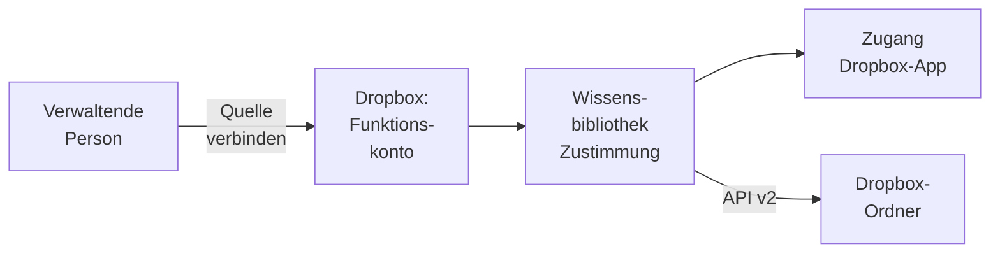

# Konnektor: Dropbox

## 1. Was der Konnektor ist

Der Konnektor liest **Ordner eines Dropbox-Kontos**, auf Wunsch auch den **Team-Bereich** eines
Dropbox-Teams, mit einer **Team-App** die **Team-Ordner** eines Teams. Er nutzt die **Dropbox API
v2** (`api.dropboxapi.com` für Auflistungen, `content.dropboxapi.com` für Downloads und Exporte)
und hält die Ordner über das Änderungsprotokoll von
Dropbox aktuell. Dropbox ist eine der [Dateiablagen](README.md#2-dateiablagen); was alle Dateiablagen
teilen, steht dort.

- **Anmeldung:** über eine **Zustimmung beim Anbieter** (OAuth) für die Bibliothek, mit einem
  Funktionskonto ([Zugänge](../../zugaenge.md), „Zustimmung beim Anbieter für die Bibliothek"). Ein
  Zugang ist **Pflicht**; er trägt die App des Betreibers, die Bibliothek ihre Zustimmung.
- **Konnektor-eigen:** eine App in der **Dropbox App Console** mit „Scoped access" und den
  Berechtigungen `account_info.read`, `files.metadata.read` und `files.content.read`.
- **Zwei Arten von Zugang:** Ein Zugang mit **Mitglieds-App** liest, was ein Dropbox-Konto sieht. Ein
  Zugang mit der Vorgabe **„Team-App"** liest Team-Ordner als Team-Administration, auch solche, die
  kein einzelnes Mitgliedskonto sieht; zustimmen muss dort eine Team-Administration (Abschnitt 2.1).
- **Liest:** Dateien in unterstützten Formaten in einem bis fünfzig Ordnern samt Unterordnern; `/`
  liest die ganze Dropbox, auch mit dem Konto geteilte Ordner. **Paper-Dokumente** exportiert Dropbox
  als Markdown; sie erscheinen mit der Endung `.md`. Dateien, die Dropbox weder herausgibt noch
  exportiert, etwa Verknüpfungen auf Webseiten, werden übersprungen.
- **Dokument:** Der Pfad in Kleinbuchstaben ist die Identität, im Team-Ordner zusammen mit dessen
  Namespace-ID. Umbenennen und Verschieben machen ein
  neues Dokument. Einen Link in die Dropbox-Oberfläche gibt es nicht, weil Dropbox für einen Pfad keine
  verlässliche Web-Adresse nennt; **„Original öffnen"** lädt die Datei durch OPAA, nur aus einem noch
  gewählten Ordner.
- **Rechte** aus Dropbox übernimmt OPAA nicht: Wer die Bibliothek lesen darf, liest alles, was das
  verbundene Konto in den Ordnern sieht, bei einer Team-App alles in den gewählten Team-Ordnern.

## 2. Einrichtung

1. **App anlegen.** In der Dropbox App Console „Create app", „Scoped access", Zugriffsart „Full
   Dropbox" („App folder" sähe nur einen eigenen Ordner). Unter „Permissions" die drei
   Berechtigungen oben setzen; schreibende braucht OPAA nicht. Unter „Settings" bei „Redirect URIs"
   `<öffentliche Adresse von OPAA>/connections/callback` eintragen (`OPAA_PUBLIC_BASE_URL`,
   [Konfiguration](../../../betrieb/konfiguration.md#alle-umgebungsvariablen)). „App key" und „App secret"
   notieren. Für mehr als wenige Konten gibt Dropbox die App nach einem Antrag für den
   Produktivbetrieb frei.
2. **Zugang.** Unter **Administration → Anbindungen → Zugänge** einen Zugang für Dropbox mit der
   Anmeldeart OAuth und der Besitzart Bibliothek anlegen: App key als „Client-ID", App secret als
   „Client-Secret", „Scopes" leer. Die Server-Adresse ist fest.
3. Festlegen, wer den Zugang nutzen darf; ab Werk nur die Systemverwaltung
   ([Berechtigungen](../../../konten-und-rechte/berechtigungen.md), „Konnektor-Freigabe").
4. Ein **eigenes Dropbox-Konto für OPAA** bereithalten. Mit ihm stimmt die verwaltende Person bei
   „Quelle verbinden" zu; die Verbindung bleibt, wenn sie ausscheidet.

App key und Secret gehen nur an den Token-Endpunkt von Dropbox; OPAA fragt die Zustimmung mit
`token_access_type=offline` an und hält das Refresh-Token verschlüsselt. Das Zugriffstoken geht nur an
die beiden API-Hosts; Redirects folgt der Konnektor nicht. Trennen, ein Neuverbinden mit anderem
Konto, die Notabschaltung und das Löschen des Zugangs widerrufen das Token bei Dropbox.

### 2.1 Team-App

Team-Ordner, die kein einzelnes Mitgliedskonto sieht, liest nur eine Team-App. Ihre Zustimmung gibt
eine **Team-Administration** von Dropbox Business für das ganze Team.

1. **App anlegen** wie oben, zusätzlich unter „Permissions" die Team-Berechtigungen
   `team_info.read`, `team_data.member` und `files.team_metadata.read` setzen. Mit ihnen stimmen nur
   Team-Administrationen zu.
2. **Zugang** wie oben anlegen und unter „Vorgaben" **„Team-App (Zustimmung einer
   Team-Administration)"** einschalten; „Scopes" bleibt leer. OPAA fragt bei der Zustimmung dann die
   drei Berechtigungen der Mitglieds-App und die drei Team-Berechtigungen an. Wer „Scopes" doch
   füllt, muss alle sechs nennen; fehlt eine, nimmt OPAA den Zugang nicht an.
3. Bei „Quelle verbinden" stimmt ein Konto mit Team-Administration zu. OPAA nennt danach dieses Konto
   („Verbunden als …").

Die Vorgabe gilt für jede Bibliothek des Zugangs. Solange Bibliotheken auf dem Zugang liegen, lässt sie
sich nicht umschalten: Ihre gespeicherte Auswahl, Ordnerpfade oder Team-Ordner, passte nicht mehr.
Für die andere Art einen eigenen Zugang anlegen.

Das Token einer Team-App reicht bei Dropbox weiter als das, was OPAA liest: Es könnte im Namen jedes
Mitglieds lesen. OPAA liest damit nur die gewählten Team-Ordner, als die Team-Administration, die
zugestimmt hat.

## 3. Quellkonfiguration

Die Zeile „Verbindung" fragt weder Adresse noch Zugangsdaten ab. „Eigene Adresse" gibt es nicht.

1. **Zugang** wählen, wenn mehrere zur Wahl stehen.
2. **„Quelle verbinden"** und bei Dropbox mit dem Funktionskonto zustimmen
   ([Wissensbibliotheken](../README.md), Abschnitt 3.3). OPAA nennt danach das Konto
   („Verbunden als …"). Erst dann laden Ordnerauswahl und Test etwas.
3. **„Teambereich lesen"**: aus liest die Ordner des Kontos, an die des Team-Bereichs.
4. **Umfang**: „Alle Ordner" oder „Nur ausgewählte Ordner", Pfade wie `/Projekte`; kein Ordner
   darf in einem anderen liegen. Die Auswahl zeigt die Ordner Ebene für Ebene; ist eine Ebene sehr
   groß, steht „Liste unvollständig.", und die übrigen Ordner lassen sich über „Von Hand
   eintragen …" angeben.
5. Der Verbindungstest prüft jeden Ordner.

**Unter einem Zugang mit Team-App** steht in der Zeile „Verbindung" statt des Schalters ein Hinweis,
dass die Bibliothek Team-Ordner des Teams liest. Der **Umfang** wählt ein bis fünfzig Team-Ordner aus
einer flachen Liste; die übrigen Ordner eines Team-Ordners wählt man nicht einzeln, jeder Team-Ordner
wird ganz gelesen. Fehlt ein Team-Ordner in der Liste, nimmt „Von Hand eintragen …" seine
Namespace-ID aus Ziffern an. Mitgliederordner, geteilte Ordner und App-Ordner bietet die Liste nicht
an. Der Verbindungstest prüft jeden Team-Ordner.

Unter „Umfang" stehen die Ordner für alle Leseberechtigten, beim Team-Bereich mit „im Team-Bereich".
Den eigenen Vollabgleich-Rhythmus setzt „Vollabgleich alle … Tage". Eine geänderte Ordnerliste oder
ein umgeschalteter Team-Bereich lassen den nächsten Lauf vollständig abgleichen, ebenso eine geänderte
Auswahl der Team-Ordner.

## 4. Betriebsarten und Änderungserkennung

| Laufart | Wann | Was er tut |
|---|---|---|
| **Vollabgleich** | erster Lauf, nach einer Änderung der Ordner, nach einem verfallenen Änderungsstand, nach einem gelöschten, umbenannten oder verschobenen Ordner, im Vollabgleich-Rhythmus, „Vollabgleich starten" | listet alle Ordner und entfernt, was fehlt |
| **Änderungslauf** | jeder Lauf dazwischen und „Jetzt indizieren" | liest das Änderungsprotokoll jedes Ordners ab dem gespeicherten Stand |

Jeder Ordner hat einen eigenen Änderungsstrom. War ein Ordner beim Beginn eines Vollabgleichs nicht
erreichbar, hat sein Strom keinen Stand, und der nächste Lauf ist wieder ein Vollabgleich.

**Unverändertes erkennen.** Vor dem Download vergleicht OPAA die Inhaltsprüfsumme von Dropbox
(`content_hash`), bei Paper-Dokumenten die Revision. Verbindlich bleibt die eigene Prüfsumme.

**Über mehrere Läufe.** Reicht das Budget nicht, listet der nächste Lauf zuerst die noch nicht
gelisteten Ordner, danach die schon gelisteten erneut. Ein einzelner Ordner wird immer in einem Lauf
ganz gelistet.

## 5. Löscherkennung

Weil der Pfad die Identität ist, entfernt ein Vollabgleich auch über mehrere Läufe, was keiner seiner
Läufe gesehen hat ([Konnektoren](README.md#23-wann-eine-gelöschte-datei-als-nachgewiesen-gilt)).

| Ereignis in Dropbox | Verhalten in OPAA |
|---|---|
| Datei gelöscht | der nächste Änderungslauf entfernt das Dokument, sonst der nächste Vollabgleich |
| Datei umbenannt oder verschoben | der nächste Änderungslauf entfernt das alte Dokument und nimmt die Datei unter dem neuen Pfad auf |
| Ordner gelöscht | Dropbox meldet nur den Ordner; OPAA macht den nächsten Lauf zum Vollabgleich, der die Dateien entfernt |
| Ordner umbenannt oder verschoben | die Dateien kommen unter dem neuen Pfad an; die alten entfernt der folgende Vollabgleich |
| gewählter Ordner gelöscht oder nicht mehr geteilt | nicht erreichbar, nichts wird entfernt |

Ob ein gemeldeter gelöschter Pfad Datei oder Ordner war, fragt OPAA bei Dropbox nach; bei unklarer
Antwort folgt ein Vollabgleich.

## 6. Ordner

Die Ordner unterhalb jedes gewählten Ordners erscheinen als Ordner der Bibliothek, der gewählte Ordner
ist die Wurzel. Bei mehreren steht sein Name vorn, bei `/` „Dropbox". Namen, die keinen Ordner tragen
können, und zu tiefe Ketten folgen den Regeln des Kapitels
[Wissensbibliotheken](../README.md).

## 7. Anhänge

Eine EML- oder MSG-Datei liefert ihre Anhänge als eigene Dokumente, mit den Grenzen des Kapitels
[E-Mail](../formate/mail.md).

## 8. Grenzen und Schutzmechanismen

- **Drosselung.** Bei `429` wartet OPAA die Zeit aus `Retry-After`, höchstens `max-retry-wait`, und
  wiederholt bis zu `max-retries`-mal.
- **Kosten eines Laufs.** Ein Änderungslauf ohne Änderungen kostet zwei Anfragen je Ordner, mit
  Team-Bereich eine weitere je Lauf, mit Team-App mindestens zwei weitere je Lauf (die
  Team-Administration und die Liste der Team-Ordner); jede Protokollseite und jeder gelöschte Pfad
  kosten eine mehr.
- **Team-Ordner.** Höchstens fünfzig je Bibliothek. Die Auswahl listet bis zu zehn Seiten der
  Namespaces des Teams, ein Lauf bis zu hundert. Darüber steht in der Auswahl „Liste
  unvollständig.", und weitere Team-Ordner lassen sich über ihre Namespace-ID angeben; im Lauf ist
  ein Team-Ordner jenseits dieser Grenze „nicht auffindbar" und wird nicht gelesen.
- **Große Ordner.** Ein Ordner mit mehr Einträgen, als ein Lauf auflisten kann, kommt nie zum Ende,
  und jeder Lauf endet als „unvollständig, wird fortgesetzt". Abhilfe: Budget anheben oder den Ordner
  aufteilen.
- Ist der Pfad länger, als die Identität eines Dokuments fassen kann, wird die Datei nicht geladen
  und bei jedem Vollabgleich als abgewiesen gemeldet ([Wissensbibliotheken](../README.md),
  Abschnitt 7.1).
- **Noch nicht an einem echten Dropbox-Konto bestätigt** und auf die Dokumentation von Dropbox und ein
  Testdoppel gestützt: die Meldungen gelöschter und verschobener Ordner im Änderungsprotokoll, der
  Markdown-Export von Paper-Dokumenten, der Team-Bereich über die Wurzel des Teams, die Team-App
  samt Lesen als Team-Administration in einem Team-Ordner und die Antwort von Dropbox, wenn das Token
  einer Mitglieds-App an eine Team-Schnittstelle geht.
- **Offen beim neueren Team-Bereich:** In Teams mit dem neueren Modell des Team-Bereichs ist nicht
  geklärt, ob `team/namespaces/list` die Wurzel des Team-Bereichs als Team-Ordner nennt. Nennt
  Dropbox sie nicht, erscheint sie in der Auswahl nicht und lässt sich über eine Team-App nicht
  lesen; das ist an keinem echten Konto bestätigt.

## 9. Protokoll und Fehlerbilder

| Meldung | Bedeutung | Abhilfe |
|---|---|---|
| „Bitte zuerst die Quelle verbinden." | noch keine Zustimmung | „Quelle verbinden" |
| „Dropbox hat das Zugriffstoken abgewiesen." | Zustimmung widerrufen oder App gelöscht | die Quelle neu verbinden |
| „Der Dropbox-App fehlt die Berechtigung …" | der App fehlt die genannte Berechtigung, bei einer Team-App auch eine der Team-Berechtigungen; nennt Dropbox keine, heißt es „fehlt eine Berechtigung, die der Zugang anfragt" | in der App Console ergänzen, dann neu verbinden |
| „Eine Team-App braucht die Scopes …; „Scopes" leer lassen oder ergänzen" | beim Speichern eines Zugangs mit Team-App: eigene Scopes ohne alle Team-Berechtigungen | „Scopes" leeren oder die genannten ergänzen |
| „Der Ordner „…" ist für das Konto nicht sichtbar." | Pfad falsch, Ordner gelöscht oder nicht geteilt; der Bestand bleibt | Ordner prüfen |
| „Das verbundene Dropbox-Konto gehört zu keinem Team mit Team-Bereich." | Team-Bereich gewählt, das Konto hat keinen | Schalter aus oder Teamkonto verbinden |
| „Dropbox nimmt die Zustimmung nicht als Team-App an; die Quelle muss von einer Team-Administration neu verbunden werden." | Zugang mit Team-App, zugestimmt hat ein Konto ohne Team-Administration oder die App trägt keine Team-Berechtigungen | Berechtigungen prüfen, mit einer Team-Administration neu verbinden |
| „„…" ist kein Team-Ordner des Teams. OPAA liest nur Team-Ordner." | der gewählte Team-Ordner ist gelöscht, archiviert oder kein Team-Ordner; der Bestand bleibt | Auswahl prüfen |
| „„…" ist nicht auffindbar. OPAA liest nur Team-Ordner." | das Team hat mehr Namespaces, als ein Lauf listet, und der Team-Ordner kam darin nicht vor; der Bestand bleibt | Team-Ordner aufräumen |
| „Dropbox hat die Liste der Team-Ordner ohne Fortsetzungspunkt abgebrochen." | Dropbox meldete weitere Team-Ordner, nannte aber keinen Fortsetzungspunkt; Auswahl oder Lauf enden ohne Ergebnis | später erneut versuchen |
| „… von … Team-Ordnern … nicht lesbar." | Ergebnis des Verbindungstests; die einzelnen stehen darunter | die genannten Team-Ordner prüfen |
| „… Dateien übersprungen, die Dropbox weder herausgibt noch exportiert" | Sammelhinweis je Lauf | nichts |
| „Dropbox drosselt die Anfragen weiterhin" | nach allen Wiederholungen; der Strom wird erneut gelesen | Zeitplan entzerren |
| „Die Übertragung von Dropbox dauerte länger als …" | über `download-timeout`; folgt im nächsten Lauf | Frist anheben |
| „Dropbox nimmt den gespeicherten Stand des Änderungsprotokolls nicht mehr an." / „Der Ordner „…" war beim Beginn des letzten Vollabgleichs nicht erreichbar." | nächster Lauf ist ein Vollabgleich | nichts |

## 10. Konfiguration

Alle Schlüssel unter `opaa.indexing.dropbox.*`.

| Schlüssel | Umgebungsvariable | Standard | Wirkung |
|---|---|---|---|
| `page-size` | `OPAA_INDEXING_DROPBOX_PAGE_SIZE` | 2000 | Einträge je Auflistungs- und Änderungsseite; höchstens 2000 |
| `max-file-size-bytes` | `OPAA_INDEXING_DROPBOX_MAX_FILE_SIZE_BYTES` | 52428800 (50 MiB) | Obergrenze je Download oder Export, auch für „Original öffnen" |
| `request-timeout` | `OPAA_INDEXING_DROPBOX_REQUEST_TIMEOUT` | 30s | Timeout je Anfrage |
| `download-timeout` | `OPAA_INDEXING_DROPBOX_DOWNLOAD_TIMEOUT` | 10m | Gesamtfrist je Download oder Export |
| `max-retries` | `OPAA_INDEXING_DROPBOX_MAX_RETRIES` | 5 | Wiederholungen einer gedrosselten Anfrage |
| `max-retry-wait` | `OPAA_INDEXING_DROPBOX_MAX_RETRY_WAIT` | 5m | längste einzelne Wartezeit |
| `request-budget-per-run` | `OPAA_INDEXING_DROPBOX_REQUEST_BUDGET_PER_RUN` | 20000 | Anfragen je Lauf |
| `max-files-per-run` | `OPAA_INDEXING_DROPBOX_MAX_FILES_PER_RUN` | 1000000 | gelistete Dateien je Vollabgleich, bevor der Lauf scheitert |
| `download-concurrency` | `OPAA_INDEXING_DROPBOX_DOWNLOAD_CONCURRENCY` | 2 | gleichzeitige Downloads je Lauf |
| `api-base`, `content-base`, `authorization-endpoint`, `token-endpoint`, `revocation-endpoint` | `OPAA_INDEXING_DROPBOX_API_BASE` usw. | die Adressen von Dropbox | nur für einen Ersatzserver in Tests |

Die Obergrenze von fünfzig Ordnern je Bibliothek ist fest.

## 11. Nicht gebaut

- Mitgliederordner, geteilte Ordner und App-Ordner über eine Team-App (Lesen im Namen beliebiger
  Mitglieder)
- Unterordner eines Team-Ordners als eigener Umfang
- Persönliche Verbindung und private Bibliotheken
- Übernahme von Rechten aus Dropbox
- Push-Benachrichtigungen über Webhooks; der Änderungslauf im Zeitplan ersetzt sie
- Fortsetzungspunkt innerhalb eines Ordners
