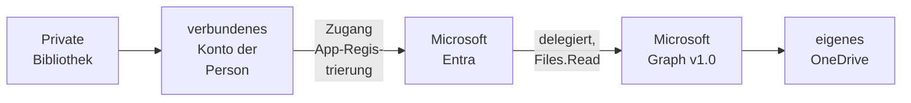

# Konnektor: OneDrive

> **Entwurf** — gegen den Code geprüft, vom Maintainer noch nicht abgenommen.

## 1. Was der Konnektor ist

Der Konnektor liest das **eigene OneDrive for Business einer Person** über **Microsoft Graph v1.0**
und speist daraus ihre [private Bibliothek](../private-bibliotheken.md). Beispiel: Eine Referentin
verbindet ihr Dienstkonto bei Microsoft 365 mit OPAA und wählt in ihrem OneDrive den Ordner
„Vorlagen"; danach findet sie deren Inhalt im Chat, und außer ihr niemand. OneDrive ist eine der
[Dateiablagen](README.md#2-dateiablagen); Speicher, Abgleich und Löscherkennung teilt es mit
[SharePoint](sharepoint.md).

- **Anmeldung:** über das **verbundene Konto der Person** mit ihrer Zustimmung bei Microsoft
  (OAuth, delegiert) ([Zugänge](../../zugaenge.md), „Verbundenes Konto einer Person"). Ein Zugang ist
  **Pflicht**; er trägt die App-Registrierung des Hauses, das verbundene Konto die Zustimmung. Eine
  geteilte Bibliothek über ein Dienstkonto gibt es nicht; OneDrive speist nur private Bibliotheken.
- **Konnektor-eigen:** die delegierten Berechtigungen **`Files.Read`** und **`offline_access`**, keine
  Anwendungsberechtigung. OPAA liest damit nur, was die Person selbst lesen darf, und nur ihr
  eigenes OneDrive: Vor jedem Lauf, jedem Verbindungstest, jeder Auflistung und jedem „Original
  öffnen" fragt OPAA bei Graph, welches OneDrive zum verbundenen Konto gehört, und liest nur dann
  weiter, wenn es das der Bibliothek ist.
- **Liest:** Dateien in unterstützten Formaten im ganzen OneDrive oder in bis zu fünfzig gewählten
  Ordnern samt Unterordnern, Office-Dateien so, wie sie liegen. **Nicht** gelesen werden Dateien,
  die andere mit der Person teilen und die in deren Laufwerk liegen, auch nicht als Verknüpfung
  unter „Meine Dateien", Dokumentbibliotheken von SharePoint, OneNote-Notizbücher, Dateien, die
  Microsoft als Schadsoftware kennzeichnet, und **private Microsoft-Konten** (OneDrive ohne
  Arbeits- oder Schulkonto).
- **Dokument:** OneDrive und Datei-Kennung sind die Identität. Umbenennen und Verschieben innerhalb
  des OneDrive behalten das Dokument. Einen Link in die OneDrive-Oberfläche gibt es nicht;
  **„Original öffnen"** lädt die Datei durch OPAA, nur aus dem OneDrive, das die Bibliothek gewählt
  hat, und nur, solange das verbundene Konto dazu gehört.
- **Rechte** aus OneDrive übernimmt OPAA nicht. Es braucht keine: Eine private Bibliothek liest
  außer ihrer Besitzerin niemand.

## 2. Einrichtung

Die Systemverwaltung richtet die App-Registrierung und den Zugang einmal ein; jede Person verbindet
danach ihr eigenes Konto.

1. **App-Registrierung.** Im Microsoft-Entra-Admin-Center „App-Registrierungen" → „Neue
   Registrierung", etwa `opaa-onedrive`, nur Konten dieses Verzeichnisses. Als Umleitungs-URI die
   Plattform **„Web"** mit `<öffentliche Adresse von OPAA>/connections/callback` eintragen
   (`OPAA_PUBLIC_BASE_URL`, [Konfiguration](../../../betrieb/konfiguration.md#alle-umgebungsvariablen)).
   Anwendungs-ID (Client-ID) und Verzeichnis-ID (Mandanten-ID) notieren.
2. **Secret.** „Zertifikate & Geheimnisse" → „Neuer geheimer Clientschlüssel"; die Spalte „Wert"
   sofort kopieren, nicht die „Geheime ID" daneben, und das Ablaufdatum notieren.
3. **Berechtigungen.** „API-Berechtigungen" → „Microsoft Graph" → **„Delegierte Berechtigungen"**:
   `Files.Read` und `offline_access`. Anwendungsberechtigungen braucht OPAA nicht; `Files.Read.All`
   oder `Sites.Read.All` sind nicht nötig. Ob die Personen selbst zustimmen dürfen oder die
   Verwaltung „Administratorzustimmung erteilen" muss, hängt von den Einstellungen zur
   Benutzerzustimmung im Mandanten ab.
4. **Zugang.** Unter **Administration → Anbindungen → Zugänge** einen Zugang für OneDrive mit der
   Anmeldeart OAuth und der Besitzart „Person" anlegen: Client-ID, Client-Secret, „Ablaufdatum des
   Secrets" und als „Mandant" die Verzeichnis-ID oder die Domäne, etwa `contoso.onmicrosoft.com`.
   „Scopes" leer lassen; OPAA fragt `Files.Read offline_access`. Die Server-Adresse ist fest.
5. Festlegen, wer den Zugang nutzen darf; ab Werk nur die Systemverwaltung
   ([Berechtigungen](../../../konten-und-rechte/berechtigungen.md), „Konnektor-Freigabe").

Als „Mandant" gehört der eigene Mandant eingetragen, nicht `common` oder `organizations`, und die
App-Registrierung bleibt auf Konten dieses Verzeichnisses beschränkt: Sonst kann sich auch ein
Arbeitskonto eines fremden Mandanten verbinden und sein OneDrive einlesen; die Prüfung des eigenen
OneDrive hält es nicht auf. Ein privates Microsoft-Konto weist OPAA in jedem Fall ab.

Client-ID und Secret gehen nur an den Token-Endpunkt des Mandanten, das Zugriffstoken nur an
`https://graph.microsoft.com`. Downloads leitet Graph auf eine kurzlebige Adresse um; OPAA folgt
nur über `https`, prüft das Ziel und sendet dorthin kein Token.

**Verbinden.** Die Person wählt unter **Einstellungen → Verbundene Konten** beim Zugang „Verbinden"
und meldet sich bei Microsoft mit ihrem Arbeits- oder Schulkonto an; Microsoft fragt dabei immer,
welches Konto gemeint ist. Nach der Zustimmung nennt OPAA das Konto mit der E-Mail-Adresse, die
Graph als Besitzer des OneDrive angibt; nennt Graph keine, den Anzeigenamen oder nichts
([Benutzerverwaltung](../../../konten-und-rechte/benutzerverwaltung.md), „Verbundene Konten").

## 3. Quellkonfiguration

Eine OneDrive-Bibliothek legt fest:

- **das OneDrive** — genau eines, das des verbundenen Kontos; die Auswahl bietet nur dieses an;
- **Ordner** (optional) — ohne Auswahl gilt das ganze OneDrive, sonst bis zu fünfzig Ordner samt
  Unterordnern; die Auswahl zeigt die Ordner Ebene für Ebene, nur bis zu einer festen Grenze je
  Ebene;
- **einen eigenen Vollabgleich-Rhythmus** in Tagen (optional).

Der Assistent „Neue Wissensbibliothek" bietet die Quellart „OneDrive" nur Personen an, die auf
einem OneDrive-Zugang ein verbundenes Konto haben. Unter „Zugang" steht dieser als „`<Zugang>` · privat"
mit dem Hinweis „nur für Sie, später nicht änderbar"; eine geteilte Bibliothek und „Eigene Adresse"
gibt es nicht, und der Schritt „Freigaben" entfällt. Gibt es nur einen solchen Zugang, ist er schon
gewählt und steht als Zeile ohne Auswahlknopf da, samt Hinweis; die Zeile „Verbindung" bleibt dann
zuerst aufgeklappt. Bei mehreren wählt man einen ausdrücklich.

- **Verbindung** fragt weder Adresse noch Zugangsdaten ab. OPAA ermittelt das OneDrive des
  verbundenen Kontos selbst und nennt es mit seinem Namen als „das OneDrive Ihres verbundenen
  Microsoft-Kontos". Lässt es sich nicht ermitteln, steht dort „Das OneDrive ließ sich nicht
  ermitteln." mit dem Grund aus Abschnitt „Protokoll und Fehlerbilder" und „Erneut ermitteln"; der
  Assistent geht dann nicht weiter („OneDrive fehlt").
- **Umfang** bietet „Alle Ordner" (Vorgabe) oder „Nur ausgewählte Ordner". Bis zu sieben Ordner der
  obersten Ebene stehen zum Ankreuzen in der Zeile; „Ordner auswählen …" öffnet den Auswahldialog
  mit allen Ebenen. Die Zeile nennt danach die gewählten Ordner mit ihrem Pfad, etwa
  „Projekte / 2026".
- **Zeitplan** mit „Vollabgleich alle … Tage" für den eigenen Vollabgleich-Rhythmus.

Der Verbindungstest prüft mit dem verbundenen Konto, dass das gewählte OneDrive dessen eigenes und
erreichbar ist, samt den gewählten Ordnern; bei Erfolg meldet er „Anmeldung erfolgreich; das OneDrive
ist erreichbar." Die Adresse von Microsoft Graph ist fest; ein gescheiterter Test nennt deshalb nie
die Stufe „Adresse", sondern „Anmeldung" oder „Rechte"; fehlt nur eine Angabe oder scheitert er
vor der Anmeldung, etwa an der Zieladressprüfung, allein die Meldung. Ein Ergebnis gilt nur für
die Auswahl, mit der getestet wurde: Wer danach Ordner ändert, sieht wieder „nicht geprüft".

Im Reiter „Quelle" öffnet „Ändern" jede Zeile einzeln, „Speichern" übernimmt sie. Unter
„Verbindung" ermittelt „OneDrive neu wählen" das OneDrive des inzwischen verbundenen Kontos; ist es
ein anderes, gilt danach wieder „Alle Ordner", weil die bisherigen Ordner zum alten OneDrive gehören.
Eine andere Auswahl lässt den nächsten Lauf vollständig abgleichen.

**Wenn das Konto nicht mehr gilt.** Lehnt Microsoft die Erneuerung des Tokens ab oder weist Graph das
Token ab, gilt die Verbindung als **abgelaufen**: Die Person wird benachrichtigt, die Bibliothek ruht
mit „Abgelaufen" und „Konto neu verbinden", und ihr Bestand bleibt durchsuchbar
([Private Bibliotheken](../private-bibliotheken.md)). Eine Warnung vor dem Ablauf gibt es nicht.
Ein Token ohne Berechtigung, etwa bei fehlender Administratorzustimmung, beendet dagegen nur den
Lauf mit der Meldung zur Zustimmung; die Verbindung läuft nicht ab, und niemand wird benachrichtigt.
Verbindet die Person ein anderes Microsoft-Konto, liest OPAA das OneDrive der Bibliothek nicht mehr:
Jeder Lauf scheitert, bis sie mit dem Konto neu verbindet, dem das OneDrive gehört, oder das OneDrive
neu wählt.

**Trennen** löscht das Token in OPAA. **Bei Microsoft widerruft OPAA nichts**, weil Entra dafür keinen
Weg anbietet; die Zustimmung bleibt dort gültig, bis sie abläuft oder widerrufen wird. Wer sichergehen
will, entzieht sie zusätzlich bei Microsoft: die Person in ihrem Konto unter „Meine Apps" bei der App,
die Verwaltung im Entra-Admin-Center mit „Sitzungen widerrufen" am Benutzer oder durch Entfernen der
Zustimmung in den Berechtigungen der Unternehmensanwendung. Diese Wege sind nicht an einem echten
Mandanten bestätigt. Dasselbe gilt für „Alle Verbindungen trennen" am Zugang.

## 4. Betriebsarten und Änderungserkennung

| Laufart | Wann | Was er tut |
|---|---|---|
| **Vollabgleich** | erster Lauf, nach einer Änderung der Auswahl, nach einem verfallenen Änderungsstand, im Vollabgleich-Rhythmus, „Vollabgleich starten" | listet das OneDrive und entfernt, was fehlt |
| **Änderungslauf** | jeder Lauf dazwischen und „Jetzt indizieren" | liest das Änderungsprotokoll des OneDrive ab dem gespeicherten Stand |

Vor jedem Lauf prüft OPAA, dass das verbundene Konto zum OneDrive der Bibliothek gehört; sonst
scheitert der Lauf, bevor er das OneDrive anfragt, und der Bestand bleibt.

**Unverändertes erkennen** und **Fortsetzung über mehrere Läufe** wie bei
[SharePoint](sharepoint.md#4-betriebsarten-und-änderungserkennung): Inhaltsprüfsumme, ersatzweise
Inhaltsversion oder Änderungszeit, jeweils mit Größe, Name und Ordner; reicht das Budget nicht, setzt
der nächste Lauf an der gemerkten Stelle fort, und am Ende liest OPAA das Änderungsprotokoll ab dem
Stand, der zu Beginn galt ([Konnektoren](README.md#23-wann-eine-gelöschte-datei-als-nachgewiesen-gilt)).

## 5. Löscherkennung

| Ereignis in OneDrive | Verhalten in OPAA |
|---|---|
| Datei gelöscht oder aus den gewählten Ordnern verschoben | der nächste Änderungslauf entfernt das Dokument („Im OneDrive gelöscht oder aus den gewählten Ordnern entfernt") |
| Datei umbenannt oder innerhalb des OneDrive verschoben | das Dokument bleibt; Titel, Ordner und Pfad folgen |
| Datei in ein anderes Laufwerk verschoben, etwa eine SharePoint-Dokumentbibliothek | das Dokument entfernt der Änderungslauf, sobald Graph die Löschung meldet, sonst der Vollabgleich |
| Ordner umbenannt oder verschoben | Graph meldet die Dateien nicht einzeln; der nächste Vollabgleich führt den Ordner ohne Download nach |
| Ordner gelöscht oder aus den gewählten Ordnern verschoben | einzeln gemeldete Dateien entfernt der Änderungslauf, die übrigen der nächste Vollabgleich |
| gewählter Ordner gelöscht | das OneDrive gilt als nicht erreichbar, nichts wird entfernt; die Ordnerauswahl ist anzupassen |
| Konto neu verbunden mit einem anderen Microsoft-Konto, Zustimmung entzogen | keine Löschung; der Bestand bleibt |

Für Ordneränderungen gilt ein Fenster bis zum nächsten Vollabgleich; `full-sync-interval` begrenzt es.

## 6. Ordner

Die Ordnerkette ab der Wurzel des OneDrive erscheint als Ordner der Bibliothek. Namen, die keinen
Ordner tragen können, und zu tiefe Ketten folgen den Regeln des Kapitels
[Wissensbibliotheken](../README.md).

## 7. Anhänge

Eine EML- oder MSG-Datei liefert ihre Anhänge als eigene Dokumente, mit den Grenzen des Kapitels
[E-Mail](../formate/mail.md).

## 8. Grenzen und Schutzmechanismen

- **Nur das eigene OneDrive.** Die Bibliothek merkt sich die Kennung ihres OneDrive. Weicht das
  OneDrive des verbundenen Kontos davon ab, ist es kein OneDrive for Business oder hat das Konto
  keines, liest OPAA nichts: kein Lauf, keine Auflistung, kein Original.
- **Verknüpfungen.** Was eine Person mit „Zu ‚Meine Dateien‘ hinzufügen" in ihr OneDrive holt, liegt
  im Laufwerk einer anderen Person oder einer Site. OPAA führt solche Einträge als übersprungen und
  lädt sie nie; die Ordnerauswahl bietet sie nicht an.
- **Drosselung**, **Kosten eines Laufs**, **zu langes Änderungsprotokoll**, **Fortsetzungspunkte**
  und **lange Downloads** wie bei [SharePoint](sharepoint.md#8-grenzen-und-schutzmechanismen), mit
  denselben Parametern. Ein Lauf kostet eine Anfrage mehr für die Prüfung des OneDrive.
- **Obergrenzen.** Fünfzig Ordner je Bibliothek, fest; Dateien je Vollabgleich `max-files-per-run`,
  Größe je Download `max-file-size-bytes`.
- **Noch nicht an einem echten Mandanten bestätigt** und auf die Dokumentation von Microsoft
  gestützt: ob `Files.Read` und `offline_access` ohne Administratorzustimmung genügen, welche Angaben
  Graph mit `Files.Read` über den Besitzer des OneDrive liefert, wie lange Entra eine Zustimmung hält
  und mit welcher Meldung es eine widerrufene ablehnt, die Wege zum Widerruf bei Microsoft, das
  Verhalten für Gastkonten und Konten ohne bereitgestelltes OneDrive, die Inhaltsprüfsumme für alle
  Dateiarten, das Änderungsprotokoll bei verschobenen Ordnern und die Form, in der Graph
  Verknüpfungen im Änderungsprotokoll meldet.

## 9. Protokoll und Fehlerbilder

Was beim Verbinden bei Microsoft scheitern kann, steht im Kapitel
[Benutzerverwaltung](../../../konten-und-rechte/benutzerverwaltung.md), „Verbinden und neu
verbinden".

| Meldung | Bedeutung | Abhilfe |
|---|---|---|
| „Bitte zuerst das Microsoft-Konto verbinden." / „Für die Auflistung ist ein verbundenes Microsoft-Konto erforderlich" | kein verbundenes Konto | Konto verbinden (Abschnitt 2) |
| „Bitte das OneDrive wählen." / „Die Bibliothek hat kein OneDrive gewählt." | Auswahl fehlt | OneDrive wählen |
| „Das verbundene Microsoft-Konto hat kein OneDrive for Business. Private Microsoft-Konten werden noch nicht unterstützt; bitte mit dem Arbeits- oder Schulkonto verbinden." / „Das Laufwerk ist kein OneDrive for Business …" | privates Microsoft-Konto oder anderes Laufwerk | mit dem Arbeits- oder Schulkonto neu verbinden |
| „Das verbundene Microsoft-Konto gehört zu einem anderen OneDrive als dem dieser Bibliothek. …" | mit einem anderen Konto neu verbunden; nichts wird gelesen, der Bestand bleibt | mit dem Konto neu verbinden, dem das OneDrive gehört, oder das OneDrive neu wählen |
| „Für das verbundene Microsoft-Konto ist kein OneDrive bereitgestellt." | Konto ohne OneDrive, etwa ohne Lizenz oder als Gast im Mandanten | OneDrive bereitstellen lassen oder anderes Konto verbinden |
| „Das verbundene Microsoft-Konto darf sein OneDrive nicht lesen; die Anwendung braucht die delegierte Berechtigung Files.Read." | Berechtigung fehlt an der App-Registrierung | `Files.Read` ergänzen (Abschnitt 2), dann neu verbinden |
| „Das Token der App trägt keine Berechtigung: …" | Microsoft stellte das Token ohne Berechtigung aus; der Lauf endet, die Verbindung läuft nicht ab | Berechtigungen und Zustimmung in Entra prüfen, dann neu verbinden |
| „Microsoft Graph hat das Zugriffstoken abgewiesen" | Zustimmung widerrufen oder abgelaufen; die Verbindung gilt als abgelaufen, die Bibliothek ruht | Konto neu verbinden |
| „Das OneDrive ist für das verbundene Konto nicht sichtbar." | Graph zeigt das OneDrive nicht; der Bestand bleibt | Konto neu verbinden |
| „Der gewählte Ordner „…" ist im OneDrive nicht mehr vorhanden; bitte die Ordnerauswahl anpassen." | Ordner gelöscht oder verschoben; der Bestand bleibt | Ordnerauswahl anpassen |
| „Das OneDrive listet mehr als … Dateien; so viele verarbeitet ein Lauf nicht. Bitte Ordner wählen." | über `max-files-per-run` | Ordner wählen oder Grenze anheben |
| „Der Lauf hat keine Datei neu aufgenommen. Budget anheben oder weniger Ordner wählen." | die Kette kommt nicht voran | `request-budget-per-run` anheben |
| „… OneNote-Notizbücher und ihre Abschnitte übersprungen" / „… Verknüpfungen auf Inhalte anderer Laufwerke übersprungen …" / „Microsoft meldet in dieser Datei Schadsoftware; sie wird übersprungen." | übersprungen | nichts |
| „Der Ordner ist im OneDrive nicht mehr vorhanden." | die Auswahl fragt einen gelöschten oder verschobenen Ordner an | Auswahl neu öffnen |
| „Der Downloadserver von Microsoft Graph hat mit HTTP 4xx geantwortet. Die Datei wird übersprungen …" | dauerhaft verweigert; ein späterer Vollabgleich versucht es erneut | nichts |
| „Microsoft Graph drosselt die Anfragen weiterhin" / „Die Übertragung von Microsoft Graph dauerte länger als …" | vorübergehend fehlgeschlagen; der Strom wird erneut gelesen | Zeitplan entzerren bzw. `download-timeout` anheben |
| „Microsoft Graph nimmt den gespeicherten Stand des Änderungsprotokolls nicht mehr an" / „Das OneDrive war beim Beginn des letzten Vollabgleichs nicht erreichbar." | nächster Lauf ist ein Vollabgleich | nichts |
| „OneDrive ist derzeit nicht erreichbar. Bitte später erneut versuchen." | „Original öffnen" gescheitert, vorübergehend | später erneut |

## 10. Konfiguration

OneDrive nutzt dieselben Schlüssel wie SharePoint, `opaa.indexing.sharepoint.*` mit den
Umgebungsvariablen `OPAA_INDEXING_SHAREPOINT_*`; Standards und Wirkung stehen im Kapitel
[SharePoint](sharepoint.md#10-konfiguration), Abschnitt „Konfiguration". Jeder Wert gilt für beide
Konnektoren, auch `full-sync-interval`; einen eigenen Vollabgleich-Rhythmus setzt die Bibliothek.
Die Obergrenze von fünfzig Ordnern ist fest.

## 11. Nicht gebaut

- Private Microsoft-Konten ([#3110](https://github.com/criew/opaa/issues/3110))
- Widerruf der Zustimmung bei Microsoft beim Trennen
- Warnung vor dem Ablauf der Zustimmung
- OneDrive über ein Dienstkonto für eine geteilte Bibliothek
- Dateien, die andere mit der Person teilen
- Nationale Clouds; die Adresse ist fest
- Link in die OneDrive-Oberfläche
