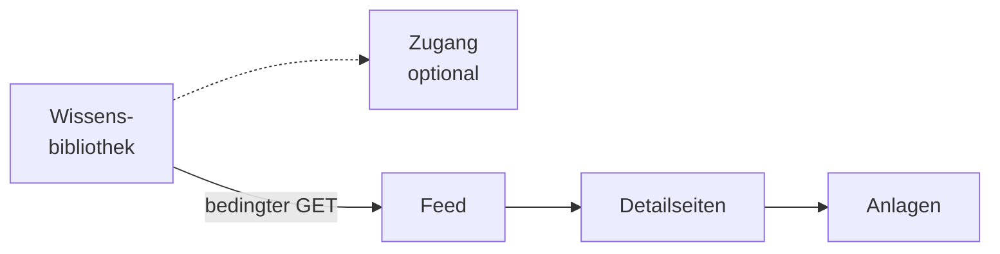
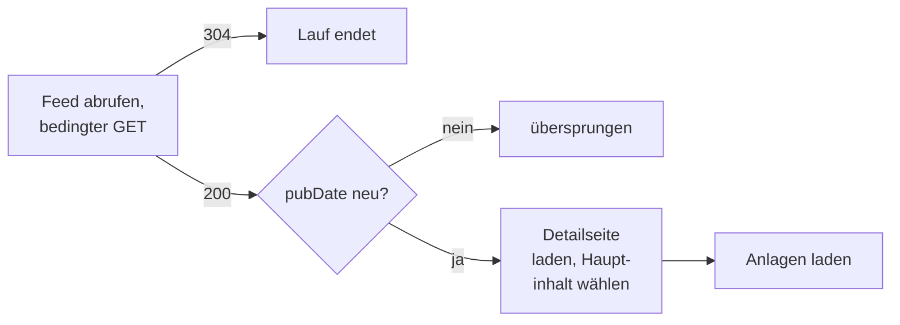

# Konnektor: Feed

## 1. Was der Konnektor ist

Der Konnektor hält eine Bibliothek mit Veröffentlichungen aktuell, die eine Website als **RSS-Feed**
anbietet: Pressemitteilungen, Amtsblätter, Bekanntmachungen, Rundschreiben. Er liest den Feed
(**RSS 2.0** über HTTP(S); Atom nicht), lädt zu jedem Eintrag die verlinkte Detailseite, reduziert sie
auf ihren Hauptinhalt und holt die dort verlinkten Anlagen als eigene Dokumente. Anders als die
übrigen Konnektoren sieht er nie den ganzen Bestand, nur das Fenster, das der Feed gerade zeigt.

- **Anmeldung:** keine oder HTTP Basic, eigene Zugangsdaten der Bibliothek
  ([Zugänge](../../zugaenge.md), „Eigene Zugangsdaten der Bibliothek"). Zugangsdaten gelten **nur für
  den Ursprung des Feeds**. Ein Zugang ist möglich.
- **Liest:** je Eintrag `title`, `link`, `description` und `pubDate`, die Detailseite und ihre
  Anlagen. Erweiterungen in fremden Namensräumen (`content:encoded`, `media:*`) werden
  ignoriert. Ein Eintrag ohne Link entfällt, von mehreren Links zählt der erste; ein nicht lesbares
  `pubDate` gilt als fehlend.
- **Dokument:** Der Eintrag ist ein Dokument, jede Anlage ein eigenes mit dem Eintrag als
  Elterndokument. Im Chat öffnet „Dokument öffnen" an einer Fundstelle daraus das Dokument durch
  OPAA; die Adresse des Eintrags zeigt das Belegfenster nicht.
- **Rechte** der Website übernimmt OPAA nicht.

## 2. Einrichtung

1. Liegt der Feed im privaten Netz, seinen Hostnamen für die
   [Zieladressprüfung](README.md#12-zieladressprüfung) freigeben.
2. Die Detailseite eines Eintrags im Browser ansehen: Trifft die Werkseinstellung des
   Inhaltsselektors (Abschnitt „Konfiguration“) den Text nicht oder zu viel Seitenrahmen, braucht
   die Bibliothek einen eigenen **Inhaltsselektor**.
   Hängen die Anlagen ohne Dateiendung an der Seite, wie beim Government Site Builder, braucht
   sie das **Anlagenprofil** `GSB` (Abschnitt „Anhänge“).
3. Optional einen Zugang anlegen. Die Profilpflicht „Nur über Zugänge" legt nur die Feed-Adresse
   fest; Detailseiten auf anderen Servern bestimmt der Betreiber des Feeds. Das sagt OPAA, bevor die
   Pflicht eingeschaltet wird.

## 3. Quellkonfiguration

Die Angaben sind dieselben wie beim [Webverzeichnis](http-directory.md#3-quellkonfiguration):
„Adresse (URL)" des Feeds und optionale Anmeldedaten `benutzer:passwort`. Dort steht auch, wann
gespeicherte Zugangsdaten beim Bearbeiten erhalten bleiben. Die
Oberfläche weist beim Anlegen darauf hin, dass OPAA auch die verlinkten Detailseiten abruft.

**Über einen Zugang:** wie beim Webverzeichnis; die Feed-Adresse liegt unter der Server-Adresse des
Zugangs. Eine Detailseite oder Anlage auf einem anderen Server ruft OPAA weiter ab, aber ohne
Zugangsdaten.

**Umfang:** wie OPAA die Detailseiten dieses Feeds liest. Beide Angaben sind optional; leer gilt
die Werkseinstellung (Abschnitt „Konfiguration“). Die Zeile sehen auch Lesende der Bibliothek.

- „Inhaltsselektor“: ein CSS-Selektor in Jsoup-Syntax, etwa `#inhalt` oder `.artikel-text`. Jeder
  Treffer ist ein Inhaltsbereich; trifft er nichts, nimmt der Lauf die ganze Seite. Einen Selektor,
  der nicht gelesen werden kann oder zu aufwendig wäre, lehnt OPAA beim Speichern ab (Abschnitt
  „Grenzen und Schutzmechanismen“).
- „Anlagenprofil“: welche Links als Anlagen gelten (Abschnitt „Anhänge“).

**Verbindungstest:** Ist eine der beiden Angaben gesetzt, lädt der Test zusätzlich die Detailseite
des ersten Eintrags und meldet, wie viele Inhaltsbereiche der Selektor findet und wie viele Anlagen
das Profil. Ohne eigene Angaben bleibt es bei der Anfrage an den Feed.

**Änderung:** Sie gilt ab dem nächsten Lauf, nach Zeitplan oder mit „Jetzt indizieren“; das
Speichern selbst startet keinen. Dieser Lauf liest den ganzen Feed und jeden Eintrag darin neu,
auch einen mit unverändertem `pubDate`, bis zu `max-entries` Einträge; jede weitere Änderung der
Angaben bewirkt das erneut. Hat ein Lauf jeden Eintrag einmal gelesen, gilt die Änderung als
angewandt, auch wenn einzelne Einträge dabei zurückgestellt wurden (Abschnitt „Betriebsarten und
Änderungserkennung“). Ein Eintrag mit gleichem Text behält seine Chunks, bekommt aber die Anlagen,
die das neue Profil findet. Ein zurückgestellter Eintrag, was nicht mehr im Feed steht, und Anlagen,
die nur das alte Profil fand, behalten ihre bisherige Fassung, bis sich der Eintrag ändert oder
jemand sie löscht.
Das Revisionsprotokoll nennt die geänderte Angabe als Änderung der Quelle, ohne ihren Wert.

## 4. Betriebsarten und Änderungserkennung

Jeder Lauf ist **ergänzend**: Er verarbeitet höchstens `max-entries` Einträge des Feeds und entfernt
nie etwas, weil es fehlt.

Unverändertes erkennt er in drei Stufen:

1. **Feed, bedingter GET.** OPAA merkt sich ETag und Last-Modified. Antwortet der Server mit 304,
   endet der Lauf nach einer Anfrage mit null Elementen — der Normalfall bei stündlichem Zeitplan.
2. **Eintrag, Veröffentlichungsdatum.** Ein Eintrag mit gleichem `pubDate`, der zuletzt erfolgreich
   indiziert wurde, wird übersprungen; ein fehlendes Datum gilt als geändert.
3. **Prüfsumme** über den reduzierten Inhalt. Bei neuem Datum, aber gleichem Text bleiben die Chunks;
   Datum und eine geänderte Überschrift werden übernommen.

Ein unveränderter Eintrag ohne Anlagen-Dokumente lädt seine Detailseite einmal, nur um Anlagen zu
finden; der Text wird dabei nicht neu verarbeitet.

Nach einer Änderung von Inhaltsselektor oder Anlagenprofil entfallen die Stufen 1 und 2, bis ein
Lauf jeden Eintrag des Feeds einmal unter den neuen Angaben gelesen hat: OPAA merkt sich mit dem
Feed-Zustand, unter welchen Angaben das geschah.

**Zurückstellen.** Den Feed-Zustand aus Stufe 1 speichert ein Lauf nur, wenn er vollständig war:
kein Fehler, kein abgeschnittener Feed, keine verlorene Anlage, keine Ablehnung am Kontingent und
kein zurückgestellter Eintrag. Zurückgestellt wird, was beim nächsten Mal klappen könnte — eine nicht
erreichbare Detailseite, eine Abweisung mit 403 oder 429. Ohne gespeicherten Zustand liefert der
Server beim nächsten Lauf den ganzen Feed, und diese Einträge bekommen eine zweite Chance.

**Detailseite.** Sie wird nach den Regeln der [HTML-Pipeline](../formate/html.md) reduziert:
Navigation, Seitenleisten, Cookie-Banner, `script`, `style` und `noscript` entfallen überall; die
Inhaltsbereiche wählt der Inhaltsselektor der Bibliothek (Rückfall `body`); Seitenkopf und -fuß entfallen nur außerhalb davon. Das HTML geht direkt an die HTML-Pipeline
und wird in Abschnitte geschnitten; der Titel des Eintrags ist der Kontexttitel. Bestehende Einträge,
die noch mit der Auffang-Pipeline geschnitten wurden, behalten ihre Chunks bis zur nächsten
`pubDate`-Änderung.

**Zeitplan.** Stündlich ist üblich: Ein unveränderter Feed kostet nur eine Anfrage. Die Wartezeit vor
jeder Detailseite und Anlage (`request-delay-ms`) bestimmt die Laufzeit: Ein Lauf über viele Einträge
mit Anlagen dauert ein Vielfaches davon. Das ist gewollt; der Konnektor soll fremde Server nicht
belasten.

## 5. Löscherkennung

**Nie durch Abwesenheit.** Dass ein älterer Eintrag nicht mehr im Feed steht, sagt nichts darüber, ob
die Meldung noch existiert. Ein Eintrag verschwindet nur durch Löschen in der Bibliothek, dann samt
seinen Anlagen.

## 6. Anhänge

Anlagen sind Links im reduzierten Hauptinhalt der Detailseite auf demselben Ursprung. Welche Links
zählen, bestimmt das **Anlagenprofil** der Bibliothek:

| Profil | Anlage ist jeder Link auf denselben Ursprung, der … | Typischer Einsatz |
|---|---|---|
| `GENERIC` | im letzten Pfadteil eine Dateiendung trägt | Anlagen wie `bescheid.pdf` |
| `GSB` | den Parameter `__blob=publicationFile` trägt | Government Site Builder, Anlagen ohne Endung |

Ob eine Anlage aufgenommen wird, entscheidet nach dem Download ihr Inhalt, nicht die Endung; doppelt
verlinkte Anlagen zählen einmal. Beim GSB-Profil entsteht der Dateiname aus dem gemeldeten
Inhaltstyp; ein Server, der eine Nicht-Text-Antwort als `text/plain` meldet, wird dabei geglaubt.
Eine Anlage, die selbst Anhänge trägt, etwa eine verlinkte EML-Datei, wird bis zur Tiefengrenze
weiter ausgepackt. Ein Fehler einer Anlage wirkt nie auf den Eintrag zurück; hat der Eintrag selbst
keinen extrahierbaren Text, werden seine Anlagen nicht indiziert.

## 7. Grenzen und Schutzmechanismen

- **Zieladressprüfung** auf Feed, Detailseite, Anlage und jedem Redirect
  ([Konnektoren](README.md#12-zieladressprüfung)).
- **Fremde Server:** Eine Detailseite auf einem anderen Server holt OPAA ohne Zugangsdaten. Ein
  Redirect, der den Ursprung der Detailseite oder Anlage verlässt, wird
  abgelehnt, bevor das fremde Ziel kontaktiert wird. Anlagen zählen nur auf dem Ursprung der
  Detailseite (Abschnitt 6). Beim Feed selbst werden bis zu fünf Redirects gefolgt, auf einen
  fremden Ursprung ohne Zugangsdaten.
- **„Original öffnen"** holt einen Eintrag oder eine Anlage mit den Zugangsdaten nur, wenn die
  Adresse auf dem Ursprung des Feeds liegt; eine Adresse auf einem anderen Server ruft OPAA ohne
  Zugangsdaten ab.
- **Prüfung je Eintrag**, bevor etwas geladen wird: Ein Link mit anderem Schema als `http`/`https`
  oder kaputter Adresse wird abgewiesen.
- **XML-Härtung:** keine DTDs, keine externen Entitäten.
- **Inhaltsselektor:** nur Element-, ID-, Klassen- und Attributselektoren, verbunden durch
  Leerzeichen, `>` oder Komma; höchstens 200 Zeichen, drei Kombinatoren je Selektor und fünf durch
  Komma getrennte Selektoren. Pseudoklassen wie `:has` oder `:contains`, die Kombinatoren `~` und
  `+` und reguläre Ausdrücke (`[attr~=…]`) sind nicht erlaubt: Der Selektor läuft gegen jedes
  Element einer Seite, die der Betreiber des Feeds bestimmt, und keine dieser Formen darf dort mehr
  als linear viel Rechenzeit kosten.
- **Inhaltstyp:** Eine Detailseite muss HTML sein; eine Anlage, die HTML liefert, gilt als
  vermutliche Bot-Schutzseite und wird verworfen.
- **Drosselung:** Nur bei HTTP 429 wird gewartet und wiederholt; danach wird zurückgestellt.

| Grenze | Parameter | Bei Überschreitung |
|---|---|---|
| Feed | `max-feed-size-bytes` | der Lauf scheitert |
| Einträge je Lauf | `max-entries` | Rest abgeschnitten, Zustand nicht gespeichert |
| Detailseite | `max-page-size-bytes` | dieser Eintrag entfällt |
| Anlagen je Eintrag | `max-attachments-per-entry` | weitere entfallen |
| Anlage | `max-attachment-size-bytes` | diese Anlage entfällt |
| Anfragen je Lauf, Summe der 429-Wartezeiten | `opaa.indexing.http.request-budget-per-run`, `…max-rate-limit-wait-per-run` | „unvollständig, wird fortgesetzt", Zustand nicht gespeichert |

Timeouts: 30 s Verbindungsaufbau, 60 s Feed, 30 s Detailseite, 120 s Anlage. Der Speicherbedarf
liegt bei bis zu einer Anlagengröße je gleichzeitig verarbeiteter Anlage.

## 8. Protokoll und Fehlerbilder

| Meldung | Bedeutung | Abhilfe |
|---|---|---|
| „Das Zertifikat des Servers wird nicht anerkannt …" | Zertifikat einer hauseigenen Zertifizierungsstelle oder auf einen anderen Namen | Zertifizierungsstelle ergänzen ([Zertifikatsprüfung](README.md#13-zertifikatsprüfung)) |
| „Verknüpfung mit nicht unterstütztem Schema abgelehnt" / „… mit ungültiger URL abgelehnt" | Link des Eintrags ist nicht http/https oder kaputt | beim Feed-Betreiber melden |
| „Vom Quellserver abgewiesen (HTTP 403 / 429)" | Bot-Schutz oder Ratenbegrenzung der Detailseite; zurückgestellt | Wartezeit erhöhen, nächster Lauf versucht es erneut |
| „Weiterleitung auf einen fremden Host abgelehnt" / „Weiterleitung von https auf http abgelehnt" / „Weiterleitung der Detailseite ungültig" | Redirect verlässt den Ursprung oder ist unbrauchbar | nichts |
| „Zieladresse liegt in einem gesperrten Adressbereich" | Zieladressprüfung | Hostnamen freigeben |
| „Detailseite nicht erreichbar" | Verbindungsfehler, Timeout, Seite zu groß; zurückgestellt | nichts |
| „Inhaltstyp der Detailseite wird nicht unterstützt" | der Link zeigt direkt auf ein PDF o. ä. | nichts |
| „Kein Inhalt extrahierbar" | Hauptinhalt nach der Reduktion leer | Inhaltsselektor der Bibliothek prüfen |
| Verbindungstest: „Der Inhaltsselektor findet auf der Detailseite des ersten Eintrags nichts …" | ein Lauf nähme die ganze Seite samt Seitenrahmen | Selektor an der Detailseite anpassen |
| Verbindungstest: „Die Detailseite des ersten Eintrags konnte nicht geprüft werden: …" | der Feed ist erreichbar, die Detailseite nicht; bei nicht erreichbarer oder nicht zugelassener Adresse nennt die Meldung keine Einzelheiten | Detailseite im Browser und Log prüfen; der Feed lässt sich trotzdem anlegen |
| Beim Speichern: „… ist kein gültiger CSS-Selektor …", „… reguläre Ausdrücke … sind nicht erlaubt", „… Pseudoklassen (:…) und die Kombinatoren ~ und + sind nicht erlaubt", „… höchstens 3 Kombinatoren …" | der Selektor wird nicht gespeichert | Selektor ohne diese Teile formulieren |
| „Anlage antwortete mit HTML statt einem Dokument (vermutlich Bot-Schutz)" | Anlage verworfen | nichts |
| „Anlage überschreitet die zulässige Größe" / „Anlage nicht erreichbar" / „Anlagenformat wird nicht unterstützt" | diese Anlage entfällt | nichts |
| „Die Quelle hat den Lauf n-mal gedrosselt …" (Ratenbegrenzung) | eine Zeile je Lauf, wenn gewartet wurde | nichts |
| „Anfragebudget von … Anfragen erschöpft …" / „Deckel der 429-Wartezeit … erreicht …" | der nächste Lauf nimmt die übrigen Einträge auf | Budget oder Deckel anheben |
| Lauf fehlgeschlagen: „Der RSS-Feed konnte nicht abgerufen werden: HTTP …", „… kein gültiges XML", „Das Dokument ist kein RSS-Feed …", Feed zu groß, Zugangsdaten abgelehnt | Bestand unverändert | Adresse, Format und Zugangsdaten prüfen |

Beim Nachladen von Anlagen tragen die Meldungen den Zusatz „beim Nachladen von Anlagen". Wird ein
Lauf während eines Eintrags gestoppt, endet er mit „Lauf unterbrochen".

## 9. Konfiguration

| Schlüssel | Umgebungsvariable | Standard | Wirkung |
|---|---|---|---|
| `opaa.indexing.rss.max-entries` | `OPAA_INDEXING_RSS_MAX_ENTRIES` | 200 | Einträge je Lauf |
| `opaa.indexing.rss.max-feed-size-bytes` | `OPAA_INDEXING_RSS_MAX_FEED_SIZE_BYTES` | 10485760 (10 MiB) | darüber scheitert der Lauf |
| `opaa.indexing.rss.max-page-size-bytes` | `OPAA_INDEXING_RSS_MAX_PAGE_SIZE_BYTES` | 5242880 (5 MiB) | darüber entfällt der Eintrag |
| `opaa.indexing.rss.request-delay-ms` | `OPAA_INDEXING_RSS_REQUEST_DELAY_MS` | 1000 | Wartezeit vor jeder Detailseite und Anlage; 0 schaltet ab |
| `opaa.indexing.rss.max-attachments-per-entry` | `OPAA_INDEXING_RSS_MAX_ATTACHMENTS_PER_ENTRY` | 10 | Anlagen je Eintrag |
| `opaa.indexing.rss.max-attachment-size-bytes` | `OPAA_INDEXING_RSS_MAX_ATTACHMENT_SIZE_BYTES` | 20971520 (20 MiB) | darüber entfällt die Anlage |

`User-Agent`, 429-Wartezeit und die Grenzen je Lauf kommen aus dem gemeinsamen Block
`opaa.indexing.http.*`, beschrieben im Kapitel [Webverzeichnis](http-directory.md#10-konfiguration).
Die Verschachtelungstiefe der Anlagen ist allgemein (`opaa.indexing.attachments.max-depth`, im
Kapitel [Wissensbibliotheken](../README.md)). Nicht konfigurierbar: Timeouts.

Inhaltsselektor und Anlagenprofil sind Angaben je Bibliothek (Abschnitt „Quellkonfiguration“),
ohne Vorgabe für die ganze Installation. Ohne eigene Angabe gilt die Werkseinstellung:

| Angabe | Werkseinstellung |
|---|---|
| Inhaltsselektor | `main, article, [role=main]` |
| Anlagenprofil | `GENERIC` |

Die früheren Variablen dafür liest OPAA nicht mehr
([Konfiguration](../../../betrieb/konfiguration.md#entfallene-und-veraltete-variablen)).

## 10. Nicht gebaut

- Atom-Feeds
- Löschung anhand eines positiven Befunds, etwa einer dauerhaft fehlenden Detailseite
- Schonzeitraum, Rechteübernahme, ereignisgesteuerte Aktualisierung, Drosselung nach wiederholtem
  Scheitern
