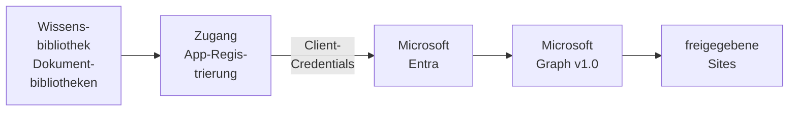

# Konnektor: SharePoint

## 1. Was der Konnektor ist

Der Konnektor liest **Dokumentbibliotheken von SharePoint Online** über **Microsoft Graph v1.0** und
hält sie über dessen Änderungsprotokoll aktuell. Eine Bibliothek in OPAA liest eine bis fünfzig
Dokumentbibliotheken, auch aus verschiedenen Sites, wahlweise eingeschränkt auf Ordner. SharePoint
ist eine der [Dateiablagen](README.md#2-dateiablagen); was alle Dateiablagen teilen, steht dort.

- **Anmeldung:** Der Zugang meldet sich selbst an, als **Anwendung** mit Client-ID und
  Client-Secret einer App-Registrierung im Mandanten des Betreibers ([Zugänge](../../zugaenge.md), „Der
  Zugang meldet sich selbst an"). Ein Zugang ist **Pflicht**; die Bibliothek trägt kein Geheimnis.
- **Konnektor-eigen:** die Anwendungsberechtigung **`Sites.Selected`**, mit der die App nur Sites
  liest, die ihr **einzeln freigegeben** sind.
- **Liest:** Dateien in unterstützten Formaten, Office-Dateien so, wie sie liegen. **Nicht** gelesen
  werden OneDrive und andere Laufwerke, die keine Dokumentbibliothek sind, OneNote-Notizbücher und
  Dateien, die Microsoft als Schadsoftware kennzeichnet.
- **Dokument:** Laufwerk und Datei-Kennung sind die Identität. Umbenennen und Verschieben innerhalb
  einer Dokumentbibliothek behalten das Dokument; eine Datei in einer anderen Dokumentbibliothek ist
  dort ein neues. Einen Link in die SharePoint-Oberfläche gibt es nicht; **„Original öffnen"** lädt
  die Datei durch OPAA, nur aus einer Dokumentbibliothek, die die Bibliothek noch gewählt hat.
- **Rechte** aus SharePoint übernimmt OPAA nicht: Wer die Bibliothek lesen darf, liest alles, was die
  App in den gewählten Dokumentbibliotheken lesen darf.

## 2. Einrichtung

1. **App-Registrierung.** Im Microsoft-Entra-Admin-Center „App-Registrierungen" → „Neue
   Registrierung", etwa `opaa-sharepoint`, nur Konten dieses Verzeichnisses, ohne Umleitungs-URI.
   Anwendungs-ID (Client-ID) und Verzeichnis-ID (Mandanten-ID) notieren.
2. **Secret.** „Zertifikate & Geheimnisse" → „Neuer geheimer Clientschlüssel"; die Spalte „Wert"
   sofort kopieren, nicht die „Geheime ID" daneben, und das Ablaufdatum notieren. Den Wert zeigt
   Entra nur direkt nach dem Anlegen.
3. **Berechtigung.** „API-Berechtigungen" → „Microsoft Graph" → „Anwendungsberechtigungen":
   **`Sites.Selected`** (empfohlen) oder `Sites.Read.All` (alle Sites, etwa für eine Erprobung), dann
   „Administratorzustimmung erteilen". `Files.Read.All` ist nicht nötig und schlösse alle OneDrives
   ein.
4. **Sites freigeben** (`Sites.Selected`). Jede Site für die App mit der Rolle `read` freigeben, etwa
   mit `Grant-PnPAzureADAppSitePermission -AppId <Client-ID> -DisplayName opaa-sharepoint -Site <Adresse> -Permissions Read`
   oder über Graph `POST /sites/{Site-ID}/permissions`.
5. **Zugang.** Unter **Administration → Anbindungen → Zugänge** einen Zugang für SharePoint mit
   Mandant (ID oder Domäne, etwa `contoso.onmicrosoft.com`), Client-ID, Client-Secret und
   „Ablaufdatum des Secrets" anlegen; „Scopes" leer lassen, OPAA fragt
   `https://graph.microsoft.com/.default`. „Anmeldung testen" prüft die Angaben.
6. Festlegen, wer den Zugang nutzen darf; ab Werk nur die Systemverwaltung
   ([Berechtigungen](../../../konten-und-rechte/berechtigungen.md), „Konnektor-Freigabe").

Client-ID und Secret gehen nur an den Token-Endpunkt des Mandanten, das Zugriffstoken nur an
`https://graph.microsoft.com`. Downloads leitet Graph auf eine kurzlebige Adresse von SharePoint um;
OPAA folgt nur über `https`, prüft das Ziel und sendet dorthin kein Token.

## 3. Quellkonfiguration

Die Zeile „Verbindung" fragt weder Adresse noch Zugangsdaten ab; beides kommt vom Zugang. Steht kein
Zugang zur Verfügung, verweist der Assistent an die Systemverwaltung. Gibt es nur einen, öffnet der
Assistent gleich den Auswahldialog der Zeile „Umfang":

1. **Site wählen.** Der Dialog listet die Sites („Sites suchen" geht nur mit `Sites.Read.All`); über
   „Von Hand eintragen …" öffnet man eine Site über ihre „Adresse der Site" aus dem Browser, etwa
   `https://contoso.sharepoint.com/sites/team`.
2. **Dokumentbibliotheken ankreuzen.** Eine angekreuzte Dokumentbibliothek gilt ganz; über die
   Pfadleiste lassen sich weitere Sites nacheinander öffnen.
3. **Ordner** (optional): Eine Dokumentbibliothek öffnen zeigt ihre Ordner Ebene für Ebene; ein
   angekreuzter Ordner gilt samt Unterordnern.
4. **„Übernehmen"**; die Zeile nennt danach die gewählten Dokumentbibliotheken mit dem Namen der
   Site. Der Verbindungstest prüft jede gewählte Dokumentbibliothek samt Ordnern.

Eine ganze Site oder „alle Sites" lässt sich nicht wählen. Sites, Dokumentbibliotheken und Ordner
einer Ebene listet der Dialog nur bis zu einer festen Grenze; ist die Liste länger, steht dort „Liste
unvollständig.". Eine fehlende Site lässt sich über einen engeren Suchbegriff oder ihre Adresse
öffnen. Im Reiter „Quelle" öffnet „Ändern" am Umfang denselben Dialog, und „Übernehmen" speichert
sofort.

Unter „Umfang" stehen die Dokumentbibliotheken für alle Leseberechtigten, jeweils mit „ganze
Dokumentbibliothek" oder den Ordnern. Den eigenen Vollabgleich-Rhythmus setzt „Vollabgleich alle …
Tage". Eine andere Auswahl lässt den nächsten Lauf vollständig abgleichen; ein geänderter Anzeigename
nicht.

Weist Entra die App ab (Secret abgelaufen, falsch, Zustimmung fehlt), zeigen alle Bibliotheken des
Zugangs „Abgelaufen" mit der Systemverwaltung als zuständig, bis ein neues Secret oder „Anmeldung
testen" das aufhebt. „Alle Verbindungen trennen" löscht das Secret in OPAA; bei Microsoft widerruft
es die Verwaltung in der App-Registrierung. Liefert Entra einen bekannten Fehlercode, nennt die
Meldung die Ursache, etwa die Geheime ID statt des Werts; die Fälle stehen unter „Protokoll und
Fehlerbilder".

## 4. Betriebsarten und Änderungserkennung

| Laufart | Wann | Was er tut |
|---|---|---|
| **Vollabgleich** | erster Lauf, nach einer Änderung der Auswahl, nach einem verfallenen Änderungsstand, im Vollabgleich-Rhythmus, „Vollabgleich starten" | listet alle Dokumentbibliotheken und entfernt, was fehlt |
| **Änderungslauf** | jeder Lauf dazwischen und „Jetzt indizieren" | liest das Änderungsprotokoll jeder Dokumentbibliothek ab dem gespeicherten Stand |

Jede Dokumentbibliothek hat einen eigenen Änderungsstrom; meldet Graph eine Datei mehrfach, gilt die
letzte Meldung. Eine Datei, die SharePoint dauerhaft verweigert, hält den Strom nicht an.

**Unverändertes erkennen.** Vor dem Download vergleicht OPAA die Inhaltsprüfsumme von SharePoint
(`quickXorHash`), ersatzweise die Inhaltsversion oder die Änderungszeit, jeweils mit Größe, Name und
Ordner; eine umbenannte Datei wird deshalb einmal geladen, bei gleichem Inhalt aber nicht neu
verarbeitet.

**Über mehrere Läufe.** Reicht das Budget nicht, setzt der nächste Lauf an der gemerkten Stelle der
Auflistung fort. Am Ende liest OPAA das Änderungsprotokoll ab dem Stand, der zu Beginn galt, und
entfernt erst dann ([Konnektoren](README.md#23-wann-eine-gelöschte-datei-als-nachgewiesen-gilt)).
Scheitert das Lesen vorübergehend, liest der nächste Lauf nur das Protokoll erneut; ist es verfallen,
endet der Abgleich ohne Entfernen; ist eine Dokumentbibliothek nicht erreichbar, beginnt der nächste
Lauf einen neuen Abgleich.

## 5. Löscherkennung

| Ereignis in SharePoint | Verhalten in OPAA |
|---|---|
| Datei gelöscht oder aus den gewählten Ordnern verschoben | der nächste Änderungslauf entfernt das Dokument |
| Datei umbenannt oder innerhalb der Dokumentbibliothek verschoben | das Dokument bleibt; Titel, Ordner und Pfad folgen |
| Datei in eine andere Dokumentbibliothek verschoben | dort ein neues Dokument; das alte entfernt der Änderungslauf, sobald Graph die Löschung meldet, sonst der Vollabgleich |
| Ordner umbenannt oder verschoben | Graph meldet die Dateien nicht einzeln; der nächste Vollabgleich führt den Ordner ohne Download nach |
| Ordner gelöscht oder aus den gewählten Ordnern verschoben | einzeln gemeldete Dateien entfernt der Änderungslauf, die übrigen der nächste Vollabgleich |
| gewählter Ordner gelöscht | die Dokumentbibliothek gilt als nicht erreichbar, nichts wird entfernt; die Ordnerauswahl ist anzupassen |
| Freigabe der Site entzogen, auch während eines Laufs | keine Löschung; der Bestand bleibt, und das Protokoll nennt die Dokumentbibliothek |

Für Ordneränderungen gilt also ein Fenster bis zum nächsten Vollabgleich; der Vollabgleich-Rhythmus
`full-sync-interval` begrenzt es und ist ab Werk bewusst kurz, weil eine Auflistung wenig kostet.

## 6. Ordner

Die Ordnerkette ab der Wurzel der Dokumentbibliothek erscheint als Ordner der Bibliothek; bei mehreren
Dokumentbibliotheken steht ihr Name vorn. Namen, die keinen Ordner tragen können, und zu tiefe Ketten
folgen den Regeln des Kapitels [Wissensbibliotheken](../README.md).

## 7. Anhänge

Eine EML- oder MSG-Datei liefert ihre Anhänge als eigene Dokumente, mit den Grenzen des Kapitels
[E-Mail](../formate/mail.md).

## 8. Grenzen und Schutzmechanismen

- **Drosselung.** Bei `429` und `503` wartet OPAA die Zeit aus `Retry-After`, höchstens
  `max-retry-wait`, und wiederholt bis zu `max-retries`-mal. Erreicht die Summe der Wartezeiten
  `max-throttle-wait-per-run`, endet der Lauf als „unvollständig, wird fortgesetzt".
- **Kosten eines Laufs.** Ein Änderungslauf ohne Änderungen kostet eine Anfrage je Dokumentbibliothek,
  eine je gewähltem Ordner und eine je Protokollseite. Ein Ordnerfilter spart keine Anfragen:
  Auflistung und Protokoll umfassen immer die ganze Dokumentbibliothek.
- **Zu langes Änderungsprotokoll.** Ein Lauf liest das Protokoll aller Dokumentbibliotheken bis zum
  Ende, bevor er einen neuen Stand übernimmt; mehr als etwa `request-budget-per-run` × `page-size`
  Änderungen schafft er nicht. Sammeln sich während eines Abgleichs über mehrere Läufe mehr Änderungen
  an, endet er nie, und der Vollabgleich-Rhythmus greift nicht, solange er offen ist; ebenso hängt ein
  Änderungslauf bis zum nächsten Vollabgleich. Erkennbar an „Anfragebudget von … Anfragen erschöpft …"
  in jedem Lauf. Nichts wird fälschlich entfernt. Abhilfe: Budget und `page-size` anheben oder die
  Dokumentbibliotheken auf mehrere Bibliotheken verteilen; eine engere Ordnerauswahl hilft nicht.
- **Fortsetzungspunkte.** Lehnt Graph eine gemerkte Stelle dauerhaft ab, beginnt die Auflistung dieser
  Dokumentbibliothek neu; geschieht das wieder, gilt sie in diesem Lauf als nicht listbar.
- **Lange Downloads.** Eine Datei, die `download-timeout` dauerhaft reißt, hält Strom und Abgleich an;
  dann die Frist erhöhen.
- **Noch nicht an einem echten Mandanten bestätigt** und auf die Dokumentation von Microsoft gestützt:
  das Fehlerbild einer nicht freigegebenen Site unter `Sites.Selected` und die Site-Suche dort, die
  Meldungen von Entra bei falschem Secret oder fehlender Zustimmung, die Ziele der
  Download-Redirects, die Haltbarkeit der Fortsetzungspunkte, ob Graph die Dateien eines
  gelöschten Ordners einzeln meldet, ausgecheckte Dateien, Entwürfe und Vertraulichkeitsbezeichnungen.

## 9. Protokoll und Fehlerbilder

Weist Entra die Anmeldung des Zugangs ab, beginnt die Meldung mit „Der Token-Endpunkt … hat die
App-Registrierung des Zugangs abgewiesen" oder „… hat die Anmeldung abgewiesen". Den Text von Entra
gibt OPAA nicht weiter; das Log nennt zusätzlich den Entra-Fehlercode (`AADSTS…`) mit Trace- und
Correlation-ID für eine Anfrage beim Microsoft-Support.

| Meldung | Bedeutung | Abhilfe |
|---|---|---|
| „Das Client-Secret wird nicht angenommen. Häufigste Ursache: …" | Am Zugang steht meist die Geheime ID (eine GUID) statt des Werts | neues Secret anlegen, den Wert kopieren und eintragen (siehe „Einrichtung") |
| „Das Client-Secret ist abgelaufen …" | Ablaufdatum überschritten | neues Secret eintragen, „Ablaufdatum des Secrets" nachziehen |
| „Der Anfrage fehlt das Client-Secret …" / „Der Anfrage fehlt ein Pflichtparameter …" | Secret oder Angabe am Zugang leer | Client-ID, Client-Secret und „Scopes" prüfen |
| „Die Client-ID ist im Mandanten nicht bekannt …" | Objekt-ID statt Anwendungs-ID oder falscher Mandant | Anwendungs-ID (Client-ID) und Mandant prüfen |
| „Der Mandant existiert nicht …" / „Die Angabe des Mandanten ist ungültig …" | Mandant vertippt oder in falscher Form | Verzeichnis-ID oder Domain wie `contoso.onmicrosoft.com` eintragen |
| „Die App-Registrierung ist im Mandanten deaktiviert …" | Anwendung in Entra abgeschaltet | in Entra wieder aktivieren |
| „Der Scope … des Zugangs wird nicht angenommen …" / „Die Ressource des Scopes ist im Mandanten nicht bekannt …" | „Scopes" am Zugang falsch gefüllt | „Scopes" leer lassen |
| „Client-ID oder Client-Secret werden nicht angenommen. Häufige Ursachen: …" | Entra nannte keinen bekannten Fehlercode | die genannten Ursachen prüfen, Entra-Code im Log nachschlagen |
| „Microsoft Graph hat das Zugriffstoken abgewiesen" | Secret, Mandant oder Zustimmung stimmen nicht | Zugang prüfen |
| „Das Token der App trägt keine Berechtigung: Für die App-Registrierung wurde keine Administratorzustimmung erteilt …" | Entra stellt das Token ohne Rollen aus, weil die Anwendungsberechtigung nicht bestätigt ist; Graph weist es mit 401 oder 403 ab, auch im Verbindungstest | in Entra unter „API-Berechtigungen" „Administratorzustimmung erteilen" (Abschnitt 2) |
| „Die Anwendung darf das nicht lesen. Bei der Berechtigung Sites.Selected muss die Site für die App freigegeben sein." / „… Dokumentbibliothek ist für die Anwendung nicht sichtbar …" | Site nicht freigegeben oder Kennung falsch, bei erteilter Administratorzustimmung; der Bestand bleibt | Site freigeben (Abschnitt 2) |
| „Microsoft Graph kennt die Site oder Bibliothek nicht …" | Adresse falsch oder Site gelöscht | Adresse prüfen |
| „Die Adresse der Site ist eine https-Adresse ohne Port, Anmeldedaten, Abfrage und Anker …" | Adresse in falscher Form | Adresse aus dem Browser übernehmen |
| „Die Site … hat keine Dokumentbibliothek, die die Anwendung lesen kann …" / „… keine SharePoint-Dokumentbibliothek …" | nur OneDrive oder andere Laufwerke | nichts |
| „Die Suche nach Sites braucht die Berechtigung Sites.Read.All …" | Suche unter `Sites.Selected` | Adresse eingeben |
| „Der gewählte Ordner … ist in der Dokumentbibliothek nicht mehr vorhanden …" | Ordner gelöscht oder verschoben; der Bestand bleibt | Ordnerauswahl anpassen |
| „… OneNote-Notizbücher und ihre Abschnitte übersprungen" / „Microsoft meldet in dieser Datei Schadsoftware …" | übersprungen | nichts |
| „Der Downloadserver von Microsoft Graph hat mit HTTP 4xx geantwortet. Die Datei wird übersprungen …" | dauerhaft verweigert; ein späterer Vollabgleich versucht es erneut | nichts |
| „Microsoft Graph drosselt die Anfragen weiterhin" / „Die Übertragung von Microsoft Graph dauerte länger als …" | vorübergehend fehlgeschlagen; der Strom wird erneut gelesen | Zeitplan entzerren bzw. `download-timeout` anheben |
| „Microsoft Graph nimmt den gespeicherten Stand des Änderungsprotokolls nicht mehr an" / „Die Dokumentbibliothek war beim Beginn des letzten Vollabgleichs nicht erreichbar" | nächster Lauf ist ein Vollabgleich | nichts |
| „Microsoft Graph nimmt den Fortsetzungspunkt der Auflistung nicht mehr an … beginnt neu" | Auflistung dieser Dokumentbibliothek von vorn | nichts |
| „… Der nächste Lauf setzt die Auflistung am zuletzt gesicherten Punkt fort" | Graph antwortete nicht verlässlich; der Lauf endet als Fehler | nichts |

## 10. Konfiguration

Alle Schlüssel unter `opaa.indexing.sharepoint.*`.

| Schlüssel | Umgebungsvariable | Standard | Wirkung |
|---|---|---|---|
| `page-size` | `OPAA_INDEXING_SHAREPOINT_PAGE_SIZE` | 200 | Einträge je Auflistungs- und Änderungsseite; höchstens 1000 |
| `max-file-size-bytes` | `OPAA_INDEXING_SHAREPOINT_MAX_FILE_SIZE_BYTES` | 52428800 (50 MiB) | Obergrenze je Download, auch für „Original öffnen" |
| `request-timeout` | `OPAA_INDEXING_SHAREPOINT_REQUEST_TIMEOUT` | 30s | Timeout je Anfrage |
| `download-timeout` | `OPAA_INDEXING_SHAREPOINT_DOWNLOAD_TIMEOUT` | 10m | Gesamtfrist je Download; danach folgt die Datei im nächsten Lauf |
| `max-retries` | `OPAA_INDEXING_SHAREPOINT_MAX_RETRIES` | 5 | Wiederholungen einer gedrosselten Anfrage |
| `max-retry-wait` | `OPAA_INDEXING_SHAREPOINT_MAX_RETRY_WAIT` | 60s | längste einzelne Wartezeit |
| `max-throttle-wait-per-run` | `OPAA_INDEXING_SHAREPOINT_MAX_THROTTLE_WAIT_PER_RUN` | 30m | Summe der Wartezeiten je Lauf |
| `request-budget-per-run` | `OPAA_INDEXING_SHAREPOINT_REQUEST_BUDGET_PER_RUN` | 20000 | Anfragen je Lauf |
| `max-files-per-run` | `OPAA_INDEXING_SHAREPOINT_MAX_FILES_PER_RUN` | 1000000 | gelistete Dateien je Vollabgleich, bevor der Lauf scheitert |
| `download-concurrency` | `OPAA_INDEXING_SHAREPOINT_DOWNLOAD_CONCURRENCY` | 2 | gleichzeitige Downloads je Lauf |
| `full-sync-interval` | `OPAA_INDEXING_SHAREPOINT_FULL_SYNC_INTERVAL` | 1d | Rhythmus des Vollabgleichs und damit das längste Fenster für Ordneränderungen; je Bibliothek überschreibbar |

Die Obergrenzen von fünfzig Dokumentbibliotheken und fünfzig Ordnern je Dokumentbibliothek sind fest.

## 11. Nicht gebaut

- OneDrive und Anmeldung im Namen einer Person
- Freigabe je Dokumentbibliothek über `Lists.SelectedOperations.Selected`
- Nationale Clouds; die Adresse ist fest
- Übernahme von Rechten aus SharePoint
- Push-Benachrichtigungen über Webhooks; der Änderungslauf im Zeitplan ersetzt sie
- Link in die SharePoint-Oberfläche
