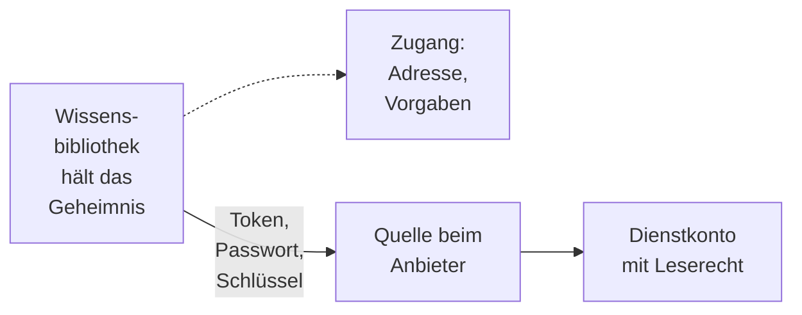
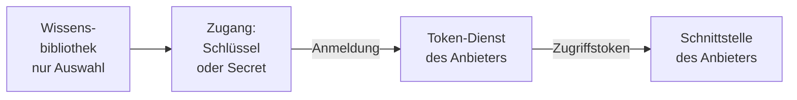
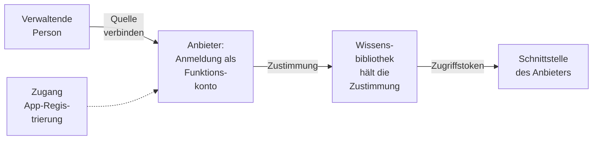
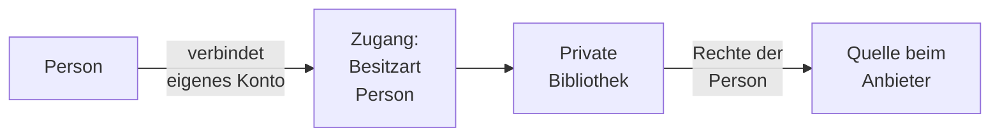

# Zugänge

Eine Wissensbibliothek mit angebundener Quelle muss wissen, **wo** die Dokumente liegen und **wie**
sie sich dort anmeldet. Das kann jede Wissensbibliothek selbst mitbringen — dann trägt, wer sie
anlegt, Serveradresse und Zugangsdaten ein. Oder die Systemverwaltung legt den technischen Zugang
einmal fest, und wer eine Wissensbibliothek anlegt, wählt ihn nur noch aus. Das ist ein **Zugang**.

> **Beispiel.** Das Haus betreibt zwei Confluence-Instanzen, das Intranet und das Projektwiki. Die
> Systemverwaltung legt dafür zwei Zugänge an: „Confluence Intranet" und „Confluence Projektwiki",
> jeweils mit Adresse und Edition. Wer eine Wissensbibliothek anlegt, wählt im Assistenten
> „Confluence Intranet", trägt das eigene Token ein und sucht die Spaces aus. Wo das Intranet liegt
> und welche Edition es hat, muss niemand wissen.

## 1. Wofür es Zugänge gibt

- **Einfacher anlegen.** Wer eine Wissensbibliothek anlegt, muss Serveradresse, Anmeldeart und
  technische Einstellungen nicht kennen.
- **Steuern, was angebunden wird.** Die Systemverwaltung legt fest, wer welchen Zugang nutzen darf,
  und kann einen Zugang jederzeit sperren oder alle seine Verbindungen trennen.
- **Anbindungen, die eine App-Registrierung brauchen.** Quellarten wie SharePoint verlangen, dass
  OPAA beim Anbieter als Anwendung eingetragen ist. Diese Registrierung hinterlegt die
  Systemverwaltung einmal am Zugang; ohne Zugang lassen sich solche Quellen nicht anbinden.
- **Persönliche Konten.** Damit eine Person ihr eigenes Konto verbinden und daraus eine
  [private Bibliothek](wissensbibliotheken/private-bibliotheken.md) speisen kann, braucht es einen Zugang, der Personen
  zulässt ([Benutzerverwaltung](../konten-und-rechte/benutzerverwaltung.md), Abschnitt 12).

## 2. Wann ein Zugang nötig ist

Ob eine Quellart Zugänge kennt, legt ihr Konnektor fest. Es gibt drei Fälle:

- **nicht möglich** — die Quelle liest nichts aus der Ferne, etwa beim Upload,
- **möglich** — eine Wissensbibliothek kann einen Zugang wählen oder die Quelle selbst eintragen,
- **Pflicht** — die Quelle lässt sich nur über einen Zugang anbinden, weil die App-Registrierung am
  Zugang liegt.

Was für eine Quellart gilt, steht in ihrem Kapitel; die Übersicht der
[Konnektoren](wissensbibliotheken/konnektoren/README.md) fasst es zusammen. Wo ein Zugang möglich ist, kann die
Systemverwaltung ihn zur Pflicht machen: **„Nur über Zugänge"** (Abschnitt 7).

## 3. Wie sich OPAA bei einer Quelle anmeldet

Die Konnektoren melden sich auf vier wiederkehrende Arten an. Sie unterscheiden sich darin, wer das
Geheimnis hält und wessen Rechte beim Anbieter gelten. Welchem Muster ein Konnektor folgt, steht am
Anfang seines Kapitels. Gemeinsam ist allen: Geheimnisse liegen verschlüsselt, erscheinen in keiner
Antwort und keinem Protokoll und gehen nur an die Adresse, für die sie eingetragen wurden.

### 3.1 Eigene Zugangsdaten der Bibliothek

Die Bibliothek trägt ein Token, ein Passwort oder einen Schlüssel eines **Dienstkontos** beim
Anbieter, etwa bei Confluence, Nextcloud, einer Windows-Dateifreigabe oder einem S3-Speicher. Wer die
Bibliothek verwaltet, trägt es ein. Über einen Zugang ändert sich nur, dass Adresse und Vorgaben vom
Zugang kommen; das Geheimnis bleibt bei der Bibliothek („persönliches Geheimnis"). Manche Quellen,
etwa ein öffentliches Webverzeichnis, brauchen gar keine Anmeldung.

### 3.2 Der Zugang meldet sich selbst an

Die Systemverwaltung hinterlegt am Zugang einen **Dienstkonto-Schlüssel** oder eine
**App-Registrierung** mit Client-ID und Client-Secret, etwa für Google Drive oder SharePoint. OPAA
holt damit beim Anbieter ein kurzlebiges Zugriffstoken; die Bibliothek trägt kein Geheimnis, nur
ihre Auswahl. Was gelesen werden darf, legt der Anbieter fest (Freigaben an das Dienstkonto, an die
App freigegebene Sites). Ist der Schlüssel abgelehnt, zeigen alle Bibliotheken des Zugangs
„Abgelaufen", zuständig ist die Systemverwaltung.

### 3.3 Zustimmung beim Anbieter für die Bibliothek

Der Zugang trägt eine App-Registrierung; die Bibliothek bekommt ihr Recht aber erst durch eine
**Zustimmung beim Anbieter** (OAuth), etwa bei Dropbox. Wer die Bibliothek anlegt, wählt „Quelle
verbinden" und meldet sich beim Anbieter mit einem **Funktionskonto** an, nicht mit dem eigenen
Konto. Die Zustimmung gehört danach der Bibliothek, nicht der Person; sie bleibt, wenn die Person
ausscheidet. Trennen und „Alle Verbindungen trennen" ziehen sie auch beim Anbieter zurück.

### 3.4 Verbundenes Konto einer Person

Ein Zugang mit der Besitzart „Person" lässt jede freigegebene Person ihr **eigenes Konto**
verbinden, etwa Nextcloud mit einem App-Passwort, unter **Einstellungen → Verbundene Konten**.
Daraus speist sie eine [private Bibliothek](wissensbibliotheken/private-bibliotheken.md): Sie liest, was ihr Konto beim
Anbieter sieht, und außer ihr liest sie niemand. Lehnt der Anbieter das Konto ab, gilt die
Verbindung als abgelaufen, und die Person wird benachrichtigt.

## 4. Was ein Zugang festlegt

| Angabe | Bedeutung |
|---|---|
| Name und Quellart | etwa „Confluence Intranet" |
| Server-Adresse | wo die Quelle liegt, sofern die Quellart eine braucht; die Adresse jeder Wissensbibliothek auf dem Zugang liegt darunter |
| Anmeldeart | wie sich OPAA bei der Quelle anmeldet, je nach Quellart etwa ohne Anmeldung, mit Benutzername und Passwort oder Token, mit einer App-Registrierung oder über eine Zustimmung beim Anbieter (OAuth) |
| Für wen er da ist | für geteilte Wissensbibliotheken, für persönliche Konten, aus denen private Bibliotheken entstehen, oder für beides (in der Oberfläche „Besitzart") |
| Vorgaben | Einstellungen, die der Zugang für alle Wissensbibliotheken darauf festlegt, damit sie niemand selbst eintragen muss — etwa die Confluence-Edition. Sie erscheinen dort nur lesbar |
| Wer ihn nutzen darf | alle Konten oder bestimmte Gruppen und Personen. Ein neuer Zugang ist zunächst nur für die Systemverwaltung freigegeben, damit sie ihn prüfen kann, bevor andere ihn wählen |

## 5. Einen Zugang einrichten

Zugänge pflegt die Systemverwaltung unter **Administration → Anbindungen → Zugänge**.

1. **„Neuer Zugang"** fragt zuerst die Quellart ab; das Formular zeigt danach nur, was diese
   Quellart braucht.
2. Name, Server-Adresse, Anmeldeart und Vorgaben eintragen; bei einer App-Registrierung
   Client-ID und Client-Secret samt Ablaufdatum, bei Google Drive die Schlüsseldatei des
   Dienstkontos.
3. Bei einer Zustimmung beim Anbieter (OAuth): beim Anbieter eine App anlegen und dort als
   **Rücksprungadresse** `{öffentliche Adresse}/connections/callback` eintragen; das Formular nennt
   die genaue Adresse. Die Scopes so wählen, dass der Anbieter eine dauerhafte Zustimmung erteilt
   (etwa `offline_access`).
4. Festlegen, **wer den Zugang nutzen darf**. Ein neuer Zugang ist zunächst für niemanden außer der
   Systemverwaltung freigegeben.
5. Bei Dienstkonto-Schlüssel und App-Registrierung prüft **„Anmeldung testen"**, ob der Anbieter
   die Angaben annimmt.

Die Übersicht nennt je Zugang, wofür er dient, wer ihn nutzen darf, wie viele Verbindungen auf ihm
laufen und ob etwas zu tun ist: **„Anmeldung abgelehnt"**, ein abgelaufenes oder bald ablaufendes
Client-Secret, viele abgelaufene verbundene Konten oder „Noch für niemanden freigegeben". Ein Klick
öffnet das Seitenpanel des Zugangs mit seinen Angaben, seiner Nutzung und den Eingriffen. 14 Tage
vor Ablauf eines Client-Secrets erhält die Systemverwaltung zusätzlich eine Benachrichtigung.

Zahlen über verbundene Konten von Personen zeigt OPAA nur gerundet: unterhalb der
Mindestgruppengröße heißt es „weniger als N", damit sich nicht auf einzelne Personen schließen lässt.

## 6. Einen Zugang pflegen

Wie eine Wissensbibliothek einen Zugang wählt oder später wechselt, beschreibt das Kapitel
[Wissensbibliotheken](wissensbibliotheken/README.md), Abschnitt 3. Am Zugang selbst ändert die
Systemverwaltung selten etwas — meist aus einem dieser Anlässe:

| Anlass | Was die Systemverwaltung tut | Folge für die Wissensbibliotheken auf dem Zugang |
|---|---|---|
| Das Client-Secret läuft ab, ein Schlüssel wird erneuert | das neue Secret oder den neuen Schlüssel eintragen | keine; sie laufen weiter |
| Andere sollen den Zugang nutzen dürfen | die Freigabe anpassen | keine; die Freigabe gilt nur für neue Wissensbibliotheken |
| Die Quelle zieht auf einen neuen Server um | die Server-Adresse ändern | Sie folgen der neuen Adresse. Ihre Zugangsdaten sind neu einzutragen, weil OPAA Geheimnisse nie an eine neue Adresse schickt |
| Die App wurde beim Anbieter neu registriert | Client-ID und Secret ändern | Alle Verbindungen müssen neu hergestellt werden |
| Eine Vorgabe ändert sich, etwa die Confluence-Edition nach einer Migration | die Vorgabe ändern | Sie laufen mit dem neuen Wert weiter |
| Verdacht, dass Zugangsdaten in falsche Hände geraten sind | **„Alle Verbindungen trennen"** | Alle Zugangsdaten und Zustimmungen werden sofort verworfen, Zustimmungen auch beim Anbieter zurückgezogen. Der Rückzug beim Anbieter wartet verschlüsselt in der Datenbank, bis er gelaufen ist, und übersteht einen Neustart des Backends. Ein Schlüssel oder Secret beim Anbieter selbst widerruft die Verwaltung dort |
| Die Quelle wird nicht mehr angebunden | den Zugang löschen | Ihr Bestand bleibt durchsuchbar, mit dem Hinweis „Zugang entfernt" |

Bevor eine Änderung gespeichert wird, die Wissensbibliotheken betrifft, zeigt eine **Vorschau**, wie
viele es sind und ob Verbindungen neu hergestellt werden müssen. Verträgt eine Wissensbibliothek die
Änderung nicht, wird nichts gespeichert. Private Bibliotheken halten keine Änderung auf: Sie werden
dann vom Zugang gelöst, ruhen, und ihre Besitzerin wird benachrichtigt.

## 7. Sperren und „Nur über Zugänge"

Unter **Administration → Anbindungen** kann die Systemverwaltung zweierlei:

- **Sperren** — einen einzelnen Zugang oder eine ganze Quellart. Neue Bibliotheken darauf sind nicht
  mehr möglich, Läufe starten nicht mehr, und der Bestand bleibt mit dem Hinweis „Gesperrt – Inhalt
  wird nicht mehr aktualisiert" durchsuchbar. Belege aus einer solchen Bibliothek tragen im Chat
  „Stand vom …". Nach dem Entsperren läuft alles ohne Neueinrichtung weiter.
- **„Nur über Zugänge"** — für eine Quellart, bei der ein Zugang möglich ist. Danach lassen sich
  neue Bibliotheken nur noch über einen Zugang anlegen. Für die Bibliotheken mit eigener Adresse,
  die es schon gibt, wählt die Systemverwaltung: **weiterlaufen lassen** (ihre Adresse ist dann
  eingefroren) oder **sperren**, bis ihre Verwaltenden sie einem Zugang zuordnen. Einschalten geht
  erst, wenn es einen passenden Zugang gibt.

Sperren, Entsperren und das Umschalten stehen im Revisionsprotokoll.

Kann eine Wissensbibliothek ihre Quelle nicht erreichen, nennt ihr Reiter „Quelle" den Grund und
wer ihn beheben kann ([Wissensbibliotheken](wissensbibliotheken/README.md), Abschnitt 6.4).

## 8. Sicherheit und Nachweis

- Client-Secrets, Schlüssel, Zugangsdaten und Token liegen verschlüsselt. Keine Antwort, kein
  Protokoll und kein Revisionseintrag enthält sie; angezeigt wird nur, ob eines hinterlegt ist.
- Ein hinterlegtes Client-Secret geht nie an eine neue Adresse: Wer einen Token-Endpunkt ändert,
  muss ein neues Secret eintragen.
- Endpunkte, an die Geheimnisse gehen, müssen `https://` verwenden.
- Anlegen, Ändern, Löschen, Sperren, die Notabschaltung und jeder Anmeldetest stehen im
  Revisionsprotokoll. Das Verbindungsprotokoll hält fest, wann Konten und Quellen verbunden und
  getrennt wurden ([Berechtigungen](../konten-und-rechte/berechtigungen.md), Abschnitt 12).

## 9. Konfiguration

| Schlüssel | Standard | Wirkung |
|---|---|---|
| `opaa.connection.expired-connections.warning-threshold` | 10 | ab wie vielen abgelaufenen verbundenen Konten auf einem Zugang die Übersicht „Viele Konten abgelaufen" zeigt; mindestens 1 |

Die Aufbewahrungsfrist des Verbindungsprotokolls stellt die Systemverwaltung unter
**Administration → Anbindungen → Einstellungen** ein.
