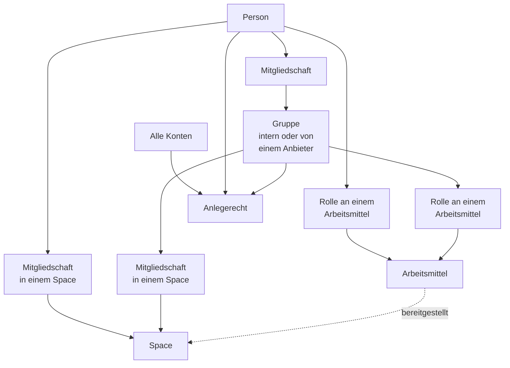

# Berechtigungen

Dieses Kapitel beschreibt, wer in einer OPAA-Installation was lesen, ändern,
freigeben und anlegen darf — und wie sich das nachweisen lässt. Es ist der eine Ort für das
Berechtigungsmodell: Subjekte, Rollen, Gruppen, Anlegerechte, Vollmachten, Lebenszyklus und
Rechtehistorie. Die Regeln gelten für jede Art von **Arbeitsmittel** gleich, ob
Wissensbibliothek oder Prompt-Bibliothek; wie Arbeitsmittel gefunden, angelegt und einem Space
zugeordnet werden, beschreibt das Kapitel [Katalog](katalog.md). Die Einrichtung des Anmeldewegs und des Verzeichnisabgleichs steht im Kapitel
[Authentifizierung](authentifizierung.md), die Verwaltung lokaler Konten in der
[Benutzerverwaltung](benutzerverwaltung.md), der Rechtefilter der Suche im Kapitel
[Suche](suche.md).

## 1. Der Aufbau in vier Objekten

| Objekt | Was es ist | Was es an Rechten trägt |
|---|---|---|
| **Organisation** | Das Haus. Heute genau eine je Installation | Die Grenze jeder Berechtigung: Gruppen, Konten, Arbeitsmittel und Spaces gehören ihr, und nichts wirkt darüber hinaus |
| **Arbeitsmittel** | Etwas, das angelegt, geteilt und einem Space zugeordnet wird: eine [Wissensbibliothek](wissensbibliotheken.md) oder eine [Prompt-Bibliothek](prompt-bibliotheken.md) | Eigene Rollen, einen Eigentümer |
| **Space** | Arbeitsbereich, in dem Chats liegen und Arbeitsmittel bereitgestellt werden | Eigene Rollen, eigene Mitgliedschaften, einen Eigentümer |
| **Gruppe** | Eine benannte Menge von Konten | Kein Recht an sich selbst — sie ist das *Subjekt*, dem Rollen, Anlegerechte und Eigentum erteilt werden |

Zwei Sätze gelten in allen folgenden Abschnitten:

- **Ein Space enthält genau, was ihm zugeordnet ist, und erweitert keine Leserechte.** Der Chat
  eines Space sucht nur in den zugeordneten Bibliotheken und bietet nur die zugeordneten Prompts
  an — und davon nur, was die Person ohnehin lesen darf. Die Zuordnung legt fest, was im Space zur
  Verfügung steht; ein Leserecht öffnet sie nicht.
- **Rechte wirken in der Suche, nicht dahinter.** Jede Suchabfrage trägt den Filter auf die
  lesbaren Bibliotheken in sich. Es gibt keinen Administrator-Durchgriff auf Inhalte
  (Abschnitt 10).



## 2. Vier Wörter, vier verschiedene Dinge

Die Oberfläche und dieses Handbuch benutzen durchgehend diese vier Begriffe. Sie sind nicht
austauschbar, und keiner von ihnen ist eine schwächere Fassung eines anderen.

| Begriff | Bedeutung | Gebunden an |
|---|---|---|
| **Rolle** | Gestufte Berechtigung an **einem Objekt** — „Leserin dieser Wissensbibliothek", „Administrator in diesem Space" | Person **oder** Gruppe; unbefristet oder mit Ablaufdatum |
| **Anlegerecht** | Installationsweites Recht, etwas **anzulegen** (Spaces, Arbeitsmittel, interne Gruppen). Ohne Gegenstand, unbefristet, **öffnet nie einen Inhalt** | Person, Gruppe oder **„Alle Konten"** |
| **Vollmacht** | Befristete, begründungspflichtige Erlaubnis mit Gegenstand: „Sicht als" in der Suchdiagnose und der Geltungsbereich einer anlassbezogenen Klärung im Nachweisprotokoll | **genau eine Person**, nie eine Gruppe |
| **Systemrolle** | Systemverwaltung und Revision — die beiden installationsweiten Rollen aus der [Benutzerverwaltung](benutzerverwaltung.md), Abschnitt 7 | genau ein Konto |

Dazu zwei Maße, die im Text gebraucht werden und in keiner Oberfläche als Wort auftauchen:

- **Wirksam** ist eine Gruppe, der ein Recht **erteilt** werden darf: nicht aufgelöst, ihr Anbieter
  eingeschaltet, ihre Mitgliedschaft noch gepflegt. Eine wirksame Gruppe **darf leer sein**.
- **Handlungsfähig** ist eine wirksame Gruppe mit mindestens einem **aktiven** Konto. Das ist das
  Maß dafür, ob sie als Eigentümerin oder als Space-Administratorin **handeln** kann (Abschnitt 13).

## 3. Wem ein Recht gegeben werden kann

| Subjekt | Rolle an Arbeitsmittel oder Space | Anlegerecht | Eigentum | Vollmacht |
|---|---|---|---|---|
| **Person** | ja | ja | Arbeitsmittel und Space | ja |
| **Gruppe** | ja | ja | Arbeitsmittel (kein Space) | nein |
| **„Alle Konten"** | ja — als Empfänger wie jeder andere | — (dort heißt dieselbe Art „Alle Konten") | nein | nein |

**Gruppen werden nicht in Personen aufgelöst.** Wer ein Arbeitsmittel an „Referat 50" freigibt, gibt
es an die Gruppe frei: Wer dort morgen Mitglied wird, liest sie ab dann, wer heute ausscheidet,
verliert sie mit der Mitgliedschaft. Das ist gewollt und der Grund, warum Freigaben an Gruppen
gepflegt bleiben, ohne dass jemand sie anfasst — und der Grund, warum die Zeile einer Gruppe
ihre heutige Größe nennt (Abschnitt 8).

**Gruppen verschachteln nicht.** Eine Gruppe hat genau die Mitglieder, die ihre Quelle ihr gibt;
eine übergeordnete Einheit aus dem Verzeichnis ist eine Anzeige- und Gliederungsangabe und
**vererbt keine Mitgliedschaft**. Eine Abteilung, die im Verzeichnis nur Untergruppen hat, ist in
OPAA eine **leere** Gruppe — eine Freigabe an sie erreicht niemanden.

## 4. Rollen an einem Arbeitsmittel

Jedes Arbeitsmittel trägt eigene Rollen und einen Eigentümer. Die Rollen sind für alle Arten gleich
gestuft; was „Inhalt pflegen" heißt, hängt von der Art ab.

| Rolle | Darf | Bei einer Wissensbibliothek zusätzlich |
|---|---|---|
| **Leser** (`VIEWER`) | das Arbeitsmittel und seinen Inhalt lesen und nutzen | durchsuchen, Treffer und Dokumentliste sehen |
| **Bearbeiter** (`EDITOR`) | zusätzlich den Inhalt pflegen, bei einer Prompt-Bibliothek etwa Prompts anlegen, ändern und löschen | Dokumente hochladen und löschen, Ordner pflegen, einen Lauf anstoßen, Metadaten pflegen |
| **Verwalter** (`MANAGER`) | zusätzlich Name und Beschreibung ändern, Rechte vergeben und entziehen, auch an alle Konten | die Quellverbindung sehen und ändern, die Bibliothek für [Fremdzugänge](fremdzugaenge.md) freigeben |
| **Eigentümer** (`OWNER`) | zusätzlich das Arbeitsmittel löschen und das Eigentum übertragen | — |

Die Rollen sind gestuft: Wer Verwalter ist, darf alles, was ein Bearbeiter darf. Die
**Quellverbindung** einer Wissensbibliothek — interner Serverpfad, Quelladresse, Zugangsdaten —
bleibt einem Bearbeiter verborgen und wird erst ab der Verwalterrolle sichtbar; sie ist
Infrastrukturangabe, nicht Konfiguration. **Verwalten ist nicht Lesen:** Die Systemverwaltung kann
jedes Arbeitsmittel verwalten, liest seinen Inhalt aber nur mit einer eigenen Rolle, einer Rolle
über eine Gruppe oder einer Freigabe an „Alle Konten".

**Der Reiter „Freigaben"** der Detailansicht ([Katalog](katalog.md), Abschnitt 5) führt die Rechte
eines Arbeitsmittels in dieser Reihenfolge:

| Abschnitt | Inhalt |
|---|---|
| **Eigentümer** | die zuständige Stelle mit Namen; über „Eigentum übergeben" reicht der Eigentümer sie an eine Person oder eine Gruppe weiter — mit Rückfrage, und die Eigentümerrolle geht mit. Auch die **Systemverwaltung** kann übergeben: So bekommt ein Arbeitsmittel mit offener Nachfolge wieder eine handlungsfähige Stelle. Jede Übergabe steht mit Namen im Nachweisprotokoll |
| **Berechtigungen** | Personen, Gruppen und „Alle Konten" mit Rolle, Befristung und Entzug, dazu das Formular „Freigeben". Für „Alle Konten" stehen nur **Leser** und **Bearbeiter** zur Wahl; bei einer Konnektorbibliothek für die Systemverwaltung darunter die Obergrenze „Freigabe an Alle erlaubt" |
| **Externer Zugang** | nur bei einer Wissensbibliothek: die Freigabe für Fremdzugänge |
| **Diagnosesperre** | nur bei einer Wissensbibliothek: ob sie in einer fremden Suchdiagnose auftauchen darf |
| **Warum sehe ich das?** | die eigene Herleitung (Abschnitt 11) |

Jeder Abschnitt speichert für sich. Eine lesende Rolle sieht Eigentümer, Diagnosesperre und die
Herleitung schreibgeschützt.

**Ein Recht kann befristet sein.** Jede Rolle wird mit oder ohne Ablaufdatum erteilt; mit dem
Ablauf endet sie, ohne dass jemand eingreift, und das Erlöschen steht im Nachweisprotokoll.

**Eigentum.** Ein Arbeitsmittel gehört einer **Person** oder einer **Gruppe**. Wer es anlegt, wählt
das: Als persönliches Arbeitsmittel erhält die anlegende Person die Eigentümerrolle, bei einer Gruppe
als Eigentümerin erhält die Gruppe die Verwalterrolle — die anlegende Person muss Mitglied dieser
Gruppe sein. **Gruppeneigentum ist die haltbarere Wahl**: Es übersteht den Weggang einzelner
Personen, und genau dafür ist Abschnitt 13 sonst zuständig.

Weitere Rollen lassen sich schon beim Anlegen vergeben. Der Assistent jeder Art sucht Personen und
Gruppen im selben Suchfeld „Person oder Gruppe suchen" wie der Abschnitt „Berechtigungen" an einem
bestehenden Arbeitsmittel — mit denselben Regeln für geschützte Gruppen
(Abschnitt 8) und derselben Rückfrage vor einer Freigabe an die Gruppe eines externen Anbieters.
Die Treffer stehen gemischt, die passendsten zuerst; eine Gruppe trägt „Gruppe" im Namen der
Zeile. Suche, Rolle und „Vormerken" stehen in einer Zeile. Den Empfänger **„Alle Konten"**
bietet der Assistent nicht an: Ein Bestand, den es noch nicht gibt, hat keine Reichweite zu weiten,
und die Obergrenze, die über eine solche Freigabe entscheidet, gehört dem angelegten Arbeitsmittel.

### Reichweite: „Alle Konten"

**Es gibt keine getrennte Verteilungsstufe mehr.** Wie weit ein Arbeitsmittel reicht, ergibt sich
allein aus ihrer Rechteliste. Wer es dem ganzen Haus öffnen will, erteilt ein Recht an den
Empfänger **„Alle Konten"** — als eigener Eintrag im Suchfeld des Abschnitts „Berechtigungen",
mit demselben Ablaufdatum
wie bei einer Person oder einer Gruppe, aber **höchstens mit der Rolle „Bearbeiter"**: Verwaltung
und Eigentum sind Zuständigkeiten und bleiben an eine benannte Stelle gebunden; mehr steht gar
nicht erst zur Wahl und würde auch abgewiesen. Vor dem Erteilen fragt die Anwendung eigens zurück
und spricht die Reichweite aus; zurücknehmen lässt sich die Freigabe wie jede andere — auch ein
späterer Rollenwechsel an dieser Zeile fragt zurück.

In den Übersichten steht die Reichweite als **abgeleitete Kennzeichnung**: „Alle", „3 Gruppen, 2
Personen" oder „nur Sie". Sie ist keine Einstellung, sondern die Zusammenfassung dessen, was in der
Rechteliste steht.

**Sichtbar ist nur, was lesbar ist.** Ein Arbeitsmittel, das eine Person nicht lesen darf, erscheint
für sie nirgends — weder in der Übersicht noch im Katalog noch in der Suche, auch nicht mit Namen
oder Beschreibung. Wer ein Arbeitsmittel für andere sichtbar machen will, gibt es frei.

Die Freigabe an alle Konten wird **historisiert** wie jede erteilte Rolle: Zu jedem Stichtag
innerhalb der Aufbewahrungsfrist ist belegbar, wie weit ein Arbeitsmittel gereicht hat (Abschnitt 12).
Die Freigabe für [Fremdzugänge](fremdzugaenge.md) ist ein weiteres Reichweitenfeld und wird
ebenso historisiert.

Wie Arbeitsmittel im Katalog erscheinen, als Favorit markiert und angelegt werden, beschreibt das
Kapitel [Katalog](katalog.md).

### Freigabe-Obergrenze für Konnektorbibliotheken

Wer eine Konnektorbibliothek anlegen darf, entscheidet auch über ihre Reichweite — bis zu einer
**Obergrenze**, die ausschließlich die Systemverwaltung setzt. Ohne sie könnte, wer eine Bibliothek
aus einem Dateiverzeichnis, einem Webverzeichnis, einem Feed, Confluence, einem Objektspeicher
oder einer Dateiablage wie Google Drive, SharePoint, Nextcloud, Dropbox oder einer
Windows-Dateifreigabe anlegt, den eingespeisten Bestand im nächsten Schritt dem ganzen Haus
öffnen — die Obergrenze ist die technische Sicherung gegen genau diesen einen Schritt. Bibliotheken für Uploads tragen keine
Obergrenze: Dort kuratiert dieselbe Person ohnehin jedes Dokument einzeln.

**Die Obergrenze gilt je Bibliothek und wird nicht automatisch gesetzt.** Neu angelegt ist jede
Konnektorbibliothek zunächst **ungedeckelt**: Die Erlaubnis steht offen, und die
Systemverwaltung muss sie eigens entziehen, damit die Obergrenze wirkt. Die Bibliothek selbst
startet trotzdem eng — sie trägt nur die Rechte, die der Anlegende erteilt. Wer die Obergrenze nicht senkt, lässt dem Anlegenden also die Wahl bis hin zur Freigabe
an alle Konten. Ein Betrieb, der das systematisch verhindern will, prüft die Obergrenze
deshalb **nach jeder Neuanlage** einer Konnektorbibliothek, oder schränkt das Anlegerecht
„Konnektorbibliotheken anlegen" auf eine benannte Gruppe ein (Abschnitt 9) — dann entscheidet diese
Gruppe, wer überhaupt anlegen darf, bevor die Obergrenze greifen müsste.

Zu finden ist die Obergrenze auf der Detailseite der jeweiligen Bibliothek, Reiter „Freigaben" —
sichtbar und änderbar nur für die Systemverwaltung. Sie besteht aus einer Erlaubnis:

| Erlaubnis | Wirkung, wenn entzogen |
|---|---|
| **Freigabe an alle Konten erlaubt** | Ein Recht an „Alle Konten" kann nicht mehr erteilt werden; ein bestehendes wird beim Entziehen sofort zurückgenommen |

**Wird die Erlaubnis entzogen, wirkt das sofort — aber ausschließlich für die Freigabe an alle
Konten.**
Es gibt keine Übergangszeit und keinen Zustand „noch zu weit, aber geduldet". **Unberührt bleiben
erteilte Rechte an einzelnen Personen und Gruppen sowie eine bestehende Fremdzugangsfreigabe**
(Abschnitt „Die Freigabe einer Wissensbibliothek" im Kapitel [Fremdzugänge](fremdzugaenge.md)) —
beide müssen gesondert geprüft und, falls gewünscht, gesondert zurückgenommen werden. Jeder Vorgang
steht im Nachweisprotokoll: das Setzen der Obergrenze selbst und, falls ausgelöst, die dadurch
bewirkte Rücknahme der Freigabe.

Versucht die Eigentümerin oder ein Verwalter der Bibliothek anschließend, an alle Konten
freizugeben, weist die Anwendung das mit einer Meldung ab, die die geltende Obergrenze beim Namen
nennt und auf die Systemverwaltung verweist — kein technischer Fehler, sondern eine erklärte
Grenze.

### Private Bibliotheken

Eine **private Bibliothek** speist sich aus dem verbundenen Konto ihrer Besitzerin, und außer ihr
liest sie niemand — auch nicht die Systemverwaltung. Rechte an andere, Übertragung, Nachfolge und
„Sicht als" gibt es für sie nicht. Alles Weitere steht im Kapitel
[Private Bibliotheken](private-bibliotheken.md).

## 5. Rollen in einem Space

Ein Space hat eigene Rollen — **Mitglied**, **Kurator**, **Administrator** — und einen
**Eigentümer**, der immer eine natürliche Person ist. Auch eine Gruppe wird Mitglied eines Space,
mit Rolle. Ein Space enthält genau die Arbeitsmittel, die ihm zugeordnet sind, und erweitert keine
Leserechte (Abschnitt 1). Rollen, Zuordnung, Einstellungen und das Anlegen eines Space beschreibt das
Kapitel [Spaces](spaces.md).

## 6. Woher Gruppen kommen

Jede Gruppe hat genau eine Herkunft, und sie steht als Zusatz neben dem Namen — nie im Namen selbst:
„Referat 50 · Verzeichnis Haus A · /Haus/Abteilung 5 · 23 Mitglieder".

| Herkunft | Wer sie pflegt | Bearbeitbar in OPAA |
|---|---|---|
| **intern** | Die Verantwortlichen der Gruppe (Abschnitt 7) | ja |
| **von einem Identitätsanbieter** | Der Anbieter — über den Gruppen-Claim seiner Tokens oder über den Verzeichnisabgleich | nein, schreibgeschützt |

**Wie OPAA die Mitglieder einer Anbietergruppe erfährt.** Gruppen aus einem Identitätsanbieter
unterscheiden sich nicht in sich, sondern darin, wie ihr Anbieter angeschlossen ist. Das wird je
Anbieter eingerichtet, und alle seine Gruppen folgen dieser Einstellung:

- **Über die Anmeldung (Gruppen-Claim):** OPAA darf beim Anbieter nichts nachfragen. Es erfährt die
  Gruppen einer Person nur in dem Moment, in dem sie sich anmeldet — der Anbieter schickt dann mit,
  in welchen Gruppen sie ist. Wird jemand dort aus einer Gruppe genommen, bleibt die Person in OPAA
  Mitglied, bis sie sich das nächste Mal anmeldet; wer sich nicht mehr anmeldet, bleibt es.
  Vergleichbar dem Dienstausweis am Einlass: Man sieht nur, wer gerade durch die Tür kommt.
- **Über den Verzeichnisabgleich:** OPAA hat ein eigenes Lesekonto beim Anbieter und liest Gruppen
  und Mitglieder im eingestellten Takt selbst aus. Änderungen gelten nach dem nächsten Abgleich,
  auch für Personen, die sich nicht anmelden. Vergleichbar der Personalliste, die das Personalamt
  regelmäßig schickt.

Warum nicht jeder Anbieter abgeglichen wird: Der Abgleich braucht ein Lesekonto, das die IT des
Verzeichnisses einrichten und freigeben muss. Die Anmeldung kommt ohne aus und ist deshalb schneller
eingerichtet — um den Preis, dass Änderungen erst mit der nächsten Anmeldung ankommen. In der
Gruppenverwaltung erklärt das Info-Symbol hinter dem Anbieternamen, welcher der beiden Wege für eine
Gruppe gilt.

**Je Anbieter genau ein Mechanismus.** Entweder der **Gruppen-Claim** seiner Tokens oder der
**Verzeichnisabgleich**; beides zugleich lehnt OPAA ab. Einrichtung, Zeitplan, Trockenlauf,
Plausibilitätsschwelle, leeres Ergebnis, unerreichbares Verzeichnis und der Bestätigungsweg stehen
im Kapitel [Authentifizierung](authentifizierung.md#verzeichnisabgleich-je-anbieter). Für das
Rechtemodell zählen vier Folgen:

- **Der Token ist die Vorgabe, weil er ohne Konfiguration funktioniert — der Verzeichnisabgleich
  ist der empfohlene Weg** für jedes Haus mit gepflegtem Verzeichnis. Nur er hat die vier
  Schutzmechaniken; der Token-Weg hat keine davon.
- **Eine Umbenennung des Claim-Werts im Identitätsmanagement ist im Token-Betrieb ein
  Gruppenwechsel ohne Schutzmechanik.** Ab der ersten Anmeldung ist jede Person Mitglied der neuen
  Gruppe, und jede Freigabe an der alten Gruppe wirkt für niemanden mehr. Nichts wird dabei
  gelöscht, und es fällt auch nicht von selbst auf — sichtbar wird es im Reiter „Gruppen ohne
  aktive Mitglieder" der Betriebsliste (Abschnitt 13).
- **Die Genauigkeit der Rechtehistorie hängt am Mechanismus.** Im Verzeichnisbetrieb steht in der
  Historie der Zeitpunkt des Laufs, der die Änderung gesehen hat. Im Token-Betrieb steht dort der
  Zeitpunkt der **Anmeldung**: Eine Verzeichnisänderung vom 3. März erscheint für eine Person, die
  sich am 20. März anmeldet, mit dem **20. März**. Welcher Mechanismus eine Gruppe pflegt, nennt die
  Herleitung je Gruppe (Abschnitt 11).
- **Ein Mechanismuswechsel entzieht nichts still.** Token-Gruppen und Verzeichnisgruppen sind
  verschiedene Objekte; die alten bleiben mit **eingefrorener** Mitgliedschaft stehen, sind kein
  neues Ziel einer Freigabe mehr, und ihre Rechte gehen mit einer Übertragung (Abschnitt 13.2) auf
  die neuen über.

**Externe Anbieter sind sichtbar abgehoben.** Jede Anbieterzeile trägt ein Kennzeichen „extern" —
Vorgabe ist: jeder Anbieter außer dem Standardanbieter, bis die Systemverwaltung es ändert. Gruppen
eines externen Anbieters erscheinen in jeder Auswahl mit einem eigenen Symbol, und das Erteilen
eines Rechts an eine solche Gruppe verlangt eine Zwischenfrage, die den Anbieter beim Namen nennt.
Dieselbe Zwischenfrage kommt auch, wenn die Gruppe über ihre Kennung statt über die Suche benannt
wurde — sonst wäre sie über diesen Weg umgehbar.

**Nicht wirksame Gruppen sind kein neues Ziel.** Sie stehen in der Auswahl, aber nicht wählbar, und
die Zeile nennt den Grund — „aufgelöst", „Anbieter deaktiviert", „Mitgliedschaft eingefroren" —
jeweils mit dem Zusatz, dass **bestehende Rechte bleiben**. Ohne diese Regel wirkte eine Freigabe an
eine Gruppe eines abgeschalteten Anbieters für niemanden und mit dem Wiedereinschalten schlagartig
für alle, ohne dass jemand darüber entschieden hätte.

**Lokale Konten haben keinen Gruppenmechanismus.** Für sie sind interne Gruppen der einzige Weg zu
einer Gruppe.

## 7. Interne Gruppen und ihre Verantwortlichen

Eine **interne Gruppe** ist eine Gruppe, die in OPAA selbst entsteht. Sie wird nicht von der
Systemverwaltung gepflegt, sondern von benannten **Verantwortlichen**.

**Wer sie anlegt, ist verantwortlich.** Das Anlegen verlangt das Anlegerecht „Interne Gruppen
anlegen" (Abschnitt 9); die anlegende Person wird im selben Schritt verantwortliche Person.
Verantwortliche sind immer Personen, nie Gruppen, und sie sind nicht automatisch Mitglied. Angelegt
und gepflegt wird unter **Einstellungen → Meine Gruppen**.

Der Dialog **„Gruppe anlegen“** ist aufgebaut wie „Bearbeiten“: Name, Beschreibung, der Schalter
„Zur Verwendung freigegeben“ und darunter die Verantwortlichen, die sich gleich mitbenennen lassen —
alles wird mit „Anlegen“ in einem Schritt übernommen. Die **Systemverwaltung** sieht zusätzlich den
Schalter „Geschützte Gruppe“ und kann eine Gruppe auch für andere anlegen: Benennt sie
Verantwortliche, wird sie selbst es nur, wenn sie sich in der Liste lässt. Wer ohne Systemrolle
anlegt, bleibt immer verantwortlich.

Verantwortliche dürfen:

- Mitglieder aufnehmen und entfernen — nur Konten des eigenen Hauses
- Name und Beschreibung ändern
- weitere Verantwortliche benennen und entlassen
- die Gruppe **zur Verwendung freigeben** und die Freigabe zurücknehmen
- die Gruppe vorübergehend **deaktivieren** und wieder **reaktivieren** (siehe unten)
- die Gruppe löschen, solange sie keine Berechtigung, kein Anlegerecht und kein Eigentum mehr trägt
  und in keinem Space Mitglied ist

**Wer nicht verantwortlich ist, sieht die Gruppe unter „Meine Gruppen" nicht** und bekommt auf jeden
Pflegeversuch dieselbe Antwort wie für eine Gruppe, die es nicht gibt. Die Systemverwaltung darf
jede interne Gruppe pflegen — sie muss eine Gruppe ohne Verantwortliche wieder besetzen können; ihr
Einstieg ist **Administration → Gruppen**. Dort stehen alle Gruppen in einer Tabelle wie die Konten
der Benutzerverwaltung: durchsuchbar über Name, Beschreibung und Quellpfad, filterbar nach Herkunft
und Zustand, sortierbar und seitenweise. Hinter dem Anbieter einer Anbietergruppe erklärt ein
Info-Symbol, wie OPAA die Mitglieder erfährt: nur bei der Anmeldung der jeweiligen Person oder durch
eigenes Auslesen im Takt des Verzeichnisabgleichs, auch ohne Anmeldung (Abschnitt 6). Eine interne Gruppe, die ihre Verantwortlichen noch
nicht freigegeben haben, trägt den Zustand **„Nicht freigegeben“**; das Info-Symbol daneben nennt
den Grund, ebenso bei „Deaktiviert“, „Aufgelöst“, „Anbieter deaktiviert“ und „Nicht mehr gepflegt“. Die Spalte
**Verwendung** beantwortet vor dem Aufräumen, ob an einer Gruppe etwas hängt: an wie vielen
Bibliotheken sie Rechte hat, in wie vielen Spaces sie Mitglied ist, ob ihr Bibliotheken gehören und
ob sie Anlegerechte trägt, etwa „2 Bibliotheken · 1 Space“. Der Tooltip schlüsselt die Angabe auf;
„nicht verwendet“ heißt, dass die Gruppe nichts davon vermittelt. Die Handlungen
einer Gruppe stehen im Zeilenmenü: **Bearbeiten**, **Mitglieder**, **Rechte übertragen**,
**Deaktivieren** bzw. **Reaktivieren** und **Löschen**; deaktiviert und gelöscht werden kann nur eine
interne Gruppe. **Mitglieder** zeigt die Mitglieder als
alphabetische Tabelle mit dem Datum der Aufnahme und ihre Zahl im Titel, mit einem Filterfeld
über der Tabelle; die Liste
lädt beim Öffnen des Dialogs. Bei einer internen Gruppe lassen sich dort Personen aufnehmen und
entfernen. Jeder Abruf durch die Systemverwaltung steht im Nachweisprotokoll, und der Dialog sagt
das.

**Verantwortung wird abgegeben, nicht abgelegt.** Die letzte verantwortliche Person kann sich nicht
selbst entfernen: erst die Nachfolge benennen, dann zurücktreten. Wer die Aufgabe wechselt, gibt die
Verantwortung ausdrücklich ab; „Meine Gruppen" führt dafür die Handlung **„Verantwortung und
Eigentum abgeben"**. Scheidet jemand aus, kann die Systemverwaltung die letzte verantwortliche
Person entlassen — die Gruppe steht dann ohne Verantwortliche da, bis eine neue benannt wird, und
erscheint so lange in der Betriebsliste (Abschnitt 13).

**Freigabe zur Verwendung.** Eine neu angelegte interne Gruppe ist für andere zunächst **nicht**
wählbar: Wer ein Arbeitsmittel freigibt, findet sie weder in der Auswahl noch über ihre Kennung. Erst
die Freigabe durch die Verantwortlichen macht sie zu einem möglichen Empfänger. Das gilt für jeden
Weg, auf dem eine Gruppe zum Zuge kommt: Berechtigung auf ein Arbeitsmittel, Anlegerecht, Eigentum und
Aufnahme als Mitglied eines Space. Bei der Umstellung wurde jede interne Gruppe, die bereits eines
davon trug, automatisch als freigegeben übernommen — niemand verliert eine Möglichkeit, die er
benutzt hat. Anbietergruppen brauchen keine Freigabe; sie sind immer wählbar, solange sie wirksam
sind.

**Vorübergehend deaktivieren.** Ruht ein Projekt, wird umorganisiert oder geprüft, ob die Rechte
einer Gruppe noch stimmen, lässt sich eine interne Gruppe **deaktivieren** — in „Meine Gruppen“ im
Bereich **Wirkung** oder in der Gruppenverwaltung im Zeilenmenü. Das dürfen ihre Verantwortlichen und
die Systemverwaltung, bei einer geschützten Gruppe ebenso wie bei jeder anderen.

- **Solange sie deaktiviert ist, wirkt die Gruppe für niemanden.** Ihre Berechtigungen an
  Arbeitsmitteln, ihre Space-Mitgliedschaften und ihre Anlegerechte erreichen keines ihrer Mitglieder;
  die Suche, „Warum sehe ich das?“ und das Rechteprofil der Suchdiagnose zählen die Gruppe nicht
  mit. Das gilt sofort, ohne neue Anmeldung.
- **Sie ist kein neues Ziel.** Wer etwas freigibt, sieht sie in der Auswahl als nicht wählbar mit
  dem Grund „Gruppe deaktiviert“; als Eigentümerin eines neuen Arbeitsmittels steht sie nicht zur Wahl.
- **Gespeichert bleibt alles.** Berechtigungen, Space-Mitgliedschaften mit Rolle, Anlegerechte,
  Mitglieder, Verantwortliche, Freigabe und Schutzkennzeichen bleiben stehen; **„Reaktivieren“** stellt
  den vorherigen Stand ohne weitere Entscheidung wieder her. Mitglieder lassen sich auch während der
  Deaktivierung aufnehmen und entfernen.
- **Die Bestätigung beziffert die Folgen** — wie viele Freigaben an wie vielen Objekten, wie viele
  Space-Mitgliedschaften und Anlegerechte und wie viele aktive Konten betroffen sind.
- **Verweigert wird das Deaktivieren**, solange die Gruppe **einzige Eigentümerin** einer Wissens-
  oder Prompt-Bibliothek ist oder das **letzte handlungsfähige Administrator-Mitglied** eines Space:
  Sonst stünde das Objekt ohne Zuständige da. Die Meldung nennt, wie viele Objekte im Weg sind; der
  Ausweg ist „Rechte übertragen“ (Abschnitt 13.2) oder eine weitere zuständige Person.
- Eine Frist oder Wiedervorlage gibt es nicht: Die Gruppe bleibt deaktiviert, bis jemand sie
  reaktiviert, ihre Rechte überträgt oder sie löscht.

Freigabe und Deaktivierung sind zwei verschiedene Schalter: Die zurückgenommene Freigabe nimmt eine
Gruppe nur aus der Auswahl, ihre bestehenden Rechte wirken weiter; die Deaktivierung setzt diese
Rechte selbst außer Kraft.

**Namen interner Gruppen sind absichtlich nicht eindeutig.** Eine Ablehnung „diesen Namen gibt es
schon" verriete jedem Inhaber des Anlegerechts, dass eine Gruppe dieses Namens existiert — genau die
Auskunft, die Abschnitt 8 schützt. Stattdessen warnt das Formular, wenn eine für die anlegende
Person **sichtbare** Gruppe gleich heißt.

**Geschützte Gruppen** sind die Gruppen der Personalvertretung, der Schwerbehindertenvertretung, der
Gleichstellung und der Personalvorgänge. **Über den Schutz entscheidet die Systemverwaltung** — für
interne Gruppen ebenso wie für Gruppen eines Identitätsanbieters. Sie setzt und löst das Kennzeichen
in der Gruppenverwaltung im Dialog **„Bearbeiten“** mit dem Schalter **„Geschützte Gruppe“**;
Verantwortliche einer internen Gruppe können es nicht. Jede Änderung steht mit handelnder Person im
Nachweisprotokoll.

**Was festgehalten wird.** Aufnahme und Entfernung eines Mitglieds werden der betroffenen Person in
der Anwendung angezeigt (ohne E-Mail) und stehen mit der handelnden verantwortlichen Person im
Nachweisprotokoll und in der Rechtehistorie. Benennung, Entlassung und Abgabe der Verantwortung sowie
jede Änderung an Freigabe und Schutzkennzeichen stehen im Nachweisprotokoll; eine Rechtehistorie
führen sie nicht — Verantwortung trägt kein Leserecht. Deaktivieren und Reaktivieren stehen mit
handelnder Person und den bezifferten Folgen im Nachweisprotokoll; in der Rechtehistorie enden mit
dem Deaktivieren die Mitgliedschaftszeiträume der Gruppe und beginnen mit dem Reaktivieren neu, so
dass die Stichtagsauskunft für die Zwischenzeit keinen Zugriff über die Gruppe ausweist. Ruft die **Systemverwaltung** die
Mitgliederliste einer Gruppe ab, die sie nicht selbst verantwortet, steht auch dieser Abruf im
Nachweisprotokoll — mit der Zahl der Mitglieder, ohne die Namen. Verantwortliche erzeugen beim Lesen
ihrer eigenen Gruppe keinen Eintrag. Auch der Bericht des Verzeichnisabgleichs nennt aufgenommene
und entfernte Mitglieder namentlich; jede Auslieferung dieses Berichts an die Systemverwaltung steht
ebenfalls im Nachweisprotokoll, mit der Zahl der genannten Gruppen und Personen.

**Gruppen aus dem Verzeichnis oder dem Anmeldetoken lassen sich hier nicht bearbeiten.** Sie haben
keine Verantwortlichen; Name und Mitglieder pflegt ihre Quelle. In der Gruppenverwaltung lässt sich an
ihnen nur der Schutz einstellen.

## 8. Wer welche Gruppe sieht — und wie groß sie ist

Eine Gruppe ist eine Aussage über Personen. Deshalb ist die Sichtbarkeit einer Gruppe selbst
abgestuft, und die Regel wird im Dienst durchgesetzt, nicht in der Auswahlliste: Eine Gruppe, die
jemand nicht benennen darf, ist für ihn „nicht gefunden" — auch dann, wenn er ihre Kennung von Hand
eingibt.

| Wer | Name und Herkunft | Größe | Mitgliederliste |
|---|---|---|---|
| **Verantwortliche** einer internen Gruppe | ja | ja | ja |
| **Systemverwaltung** | ja | ja | ja — **der Abruf ist ein Nachweiseintrag** |
| **Wer ein Recht erteilt** (Verwalter eines Arbeitsmittels, Administrator eines Space) | ja, bei internen Gruppen nur nach Freigabe zur Verwendung | Zahl **aktiver Konten**: in der Auswahl unterhalb der Mindestgruppengröße „kleine Gruppe" statt einer Zahl, an der Zeile einer bestehenden Freigabe oder Mitgliedschaft immer die Zahl | ja, solange die Gruppe an **seinem** Objekt ein Recht hält, auch bei kleinen Gruppen — **nicht** bei geschützten Gruppen; dort tritt an ihre Stelle, wen man fragen kann |
| **Mitglied** der Gruppe | seine eigenen Gruppen | ja | nein |
| **Alle übrigen** | nichts | — | — |

Vier Eigenschaften gehören dazu:

- **„Kleine Gruppe" statt einer Zahl in der Auswahl.** Liegt die Zahl aktiver Konten unter der
  Mindestgruppengröße (Abschnitt 15), nennt die Auswahl eines Empfängers sie nicht. Eine Gruppe von
  vier ist in einem Referat eine Person mit Namen.
- **„Erreicht derzeit niemanden."** Eine leere, aber wirksame Gruppe bleibt wählbar — sonst
  scheiterte „Gruppe anlegen, freigeben, Mitglieder aufnehmen" am ersten Schritt. Die Auswahl sagt
  es dazu, und die Betriebsliste führt die Folge (Abschnitt 13).
- **Die heutige Größe an der Zeile.** Die Freigabeliste eines Arbeitsmittels und die Mitgliederliste
  eines Space nennen bei einer Gruppe die Zahl ihrer aktiven Konten von heute („Gruppe · …
  Mitglieder"), ohne Mindestgruppengröße: Wer die Zeile sieht, verwaltet das Recht und darf die
  Mitglieder ohnehin aufklappen. Eine Zahl vom Tag der Erteilung wird nicht festgehalten; wer seit
  wann über welche Gruppe Zugriff hat, beantworten Rechtehistorie, Nachweisprotokoll und die
  Herleitung (Abschnitte 11 und 12).
- **Geschützte Gruppen sind über die Suche nicht auffindbar.** In der Auswahl erscheinen sie nur bei
  Eingabe ihrer **vollständigen** Bezeichnung; wer ihre Kennung eingibt, erhält sie zur Bestätigung
  **ohne** Namen. In fremden Listen — Mitgliederliste eines Space, Freigabeliste eines Arbeitsmittels,
  Liste der Anlegerechte — steht „Geschützte Gruppe"
  statt der Bezeichnung. Die Zeile bleibt, damit eine Mitgliedschaft beendet werden kann, die
  niemand sieht; die Größe entfällt dort ganz.

**Wer ein Recht gibt, sieht, an wen.** An der Zeile einer Gruppe steht in der Freigabeliste eines
Arbeitsmittels „Mitglieder anzeigen", in der Mitgliederliste eines Space im Menü „⋯" der Eintrag
„Mitglieder der Gruppe anzeigen". Die Liste wird
**erst auf ausdrücklichen Wunsch** geladen, zeigt die **aktiven Konten** mit Namen und sagt dazu,
wie viele es insgesamt sind; bei langen Listen wird seitenweise nachgeladen. Die Größe der Gruppe
begrenzt dabei nichts, auch eine kleine Gruppe zeigt ihre Namen. Vier Grenzen gelten:

- **Nur am eigenen Objekt, und nur solange die Gruppe dort ein Recht hält.** Wer die Freigabe
  entzieht oder die Mitgliedschaft im Space beendet, sieht die Mitglieder nicht mehr; eine
  abgelaufene Freigabe hält nichts. Eine Abfrage „wer ist in dieser Gruppe" ohne Objekt gibt es
  nicht.
- **Nur bei Gruppen, die zur Verwendung freigegeben sind** — Anbietergruppen sind es immer. Nehmen
  die Verantwortlichen die Freigabe zurück, endet auch diese Auskunft.
- **Die Vorgabe ist „nicht freigegeben".**
- **Bei einer geschützten Gruppe gibt es keine Liste**, keinen Namen und keine Größe: An ihre Stelle
  tritt, **wen man fragen kann** — die Verantwortlichen einer internen Gruppe; bei einer Gruppe
  eines Identitätsanbieters gibt die Systemverwaltung Auskunft.

**Der Abruf durch die Systemverwaltung steht im Nachweisprotokoll, auch hier.** Wer über seine
Systemrolle an die Liste kommt — und eine Systemrolle trägt an jedem Arbeitsmittel und in jedem Space —,
hinterlässt denselben Eintrag wie beim Abruf über die Gruppenverwaltung (Abschnitt 7), mit der Zahl
der Mitglieder und ohne die Namen. Wer die Gruppe an seinem eigenen Objekt berechtigt hat und keine
Systemrolle trägt, erzeugt keinen Eintrag: Er liest, wen er selbst hereingeholt hat; wer das war und
wann, steht ohnehin an der Freigabe.
## 9. Anlegerechte

**Anlegerechte** entscheiden installationsweit, wer etwas anlegen darf. Sie gelten für alle Konten,
gleich ob lokal oder aus einem Identitätsanbieter, und werden an eine Person, eine Gruppe oder an
**„Alle Konten"** vergeben.

| Anlegerecht | Ausgeliefert an |
|---|---|
| **Spaces anlegen** | Alle Konten |
| **Bibliotheken für Uploads anlegen** | Alle Konten |
| **Konnektorbibliotheken anlegen** | je Quellart und je Zugang (unten); die mitgelieferten Quellarten an Alle Konten |
| **Interne Gruppen anlegen** | niemanden — die Systemverwaltung hat es ohnehin |
| **Prompt-Bibliotheken anlegen** | Alle Konten |

Fünf Punkte dazu:

- **Der ausgelieferte Zustand ändert nichts.** Wer bisher Spaces und Bibliotheken anlegen konnte, kann
  es weiterhin. Einschränken heißt: „Alle Konten" das Recht entziehen und es einer benannten Gruppe
  geben.
- **Konnektorbibliotheken sind der erste Kandidat für eine Einschränkung.** Sie erreichen Serverpfade
  und hinterlegte Zugangsdaten, tragen die Freigabe-Obergrenze und die Freigabe für
  [Fremdzugänge](fremdzugaenge.md). Wer das Anlegen dieser Bibliotheken auf eine benannte Gruppe
  begrenzt, begrenzt zugleich, wer serverseitige Quellen anschließen kann — und muss die
  Freigabe-Obergrenze nicht hinter jeder Neuanlage nachziehen.
- **„Interne Gruppen anlegen" wird bei der Einführung an eine benannte Gruppe vergeben**, etwa
  „Referatsleitungen", nicht an „Alle Konten". Ausgeliefert wird es an niemanden — ob und an wen es
  geht, entscheidet das Haus.
- **Ein Anlegerecht öffnet nie einen Inhalt.** Es erlaubt das Anlegen und sonst nichts; an der Menge
  der lesbaren Bibliotheken ändert es nichts, und in der Herleitung eines Zugriffs (Abschnitt 11)
  taucht es deshalb nicht auf.
- **Ein Entzug wirkt sofort**, ohne dass sich die betroffene Person neu anmelden muss. Unter „Neu"
  im Katalog erscheinen nur die Arten, für die die Person ein Anlegerecht hat; ohne jedes fehlt
  „Neu" ganz (Abschnitt 4, „Anlegen über ‚Neu'"). Wer einen Assistenten direkt aufruft, liest das
  fehlende Recht beim Namen und erfährt, an wen man sich wendet. Im Wissens-Assistenten erscheint
  eine Quellart, deren Recht fehlt, gar nicht; darf die Person keine anlegen, sagt der Schritt
  „Quellart“ das und verweist an die Systemverwaltung.

### Konnektor-Freigabe: je Quellart und je Zugang

„Konnektorbibliotheken anlegen" wird nicht als Ganzes erteilt, sondern **für eine Quellart** oder
**für einen Zugang** (Kapitel [Zugänge](zugaenge.md)):

| Neue Bibliothek | Das Recht muss gelten für |
|---|---|
| mit eigener Adresse | ihre Quellart, etwa „Quellart RSS-Feed" |
| über einen Zugang | genau diesen Zugang, etwa „Zugang Nextcloud intern" |

Die Freigabe eines Zugangs öffnet keinen zweiten Zugang derselben Quellart, und die Freigabe einer
Quellart öffnet keinen ihrer Zugänge.

- **Auslieferung:** Die mitgelieferten Quellarten Dateisystem, Webverzeichnis, RSS-Feed, Confluence
  und S3-Objektspeicher sind für Alle Konten frei, wie vor der Einführung der Freigabe. Jede weitere
  Quellart und jeder neu angelegte Zugang ist **aus**: Bis zur Freigabe legt dort nur die
  Systemverwaltung an. Ein Update öffnet so nie stillschweigend einen neuen Weg nach draußen.
- **Die Freigabe regelt nur, was ein neues Ziel öffnet:** eine Bibliothek anlegen, sie einem
  anderen Zugang zuordnen oder von ihrem Zugang lösen (das gibt ihr eine eigene Adresse, also gilt
  die Freigabe der Quellart), und vor dem Anlegen die Verbindung testen oder die Quelle auflisten.
  Wird sie entzogen, laufen bestehende Bibliotheken weiter; auch das erneute Zuordnen zum
  bisherigen Zugang bleibt möglich. Läufe stoppt nur die **Sperre** einer Quellart oder eines
  Zugangs (Kapitel [Zugänge](zugaenge.md)).
- **Der Assistent zeigt nur, was die Person anlegen darf:** Eine Quellart, die sie weder mit
  eigener Adresse noch über einen nutzbaren Zugang anlegen darf oder die gesperrt ist, erscheint im
  Wissens-Assistenten nicht; ebenso ein Zugang, der für sie nicht freigegeben oder gesperrt ist.
  Die Systemverwaltung sieht unter „Administration → Zugänge“ weiterhin alle Quellarten und
  Zugänge. Als Anlegerecht der Person erscheint „Konnektorbibliotheken anlegen", sobald sie es
  für mindestens eine Quellart oder einen Zugang hat.
- **Ein gelöschter Zugang nimmt seine Freigaben mit**; ihr Entzug steht in der Rechtehistorie.

Vergeben und entzogen werden Anlegerechte unter **Administration → Anlegerechte**. Die Seite
beantwortet eine Frage: **„Wer darf was anlegen?"**

- **Übersicht.** Je Anlegerecht steht eine Zeile mit kurzer Erklärung und dem Stand als Kennzeichen:
  **„Alle Konten"**, die Zahl der berechtigten Gruppen und Personen samt Namen (etwa „1 Gruppe,
  1 Person") oder **„Nur Systemverwaltung"**. Bei „Bibliotheken mit Anbindung"
  (Konnektorbibliotheken) stehen Quellen und Zugänge mit gleichem Stand zusammen, getrennt nach
  „Quellen" und „Zugänge"; eine abweichende Quelle fällt so sofort auf. Die Klartextzeile des
  Stands („Alle Konten dürfen Spaces anlegen.", „Zugang Nextcloud intern: frei für Alle Konten.")
  gehört zu jeder Zeile, wird von Screenreadern vorgelesen und steht sichtbar im Panel unter
  „Stand jetzt". Eingabefelder hat die Übersicht nicht.
- **Ändern.** „Ändern" öffnet ein Seitenpanel mit genau einer Frage, etwa „Wer darf Spaces
  anlegen?", und drei Antworten: **Alle Konten**, **Nur bestimmte Gruppen und Personen** (mit einer
  gemeinsamen Suche für Gruppen und Personen) oder **Nur die Systemverwaltung**. Bei
  Konnektorbibliotheken wählt man im Panel zuerst die Quelle oder den Zugang; bei einem Zugang
  führt „Zugang ansehen“ zu seinem Panel unter Administration → Anbindungen → Zugänge, wo sich
  dieselbe Freigabe ebenfalls festlegen lässt. Unter der Auswahl
  steht vor dem Speichern, was danach gilt („Referat 32 Ordnung und die Systemverwaltung dürfen
  Spaces anlegen."). Erst „Speichern" sendet etwas.
- **Reihenfolge beim Einschränken.** OPAA erteilt zuerst den neu gewählten Gruppen und Personen und
  entzieht danach, „Alle Konten" zuletzt. Zu keinem Zeitpunkt dürfen damit weniger Konten anlegen
  als vorher und nachher. Schlägt ein Schritt fehl, nennt das Panel, wie viele Schritte ausgeführt
  wurden, und die Übersicht zeigt den Stand danach. Die getroffene Auswahl bleibt im Panel stehen
  und lässt sich erneut speichern.
- **Benannte Vergaben neben „Alle Konten".** Wer ein eingeschränktes Recht wieder für alle öffnet,
  behält die benannten Gruppen und Personen; die Übersicht nennt sie als „Zusätzlich eingetragen".
  Solange alle Konten dürfen, wirken sie nicht, eine spätere Einschränkung beginnt mit ihnen. Im
  Panel lassen sie sich unter „Alle Konten" einzeln entfernen, ohne „Alle Konten" anzutasten.
  „Nur die Systemverwaltung" entzieht dagegen jede Vergabe.
- **Rückfragen.** Der Entzug von „Alle Konten" verlangt eine Bestätigung, weil er die
  Arbeitsbedingungen aller Beschäftigten ändert. Eine Gruppe eines externen Anbieters verlangt die
  übliche Zwischenfrage (Abschnitt 6).

**Vergabe und Entzug sind Governance-Ereignisse** im Nachweisprotokoll und werden mit ihrem Zeitraum
in der Rechtehistorie festgehalten.

## 10. Systemrollen und Vollmachten

**Die Systemverwaltung liest in der Suche nichts, was ihr nicht freigegeben ist — verwaltet aber
jedes Arbeitsmittel.** Beide Sätze gelten gleichzeitig, und sie widersprechen sich nicht: Der
Rechtefilter der Suche kennt keine Ausnahme für die Systemrolle, die Verwaltung der Arbeitsmittel
dagegen führt sie an jedem als Eigentümerin. Kein Anlegerecht und keine Vollmacht ändert das
Erste.

**Auch der einzelne Inhalt bleibt zu.** Die Systemverwaltung sieht die Dokumentenliste jeder
Bibliothek; das Öffnen eines Originals und die Chunk-Ansicht der Suchdiagnose prüfen aber dieselbe
Formel wie die Suche: Ohne Leserecht auf die Bibliothek antwortet die Anwendung mit einer Meldung,
die den Grund benennt, statt den Inhalt auszuliefern. Wer ihn tatsächlich braucht, holt sich das
Recht sichtbar: **sich selbst die Rolle „Leser" auf diese Bibliothek geben** — der kleinste Schritt,
und er steht mit Beginn und Ende in der Rechtehistorie (Abschnitt 12) — oder, wenn die Zuständigkeit
ohnehin übergeht, das Eigentum übernehmen („Eigentum abgeben", Abschnitt 13). So oder so geschieht
das Lesen danach mit einem Recht, das jeder nachsehen kann. Wer eine Störung nachstellen muss („die Suche liefert ein Dokument, das ich nicht sehen
dürfte"), tut das über die Suchdiagnose mit Rechteprofil ([Suche](suche.md), Abschnitt 8) — das ist
der vorgesehene Weg, nicht der Umweg über eine Rolle.

**Die Revision verleiht kein Anlegerecht und keine Rolle.** Sie ist ein Lesezugang zum
Nachweisprotokoll, zur Stichtagsauskunft und zum Verbindungsprotokoll (Abschnitt 12) und sonst
nichts; ein Revisionskonto hat
an Inhalten genau das, was „Alle Konten" oder seine Gruppen ihm geben.

**Neue Systemrollen gibt es nicht.** Ein Haus, das einen „Bibliotheksverwalter" will, legt eine
Gruppe an und gibt ihr die Anlegerechte und die Rollen.

**Vollmachten sind das Gegenstück zu Rollen und Anlegerechten**: befristet, begründungspflichtig, an
genau eine Person gebunden, an Gruppen und an „Alle Konten" **nicht** vergebbar. Es gibt zwei:

| Vollmacht | Gegenstand | Grenzen |
|---|---|---|
| **„Sicht als"** | Eine Diagnose im Rechtekontext einer benannten Person | Geltungsbereich ist eine wirksame **Anbietergruppe** — aus dem Verzeichnis oder aus dem Anmeldetoken —, die mindestens die Mindestgruppengröße an aktiven Konten erreicht, auch im Moment jeder Nutzung; höchstens 12 Monate; Pflichtbegründung je Lauf; Protokolleintrag; die Diagnosesperre der Bibliotheken wird abgezogen ([Suche](suche.md), Abschnitte 8.2 und 8.3) |
| **Geltungsbereich einer anlassbezogenen Klärung** | Der eine Fall, in dem das Nachweisprotokoll nach einer Person gefiltert werden darf | Person, Zeitraum und Zweck vorab benannt; **Vier-Augen-Freigabe** durch eine zweite Person der Revision |

Eine Vollmacht wird nicht historisiert: Sie ist ein Betriebsrecht der Gegenwart und sagt nichts
darüber, wer am Tag X was lesen durfte. Ihre Erteilung, Nutzung und ihr Entzug stehen im
Nachweisprotokoll.

**Wie lange eine anlassbezogene Klärung liegt.** Antrag und Freigabe bleiben mit Person, Zeitraum,
Zweck und Begründung als Nachweis erhalten, nachdem die Freigabe nicht mehr nutzbar ist, und werden
dann automatisch gelöscht, freigegebene wie nie freigegebene; die Frist steht in der Konfiguration
(Abschnitt 15, `OPAA_AUDIT_INCIDENT_SCOPE_RETENTION_YEARS`). Eine Dienstvereinbarung kann sie
verlängern. Für den Jahresbericht an die Personalvertretung zählt OPAA jede Freigabe bei ihrer
Erteilung je Jahr und Zweck mit; diese Zahl bleibt nach dem Löschen der einzelnen Klärungen
erhalten und nennt keine Person. Solange ein Antrag offen oder eine Freigabe noch nutzbar ist,
lässt sich keines der Konten löschen, die sie nennt. Danach hält sie das Löschen nicht mehr auf und
nennt die Person nur noch unter ihrem Pseudonym aus dem Nachweisprotokoll; über die Klärung lassen
sich deren Protokolleinträge damit bis zu ihrer Löschung weiter der Person zuordnen.

## 11. „Warum sehe ich das?" — die Herleitung

Für jedes Arbeitsmittel und jeden Space, die eine Person sieht, zeigt die Oberfläche ihr **den eigenen
Weg** zur wirksamen Rolle — ohne Vollmacht, ohne Protokolleintrag, und **ohne die Mitglieder einer
Gruppe offenzulegen**. Die Herleitung steht auf der Detailseite des Arbeitsmittels und am Space.

**Aufbau.** Der erste Satz nennt die wirksame Rolle: „Thomas Klein ist Kurator in diesem Space."
bzw. „Maria Weber darf diese Bibliothek lesen." Gibt es nur einen Weg, folgt seine Herkunft im
selben Satz („… – direkt aufgenommen."). Bei mehreren Wegen steht darunter eine Zeile je Weg mit
der Rolle, die er verleiht, und zum Schluss „Es gilt die höhere Rolle.":

```
Maria Weber ist Administrator in diesem Space.
  Direkt aufgenommen: Kurator
  Über die Gruppe Meldewesen: Administrator
Es gilt die höhere Rolle.
```

Space und Arbeitsmittel zeigen die Herleitung gleich; „Schließen" klappt sie wieder zu. Der Zeitpunkt
eines Wegs steht nur als Tooltip an seiner Zeile. Herkunft und Mechanismus einer Gruppe nennt die
Herleitung nicht; wer verwaltet, sieht die Mitglieder über „Mitglieder der Gruppe anzeigen".

| Grundlage | Wie der Weg heißt |
|---|---|
| Freigabe an Sie | „direkt freigegeben" |
| Freigabe an eine Gruppe | „über die Gruppe …" mit dem Gruppennamen |
| Freigabe an alle Konten | „für alle Konten freigegeben", ohne jemanden zu benennen |
| Eigene Mitgliedschaft | „direkt aufgenommen" |
| Mitgliedschaft über eine Gruppe | „über die Gruppe …" mit dem Gruppennamen |
| Eigentum | „als Eigentümer" |
| Systemverwaltung | Am Space „über die Systemverwaltung", **ohne** Rolle, weil es keine Mitgliedschaftsrolle ist. An einer Bibliothek ein eigener Satz: „… verwaltet diese Bibliothek über die Systemverwaltung (ohne Leserecht am Inhalt)." Verwalten ist nicht Lesen (Abschnitt 4); die wirksame Rolle im ersten Satz und „Es gilt die höhere Rolle." ergeben sich deshalb nur aus den übrigen Wegen |

**Gegenüber anderen ist die Herleitung enger.** Für einen anderen Menschen gibt sie ein
Administrator oder der Eigentümer eines Space ab — dieselben Personen, die die Mitgliederliste
ohnehin sehen. Führt ein Weg dabei über eine **geschützte Gruppe**, nennt die Antwort nur die
wirksame Rolle und sagt, dass ein Weg nicht benannt wird: Stünde dort „Rolle über eine geschützte
Gruppe" und wirkte im Space genau eine solche Gruppe, wäre sie benannt. **Die eigene Herleitung
bleibt immer vollständig.**

## 12. Nachweis: Rechtehistorie und Stichtagsauskunft

**Nachweisprotokoll und Rechtehistorie sind zwei verschiedene Bestände.** Ein Protokolleintrag sagt,
**dass** jemand etwas getan hat. Eine Historienzeile sagt, **in welchem Zeitraum** ein Recht galt —
sie trägt die Stichtagsauskunft und überlebt das Löschen des Gegenstands, auf den sie sich bezieht.

Historisiert werden: Berechtigungen an Arbeitsmitteln, Gruppenmitgliedschaften (solange eine interne
Gruppe deaktiviert ist, ruhen ihre Zeiträume — Abschnitt 7), die Reichweitenfelder
eines Arbeitsmittels, Space-Mitgliedschaften (Person und Gruppe, mit Rolle), Eigentum, Anlegerechte und
der Kontozustand. **Keine** Historie führen die Systemrollen, die Verantwortlichkeiten für interne
Gruppen, die Vollmachten und die Nachfolgevorgänge — die drei Letzten tragen kein Leserecht, und
was mit einer Systemrolle geschah, steht allein im Nachweisprotokoll.

**Die Stichtagsauskunft ist eine Funktion der Revision** und steht ihr unter **Revision →
Stichtagsauskunft** offen. Sie beantwortet eine Frage: „Wer durfte dieses Objekt an diesen Tagen
lesen?" Fünf Schutzregeln gehören dazu:

- **Genau ein benanntes Objekt je Abfrage** — ein Arbeitsmittel oder ein Space, über Objektart und
  Kennung. Es gibt keine Sammelabfrage über einen Space, eine Organisationseinheit oder einen Filter:
  Sonst setzte die Revision aus dreißig Objektabfragen desselben Referats das Rechteprofil jeder
  Person darin zusammen.
- **Zeitfenster und Seitengrenze sind Pflicht**, mit denselben Grenzen wie jeder andere Zugang zum
  Nachweisprotokoll: höchstens **92 Tage** je Abfrage. **Eine zu weite Anfrage wird abgelehnt, nicht
  zurechtgestutzt** — eine gekürzte Antwort sähe vollständig aus. Ein Zeitraum über mehrere Jahre
  wird aus mehreren Abfragen zusammengesetzt, jede für sich nachvollziehbar.
- **Ein Anlass ist Pflichtangabe**, und **jeder Abruf ist selbst ein Protokollereignis**, der
  abgewiesene eingeschlossen.
- **Die Antwort sagt, wo sie nichts sagen kann.** Liegt das Fenster vor der Aufbewahrungsgrenze,
  weist die Auskunft das aus: Dort heißt leer „nicht mehr vorgehalten", nicht „kein Zugriff".
  Ebenso nennt jede Antwort die vier Rechtequellen, die sie **nicht** abdeckt: Systemrolle,
  Eigentum, Anlegerechte und Kontozustand. Die Systemrolle wiegt am schwersten — eine
  Systemverwaltung verwaltet jedes Arbeitsmittel ihrer Organisation, ohne dass ein Zeitraum das belegt.
  Zusammengerechnet werden heute Berechtigungen, Gruppenmitgliedschaften, Reichweitenfelder und
  Space-Mitgliedschaften.
- **Es gibt keinen Personen-Einstieg.** „Worauf hatte Person X am 3. März Zugriff" ist nicht
  gebaut und bleibt es, bis die Pseudonymisierung der Historie vorliegt (#391/#395).

Eine [private Bibliothek](private-bibliotheken.md) nennen Stichtagsauskunft und
Nachweisprotokoll nie mit ihrem Namen, sondern „Private Bibliothek“ mit ihrer Kennung — auch in den
Einträgen, die beim Anlegen, Ändern und Löschen entstehen.

Wie lange Zeiträume liegen bleiben, wie eine Verkürzung wirkt und was das für die Löschbarkeit
eines Kontos bedeutet, steht im Kapitel [Suche](suche.md), Abschnitt 8.4.

### Verbindungsprotokoll

**Das Verbindungsprotokoll ist ein eigener Bestand neben dem Nachweisprotokoll.** Es ist für die
Verbindungen zu einem Zugang gedacht, und zwar für drei Besitzarten: die persönliche Verbindung einer
Person (verbundenes Konto), die Quellverbindung einer Bibliothek (Dienstkonto, „Quelle verbinden“)
und eine Verbindung, die der Zugang selbst hält. Festgehalten werden Verbinden, Neuverbinden,
Trennen, Ablauf, Notabschaltung und Löschung, bei der Notabschaltung ein Eintrag je betroffener
Verbindung. **Heute schreiben nur die verbundenen Konten hinein**
([Benutzerverwaltung](benutzerverwaltung.md), Abschnitt 12): Verbinden, Neuverbinden und Trennen durch
die Person, der Ablauf, wenn der Anbieter die Zugangsdaten ablehnt, und das Ende durch eine Handlung
der Systemverwaltung am Zugang — Notabschaltung, geänderte Server-Adresse oder App-Registrierung,
geänderte Vorgabe, Löschen des Zugangs —, je ein Eintrag für jede betroffene Verbindung. Für die
Quellverbindungen von Bibliotheken entstehen noch keine Einträge; ihre Notabschaltung steht wie
Anlegen, Ändern, Sperren und Löschen eines Zugangs im Nachweisprotokoll. Solange niemand ein Konto
verbunden hat, bleibt das Protokoll leer.

- **Inhalt:** wer gehandelt hat, wessen Verbindung es ist, welcher Zugang (mit dem Namen, den er zu
  dem Zeitpunkt trug), welches Ereignis, wann und — bei jedem Ende — warum: selbst getrennt,
  Notabschaltung, geänderte Server-Adresse, geänderte App-Registrierung, deaktiviertes Konto,
  gelöschter Zugang, vom Anbieter abgelehnt oder abgelaufen, bei einer Quellverbindung außerdem
  gelöschte Bibliothek oder Bibliothek auf einen anderen Zugang umgehängt. Ein Ende ohne Anlass nimmt die
  Datenbank nicht an. Personen erscheinen wie im Nachweisprotokoll nur als Pseudonym; ein Ereignis
  ohne handelnde Person trägt die Kennung `SYSTEM`. **Kein Eintrag enthält ein Token.**
- **Wessen Verbindung:** Bei einer **persönlichen** Verbindung steht die Person als Pseudonym im
  Eintrag, **nie eine Bibliothek oder ein Kontoname beim Anbieter** — das erzwingt die Datenbank.
  Bei einer **Quellverbindung** stehen die Bibliothek und die Kontoadresse des Dienstkontos im
  Eintrag, aber keine Person. Eine Verbindung des **Zugangs** nennt weder Person noch Bibliothek
  noch Konto. Der Eintrag überlebt die Bibliothek. Die Verbindung einer privaten Bibliothek gilt
  immer als persönliche Verbindung ihrer Besitzerin, nie als Quellverbindung.
- **Lesen darf nur die Revision.** Die Systemverwaltung liest es nicht, auch nicht mit ihrer
  Systemrolle. Es gelten dieselben Schutzregeln wie für das Nachweisprotokoll: Anlass und Zeitfenster
  sind Pflicht, die Seiten sind begrenzt, und jeder Abruf — der abgewiesene eingeschlossen — steht
  als Ereignis `CONNECTION_LOG_ACCESSED` im Nachweisprotokoll. Eingrenzen lässt sich nach Ereignis
  und Zugang, **nicht nach Person**; jede Abfrage bleibt in der eigenen Organisation.
- **Aufbewahrung:** Einträge werden nach Ablauf der Aufbewahrungsfrist des Verbindungsprotokolls
  gelöscht (Abschnitt 15), monatsweise und ohne Zutun; ein täglicher Lauf entfernt abgelaufene
  Monate. Abschalten lässt sich die Löschung nicht, nur die Frist innerhalb ihrer Grenzen ändern —
  das darf die Systemverwaltung, und jede Änderung steht als `CONNECTION_LOG_RETENTION_CHANGED` mit
  altem und neuem Wert im Nachweisprotokoll.
- **Schutz auf Datenbankebene:** Das Anwendungskonto darf Einträge nur anfügen und lesen; ändern,
  einzeln löschen oder die Tabelle leeren kann es mit seinen Rechten nicht. Es gilt derselbe
  Vorbehalt wie beim Nachweisprotokoll: Solange das Anwendungskonto die Eigentümerrolle der
  Protokolle selbst anlegt, behält es über deren Verwaltungsrecht einen Weg, sich diese Rechte
  zurückzuholen — sichtbar im Systemkatalog, aber nicht verschlossen. Vollständig gilt der Schutz
  erst, wenn die Eigentümerrolle außerhalb des Anwendungskontos eingerichtet wird.

**Ansicht:** Die Revision liest das Protokoll unter **Revision → Verbindungsprotokoll**. Pflicht sind
Zeitraum (von, bis) und Anlass; eingrenzen lässt es sich nach Ereignis und nach Zugang. Zur Wahl der
Zugänge stehen alle, zu denen das Protokoll Einträge hat, mit ihrem zuletzt protokollierten Namen;
ein inzwischen gelöschter trägt den Zusatz „(gelöscht)“. Die Liste stammt aus dem Protokoll selbst,
die Revision liest dafür nichts aus der Verwaltung, und ihr Abruf nennt keine Person und wird nicht
protokolliert. Die Tabelle zeigt je Eintrag Zeit, Ereignis, Grund des Endes, Besitzart,
bei einer persönlichen Verbindung das Pseudonym der Person und bei einer Quellverbindung Bibliothek
und Kontoadresse, den Zugang und wer ausgelöst hat — „System“ für ein Ereignis ohne handelnde Person.
Geblättert wird seitenweise, solange es weitere Einträge gibt. Eine leere Antwort sagt, dass Einträge
erst mit verbundenen Konten entstehen.

**Frist:** Die Systemverwaltung stellt die Aufbewahrungsfrist unter **Administration → Anbindungen →
Einstellungen** im Abschnitt „Verbindungsprotokoll“ ein, innerhalb der Grenzen aus Abschnitt 15. Die Rückfrage vor dem
Speichern sagt, ob mit dem nächsten täglichen Lauf gelöscht wird (Verkürzung) oder die längere Frist
sofort gilt (Verlängerung); eine Frist außerhalb der Grenzen nimmt die Maske nicht an. Lesen kann die
Systemverwaltung das Protokoll dort nicht.

## 13. Lebenszyklus: Ausscheiden, Übertragung, „Nachfolge offen"

### 13.1 Kontosperre aus dem Verzeichnis

Läuft der Verzeichnisabgleich, übernimmt derselbe Lauf auch den **Kontostatus**: Ein Konto, das das
Verzeichnis als gesperrt meldet oder gar nicht mehr meldet, verliert beim nächsten Lauf seinen
Zugang — nicht erst mit dem Ablauf seines Tokens. Es ist **gesperrt, nicht gelöscht**:
Mitgliedschaften, Spaces, Rollen und Eigentum bleiben stehen, die Sperre ist über das Verzeichnis
rückholbar, und **die betroffene Person erhält bei der nächsten Anmeldung Grund und Ansprechstelle**
statt einer wortlosen Abweisung. Sperren zählen in dieselbe Plausibilitätsschwelle und denselben
Bestätigungsweg wie Mitgliedschaftsentzüge. Die Einzelheiten stehen im Kapitel
[Authentifizierung](authentifizierung.md#verzeichnisabgleich-je-anbieter).

**Eine Kontosperre wird nie wegen offener Eigentums- oder Zuständigkeitsfragen abgelehnt.** Sie ist
die eine Handlung, die den Zustand „Nachfolge offen" erzeugen darf; die einzige Ausnahme bleibt der
Schutz des letzten anmeldefähigen Systemverwalters.

### 13.2 Rechte einer Gruppe auf eine andere übertragen

Wird ein Referat aufgelöst, ein Identitätsanbieter abgelöst oder eine Person durch eine andere
ersetzt, müssen die Rechte mitgehen. Dafür gibt es **eine** Handlung statt Objekt-für-Objekt-Arbeit:
die Übertragung.

**Was übertragen wird.** Der Umfang ist wählbar — alles oder nur ein Teil:

| Umfang | Gruppe → Gruppe | Gruppe → Person | Person → Person |
|---|---|---|---|
| Berechtigungen an Arbeitsmitteln | ja | — | — |
| Mitgliedschaften in Spaces | ja | — | — |
| Anlegerechte | ja | — | — |
| Eigentum an Arbeitsmitteln | ja | ja | ja |
| Eigentum an Spaces | — | — | ja |
| Verantwortung für interne Gruppen | — | — | ja |

**Ein Space gehört immer einer natürlichen Person.** Deshalb wechselt sein Eigentum nur zwischen
Personen; eine Gruppe besitzt keinen Space und wird auch keiner. **Der persönliche Space ist von der
Übertragung ausgenommen** — über sein Eigentum entscheidet niemand, er erscheint auch in keiner
Vorschau. Übernimmt eine Person einen Space,
wird sie dabei — falls sie es noch nicht ist — als Administratorin aufgenommen: Eine Verantwortliche,
die in der Mitgliederliste nicht auftaucht, wäre genau der Zustand, den die Übertragung beenden
soll.

**Von einer Person gehen nur Eigentum und Verantwortung über.** Die Berechtigungen einer Person
werden hier weder übertragen noch aufgezählt — sie enden mit ihrem Konto. Eine Vorschau „alles, was
Frau Vogt darf" gibt es bewusst nicht.

**Wer das darf.** Die Systemverwaltung für das ganze Haus. Ihre eigene Verantwortung und ihr eigenes
Eigentum gibt jede Person selbst ab, aus „Meine Gruppen". Wer ein Arbeitsmittel verwaltet, ändert dessen
Berechtigungen weiterhin einzeln.

**Ablauf.** Zuerst die **Vorschau**: Sie nennt in einem Satz, was bewegt würde („12 Berechtigungen an
7 Objekten, Mitglied in 2 Spaces, Eigentum an 3 Objekten"). Danach die ausdrückliche **Bestätigung**,
gegen dieselbe Lage, die die Vorschau gezeigt hat: Hat sich an den betroffenen Zeilen inzwischen
etwas geändert oder ist die Vorschau zu alt, wird nichts angewendet, und OPAA verlangt eine neue
Vorschau. Beides steht im Nachweisprotokoll — **auch eine Vorschau, die niemand ausführt**: Sie
liest alles, was eine Gruppe oder eine Person hält.

**Das Ziel muss wirksam sein** — nicht aufgelöst, sein Anbieter eingeschaltet. **Leer sein darf es:**
Im Token-Betrieb entsteht die Gruppe eines neuen Anbieters erst mit der ersten Anmeldung. Die Quelle
darf dagegen aufgelöst sein; das ist der Regelfall. Über die Grenze des Hauses hinweg gibt es keine
Übertragung.

**Hat das Ziel an einem Objekt schon eine Rolle, bleibt die stärkere stehen.** Eine Übertragung gibt
Rechte weiter und nimmt dem Ziel nichts weg.

**Danach steht am Objekt, was geschehen ist** („übertragen am 14.03.2026, Vorgang …") — bei einer
Gruppe als Quelle mit deren Namen, bei einer Person **ohne** ihren Namen. Die Rechtehistorie zeigt
für jedes betroffene Objekt an jedem Tag genau ein Subjekt: Das Intervall der Quelle endet genau
dort, wo das des Ziels beginnt, und beide tragen dieselbe Vorgangsnummer.

**Danach lässt sich ein Anbieter löschen, dessen Gruppen noch Rechte trugen.** Das ist der vorgesehene
Weg aus der Ablehnung „Diese Gruppen wirken noch"; die Rechte werden umgezogen, nicht entfernt.

**Mit dem Eigentum geht die Rolle mit.** Wer ein Arbeitsmittel übernimmt, darf es danach auch
verwalten; die vorherige Eigentümerin verliert ihre Rolle daran. Bei einer Gruppe als
neuer Eigentümerin ist es die Verwalterrolle, bei einer Person die Eigentümerrolle — dieselben
Rollen, die beim Anlegen eines Arbeitsmittels vergeben werden.

**Es gibt eine Obergrenze.** Eine Übertragung bewegt höchstens so viele Zeilen, wie die
Konfigurationstabelle in Abschnitt 15 nennt. Darüber wird sie abgelehnt, mit der Zahl und dem
Hinweis, in mehreren Schritten zu übertragen — etwa erst die Berechtigungen, dann das Eigentum.

**Was die Übertragung nicht tut:** Sie läuft nie automatisch. Eine Reorganisation im Verzeichnis
erzeugt eine aufgelöste Gruppe und einen Eintrag in der Betriebsliste — die Entscheidung, wohin ihre
Rechte gehen, trifft ein Mensch. Ebenso wenig nimmt sie Mitgliedschaften zurück, die ein
kompromittierter Anbieter gesetzt hat; das bleibt Handarbeit.

**Wo sie steht.** In der Gruppenverwaltung (**Administration → Gruppen**) steht im Zeilenmenü jeder
Gruppe die Handlung „Rechte übertragen“; für die Gruppen eines Anbieters führt die **Arbeitsliste** desselben
Anbieters dieselbe Handlung je Gruppe (**Administration → Identitätsanbieter → Zeilenmenü →
Arbeitsliste der Gruppen**). Die eigene Abgabe steht unter **Einstellungen → Meine Gruppen →
„Verantwortung und Eigentum abgeben"**. In allen drei Fällen ist der Ablauf derselbe: Ziel wählen,
Umfang wählen, Vorschau, Bestätigung.

### 13.3 Wenn niemand mehr zuständig ist: „Nachfolge offen"

Wird ein Konto gesperrt oder verliert eine Gruppe ihr letztes aktives Mitglied, steht das, was daran
hängt, ohne Verantwortliche da. OPAA nennt diesen Zustand **„Nachfolge offen"** und leitet ihn ab —
er wird nirgends gesetzt und muss nirgends zurückgenommen werden. Sobald wieder jemand handlungsfähig
ist, ist er vorbei.

**Was der Zustand bedeutet — und was nicht.** Das Objekt bleibt nutzbar, alle bestehenden Rechte
bleiben, **nichts wird gelöscht**. Eingefroren ist allein die **Reichweite**: keine neuen oder
größeren Berechtigungen, keine größere Sichtbarkeit, keine neue oder verlängerte Freigabe für
Fremdzugänge, keine neue Bereitstellung in einem Space, keine neuen Space-Mitglieder. Der Versuch wird
mit einer Meldung abgelehnt, die auch sagt, wer zuständig ist.

**Alles, was Reichweite wegnimmt, bleibt möglich** — und zwar dieselben Wege wie sonst: eine
Berechtigung herabstufen oder entziehen, eine Befristung vorziehen, eine Freigabe verkürzen oder
zurücknehmen, ein Space-Mitglied entfernen, das Objekt umbenennen, einschränken, lesen, durchsuchen
und indexieren.

**Jedes betroffene Objekt führt Zustand und Zuständigkeit mit** — „Nachfolge offen — zuständig: die
Systemverwaltung" —, und zwar für jeden, der das Objekt sehen darf: bewusst ohne Datum, ohne den
bisherigen Eigentümer und ohne Grund, dazu der Satz, dass das Objekt nutzbar bleibt und nichts
gelöscht wird. Zu sehen ist die Kennzeichnung im **Katalog** und in der **Detailansicht**
einer Bibliothek — einer Wissens- wie einer Prompt-Bibliothek — sowie in der **Space-Übersicht**
und am **Space** selbst. Das Datum steht allein in der Betriebsliste. **Suchtreffer und
Quellenverweise tragen den Hinweis nicht:** Der Zustand betrifft die Zuständigkeit, nicht die Richtigkeit des Inhalts, und eine
Kennzeichnung dort machte jede Antwort zu einer Zustandsauswertung.

**Die Betriebsliste der Systemverwaltung** steht unter **Administration → Ohne Zuständigkeit** und
**hat drei Reiter**. Jeder Reiter hat eine eigene Adresse, damit ein Verweis im richtigen Reiter
landet und ein Neuladen ihn behält (`/admin/succession/open`, `…/grants`, `…/groups`). Jeder Reiter
zeigt, wie viele Einträge er enthält; gezählt wird nur nach Art des Eintrags, nie nach Person.

| Reiter | Was darin steht | Nächster Schritt |
|---|---|---|
| Inhalte ohne Verantwortliche | Arbeitsmittel, Spaces und interne Gruppen, deren Eigentümerin oder Verantwortliche nicht mehr handeln kann | „Nachfolge bestimmen“; bei einer internen Gruppe ohne Verantwortliche und bei einem Objekt einer internen Gruppe „Zur Gruppenverwaltung“ |
| Gruppen ohne aktive Mitglieder | Gruppen, die Rechte tragen, aber kein aktives Mitglied mehr haben — die Rechte erreichen niemanden | „Rechte übergeben“ an eine andere Gruppe |
| Leere Gruppen | interne Gruppen, die weder aktive Mitglieder noch Rechte haben | in der Gruppenverwaltung auflösen |

Ein leerer Reiter sagt, wann dort etwas erscheint, zum Beispiel: „Wird das Konto einer Person
gesperrt, der eine Bibliothek oder ein Space gehört, erscheint das hier.“

Die Liste ist **vollständig ab dem ersten Tag**, gleich wer zuständig ist; die Angabe der
Zuständigkeit ist eine Auskunft, keine Zugangsbeschränkung zur Liste. Einträge, die länger als die
eingestellte Zeit offen sind (Abschnitt 15), tragen die Markierung **„lange offen“**. Ein Eintrag
bleibt in der Liste, bis wieder jemand zuständig ist; ihn ohne Nachfolge auszublenden oder als
„geprüft“ zu vermerken, ist nicht vorgesehen. Es gibt keine Frist, keine Erinnerung und keine
E-Mail — die Liste zeigt, sie treibt nicht.

**Es gibt keine Abfrage „was gehörte Frau Vogt".** Die Liste geht vom Objekt aus; wem es gehört,
steht in der Zeile, ist aber weder sortierbar noch zählbar. Dasselbe gilt für die Person, die einen
Vorgang beendet hat.

**Der Ausgang ist die Übertragung** (Abschnitt 13.2) mit dem Umfang „Eigentum und Verantwortung".
Endet der Zustand damit wirklich, wird der Vorgang geschlossen und die handelnde Person am Vorgang
vermerkt; geht das Objekt an jemanden, der ebenfalls nicht handeln kann, bleibt der Vorgang offen —
sonst begänne sein Alter von vorn.

**Was eine Zeile zeigt und anbietet.** Das Objekt mit seiner Art, darunter in einem Satz das
Problem („Wem die Bibliothek gehört, kann nicht mehr handeln.“), seit wann der Eintrag
offen ist („offen seit 12 Tagen“, vor dem ersten Feststellungslauf „gerade erkannt“) und wer
zuständig ist. Die bisherige Eigentümerin und Hinweise, wo eine Nachfolge zu suchen ist, stehen als
Text daneben. Der Name des Objekts führt in das Arbeitsmittel beziehungsweise in den Space. Jede Zeile
hat **genau einen** hervorgehobenen nächsten Schritt:

- **„Nachfolge bestimmen“** bei einem Objekt einer Person: Übergabe von Person zu Person, Umfang
  Eigentum und Verantwortung. Wessen Bestand übergeben wird, wählt die Systemverwaltung dabei
  selbst („Bisheriges Konto“); die Liste nennt die Person nur als Text.
- **„Rechte übergeben“** bei einer Gruppe ohne aktive Mitglieder: Übernahme durch eine andere Gruppe.
- **„Zur Gruppenverwaltung“** bei einer internen Gruppe ohne Verantwortliche (dort werden neue
  Verantwortliche ernannt; die Gruppe arbeitet mit ihren Mitgliedern weiter und gibt ihre Rechte
  nicht ab), bei einem Objekt einer internen Gruppe und bei einer leeren Gruppe (eine Gruppe, die
  nichts hält, hat nichts zu übergeben, sie wird aufgelöst).

Übergeben wird in jedem Fall über denselben Übertragungsdialog wie in Abschnitt 13.2, mit Vorschau
und ausdrücklicher Bestätigung. Eine Zeile, die der Feststellungslauf noch nicht gesehen hat
(„gerade erkannt“), steht bereits in der Liste; ihr Alter zählt ab dem ersten Lauf. Wann der Lauf
hinsieht, steht in Abschnitt 15.

**Der kleine Weg für ein einzelnes Objekt.** Geht es nur um ein Arbeitsmittel und nicht um den ganzen
Bestand einer Person, genügt im Reiter „Freigaben" der Abschnitt „Eigentümer" mit „Eigentum
übergeben" (Abschnitt 4). Auch das beendet den Zustand „Nachfolge offen" dieses Objekts und wird am
Vorgang vermerkt; auch das darf die Systemverwaltung. Der Unterschied zum Übertragungsdialog ist
allein der Umfang: ein Objekt statt aller Wirkungen eines Subjekts.

**Vorgänge sind Protokoll**, kein Rechtenachweis: Ein monatlicher Lauf löscht
abgeschlossene Vorgänge, sobald ihr Ende länger zurückliegt als die
Aufbewahrungsfrist des Nachweisprotokolls — dieselbe Frist, eine Verwaltungseinstellung und keine
Umgebungsvariable (Abschnitt 15). Ein offener Vorgang wird nie gelöscht, gleich wie alt er ist.

## 14. Diagnose im Gruppenkontext

Die Suchdiagnose läuft im **Rechteprofil** einer Gruppe: Ein Profil *ist* eine Gruppe samt der
Bibliotheken, die sie lesen darf. Zusätzlich lässt sich ein **Space** dazuwählen; dann sucht die
Diagnose in der Schnittmenge aus den Bibliotheken des Space und den für die Gruppe lesbaren. Diese
Kombination ist nur zulässig, wenn mindestens so viele **aktive** Konten der Gruppe den Space auf
irgendeinem Weg erreichen, wie die Mindestgruppengröße verlangt — geprüft im Moment des Laufs, nicht
bei der Auswahl. Sonst antwortet die Seite mit einem Hinweis auf den Personenkontext mit Vollmacht.
Jeder Lauf mit Space-Kontext erzeugt **einen** Protokolleintrag.

Die Diagnose bleibt der Systemverwaltung vorbehalten; kein Anlegerecht öffnet sie. Sie ist **kein**
Nachweis über vergangene Zugriffe — dafür gibt es die Stichtagsauskunft (Abschnitt 12), und beide
bleiben getrennt. Die Stufen, das Erklärprotokoll, die Diagnosesperre und „Sicht als" beschreibt das
Kapitel [Suche](suche.md), Abschnitt 8.

## 15. Konfiguration

Fünf der Größen sind Umgebungsvariablen und stehen mit ihrer vollständigen Beschreibung in der
[Konfiguration](konfiguration.md#alle-umgebungsvariablen); das Abgleichintervall ist eine Einstellung
der Anbieterzeile, drei sind Verwaltungseinstellungen, und die beiden letzten Werte sind fest
eingebaut.

| Größe | Vorgabe | Grenzen | Wirkung |
|---|---|---|---|
| `OPAA_MINIMUM_GROUP_SIZE` | **5** | **erzwungene Untergrenze 5**, nur nach oben änderbar | Mindestgruppengröße: ab wann die Auswahl eines Empfängers eine Gruppengröße als Zahl nennt statt „kleine Gruppe" (Abschnitt 8), und wie viele aktive Konten ein Rechteprofil mit Space-Kontext braucht (Abschnitt 14). Ein Start mit einem kleineren Wert bricht ab — abschalten kann den Schutz niemand |
| Abgleichintervall je Anbieter | **360 Minuten** (6 Stunden) | 5 Minuten bis 1 Woche | Wie oft der Verzeichnisabgleich eines Anbieters fällig ist; Einstellung der Anbieterzeile, nicht der Umgebung |
| `OPAA_DIRECTORY_SYNC_CHANGE_THRESHOLD_FRACTION` | **0,3** (30 %) | größer als 0, höchstens 1 | Plausibilitätsschwelle: Ein Lauf, der mehr als diesen Anteil der Mitgliedschaften entziehen oder Konten sperren würde, schreibt nichts und legt seinen Plan zur Bestätigung vor |
| `OPAA_SUCCESSION_AGING_THRESHOLD_MONTHS` | **12 Monate** | frei nach oben; ein Wert **≤ 0 fällt still auf 12 zurück** (kein Startabbruch, anders als bei der Mindestgruppengröße) | Ab welchem Alter ein Eintrag der Betriebsliste als „lange offen“ hervorgehoben wird. Hebt hervor, löst nichts aus |
| `OPAA_SUCCESSION_DETECTION_CRON` | **stündlich** (`0 5 * * * *`) | Spring-Cron, sechs Felder | Wann der Feststellungslauf hinsieht. Er schreibt nur Erstfeststellung und Ende eines Vorgangs; der Zustand selbst ist abgeleitet und gilt auch ohne ihn — ohne den Lauf fehlt den Einträgen nur das Alter |
| Aufbewahrungshöchstdauer der Rechtehistorie | **36 Monate** | 12 bis 120 Monate | Wie lange ein beendeter Zeitraum nach seinem Ende liegen bleibt; eine Verwaltungseinstellung, keine Umgebungsvariable ([Suche](suche.md), Abschnitt 8.4). Jede Änderung ist ein Protokollereignis |
| Aufbewahrungsfrist des Nachweisprotokolls | **36 Monate** | 12 bis 120 Monate | Verwaltungseinstellung; ihr folgen auch die abgeschlossenen Nachfolgevorgänge (Abschnitt 13.3). Eine Verkürzung wirkt mit dem nächsten Monatslauf, und zwar vollständig; eine Verlängerung wirkt sofort, holt aber Gelöschtes nicht zurück |
| `OPAA_AUDIT_INCIDENT_SCOPE_RETENTION_YEARS` | **1 Jahr** | 1 bis 10 Jahre; ein Wert außerhalb bricht den Start ab | Löschfrist der anlassbezogenen Klärungen (Abschnitt 10): gelöscht wird am Ende des Kalenderjahres, das so viele Jahre nach dem Ende der Nutzbarkeit liegt. Die Nutzbarkeit einer Freigabe ist fest **30 Tage**; für die Löschfrist zählt bei einem nie freigegebenen Antrag als Ende der Nutzbarkeit der Antrag plus 30 Tage — freigeben lässt er sich auch danach |
| Aufbewahrungsfrist des Verbindungsprotokolls | **12 Monate** | 6 bis 24 Monate | Verwaltungseinstellung der Systemverwaltung unter Administration → Anbindungen → Einstellungen, Abschnitt „Verbindungsprotokoll“; einen Wert außerhalb der Grenzen weist sie ab, und die Datenbank erzwingt sie zusätzlich. Jede Änderung ist ein Protokollereignis. Eine Verkürzung wirkt mit dem nächsten täglichen Lauf vollständig; eine Verlängerung wirkt sofort, holt aber Gelöschtes nicht zurück |
| Obergrenze einer Übertragung | **500 Zeilen** | fest | Mehr bewegt eine Übertragung nicht; darüber wird sie abgelehnt und in mehreren Schritten gefahren (Abschnitt 13.2) |
| Gültigkeit einer Übertragungsvorschau | **30 Minuten** | fest | Danach wird gegen einen frischen Stand neu gerechnet, statt eine alte Vorschau anzuwenden |

## 16. Vor der Einführung

Drei Dinge gehören vor die Inbetriebnahme, nicht danach:

- **Die Auskunft über die Datenerhebung** — einschließlich der Bestände, die dieses Kapitel
  beschreibt: Rechtehistorie, Kontozustandshistorie und Nachfolgevorgänge. Die
  Personalvertretung erhält einen **Testzugang**, um die Zusagen dieses Kapitels nachzuvollziehen.
- **Änderungen an den vier Größen, die den Schutz tragen, sind Governance-Ereignisse** — mit einem
  Unterschied im Nachweis, den dieses Kapitel ausspricht: Die **Aufbewahrungsfristen** und das
  **Abgleichintervall eines Anbieters** sind Verwaltungseinstellungen und stehen mit jeder Änderung
  im Nachweisprotokoll, für die Personalvertretung nachlesbar. **Mindestgruppengröße und
  Plausibilitätsschwelle** sind dagegen Umgebungsvariablen: Sie werden beim Start gelesen, eine
  Änderung wirkt erst mit dem Neustart und **erzeugt keinen Protokolleintrag**. Für sie trägt der
  organisatorische Weg — die Änderung wird wie ein Governance-Ereignis behandelt und dokumentiert,
  nachweisbar ist sie nur über die Konfiguration der Installation.
- **Der ausgelieferte Zustand der Anlegerechte wird bewusst bestätigt oder geändert** (Abschnitt 9).
  Die Übersicht unter Administration → Anlegerechte zeigt dafür je Recht den Stand; im Panel
  „Ändern" steht er als Klartextzeile unter „Stand jetzt".

### Prüfliste vor einem Postfach-Konnektor (Vorbereitung)

> **Vorbereitung:** Einen Postfach-Konnektor gibt es noch nicht (#2172). Die Prüfliste steht hier,
> damit ein Haus die Fragen klären kann, bevor es einen solchen Konnektor freigibt. Sie ist **keine
> Rechtsberatung**: Sie nennt die Fragen, die Antworten hängen von Aktenordnung,
> Dienstvereinbarungen und Recht des jeweiligen Hauses ab.

Wie jede neue Quellart ist ein Postfach-Konnektor ab Werk aus (Abschnitt 9, „Konnektor-Freigabe“).
Weil die Systemverwaltung auch ohne Freigabe anlegen kann, sollten die folgenden Punkte **vor dem
Anlegen des ersten Zugangs zu einem Postfach und vor dessen Freigabe** geklärt sein, für **private
Postfächer** (verbundenes Konto, private Bibliothek) wie für **Funktionspostfächer** (eine Bibliothek,
die die Personen und Gruppen mit Rolle an ihr lesen). Wie ein Postfach-Konnektor anbindet, steht
noch nicht fest; wo die Punkte einen Mechanismus nennen, beschreiben sie das bisherige Konzept.

**1. Aktenführung und E-Akte**

- *Worum es geht:* OPAA durchsucht das Postfach, wie es ist. Was zu einem Vorgang gehört, liegt nach
  der Aktenordnung vieler Häuser maßgeblich in der Akte, nicht im Postfach.
- *Warum es zählt:* Ein durchsuchbares Postfach kann zur Ablage neben der Akte werden. Antworten
  stützen sich dann auf Korrespondenz, deren maßgebliche Fassung woanders liegt oder fehlt.
- *Zu klären:* Welche Mails sind aktenrelevant, und wo liegen sie maßgeblich? Ist ein
  Postfach-Index mit der Aktenordnung vereinbar? Wie wird verhindert, dass er die Ablage in der Akte
  ersetzt?

**2. Aufbewahrungs- und Löschpflichten gegenüber der Löschfrist**

- *Worum es geht:* OPAA hält nur eine Kopie. Eine in der Quelle gelöschte Mail verschwindet mit
  einem späteren Abgleich aus dem Index. Eine private Bibliothek löscht die Besitzerin jederzeit selbst,
  sonst der Löschlauf nach Ablauf der Löschfrist, sobald das Konto deaktiviert ist
  (`OPAA_CONNECTION_PRIVATE_LIBRARY_DELETION_DAYS`, [Benutzerverwaltung](benutzerverwaltung.md),
  Abschnitt 12).
- *Warum es zählt:* Aufbewahrungspflichten erfüllt OPAA nicht; sie müssen in Mailsystem oder Akte
  erfüllt sein. Umgekehrt darf die Kopie nicht länger bestehen, als es die Löschpflichten erlauben.
- *Zu klären:* Liegen alle Aufbewahrungspflichten bei Mailsystem oder Akte, sodass OPAA löschen
  darf? Passt die eingestellte Löschfrist zu den Löschpflichten, etwa nach dem Ausscheiden einer
  Person? Reicht der Laufrhythmus, damit eine in der Quelle gelöschte Mail rechtzeitig aus dem Index
  verschwindet?

**3. Vertretung und Zugriff Dritter**

- *Worum es geht:* Eine private Bibliothek liest nur ihre Besitzerin
  ([Private Bibliotheken](private-bibliotheken.md)): keine Freigabe, keine Nachfolge, kein „Sicht als“, kein Vorfallszugriff. Eine
  Vertretung kann deshalb nicht über OPAA in die Bibliothek der Abwesenden sehen. Der Inhalt ist,
  was das Konto beim Anbieter sieht; was das bei Vertretungsrechten im Mailsystem einschließt,
  hängt vom künftigen Konnektor ab.
- *Warum es zählt:* Eine Vertretung arbeitet weiter im Mailsystem, nicht über den Index der
  Abwesenden. Mails enthalten Daten Dritter, etwa von Bürgerinnen und Bürgern, die von der
  Indexierung nichts wissen.
- *Zu klären:* Genügt für Vertretungen der Weg über das Mailsystem? Sieht ein Konto beim Anbieter
  fremde Postfächer, etwa über Vertretungsrechte, und sollen diese in seine private Bibliothek
  gelangen? Auf welcher Grundlage werden Daten Dritter verarbeitet, und wie werden sie informiert?

**4. Funktionspostfächer und Mitbestimmung**

- *Worum es geht:* Ein Funktionspostfach gehört keiner einzelnen Person. Nach dem bisherigen Konzept
  wird es nicht über ein verbundenes Konto angebunden, sondern als Bibliothek über einen Zugang mit
  Anwendungsberechtigung, die die Verwaltung des Mailsystems auf bestimmte Postfächer beschränkt.
- *Warum es zählt:* Ein gemeinsamer Index über die Korrespondenz mehrerer Beschäftigter kann geeignet
  sein, Leistung und Verhalten zu überwachen. Schon die Eignung kann die Mitbestimmung der
  Personalvertretung auslösen.
- *Zu klären:* Braucht die Anbindung eine Dienstvereinbarung oder die Zustimmung der
  Personalvertretung? Deckt sich der Kreis der Lesenden mit dem, der das Postfach heute liest? Auf
  welche Postfächer ist die Anwendung beim Anbieter beschränkt? Gilt die Vereinbarung auch für
  private Postfächer, die Beschäftigte freiwillig verbinden?

**5. Sicherungen innerhalb der Löschfrist**

Dieser Punkt gilt für **alle privaten Bibliotheken**, auch die heute schon möglichen, nicht nur für
Postfächer.

- *Worum es geht:* Die Löschung einer privaten Bibliothek erfasst Sicherungen der Datenbank und der
  Originalablage nicht. Eine vorher gezogene Sicherung enthält die Bibliothek weiterhin; nach einer
  Wiederherstellung ist sie wieder da.
- *Warum es zählt:* Die Zusage, dass eine Bibliothek gelöscht ist, gilt nur so weit, wie Sicherungen
  mitgedacht sind.
- *Zu klären:* Wie lange werden Sicherungen aufbewahrt, und ist diese Frist zusammen mit der
  Löschfrist mit den Zusagen des Hauses vereinbar? Wer löscht nach einer Wiederherstellung die
  inzwischen gelöschten privaten Bibliotheken erneut, und wie wird das dokumentiert?

## 17. Was es hier nicht gibt

- **Keinen Administrator-Durchgriff in der Suche** (Abschnitt 10).
- **Keinen Vorfallszugriff auf den Inhalt privater Bibliotheken.** Die anlassbezogene Klärung
  (Abschnitt 10) filtert nur das Nachweisprotokoll; den Inhalt untersucht das Haus in der
  Originalquelle ([Benutzerverwaltung](benutzerverwaltung.md), Abschnitt 12).
- **Keinen Rückgriff auf alles Lesbare im Chat.** Ein Space ohne Zuordnung sucht nichts; es gibt
  keinen Schalter, der einen Space auf alle lesbaren Bibliotheken öffnet (Abschnitt 5).
- **Keine Gruppenschachtelung** und keine vererbte Mitgliedschaft (Abschnitt 3).
- **Keine Gruppe als Verantwortliche einer Gruppe** und keine Gruppe als Space-Eigentümerin.
- **Keine freien Rollen.** Die vier Rollen an Arbeitsmitteln und die drei Space-Rollen sind fest; wer ein Bündel
  braucht, nimmt eine Gruppe.
- **Keine Mitgliederliste ohne Objekt.** Wer wissen will, wer in einer Gruppe ist, fragt an einem
  Objekt, an dem er selbst das Recht vergibt (Abschnitt 8), oder verantwortet die Gruppe.
- **Keinen Personen-Einstieg in die Stichtagsauskunft** (Abschnitt 12) und **keine Vorschau
  „alles, was diese Person darf"** (Abschnitt 13.2).
- **Keine Historie der Systemrollen.** Was mit einer Systemrolle geschah, steht im
  Nachweisprotokoll und unterliegt dessen Frist.
- **Keine Zustimmung des Freigebenden bei Gruppenzuwachs** und kein Signal dafür. Die Gruppe bleibt
  Subjekt der Freigabe; ihre Zeile nennt die heutige Größe (Abschnitt 8).
- **Keine Rezertifizierung.** Ein Recht kann befristet werden, aber niemand wird zur Wiedervorlage
  gezwungen.
- **Keinen Freigabestand, keine Versionen und keine Nutzungsangaben im Katalog** (Abschnitt 4,
  „Der Katalog"). Ein Eintrag sagt, was es gibt und wer zuständig ist.
- **Kein Schreiben ins Verzeichnis.** OPAA liest, und zwar nur.

## 18. Weiterführende Kapitel

- Anmeldewege, Anbieterverwaltung, Verzeichnisabgleich, Keycloak als Verzeichnis und die
  Variablenliste: [Authentifizierung](authentifizierung.md), [Konfiguration](konfiguration.md)
- Lokale Konten, Systemrollen und ihre Fristen: [Benutzerverwaltung](benutzerverwaltung.md)
- Rechtefilter, Suchdiagnose, Diagnosesperre und die Aufbewahrung der Rechtehistorie:
  [Suche](suche.md)
- Arbeitsmittel finden, anlegen und zuordnen: [Katalog](katalog.md)
- Rollen, Zuordnung und Einstellungen eines Space: [Spaces](spaces.md)
- Der lesende Kanal für fremde KI-Werkzeuge und seine Freigabe je Bibliothek:
  [Fremdzugänge](fremdzugaenge.md)
