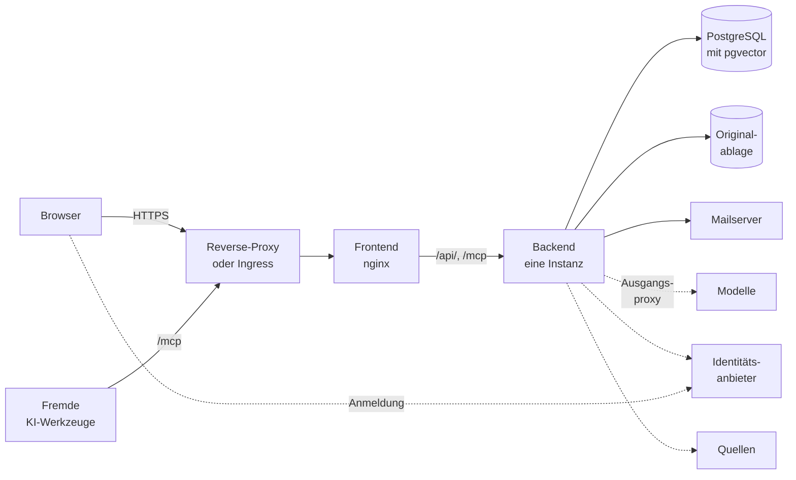

# Betriebsübersicht

> **Entwurf.** Dieses Kapitel ist geschrieben und gegen den gebauten Stand geprüft, aber noch nicht
> abgenommen.

Dieses Kapitel beschreibt, aus welchen Bausteinen eine OPAA-Installation besteht, wie sie
zusammenhängen und was für jeden Betriebsweg gleich gilt: Images, Bereitschaft, Härtung, Schlüssel,
Sicherung, Aktualisierung, Logs und Metriken. Wie OPAA mit Docker Compose oder unter Kubernetes
läuft, beschreiben die beiden Kinder dieses Kapitels; die Bedeutung jeder Umgebungsvariable steht
in der [Konfiguration](konfiguration.md).

> **Beispiel.** Ein Landratsamt betreibt OPAA auf einer virtuellen Maschine mit Docker Compose. Vor
> dem Frontend steht der Reverse-Proxy des Hauses mit dem Zertifikat, die Datenbank läuft im
> Stapel, die Originale der Uploads liegen auf dem Dateiserver, Chat und Einbettung laufen über
> einen Modellserver im Rechenzentrum, angemeldet wird über das Keycloak des Hauses. Ins Internet
> geht das Backend nur über den Proxy des Hauses, und auch das nur für zwei Webquellen.

## Bausteine



Gestrichelt sind die Verbindungen des Backends, die über den Ausgangsproxy gehen können, und die
Anmeldung des Browsers beim Identitätsanbieter. Die Originalablage ist ein Verzeichnis oder ein
Objektspeicher; die Modelle sind Chat, Embedding und Reranking.

| Baustein | Aufgabe | Pflicht | Kapitel |
|---|---|---|---|
| Frontend | liefert die Oberfläche aus und reicht `/api/` und `/mcp` an das Backend weiter; hält keinen Zustand | ja | [Frontend-Laufzeitimage](#frontend-laufzeitimage) |
| Backend | die Anwendung: Suche, Antwort, Indexierung, Rechte, Verwaltung | ja, genau eine Instanz | [Backend-Laufzeitimage](#backend-laufzeitimage) |
| PostgreSQL mit pgvector | die einzige Wahrheit: Dokumente, Chunks samt Vektoren, Volltext, Metadaten, Rechte, Chats, Protokolle | ja | [Datenbank](datenbank.md) |
| Originalablage | die Originale hochgeladener Dokumente, in einem Verzeichnis, auf einem Netzlaufwerk oder in einem Objektspeicher | ja, sobald hochgeladen wird | [Originalablage](originalablage.md) |
| Modelle | Chat, Einbettung und optional Reranking über openai-kompatible Endpunkte, im Haus oder außerhalb | Chat und Einbettung | [Modelle](modelle.md) |
| Identitätsanbieter | Anmeldung über OpenID Connect; ohne ihn melden sich nur lokale Konten an | nein | [Authentifizierung](authentifizierung.md) |
| Mailserver | Einladungen, Rücksetzlinks, Benachrichtigungen | nein | [E-Mail-Versand](e-mail.md) |
| Quellen | Dateisysteme, Webverzeichnisse, Feeds, Confluence, Objektspeicher und weitere, angebunden über Konnektoren | nein | [Konnektoren](konnektoren/README.md) |
| Ausgangsproxy | der eine Weg des Backends ins Netz, wenn das Haus einen verlangt | nein | [Ausgangsproxy](#ausgangsproxy) |

Gesichert werden muss nur, was einen Zustand hält: die Datenbank, die Originalablage und die
Geheimnisse der Konfiguration ([Sicherung und Wiederherstellung](#sicherung-und-wiederherstellung)).
Frontend, Backend und Modelle lassen sich jederzeit neu starten.

## Genau eine Backend-Instanz

OPAA läuft mit **genau einem Backend-Prozess**. Zeitpläne der Indexierung und des
Verzeichnisabgleichs, der Wiederanlauf abgebrochener Läufe, Zwischenspeicher und Thread-Pools sind an
diesen Prozess gebunden; zwei Instanzen gegen dieselbe Datenbank würden Läufe
doppelt starten und sich gegenseitig für abgebrochen halten. Skalierung ist deshalb eine Frage der
Hardware dieser einen Instanz, Hochverfügbarkeit des Backends gibt es nicht. Eine Aktualisierung ist
eine kurze Unterbrechung: Die alte Instanz endet, bevor die neue startet.

Das Frontend hält keinen Zustand und darf mehrfach laufen.

## Eine Organisation

Eine Installation wird mit **genau einer** Organisation ausgeliefert; es gibt keinen Verwaltungspfad,
der eine zweite anlegt, und alle Identitätsanbieter legen Konten in dieselbe Organisation an. Die
Mandantengrenze wird trotzdem durchgehend gehalten: Ein Objekt einer anderen Organisation ist für
jeden Aufruf „nicht gefunden", nicht „nicht erlaubt", und die Datenbank lässt keine Verbindung
zwischen Objekten zweier Organisationen zu. Die Originalablage führt die Organisation in jedem
Ablageort mit.

## Images und Versionen

Die CI veröffentlicht fertige Images für Backend und Frontend; gebaut wird auf dem Zielsystem nicht.
Es gibt zwei Arten von Ständen:

- **Releases** mit fester Versionsnummer. Ein Release wird einmal gebaut und nie überschrieben.
- **Der Entwicklungsstand `main`.** Er wird bei jedem Push auf `main` und zusätzlich wöchentlich
  (montags) neu gebaut, damit er auch ohne Codeänderung die aktuellen Sicherheitsupdates des
  Betriebssystems trägt.

| Image | Tags |
|-------|------|
| `ghcr.io/criew/opaa-backend` | `X.Y.Z`, `X.Y`, `main`, `sha-<commit>` |
| `ghcr.io/criew/opaa-frontend` | `X.Y.Z`, `X.Y`, `main`, `sha-<commit>` |

- **Architekturen.** Jedes Release und der Stand `main` liegen für `linux/amd64` und `linux/arm64`
  vor; Docker und Kubernetes ziehen die passende Variante, auch auf ARM-Servern und Apple-Silicon-
  Rechnern ohne Emulation. Ältere `sha-<commit>`-Tags aus der Zeit vor den arm64-Builds gibt es nur
  für `linux/amd64`.
- **Welcher Stand.** `X.Y.Z` ändert seinen Inhalt nie, `X.Y` zeigt auf das jüngste Patch-Release
  dieser Linie, ein Tag `latest` gibt es nicht. Für einen Betrieb, der Aktualisierungen plant, ist
  eine Release-Version der empfohlene Stand. Ein Release bekommt Sicherheitsupdates des Basis-Images
  über ein Patch-Release, nicht über den wöchentlichen Neubau: Wer `X.Y` verwendet, erhält es mit dem
  nächsten Pull, wer `X.Y.Z` pinnt, wechselt bewusst.
- **Backend und Frontend** laufen immer mit **derselben** Version.
- **Einen festen Stand von `main`** pinnt man über den Digest
  (`image: ghcr.io/criew/opaa-backend@sha256:…`), nicht über einen Tag. Auch `sha-<commit>` taugt
  dafür nicht: Der wöchentliche Neubau verschiebt `main` und `sha-<commit>` gemeinsam auf einen
  neuen Digest, solange der Commit der Stand von `main` ist. `sha-<commit>` beantwortet also „aus
  welchem Commit", nicht „welches Image". Den Digest eines Stands liefert
  `docker buildx imagetools inspect ghcr.io/criew/opaa-backend:main`.

Welche Version läuft, nennen `/actuator/info` unter `build.version` und die Startzeile des
Protokolls (`Starting OpaaApplication v<Version>`), für das Frontend der Dialog „Info zu …" im
Profilmenü. Ein Release-Image meldet die Version seines Tags, ein Image von `main` den
Entwicklungsstand `0.0.0-dev`.

**SBOM und Herkunft.** Jedes Image trägt je Architektur eine SBOM- und eine Provenance-Attestierung;
die SBOM deckt auch die Betriebssystempakete des Basis-Images ab:

```bash
docker buildx imagetools inspect ghcr.io/criew/opaa-backend:main --format '{{ json .SBOM }}'
docker buildx imagetools inspect ghcr.io/criew/opaa-backend:main --format '{{ json .Provenance }}'
# nur eine Architektur
docker buildx imagetools inspect ghcr.io/criew/opaa-backend:main --format '{{ json (index .SBOM "linux/arm64") }}'
```

Für das Frontend entsprechend mit `opaa-frontend`. Zusätzlich legt die CI bei jedem Push auf `main`
je eine CycloneDX-SBOM der ausgelieferten Laufzeit-Abhängigkeiten von Backend und Frontend als
Workflow-Artefakte `sbom-backend` und `sbom-frontend` ab (90 Tage Aufbewahrung, ohne Test- und
Build-Werkzeuge).

## Backend-Laufzeitimage

Das Backend läuft in einem bewusst minimalen Image: eine mit `jlink` erzeugte Java-21-Laufzeit auf
einem Distroless-Basisimage. Außer der C-Bibliothek enthält es kein Betriebssystempaket — keine
Shell, keine Coreutils, kein `curl`/`wget`, keinen Paketmanager. Daraus folgt:

- **Keine Shell im Container.** `docker exec … sh` und `kubectl exec … sh` scheitern. Diagnose läuft
  über Protokoll, Actuator und Werkzeug-Container ([Diagnose ohne Shell](#diagnose-ohne-shell)).
- **Proben von außen.** Ein Healthcheck darf kein `CMD-SHELL` und kein `curl`/`wget` im Container
  verwenden; er fragt `GET /actuator/health/readiness` von außen ab
  ([Bereitschaft und Lebendigkeit](#bereitschaft-und-lebendigkeit)).
- **Zeitzone:** UTC, solange `TZ` nicht gesetzt ist. `TZ=Europe/Berlin` wirkt wie gewohnt; die
  Zeitzonendatenbank steckt in der Java-Laufzeit.
- **Zertifikate:** Der Truststore ist der `cacerts` der Java-Laufzeit mit den öffentlichen CAs. Eine
  interne CA kommt in eine **Kopie** dieses Truststores, nie in einen leeren, neuen Store — der
  ersetzte sonst alle öffentlichen CAs, und HTTPS zu Modellanbietern, S3 und Identitätsanbietern
  scheitert mit `PKIX path building failed`. Wie das geht, steht je Betriebsweg unter
  [Docker Compose](docker-compose.md#eigene-interne-ca-ergänzen) und
  [Kubernetes](kubernetes.md#eigene-zertifizierungsstelle).
- **JVM-Optionen** (Heap-Grenzen, Debug-Agent, JFR) gehen über `JAVA_TOOL_OPTIONS`; ein eigener
  `java`-Aufruf würde den Entrypoint überschreiben.
- **Ohne Sonderrechte:** Der Prozess läuft als Benutzer und Gruppe `65532` und lauscht auf Port 8080.
  Eingehängte Verzeichnisse müssen für diese Kennung zugänglich sein: die Originalablage und ein
  eigenes Temp-Verzeichnis beschreibbar, Korpus-Verzeichnisse lesbar.

### Nur lesbares Dateisystem

Das Backend schreibt an genau zwei Stellen:

| Pfad | Inhalt | Nötig |
|---|---|---|
| `/tmp` (`java.io.tmpdir`) | Arbeitsdateien von Tomcat und Uploads, heruntergeladene Quelldateien, Arbeitskopien für den Objektspeicher, der Font-Cache von PDFBox, Laufzeitdaten der JVM | immer |
| `/app/uploads` (`OPAA_UPLOAD_STORAGE_PATH`) | die hochgeladenen Originale | nur, solange sie im Dateisystem liegen (`OPAA_UPLOAD_STORE` nicht auf `s3`) |

Alles andere liest der Prozess nur; ein eigenes `OPAA_UPLOAD_S3_TEMP_DIRECTORY` oder
`OPAA_INDEXING_S3_TEMP_DIRECTORY` kommt als dritter beschreibbarer Pfad hinzu und muss auf einem
eingehängten Volume oder unter `/tmp` liegen. Diagnoseziele gehören immer absolut unter `/tmp`: Ein
`jcmd … GC.heap_dump heap.hprof`, ein `JFR.dump` ohne `filename` und
`-XX:+HeapDumpOnOutOfMemoryError` ohne `-XX:HeapDumpPath=/tmp` schreiben sonst nach `/app` und
scheitern mit `Read-only file system`.

`/tmp` liegt auf einem Datenträger, nicht im Arbeitsspeicher: Die Dateien dort erreichen die Größe
eines Dokuments. Es fasst mehrere der größten erwarteten Dokumente gleichzeitig und, wenn einer
vorgesehen ist, einen Heap-Dump, der so groß wird wie der Heap. Unter Docker Compose ist das ein
benanntes Volume, das Neustarts überlebt, unter Kubernetes ein `emptyDir`, das mit dem Pod
verschwindet. Was ein harter Abbruch dort zurücklässt,
und jeder Heap-Dump oder JFR-Mitschnitt, kann Inhalte privater Bibliotheken enthalten, ein Heap-Dump
zusätzlich Geheimnisse und entschlüsselte Zugangsdaten — solche Dateien werden nach der Diagnose
entfernt.

### Speicher und Container-Grenzen

Die JVM richtet ihre Heap-Grenze nach dem Speicher, den sie sieht, und nimmt ohne eigene Angabe
**25 %** davon: ohne Container-Grenze 25 % des Host-Speichers, mit Grenze 25 % der Grenze. Mit
Grenze bleibt so viel ungenutzt; dann wird der Anteil über `JAVA_TOOL_OPTIONS` angehoben:

```text
JAVA_TOOL_OPTIONS=-XX:MaxRAMPercentage=70
```

Der Rest der Grenze gehört Klassen, übersetztem Code, Threads und Puffern. Ohne Container-Grenze
wird der Anteil **nicht** angehoben, sonst konkurriert die JVM mit Datenbank und Modellbetrieb um
den Host-Speicher.

**Messwert als Ausgangspunkt.** Die E2E-Suite (Uploads, Indexierung von PDF-, Office- und
Mail-Dateien, Chat) lief mit einer Grenze von 1,5 GiB und 75 % Heap ohne Abbruch: Spitze des
Containers 1,0 GiB, belegter Heap höchstens rund 400 MiB, Klassen, Code und Threads zusammen rund
420 MiB. Für den Betrieb empfohlen:

| | Anforderung (`requests`) | Grenze (`limits`) | Heap-Anteil |
|---|---|---|---|
| Speicher | 1 GiB | 2 GiB | `-XX:MaxRAMPercentage=70` |
| CPU | 0,5 | keine | — |

Die CPU-Werte sind nicht gemessen. Eine CPU-Grenze drosselt die JVM gerade beim Start und bei der
Indexierung und wird deshalb nur gesetzt, wenn der Cluster sie verlangt. Große Bestände, sehr große
PDF-Dateien oder viele gleichzeitige Indexierungen brauchen mehr.

Ein Abbruch wegen der Grenze zeigt sich unter Kubernetes als `OOMKilled` im Status des Pods, unter
Compose als `true` in `docker inspect --format '{{.State.OOMKilled}}' <container>`. Der Exit-Code
`137` allein ist nicht eindeutig, er entsteht auch nach Ablauf der Stopp-Frist. Steht dort `true`,
die Grenze anheben, nicht den Heap-Anteil.

## Frontend-Laufzeitimage

Das Frontend liefert die Oberfläche aus und reicht `/api/` und `/mcp` an das Backend weiter. Es läuft
auf dem unprivilegierten nginx-Image (`nginxinc/nginx-unprivileged`) und hält die Einschränkungen
ein, die ein Kubernetes-Cluster mit Pod Security Standard `restricted` verlangt:

- **Ohne root:** Der Prozess läuft als Benutzer `101` und lauscht auf **Port 8080**, über IPv4 und,
  wenn der Container IPv6 hat, auch über IPv6. Ob IPv6 vorhanden ist, entscheidet der Container beim
  Start anhand von `/proc/net/if_inet6`; fehlt die Datei, lauscht nginx nur über IPv4 und meldet das
  im Protokoll. Eine Probe kann deshalb `localhost` verwenden.
- **Beliebige Kennung:** Das Image läuft auch unter einer vom Cluster zugewiesenen Kennung, etwa bei
  OpenShift, solange `/tmp` beschreibbar ist.
- **Nur lesbares Dateisystem:** Der Container schreibt ausschließlich unter `/tmp` — die beim Start
  erzeugte Serverkonfiguration, die PID-Datei und die Zwischenablage für Uploads und, bei langsamen
  Clients, für große Antworten des Backends. Unter Compose ist `/tmp` ein `tmpfs` mit 512 MiB, unter
  Kubernetes ein `emptyDir`. Reicht der Platz bei vielen gleichzeitigen großen Uploads nicht, wird
  die Grenze angehoben.
- **Backend-Ziel:** `OPAA_BACKEND_UPSTREAM` nennt Host und Port des Backends. Ein Wert, der nicht die
  Form `host[:port]` hat (Port 1 bis 65535), bricht den Start mit einer Meldung im Protokoll ab.
- **Wartezeit auf das Backend:** `OPAA_BACKEND_READ_TIMEOUT` bestimmt, wie lange nginx auf die Antwort
  des Backends wartet, für `/api/` und `/mcp` gleichermaßen. Eine Chat-Antwort kommt erst, wenn Suche,
  Reranking und Modellaufruf fertig sind, und kann Minuten brauchen; antwortet das Backend nicht
  rechtzeitig, endet die Anfrage mit `504`. Ein Wert ohne Einheit `s`, `m` oder `h` bricht den Start
  ab.
- **Uploadgröße:** nginx nimmt Anfragen bis 52 MB an, etwas mehr als die Grenze des Backends
  (`OPAA_UPLOAD_MAX_FILE_SIZE`), weil nginx die ganze Multipart-Anfrage misst. Der Wert steht fest in
  der nginx-Konfiguration des Images; wer die Grenze des Backends anhebt, hebt ihn dort mit an,
  ebenso an jedem Proxy davor (siehe `OPAA_UPLOAD_MAX_FILE_SIZE` in der
  [Konfiguration](konfiguration.md)).

## Bereitschaft und Lebendigkeit

Für einen Container-Healthcheck oder die Probe eines Lastverteilers ist nicht der Gesamtstatus der
richtige Pfad, sondern:

| Pfad | Antwortet auf Basis von | Gedacht für |
| --- | --- | --- |
| `GET /actuator/health/readiness` | Prozesszustand und Datenbank | Lastverteiler-Probe, Container-Healthcheck: Darf diese Instanz Anfragen bekommen? |
| `GET /actuator/health/liveness` | Prozesszustand | Neustart-Entscheidung: Lebt der Prozess noch? |
| `GET /actuator/health` | alles, was nicht in einer eigenen Gruppe steht | Überblick bei der Diagnose |

Beide Proben und der Gesamtstatus sind ohne Anmeldung erreichbar und antworten dann nur mit dem
Status (`{"status":"UP"}` bzw. `DOWN`); die Aufschlüsselung sieht nur ein angemeldeter Aufrufer.
Jede **andere** Gruppe verlangt ein gültiges Zugangstoken, weil zwei von ihnen bei jedem Abruf einen
echten Modellaufruf bzw. eine echte Ähnlichkeitssuche auslösen.

> **Die Bereitschaft zieht eine Datenbankverbindung.** Nicht nur ein Ausfall der Datenbank lässt die
> Probe `DOWN` melden, sondern auch ein erschöpfter Verbindungspool. Eine Instanz, die unter Last
> alle Verbindungen in langen Chat-Anfragen hält, kann sich so selbst aus der Rotation nehmen. Bei
> knapp bemessenen Pools die Probe mit einer nachsichtigen Anzahl Fehlversuche konfigurieren.

Chat-Modell, Embedding-Modell und Vektorspeicher stehen bewusst **nicht** in der Bereitschaft und
nicht im Gesamtstatus: Jeder hängt an einem fremden Dienst, und ein hängender Modellserver darf die
Instanz nicht aus der Rotation nehmen, während Anmeldung, Verwaltung und Dokumentenzugriff
weiterarbeiten. Ohne Datenbank dagegen kann die Instanz nichts beantworten. Die übrigen Zustände
stehen in eigenen Gruppen:

| Gruppe | Prüft |
| --- | --- |
| `GET /actuator/health/chat-model` | welches Chat-Modell aktiv ist (ohne Aufruf des Modells) |
| `GET /actuator/health/embedding-model` | einen echten Embedding-Aufruf |
| `GET /actuator/health/vector-store` | eine echte Ähnlichkeitssuche |
| `GET /actuator/health/upload-store` | den Objektspeicher der Originalablage; `UP` mit Endpunkt und Bucket oder `DOWN` mit dem Grund (nur mit `OPAA_UPLOAD_STORE=s3`) |
| `GET /actuator/health/mail` | den letzten SMTP-Versand: `UP`, `DOWN` oder `UNKNOWN`, ohne Einzelheiten |

## Sanftes Herunterfahren

Ein Stopp bricht laufende HTTP-Anfragen nicht ab: Das Backend nimmt keine neuen Verbindungen mehr an
und lässt die angenommenen Anfragen zu Ende laufen, höchstens so lange, wie `OPAA_SHUTDOWN_TIMEOUT`
erlaubt. Zusammen mit den Proben ist das die Voraussetzung, eine Instanz hinter einem Lastverteiler
geordnet zu erneuern: aus der Rotation nehmen, auslaufen lassen, stoppen.

- **Hintergrundläufe teilen dieses Zeitfenster nicht.** Ein laufender Indexierungs- oder
  Upload-Vorgang wird beim Stopp sofort abgebrochen, beim nächsten Start als abgebrochen erkannt und
  kann wiederholt werden. Ein großer Lauf kann einen Neustart nicht hinhalten.
- **Chat-Titel und Gesprächsnotiz** bekommen ein eigenes, kurzes und fest eingebautes Zeitfenster,
  weil beide nie nachgeholt werden. Ein langsamer Aufruf wird trotzdem abgebrochen. Das Fenster kommt
  zu dem der Anfragen hinzu: `OPAA_SHUTDOWN_TIMEOUT` gilt je Stopp-Phase, nicht für den ganzen Stopp.
- **Die Stopp-Frist der Plattform** muss länger sein, sonst endet der Prozess abrupt: unter Compose
  `OPAA_STOP_GRACE_PERIOD`, unter Kubernetes `backend.terminationGracePeriodSeconds`, das der Chart
  größer als das Zeitfenster verlangt.

## Netzwerkzugang

Das Backend wird nie direkt angesprochen, sondern über das Frontend. Davor steht in jedem
erreichbaren Betrieb ein **TLS-terminierender Reverse-Proxy** — der Proxy des Hauses vor dem
Compose-Stapel oder der Ingress-Controller des Clusters. Für ihn gilt:

- **`X-Forwarded-Proto` autoritativ setzen** (`proxy_set_header X-Forwarded-Proto $scheme;`) und nie
  vom Client durchlassen. Das Backend wertet `X-Forwarded-*` aus, damit Anfragen desselben Origins
  hinter dem Proxy nicht als cross-origin gelten; ein gefälschtes `https` umginge sonst die
  CORS-Prüfung. Der nginx im Frontend-Container reicht einen eingehenden Wert unverändert weiter.
- **`X-Forwarded-For` setzen oder anhängen und ein eingehendes `Forwarded` verwerfen.** Wie das
  Backend den Header auswertet, steht unter [Vertraute Proxys](#vertraute-proxys-und-client-adresse).
  Der nginx im Frontend-Container hängt die Kette an (`$proxy_add_x_forwarded_for`) und verwirft
  `Forwarded`, weil das Backend diesen Header sonst vorziehen würde.
- **`/`, `/api/` und `/mcp` an das Frontend reichen.** `/mcp` ist der Kanal der
  [Fremdzugänge](fremdzugaenge.md); fehlt er, beantwortet die Auslieferung den Aufruf mit ihrer
  Startseite, und der Client meldet eine unverständliche Antwort. Antworten auf `/mcp` nicht
  puffern: Der Kanal kann als Ereignisstrom antworten.
- **Zeitgrenze mindestens so lang wie `OPAA_BACKEND_READ_TIMEOUT`** für `/api/` und `/mcp` (bei nginx
  `proxy_read_timeout`, Vorgabe eine Minute) — sonst bricht der Proxy lange Chat-Antworten mit `504`
  ab, während das Backend noch rechnet.
- **Die Rücksprungseiten nicht protokollieren.** `/connections/callback` (Zustimmung bei einem
  OAuth-Anbieter, siehe [Zugänge](zugaenge.md)) und `/auth/callback` (Anmeldung) sind Seiten der
  Anwendung, keine Backend-Pfade; ihre Abfrageparameter tragen einen einmal gültigen Code. Der
  Proxy reicht sie wie `/` an das Frontend und darf sie weder protokollieren noch verändern. Der
  Frontend-Container schreibt sie nicht ins Zugriffsprotokoll, weder in die Anfragezeile noch in den
  Referer der Folgeanfragen; alle übrigen Anfragen protokolliert er im Format `main` des Basis-Images.
  Die Adresse muss genau `{OPAA_PUBLIC_BASE_URL}/connections/callback` lauten, wie in der
  App-Registrierung beim Anbieter.
- **`Strict-Transport-Security` setzt der äußere Proxy**, dort, wo TLS endet. Der Frontend-Container
  spricht selbst nur `http` und setzt den Header bewusst nicht; zwei Stellen für HSTS liefen nur
  auseinander.

### Sicherheits-Header und `Strict-Transport-Security`

Der nginx im Frontend-Container setzt `Content-Security-Policy`, `X-Content-Type-Options`,
`X-Frame-Options` und `Referrer-Policy` auf jede Antwort, auch auf Fehlerantworten, und verrät seine
Version nicht. Die Content-Security-Policy erzwingt, dass die Oberfläche alle Skripte, Stile,
Schriften und Icons selbst ausliefert und zur Laufzeit kein CDN lädt; Verbindungen gehen nur an die
eigene Herkunft. Zwei Ausnahmen: `style-src` erlaubt Inline-Stile, weil die Oberflächenbibliothek
Stile zur Laufzeit einfügt, und `connect-src` lässt die Origins zu, die in
`OPAA_CSP_CONNECT_SRC_EXTRA` stehen — gebraucht für einen Identitätsanbieter auf fremdem Origin
([Authentifizierung](authentifizierung.md#content-security-policy-und-ein-anbieter-auf-fremdem-origin)).
Die Backend-eigenen Kopien dieser Header entfernt nginx, damit jede Antwort sie nur einmal trägt.
`Strict-Transport-Security` gehört an den äußeren Proxy (siehe oben).

## Ausgangsproxy

Muss das Backend über einen Proxy ins Netz, trägt die Systemverwaltung ihn in der Oberfläche ein:
**Administration → Anbindungen → Einstellungen**, Abschnitt **Ausgangsproxy**. Es gibt genau einen
Proxy für das ganze Haus; ohne Eintrag gehen alle Verbindungen direkt hinaus. Die JVM-Eigenschaft
`http.proxyHost` und die Umgebungsvariablen `HTTP_PROXY`/`HTTPS_PROXY` wertet OPAA nicht aus.

- **Was über den Proxy geht:** jede HTTP(S)-Verbindung des Backends — Quellen der Bibliotheken samt
  Weiterleitungen und Original-Abruf, OAuth- und Token-Endpunkte der Zugänge, Dienstkonto-Tokens,
  MCP-Server, Chat-, Einbettungs- und Rerank-Endpunkte samt Verbindungstest, Discovery-Dokument und
  Signaturschlüssel der Identitätsanbieter und der Verzeichnisabgleich. `http`-Ziele gehen als
  gewöhnliche Proxy-Anfrage hinaus, `https`-Ziele als Tunnel (`CONNECT`).
- **Was nie über den Proxy geht:** Ziele auf `localhost` und Loopback-Adressen, die Datenbank, der
  Mailserver, SMB-Freigaben und der Objektspeicher der Originalablage.
- **Format:** `http://host:port` oder `host:port`. Ein Proxy über `https`, SOCKS und eine Anmeldung
  am Proxy werden nicht unterstützt; ein Proxy, der eine Anmeldung verlangt, weist jede Verbindung
  ab. Er muss OPAA über die Adresse des Servers zulassen.
- **Ausnahmeliste:** ein Eintrag je Zeile. Ein Hostname gilt für sich und alle Subdomänen
  (`intranet.example.org` trifft auch `wiki.intranet.example.org`; ein vorangestellter `.` oder `*.`
  bedeutet dasselbe), eine IP-Adresse für sich, ein Netzbereich wie `10.0.0.0/8` für IP-Adressen
  darin, nie für einen Hostnamen, auch wenn er in den Bereich auflöst. Abgewiesen werden `*`, Ports
  und Leerzeichen. Interne Ziele wie ein Modellserver im eigenen Netz gehören auf diese Liste.
- **Ausnahmeliste und Zielprüfung sind getrennt.** Die Ausnahmeliste entscheidet nur über den Weg; ob
  ein internes Ziel erreicht werden darf, entscheidet die [Zielprüfung](#zielprüfung-abrufe-des-servers).
  Ein internes Ziel braucht in der Regel beides.
- **Der Proxy bestimmt die Zieladresse.** Geprüft wird das Ziel, nie der Proxy. Ein Hostname, den der
  Server selbst nicht auflösen kann, wird über den Proxy nicht abgelehnt, denn der Proxy löst ihn auf;
  welche Adresse er wählt, sieht OPAA nicht. Wer interne Ziele hinter dem Proxy ausschließen muss,
  sperrt sie am Proxy.
- **Änderungen** gelten für jede danach aufgebaute Verbindung, ohne Neustart; eine offene,
  wiederverwendete Verbindung läuft auf ihrem bisherigen Weg weiter, bis sie schließt. Jede Änderung
  steht als `OUTBOUND_PROXY_CHANGED` mit altem und neuem Stand im Revisionsprotokoll.
- **Fehlerbild:** Lehnt der Proxy einen Tunnel ab oder verlangt er eine Anmeldung (Status 407),
  melden Verbindungstests und Läufe der Quellen, die Anmeldung an Zugängen, die Prüfung der
  Identitätsanbieter, der Verzeichnisabgleich und die Modell-Endpunkte das mit dem Status des
  Proxys. Ausnahme ist S3: Dort erkennt OPAA nur die 407; einen abgelehnten Tunnel meldet der
  Konnektor als Antwort des Objektspeichers, etwa als fehlende Berechtigung bei Status 403.
- **Notanker:** Ein falscher Proxy kann die Anmeldung über Identitätsanbieter lahmlegen, weil auch
  deren Signaturschlüssel über ihn geholt werden. Das lokale Konto der Systemverwaltung meldet sich
  ohne Anbieter an und kann den Eintrag korrigieren.

## Härtung für erreichbare Deployments

Eine Installation, die aus einem größeren Netz oder dem Internet erreichbar ist, braucht mehr als die
Vorgaben, mit denen der mitgelieferte Stapel ohne Ersteinrichtung startet. Als Faustregel: Ein
bekanntes, im Repository stehendes Zugangsdatenpaar, ein Klartext-Transportweg zu Anmeldedaten und
ein netzweit erreichbarer administrativer Zugang sind immer zu schließen; eine Einschränkung, die nur
die Angriffsfläche auf einem sonst vertrauenswürdigen Host verkleinert, ist eine Empfehlung.

| Maßnahme | Zwingend | Wo beschrieben |
|---|---|---|
| TLS am äußeren Proxy; `X-Forwarded-Proto` autoritativ | ja | [Netzwerkzugang](#netzwerkzugang) |
| Betriebsmodus `oidc`, nie `dev` | ja | [Authentifizierung](authentifizierung.md#entwicklungsmodus-dev) |
| eigene Geheimnisse statt Vorgaben, `OPAA_AUTH_LOCAL_COOKIE_SECURE` nicht auf `false` | ja | [Schlüssel und Geheimnisse](#schlüssel-und-geheimnisse) |
| vertraute Proxys eintragen | ja, sobald ein Proxy vor dem Backend steht | [Vertraute Proxys](#vertraute-proxys-und-client-adresse) |
| mitgelieferten Keycloak-Realm härten | ja, wenn er genutzt wird | [Authentifizierung](authentifizierung.md#härtung-des-mitgelieferten-keycloak) |
| Ports nur an `127.0.0.1`, Zugangsdaten des mitgelieferten Objektspeichers ersetzen | ja für Keycloak und den Objektspeicher, sonst empfohlen | [Docker Compose](docker-compose.md#härtung-des-compose-stapels) |
| Netztrennung, Pod Security | — | [Kubernetes](kubernetes.md#netz-und-sicherheit) |
| Ziele des Servers begrenzen | Vorgabe ist eingeschaltet | [Zielprüfung](#zielprüfung-abrufe-des-servers) |

### Vertraute Proxys und Client-Adresse

Das Backend zählt seine Rate-Limits je Client-Adresse und prüft an derselben Adresse die
Netzbeschränkung lokaler Systemverwalter (`OPAA_LOCAL_ADMIN_ALLOWED_CIDRS`). Steht ein Proxy davor —
und der nginx des Frontend-Containers ist bereits einer —, ist die Verbindungsadresse die des Proxys.
`OPAA_RATE_LIMIT_TRUSTED_PROXY_CIDRS` nennt deshalb die Netze, deren Verbindungen `X-Forwarded-For`
vorlegen dürfen; **Pflicht, sobald ein Proxy vor dem Backend steht**.

- **Ohne Wert** (die Vorgabe) wird der Header ignoriert. Dann teilen alle Clients einen Zähler: Die
  Anmeldegrenze gilt für das ganze Haus, und die Netzbeschränkung sieht nur den Proxy. Der Start
  schreibt in diesem Fall eine Warnung mit genau dieser Folge ins Log.
- **So eng wie möglich.** Unter Compose ist der Wert die feste Adresse des Frontend-Containers als
  `/32`, nicht das ganze Compose-Netz: Dessen Gateway-Adresse spricht jeder Prozess des Hosts und
  jeder Container, und wer sie vertraut, macht jeden davon zu einem Proxy, der `X-Forwarded-For`
  beliebig setzen kann. Ein weiterer Proxy auf **demselben** Host erscheint dem Container-nginx unter
  genau dieser Gateway-Adresse und muss dann zusätzlich eingetragen werden — ein bewusster Zusatz
  mit diesem Risiko. Ein Proxy auf einem anderen Rechner kommt mit seiner eigenen Adresse hinzu.
  Unter Kubernetes schützen NetworkPolicies das Pod-Netz ([Kubernetes](kubernetes.md#proxy-kette-und-client-adresse)).
  Bereiche weiter als `/8` (`0.0.0.0/0`, `::/0`) lehnt der Start ab.
- **Von rechts gelesen.** Der Client ist der erste Eintrag der Kette, der kein vertrauter Proxy ist;
  ein vom Client selbst mitgeschickter Anfang zählt nie, und mehrere `X-Forwarded-For`-Zeilen gelten
  als eine Kette. Ein äußerer Proxy darf die Kette anhängen oder überschreiben, muss aber selbst in
  der Liste stehen. Ein Client, der den Header selbst setzt, erreicht damit nichts — auch nicht an
  den Webhook-Eingängen für Confluence und S3, die ohne Sitzung erreichbar sind.
- **Prüfen:** Der Diagnose-Endpunkt `GET /api/v1/admin/diagnostics/client-address` zeigt, wie das
  Backend die eigene Anfrage auflöst ([Diagnose ohne Shell](#diagnose-ohne-shell)).

### Zielprüfung: Abrufe des Servers

Wer eine Bibliothek mit einer Webquelle anlegt, bestimmt eine Adresse, die der Server bei jedem Lauf
abruft — auch Ziele, die nur aus dem Netz des Servers erreichbar sind. Das ist eine Eigenschaft der
Funktion, keine Lücke: Sie verlangt Anmeldung und mindestens Bearbeitungsrecht auf der Bibliothek,
und das Anlegen steht bewusst jedem Berechtigten offen. Den Raum dessen, was erreichbar ist, begrenzen
zwei Schranken, unabhängig davon, wer die Bibliothek anlegt:

- **Die Pfad-Allowlist** (`OPAA_INDEXING_FILESYSTEM_ALLOWLIST`) für Dateisystem-Bibliotheken: Nur
  Pfade darunter sind konfigurierbar. Eine Ablehnung nennt keine Serverpfade, sondern verweist auf die
  Systemverwaltung.
- **Die Zielprüfung** für jede Quelle, die der Server über das Netz abruft (Webverzeichnis, Feed,
  Confluence, S3 und weitere), standardmäßig eingeschaltet: Loopback, Link-Local einschließlich der
  Cloud-Metadaten-Adresse `169.254.169.254`, die privaten IPv4-Bereiche, Carrier-Grade NAT,
  reservierte Bereiche, IPv6 Unique-Local, NAT64 und in IPv6 eingebettete IPv4-Adressen werden
  abgelehnt. Geprüft wird die **aufgelöste** Adresse, vor dem ersten Abruf und nach jeder
  Weiterleitung. Ein Betrieb mit internen Quellen, etwa einem Intranet, trägt deren Hostnamen in
  `OPAA_INDEXING_TARGET_VALIDATION_ALLOWLIST` ein, statt die Prüfung mit
  `OPAA_INDEXING_TARGET_VALIDATION_ENABLED=false` abzuschalten. Dieselbe Prüfung gilt mit eigenen
  Schaltern für Identitätsanbieter und die Originalablage.

Dazu kommen feste Regeln: Nur `http` und `https`; einer Weiterleitung folgt OPAA nur auf demselben
Origin, nie auf einen fremden Host und nie von `https` auf `http` (von `http` auf `https` auf demselben
Host schon). Eine Zertifikatsprüfung, die eine Bibliothek abschaltet, gilt beim Webverzeichnis für den
ganzen Abruf, beim Feed nur für den Origin des Feeds. Einen eigenen Proxy trägt keine Bibliothek; alle
Verbindungen nehmen den [Ausgangsproxy](#ausgangsproxy). Fehlermeldungen eines Laufs nennen bei einer
abgelehnten Weiterleitung nur Schema und Host des Ziels, nie die ganze Adresse.

**Grenze: DNS-Rebinding.** Die geprüfte Auflösung und die Auflösung, mit der die Verbindung
tatsächlich aufgebaut wird, sind zwei Vorgänge; ein Resolver, der dazwischen anders antwortet, wird
nicht erkannt. Die Zielprüfung ist Härtung gegen naheliegende Fehlgriffe und Missbrauch, keine
Garantie. Wer das Restrisiko ausschließen muss, beschränkt die ausgehenden Verbindungen des Backends
zusätzlich auf Netzebene, etwa mit Egress-Regeln oder einem Proxy mit Zielliste.

Der Anstoß eines Laufs (`POST /api/v1/libraries/{libraryId}/indexing`) ist über den Proxy aus dem
Netz erreichbar wie jeder API-Pfad. Er verlangt Anmeldung, Bearbeitungsrecht auf der Bibliothek und
unterliegt einem eigenen, engen Rate-Limit (`OPAA_RATE_LIMIT_INDEXING_*`).

## Schlüssel und Geheimnisse

| Geheimnis | Wofür | Ohne eigenen Wert | Bei Verlust oder Wechsel |
|---|---|---|---|
| `OPAA_AUTH_JWT_SECRET` | Wurzelgeheimnis lokal ausgestellter Tokens und der Prüfwerte von Refresh-, Einladungs-, Rücksetz- und Übergabelinks | im Betriebsmodus `oidc` bricht der Start ab (auch unter 32 Zeichen oder bei einem Platzhalter wie `change_me`) | alle lokalen Sitzungen enden, alle offenen Links verfallen — gewollt nach einer [Rücksicherung](authentifizierung.md#nacharbeit-nach-einer-rücksicherung-der-datenbank) |
| `OPAA_CREDENTIALS_ENCRYPTION_KEY` | Zugangsdaten der Quellen, Zugänge und verbundenen Konten, Webhook-Geheimnisse, Zugang des Verzeichnisabgleichs | nur das Speichern solcher Zugangsdaten scheitert | gespeicherte Werte sind unlesbar und neu einzutragen |
| `OPAA_SETTINGS_ENCRYPTION_KEY` | Zugangsschlüssel der Chat-Modelle, SMTP-Passwort | nur das Speichern solcher Werte scheitert | gespeicherte Werte sind unlesbar und neu einzutragen ([Modelle](modelle.md#verschlüsselung-der-zugangsschlüssel-verwalteter-chat-modelle)) |
| `OPAA_DB_USERNAME`, `OPAA_DB_PASSWORD` | Konto der Datenbank | Vorgabe `opaa`/`opaa`, nur für die Entwicklung | Der mitgelieferte Datenbankcontainer legt das Konto nur beim ersten Start an; das Paar vor dem ersten Start setzen |

Alle Geheimnisse erzeugt man zufällig (`openssl rand -base64 48` für das Signaturgeheimnis,
`openssl rand -base64 32` für die beiden Schlüssel), legt sie außerhalb des Repositorys ab
(Passwort-Tresor, Secret-Manager) und sichert sie getrennt von der Datenbank: Eine
Datenbanksicherung ohne die beiden Verschlüsselungsschlüssel enthält unlesbare Zugangsdaten. Die im
Profil `dev` hinterlegten Schlüssel sind nicht für den Betrieb gedacht. Tokens eines
Identitätsanbieters prüft OPAA nur gegen dessen Signaturschlüssel; das Signaturgeheimnis betrifft nur
lokale Konten.

### Zugangsdaten-Verschlüsselung

Zugangsdaten einer Quelle — bei Webquellen etwa `benutzer:passwort` für die Basic-Anmeldung, bei
Confluence ein Token, bei S3 ein Schlüsselpaar — liegen **verschlüsselt** in der Datenbank
(AES-256-GCM, zufälliger Initialisierungsvektor je Wert, Präfix `enc:v1:`). Keine API-Antwort und
kein Log enthält sie; die Oberfläche zeigt nur, ob welche hinterlegt sind.

- **Kein Schlüssel nötig, solange nichts zu verschlüsseln ist.** Uploads, Dateisystem-Bibliotheken
  und Webquellen ohne Anmeldung brauchen keinen. Erst das Anlegen oder Ändern von Zugangsdaten
  scheitert ohne gültigen Schlüssel mit `503` und einer klaren Meldung.
- **Lesen scheitert weich, Schreiben hart.** Lässt sich ein Wert mit dem aktuellen Schlüssel nicht
  entschlüsseln (Schlüssel verloren oder gewechselt, Wert beschädigt), behandelt OPAA ihn als nicht
  gesetzt und schreibt eine Warnung ohne Wert und ohne Kennung der Bibliothek ins Log; die übrigen
  Bibliotheken bleiben lesbar. Die Oberfläche zeigt die Zugangsdaten dann als „nicht gesetzt",
  obwohl der Geheimtext noch gespeichert ist. Ein Schreibvorgang auf Zugangsdaten scheitert dagegen
  mit `503`, statt sie still zu verlieren.
- **Andere Änderungen lassen den Geheimtext stehen.** Name, Zeitplan oder Metadaten einer Bibliothek
  zu ändern schreibt den gelesenen Leerwert nicht zurück; mit dem wiedergefundenen Schlüssel sind die
  Zugangsdaten wieder lesbar. Zwei Vorgänge löschen ihn dagegen absichtlich: ein Wechsel des Hosts der
  Quelle ohne neue Zugangsdaten (sie gelten nur für den bisherigen Host) und der Widerruf eines
  Webhook-Geheimnisses oder Ereignis-Tokens.
- **Bei Schlüsselverlust** sind die verschlüsselten Werte nicht wiederherstellbar. Betroffen sind nur
  die Zugangsdaten, nicht die Bibliothek oder ihr Bestand. Die Zugangsdaten werden an der Bibliothek
  bzw. am Zugang neu eingetragen; bis dahin läuft ein Lauf ohne Anmeldung und scheitert, wenn die
  Quelle eine verlangt.
- **Ein Wechsel des Schlüssels im Bestand ist nicht vorgesehen.** Es gibt keinen Weg, vorhandene Werte
  umzuschlüsseln; wer den Schlüssel trotzdem wechselt, trägt jeden betroffenen Wert danach neu ein.
  Ein Wert mit unbekannter Fassung (nicht `enc:v1:`) wird nie als Klartext behandelt.

## Sicherung und Wiederherstellung

| Bestandteil | Inhalt | Gesichert durch |
|---|---|---|
| Datenbank | Dokumente, Chunks samt Vektoren, Volltext, Metadaten, Konten, Rechte und Rechtehistorie, Chats, Nachweis- und Revisionsprotokoll | `pg_dump` oder die Sicherung des Datenbankbetriebs |
| Originalablage | die Originale der Uploads | Kopie des Verzeichnisses, Snapshots, Versionierung oder Replikation des Objektspeichers |
| Geheimnisse | vor allem `OPAA_CREDENTIALS_ENCRYPTION_KEY`, `OPAA_SETTINGS_ENCRYPTION_KEY`, `OPAA_AUTH_JWT_SECRET`, Datenbankkonto | Kopie außerhalb der Installation |
| Konfiguration | `.env.docker` bzw. die Werte-Datei des Charts; sie nennt auch den Endpunkt der Originalablage, auf den die Verweise der Datenbank zeigen | Versionsverwaltung |

Nicht zu sichern sind Container und Pods, `/tmp`, das Frontend und die heruntergeladenen Modelle.

- **Reihenfolge.** Erst die Datenbank sichern, dann die Originale; wiederherstellen umgekehrt, erst
  die Originale, dann die Datenbank. Warum, steht unter
  [Originalablage](originalablage.md#sicherung-und-wiederherstellung). Einen genau zusammenpassenden
  Stand ergibt eine Sicherung bei angehaltenem Backend.
- **Was ein `pg_dump` nicht enthält:** die Rollen der PostgreSQL-Instanz. Auf dem Ziel müssen die
  Erweiterung `vector` und die Rolle `opaa_audit_owner` vorher existieren
  ([Datenbank](datenbank.md#voraussetzungen-einer-eigenen-postgresql)); sonst bricht die
  Wiederherstellung mit `role "opaa_audit_owner" does not exist` ab. Wiederhergestellt wird mit einem
  Konto, das Eigentümer setzen darf.
- **Dieselben Verschlüsselungsschlüssel, ein neues Signaturgeheimnis.** Nach jeder Rücksicherung der
  Datenbank bekommt `OPAA_AUTH_JWT_SECRET` einen neuen Wert, bevor das Backend startet, und die
  Sperren der Zwischenzeit werden erneut gesetzt
  ([Nacharbeit nach einer Rücksicherung](authentifizierung.md#nacharbeit-nach-einer-rücksicherung-der-datenbank)).
  Sind Fremdzugänge in Betrieb, kommt deren Prüfliste dazu ([Fremdzugänge](fremdzugaenge.md)).

Die Befehle stehen je Betriebsweg unter [Docker Compose](docker-compose.md#sicherung-und-wiederherstellung)
und [Kubernetes](kubernetes.md#sicherung-und-wiederherstellung).

## Aktualisierung

Eine Aktualisierung tauscht die Images von Backend und Frontend gegen einen neuen Stand und startet
das Backend neu. Im Grundsatz:

1. **Die Notizen des Release lesen.** Jedes Release nennt im Abschnitt „Vorbereitung für
   Bestandsinstallationen" die Schritte, die vor dem Update zu erledigen sind, oder sagt „Keine
   Vorbereitung nötig". Wer Versionen überspringt, prüft diesen Abschnitt bei jedem übersprungenen
   Release.
2. **Sichern** ([Sicherung und Wiederherstellung](#sicherung-und-wiederherstellung)).
3. **Vorbereitung erledigen**, dann die Images tauschen. Backend und Frontend bekommen dieselbe
   Version.
4. **Beim Start** wendet das Backend die noch fehlenden Schemaänderungen an, nur vorwärts. Bereitschaft
   und Protokoll zeigen, ob der Start gelungen ist.
5. **Prüfen:** Version unter `/actuator/info`, eine Frage im Chat, auf der Seite „Suche & Indexierung"
   ein ausstehender Nachzug.

Einen Rückweg auf eine ältere Version gibt es nur über die Sicherung: Schemaänderungen werden nicht
zurückgenommen. Die Befehle stehen unter
[Docker Compose](docker-compose.md#aktualisierung-auf-einen-neuen-stand) und
[Kubernetes](kubernetes.md#aktualisierung-und-rückweg).

### Was ein Update mit dem Index macht

Kurz: Ein Update **gefährdet den Index nicht** und macht **keine Neuindizierung erforderlich**.

- **Der Index** liegt in PostgreSQL und überlebt das Neuerstellen der Container; der Korpus einer
  Dateisystem-Bibliothek liegt auf dem Host und wird ohnehin nur gelesen.
- **Schemaänderungen** werden beim Start nur vorwärts angewendet; keine löscht Dokument- oder
  Vektordaten. Die Vektortabelle entsteht beim ersten Start, wenn sie fehlt, und wird bei einem
  Update nicht verändert. Die Ausnahme ist eine zu einer neuen Baseline zusammengefasste Historie:
  Dann ist das Update ein Neuaufsetzen, und die Notizen des Release sagen das
  ([Docker Compose](docker-compose.md#neu-aufsetzen-statt-aktualisieren)).
- **Ändert ein Update die Verarbeitung eines Formats oder die Bildung des Volltextindex**, bleiben die
  betroffenen Chunks durchsuchbar, liegen aber in der älteren Fassung. Die Seite „Suche &
  Indexierung" weist die Bibliotheken mit „Nachzug ausstehend" aus, und ein
  [Nachzug](wissensbibliotheken.md#72-pipeline-versionen-und-nachzug) bringt sie auf den neuen Stand.
  Ein solches Update nennen die Notizen des Release.

Eine vollständige Neuindizierung wird erst durch Änderungen nötig, die nichts mit dem Image zu tun
haben:

| Auslöser | Folge |
|---|---|
| Embedding-Modell oder -Anbieter gewechselt | Die vorhandenen Vektoren stammen aus einem anderen Modell und sind nicht vergleichbar — vollständige Neuindizierung ([Modelle](modelle.md#embedding)) |
| `OPAA_PGVECTOR_DIMENSIONS` geändert | Passt nicht zur bestehenden Vektortabelle; die Datenbank wird zurückgesetzt und der Korpus neu indiziert. Liegen bereits Vektoren mit anderer Dimension vor, bricht der Start mit einer klaren Meldung ab |
| Datenbank verworfen, etwa mit `docker compose down -v` | Datenbank samt Index ist weg — vollständige Neuindizierung |
| Wechsel der PostgreSQL-Hauptversion | ein eigener Migrationsvorgang der Datenbank, kein Image-Update ([Datenbank](datenbank.md)) |

Ein Wechsel des **Chat**-Modells berührt den Index nicht.

> **Falle bei einer Neuindizierung:** OPAA überspringt eine Datei, deren Prüfsumme unverändert ist
> und deren Dokument als indiziert gilt. Wer nur die Vektoren einer Bibliothek verwirft, bekommt
> deshalb einen Lauf voller übersprungener Dateien und einen leeren Index. Für einen echten Neuaufbau
> einer Bibliothek werden Vektoren, Dokumente und (nur bei Feeds) der Feed-Zustand gemeinsam
> zurückgesetzt, gezielt für diese Bibliothek, danach wird sie regulär indiziert:
>
> ```sql
> DELETE FROM vector_store WHERE metadata->>'library_id' = '<library-id>';
> DELETE FROM documents WHERE library_id = '<library-id>';
> DELETE FROM rss_feed_state WHERE library_id = '<library-id>';  -- nur bei Feed-Bibliotheken
> ```

## Logs und Metriken

**Protokoll.** Das Backend schreibt auf die Standardausgabe; Compose und Kubernetes nehmen es dort ab
(`docker compose logs backend`, `kubectl logs`). Ohne Angabe ist es Text; mit
`LOGGING_STRUCTURED_FORMAT_CONSOLE` (`ecs`, `logstash` oder `gelf`) wird jede Zeile ein JSON-Objekt,
das ein Log-Sammler ohne eigenes Muster zerlegt. Wichtige Zeilen beim Start: die Version, Warnungen zu
fehlenden vertrauten Proxys oder einem unsicheren Cookie, das Einmalpasswort des Erststarts
([Authentifizierung](authentifizierung.md#erststart-und-systemverwalter-konto)) und jede
Startabbruch-Meldung mit dem Namen der Variable.

**Was das Protokoll nicht enthält und was doch.** Geheimnisse, Zugangsdaten und Request-Bodies
erscheinen nicht. Ordner, Dateien, Anhänge und Titel einer privaten Bibliothek schreibt OPAA selbst
nicht ins Protokoll, auch nicht auf `DEBUG`; an ihrer Stelle steht `<private library …>` mit der
Kennung der Bibliothek, Fehlermeldungen ihrer Läufe erscheinen nur mit Typ und Stack. Nicht abgedeckt
sind die Ausgaben eingebundener Bibliotheken (etwa Tika, PDFBox, HTTP-Client) auf `DEBUG` oder
`TRACE`, Fehlermeldungen der Datenbank, die Zeilenwerte nennen können, und der Eintrag „Unexpected
error" einer unerwarteten Ausnahme. Wer das Protokoll über `INFO` hinaus öffnet, behandelt es wie
Inhalte. Was die Besitzerin einer privaten Bibliothek wissen muss, steht im Laufprotokoll ihrer
Bibliothek.

**Protokolle in der Anwendung.** Handlungen von Personen — Rechtevergaben, Anmeldungen mit dem
Notanker-Konto, Änderungen an Anbietern, Zugängen und Einstellungen — stehen nicht im Anwendungslog,
sondern im Nachweis- und Revisionsprotokoll der Anwendung
([Berechtigungen](berechtigungen.md)); Läufe der Indexierung im Laufprotokoll ihrer Bibliothek
([Wissensbibliotheken](wissensbibliotheken.md)).

**Metriken.** Das Backend liefert Metriken im Prometheus-Format unter `/actuator/prometheus`, eine
Übersicht unter `/actuator/metrics`. Die wichtigsten:

| Metrik | Bedeutung |
|---|---|
| `http_server_requests_seconds_*` | Anfragen an das Backend nach Pfad, Methode und Status |
| `opaa_query_duration_seconds_*`, `opaa_query_count_total` | Dauer und Anzahl der Fragen im Chat, Anzahl nach Erfolg und Fehler |
| `opaa_query_tokens_total` | verbrauchte Token der Modellaufrufe |
| `opaa_chat_search_duration_seconds_*` | Dauer der Suche über Chats |
| `opaa_indexing_documents_total` | verarbeitete Dokumente der Indexierung und der Uploads, nach Ergebnis (`processed`, `skipped`, `failed`) |
| `opaa_rate_limit_rejected_total` | von einem Rate-Limit abgewiesene Anfragen, nach Grenze (`limit`) und erschöpftem Bereich (`scope`); die globale Grenze der Anmeldung ist das Frühwarnsignal gegen verteiltes Ausprobieren gestohlener Zugangsdaten |
| `opaa_auth_local_account_lockout_total` | Sperren lokaler Konten nach Fehlversuchen |
| `executor_active_threads{name="indexingTaskExecutor"}` | laufende Indexierungsläufe |
| `hikaricp_connections_*` | Verbindungspool zur Datenbank |
| `jvm_memory_used_bytes`, `jvm_memory_max_bytes` | Speicher der JVM |

Weitere Metriken der Suche, etwa zur Zerlegung in Teilfragen und zur Gesprächsnotiz, stehen unter
[Suche](suche.md#102-metriken-und-log). Wie Prometheus die Metriken unter Kubernetes einsammelt und welche Alarme der Chart mitbringt, steht
unter [Kubernetes](kubernetes.md#betriebsüberwachung).

### Diagnose ohne Shell

Die Actuator-Pfade des Backends beantworten die meisten Fragen ohne Zugang zum Container. Unter
Compose erreicht man sie auf dem Backend-Port des Hosts, unter Kubernetes über den Management-Port;
der Frontend-nginx reicht sie nicht nach außen.

```bash
curl -s http://localhost:8081/actuator/info          # Version des Backends
curl -s http://localhost:8081/actuator/health        # Zustandsübersicht
curl -s http://localhost:8081/actuator/health/readiness   # Bereitschaft (Lastverteiler-Probe)
curl -s http://localhost:8081/actuator/health/liveness    # Lebendigkeit des Prozesses
curl -s http://localhost:8081/actuator/metrics       # Metriken
curl -s http://localhost:8081/actuator/prometheus    # Prometheus-Format
curl -s -H "Authorization: Bearer <token>" https://<host>/api/v1/admin/diagnostics/client-address   # aufgelöste Client-Adresse dieser Anfrage
```

Wie viel `/actuator/health` zeigt, hängt von der Anmeldung ab: Ein anonymer Aufruf sieht im
Betriebsmodus `oidc` nur `{"status":"UP"}` bzw. `DOWN`, die Aufschlüsselung braucht ein gültiges
Zugangstoken. Im Entwicklungsmodus gilt jede Anfrage als angemeldet.

Der letzte Aufruf (nur Systemverwaltung, mit dem Zugangstoken einer angemeldeten Sitzung und über
denselben Weg wie die Browser, also durch den Proxy) zeigt, wie das Backend die Adresse **genau
dieser** Anfrage auflöst: `remoteAddress` ist die Adresse der Verbindung (hinter einem Proxy dessen
Adresse), `forwardedFor` der empfangene `X-Forwarded-For`-Header, `forwardedForTrusted`, ob er gezählt
hat, und `clientAddress` die Adresse, nach der Rate-Limits und `OPAA_LOCAL_ADMIN_ALLOWED_CIDRS` diese
Anfrage beurteilen. Steht dort die Adresse des Proxys statt die des eigenen Rechners, fehlt der Proxy
in `OPAA_RATE_LIMIT_TRUSTED_PROXY_CIDRS`.

Thread- und Heap-Dumps, Dateien aus dem Container und Netzwerkdiagnose stehen je Betriebsweg unter
[Docker Compose](docker-compose.md#diagnose-im-container) und [Kubernetes](kubernetes.md#fehlersuche).

## Fehlerbehebung

| Bild | Wo weiter |
|---|---|
| Der Start bricht ab und nennt eine Variable | [Konfiguration](konfiguration.md); bei `OPAA_AUTH_JWT_SECRET` [Authentifizierung](authentifizierung.md#das-backend-startet-nicht-und-nennt-opaa_auth_jwt_secret) |
| Der Start bricht mit einem Hinweis auf pgvector, Schema oder Migration ab | [Datenbank](datenbank.md) |
| Die Bereitschaft meldet `DOWN` | Datenbank erreichbar? Verbindungspool erschöpft? ([Bereitschaft und Lebendigkeit](#bereitschaft-und-lebendigkeit)) |
| Indexierung oder Chat schlagen fehl, alles andere läuft | [Modelle](modelle.md#fehlerbilder) |
| Niemand kommt herein, kein Einmalpasswort, Anmeldung mit `429` | [Authentifizierung](authentifizierung.md#fehlerbehebung) |
| Originale lassen sich nicht abrufen oder hochladen | [Originalablage](originalablage.md#wenn-etwas-nicht-stimmt) |
| Mails kommen nicht an | [E-Mail-Versand](e-mail.md#fehlerbilder) |
| Lange Antworten enden mit `504` | Zeitgrenzen von Frontend und äußerem Proxy ([Netzwerkzugang](#netzwerkzugang)) |
| Verbindungen nach außen scheitern mit dem Status des Proxys | [Ausgangsproxy](#ausgangsproxy) |
| Container- oder Pod-spezifische Fehlerbilder | [Docker Compose](docker-compose.md#fehlerbehebung), [Kubernetes](kubernetes.md#fehlersuche) |

## Weiterführende Kapitel

- [Docker Compose](docker-compose.md) und [Kubernetes](kubernetes.md) — die beiden Betriebswege
- [Datenbank](datenbank.md), [Originalablage](originalablage.md), [E-Mail-Versand](e-mail.md) — die
  Bausteine mit eigenen Abläufen
- [Konfiguration](konfiguration.md), [Modelle](modelle.md), [Authentifizierung](authentifizierung.md)
