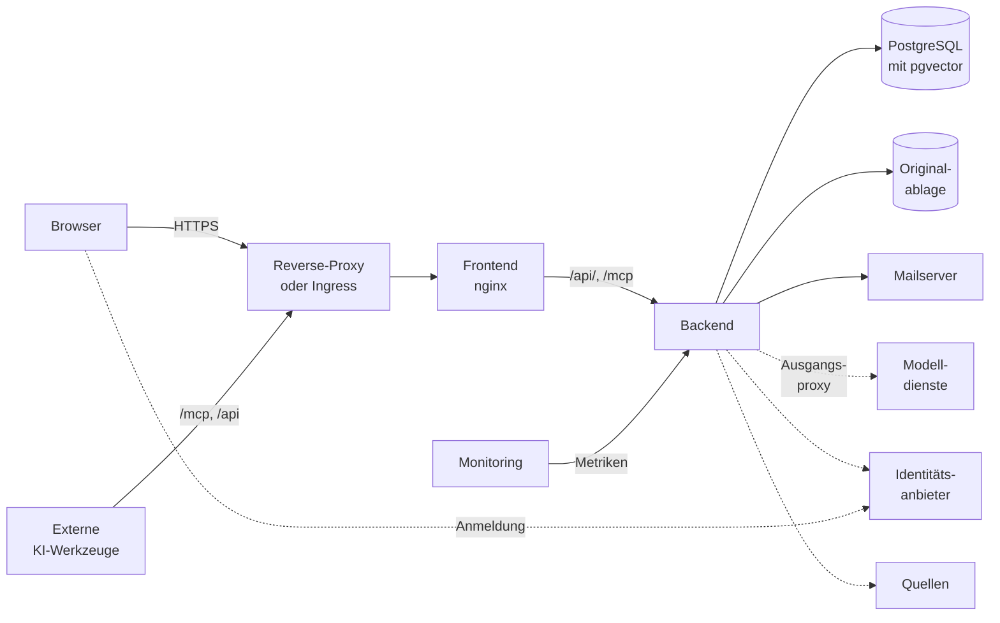

# Betriebsübersicht

Dieses Kapitel beschreibt die Bausteine einer OPAA-Installation und was für jeden Betriebsweg gleich
gilt: Images, Probes, Härtung, Schlüssel, Sicherung, Aktualisierung, Logs und Metriken. Die
Einrichtung beschreiben die Kinder [Docker Compose](docker-compose.md) und
[Kubernetes](kubernetes.md), jede Umgebungsvariable die [Konfiguration](konfiguration.md).

## Bausteine



Gestrichelt sind die Verbindungen, die über den [Ausgangsproxy](#ausgangsproxy) gehen können, und
die Anmeldung des Browsers beim Identitätsanbieter.

| Baustein | Aufgabe | Pflicht | Kapitel |
|---|---|---|---|
| Reverse-Proxy oder Ingress | TLS, Weiterleitung an das Frontend | ja, sobald erreichbar | [Netzwerkzugang](#netzwerkzugang) |
| Frontend | liefert die Oberfläche aus, reicht `/api/` und `/mcp` an das Backend; ohne Zustand | ja | [Frontend-Laufzeitimage](#frontend-laufzeitimage) |
| Backend | Suche, Antwort, Indexierung, Rechte, Verwaltung | ja, eine oder mehrere Instanzen | [Backend-Laufzeitimage](#backend-laufzeitimage) |
| PostgreSQL mit pgvector | einziger Zustand: Dokumente, Vektoren, Volltext, Rechte, Chats, Protokolle | ja | [Datenbank](datenbank.md) |
| Originalablage | Originale der Uploads, im Dateisystem (auch Netzlaufwerk) oder in einem S3-Objektspeicher wie MinIO | ja, sobald hochgeladen wird | [Originalablage](originalablage.md) |
| Modelldienste | je Rolle ein OpenAI-kompatibler Endpunkt: Chat und Embedding (Pflicht), Reranking und Spracherkennung (optional) | Chat und Embedding | [Modelle](modelle.md) |
| Identitätsanbieter | Anmeldung über OpenID Connect, etwa Keycloak; ohne ihn nur lokale Konten | nein | [Authentifizierung](authentifizierung.md) |
| Mailserver | SMTP für Einladungen, Rücksetzlinks, Benachrichtigungen | nein | [E-Mail-Versand](e-mail.md) |
| Quellen | angebunden über Konnektoren, etwa SMB-Freigaben, Nextcloud, Google Drive, SharePoint, Confluence, Feeds … | nein | [Konnektoren](konnektoren/README.md) |
| Ausgangsproxy | der eine Weg des Backends ins Netz, wenn das Haus einen verlangt | nein | [Ausgangsproxy](#ausgangsproxy) |
| Externe KI-Werkzeuge | greifen über MCP oder API mit persönlichen Zugangstokens zu | nein, eigener Schalter | [Externe KI-Werkzeuge](fremdzugaenge.md) |
| Monitoring | Prometheus liest Metriken, ein Log-Sammler die Standardausgabe | nein | [Logs und Metriken](#logs-und-metriken) |

Gesichert wird nur, was Zustand hält: Datenbank, Originalablage und Geheimnisse
([Sicherung und Wiederherstellung](#sicherung-und-wiederherstellung)). Jede Verbindung nach außen mit
ihren Daten listet das Faktenblatt `datenfluesse` ([Nachvollziehbarkeit](nachvollziehbarkeit.md)).

## Eine oder mehrere Backend-Instanzen

Vorgabe ist eine Backend-Instanz. Mehrere gleichrangige Instanzen gegen dieselbe Datenbank überstehen
den Ausfall einer Instanz und lassen sich nacheinander aktualisieren; sie stimmen sich nur über die
Datenbank ab. Voraussetzungen und Grenzen: [Mehrere Backend-Instanzen](mehrere-instanzen.md).

## Zeitzone

- Gesetzt über `TZ` (Compose) bzw. `backend.timeZone` (Helm); Vorgabe UTC.
- Bestimmt die Uhrzeiten geplanter Läufe (Löschläufe, Zeitpläne der Wissensbibliotheken,
  Feststellung der Nachfolge), Tages-, Monats- und Jahresgrenzen von Fristen, Erinnerungen und
  Datumsangaben in Mails.
- Mit mehreren Instanzen auf allen gleich
  ([Konfigurationsabdruck](mehrere-instanzen.md#gleiche-konfiguration-der-konfigurationsabdruck)).

## Eine Organisation

- Eine Installation hat **genau eine** Organisation; einen Weg, eine zweite anzulegen, gibt es nicht.
  Alle Konten, auch die aus Identitätsanbietern, gehören zu ihr.
- Datenmodell und Prüfungen sind für mehrere Mandanten vorbereitet: Objekte tragen ihre
  Organisation, die Datenbank verbietet Verweise zwischen Organisationen, und ein Objekt einer
  fremden Organisation ist für jeden Aufruf „nicht gefunden“.
- Mandantenbetrieb in einer Installation ist damit nicht gebaut; getrennte Mandanten bekommen
  getrennte Installationen.

## Images und Versionen

Die CI veröffentlicht fertige Images für `linux/amd64` und `linux/arm64`; auf dem Zielsystem wird
nichts gebaut. Backend und Frontend laufen immer mit **derselben** Version.

| Image | Tags |
|-------|------|
| `ghcr.io/criew/opaa-backend` | `X.Y.Z`, `X.Y`, `main`, `sha-<commit>` |
| `ghcr.io/criew/opaa-frontend` | `X.Y.Z`, `X.Y`, `main`, `sha-<commit>` |

- **`X.Y.Z`** ändert sich nie; **`X.Y`** zeigt auf das jüngste Patch-Release der Linie und bringt
  Sicherheitsupdates mit dem nächsten Pull. Ein Tag `latest` gibt es nicht. Im Echtbetrieb läuft ein
  Release ([Releases und Nachweise](releases-und-nachweise.md)).
- **`main`** wird bei jedem Push und wöchentlich neu gebaut. Einen festen Stand pinnt nur der
  Digest (`…/opaa-backend@sha256:…`), nicht `sha-<commit>`.
- **Laufende Version:** `/actuator/info` (`build.version`), die Startzeile des Logs und im Frontend
  der Dialog „Info zu …“ im Profilmenü.
- **SBOM und Provenance** hängen je Architektur am Image:

  ```bash
  docker buildx imagetools inspect ghcr.io/criew/opaa-backend:<tag> --format '{{ json .SBOM }}'
  docker buildx imagetools inspect ghcr.io/criew/opaa-backend:<tag> --format '{{ json .Provenance }}'
  ```

- **Update-Paket:** Am GitHub-Release hängt ein attestiertes Paket für Datenschutz,
  Personalvertretung und Informationssicherheit
  ([Nachvollziehbarkeit](nachvollziehbarkeit.md#das-update-paket-eines-release)).

## Backend-Laufzeitimage

Java 21 auf einem Distroless-Image, ohne Shell, Coreutils, `curl` und Paketmanager.

- **Keine Shell:** `docker exec … sh` scheitert; Diagnose über Log, Actuator und Werkzeug-Container
  ([Diagnose ohne Shell](#diagnose-ohne-shell)). Health Checks fragen von außen ab.
- **Ohne Root:** Benutzer und Gruppe `65532`, Port 8080. Eingehängte Verzeichnisse müssen für diese
  Kennung zugänglich sein.
- **Zertifikate:** Eine interne CA kommt in eine **Kopie** des mitgelieferten Truststores, nie in
  einen leeren Store — sonst scheitert HTTPS zu allen öffentlichen Diensten
  ([Docker Compose](docker-compose.md#eigene-interne-ca-ergänzen),
  [Kubernetes](kubernetes.md#eigene-zertifizierungsstelle)).
- **JVM-Optionen** gehen über `JAVA_TOOL_OPTIONS`.

<a id="nur-lesbares-dateisystem"></a>

### Read-only Filesystem

Das Backend schreibt nur unter `/tmp` (Arbeitsdateien, Uploads, heruntergeladene Quelldateien) und,
solange die Originale im Dateisystem liegen, unter `OPAA_UPLOAD_STORAGE_PATH`. Eigene
Temp-Verzeichnisse für S3 (`OPAA_UPLOAD_S3_TEMP_DIRECTORY`, `OPAA_INDEXING_S3_TEMP_DIRECTORY`)
liegen unter `/tmp` oder auf einem eigenen Volume.

- `/tmp` liegt auf einem Datenträger und fasst mehrere der größten Dokumente gleichzeitig, bei
  vorgesehenem Heap-Dump zusätzlich die Heap-Größe.
- Heap-Dumps und JFR-Mitschnitte gehören absolut unter `/tmp`, sonst `Read-only file system`.
- **Sicherheit:** Reste in `/tmp`, Heap-Dumps und JFR-Mitschnitte können Inhalte privater
  Bibliotheken, Geheimnisse und entschlüsselte Zugangsdaten enthalten. Nach der Diagnose löschen.

### Speicher und Container-Grenzen

Ohne Angabe nimmt die JVM 25 % des sichtbaren Speichers als Heap. Mit Container-Limit wird der
Anteil angehoben, ohne Limit nicht.

| | Request | Limit | Heap-Anteil |
|---|---|---|---|
| Speicher | 1 GiB | 2 GiB | `JAVA_TOOL_OPTIONS=-XX:MaxRAMPercentage=70` |
| CPU | 0,5 | keine | — |

Große Bestände, sehr große PDF-Dateien oder viele gleichzeitige Indexierungen brauchen mehr. Ein
OOM-Kill zeigt sich als `OOMKilled` (Kubernetes) bzw. in
`docker inspect --format '{{.State.OOMKilled}}' <container>`; dann das Limit anheben, nicht den
Heap-Anteil. Exit-Code `137` allein ist nicht eindeutig.

## Frontend-Laufzeitimage

nginx (`nginxinc/nginx-unprivileged`), lauffähig unter Pod Security Standard `restricted`.

- **Ohne Root:** Benutzer `101`, Port 8080, auch mit beliebiger, vom Cluster vergebener Kennung.
- **Read-only Filesystem:** schreibt nur unter `/tmp` (Konfiguration, Zwischenablage für Uploads und
  große Antworten). Bei vielen großen Uploads gleichzeitig `/tmp` vergrößern.
- **`OPAA_BACKEND_UPSTREAM`:** Host und Port des Backends.
- **`OPAA_BACKEND_READ_TIMEOUT`:** wie lange nginx auf das Backend wartet. Eine Chat-Antwort kann
  Minuten brauchen; zu kurz endet mit `504`.
- **Uploadgröße:** fest 52 MB, knapp über der Grenze des Backends (`OPAA_UPLOAD_MAX_FILE_SIZE`). Wer
  diese anhebt, passt das Image und jeden Proxy davor an.
- Ungültige Werte dieser Variablen brechen den Containerstart mit einer Meldung im Log ab.

<a id="bereitschaft-und-lebendigkeit"></a>

## Readiness und Liveness

| Pfad | Prüft | Gedacht für |
| --- | --- | --- |
| `GET /actuator/health/readiness` | Prozess und Datenbank | Readiness-Probe, Health Check, Load Balancer |
| `GET /actuator/health/liveness` | Prozess | Liveness-Probe (Neustart) |
| `GET /actuator/health` | Überblick | Diagnose |

- Ohne Anmeldung antworten sie nur mit `UP`/`DOWN`; Details und alle weiteren Health Groups
  verlangen ein Zugangstoken.
- Die Readiness braucht eine Datenbankverbindung: Auch ein erschöpfter Connection Pool meldet `DOWN`.
  Bei knappen Pools die Probe nachsichtig konfigurieren.
- Modelldienste stehen bewusst nicht in der Readiness; ein hängender Modellserver nimmt die Instanz
  nicht aus der Rotation. Sie haben eigene Health Groups:

| Health Group | Prüft |
| --- | --- |
| `chat-model` | welches Chat-Modell aktiv ist, ohne Aufruf |
| `embedding-model` | einen echten Embedding-Aufruf |
| `transcription-model` | letzten bekannten Zustand der Spracherkennung |
| `vector-store` | eine echte Ähnlichkeitssuche |
| `upload-store` | den S3-Objektspeicher der Originalablage |
| `mail` | den letzten SMTP-Versand |

<a id="sanftes-herunterfahren"></a>

## Graceful Shutdown

Beim Stopp nimmt das Backend keine neuen Verbindungen an und lässt laufende Anfragen bis
`OPAA_SHUTDOWN_TIMEOUT` zu Ende laufen.

- **Die Grace Period der Plattform muss länger sein** (`OPAA_STOP_GRACE_PERIOD` unter Compose,
  `backend.terminationGracePeriodSeconds` unter Kubernetes), sonst endet der Prozess abrupt.
- **Indexierungs- und Upload-Läufe** der stoppenden Instanz brechen sofort ab und lassen sich
  wiederholen.
- **Mails** liegen bis zur Zustellung in der Datenbank und gehen nicht verloren.
- Bei einem Rolling Update stellt der Helm-Chart die Zeitfenster passend ein
  ([Kubernetes](kubernetes.md#mehrere-backend-instanzen)).

## Netzwerkzugang

Das Backend wird nie direkt angesprochen, sondern über das Frontend. Davor steht in jedem
erreichbaren Betrieb ein **TLS-terminierender Reverse-Proxy** oder Ingress. Für ihn gilt:

- **`X-Forwarded-Proto` selbst setzen**, nie vom Client übernehmen; ein gefälschtes `https` umginge
  die CORS-Prüfung.
- **`X-Forwarded-For` setzen oder anhängen, `Forwarded` verwerfen**
  ([Vertraute Proxys](#vertraute-proxys-und-client-adresse)).
- **`/`, `/api/` und `/mcp` an das Frontend reichen**; Antworten auf `/mcp` nicht puffern.
- **Timeout** für `/api/` und `/mcp` mindestens `OPAA_BACKEND_READ_TIMEOUT`, sonst `504` bei langen
  Antworten.
- **Callback-Seiten** `/auth/callback` und `/connections/callback` tragen einmal gültige Codes:
  weder protokollieren noch verändern.
- OPAA läuft nur im Wurzelpfad. Eine öffentliche Adresse mit Nicht-Standardport gehört in
  `OPAA_CORS_ALLOWED_ORIGINS`.
- **`Strict-Transport-Security` setzt der äußere Proxy**, wo TLS endet.

### Sicherheits-Header und `Strict-Transport-Security`

Der Frontend-Container setzt auf jede Antwort `Content-Security-Policy`, `X-Content-Type-Options`,
`X-Frame-Options`, `Referrer-Policy` und `Permissions-Policy` (Mikrofon nur für die eigene Herkunft,
Kamera und Standort gesperrt). Die CSP lässt keine fremden Skripte oder CDNs zu und Verbindungen nur
zur eigenen Herkunft. Ein Identitätsanbieter auf fremdem Origin kommt über
`OPAA_CSP_CONNECT_SRC_EXTRA` dazu
([Authentifizierung](authentifizierung.md#content-security-policy-und-ein-anbieter-auf-fremdem-origin)).
HSTS setzt der Container nicht; das gehört an den äußeren Proxy.

## Ausgangsproxy

Verlangt das Haus einen Proxy, trägt die Systemverwaltung ihn unter **Administration → Anbindungen →
Einstellungen**, Abschnitt **Ausgangsproxy** ein. Es gibt genau einen; `HTTP_PROXY`/`HTTPS_PROXY`
und `http.proxyHost` wertet OPAA nicht aus.

- **Über den Proxy:** jede HTTP(S)-Verbindung des Backends — Quellen, Zugänge, Modelldienste,
  Identitätsanbieter, Verzeichnisabgleich.
- **Nie über den Proxy:** Loopback, Datenbank, Mailserver, SMB-Freigaben, Objektspeicher der
  Originalablage.
- **Format:** `http://host:port` oder `host:port`. Proxy über HTTPS, SOCKS und Proxy-Anmeldung
  werden nicht unterstützt.
- **Ausnahmeliste:** je Zeile ein Hostname (gilt mit Subdomänen), eine IP-Adresse oder ein
  CIDR-Bereich. Interne Ziele wie ein Modellserver im Haus gehören hierher.
- **Ausnahmeliste ist keine Freigabe:** Ob ein internes Ziel erreicht werden darf, entscheidet die
  [Zielprüfung](#zielprüfung-abrufe-des-servers). Hinter dem Proxy löst der Proxy die Adresse auf;
  interne Ziele sperrt dann der Proxy.
- Änderungen wirken ohne Neustart und stehen im Revisionsprotokoll.
- **Notanker:** Ein falscher Proxy kann die Anmeldung über Identitätsanbieter lahmlegen; das lokale
  Systemverwaltungskonto meldet sich ohne Anbieter an und korrigiert den Eintrag.

## Härtung für erreichbare Deployments

Ist die Installation aus einem größeren Netz oder dem Internet erreichbar, gilt:

| Maßnahme | Zwingend | Wo beschrieben |
|---|---|---|
| TLS am äußeren Proxy; `X-Forwarded-Proto` autoritativ | ja | [Netzwerkzugang](#netzwerkzugang) |
| Betriebsmodus `oidc`, nie `dev` | ja | [Authentifizierung](authentifizierung.md#entwicklungsmodus-dev) |
| eigene Geheimnisse statt Vorgaben, `OPAA_AUTH_LOCAL_COOKIE_SECURE` nicht auf `false` | ja | [Schlüssel und Geheimnisse](#schlüssel-und-geheimnisse) |
| vertraute Proxys eintragen | ja, sobald ein Proxy vor dem Backend steht | [Vertraute Proxys](#vertraute-proxys-und-client-adresse) |
| mitgelieferten Keycloak-Realm härten | ja, wenn er genutzt wird | [Authentifizierung](authentifizierung.md#härtung-des-mitgelieferten-keycloak) |
| Ports nur an `127.0.0.1`, Zugangsdaten des mitgelieferten Objektspeichers ersetzen | ja für Keycloak und den Objektspeicher, sonst empfohlen | [Docker Compose](docker-compose.md#härtung-des-compose-stapels) |
| Netztrennung, Pod Security | empfohlen | [Kubernetes](kubernetes.md#netz-und-sicherheit) |
| Ziele des Servers begrenzen | Vorgabe ist eingeschaltet | [Zielprüfung](#zielprüfung-abrufe-des-servers) |

### Vertraute Proxys und Client-Adresse

Rate-Limits und die Netzbeschränkung lokaler Systemverwalter (`OPAA_LOCAL_ADMIN_ALLOWED_CIDRS`)
richten sich nach der Client-Adresse. Hinter einem Proxy — der Frontend-nginx ist schon einer — ist
die Verbindungsadresse die des Proxys. `OPAA_RATE_LIMIT_TRUSTED_PROXY_CIDRS` nennt die Netze, deren
`X-Forwarded-For` zählt; **Pflicht, sobald ein Proxy vor dem Backend steht**.

- **Ohne Wert** teilen sich alle Clients einen Zähler, und die Netzbeschränkung sieht nur den Proxy.
  Der Start warnt im Log.
- **So eng wie möglich:** unter Compose die feste Adresse des Frontend-Containers als `/32`, nie das
  ganze Compose-Netz; jeder weitere Proxy mit seiner eigenen Adresse. Bereiche weiter als `/8` lehnt
  der Start ab.
- **Prüfen** mit `GET /api/v1/admin/diagnostics/client-address` ([Diagnose ohne Shell](#diagnose-ohne-shell)).

### Zielprüfung: Abrufe des Servers

Wer eine Bibliothek mit einer Netzquelle anlegt, bestimmt Adressen, die der Server abruft — auch
solche, die nur aus dem Netz des Servers erreichbar sind (SSRF). Zwei Schranken begrenzen das:

- **Pfad-Allowlist** (`OPAA_INDEXING_FILESYSTEM_ALLOWLIST`) für Dateisystem-Bibliotheken.
- **Zielprüfung** für jede Netzquelle, standardmäßig an: Loopback, Link-Local samt
  `169.254.169.254`, private und reservierte Bereiche werden abgelehnt, geprüft nach der
  DNS-Auflösung und nach jedem Redirect. Interne Quellen kommen in
  `OPAA_INDEXING_TARGET_VALIDATION_ALLOWLIST`, statt die Prüfung abzuschalten. Identitätsanbieter
  und Originalablage haben eigene Schalter derselben Prüfung.
- Nur `http` und `https`; Redirects nur auf demselben Origin, nie auf `http` herab. Zertifikate
  werden immer geprüft.
- **Grenze:** DNS-Rebinding wird nicht erkannt. Wer das ausschließen muss, beschränkt den Egress des
  Backends zusätzlich auf Netzebene.

## Schlüssel und Geheimnisse

| Geheimnis | Wofür | Ohne eigenen Wert | Bei Verlust oder Wechsel |
|---|---|---|---|
| `OPAA_AUTH_JWT_SECRET` | lokal ausgestellte Tokens und Links (Refresh, Einladung, Rücksetzen) | im Modus `oidc` bricht der Start ab | alle lokalen Sitzungen, offenen Links und Zugangstokens [externer KI-Werkzeuge](fremdzugaenge.md) werden ungültig — gewollt nach einer [Rücksicherung](authentifizierung.md#nacharbeit-nach-einer-rücksicherung-der-datenbank) |
| `OPAA_CREDENTIALS_ENCRYPTION_KEY` | Zugangsdaten von Quellen, Zugängen und verbundenen Konten, Webhook-Geheimnisse | Speichern solcher Zugangsdaten scheitert | gespeicherte Werte unlesbar, neu einzutragen |
| `OPAA_SETTINGS_ENCRYPTION_KEY` | Schlüssel der Chat-Modelle, SMTP-Passwort, wartende Mails | Speichern solcher Werte scheitert | Werte neu einzutragen ([Modelle](modelle.md#verschlüsselung-der-zugangsschlüssel-verwalteter-chat-modelle)); wartende Mails verworfen |
| `OPAA_DB_USERNAME`, `OPAA_DB_PASSWORD` | Datenbankkonto | Vorgabe `opaa`/`opaa`, nur Entwicklung | vor dem ersten Start setzen |

- Zufällig erzeugen: `openssl rand -base64 48` (Signaturgeheimnis), `openssl rand -base64 32`
  (Schlüssel).
- Außerhalb des Repositorys ablegen (Tresor, Secret-Manager) und **getrennt von der Datenbank
  sichern**: Ohne die Schlüssel enthält eine Datenbanksicherung unlesbare Zugangsdaten.
- Die Schlüssel des Profils `dev` sind nicht für den Betrieb.

### Zugangsdaten-Verschlüsselung

Zugangsdaten liegen mit AES-256-GCM verschlüsselt in der Datenbank. Keine API-Antwort und kein Log
enthält sie.

- Ohne Schlüssel scheitert nur das Speichern von Zugangsdaten (`503`).
- Ist ein Wert nicht entschlüsselbar, zeigt die Oberfläche „nicht gesetzt“, das Log eine Warnung;
  andere Änderungen an der Bibliothek lassen den Geheimtext stehen.
- **Bei Schlüsselverlust** sind die Werte verloren, nicht die Bibliothek: Zugangsdaten neu eintragen.
- **Schlüsselwechsel** im Bestand ist nicht vorgesehen; wer wechselt, trägt alle Werte neu ein.

## Sicherung und Wiederherstellung

| Bestandteil | Gesichert durch |
|---|---|
| Datenbank | `pg_dump` oder die Sicherung des Datenbankbetriebs |
| Originalablage | Kopie, Snapshots, Versionierung oder Replikation |
| Geheimnisse | Kopie außerhalb der Installation |
| Konfiguration (`.env.docker` bzw. Werte-Datei) | Versionsverwaltung |

- **Reihenfolge:** erst Datenbank, dann Originale sichern; umgekehrt wiederherstellen
  ([Originalablage](originalablage.md#sicherung-und-wiederherstellung)). Ein genau passender Stand
  entsteht bei angehaltenem Backend.
- **Vor dem Einspielen** müssen auf dem Ziel die Erweiterung `vector` und die Rolle
  `opaa_audit_owner` existieren ([Datenbank](datenbank.md#voraussetzungen-einer-eigenen-postgresql)).
- **Nach jeder Rücksicherung** dieselben Verschlüsselungsschlüssel, aber ein neues
  `OPAA_AUTH_JWT_SECRET`
  ([Nacharbeit](authentifizierung.md#nacharbeit-nach-einer-rücksicherung-der-datenbank)).

Befehle: [Docker Compose](docker-compose.md#sicherung-und-wiederherstellung),
[Kubernetes](kubernetes.md#sicherung-und-wiederherstellung).

### Wiederherstellungsprobe

Die Probe belegt, dass Datenbank, Index und Originale aus einer Sicherung passend zurückkommen, und
misst Wiederherstellungszeit (RTO) und Wiederherstellungspunkt (RPO). Befehle für einen Testcluster:
[Kubernetes](kubernetes.md#wiederherstellungsprobe-auf-einem-testcluster); andere Betriebswege
folgen demselben Ablauf.

- In eine zweite, **leere** Installation zurückspielen, nie in die laufende.
- Dieselbe Version, dasselbe Embedding-Modell, dieselben Verschlüsselungsschlüssel und dasselbe
  Datenbankpasswort, aber ein neues `OPAA_AUTH_JWT_SECRET`.
- Testbestand statt Echtdaten; eine Kopie echter Daten wie Produktivdaten behandeln und danach
  löschen.

**Testbestand** in der Quelle:

| Nr. | Objekt | Zweck |
|---|---|---|
| T1 | Upload-Bibliothek mit mindestens drei einfachen Dateien (etwa PDF, DOCX, TXT), ohne Archive und E-Mails mit Anhängen | Originale und Index |
| T2 | in einer dieser Dateien der Satz „Probe-Marker vor der Sicherung: [zufälliges Wort M1]“ | belegte Antwort |
| T3 | ein Space mit zwei Mitgliedern, T1 zugeordnet | Rechte und Mitgliedschaften |
| T4 | eine Testperson ohne Zugriff auf T1 | Rechteprobe |
| T5 | ein Chat mit einer Frage nach M1 | Chats |
| T6 | ein zweiter, nicht aktiver Chat-Modell-Eintrag auf denselben Endpunkt mit beliebigem Zugangsschlüssel; „Verbindung testen“ gelingt | Schlüssel der Einstellungen (P11) |
| T7 | eine Bibliothek mit Webquelle und Zugangsdaten für die Basic-Anmeldung | Schlüssel der Zugangsdaten (P12) |

**Ablauf** (Zeitpunkte fortlaufend notieren):

1. **Ausgangsstand:** Version, Image-Digests, Embedding-Modell, Zahl der Dokumente in T1. Als T4 oder
   Mitglied von T3 angemeldet bleiben (für P10).
2. **Sichern (`tS`):** Backend anhalten, Zeilen zählen (Abfrage unten), Datenbank sichern,
   Prüfsummenliste der Originale erzeugen, Originale sichern, Backend starten.
3. **Datenverlust erzeugen (`tA`):** in T1 eine Datei mit „Probe-Marker nach der Sicherung:
   [zufälliges Wort M2]“ hochladen und einen Chat dazu führen.
4. **Wiederherstellen (ab `t0`):** Ziel mit angehaltenem Backend aufbauen, Originale zurückspielen
   und prüfsummen (`t1`), Rolle `opaa_audit_owner` anlegen, Datenbank zurückspielen (`t2`), Zeilen
   **vor** dem Start zählen, Backend mit neuem Signaturgeheimnis starten bis zur Readiness (`t3`),
   P4 bis P12 prüfen (`t4`).

Zeilenzählung über alle Tabellen, unabhängig von der Version:

```sql
SELECT format('%I.%I', n.nspname, c.relname) AS tabelle,
       (xpath('/row/n/text()',
              query_to_xml(format('SELECT count(*) AS n FROM %I.%I', n.nspname, c.relname),
                           false, true, '')))[1]::text AS zeilen
  FROM pg_class c
  JOIN pg_namespace n ON n.oid = c.relnamespace
 WHERE c.relkind = 'r'
   AND n.nspname NOT IN ('pg_catalog', 'information_schema')
   AND n.nspname NOT LIKE 'pg\_toast%'
 ORDER BY 1;
```

| Nr. | Prüfung | Erwartet |
|---|---|---|
| P1 | `pg_restore --exit-on-error` | Rückgabewert 0 |
| P2 | Zeilenzählung Quelle gegen Ziel | gleich für jede Tabelle |
| P3 | Prüfsummenlisten der Originale | gleich |
| P4 | Version; Zeilen in `databasechangelog` vor und nach dem Start | Version wie in Schritt 1; Zahl unverändert. Ausnahme: War die Quelle nur einmal gestartet, wächst sie um genau zwei ([Rückweg](kubernetes.md#rückweg)) |
| P5 | Seite „Suche & Indexierung“; Health Groups `embedding-model` und `vector-store` | gleiches Embedding-Modell, kein „Index veraltet“; beide `UP` |
| P6 | Bericht verwaister Originale für T1 ([Originalablage](originalablage.md#originale-einer-vorhandenen-bibliothek)) | keine verwaisten; so viele referenzierte Originale wie Dokumente |
| P7 | Anmeldung, Space T3, Frage nach M1, „Original öffnen“ | belegte Antwort aus T1, Original mit gleicher Prüfsumme, Chat T5 vorhanden |
| P8 | T4 fragt nach M1 | keine Fundstelle aus T1 |
| P9 | Frage nach M2, Chatliste | M2 nicht auffindbar, Chat aus Schritt 3 fehlt |
| P10 | Sitzung aus Schritt 1 gegen das Ziel | ungültig, neue Anmeldung nötig |
| P11 | T6: „Verbindung testen“ ohne neuen Schlüssel | gelingt wie in der Quelle |
| P12 | T7: „Verbindung testen“ ohne neue Zugangsdaten | Zugangsdaten gelten als hinterlegt, Test gelingt wie in der Quelle |

**Messung:** RTO der Probe ist `t4 − t0`, RPO `tA − tS` (im Betrieb höchstens der Abstand zweier
Sicherungen). Größe von Datenbank und Originalen gehört zum Ergebnis; nur eine Probe mit
Produktivmenge belegt die echte Wiederherstellungszeit. Danach Ziel und Testsicherungen löschen.

## Aktualisierung

1. **Release-Notizen lesen**, Abschnitt „Vorbereitung für Bestandsinstallationen“ — bei
   übersprungenen Versionen für jede. Für Abstimmungen mit Datenschutz oder Personalvertretung dient
   das [Update-Paket](#images-und-versionen).
2. **Sichern** ([Sicherung und Wiederherstellung](#sicherung-und-wiederherstellung)).
3. **Vorbereitung erledigen, Images tauschen**, Backend und Frontend auf dieselbe Version.
4. **Start:** Das Backend migriert das Schema, nur vorwärts. Mit mehreren Instanzen:
   [Update ohne Ausfall](mehrere-instanzen.md#update-ohne-ausfall).
5. **Prüfen:** `/actuator/info`, eine Frage im Chat, „Suche & Indexierung“.

Zurück auf eine ältere Version geht es nur über die Sicherung. Befehle:
[Docker Compose](docker-compose.md#aktualisierung-auf-einen-neuen-stand),
[Kubernetes](kubernetes.md#aktualisierung-und-rückweg).

### Was ein Update mit dem Index macht

Ein Update **gefährdet den Index nicht** und verlangt **keine Neuindizierung**.

- Schemaänderungen löschen keine Dokument- oder Vektordaten. Ausnahme ist ein Neuaufsetzen, das die
  Release-Notizen ankündigen ([Docker Compose](docker-compose.md#neu-aufsetzen-statt-aktualisieren)).
- Ändert sich die Verarbeitung eines Formats, bleiben alte Chunks durchsuchbar;
  „Suche & Indexierung“ zeigt „Nachzug ausstehend“, und ein
  [Nachzug](wissensbibliotheken.md#72-pipeline-versionen-und-nachzug) bringt sie auf den neuen Stand.
- Ändert ein Update die Vorgaben des Embedding-Modells, verlangt OPAA eine Neueinbettung
  ([Modell wechseln](modelle.md#modell-wechseln)). Wer das bisherige Modell behält, setzt es
  ausdrücklich ([Welches Embedding-Modell](modelle.md#welches-embedding-modell)).

Eine vollständige Neuindizierung brauchen nur: eine verworfene Datenbank und der Austausch einer
fehlerhaften Ollama-Fassung bei langen Eingaben ([Modelle](modelle.md#embedding)).

> **Falle bei einer Neuindizierung:** Eine Datei mit unveränderter Prüfsumme, deren Dokument als
> indiziert gilt, wird übersprungen. Wer nur die Vektoren verwirft, bekommt einen leeren Index. Für
> einen Neuaufbau einer Bibliothek gemeinsam zurücksetzen, dann regulär indizieren:
>
> ```sql
> DELETE FROM vector_store WHERE metadata->>'library_id' = '<library-id>';
> DELETE FROM documents WHERE library_id = '<library-id>';
> DELETE FROM rss_feed_state WHERE library_id = '<library-id>';  -- nur bei Feed-Bibliotheken
> ```

## Logs und Metriken

- **Log** auf der Standardausgabe, als Text oder mit `LOGGING_STRUCTURED_FORMAT_CONSOLE` (`ecs`,
  `logstash`, `gelf`) als JSON. Beim Start stehen dort Version, Warnungen zur Konfiguration, das
  Einmalpasswort des Erststarts
  ([Authentifizierung](authentifizierung.md#erststart-und-systemverwalter-konto)) und jeder
  Startabbruch mit dem Namen der Variable.
- **Inhalt:** Geheimnisse, Zugangsdaten und Request-Bodies erscheinen nicht, Namen aus privaten
  Bibliotheken auch auf `DEBUG` nicht. Ausgaben eingebundener Bibliotheken auf `DEBUG`/`TRACE` und
  Datenbankfehler können Inhalte nennen: Ein Log über `INFO` wie Inhalte behandeln.
- **Handlungen von Personen** stehen nicht im Log, sondern im Nachweis- und Revisionsprotokoll der
  Anwendung ([Berechtigungen](berechtigungen.md)).
- **Metriken** im Prometheus-Format unter `/actuator/prometheus`:

| Metrik | Bedeutung |
|---|---|
| `http_server_requests_seconds_*` | Anfragen nach Pfad, Methode, Status |
| `opaa_query_duration_seconds_*`, `opaa_query_count_total` | Dauer und Zahl der Chat-Fragen |
| `opaa_query_tokens_total` | Token der Antwortaufrufe |
| `opaa_indexing_documents_total` | verarbeitete Dokumente nach Ergebnis |
| `opaa_indexing_embedding_inputs_total` | Chunks an der Eingabegrenze des Embedding-Modells, nach Ergebnis (`split`, `cut`, `unverified`; [Modelle](modelle.md)) |
| `opaa_rate_limit_rejected_total` | abgewiesene Anfragen; die globale Anmeldegrenze warnt vor verteiltem Ausprobieren von Zugangsdaten |
| `opaa_auth_local_account_lockout_total` | Sperren lokaler Konten |
| `hikaricp_connections_*` | Connection Pool der Datenbank |
| `jvm_memory_used_bytes`, `jvm_memory_max_bytes` | Speicher der JVM |

Weitere Metriken: [Suche](suche.md#102-metriken-und-log); Einsammeln und Alarme unter Kubernetes:
[Betriebsüberwachung](kubernetes.md#betriebsüberwachung).

### Diagnose ohne Shell

Actuator-Pfade sind nur über den Backend- bzw. Management-Port erreichbar, nicht über das Frontend:

```bash
curl -s http://localhost:8081/actuator/info              # Version
curl -s http://localhost:8081/actuator/health/readiness  # Readiness
curl -s http://localhost:8081/actuator/prometheus        # Metriken
curl -s -H "Authorization: Bearer <token>" https://<host>/api/v1/admin/diagnostics/client-address
```

Der letzte Aufruf (Systemverwaltung, über den Proxy) zeigt, welche Client-Adresse das Backend für
diese Anfrage ermittelt (`clientAddress`). Steht dort die Adresse des Proxys, fehlt er in
`OPAA_RATE_LIMIT_TRUSTED_PROXY_CIDRS`. Dumps und Dateien aus dem Container:
[Docker Compose](docker-compose.md#diagnose-im-container), [Kubernetes](kubernetes.md#fehlersuche).

## Fehlerbehebung

| Bild | Wo weiter |
|---|---|
| Start bricht ab und nennt eine Variable | [Konfiguration](konfiguration.md); bei `OPAA_AUTH_JWT_SECRET` [Authentifizierung](authentifizierung.md#das-backend-startet-nicht-und-nennt-opaa_auth_jwt_secret) |
| Start bricht mit Hinweis auf pgvector, Schema oder Migration ab | [Datenbank](datenbank.md) |
| Start bricht mit `refuses to start` ab | [Konfigurationsabdruck](mehrere-instanzen.md#gleiche-konfiguration-der-konfigurationsabdruck) |
| Readiness meldet `DOWN` | Datenbank, Connection Pool ([Readiness und Liveness](#readiness-und-liveness)) |
| Indexierung oder Chat schlagen fehl | [Modelle](modelle.md#fehlerbilder) |
| Niemand kommt herein, Anmeldung mit `429` | [Authentifizierung](authentifizierung.md#fehlerbehebung) |
| Originale lassen sich nicht abrufen oder hochladen | [Originalablage](originalablage.md#wenn-etwas-nicht-stimmt) |
| Mails kommen nicht an | [E-Mail-Versand](e-mail.md#fehlerbilder) |
| Lange Antworten enden mit `504` | Timeouts von Frontend und Proxy ([Netzwerkzugang](#netzwerkzugang)) |
| Verbindungen nach außen scheitern mit Proxy-Status | [Ausgangsproxy](#ausgangsproxy) |
| Container- oder Pod-Fehlerbilder | [Docker Compose](docker-compose.md#fehlerbehebung), [Kubernetes](kubernetes.md#fehlersuche) |

## Weiterführende Kapitel

- [Docker Compose](docker-compose.md) und [Kubernetes](kubernetes.md) — die beiden Betriebswege
- [Mehrere Backend-Instanzen](mehrere-instanzen.md)
- [Datenbank](datenbank.md), [Originalablage](originalablage.md), [E-Mail-Versand](e-mail.md)
- [Konfiguration](konfiguration.md), [Modelle](modelle.md), [Authentifizierung](authentifizierung.md)
