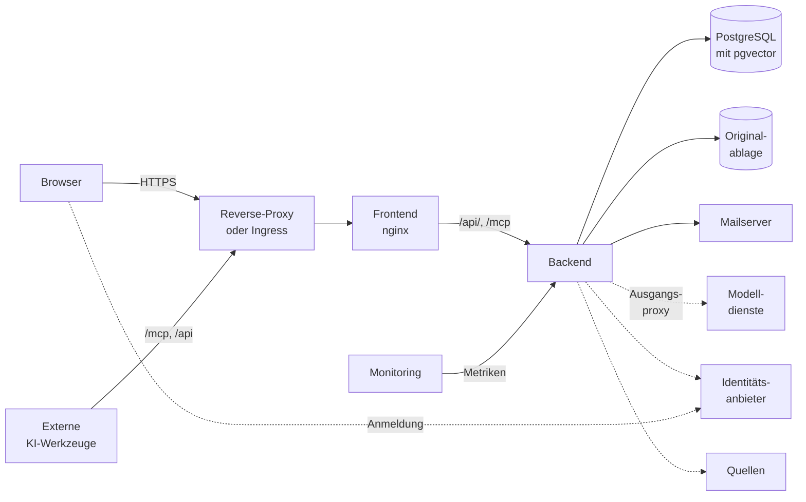

# Betriebsübersicht

Dieses Kapitel beschreibt die Bausteine einer OPAA-Installation und führt zu den Kapiteln, die für
jeden Betriebsweg gleich gelten. Die Einrichtung beschreiben [Docker Compose](docker-compose.md) und
[Kubernetes](kubernetes.md), jede Umgebungsvariable die [Konfiguration](konfiguration.md).

## Bausteine

Gestrichelt sind die Verbindungen, die über den
[Ausgangsproxy](netz-und-sicherheit.md#ausgangsproxy) gehen können, und die Anmeldung des Browsers
beim Identitätsanbieter.

| Baustein | Aufgabe | Pflicht | Kapitel |
|---|---|---|---|
| Reverse-Proxy oder Ingress | TLS, Weiterleitung an das Frontend | ja, sobald erreichbar | [Netzwerkzugang](netz-und-sicherheit.md#netzwerkzugang) |
| Frontend | liefert die Oberfläche aus, reicht `/api/` und `/mcp` an das Backend; ohne Zustand | ja | [Frontend-Laufzeitimage](images-und-laufzeit.md#frontend-laufzeitimage) |
| Backend | Suche, Antwort, Indexierung, Rechte, Verwaltung | ja, eine oder mehrere Instanzen | [Backend-Laufzeitimage](images-und-laufzeit.md#backend-laufzeitimage) |
| PostgreSQL mit pgvector | einziger Zustand: Dokumente, Vektoren, Volltext, Rechte, Chats, Protokolle | ja | [Datenbank](datenbank.md) |
| Originalablage | Originale der Uploads, im Dateisystem (auch Netzlaufwerk) oder in einem S3-Objektspeicher wie MinIO | ja, sobald hochgeladen wird | [Originalablage](originalablage.md) |
| Modelldienste | je Rolle ein OpenAI-kompatibler Endpunkt: Chat und Embedding (Pflicht), Reranking und Spracherkennung (optional) | Chat und Embedding | [Modelle](modelle.md) |
| Identitätsanbieter | Anmeldung über OpenID Connect, etwa Keycloak; ohne ihn nur lokale Konten | nein | [Authentifizierung](authentifizierung.md) |
| Mailserver | SMTP für Einladungen, Rücksetzlinks, Benachrichtigungen | nein | [E-Mail-Versand](e-mail.md) |
| Quellen | angebunden über Konnektoren, etwa SMB-Freigaben, Nextcloud, Google Drive, SharePoint, Confluence, Feeds … | nein | [Konnektoren](konnektoren/README.md) |
| Ausgangsproxy | der eine Weg des Backends ins Netz, wenn das Haus einen verlangt | nein | [Ausgangsproxy](netz-und-sicherheit.md#ausgangsproxy) |
| Externe KI-Werkzeuge | greifen über MCP oder API mit persönlichen Zugangstokens zu | nein, eigener Schalter | [Externe KI-Werkzeuge](fremdzugaenge.md) |
| Monitoring | Prometheus liest Metriken, ein Log-Sammler die Standardausgabe | nein | [Logs und Metriken](ueberwachung-und-fehlerbehebung.md#logs-und-metriken) |

Gesichert wird nur, was Zustand hält: Datenbank, Originalablage und Geheimnisse
([Sicherung und Wiederherstellung](sicherung-und-wiederherstellung.md)). Jede Verbindung nach außen
mit ihren Daten listet das Faktenblatt `datenfluesse` ([Nachvollziehbarkeit](nachvollziehbarkeit.md)).

## Eine oder mehrere Backend-Instanzen

Vorgabe ist eine Backend-Instanz; mehrere gleichrangige Instanzen gegen dieselbe Datenbank
überstehen den Ausfall einer Instanz und lassen sich nacheinander aktualisieren
([Mehrere Backend-Instanzen](mehrere-instanzen.md)).

## Zeitzone

- Gesetzt über `TZ` (Compose) bzw. `backend.timeZone` (Helm); Vorgabe UTC.
- Bestimmt die Uhrzeiten geplanter Läufe (Löschläufe, Zeitpläne der Wissensbibliotheken,
  Feststellung der Nachfolge), Tages-, Monats- und Jahresgrenzen von Fristen, Erinnerungen und
  Datumsangaben in Mails.
- Mit mehreren Instanzen auf allen gleich
  ([Konfigurationsabdruck](mehrere-instanzen.md#gleiche-konfiguration-der-konfigurationsabdruck)).

## Eine Organisation

- Eine Installation hat **genau eine** Organisation; einen Weg, eine zweite anzulegen, gibt es nicht.
  Alle Konten, auch die aus Identitätsanbietern, gehören zu ihr.
- Datenmodell und Prüfungen sind für mehrere Mandanten vorbereitet: Objekte tragen ihre
  Organisation, die Datenbank verbietet Verweise zwischen Organisationen, und ein Objekt einer
  fremden Organisation ist für jeden Aufruf „nicht gefunden“.
- Mandantenbetrieb in einer Installation ist damit nicht gebaut; getrennte Mandanten bekommen
  getrennte Installationen.

## Wegweiser

| Anlass | Kapitel |
|---|---|
| installieren | [Docker Compose](docker-compose.md) oder [Kubernetes](kubernetes.md) |
| Images, Versionen, Container-Grenzen, Probes, Graceful Shutdown | [Images und Laufzeit](images-und-laufzeit.md) |
| Reverse-Proxy, Härtung, Zielprüfung, Ausgangsproxy, Schlüssel | [Netz und Sicherheit](netz-und-sicherheit.md) |
| sichern, zurückspielen, Wiederherstellungsprobe | [Sicherung und Wiederherstellung](sicherung-und-wiederherstellung.md) |
| auf eine neue Version gehen | [Aktualisierung](aktualisierung.md) |
| Logs, Metriken, Störungen | [Überwachung und Fehlerbehebung](ueberwachung-und-fehlerbehebung.md) |
| mehrere Instanzen planen | [Mehrere Backend-Instanzen](mehrere-instanzen.md) |
| Datenbank, Originalablage, Mailserver einrichten | [Datenbank](datenbank.md), [Originalablage](originalablage.md), [E-Mail-Versand](e-mail.md) |

## Weiterführende Kapitel

- Die Unterkapitel im [Wegweiser](#wegweiser)
- [Konfiguration](konfiguration.md), [Modelle](modelle.md), [Authentifizierung](authentifizierung.md)
