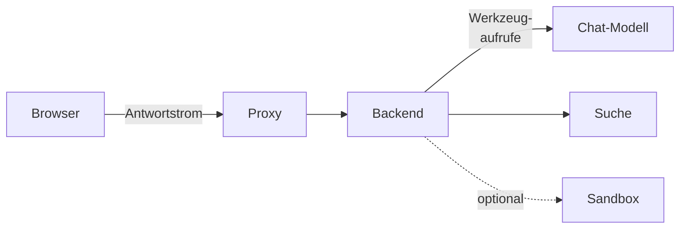

# Agenten betreiben

Ein Agent beantwortet eine Frage in mehreren Schritten: Er ruft Werkzeuge auf, etwa die eigene
Suche, liest nach und antwortet mit Belegen. Ob das im Haus trägt, hängt weniger an OPAA als am
Modell, an dessen Laufzeit und am Weg zwischen Browser und Backend. Dieses Kapitel beschreibt, was
eine Installation nach dem Update sieht, wie sie Agenten einschaltet und wie man Störungen
eingrenzt. Bedienung und Einrichtung stehen unter [Agenten einschalten](../administration/agenten.md),
[Agent anlegen](../benutzer/agent-anlegen.md) und [Agenten verwenden](../benutzer/agenten-verwenden.md).

Jeder Pfeil kann eine Störung verursachen, die aussieht wie ein Modell, das nicht sucht: ein Proxy,
der den Strom puffert, ein Auswerter für Werkzeugaufrufe, der nicht zum Modell passt, oder eine zu
kleine Kontextlänge.

## Nach dem Update

Eine bestehende Installation ändert durch das Update nichts an ihrem Verhalten:

- **Schalter „Agenten“ und „Vorlagen“ sind aus.** Niemand sieht Agenten oder Vorlagen, das `@` im
  Chat bietet nur Wissen an, und die Anlegerechte dafür erscheinen nicht.
- **Die Werkzeugfähigkeit jedes Chat-Modells ist „Ungeprüft“.** Eine Frage an einen Agenten würde
  abgelehnt, bis sie festgehalten ist.
- **Der gewöhnliche Chat bleibt unverändert**, mit jedem Modell und jeder Werkzeugfähigkeit.
- **Die Sandbox ist aus**, bis der Betrieb sie einrichtet ([Sandbox für Agenten](sandbox.md)).

Zum Einschalten, in dieser Reihenfolge:

1. Die Kombination aus Chat-Modell und Laufzeit messen
   ([Modell auf Werkzeugaufrufe messen](modell-endpunkte.md#modell-auf-werkzeugaufrufe-messen)).
   Eine Messung gilt nur dieser Kombination aus Modell, Quantisierung, Laufzeit und deren Version;
   eine Übersicht geprüfter Kombinationen folgt mit der Werkzeugprüfung in der Modellverwaltung.
2. Die Werkzeugfähigkeit am Modell festhalten
   ([Werkzeugfähigkeit festhalten](../administration/modelle.md#werkzeugfähigkeit-festhalten)).
3. Proxy und Ingress für lange Antwortströme prüfen
   ([Netzwerkzugang](netz-und-sicherheit.md#netzwerkzugang)).
4. Agenten einschalten, Werkzeuge wählen und das Anlegerecht vergeben
   ([Agenten einschalten](../administration/agenten.md)).
5. Für Dateien nach Vorlage oder aus eigenem Code: Sandbox einrichten, „Vorlagen“ einschalten
   ([Vorlagen einschalten](../administration/vorlagen.md)).
6. Frist des Schrittprotokolls mit Datenschutz und Personalvertretung abstimmen
   ([Datenschutz einstellen](../administration/datenschutz.md)).

**Zurückrollen:** Den Schalter „Agenten“ ausschalten genügt. Er wirkt ohne Neustart auf allen
Instanzen; danach beginnt kein Agentenlauf mehr, und der gewöhnliche Chat läuft weiter. Angelegte
Agenten, Vorlagen und gespeicherte Antworten bleiben und sind nach dem Wiedereinschalten unverändert
da. Ein Zurückgehen auf die vorige Version ist dafür nicht nötig.

## Störungssuche

Mehrere Betriebsfehler sehen aus wie ein unfähiges Modell. Bevor ein Modell verworfen wird, lohnt
der Blick in diese Tabelle und auf die Metriken der Agentenläufe
([Überwachung und Fehlerbehebung](ueberwachung-und-fehlerbehebung.md#logs-und-metriken)).

| Beobachtung | Wahrscheinliche Ursache | Abhilfe |
|---|---|---|
| Jede Frage an einen Agenten endet mit dem Hinweis, das aktive Modell sei nicht geprüft oder nicht fähig | Werkzeugfähigkeit „Ungeprüft“ oder „Nicht fähig“ | messen und festhalten ([Werkzeugfähigkeit festhalten](../administration/modelle.md#werkzeugfähigkeit-festhalten)) oder ein fähiges Modell aktivieren |
| Seit dem Umzug des Modellservers wird wieder abgelehnt | Basis-Adresse oder Modell-Kennung geändert, die Angabe ist zurück auf „Ungeprüft“ | neu messen und festhalten |
| Der Agent sucht fast nie, antwortet aber flüssig aus allgemeinem Wissen | Kontextlänge der Laufzeit zu klein; die Laufzeit schneidet die Werkzeugbeschreibungen stillschweigend ab | Kontextlänge am Modellserver erhöhen, neu messen |
| In der Messung gut, im Chat sucht der Agent kaum oder schreibt den Aufruf als Text | Auswerter der Laufzeit für Werkzeugaufrufe passt nicht zum Modell, oder Auftrag des Agenten und die tatsächlichen Werkzeugbeschreibungen sprengen die Kontextlänge | mit den Werkzeugen der Agenten messen; Auswerter für Werkzeugaufrufe oder Kontextlänge am Modellserver anpassen |
| Jede Frage an einen Agenten scheitert mit einem Fehler des Modells | Laufzeit nimmt keine Werkzeuge an, etwa vLLM ohne `--enable-auto-tool-choice` | Modellserver mit Werkzeugunterstützung starten ([Modell auf Werkzeugaufrufe messen](modell-endpunkte.md#modell-auf-werkzeugaufrufe-messen)) |
| Etwa 60 Sekunden lang erscheint nichts, dann bricht die Antwort ab; ohne Agent kommt sie auf einmal | Ein vorgelagerter Proxy puffert den Antwortstrom oder hat ein kurzes Timeout | Puffern für den Antwortstrom abschalten, Lese-Timeout prüfen ([Netzwerkzugang](netz-und-sicherheit.md#netzwerkzugang)) |
| Antworten tragen oft „Grenze erreicht“ und den Vermerk „nicht geprüft“ | Grenze für Werkzeugaufrufe, Suchen, Dauer oder gesammelten Text zu knapp für die Fragen des Hauses, oder der Agent senkt sie | Grenzen am Agenten prüfen, sonst `OPAA_AGENT_*` anheben ([Konfiguration](../referenz/konfiguration.md)) |
| „Gerade arbeiten zu viele Agenten gleichzeitig“ | Platzlimit der Installation erreicht | `OPAA_AGENT_WORKSPACE_CAPACITY` anheben, wenn der Modellserver es trägt; `opaa_agent_workspace_rejected_total` beobachten |
| „Dieser Agent ist nicht verfügbar“ oder der Agent fehlt im `@`-Menü | Agenten ausgeschaltet, Agent dem Space nicht zugeordnet oder für die Person nicht lesbar | [Agenten einschalten](../administration/agenten.md), Reiter „Zuordnungen“ und „Freigaben“ am Agenten |
| Der Agent sagt, er könne keine Datei erzeugen | Werkzeug nicht zugelassen, „Vorlagen“ aus, Vorlage dem Agenten nicht zugeordnet oder für die Person nicht lesbar, oder Sandbox nicht erreichbar | Werkzeuge unter „Administration → Agenten“, [Vorlagen einschalten](../administration/vorlagen.md), Vorlagen am Agenten ([Agent anlegen](../benutzer/agent-anlegen.md)), [Sandbox für Agenten](sandbox.md) |

Einen einzelnen Lauf grenzt die Systemverwaltung über seine Laufkennung im Schrittprotokoll ein
([Protokoll eines Agentenlaufs einsehen](../administration/datenschutz.md#protokoll-eines-agentenlaufs-einsehen)).
Die Person findet die Kennung, wenn sie die Schritte unter der Antwort aufklappt.

## Was über Agentenläufe gespeichert wird

| Bestand | Inhalt | Wer hineinsieht | Frist |
|---|---|---|---|
| Antwort mit Schritten im Chat | Antwort, Schritte mit Teilfrage und Trefferzahl, erzeugte Dateien, Laufkennung, Fassungsstempel | nur die Person | wie der Chat |
| Schrittprotokoll | Werkzeug, Ergebnis, Trefferzahl, Dauer, Abbruchgrund je Schritt; kein Konto, keine Teilfrage | Systemverwaltung mit Laufkennung und Anlass | einstellbar, [Datenschutz einstellen](../administration/datenschutz.md) |
| Sandboxprotokoll | Ergebnis, Dauer, Zahl der Skripte und Dateien je Sandbox; kein Skript, kein Dateiinhalt | wie Schrittprotokoll | nie länger als das Schrittprotokoll |
| Betriebsmetriken | Zahl der Agentenläufe nach Ergebnis, getrennt nach mitgeliefertem und angelegten Agenten, Werkzeugaufrufe nach Werkzeug und Ergebnis; ohne Person, Space oder Namen eines Agenten | Betrieb über das Monitoring | wie das Monitoring sie hält |
| Nachweisprotokoll | jeder Abruf des Schritt- oder Sandboxprotokolls, Anlegen und Ändern von Agenten und Vorlagen; nicht das Aufrufen eines Agenten | Revision | allgemeine Protokollfrist |

Die Auskunft über die Datenerhebung beschreibt diese Bestände Feld für Feld, mit Zweck, Frist und
den Abfragewegen, die es gibt und die es nicht gibt
([Auskunft über die Datenerhebung](nachvollziehbarkeit.md#auskunft-über-die-datenerhebung-einer-installation)).
