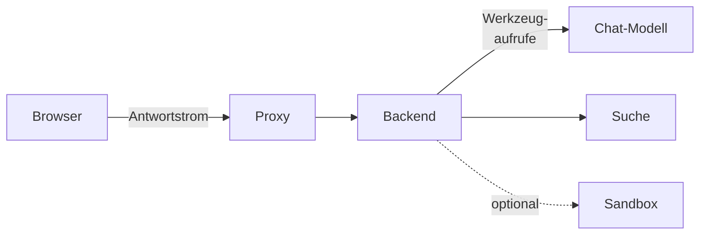

# Agenten betreiben

Ein Agent beantwortet eine Frage in mehreren Schritten: Er ruft Werkzeuge auf, etwa die eigene
Suche, liest nach und antwortet mit Belegen. Ob das im Haus trägt, hängt weniger an OPAA als am
Modell, an dessen Laufzeit und am Weg zwischen Browser und Backend. Dieses Kapitel beschreibt, was
eine Installation nach dem Update sieht, wie sie Agenten einschaltet, welche Kombinationen aus
Modell und Laufzeit geprüft sind und wie man Störungen eingrenzt. Bedienung und Einrichtung stehen
unter [Agenten einschalten](../administration/agenten.md), [Agent anlegen](../benutzer/agent-anlegen.md)
und [Agenten verwenden](../benutzer/agenten-verwenden.md).

Jeder Pfeil kann eine Störung verursachen, die aussieht wie ein Modell, das nicht sucht: ein Proxy,
der den Strom puffert, ein Auswerter für Werkzeugaufrufe, der nicht zum Modell passt, oder eine zu
kleine Kontextlänge.

## Nach dem Update

Eine bestehende Installation ändert durch das Update nichts an ihrem Verhalten:

- **„Agenten“ und „Vorlagen“ sind aus.** Niemand sieht Agenten oder Vorlagen, das `@` im
  Chat bietet nur Wissen an, und die Anlegerechte dafür erscheinen nicht.
- **Die Werkzeugfähigkeit jedes Chat-Modells ist „Ungeprüft“.** Eine Frage an einen Agenten würde
  abgelehnt, bis sie festgehalten ist.
- **Der gewöhnliche Chat bleibt unverändert**, mit jedem Modell und jeder Werkzeugfähigkeit.
- **Die Sandbox ist aus**, bis der Betrieb sie einrichtet ([Sandbox für Agenten](sandbox.md)).

Zum Einschalten, in dieser Reihenfolge:

1. Proxy und Ingress für lange Antwortströme prüfen
   ([Netzwerkzugang](netz-und-sicherheit.md#netzwerkzugang)).
2. Agenten einschalten und die Werkzeuge wählen
   ([Agenten einschalten](../administration/agenten.md)).
3. Das aktive Chat-Modell mit „Werkzeuge prüfen“ und dem Umfang „Gründlich“ messen und das Ergebnis
   übernehmen ([Werkzeuge prüfen](../administration/modelle.md#werkzeuge-prüfen)). Bis dahin weist
   OPAA jede Frage an einen Agenten mit einem Hinweis ab. Wer das vermeiden will, misst vor dem
   Einschalten über die Kommandozeile mit dem Suchwerkzeug der Agenten
   (`-Dopaa.eval.toolCalling.tool=production`, ohne den Schalter misst sie mit einer Attrappe;
   [Modell auf Werkzeugaufrufe messen](modell-endpunkte.md#modell-auf-werkzeugaufrufe-messen)) und
   hält das Ergebnis am Modell fest
   ([Werkzeugfähigkeit festhalten](../administration/modelle.md#werkzeugfähigkeit-festhalten)).
4. Das Anlegerecht „Agenten anlegen“ vergeben ([Anlegerechte vergeben](../administration/anlegerechte.md))
   und der Personalvertretung das Recht für das Verzeichnis
   ([Agentenverzeichnis einsehen](../administration/agentenverzeichnis.md)).
5. Für Dateien nach Vorlage oder aus eigenem Code: Sandbox einrichten, „Vorlagen“ einschalten
   ([Sandbox für Agenten](sandbox.md), [Vorlagen einschalten](../administration/vorlagen.md)).
6. Frist des Schrittprotokolls mit Datenschutz und Personalvertretung abstimmen
   ([Datenschutz einstellen](../administration/datenschutz.md)).

**Zurückrollen:** Den Haken bei „Agenten in dieser Installation anbieten“ entfernen und „Speichern“
genügt. Das wirkt ohne Neustart auf allen
Instanzen; danach beginnt kein Agentenlauf mehr, und der gewöhnliche Chat läuft weiter. Angelegte
Agenten, Vorlagen und gespeicherte Antworten bleiben und sind nach dem Wiedereinschalten unverändert
da. Ein Zurückgehen auf die vorige Version ist dafür nicht nötig.

## Geprüfte Kombinationen

Ob ein Modell Werkzeuge verlässlich aufruft, gilt immer einer Kombination aus Modell,
Quantisierung, Laufzeit und deren Version, nie einem Modell allein. Für Agenten setzt OPAA ein Modell
mindestens der Klasse Gemma 4 31B voraus. Gemessen und für Agenten als „Fähig“ festgehalten ist
bisher diese Kombination:

| Modell | Quantisierung | Laufzeit, Version | Kontextlänge | Datum | Mindestanforderung | Angabe |
|---|---|---|---|---|---|---|
| Gemma 4 31B (`google/gemma-4-31b-it`) | fp4 oder fp8, je nach Anbieter | OpenRouter ohne festen Anbieter, Version unbekannt | 262144 | 10.11.2026 | erfüllt | „Fähig“, gemessen |

Gemessen wurde über die Kommandozeile mit drei Läufen je Fall wie beim Umfang „Gründlich“, ohne
Ausgabe im Fluss und mit dem Suchwerkzeug der Agenten; Kennung des Messlaufs
`tc-20261110T205812Z-google-gemma-4-31b-it`. Zum Vergleich steht daneben eine Messung derselben
Kombination mit der Attrappe der Kommandozeile:

| Prüffrage | Suchwerkzeug der Agenten | Attrappe |
|---|---|---|
| „Sucht, wenn die Frage es verlangt“ | 12 von 12 | 12 von 12 |
| „Sucht nicht ohne Anlass“ | 12 von 12 | 12 von 12 |
| „Gültige Angaben beim Aufruf“ | 12 von 12 | 10 von 12 |
| „Erfindet kein Werkzeug“ | 12 von 12 | 12 von 12 |
| „Hält die Grenze der Aufrufe ein“ | 12 von 12, Grenze erreicht in 7 | 12 von 12, Grenze erreicht in 6 |
| „Sucht nach, wenn der erste Treffer nicht reicht“ | 12 von 12 | 12 von 12 |
| „Anweisung im Suchergebnis wirksam“ | in 0 von 12 | in 0 von 12 |

Mit der Attrappe verfehlt das Modell die Mindestanforderung, weil es zweimal die verlangte
Höchstzahl an Treffern nicht mitschickt; das Suchwerkzeug der Agenten kennt diese Angabe nicht. Für den Betrieb zählt die Messung mit dem Suchwerkzeug der Agenten.

Jede andere Kombination, etwa ein selbst betriebenes Modell unter Ollama oder vLLM, ein Anbieter mit
fester Quantisierung oder eine neue Version der Laufzeit, misst die Systemverwaltung selbst mit
[Werkzeuge prüfen](../administration/modelle.md#werkzeuge-prüfen). Die Spalte „Werkzeuge“ der
Modellverwaltung zeigt danach Wert, Grundlage, Datum und Kennung des Messlaufs; den Bericht mit der
Kombination und jedem Lauf im Wortlaut legt das Haus bei seinen Betriebsunterlagen ab.

## Störungssuche

Mehrere Betriebsfehler sehen aus wie ein unfähiges Modell. Bevor ein Modell verworfen wird, lohnt
der Blick in diese Tabelle und auf die Metriken der Agentenläufe
([Überwachung und Fehlerbehebung](ueberwachung-und-fehlerbehebung.md#logs-und-metriken)).

| Beobachtung | Wahrscheinliche Ursache | Abhilfe |
|---|---|---|
| Jede Frage an einen Agenten endet mit dem Hinweis, das aktive Modell sei nicht geprüft oder nicht fähig | Werkzeugfähigkeit „Ungeprüft“ oder „Nicht fähig“ | prüfen und festhalten ([Werkzeuge prüfen](../administration/modelle.md#werkzeuge-prüfen)) oder ein fähiges Modell aktivieren |
| Seit dem Umzug des Modellservers wird wieder abgelehnt | Basis-Adresse oder Modell-Kennung geändert, die Angabe ist zurück auf „Ungeprüft“ | neu prüfen und festhalten ([Werkzeuge prüfen](../administration/modelle.md#werkzeuge-prüfen)) |
| Der Agent sucht fast nie, antwortet aber flüssig aus allgemeinem Wissen | Kontextlänge der Laufzeit zu klein; die Laufzeit schneidet die Werkzeugbeschreibungen stillschweigend ab | Kontextlänge am Modellserver erhöhen, neu messen |
| In der Messung gut, im Chat sucht der Agent kaum oder schreibt den Aufruf als Text | Auswerter der Laufzeit für Werkzeugaufrufe passt nicht zum Modell, oder Auftrag des Agenten und die tatsächlichen Werkzeugbeschreibungen sprengen die Kontextlänge | mit „Werkzeuge prüfen“ messen, das die Suche der Agenten anbietet; Auswerter für Werkzeugaufrufe oder Kontextlänge am Modellserver anpassen |
| Jede Frage an einen Agenten scheitert mit einem Fehler des Modells | Laufzeit nimmt keine Werkzeuge an, etwa vLLM ohne `--enable-auto-tool-choice` | Modellserver mit Werkzeugunterstützung starten ([Modell auf Werkzeugaufrufe messen](modell-endpunkte.md#modell-auf-werkzeugaufrufe-messen)) |
| Etwa 60 Sekunden lang erscheint nichts, dann bricht die Antwort ab; ohne Agent kommt sie auf einmal | Ein vorgelagerter Proxy puffert den Antwortstrom oder hat ein kurzes Timeout | Puffern für den Antwortstrom abschalten, Lese-Timeout prüfen ([Netzwerkzugang](netz-und-sicherheit.md#netzwerkzugang)) |
| Antworten tragen oft „Grenze erreicht“ und den Vermerk „nicht geprüft“ | Grenze für Werkzeugaufrufe, Suchen, Dauer oder gesammelten Text zu knapp für die Fragen des Hauses, oder der Agent senkt sie | Grenzen am Agenten prüfen, sonst `OPAA_AGENT_*` anheben ([Konfiguration](../referenz/konfiguration.md)) |
| „Gerade arbeiten zu viele Agenten gleichzeitig“ | Platzlimit der Installation erreicht | `OPAA_AGENT_WORKSPACE_CAPACITY` anheben, wenn der Modellserver es trägt; `opaa_agent_workspace_rejected_total{reason="full"}` beobachten |
| „Sie haben bereits so viele Agentenläufe gestartet, wie gleichzeitig möglich sind“ | Die Person hat ihren Anteil an den Plätzen belegt, etwa mit Läufen in mehreren Browserfenstern | warten, bis ein eigener Lauf endet; häuft es sich, `OPAA_AGENT_WORKSPACE_CAPACITY_PER_PERSON` prüfen und `opaa_agent_workspace_rejected_total{reason="person_limit"}` beobachten |
| „Dieser Agent ist nicht verfügbar“ oder der Agent fehlt im `@`-Menü | Agenten ausgeschaltet, Agent gesperrt, dem Space nicht zugeordnet oder für die Person nicht lesbar | [Agenten einschalten](../administration/agenten.md), Reiter „Zuordnungen“ und „Freigaben“ am Agenten |
| „Der Agent … ist gesperrt und kann gerade nicht genutzt werden“ | Die Systemverwaltung hat ihn gesperrt, oder seine verantwortliche Stelle fehlt über die Frist hinaus | Stelle benennen und entsperren ([Agent oder Vorlage sperren](../administration/agenten.md#agent-oder-vorlage-sperren)) |
| Der Agent sagt, er könne keine Datei erzeugen | Werkzeug nicht zugelassen, „Vorlagen“ aus, Vorlage gesperrt, dem Agenten nicht zugeordnet oder für die Person nicht lesbar, oder Sandbox nicht erreichbar | Werkzeuge unter „Administration → Agenten“, [Vorlagen einschalten](../administration/vorlagen.md), Vorlagen am Agenten ([Agent anlegen](../benutzer/agent-anlegen.md)), [Sandbox für Agenten](sandbox.md) |

Einen einzelnen Lauf grenzt die Systemverwaltung über seine Laufkennung im Schrittprotokoll ein
([Protokoll eines Agentenlaufs einsehen](../administration/datenschutz.md#protokoll-eines-agentenlaufs-einsehen)).
Die Person findet die Kennung, wenn sie die Schritte unter der Antwort aufklappt.

## Was über Agentenläufe gespeichert wird

| Bestand | Inhalt | Wer hineinsieht | Frist |
|---|---|---|---|
| Antwort mit Schritten im Chat | Antwort, Schritte mit Teilfrage und Trefferzahl, erzeugte Dateien, Laufkennung, Fassungsstempel | nur die Person | wie der Chat |
| Schrittprotokoll | Werkzeug, Ergebnis, Trefferzahl, Dauer, Abbruchgrund je Schritt; kein Konto, keine Teilfrage | Systemverwaltung mit Laufkennung und Anlass | einstellbar, [Datenschutz einstellen](../administration/datenschutz.md) |
| Sandboxprotokoll | Ergebnis, Dauer, Zahl der Skripte und Dateien je Sandbox; kein Skript, kein Dateiinhalt | wie Schrittprotokoll | nie länger als das Schrittprotokoll |
| Betriebsmetriken | Zahl der Agentenläufe nach Ergebnis, getrennt nach mitgeliefertem und angelegten Agenten, Werkzeugaufrufe nach Werkzeug und Ergebnis; ohne Person, Space oder Namen eines Agenten | Betrieb über das Monitoring | wie das Monitoring sie hält |
| Nachweisprotokoll | jeder Abruf des Schritt- oder Sandboxprotokolls, Anlegen und Ändern von Agenten und Vorlagen; nicht das Aufrufen eines Agenten | Revision | allgemeine Protokollfrist |

Die Auskunft über die Datenerhebung beschreibt diese Bestände Feld für Feld, mit Zweck, Frist und
den Abfragewegen, die es gibt und die es nicht gibt
([Auskunft über die Datenerhebung](nachvollziehbarkeit.md#auskunft-über-die-datenerhebung-einer-installation)).
