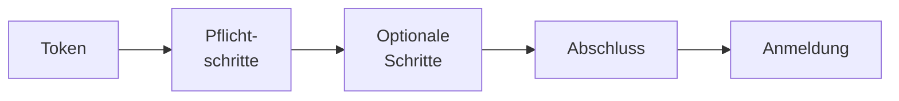

# Einrichtungs-Assistent

> **Entwurf** — gegen den Code geprüft, vom Maintainer noch nicht abgenommen.

Eine Instanz im Installationsmodus lässt sich im Browser einrichten statt über die
Installations-API von Hand: Solange die Installation aussteht, führt jede Adresse der Oberfläche
zum Assistenten unter `/installation`, etwa `https://opaa.stadt.example/installation`. Dieses Kapitel
beschreibt nur die Oberfläche; Installationsmodus, Installations-Token, zugelassene Netzbereiche und
die Prüfungen der Schritte beschreibt das Kapitel „Installation“ der Betriebsübersicht.

## Ablauf

1. **Token eingeben.** Ohne gültiges Installations-Token zeigt der Assistent keinen Schritt und
   keinen gespeicherten Wert.
2. **Pflichtschritte:** „Erstes Konto“, „Anmeldeverfahren“, „Chat-Modell“. „Prüfen und weiter“
   speichert die Angaben eines Schritts und prüft sie sofort, beim Chat-Modell etwa mit einem
   Verbindungstest. Die Oberfläche prüft vorab nur die Form, etwa einer E-Mail-Adresse oder einer
   Adresse mit `http://` oder `https://`; alles Weitere prüft das Backend.
3. **Optionale Schritte** stehen in der Schrittliste in einer eigenen Gruppe, lassen sich mit
   „Überspringen“ auslassen und nennen, wo der Wert nach dem Abschluss in der Verwaltung zu finden
   ist. Heute sind alle Schritte Pflicht.
4. **Abschluss.** „Installation abschließen“ ist erst möglich, wenn alle Pflichtschritte geprüft
   sind; bis dahin nennt die Seite die offenen Schritte. Danach führt „Zur Anmeldung“ zur
   Anmeldeseite, an der sich die Person mit dem ersten Konto anmeldet.

## Zustand der Schritte

Jeder Schritt steht in der Liste mit seinem Zustand:

- **Geprüft** — gespeichert, und die Prüfung ist gelungen.
- **Prüfung fehlgeschlagen** — gespeichert, die Prüfung ist gescheitert. Die Meldung über dem
  Formular nennt den Grund, auch nach erneutem Öffnen des Schritts.
- **Gespeichert, Prüfung offen** — gespeichert, aber noch nicht geprüft.
- **Offen** — noch nichts gespeichert.

Gespeicherte Geheimnisse zeigt der Assistent nie wieder an, nur als „Gesetzt“ mit der Aktion
„Ersetzen“; einen gespeicherten API-Schlüssel entfernt „Gespeicherten Schlüssel entfernen“. Wer das
erste Konto nachträglich ändert, gibt dessen Passwort dabei erneut ein; unverändert wird es nur
noch einmal geprüft.

## Unterbrechen und fortsetzen

Der Stand liegt in der Datenbank, nicht im Browser. Wer die Seite neu lädt, den Browser schließt
oder an einem anderen Rechner weitermacht, gibt das Token erneut ein und landet beim ersten
Pflichtschritt, der noch nicht geprüft ist; sind alle geprüft, beim Abschluss. Das Token selbst
behält der Browser nur, solange die Seite offen ist.

## Fehlerbilder

| Meldung | Bedeutung | Abhilfe |
|---|---|---|
| „Das Installations-Token stimmt nicht.“ | falsches oder inzwischen ersetztes Token | Token neu eingeben |
| „Zu viele Anfragen oder Fehlversuche von dieser Adresse.“ | die Begrenzung je Netzadresse greift | einige Minuten warten |
| „Die Einrichtung ist von diesem Netz aus nicht freigegeben.“ | die zugelassenen Netzbereiche schließen den Rechner aus | aus einem zugelassenen Netz einrichten |
| „Bereits eingerichtet“ | die Installation wurde inzwischen abgeschlossen, etwa über eine Antwortdatei oder in einem zweiten Fenster | anmelden |

## Was nicht gebaut ist

- Der Schritt Embedding-Modell im Assistenten (#3191).
- Ausgangsproxy, E-Mail-Versand und Branding als optionale Schritte; sie folgen nach dem Abschluss in
  der Verwaltung.

## Weiterführende Kapitel

- [Authentifizierung](authentifizierung.md), [Modelle](modelle.md)
- [Konfiguration](konfiguration.md)
