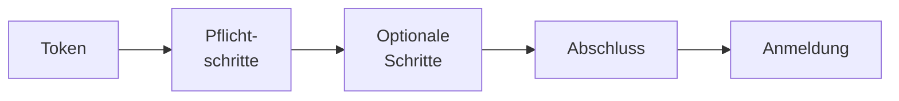

# Einrichtungs-Assistent

> **Entwurf.** Die Oberfläche des Assistenten ist gebaut; den Installationsmodus, in dem das
> Backend sie anbietet, noch nicht (siehe [Was nicht gebaut ist](#was-nicht-gebaut-ist)).

Eine neue Installation fragt ihre ersten Einstellungen im Browser ab, statt sie aus Startvariablen zu
übernehmen: das erste Konto, das Anmeldeverfahren und das Chat-Modell. Solange die Einrichtung nicht
abgeschlossen ist, zeigt die Oberfläche unter jeder Adresse nur den Assistenten, etwa
`https://opaa.stadt.example/installation`. Den Rahmen beschreibt die
[Betriebsübersicht](README.md).

## Ablauf

1. **Token eingeben.** Die Einrichtung ist durch ein einmaliges Installations-Token geschützt. Der
   erste Start schreibt es als markierten Block ins Log des Backends; gibt der Betrieb es über
   `OPAA_INSTALLATION_TOKEN` vor, gilt dieses. Ohne gültiges Token zeigt der Assistent keinen
   Schritt und keinen gespeicherten Wert.
2. **Pflichtschritte.** Erstes Konto, Anmeldeverfahren und Chat-Modell. „Prüfen und weiter“
   speichert die Angaben und prüft sie sofort, beim Chat-Modell etwa mit einem Verbindungstest.
3. **Optionale Schritte.** Sie stehen in der Schrittliste in einer eigenen Gruppe und lassen sich mit
   „Überspringen“ auslassen; die Zeile nennt, wo der Wert nach dem Abschluss in der Verwaltung zu
   finden ist.
4. **Abschluss.** „Installation abschließen“ ist erst möglich, wenn alle Pflichtschritte geprüft
   sind; bis dahin nennt die Seite die offenen Schritte. Danach ist der Assistent auf jeder Instanz
   verschwunden, das Token verliert seine Gültigkeit, und die Anmeldung erfolgt mit dem ersten Konto.

| Schritt | Pflicht | Prüfung | Später änderbar unter |
|---|---|---|---|
| Erstes Konto | ja | Adresse vollständig und zustellbar, nicht `admin@opaa.local`; Passwortregel | Benutzer |
| Anmeldeverfahren | ja | mit Identitätsanbieter: Discovery und JWK-Set erreichbar | Identitätsanbieter |
| Chat-Modell | ja | Verbindungstest | Modelle |
| Branding | nein | — | Allgemein & Branding |

Welche Schritte erscheinen und welche davon Pflicht sind, bestimmt das Backend; die Schrittliste
zeigt genau diese.

## Zustand der Schritte

Jeder Schritt steht in der Liste mit seinem Zustand:

- **Geprüft** — gespeichert, und die Prüfung ist gelungen.
- **Gespeichert, Prüfung offen** — die Angaben sind gespeichert, die Prüfung ist gescheitert oder
  steht aus. Die Meldung über dem Formular nennt den Grund, etwa „Das Modell antwortet nicht“.
- **Offen** — noch nichts gespeichert.

Ändert sich ein gespeicherter Wert, verfällt seine Prüfung. Geheimnisse wie Passwort oder
API-Schlüssel zeigt der Assistent nie wieder an, nur als „Gesetzt“ mit der Aktion „Ersetzen“.

## Unterbrechen und fortsetzen

Der Stand liegt in der Datenbank, nicht im Browser. Wer die Seite neu lädt, den Browser schließt
oder an einem anderen Rechner weitermacht, gibt das Token erneut ein und landet beim ersten
Pflichtschritt, der noch nicht geprüft ist; sind alle geprüft, beim Abschluss. Das Token selbst
behält der Browser nur, solange die Seite offen ist.

## Fehlerbilder

| Meldung | Bedeutung | Abhilfe |
|---|---|---|
| „Das Installations-Token stimmt nicht.“ | falsches oder inzwischen ersetztes Token | Token aus dem Log bzw. `OPAA_INSTALLATION_TOKEN` übernehmen |
| „Zu viele Fehlversuche von dieser Adresse.“ | Fehlversuche sind je Netzadresse begrenzt | einige Minuten warten |
| „Die Einrichtung ist von diesem Netz aus nicht freigegeben.“ | `OPAA_INSTALLATION_ALLOWED_CIDRS` schließt das Netz aus | aus einem zugelassenen Netz einrichten |
| „Bereits eingerichtet“ | die Installation wurde inzwischen abgeschlossen, etwa über eine Antwortdatei oder in einem zweiten Fenster | anmelden |

## Was nicht gebaut ist

- Installationsmodus, Token, Installations-API und Antwortdatei im Backend (#3189). Bis dahin
  richtet sich eine Installation wie bisher über die Startvariablen ein, beschrieben unter
  [Erststart und Systemverwalter-Konto](authentifizierung.md#erststart-und-systemverwalter-konto).
- Die Schritte Embedding-Modell, Ausgangsproxy und E-Mail-Versand im Browser; der Assistent zeigt sie,
  falls das Backend sie meldet, als noch nicht im Browser einrichtbar.

## Weiterführende Kapitel

- [Authentifizierung](authentifizierung.md), [Modelle](modelle.md), [Branding](branding.md)
- [Konfiguration](konfiguration.md)
