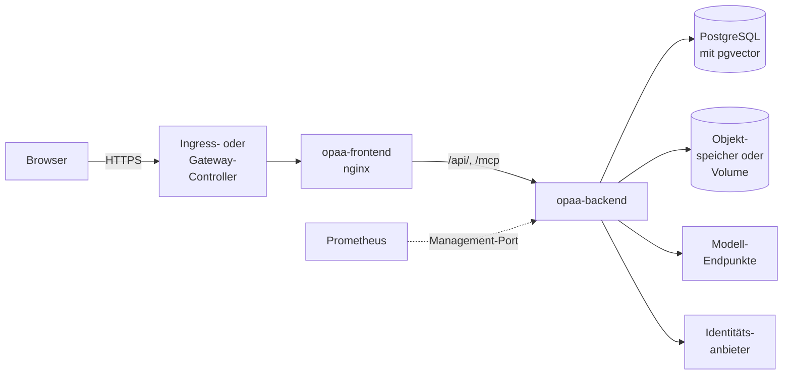

# Kubernetes

OPAA lässt sich unter Kubernetes mit dem Helm-Chart des Projekts betreiben. Der Chart startet
dieselben Images wie der Compose-Stapel ([Docker Compose](docker-compose.md)): ein Backend und
ein Frontend. Datenbank, Modelle, Objektspeicher und Identitätsanbieter betreibt das Haus selbst; der
Chart bindet sie an.

Dieses Kapitel beschreibt, was unter Kubernetes anders ist und welcher Wert des Charts welche
Einstellung setzt. Was für beide Betriebswege gleich gilt — Laufzeitimages, Probes, Härtung,
Sicherung, Logs und Metriken, was ein Update mit dem Index macht —, steht in der
[Betriebsübersicht](README.md) und ihren Kapiteln; die Bedeutung der Umgebungsvariablen in der
[Konfiguration](konfiguration.md), Anmeldung und Erststart unter
[Authentifizierung](authentifizierung.md), Datenbank und Originalablage in ihren Kapiteln. Dieses
Kapitel verweist an der jeweiligen Stelle dorthin.

## Kubernetes oder Compose

Beide Wege führen zur selben Anwendung mit denselben Grenzen
([Mehrere Backend-Instanzen](mehrere-instanzen.md#docker-compose-und-kubernetes)). In der
Vorgabe läuft der Chart mit einer Backend-Instanz:

- Das Backend-Deployment hat ein Replikat; `backend.replicas: 0` hält das Backend an. Mehrere
  Replikate für Hochverfügbarkeit und eine Aktualisierung ohne Ausfall beschreibt
  [Mehrere Backend-Instanzen](#mehrere-backend-instanzen).
- Die Strategie ist `Recreate`. Bei einer Aktualisierung endet der alte Pod, bevor der neue startet;
  sie ist mit einem Pod deshalb eine **kurze Unterbrechung**.
- Das Frontend hält keinen Zustand und darf mehrfach laufen (`frontend.replicas`).

Kubernetes bringt außerdem die vorhandene Plattform des Hauses: Eingang und Zertifikate,
Geheimnisverwaltung, Überwachung, Netztrennung und GitOps.

| Thema | Compose ([Docker Compose](docker-compose.md)) | Kubernetes (dieses Kapitel) |
|---|---|---|
| Konfiguration | `.env.docker` | Werte-Datei des Charts und ein Secret; weitere Variablen über `backend.extraEnv` |
| Betriebsmodus | `SPRING_PROFILES_ACTIVE` frei wählbar | fest `oidc`; der Entwicklungsmodus ist nicht vorgesehen |
| Datenbank | im Stapel mitgeliefert | extern; zur Erprobung eine zuschaltbare Datenbank im Release |
| Identitätsanbieter | Keycloak im Stapel zuschaltbar | extern oder nur lokale Konten |
| Originalablage | Verzeichnis auf dem Host oder Objektspeicher | Objektspeicher oder PersistentVolumeClaim |
| Eingang und TLS | eigener Reverse-Proxy vor dem Frontend | Ingress oder HTTPRoute, TLS am Controller |
| Vertraute Proxys | feste Adresse des Frontend-Containers | Pod-Netz, abgesichert durch zwei NetworkPolicies |
| Eigene CA | Kopie des Truststores einhängen | `extraCACertificates`, Truststore entsteht bei jedem Start |
| Beschreibbare Pfade | benannte Volumes | `emptyDir` je Pod |
| Aktualisierung | `docker compose pull` und `up -d` | `helm upgrade` |

Was der Chart anlegt, mit dem Release-Namen `opaa`:

| Objekt | Name | Wann |
|---|---|---|
| Deployment, Service, ConfigMap | `opaa-backend` | immer |
| Deployment, Service | `opaa-frontend` | immer |
| ServiceAccount | `opaa` | `serviceAccount.create` |
| Secret | `opaa` | ohne `secrets.existingSecret` |
| PersistentVolumeClaim | `opaa-uploads` | Originalablage auf einem Volume ohne `existingClaim` |
| Job | `opaa-migrate-<Prüfsumme>` | `backend.migration.enabled` |
| PodDisruptionBudget | `opaa-backend` | ab zwei Backend-Replikaten |
| StatefulSet, Service | `opaa-postgresql` | `evaluationDatabase.enabled` |
| NetworkPolicies | `opaa-backend-ingress` und weitere | siehe [NetworkPolicies](#networkpolicies) |
| Ingress oder HTTPRoute | `opaa` | `ingress.enabled` bzw. `httpRoute.enabled` |
| ServiceMonitor, PrometheusRule | `opaa-backend`, `opaa` | siehe [Betriebsüberwachung](#betriebsüberwachung) |
| Pod für `helm test` | `opaa-test-health` | nur während `helm test` |

Enthält der Release-Name nicht `opaa`, beginnen die Namen mit `<Release-Name>-opaa`. Alle Befehle
dieses Kapitels verwenden den Release-Namen `opaa` und den Namespace `opaa`.



### Mehrere Backend-Instanzen

Mehrere Backend-Pods gegen dieselbe Datenbank erlauben eine Aktualisierung ohne Unterbrechung und
überstehen den Ausfall eines Pods; wie sie zusammenarbeiten, erklärt
[Mehrere Backend-Instanzen](mehrere-instanzen.md). Der Chart rendert `backend.replicas` größer 1 nur zusammen mit dem
Migrations-Job und einer Originalablage, die jeder Pod sieht:

```yaml
backend:
  replicas: 2
  migration:
    enabled: true
  topologySpreadConstraints:
    - maxSkew: 1
      topologyKey: kubernetes.io/hostname
      whenUnsatisfiable: ScheduleAnyway
uploads:
  store: s3              # oder persistentVolumeClaim mit accessModes: [ReadWriteMany]
```

Damit ändert sich:

- **Migration als Job.** Der Job `opaa-migrate-<Prüfsumme>` migriert die Datenbank
  ([Migration als eigener Schritt](datenbank.md#migration-als-eigener-schritt)). Sein Name folgt Image
  und Konfiguration; ein Upgrade mit neuem Image oder neuer Konfiguration startet ihn neu, ein Upgrade
  ohne beides nicht. Die Backend-Pods migrieren nicht selbst und warten im Init-Container
  `await-migration`, bis die Datenbank jede Migration ihrer Version enthält. Mit der
  Erprobungsdatenbank wartet der Job zuerst auf sie; die Eingangs-Policy der Erprobungsdatenbank lässt
  ihn ein, und mit `networkPolicy.egress.enabled` bekommt er eine eigene Ausgangs-Policy mit DNS und
  `networkPolicy.egress.backendRules`.
- **Pod für Pod.** Die Strategie wird `RollingUpdate`: Ein neuer Pod startet, bevor ein alter endet,
  und der nächste folgt erst, wenn der neue bereit ist. `backend.updateStrategy: Recreate` bleibt
  wählbar, etwa um einen Wert des [Konfigurationsabdrucks](mehrere-instanzen.md#gleiche-konfiguration-der-konfigurationsabdruck) zu ändern, den
  alle Pods teilen müssen.
- **Austausch ohne Abbruch.** Ein Pod, der enden soll, nimmt über `backend.preStopSleepSeconds` noch
  Anfragen an, bis Kubernetes ihn aus dem Service genommen hat. Das Zeitfenster für laufende Anfragen
  (`backend.shutdownTimeoutSeconds`) folgt ohne eigenen Wert dem Lese-Timeout des Frontends, damit
  eine lange Chat-Antwort den Austausch übersteht; ein kleinerer Wert bricht das Rendern ab.
- **Wartung der Knoten.** Ein PodDisruptionBudget lässt immer nur einen Backend-Pod gleichzeitig
  räumen. `backend.topologySpreadConstraints` oder eine Anti-Affinität in `backend.affinity` verteilt
  die Pods über Knoten oder Zonen.
- **Datenbankverbindungen.** `backend.databasePoolSize` gilt je Pod; die Grenze für
  `max_connections` nennt [Verbindungen bei mehreren Instanzen](datenbank.md#verbindungen-bei-mehreren-instanzen).
- **Grenzen je Pod.** Welche Grenzen je Pod gelten, steht unter
  [Grenzen und Budgets](mehrere-instanzen.md#grenzen-und-budgets).
  `backend.installationBudgets` nimmt das Budget der ganzen Installation je Variable und setzt jedem
  Pod seinen Teil, abgerundet und mindestens 1; ändert sich `backend.replicas`, rechnet der Chart neu:

  ```yaml
  backend:
    replicas: 2
    installationBudgets:
      OPAA_INDEXING_EMBEDDING_CONCURRENCY: 6     # je Pod 3
      OPAA_RATE_LIMIT_QUERY_MAX_REQUESTS: 20     # je Pod 10
  ```
- **Alarme je Pod.** Fehlende Metriken, voller Heap und hängende Indexierung melden sich, sobald ein
  einzelner Pod betroffen ist ([Alarme](#alarme)).

Weitere Voraussetzungen: Volumes aus `filesystemSources` müssen sich in mehrere Pods einhängen lassen,
etwa per NFS oder mit `ReadOnlyMany`. Befehle mit `deploy/opaa-backend` sprechen einen beliebigen Pod
an; alle Pods erreicht `-l app.kubernetes.io/component=backend`, für Protokolle mit `--tail=-1`.

## Voraussetzungen

| Was | Anforderung |
|---|---|
| Kubernetes | eine der drei jüngsten Minor-Versionen, die das Kubernetes-Projekt zum Zeitpunkt des OPAA-Releases pflegt; ältere können funktionieren, werden aber nicht geprüft |
| Knoten | `linux/amd64` oder `linux/arm64`; Releases und `main` gibt es für beide Architekturen, der Knoten zieht die passende (ältere `sha-<commit>`-Stände nur für `linux/amd64`) |
| Helm | Helm 4, oder Helm 3 ab 3.8 |
| Namespace | Pod Security Admission auf `restricted` ist möglich und empfohlen; der Chart braucht keine Ausnahme |
| Netzwerkschicht | setzt NetworkPolicies durch, sobald `trustedProxyCidrs` gesetzt wird (siehe [Proxy-Kette und Client-Adresse](#proxy-kette-und-client-adresse)) |
| Eingang | ein Ingress-Controller oder eine Gateway-API-Implementierung mit einem Gateway; ein DNS-Name und ein Zertifikat, etwa über cert-manager |
| Datenbank | PostgreSQL mit pgvector 0.8.0 oder neuer, vom Cluster aus erreichbar, mit einer Datenbank und einem Konto für OPAA; Vorbereitung siehe [Voraussetzungen einer eigenen PostgreSQL](datenbank.md#voraussetzungen-einer-eigenen-postgresql) |
| Originalablage | ein vorher angelegter Bucket in einem S3-kompatiblen Objektspeicher mit Zugangs- und Geheimschlüssel, oder eine StorageClass für ein Volume mit `ReadWriteOnce` |
| Modelle | ein OpenAI-kompatibler Endpunkt für die Einbettung und einer für den Chat, wahlweise im Cluster; optional ein Rerank-Endpunkt (siehe [LLM-Anbieter](modelle.md#llm-anbieter)) |
| Identitätsanbieter | optional ein OIDC-Anbieter mit einem öffentlichen Client; ohne ihn melden sich Personen mit lokalen Konten an |
| Mailserver | optional; in der Antwortdatei (`bootstrap.mail`), im Einrichtungs-Assistenten (ein Server im Cluster-Netz braucht dann `installationMailTargetAllowlist`) oder nach der Installation in der Oberfläche |
| Postfach | eine zustellbare Adresse für das erste Systemverwalter-Konto, am besten ein Funktionspostfach der IT |

Für eine Erprobung ohne eigene Datenbank bringt der Chart eine Erprobungsdatenbank mit (siehe
[Datenbank](#datenbank)). Sie ist nicht für den Betrieb gedacht.

## Installation

### 1. Namespace anlegen

```bash
kubectl create namespace opaa
kubectl label namespace opaa \
  pod-security.kubernetes.io/enforce=restricted \
  pod-security.kubernetes.io/warn=restricted
```

Der Namespace wird vor dem Chart angelegt, damit die Labels von Anfang an gelten. `helm install`
braucht dann kein `--create-namespace`.

### 2. Datenbank vorbereiten

Ein Datenbankverwalter legt die Erweiterung `vector` und gegebenenfalls die Rolle
`opaa_audit_owner` an, bevor OPAA zum ersten Mal startet. Die Befehle stehen unter
[Voraussetzungen einer eigenen PostgreSQL](datenbank.md#voraussetzungen-einer-eigenen-postgresql).
Soll OPAA in einem eigenen Schema liegen, muss es ebenfalls vorher existieren
([Eigenes Datenbankschema](datenbank.md#eigenes-datenbankschema)).

Mit der [Erprobungsdatenbank](#datenbank) entfällt dieser Schritt: Ihr Konto ist Superuser und legt
Erweiterung und Rolle bei der Migration selbst an.

### 3. Geheimnisse anlegen

Der empfohlene Weg ist ein Secret, das der Chart nur liest (`secrets.existingSecret`). Welche
Schlüssel es enthält, steht unter [Geheimnisse](#geheimnisse). Die Schlüssel werden zuerst in Dateien
erzeugt, damit eine Kopie außerhalb des Clusters entsteht:

```bash
umask 077
mkdir opaa-geheimnisse
cd opaa-geheimnisse
openssl rand -base64 48 | tr -d '\n' > OPAA_AUTH_JWT_SECRET
openssl rand -base64 32 | tr -d '\n' > OPAA_CREDENTIALS_ENCRYPTION_KEY
openssl rand -base64 32 | tr -d '\n' > OPAA_SETTINGS_ENCRYPTION_KEY
printf '%s' '<Passwort des Datenbankkontos>' > OPAA_DB_PASSWORD
printf '%s' '<Zugangsschlüssel des Objektspeichers>' > OPAA_UPLOAD_S3_ACCESS_KEY
printf '%s' '<Geheimschlüssel des Objektspeichers>' > OPAA_UPLOAD_S3_SECRET_KEY
printf '%s' '<Passwort des ersten Kontos>' > installation-admin-password
wc -c *
kubectl -n opaa create secret generic opaa-secrets --from-file=.
cd ..
```

Jede Datei wird ein Schlüssel des Secrets, ihr Name ist der Schlüsselname. `tr -d '\n'` und
`printf '%s'` verhindern einen Zeilenumbruch am Ende des Werts. Die beiden Dateien des Objektspeichers
entfallen, wenn die Originale auf einem Volume liegen; `installation-admin-password` entfällt bei der
Installation im Browser und wird nach der Installation wieder entfernt. Die Schlüssel der Modelle
kommen als `installation-chat-api-key` und `installation-embedding-api-key` dazu, wenn die Endpunkte
einen verlangen.

`wc -c *` zeigt vor dem Anlegen die Länge jedes Werts. Keine Datei darf leer sein; ging beim Kopieren
der Befehle ein `openssl` verloren, steht dort `0`. Die beiden Verschlüsselungsschlüssel haben
44 Zeichen, `OPAA_AUTH_JWT_SECRET` hat 64. Einen leeren Wert in einem vorhandenen Secret erkennt der
Chart nicht, weil er nur den Namen des Secrets sieht (siehe [Geheimnisse](#geheimnisse)).

**Das Verzeichnis ist danach die einzige Kopie der Verschlüsselungsschlüssel außerhalb des
Clusters.** Es gehört dorthin, wo das Haus seine Notfallgeheimnisse verwahrt, und vom Arbeitsrechner
gelöscht. Wer External Secrets, Sealed Secrets oder Vault verwendet, legt dort ein Secret mit
denselben Schlüsselnamen an.

### 4. Werte-Datei schreiben

Eine Werte-Datei für den Betrieb mit Objektspeicher, Identitätsanbieter und Ingress:

```yaml
# opaa-werte.yaml
publicBaseUrl: https://opaa.example.org

database:
  host: postgres.example.org
  sslMode: verify-full

embedding:
  baseUrl: https://modelle.example.org/v1
  model: bge-m3

bootstrap:
  initialAdmin:
    email: it-postfach@example.org
  oidc:
    issuerUri: https://login.example.org/realms/opaa
    clientId: opaa
  chatModel:
    baseUrl: https://modelle.example.org/v1
    model: qwen2.5:7b

secrets:
  existingSecret: opaa-secrets

uploads:
  store: s3
  s3:
    endpoint: https://s3.example.org
    bucket: opaa-originale

frontend:
  cspConnectSrcExtra: https://login.example.org

ingress:
  enabled: true
  className: nginx
  host: opaa.example.org
  annotations:
    nginx.ingress.kubernetes.io/proxy-body-size: 52m
    nginx.ingress.kubernetes.io/proxy-read-timeout: "600"
    nginx.ingress.kubernetes.io/proxy-buffering: "off"
  tls:
    - secretName: opaa-tls
      hosts:
        - opaa.example.org
```

- **Pflicht** sind `publicBaseUrl`, `database.host` (ohne Erprobungsdatenbank), dazu die
  Geheimnisse und beim Objektspeicher `uploads.s3.endpoint` und `uploads.s3.bucket`; mit Antwortdatei
  zusätzlich `bootstrap.chatModel.*` und `embedding.baseUrl` und `embedding.model`. Fehlt einer, lehnt
  der Chart die Installation mit einer Meldung ab, die den Wert nennt.
- `publicBaseUrl` ist die Adresse, unter der Personen OPAA aufrufen: mit Schema, ohne Pfad und ohne
  Schrägstrich am Ende. OPAA läuft immer an der Wurzel seines Hostnamens; ein Unterpfad ist mit dem
  Chart nicht möglich.
- Die Dimension des Embedding-Modells ermittelt die Probeeinbettung der Installation; einstellen
  muss sie niemand. `embedding.dimensions` ist ohne Wirkung und wird nur noch angenommen, damit
  ältere Werte-Dateien weiter rendern. Ein späterer Wechsel des Modells läuft in der Modellverwaltung,
  mit Neueinbettung ([Modell wechseln](modelle.md#modell-wechseln)).
- **Interne Modell-Hosts** gehören mit Port in `targetValidation.modelAllowlist`, etwa
  `ollama.ai.svc.cluster.local:11434`, nicht in die Liste der Quellen. Host und Port von
  `bootstrap.chatModel.baseUrl` und `embedding.baseUrl` trägt der Chart selbst und dauerhaft ein,
  auch nach der Installation; die Freigabe gilt dann für jede Modellrolle auf diesem Host und Port.
  Nötig ist ein Eintrag für Modelle auf anderen Hosts, die die Verwaltung später anlegt, etwa Rerank-
  und Transkriptionsmodell ([Adressprüfung der Modelle](modelle.md#adressprüfung-der-modelle)).
- `bootstrap.*` ist die **Antwortdatei** der [Installation](installation.md): Mit
  `bootstrap.initialAdmin.email` rendert der Chart sie, und der erste Start richtet OPAA daraus ein
  (siehe [7. Installation und erste Anmeldung](#7-installation-und-erste-anmeldung)). Ohne die
  Adresse bleibt OPAA im Installationsmodus, bis die Installation im Browser abgeschlossen ist.
- **Modelle vorher prüfen.** Das Modell aus `bootstrap.chatModel.model` und das aus `embedding.model`
  müssen im jeweiligen Endpunkt vorhanden sein. Fehlt das Chat-Modell, scheitert schon der
  Verbindungstest der Installation, und OPAA bleibt im Installationsmodus. Ein OpenAI-kompatibler
  Endpunkt nennt seine Modelle unter `<baseUrl>/models`, etwa mit
  `curl -s https://modelle.example.org/v1/models`; verlangt der Endpunkt einen Schlüssel, kommt
  `-H "Authorization: Bearer <Schlüssel>"` dazu.
- Ohne Identitätsanbieter entfällt `bootstrap.oidc` ganz, und `frontend.cspConnectSrcExtra` bleibt
  leer.
- Der Eingang ist hier ein Ingress für ingress-nginx; andere Controller und die Gateway API stehen
  unter [Eingang](#eingang).

Liegen die Originale auf einem Volume statt im Objektspeicher, ersetzt dieser Block den Abschnitt
`uploads`:

```yaml
uploads:
  store: persistentVolumeClaim
  persistence:
    size: 20Gi
    fsGroup: 65532
```

`fsGroup` ist nur nötig, wenn das Volume sonst nicht beschreibbar ist (siehe
[Originalablage](#originalablage)).

Vor der Installation zeigt `helm template`, ob der Chart die Werte annimmt. Die vollständige Liste
aller Werte samt Kommentaren liefert `helm show values`:

```bash
helm template opaa oci://ghcr.io/criew/charts/opaa --version <x.y.z> -n opaa -f opaa-werte.yaml > /dev/null
helm show values oci://ghcr.io/criew/charts/opaa --version <x.y.z>
```

### 5. Installieren

Jedes Release von OPAA veröffentlicht den Chart neben den Images in der GitHub Container Registry.
Chart und Images tragen dieselbe Versionsnummer; ohne eigene Angabe startet der Chart genau die Images
seiner Version:

```bash
helm install opaa oci://ghcr.io/criew/charts/opaa --version <x.y.z> -n opaa -f opaa-werte.yaml
```

Die verfügbaren Versionen und ihre Vorbereitungsschritte stehen unter *Releases* im
GitHub-Repository. Wer den Entwicklungsstand `main` aus einem Checkout des Repositorys installiert,
nennt die Image-Tags ausdrücklich, weil der Chart im Repository keine Release-Version trägt:

```bash
helm install opaa deploy/helm/opaa -n opaa -f opaa-werte.yaml \
  --set backend.image.tag=main --set frontend.image.tag=main
```

#### Installation ohne Internetzugang

Erreicht der Cluster GHCR nicht, kommen Chart und Images aus dem Offline-Bündel des Release. Prüfen
und Einspielen in die interne Registry beschreibt
[Images und Laufzeit](images-und-laufzeit.md#installation-ohne-internetzugang). Installiert wird
dann aus der Datei im Bündel, mit den Image-Adressen der internen Registry:

```bash
helm install opaa chart/opaa-<x.y.z>.tgz -n opaa -f opaa-werte.yaml \
  --set backend.image.repository=registry.intern/opaa/opaa-backend \
  --set frontend.image.repository=registry.intern/opaa/opaa-frontend
```

Die Tags bleiben die Version des Charts. Wer per Digest pinnt, nimmt die Werte aus `DIGESTS` im
Bündel (`backend.image.digest`, `frontend.image.digest`); sie gelten unverändert in der internen
Registry. Verlangt die Registry eine Anmeldung, gehört ein Secret in `imagePullSecrets`. Die
Erprobungsdatenbank und alle übrigen Drittimages kommen auf eigenem Weg in die Registry.

### 6. Auf das Backend warten und prüfen

Der erste Start legt das Datenbankschema an. Das Backend meldet sich erst danach bereit:

```bash
kubectl -n opaa rollout status deploy/opaa-backend --timeout=15m
helm test opaa -n opaa
```

`helm test` ruft über den Frontend-Service `/api/health` ab und prüft damit die Kette Frontend-nginx
→ Backend. Schlägt einer der beiden Schritte fehl, hilft die [Fehlersuche](#fehlersuche).

### 7. Installation und erste Anmeldung

Eine leere Datenbank steht im Installationsmodus ([Installation](installation.md)); die Readiness ist
dabei `UP`. Zwei Wege führen hinaus:

- **Antwortdatei aus den Werten.** Mit `bootstrap.initialAdmin.email` rendert der Chart die
  Antwortdatei als ConfigMap `<Release>-backend-installation` und hängt das Passwort des ersten Kontos
  aus dem Secret (Schlüssel `installation-admin-password`) als Datei ein, nie als Variable. Der erste
  Start prüft wie der Assistent und schließt ab. Die Adressen von Chat- und Embedding-Modell prüft er
  wie Quellen: Ein Modell im Cluster, etwa Ollama, braucht seinen Host in
  `targetValidation.indexingAllowlist`. Die erste Anmeldung verlangt ein neues Passwort, damit das im
  Secret danach nicht mehr gilt (`bootstrap.initialAdmin.requirePasswordChange`, Vorgabe `true`).
  Fehlt das Passwort im Secret, startet der Pod trotzdem; OPAA bleibt dann im Installationsmodus, und
  das Protokoll nennt die fehlende Datei. Mit `bootstrap.mail.host` enthält die Antwortdatei auch den
  Mailserver; der erste Start prüft Verbindung und Anmeldung, ohne eine Nachricht zu senden. Host und
  Port trägt der Chart in `installationMailTargetAllowlist` ein, damit ein Server im eigenen Netz die
  Adressprüfung der Installation passiert. Ohne `bootstrap.mail` bleibt der Schritt übersprungen.
  Scheitert eine Prüfung, nennt das Protokoll Schritt und Grund:

  ```bash
  kubectl -n opaa logs -l app.kubernetes.io/component=backend --tail=-1 | grep "answer file"
  ```

- **Im Browser oder über die Installations-API.** Ohne `bootstrap.initialAdmin.email` führt der
  Assistent unter `publicBaseUrl` durch die Schritte. Das Token kommt aus dem Secret (Schlüssel
  `OPAA_INSTALLATION_TOKEN`) oder steht einmalig im Protokoll des ersten Starts:

  ```bash
  kubectl -n opaa logs -l app.kubernetes.io/component=backend --tail=-1 | grep -A3 "INSTALLATION TOKEN"
  ```

  Leitet der Cluster Protokolle an ein zentrales System weiter, steht ein erzeugtes Token auch dort;
  dann das Token vorher selbst in das Secret legen.

  `installationAllowedCidrs` beschränkt die Installations-API zusätzlich auf Netzbereiche. Geprüft
  wird die Client-Adresse, die das Backend sieht: ohne `trustedProxyCidrs` die des Frontend-Pods, nicht
  die der Person ([Proxy-Kette und Client-Adresse](#proxy-kette-und-client-adresse)). Ohne
  Proxy-Kette lässt sich die Installation direkt am Backend vornehmen, dessen Port auf den eigenen
  Rechner weitergeleitet wird; die Prüfung sieht dann die Adresse von `kubectl`:

  ```bash
  kubectl -n opaa port-forward svc/opaa-backend 8080:8080
  ```

  Die Hinweise nach `helm install` warnen, wenn die Netzbereiche ohne `trustedProxyCidrs` gesetzt
  sind; dasselbe gilt für `localAdminAllowedCidrs`.

Die Anmeldung läuft danach über `<publicBaseUrl>/login` mit dem ersten Konto; der Abschluss hat die
lokale Benutzerverwaltung eingeschaltet. Den Weg für Systemverwalter bei abgeschalteter Verwaltung
beschreibt die [Benutzerverwaltung](../konten-und-rechte/benutzerverwaltung.md#1-wann-diese-verwaltung-gebraucht-wird). Was dann zu tun
ist (persönliche Verwalterkonten anlegen, Notanker versiegeln), steht unter
[Erststart und Systemverwalter-Konto](authentifizierung.md#erststart-und-systemverwalter-konto). Nach
dem Abschluss gehören das Passwort (`secrets.initialAdminPassword` bzw. der Schlüssel
`installation-admin-password`) und die Modellschlüssel der Antwortdatei aus dem Secret entfernt;
`bootstrap.initialAdmin.email` darf stehen bleiben, die Antwortdatei wird übergangen, und der Pod
startet auch ohne die Dateien.

### 8. Nach der Ersteinrichtung

- **In der Oberfläche einrichten:** Mailserver ([E-Mail-Versand](e-mail.md)), sofern nicht schon im
  Assistenten eingetragen,
  weitere Identitätsanbieter, weitere Chat-Modelle, Verzeichnisabgleich und der Zugriff externer KI-Werkzeuge.
- **Client-Adresse richtigstellen:** `trustedProxyCidrs` und die Eingangs-Policy des Frontends setzen
  (siehe [Proxy-Kette und Client-Adresse](#proxy-kette-und-client-adresse)). Bis dahin teilen sich
  alle Personen einen Zähler der Rate-Limits und der Anmeldesperre.
- **Ausgang begrenzen:** die Egress-Policies einschalten, sobald alle Ziele bekannt sind (siehe
  [NetworkPolicies](#networkpolicies)). Bis dahin erreicht das Backend jedes Ziel, das der Cluster
  zulässt, auch den Metadatendienst `169.254.169.254`; die Hinweise nach `helm install` erinnern
  daran.
- **Überwachung anschließen:** siehe [Betriebsüberwachung](#betriebsüberwachung).
- **Sicherung einrichten:** siehe [Sicherung und Wiederherstellung](#sicherung-und-wiederherstellung).

### Erprobung ohne Eingang und ohne eigene Datenbank

Für eine Erprobung auf einem Testcluster genügt eine Werte-Datei mit der Erprobungsdatenbank, einem
Volume für die Originale und Geheimnissen in den Werten:

```yaml
# opaa-erprobung.yaml - nicht für den Betrieb
publicBaseUrl: http://localhost:8080
evaluationDatabase:
  enabled: true
embedding:
  baseUrl: http://ollama.ai.svc.cluster.local:11434/v1
  model: nomic-embed-text
bootstrap:
  initialAdmin:
    email: it-postfach@example.org
  chatModel:
    baseUrl: http://ollama.ai.svc.cluster.local:11434/v1
    model: qwen2.5:7b
uploads:
  store: persistentVolumeClaim
  persistence:
    fsGroup: 65532
secrets:
  jwtSecret: <Ausgabe von openssl rand -base64 48>
  databasePassword: <frei gewähltes Passwort>
  credentialsEncryptionKey: <Ausgabe von openssl rand -base64 32>
  settingsEncryptionKey: <Ausgabe von openssl rand -base64 32>
  initialAdminPassword: <Passwort des ersten Kontos, 12 bis 64 Zeichen>
```

Erreichbar ist die Installation dann über eine Portweiterleitung auf genau die Adresse aus
`publicBaseUrl`; eine andere Adresse lehnt das Backend als fremden Origin ab:

```bash
kubectl -n opaa port-forward svc/opaa-frontend 8080:80
```

Die Erprobungsdatenbank hat keine Sicherung, keine Replikation und keinen Aktualisierungsweg über
Hauptversionen von PostgreSQL. Wer aus der Erprobung einen Betrieb macht, setzt neu auf.

## Erprobung mit dem Beispiel-Setup

Wer OPAA unter Kubernetes vorführen oder einen ersten Eindruck gewinnen will, braucht neben dem Chart
alle Dienste, die der Chart nur anbindet. Das Beispiel-Setup im Repository unter
`examples/kubernetes-trial/` baut sie mit einem Befehl in einem leeren lokalen Cluster auf und
installiert den Chart mit passenden Werten. Ablauf, Einstellungen und Fehlersuche stehen in der
README dieses Verzeichnisses.

> **Nicht für den Betrieb.** Jeder Dienst läuft mit einer Instanz, ohne TLS und ohne Sicherung.
> Keycloak läuft im Entwicklungsmodus mit Testkonten, deren Passwörter im Repository stehen. Aus dem
> Beispiel-Setup wird kein Betrieb; eine Installation beginnt mit [Installation](#installation).

| Dienst | Im Beispiel-Setup | Anbindung im Chart |
|---|---|---|
| Datenbank | Erprobungsdatenbank des Charts | `evaluationDatabase.enabled` |
| Identitätsanbieter | Keycloak mit dem Realm `opaa`, einem öffentlichen Client und zwei Testkonten | `bootstrap.oidc`, `frontend.cspConnectSrcExtra` |
| Modelle | Ollama mit einem kleinen Chat-Modell und `nomic-embed-text`, vorab gezogen | `embedding`, `bootstrap.chatModel` |
| Originalablage | RustFS mit einem vorab angelegten Bucket | `uploads.s3` |
| Mailserver | Mailpit; ein Job trägt es nach dem Start als Mailserver ein und schickt die Testnachricht | keiner, Verwaltungseinstellung |
| Eingang | Traefik des Clusters, Hostnamen unter `*.localhost` | `ingress` |

Die Geheimnisse erzeugt das Skript beim ersten Start und legt sie als Secret an, das der Chart über
`secrets.existingSecret` liest. Ein weiterer Start lässt sie unverändert.

### Starten und abbauen

Voraussetzung ist ein lokaler Cluster mit Traefik als Ingress-Controller, etwa k3d, dazu `kubectl`,
`helm` und `openssl`:

```bash
k3d cluster create opaa-trial -p "127.0.0.1:8088:80@loadbalancer"
examples/kubernetes-trial/trial.sh up
```

Der Port ist nur auf dem eigenen Rechner erreichbar (`127.0.0.1`), weil Mailpit Einladungs- und
Rücksetzlinks zeigt und die Testkonten bekannt sind. Das Skript arbeitet im aktuellen kubectl-Kontext
und nennt ihn zuerst. Einen Kontext, der nicht nach einem lokalen Cluster aussieht, lehnt es ab, und
es ändert keinen gleichnamigen Namespace, den es nicht selbst angelegt hat. Es legt die Namespaces
`opaa-trial` (OPAA, Pod Security Standard `restricted`) und `opaa-trial-services` (die Dienste) an
und wartet, bis alles bereit ist. Am Ende nennt es die Adressen und die Befehle, mit denen die
erzeugten Verwaltungspasswörter aus den Secrets gelesen werden. Angemeldet wird über Keycloak oder
als erster Systemverwalter über `/login/system`.

```bash
examples/kubernetes-trial/trial.sh down
```

`down` löscht beide Namespaces und mit ihnen Datenbank, Modelle, Originale und Geheimnisse.

| Umgebungsvariable | Vorgabe | Wirkung |
|---|---|---|
| `TRIAL_PORT` | `8088` | Port, unter dem der Ingress-Controller auf dem Rechner erreichbar ist; nach dem ersten Start nicht mehr ändern, weil die Installation den Issuer festhält |
| `TRIAL_CHAT_MODEL` | `qwen2.5:3b` | Chat-Modell, das Ollama zieht und OPAA beim ersten Start übernimmt |
| `OPAA_IMAGE_TAG` | `main` | Tag der OPAA-Images |
| `KUBE_CONTEXT` | aktueller Kontext | kubectl-Kontext des Zielclusters |
| `TRIAL_ALLOW_CONTEXT` | leer | Name eines Kontexts, der nicht nach einem lokalen Cluster aussieht (`k3d-*`, `kind-*`, `docker-desktop`, `rancher-desktop`, `orbstack`, `minikube`) und trotzdem gemeint ist |

### Was sich daraus für eine Installation ablesen lässt

- **Issuer und Signaturschlüssel.** Der Browser erreicht Keycloak unter einer Adresse, die im Cluster
  nicht auflöst. Das Backend vergleicht den Issuer nur mit dem Token und holt die Schlüssel über
  `bootstrap.oidc.jwkSetUri` unter der internen Adresse (siehe [Identitätsanbieter](#identitätsanbieter)).
- **Content-Security-Policy.** Keycloak liegt auf einem anderen Origin als OPAA; sein Origin steht
  deshalb in `frontend.cspConnectSrcExtra`, und die Ausgabe von `helm install` bestätigt ihn.
- **Modelle vor dem ersten Start.** Das Chat-Modell aus `bootstrap.chatModel` muss im Endpunkt
  vorhanden sein, sonst scheitert der Verbindungstest der Installation; ein späterer Wechsel geht über
  die Modellverwaltung.
- **Bucket vorab.** OPAA legt keinen Bucket an; im Beispiel-Setup tut das ein Job beim Aufbau.
- **Mailserver in der Oberfläche.** Das Beispiel-Setup setzt `bootstrap.mail` nicht und trägt ihn
  über die Schnittstelle ein, wie es die Systemverwaltung in der Oberfläche täte
  ([E-Mail-Versand](e-mail.md)).

## Geheimnisse

Geheimnisse stehen nie in der ConfigMap. Der Chart liest sie aus einem Secret, auf einem von zwei
Wegen:

- **Vorhandenes Secret** (`secrets.existingSecret`), empfohlen. Der Chart legt dann kein Secret an
  und ignoriert die übrigen Werte unter `secrets`.
- **Secret aus den Werten.** Der Chart legt das Secret aus `secrets.jwtSecret` und den übrigen
  Werten an. Die Geheimnisse stehen dann in der Werte-Datei und in den Daten des Helm-Releases.

| Schlüssel im Secret | Wert unter `secrets` | Pflicht | Inhalt |
|---|---|---|---|
| `OPAA_AUTH_JWT_SECRET` | `jwtSecret` | ja | Wurzelgeheimnis der lokalen Anmeldung, mindestens 32 Zeichen, erzeugt mit `openssl rand -base64 48` |
| `OPAA_DB_PASSWORD` | `databasePassword` | ja | Passwort des Datenbankkontos |
| `OPAA_CREDENTIALS_ENCRYPTION_KEY` | `credentialsEncryptionKey` | ja | Base64 von 32 Zufallsbytes, erzeugt mit `openssl rand -base64 32`; verschlüsselt Zugangsdaten von Quellen und Verbindungen |
| `OPAA_SETTINGS_ENCRYPTION_KEY` | `settingsEncryptionKey` | ja | wie oben; verschlüsselt Modellschlüssel, das Passwort des Mailservers und wartende E-Mails |
| `OPAA_UPLOAD_S3_ACCESS_KEY` | `s3AccessKey` | bei `uploads.store: s3` | Zugangsschlüssel des Objektspeichers |
| `OPAA_UPLOAD_S3_SECRET_KEY` | `s3SecretKey` | bei `uploads.store: s3` | Geheimschlüssel des Objektspeichers |
| `installation-chat-api-key` | `chatApiKey` | mit `bootstrap.chatModel.apiKeyInSecret` | Schlüssel des Chat-Modells der Antwortdatei, als Datei eingehängt |
| `installation-embedding-api-key` | `embeddingApiKey` | mit `embedding.apiKeyInSecret` | Schlüssel des Embedding-Modells der Antwortdatei, als Datei eingehängt |
| `installation-mail-password` | `mailPassword` | mit `bootstrap.mail.passwordInSecret` | Passwort des Mailservers der Antwortdatei, als Datei eingehängt |
| `installation-admin-password` | `initialAdminPassword` | für die Installation mit `bootstrap.initialAdmin.email` | Passwort des ersten Kontos der Antwortdatei, als Datei eingehängt; nach dem Abschluss entfernen. Fehlt es, startet der Pod, und die Installation wartet |
| `OPAA_INSTALLATION_TOKEN` | `installationToken` | nein | Installations-Token, mindestens 32 Zeichen; ohne es schreibt der erste Start ein erzeugtes ins Protokoll |

Die Verschlüsselungsschlüssel sind im Chart Pflicht, auch wenn noch nichts verschlüsselt gespeichert
ist. Ein fehlender Schlüssel fiele sonst erst auf, wenn die erste Quelle ihre Zugangsdaten speichert.

**Wo ein fehlender Schlüssel auffällt.** Bei Geheimnissen aus den Werten lehnt der Chart die
Installation ab. Bei einem vorhandenen Secret sieht der Chart nur den Namen; fehlt ein
Pflichtschlüssel, startet der Pod nicht (`CreateContainerConfigError`), und `kubectl describe pod`
nennt den Schlüssel. Ein optionaler Schlüssel darf fehlen, ebenso die Dateien der Antwortdatei
(`installation-*`), die der Pod nur einhängt, wenn es sie gibt. `OPAA_INITIAL_ADMIN_PASSWORD` und
`OPAA_OPENAI_EMBEDDING_API_KEY` aus einem Secret bis `v0.1.0-rc.4` liest OPAA nicht mehr; sie gehören
entfernt.

**Der Chart erzeugt keine Schlüssel.** Ein bei der Installation zufällig erzeugter Schlüssel ginge mit
`helm template`, in GitOps-Werkzeugen oder bei einer Neuinstallation verloren. Geht einer der beiden
Verschlüsselungsschlüssel verloren, sind die damit gespeicherten Geheimnisse unlesbar (siehe
[Zugangsdaten-Verschlüsselung](netz-und-sicherheit.md#zugangsdaten-verschlüsselung)). Deshalb gehört eine
Kopie außerhalb des Clusters zur Sicherung.

**Ein geänderter Schlüssel wirkt erst nach einem Neustart.** Bei einem vorhandenen Secret startet
`kubectl -n opaa rollout restart deploy/opaa-backend` das Backend neu. Bei Geheimnissen aus den Werten
startet `helm upgrade` es von selbst. Eine Änderung von `OPAA_AUTH_JWT_SECRET` beendet alle lokalen
Sitzungen und entwertet alle offenen Einladungs- und Rücksetzlinks und alle Zugangstokens für
externe KI-Werkzeuge.

## Wertereferenz

OPAA kennt drei Arten von Konfiguration. Der Chart behandelt sie unterschiedlich:

| Art | Gelesen | Im Chart |
|---|---|---|
| **Bereitstellungswerte** | bei jedem Start | alle Werte außer `bootstrap`; eine Änderung wirkt mit dem nächsten `helm upgrade` |
| **Antwortdatei** | von einem Start, solange die Installation offen ist; danach übergangen | `bootstrap` und die Schlüssel `installation-admin-password`, `installation-chat-api-key` und `installation-mail-password` |
| **Verwaltungseinstellungen** | nur aus der Datenbank | keine Werte; Einrichtung in der Oberfläche |

Die folgenden Tabellen nennen jeden Wert des Charts mit seiner Vorgabe und der Umgebungsvariablen, die
er setzt. Bedeutung und Wertebereich der Variablen stehen in der
[Variablenliste](konfiguration.md#alle-umgebungsvariablen) der Konfiguration. `values.schema.json`
prüft die Werte beim Rendern; ein unbekannter Schlüssel wird abgelehnt.

### Allgemein

| Wert | Vorgabe | Setzt | Wirkung |
|---|---|---|---|
| `publicBaseUrl` | leer, Pflicht | `OPAA_PUBLIC_BASE_URL`, `OPAA_CORS_ALLOWED_ORIGINS` | öffentliche Adresse; Basis aller Links in Mails, der OAuth-Rücksprungadresse und des erlaubten Origin |
| `nameOverride`, `fullnameOverride` | leer | — | ersetzt `opaa` bzw. den ganzen Namensstamm der Objekte |
| `imagePullSecrets` | leer | — | Secrets für eine eigene Registry, an allen Pods |
| `serviceAccount.create` | `true` | — | legt einen ServiceAccount an; kein Pod hängt dessen Token ein |
| `serviceAccount.name`, `serviceAccount.annotations` | leer | — | Name eines eigenen oder vorhandenen Kontos, Annotationen |
| `podSecurityContext` | `runAsNonRoot`, `seccompProfile: RuntimeDefault` | — | Sicherheitskontext aller Pods (siehe [Pod Security](#pod-security)) |
| `containerSecurityContext` | ohne Rechteausweitung, Read-only Root Filesystem, keine Capabilities | — | Sicherheitskontext aller Container |

### Datenbank und Erprobungsdatenbank

| Wert | Vorgabe | Setzt | Wirkung |
|---|---|---|---|
| `database.host` | leer, Pflicht ohne Erprobungsdatenbank | `OPAA_DB_URL` | Hostname der PostgreSQL |
| `database.port` | `5432` | `OPAA_DB_URL` | Port |
| `database.name` | `opaa` | `OPAA_DB_URL` | Name der Datenbank |
| `database.username` | `opaa` | `OPAA_DB_USERNAME` | Konto von OPAA; das Passwort kommt aus dem Secret |
| `database.schema` | leer (`public`) | `OPAA_DB_SCHEMA` | eigenes Schema; muss vor dem ersten Start existieren |
| `database.sslMode` | leer (Vorgabe des Treibers, `prefer`) | `OPAA_DB_URL` | `disable`, `allow`, `prefer`, `require`, `verify-ca` oder `verify-full`; die beiden `verify-*` prüfen das Serverzertifikat gegen die öffentlichen CAs und `extraCACertificates` |
| `evaluationDatabase.enabled` | `false` | — | PostgreSQL mit pgvector im Release, nur zur Erprobung; schließt `database.host` aus |
| `evaluationDatabase.image.repository`, `.tag`, `.digest`, `.pullPolicy` | `docker.io/pgvector/pgvector`, `pg18`, leer, `IfNotPresent` | — | Image der Erprobungsdatenbank |
| `evaluationDatabase.persistence.size`, `.storageClassName` | `8Gi`, leer | — | Volume der Erprobungsdatenbank |
| `evaluationDatabase.resources` | 100m CPU und 256Mi angefordert, 1Gi Grenze | — | Ressourcen der Erprobungsdatenbank |

### Modelle, Mail und Adressprüfung

| Wert | Vorgabe | Setzt | Wirkung |
|---|---|---|---|
| `embedding.baseUrl` | leer, Pflicht mit Antwortdatei | `embeddingModel.baseUrl` der Antwortdatei | OpenAI-kompatibler Einbettungs-Endpunkt; die Installation prüft ihn mit einer Probeeinbettung, danach ändert der Wert nichts mehr |
| `embedding.model` | leer, Pflicht mit Antwortdatei | `embeddingModel.model` | Einbettungsmodell; die Probeeinbettung ergibt seine Dimension |
| `embedding.dimensions` | leer | — | ohne Wirkung; nur noch angenommen, damit Werte-Dateien bis `v0.1.0-rc.4` weiter rendern |
| `embedding.timeout` | leer (Vorgabe der Anwendung) | `OPAA_OPENAI_EMBEDDING_TIMEOUT` | Höchstdauer eines Embedding-Aufrufs; ein großes Modell auf einer CPU braucht mehr ([Modell wechseln](modelle.md#modell-wechseln)) |
| `embedding.maxInputTokens` | leer (Vorgabe der Anwendung) | `embeddingModel.maxInputTokens` | Eingabegrenze des Endpunkts in Tokens ([Eingabegrenze des Embedding-Modells](modelle.md#eingabegrenze-des-embedding-modells)) |
| `embedding.apiKeyInSecret` | `false` | `embeddingModel.apiKeyFile` | Schlüssel des Embedding-Modells aus dem Secret (Schlüssel `installation-embedding-api-key`) |
| `rerank.timeout` | leer (Vorgabe der Anwendung) | `OPAA_RERANK_TIMEOUT` | Zeitbudget eines Rerank-Aufrufs, etwa `120s`; wer es anhebt, hebt `frontend.backendReadTimeout` mit an |
| `rerank.probeInterval` | leer (Vorgabe der Anwendung) | `OPAA_RERANK_PROBE_INTERVAL` | Abstand der Erreichbarkeitsprüfung ohne Fragen; bei einem bezahlten Endpunkt groß wählen, etwa `24h` |
| `transcription.maxAudioBytes`, `.timeout`, `.maxConcurrent` | leer (Vorgaben der Anwendung) | `OPAA_TRANSCRIPTION_MAX_AUDIO_BYTES`, `OPAA_TRANSCRIPTION_TIMEOUT`, `OPAA_TRANSCRIPTION_MAX_CONCURRENT` | größte Aufnahme in Byte, Zeitbudget einer Transkription, gleichzeitige Transkriptionen der Installation. Mit eingeschalteter Spracheingabe braucht der Ingress-Controller einen Puffer für den Anfrage-Body, der eine Aufnahme im Arbeitsspeicher hält, bei ingress-nginx `nginx.ingress.kubernetes.io/client-body-buffer-size: 11m`; sonst schreibt er sie in eine temporäre Datei. Endpunkt, Modell, Schlüssel und Sprache pflegt die Systemverwaltung unter Modelle → Spracheingabe, den Rerank-Endpunkt unter Modelle → Reranking |
| `mail.connectTimeout`, `.readTimeout`, `.writeTimeout` | leer (Vorgaben der Anwendung) | `OPAA_MAIL_CONNECT_TIMEOUT`, `OPAA_MAIL_READ_TIMEOUT`, `OPAA_MAIL_WRITE_TIMEOUT` | Timeouts der SMTP-Verbindung; den Mailserver selbst setzt `bootstrap.mail` oder die Oberfläche |
| `targetValidation.indexingAllowlist` | leer | `OPAA_INDEXING_TARGET_VALIDATION_ALLOWLIST` | Hosts interner Quellen, die die Zielprüfung passieren dürfen, am besten als `host:port`; Modell-Hosts gehören nicht hierher |
| `targetValidation.modelAllowlist` | leer | `OPAA_MODEL_TARGET_VALIDATION_ALLOWLIST` | Hosts interner Modell-Endpunkte als `host:port` (ohne Port: jeder Port des Hosts); Host und Port aus `bootstrap.chatModel.baseUrl` und `embedding.baseUrl` ergänzt der Chart selbst und dauerhaft, die Freigabe gilt dann für jede Modellrolle auf diesem Host und Port |
| `targetValidation.identityProviderAllowlist` | leer | `OPAA_OIDC_TARGET_VALIDATION_ALLOWLIST` | Weitere interne Identitätsanbieter als `host:port` (ohne Port: jeder Port des Hosts); Host und Port aus `bootstrap.oidc` ergänzt der Chart selbst |

### Funktionen

| Wert | Vorgabe | Setzt | Wirkung |
|---|---|---|---|
| `features.promptLibraries.enabled` | `true` | `OPAA_FEATURES_PROMPT_LIBRARIES_ENABLED` | `false` schaltet die Prompt-Bibliotheken ab (siehe [Prompt-Bibliotheken](../arbeitsmittel/prompt-bibliotheken.md#9-abschalten)) |
| `features.metadata.enabled` | `true` | `OPAA_FEATURES_METADATA_ENABLED` | Schalter für die Metadaten von Dokumenten und Bibliotheken; `false` lässt nur den Titel eines Dokuments übrig |
| `features.speechInput.enabled` | `true` | `OPAA_FEATURES_SPEECH_INPUT_ENABLED` | `false` schaltet die Spracheingabe im Chat ab, auch mit eingetragenem Transkriptionsdienst |
| `features.externalAccess.enabled` | `true` | `OPAA_FEATURES_EXTERNAL_ACCESS_ENABLED` | `false` schaltet den Zugriff externer KI-Werkzeuge samt MCP-Server unter `/mcp` ab (siehe [Externe KI-Werkzeuge](../spaces/fremdzugaenge.md#externe-ki-werkzeuge-ganz-abschalten)); an, öffnet erst der Schalter der Verwaltung den Kanal |

Ein Schalter setzt die Variable `OPAA_FEATURES_<NAME>_ENABLED`, der Name in Großbuchstaben mit
Unterstrichen. Wie überall lehnt `values.schema.json` einen unbekannten Namen ab, etwa einen
Tippfehler; eine Funktion ohne Eintrag bleibt an. Was das Abschalten bewirkt, beschreibt die
Konfiguration unter [„Funktionen abschalten"](konfiguration.md#funktionen-abschalten).

### Originalablage, Dateisystem-Quellen und Zertifikate

| Wert | Vorgabe | Setzt | Wirkung |
|---|---|---|---|
| `uploads.store` | `s3` | `OPAA_UPLOAD_STORE` | `s3` (Objektspeicher) oder `persistentVolumeClaim` (Volume unter `/app/uploads`, setzt `OPAA_UPLOAD_STORE=filesystem`) |
| `uploads.s3.endpoint`, `uploads.s3.bucket` | leer, Pflicht bei `s3` | `OPAA_UPLOAD_S3_ENDPOINT`, `OPAA_UPLOAD_S3_BUCKET` | Adresse des Objektspeichers mit Schema, Bucket |
| `uploads.s3.region` | `us-east-1` | `OPAA_UPLOAD_S3_REGION` | Region |
| `uploads.s3.pathStyle` | `true` | `OPAA_UPLOAD_S3_PATH_STYLE` | Pfad-Adressierung; die meisten hauseigenen Speicher brauchen sie, AWS nicht |
| `uploads.s3.keyPrefix` | leer | `OPAA_UPLOAD_S3_KEY_PREFIX` | Präfix aller Objektschlüssel |
| `uploads.persistence.existingClaim` | leer | — | vorhandener Claim statt eines neuen |
| `uploads.persistence.size`, `.storageClassName`, `.accessModes` | `20Gi`, leer, `ReadWriteOnce` | — | Größe, StorageClass und Zugriffsart des neuen Claims |
| `uploads.persistence.fsGroup` | leer | — | Gruppe, für die das Volume beschreibbar gemacht wird |
| `filesystemSources` | leer | `OPAA_INDEXING_FILESYSTEM_ALLOWLIST` | Verzeichnisse für den Dateisystem-Konnektor, je `name`, `mountPath` und `volume`; nur lesend eingehängt |
| `extraCACertificates.configMap` oder `.secret` | leer | `JAVA_TOOL_OPTIONS` | ConfigMap oder Secret mit zusätzlichen CA-Zertifikaten im PEM-Format, nur eines von beiden |

### Antwortdatei und Installation

| Wert | Vorgabe | Setzt | Wirkung |
|---|---|---|---|
| `bootstrap.initialAdmin.email` | leer | Antwortdatei, `firstAdmin.email` | Adresse des ersten Kontos, des lokalen Notanker-Kontos; gesetzt, rendert der Chart die Antwortdatei. `admin@opaa.local` wird abgelehnt |
| `bootstrap.initialAdmin.displayName` | `Systemverwaltung` | `firstAdmin.displayName` | Anzeigename des ersten Kontos |
| `bootstrap.initialAdmin.requirePasswordChange` | `true` | `firstAdmin.requirePasswordChange` | Die erste Anmeldung verlangt ein neues Passwort, sodass das im Secret danach nicht mehr gilt |
| `bootstrap.oidc.issuerUri` | leer | `signIn.oidc.issuerUri` | Issuer eines Identitätsanbieters neben den lokalen Konten; leer heißt nur lokale Konten |
| `bootstrap.oidc.clientId` | leer, Pflicht mit Issuer | `signIn.oidc.clientId` | Client-ID dieses Anbieters |
| `bootstrap.oidc.jwkSetUri` | leer | `signIn.oidc.jwkSetUri` | Adresse der Signaturschlüssel, falls das Backend den Anbieter unter einer anderen Adresse erreicht als der Browser |
| `bootstrap.oidc.displayName` | leer | `signIn.oidc.displayName` | Name des Anbieters auf der Anmeldeseite; leer heißt „Verzeichnisdienst“ |
| `bootstrap.oidc.authority` | leer | — | ohne Wirkung; wird angenommen, damit bestehende Werte-Dateien gültig bleiben |
| `bootstrap.chatModel.baseUrl`, `.model` | leer, Pflicht mit Adresse | `chatModel.baseUrl`, `chatModel.model` | das Chat-Modell, mit Adressprüfung und Verbindungstest vor dem Abschluss; Host und Port trägt der Chart in die Liste der Modelle ein (`targetValidation.modelAllowlist`) |
| `bootstrap.chatModel.apiKeyInSecret` | `false` | `chatModel.apiKeyFile` | liest den Schlüssel des Chat-Modells aus dem Secret (`installation-chat-api-key`); mit `secrets.chatApiKey` gilt das von selbst |
| `bootstrap.chatModel.temperature`, `.maxTokens` | leer (Vorgaben der Modellverwaltung) | `chatModel.temperature`, `chatModel.maxTokens` | Temperatur und Antwortlänge |
| `bootstrap.mail.host` | leer | `mail.host` | Mailserver des Schritts E-Mail-Versand, ohne Schema und Port; leer heißt: Schritt übersprungen. Host und Port ergänzt der Chart in `installationMailTargetAllowlist` |
| `bootstrap.mail.port`, `.encryption` | `587`, `STARTTLS` | `mail.port`, `mail.encryption` | Port und Verschlüsselung (`NONE`, `STARTTLS`, `SSL`) |
| `bootstrap.mail.username` | leer | `mail.username` | Benutzername der Anmeldung; leer heißt ohne Anmeldung |
| `bootstrap.mail.passwordInSecret` | `false` | `mail.passwordFile` | liest das Passwort des Mailservers aus dem Secret (`installation-mail-password`); mit `secrets.mailPassword` gilt das von selbst |
| `bootstrap.mail.fromAddress`, `.fromName` | leer, Adresse Pflicht mit Host | `mail.fromAddress`, `mail.fromName` | Absenderadresse und Absendername |
| `installationAllowedCidrs` | leer | `OPAA_INSTALLATION_ALLOWED_CIDRS` | Netze, aus denen die Installations-API antwortet; leer heißt ohne Einschränkung |
| `installationMailTargetAllowlist` | leer | `OPAA_INSTALLATION_MAIL_TARGET_ALLOWLIST` | Mailserver im eigenen Netz, die der optionale Schritt E-Mail-Versand des Assistenten erreichen darf (`host` oder `host:port`, IPv6 als `[adresse]:port`); Host und Port aus `bootstrap.mail` ergänzt der Chart selbst. Leer und ohne `bootstrap.mail` heißt: einen internen Mailserver erst nach der Installation in der Verwaltung eintragen |

### Backend

| Wert | Vorgabe | Setzt | Wirkung |
|---|---|---|---|
| `backend.image.repository` | `ghcr.io/criew/opaa-backend` | — | Image |
| `backend.image.tag` | leer (Version des Charts) | — | Tag; für eine Release-Installation leer lassen |
| `backend.image.digest` | leer | — | heftet das Image an einen Digest; hat Vorrang vor dem Tag |
| `backend.image.pullPolicy` | `IfNotPresent` | — | Pull-Verhalten |
| `backend.replicas` | `1` | — | Zahl der Backend-Pods, `0` hält das Backend an; mehr als `1` nur mit `backend.migration.enabled` und einer Originalablage, die jeder Pod sieht ([Mehrere Backend-Instanzen](#mehrere-backend-instanzen)) |
| `backend.updateStrategy` | leer | — | `Recreate` oder `RollingUpdate`; leer wählt `Recreate` für einen Pod und `RollingUpdate` (`maxUnavailable: 0`, `maxSurge: 1`) für mehr. `RollingUpdate` verlangt dasselbe wie mehrere Pods |
| `backend.migration.enabled` | `false` | `OPAA_MODE`, `SPRING_FLYWAY_ENABLED` | Migration als eigener Job vor den Pods; die Pods laufen dann ohne eigene Migration und warten im Init-Container auf sie |
| `backend.migration.backoffLimit` | `2` | — | Wiederholungen eines gescheiterten Migrations-Jobs |
| `backend.migration.activeDeadlineSeconds` | leer | — | Höchstdauer des Migrations-Jobs in Sekunden; leer: keine |
| `backend.migration.resources` | 250m CPU und 384Mi angefordert, 768Mi Grenze | — | Ressourcen des Jobs und des wartenden Init-Containers jedes Backend-Pods |
| `backend.databasePoolSize` | leer (Vorgabe der Anwendung, `10`) | `OPAA_DB_POOL_SIZE` | Verbindungen im Datenbank-Pool je Pod ([Verbindungen bei mehreren Instanzen](datenbank.md#verbindungen-bei-mehreren-instanzen)) |
| `backend.installationBudgets` | leer | die genannten Variablen | Budget der Installation je Grenze, die je Pod gilt: Rate-Limits je Client (`OPAA_RATE_LIMIT_*_MAX_REQUESTS`, `…_PER_ADDRESS`, `…_PER_ACCOUNT`), `OPAA_INDEXING_EMBEDDING_CONCURRENCY`, `OPAA_TRANSCRIPTION_MAX_CONCURRENT`, `OPAA_DOCUMENTS_ATTACHMENT_EXTRACTION_MAX_CONCURRENT`; jeder Pod bekommt das Budget durch `backend.replicas`, abgerundet, mindestens 1. Leer: jeder Pod behält die Vorgabe der Anwendung. Nicht zusammen mit `transcription.maxConcurrent` oder derselben Variable in `extraEnv` |
| `backend.managementPort` | `8081` | `MANAGEMENT_SERVER_PORT` | Port für Probes und Metriken, getrennt von der API |
| `backend.logFormat` | leer (Text) | `LOGGING_STRUCTURED_FORMAT_CONSOLE` | `ecs`, `logstash` oder `gelf` für JSON-Protokolle |
| `backend.shutdownTimeoutSeconds` | leer: `60` mit `Recreate`, mit `RollingUpdate` das Lese-Timeout des Frontends | `OPAA_SHUTDOWN_TIMEOUT` | Zeit, die ein Stopp laufenden Anfragen lässt, je Stopp-Phase; mit `RollingUpdate` mindestens das Lese-Timeout des Frontends, sonst bricht das Rendern ab |
| `backend.terminationGracePeriodSeconds` | leer: `shutdownTimeoutSeconds` plus die Pause vor dem Stopp plus `15` | — | muss größer sein als `shutdownTimeoutSeconds` plus `preStopSleepSeconds`, sonst bricht das Rendern ab |
| `backend.preStopSleepSeconds` | `10` | — | nur mit `RollingUpdate`: so lange nimmt ein Pod, der enden soll, noch Anfragen an, bis Kubernetes ihn aus dem Service genommen hat |
| `backend.maxRamPercentage` | `70` | `JAVA_TOOL_OPTIONS` | Heap-Anteil am Speicher-Limit; wirkt nur mit `resources.limits.memory` |
| `backend.javaToolOptions` | leer | `JAVA_TOOL_OPTIONS` | weitere JVM-Optionen; Dateiziele gehören unter `/tmp`. Kein JMX-Remote, kein `-Djdk.net.hosts.file` und kein `-javaagent`, der beim Laden Namen auflöst: Solche Optionen lösen Namen vor der Anwendung auf, und der Start bricht ab ([Images und Laufzeit](images-und-laufzeit.md#backend-laufzeitimage)) |
| `backend.timeZone` | `UTC` | `TZ` | Zeitzone der geplanten Läufe, Fristgrenzen und Datumsangaben in Mails ([Betrieb](README.md#zeitzone)); Teil des Konfigurationsabdrucks |
| `backend.resources` | 500m CPU und 1Gi angefordert, 2Gi Grenze | — | siehe [Speicher und Container-Grenzen](images-und-laufzeit.md#speicher-und-container-grenzen) |
| `backend.initResources` | 50m CPU und 128Mi angefordert, 256Mi Grenze | — | Init-Container des Backends: der Truststore mit `extraCACertificates` und das Warten auf die Erprobungsdatenbank |
| `backend.startupProbe` | alle `10` s, Timeout `5` s, `60` Fehlversuche | — | gibt dem ersten Start und der Migration Zeit (`periodSeconds` mal `failureThreshold`) |
| `backend.livenessProbe` | alle `20` s, Timeout `5` s, `3` Fehlversuche | — | Liveness |
| `backend.readinessProbe` | alle `10` s, Timeout `5` s, `3` Fehlversuche | — | Readiness; je Probe außerdem `initialDelaySeconds` und `successThreshold` |
| `backend.tmp.sizeLimit`, `.medium` | `2Gi`, leer | — | `emptyDir` unter `/tmp`; `Memory` macht daraus ein tmpfs, das gegen das Speicher-Limit zählt |
| `backend.service.port` | `8080` | — | Port des Backend-Service |
| `backend.podAnnotations`, `.podLabels`, `.nodeSelector`, `.tolerations`, `.affinity` | leer | — | Planung und Kennzeichnung des Pods; `nodeSelector` und `tolerations` gelten auch für den Migrations-Job |
| `backend.topologySpreadConstraints` | leer | — | Verteilung mehrerer Backend-Pods über Knoten oder Zonen; ein Eintrag ohne `labelSelector` bekommt die Labels der Backend-Pods |
| `backend.extraEnv`, `.extraEnvFrom` | leer | beliebige | weitere Variablen, etwa eine `OPAA_*`-Einstellung ohne eigenen Wert; `SPRING_PROFILES_*` und `JAVA_TOOL_OPTIONS` lehnt der Chart in `extraEnv` ab. Den Inhalt einer Quelle aus `extraEnvFrom` prüft er nicht; dort gehören sie ebenso wenig hin |
| `backend.extraVolumes`, `.extraVolumeMounts` | leer | — | weitere Volumes |

Fest gesetzt und nicht über Werte änderbar sind `SPRING_PROFILES_ACTIVE=oidc`,
`OPAA_SERVER_ADDRESS=0.0.0.0`, bei der Ablage auf einem Volume `OPAA_UPLOAD_STORAGE_PATH=/app/uploads`
und mit dem Migrations-Job `SPRING_FLYWAY_ENABLED=false` in den Backend-Pods.

### Frontend

| Wert | Vorgabe | Setzt | Wirkung |
|---|---|---|---|
| `frontend.image.repository` | `ghcr.io/criew/opaa-frontend` | — | Image |
| `frontend.image.tag`, `.digest`, `.pullPolicy` | leer (Version des Charts), leer, `IfNotPresent` | — | wie beim Backend |
| `frontend.replicas` | `1` | — | Zahl der Frontend-Pods; mehr als einer ist zulässig |
| `frontend.preStopSleepSeconds` | `5` | — | so lange nimmt ein Frontend-Pod, der enden soll, noch Anfragen an, bis Kubernetes ihn aus dem Service genommen hat; `0` lässt die Pause weg |
| `frontend.backendReadTimeout` | leer (Vorgabe des Images, `600s`) | `OPAA_BACKEND_READ_TIMEOUT` | wie lange der Frontend-nginx auf die Antwort des Backends wartet, für `/api/` und `/mcp`; Zahl mit Einheit `s`, `m` oder `h`. Mit `rerank.timeout` zusammen anheben; Controller oder Gateway davor brauchen mindestens denselben Wert |
| `frontend.cspConnectSrcExtra` | leer | `OPAA_CSP_CONNECT_SRC_EXTRA` | weitere Quellen für `connect-src`, durch Leerzeichen getrennt; Pflicht, wenn der Issuer eines Identitätsanbieters oder sein `token_endpoint` auf einem anderen Origin liegt als `publicBaseUrl`, siehe [Identitätsanbieter](#identitätsanbieter) |
| `frontend.resources` | 50m CPU und 64Mi angefordert, 256Mi Grenze | — | Ressourcen |
| `frontend.livenessProbe`, `.readinessProbe` | alle `20` bzw. `10` s, Timeout `3` s, `3` Fehlversuche | — | Probes auf `/index.html` |
| `frontend.tmp.sizeLimit`, `.medium` | `512Mi`, leer | — | `emptyDir` unter `/tmp` für die erzeugte Konfiguration und Puffer von nginx |
| `frontend.service.type`, `.port` | `ClusterIP`, `80` | — | Service des Frontends; Ziel von Ingress und HTTPRoute |
| `frontend.podAnnotations`, `.podLabels`, `.nodeSelector`, `.tolerations`, `.affinity` | leer | — | Planung und Kennzeichnung der Pods |
| `frontend.extraEnv`, `.extraVolumes`, `.extraVolumeMounts` | leer | — | weitere Variablen und Volumes |

Das Ziel, an das der Frontend-nginx `/api/` und `/mcp` weiterreicht (`OPAA_BACKEND_UPSTREAM`), setzt der
Chart selbst auf den Backend-Service.

### Netz und Eingang

| Wert | Vorgabe | Setzt | Wirkung |
|---|---|---|---|
| `trustedProxyCidrs` | leer | `OPAA_RATE_LIMIT_TRUSTED_PROXY_CIDRS` | Netze, aus denen das Backend `X-Forwarded-For` auswertet; verlangt beide Eingangs-Policies |
| `localAdminAllowedCidrs` | leer | `OPAA_LOCAL_ADMIN_ALLOWED_CIDRS` | Netze, aus denen sich lokale Systemverwalter anmelden dürfen; leer heißt ohne Einschränkung |
| `networkPolicy.backendIngress.enabled` | `true` | — | Eingangs-Policy des Backends |
| `networkPolicy.backendIngress.extraFrom` | leer | — | weitere Peers, die die API des Backends erreichen dürfen |
| `networkPolicy.frontendIngress.controllerNamespaceSelector`, `.controllerPodSelector` | leer | — | Namespace und Pods des Controllers; sind beide gesetzt, entsteht die Eingangs-Policy des Frontends |
| `networkPolicy.egress.enabled` | `false` | — | Ausgangs-Policies für Backend und Frontend |
| `networkPolicy.egress.dns` | `kube-dns` in `kube-system`, Port 53 | — | Regeln zum DNS des Clusters |
| `networkPolicy.egress.backendRules` | leer | — | Ausgangsregeln des Backends zu allem außerhalb des Releases |
| `ingress.enabled` | `false` | — | legt ein Ingress an |
| `ingress.className`, `.annotations`, `.host`, `.tls` | leer | — | Klasse, Annotationen des Controllers, Hostname (Pflicht bei `enabled`), TLS-Block |
| `httpRoute.enabled` | `false` | — | legt eine HTTPRoute der Gateway API an |
| `httpRoute.parentRefs` | leer | — | das Gateway, an das die Route gebunden wird; Pflicht bei `enabled` |
| `httpRoute.hostnames`, `.annotations`, `.timeouts` | leer | — | Hostnamen, Annotationen, Timeouts der Route, etwa `request: 600s`; nicht kürzer als `frontend.backendReadTimeout` |

### Metriken und Alarme

Die Werte unter `metrics` beschreibt der Abschnitt [Betriebsüberwachung](#betriebsüberwachung).

## Anbindungen

### Datenbank

OPAA braucht genau eine PostgreSQL-Datenbank mit pgvector. Für den Betrieb ist das die Datenbank des
Rechenzentrums oder ein Operator im Cluster, etwa CloudNativePG. Die Vorbereitung durch den
Datenbankverwalter und die Wahl eines eigenen Schemas stehen im Kapitel
[Datenbank](datenbank.md).

Den Verbindungs-URL baut der Chart aus `database.host`, `database.port`, `database.name` und
`database.sslMode`. Mit `verify-ca` oder `verify-full` prüft das Backend das Serverzertifikat gegen die
öffentlichen CAs seiner Java-Laufzeit und gegen `extraCACertificates`; eine hauseigene CA der
Datenbank gehört deshalb dorthin.

**Erprobungsdatenbank.** `evaluationDatabase.enabled` startet ein StatefulSet mit dem Image
`pgvector/pgvector` und einem eigenen Volume. Konto, Datenbankname und Passwort kommen aus
`database.username`, `database.name` und dem Secret. Sie ist für Erprobungen gedacht:

- keine Sicherung, keine Replikation, kein Aktualisierungsweg über Hauptversionen von PostgreSQL
- läuft als das Konto `postgres` des Images mit fester Kennung; Plattformen, die Kennungen selbst
  zuweisen (OpenShift `restricted-v2`), lassen den Pod nicht zu
- ihr Volume bleibt nach `helm uninstall` erhalten und wird bei Bedarf von Hand gelöscht
- das Backend wartet in einem Init-Container, bis sie über ihren Service Verbindungen annimmt; erst
  dann startet es. Mit einer eigenen Datenbank entfällt das Warten

### Originalablage

Die Originale hochgeladener Dokumente liegen entweder im Objektspeicher oder auf einem Volume. Was
die Originalablage ist und wie sich beide Wege unterscheiden, steht unter
[Originalablage](originalablage.md).

**Objektspeicher** (`uploads.store: s3`, Vorgabe). Der Bucket muss vorher existieren. Der konfigurierte
Endpunkt passiert die Adressprüfung immer, auch mit einer internen Adresse. Ist der Speicher nicht
erreichbar, läuft OPAA weiter; der Zustand steht in der Health Group `upload-store`. Jeder Upload
legt zunächst eine Arbeitsdatei unter `/tmp` an; `backend.tmp.sizeLimit` muss mehrere gleichzeitige
Uploads fassen.

**Volume** (`uploads.store: persistentVolumeClaim`). Der Chart legt einen Claim an oder verwendet
`uploads.persistence.existingClaim`. `ReadWriteOnce` genügt für einen Backend-Pod; mehrere Pods
und `RollingUpdate` brauchen `ReadWriteMany` in `uploads.persistence.accessModes`, bei einem
vorhandenen Claim mit dessen Zugriffsmodi. Das
Backend-Image läuft unter der Kennung und Gruppe `65532`; ist das Volume dafür nicht beschreibbar,
endet der erste Upload mit einem Fehler. `uploads.persistence.fsGroup: 65532` macht es beschreibbar.
Plattformen, die Kennungen selbst zuweisen, setzen dort ihre eigene Gruppe oder lassen den Wert leer.

Ein vom Chart angelegter Claim trägt `helm.sh/resource-policy: keep` und **bleibt nach
`helm uninstall` erhalten**. Gelöscht wird er nur bewusst mit `kubectl delete pvc`.

**Ein knotengebundenes Volume bindet das Backend an seinen Knoten.** Manche StorageClasses legen
das Volume auf der Platte eines einzelnen Knotens an, etwa `local-path` von k3s, lokale
PersistentVolumes oder `hostPath`. Der Backend-Pod kann dann nur auf diesem Knoten laufen. Wird der
Knoten gewartet (`kubectl cordon` und `kubectl drain`) oder fällt er aus, bleibt der neue Pod im
Zustand `Pending`, und OPAA antwortet nicht, bis der Knoten zurück ist. Soll das Backend den Knoten
wechseln können, gehört die Originalablage auf eine StorageClass mit Netzspeicher oder in den
Objektspeicher. Dasselbe gilt für das Volume der Erprobungsdatenbank.

Auch mit Netzspeicher unterbricht eine Knotenwartung OPAA mit einer Backend-Instanz so lange, bis
der Pod auf einem anderen Knoten bereit ist (siehe [Kubernetes oder Compose](#kubernetes-oder-compose)).
Mit mehreren Pods auf verschiedenen Knoten antworten die übrigen weiter
([Mehrere Backend-Instanzen](#mehrere-backend-instanzen)).

Wie eine laufende Installation vom Volume auf den Objektspeicher wechselt, steht unter
[Eine laufende Installation auf den Objektspeicher umstellen](originalablage.md#eine-laufende-installation-auf-den-objektspeicher-umstellen).
Unter Kubernetes kopiert ein eigener Pod mit Zugriff auf den Claim die Dateien, weil das
Backend-Image weder Shell noch `tar` enthält.

### Dateisystem-Quellen

Bibliotheken mit dem Quellentyp Dateisystem lesen nur Verzeichnisse, die unter `filesystemSources`
eingetragen sind. Jeder Eintrag wird nur lesend eingehängt, und seine Einhängepfade bilden die
Freigabeliste des Konnektors; ohne Eintrag ist der Quellentyp abgeschaltet.

```yaml
filesystemSources:
  - name: ablage
    mountPath: /data/ablage
    volume:
      nfs:
        server: nas.example.org
        path: /export/opaa
```

`volume` nimmt jede Volume-Quelle von Kubernetes an, etwa einen `persistentVolumeClaim`. Das Backend
muss die Dateien unter seiner Kennung lesen dürfen. Einhängepfade unter `/tmp`, `/app`, `/etc/opaa` und
`/opt/java` lehnt der Chart ab. Einrichtung und Verhalten der Quelle stehen im Kapitel
[Dateisystem](../arbeitsmittel/wissensbibliotheken/konnektoren/filesystem.md).

### Eigene Zertifizierungsstelle

Spricht OPAA mit einem Dienst, dessen Zertifikat eine hauseigene CA ausgestellt hat, gehört diese CA
in eine ConfigMap oder ein Secret:

```bash
kubectl -n opaa create configmap opaa-ca --from-file=haus-ca.pem
```

```yaml
extraCACertificates:
  configMap: opaa-ca
```

Ein Init-Container schreibt bei jedem Start die öffentlichen CAs der Java-Laufzeit und jedes
PEM-Zertifikat aus jedem Schlüssel der ConfigMap in einen neuen Truststore. Ein Bündel, etwa aus
trust-manager, funktioniert ebenso. Weil der Truststore bei jedem Start neu entsteht, bringen neue
Images ihre aktualisierten öffentlichen CAs mit. Der Handgriff aus
[Eigene interne CA ergänzen](docker-compose.md#eigene-interne-ca-ergänzen) entfällt unter Kubernetes.

### Identitätsanbieter

Ohne `bootstrap.oidc` melden sich Personen mit lokalen Konten an
([Benutzerverwaltung](../konten-und-rechte/benutzerverwaltung.md)). Das Protokoll nennt dann bei jedem Start auf Stufe
`INFO`, dass kein Identitätsanbieter konfiguriert ist und die Anmeldung nur mit lokalen Konten
geht.

Mit einem Identitätsanbieter gehören `bootstrap.oidc.issuerUri` und `bootstrap.oidc.clientId`
zusammen; fehlt die Client-ID, lehnt der Chart die Installation ab. Die Installation prüft den
Anbieter mit einem Verbindungstest, bevor sie abschließt. Beim Anbieter werden eingetragen:

- als Weiterleitungs-URI `<publicBaseUrl>/auth/callback`
- als Web-Origin und Abmelde-Weiterleitung `<publicBaseUrl>`

Drei Werte hängen am Netz des Clusters:

- **`frontend.cspConnectSrcExtra`:** Der Browser ruft zwei Endpunkte des Anbieters per `fetch` auf:
  das Discovery-Dokument unter dem Issuer und den `token_endpoint` aus diesem Dokument. Liegt einer
  davon auf einem anderen Origin als `publicBaseUrl`, gehört dieser Origin hierher; sonst blockiert
  die Content-Security-Policy die Anmeldung, und nur die Browser-Konsole nennt die blockierte
  Adresse. Anmelde- und Abmeldeseite des Anbieters sind Seitenwechsel und brauchen keinen Eintrag,
  `userinfo_endpoint` und `jwks_uri` ruft der Browser nicht auf. Kommt später in der Oberfläche ein
  Anbieter mit einem weiteren Origin hinzu, wird der Wert ergänzt und mit `helm upgrade` übernommen.
- **`bootstrap.oidc.jwkSetUri`:** Erreicht das Backend den Anbieter nur unter einer internen Adresse,
  die der Browser nicht kennt, nennt dieser Wert die Adresse der Signaturschlüssel unter der internen
  Adresse. Der Issuer bleibt die Adresse, die der Browser sieht.
- **`targetValidation.identityProviderAllowlist`:** Weitere Anbieter mit privater Adresse, die in der
  Oberfläche angelegt werden, brauchen hier ihren Hostnamen. Die Hosts aus `bootstrap.oidc` setzt der
  Chart selbst dazu.

Gemessene Beispiele aus den Discovery-Dokumenten der Anbieter, abgerufen im Oktober 2026; für
andere Anbieter zeigt `curl -s <Issuer>/.well-known/openid-configuration` den `token_endpoint`:

| Anbieter | Issuer | `token_endpoint` | `frontend.cspConnectSrcExtra` |
|---|---|---|---|
| Keycloak mit Hostname `login.example.org` | `https://login.example.org/realms/<Realm>` | `https://login.example.org/realms/<Realm>/protocol/openid-connect/token` | `https://login.example.org` |
| Microsoft Entra ID, Endpunkt v2.0 eines Mandanten | `https://login.microsoftonline.com/<Mandant>/v2.0` | `https://login.microsoftonline.com/<Mandant>/oauth2/v2.0/token` | `https://login.microsoftonline.com` |
| Google | `https://accounts.google.com` | `https://oauth2.googleapis.com/token` | `https://accounts.google.com https://oauth2.googleapis.com` |

Die Einträge folgen der Syntax von Content Security Policy Level 3: ein Origin, ein Host ohne Schema
(`login.example.org`, dann gilt das Schema von `publicBaseUrl`) oder ein Platzhalter für Subdomains
(`https://*.example.org` erlaubt `login.example.org`, nicht aber `example.org` selbst); ohne Port
gilt der Standardport des Schemas. Ein Pfad im Eintrag schränkt die Quelle ein:
`https://login.example.org/realms/opaa` erlaubt weder das Discovery-Dokument noch den
`token_endpoint`, `https://login.example.org/realms/opaa/` nur das Discovery-Dokument, denn der
`token_endpoint` liegt meist unter einem anderen Pfad. Deshalb nur Origins eintragen. Erlaubt sind
die Schemata `http`, `https`, `ws` und `wss`; einen anderen Eintrag, etwa ein Schlüsselwort wie
`'self'`, lehnt der Chart ab, und das Image bricht damit den Start ab.

Nach denselben Regeln prüft die Ausgabe von `helm install` und `helm upgrade` den Eintrag gegen
`bootstrap.oidc.issuerUri`:

- Erlaubt die Policy den ganzen Origin des Issuers, bestätigt die Ausgabe das.
- Erlaubt ein Eintrag mit Pfad nur das Discovery-Dokument, weist sie darauf hin, dass der
  `token_endpoint` gesperrt bleiben kann.
- Erlaubt sie nicht einmal das Discovery-Dokument, warnt sie mit „ANMELDUNG ÜBER … WIRD BLOCKIERT“.
  Dieselbe Warnung erscheint, wenn der Issuer per `http` erreichbar ist und `publicBaseUrl` per
  `https`: Der Browser sperrt den Aufruf dann als Mixed Content. Ausgenommen sind Adressen des
  eigenen Rechners: `localhost` und seine Subdomains, `127.0.0.0/8` und `[::1]`.

Den `token_endpoint` selbst kann Helm nicht prüfen, weil es das Discovery-Dokument nicht abruft.
Liegt der Issuer auf einem anderen Origin als `publicBaseUrl`, erinnert die Ausgabe deshalb an ihn
und nennt die Adresse des Discovery-Dokuments.

Stellt eine hauseigene CA das Zertifikat des Anbieters aus, gehört sie nach `extraCACertificates`.
Weiteres zur Anbindung, zur Anbieterverwaltung und zum Verzeichnisabgleich steht unter
[OIDC (Keycloak)](authentifizierung.md#oidc-keycloak).

### Was der Chart setzt und was die Oberfläche pflegt

| Einstellung | Wo | Im Chart |
|---|---|---|
| Datenbank, Originalablage, Einbettung, Reranking, Proxy-Kette, CSP-Ergänzungen, Timeouts | Bereitstellungswerte | Werte; wirken bei jedem `helm upgrade` |
| erster Identitätsanbieter | Antwortdatei | `bootstrap.oidc`; danach Administration → Benutzer → Anbieter |
| erstes Chat-Modell samt Schlüssel | Antwortdatei | `bootstrap.chatModel` und `installation-chat-api-key`; danach die Modellverwaltung ([LLM-Anbieter](modelle.md#llm-anbieter)) |
| erster Systemverwalter | Antwortdatei | `bootstrap.initialAdmin` und `installation-admin-password`; danach [Benutzerverwaltung](../konten-und-rechte/benutzerverwaltung.md) |
| Mailserver, weitere Anbieter, Verzeichnisabgleich, Zugriff externer KI-Werkzeuge | Verwaltungseinstellungen | keine Werte; nur in der Oberfläche |

**Eine geänderte Werte-Datei ändert an der Antwortdatei nichts mehr.** Nach dem Abschluss der
Installation führt die Datenbank; ein GitOps-Werkzeug kann Anbieter, Modelle und Mailserver nicht
nachführen. Das gilt auch für das Embedding-Modell: Ein Wechsel läuft in der Modellverwaltung mit
einer Neueinbettung des Bestands, ein anderer Endpunkt desselben Modells ohne (siehe
[Modell wechseln](modelle.md#modell-wechseln)).

**Notfallzugang.** Kommt niemand mehr herein, stellt `OPAA_LOCAL_ADMIN_RESET=force` beim nächsten
Start einen anmeldefähigen lokalen Systemverwalter her; hat die Installation kein Notanker-Konto,
legt er es mit `OPAA_LOCAL_ADMIN_RESET_EMAIL` an (siehe
[Notfallprozedur: wieder hereinkommen](authentifizierung.md#notfallprozedur-wieder-hereinkommen)). Die
Variable wirkt einmal je Setzen: Genau ein Start setzt zurück, weitere Starts mit ihr lassen das Konto
unverändert, bis ein Start ohne sie einen neuen Reset freigibt. Sie gehört deshalb nicht in die
Werte-Datei. Einmalig setzen und nach dem Neustart entfernen:

```bash
kubectl -n opaa set env deploy/opaa-backend OPAA_LOCAL_ADMIN_RESET=force
kubectl -n opaa rollout status deploy/opaa-backend --timeout=15m
kubectl -n opaa logs -l app.kubernetes.io/component=backend --tail=-1 | grep -A5 NOTANKER
kubectl -n opaa set env deploy/opaa-backend OPAA_LOCAL_ADMIN_RESET-
```

Die letzte Zeile entfernt die Variable und startet das Backend erneut. `set env` ändert die
Pod-Vorlage und damit alle Backend-Pods; mit mehreren Pods setzt trotzdem nur einer das Konto zurück,
und nur in seinem Protokoll steht das Einmalpasswort. Die dritte Zeile liest deshalb die Protokolle
aller Backend-Pods. Ein späteres `helm upgrade`
entfernt eine so gesetzte Variable nicht zuverlässig, deshalb gehört die letzte Zeile immer dazu. Wo
ein GitOps-Werkzeug Abweichungen sofort zurücksetzt, geht derselbe Weg über einen befristeten Eintrag
in `backend.extraEnv`, der nach dem Neustart wieder entfernt wird.

### Modelle im Cluster

Ein Modellserver im Cluster, etwa Ollama, wird über seinen Service angesprochen. Der Chart bringt
keinen Modellserver mit.

```yaml
embedding:
  baseUrl: http://ollama.ai.svc.cluster.local:11434/v1
  model: bge-m3
bootstrap:
  chatModel:
    baseUrl: http://ollama.ai.svc.cluster.local:11434/v1
    model: qwen2.5:7b
targetValidation:
  modelAllowlist:
    - ollama.ai.svc.cluster.local:11434
```

Die Installation prüft die Adressen der Modelle gegen `targetValidation.modelAllowlist`; Host und
Port beider Modelle der Antwortdatei trägt der Chart selbst ein, der Eintrag gibt denselben Server
für Modelle frei, die die Verwaltung später anlegt. Ein Ziel der Konnektoren wird er dadurch nicht
([Adressprüfung der Modelle](modelle.md#adressprüfung-der-modelle)).

Ein unverändert gezogenes Modell nimmt 2.048 Tokens auf, dazu passt die Vorgabe von
`embedding.maxInputTokens`. Wer `bge-m3` per Modelfile mit 8.192 Tokens anlegt, setzt
`maxInputTokens: 8192` ([Eingabegrenze des Embedding-Modells](modelle.md#eingabegrenze-des-embedding-modells)).

Mit eingeschalteten Egress-Policies braucht das Backend eine Regel zum Namespace des Modellservers
(siehe [NetworkPolicies](#networkpolicies)).

## Netz und Sicherheit

### Eingang

Der Chart legt wahlweise ein Ingress (`ingress.enabled`) oder eine HTTPRoute der Gateway API
(`httpRoute.enabled`) an. Beide schicken jeden Pfad an den Frontend-Service; der Frontend-nginx reicht
`/api/` und `/mcp` an das Backend weiter. TLS endet am Controller. Zertifikate verwaltet der Betrieb,
der Chart bringt keine Zertifikatslogik mit.

Zwei Eigenschaften des Frontends muss der Controller mittragen, jeder nennt sie anders:

- **Uploads:** Der Frontend-nginx nimmt Anfragen bis zu einer festen Größe an (siehe Tabelle). Die
  Grenze des Controllers darf nicht kleiner sein, sonst antwortet er selbst mit `413`.
- **Lange Antworten:** Eine Chat-Antwort kommt am Stück, erst wenn Suche, Reranking und
  Modellaufruf fertig sind; bis dahin können Minuten vergehen. Der MCP-Endpunkt kann als Datenstrom
  antworten. Der Controller darf `/mcp` nicht puffern und darf keine der beiden Antworten früher
  abbrechen als der Frontend-nginx, sonst antwortet er selbst mit `504`.

| Grenze des Frontend-nginx | Wert |
|---|---|
| Größe einer Anfrage an `/api/` | 52m |
| Wartezeit auf eine Antwort von `/api/` und `/mcp` | `frontend.backendReadTimeout` |

Für ingress-nginx stehen die passenden Annotationen im Beispiel unter
[Werte-Datei schreiben](#4-werte-datei-schreiben). HAProxy Ingress kennt
`haproxy-ingress.github.io/proxy-body-size`; Traefik begrenzt die Größe einer Anfrage ohne eigene
Angabe nicht.

Mit der Gateway API:

```yaml
httpRoute:
  enabled: true
  parentRefs:
    - name: public
      namespace: gateway-system
      sectionName: https
  hostnames:
    - opaa.example.org
  timeouts:
    request: 600s
```

Die Größengrenze einer Anfrage ist dort eine Eigenschaft der Gateway-Implementierung und steht in
deren Dokumentation.

### Proxy-Kette und Client-Adresse

Eine Anfrage passiert drei Stationen: Controller, Frontend-nginx, Backend. Das Backend begrenzt
Anfragen je Client-Adresse, sperrt lokale Konten nach Fehlversuchen und prüft
`localAdminAllowedCidrs`. Die Adresse liest es aus `X-Forwarded-For`, aber nur von Verbindungen aus den
Netzen in `trustedProxyCidrs`.

Pods haben keine feste Adresse. `trustedProxyCidrs` nennt deshalb das **Pod-Netz** des Clusters, etwa
`10.244.0.0/16`. Bei vielen Clustern zeigt
`kubectl get nodes -o jsonpath='{.items[*].spec.podCIDR}'` die Bereiche der Knoten; maßgeblich ist die
Dokumentation der Plattform.

Damit gilt jeder Pod im Pod-Netz als Proxy. Das ist nur vertretbar, solange kein fremder Pod Frontend
oder Backend erreicht. Der Chart verlangt deshalb zu `trustedProxyCidrs` beide Eingangs-Policies und
bricht das Rendern sonst ab:

```yaml
trustedProxyCidrs:
  - 10.244.0.0/16
networkPolicy:
  frontendIngress:
    controllerNamespaceSelector:
      matchLabels:
        kubernetes.io/metadata.name: ingress-nginx
    controllerPodSelector:
      matchLabels:
        app.kubernetes.io/name: ingress-nginx
```

Die Eingangs-Policy des Backends ist ohnehin an. Weitere Voraussetzungen, die der Chart nicht prüfen
kann:

- **Die Netzwerkschicht setzt NetworkPolicies durch.** Sonst kann jeder Pod die Client-Adresse
  fälschen.
- **Der Controller setzt `X-Forwarded-For` und `X-Forwarded-Proto` selbst** und reicht Werte des
  Clients nicht ungeprüft durch.
- **Der Controller sieht die echte Adresse des Clients**, etwa mit `externalTrafficPolicy: Local` an
  seinem LoadBalancer-Service.
- **Die Adresse, unter der der Controller das Frontend erreicht, liegt in `trustedProxyCidrs`.**
- **Peers aus `networkPolicy.backendIngress.extraFrom` gelten ebenfalls als Proxy** und brauchen
  deshalb einen `podSelector`.

Ob die Kette stimmt, zeigt der Diagnose-Endpunkt aus
[Diagnose ohne Shell](ueberwachung-und-fehlerbehebung.md#diagnose-ohne-shell), aufgerufen über `publicBaseUrl`: Steht unter
`clientAddress` die Adresse des eigenen Rechners, ist die Kette richtig.

**Leer** (Vorgabe) sieht das Backend den Frontend-Pod als Client. Die Grenzen wirken dann zu streng,
weil sich alle Personen einen Zähler teilen, sind aber nicht umgehbar.

### NetworkPolicies

| Policy | Wann | Lässt zu |
|---|---|---|
| `opaa-backend-ingress` | `networkPolicy.backendIngress.enabled`, Vorgabe an | API-Port: Frontend-Pods und `extraFrom`; Management-Port: `metrics.scrapeFrom`, solange Metriken eingeschaltet sind |
| `opaa-frontend-ingress` | beide Selektoren unter `networkPolicy.frontendIngress` gesetzt | der Controller und der Pod von `helm test` |
| `opaa-postgresql-ingress` | Erprobungsdatenbank und Eingangs-Policy des Backends | nur das Backend |
| `opaa-frontend-egress`, `opaa-backend-egress` | `networkPolicy.egress.enabled` | DNS, Frontend zum Backend, Backend zur Erprobungsdatenbank und zu `networkPolicy.egress.backendRules` |

Die Eingangs-Policies sperren keinen Ausgang und brechen keine frische Installation. Die
Ausgangs-Policies sind aus, weil sie vor der Einrichtung Identitätsanbieter, Modelle und Quellen
blockieren würden. **Empfohlen ist, sie nach der Einrichtung einzuschalten**, mit einer Regel je
Ziel des Backends:

- Datenbank
- Identitätsanbieter (das Backend ruft Discovery-Dokument und Signaturschlüssel selbst ab)
- Einbettungs-, Chat- und Rerank-Endpunkte
- Objektspeicher der Originalablage
- Mailserver
- die Quellen der Bibliotheken und die Anbieter verbundener Konten

Ist in der Oberfläche ein [Ausgangsproxy](netz-und-sicherheit.md#ausgangsproxy) eingetragen, gehen alle
HTTP(S)-Ziele über ihn: Identitätsanbieter, Modell-Endpunkte, Quellen und Anbieter brauchen dann
keine eigene Regel mehr, sondern eine Regel zum Proxy. Eigene Regeln brauchen weiterhin die
Datenbank, der Mailserver, SMB-Freigaben, der Objektspeicher der Originalablage und jedes Ziel auf
der Ausnahmeliste des Proxys, etwa Modellserver im Cluster.

```yaml
networkPolicy:
  egress:
    enabled: true
    backendRules:
      - to:
          - ipBlock:
              cidr: 10.20.0.15/32
        ports:
          - port: 5432
            protocol: TCP
      - to:
          - namespaceSelector:
              matchLabels:
                kubernetes.io/metadata.name: ai
        ports:
          - port: 11434
            protocol: TCP
```

Die DNS-Regel zeigt auf `kube-dns` in `kube-system`. Unter OpenShift steht das DNS im Namespace
`openshift-dns`, Pods mit `dns.operator.openshift.io/daemonset-dns: default`, Port 5353; mit NodeLocal
DNSCache kommt eine `ipBlock`-Regel für dessen Adresse hinzu. Beides wird unter
`networkPolicy.egress.dns` eingetragen.

### Pod Security

Alle Pods des Charts laufen unter dem Pod Security Standard `restricted`, ohne Ausnahme:

- ohne Root-Rechte, ohne Rechteausweitung, ohne Capabilities, mit `seccompProfile: RuntimeDefault`
- Read-only Root Filesystem; beschreibbar ist je Pod nur ein `emptyDir` unter `/tmp`, beim
  Backend dazu das Volume der Originalablage
- ohne eingehängtes Token des ServiceAccounts

`runAsUser`, `runAsGroup` und `fsGroup` bleiben leer. Das Backend-Image läuft dann unter seiner
Kennung `65532`, das Frontend-Image unter `101`; Plattformen, die Kennungen selbst zuweisen, setzen
eigene, ohne dass der Chart angepasst wird. Ausnahme ist die Erprobungsdatenbank (siehe
[Datenbank](#datenbank)).

Was das Backend unter `/tmp` schreibt und wie groß das Verzeichnis sein sollte, steht unter
[Read-only Filesystem](images-und-laufzeit.md#read-only-filesystem). Überschreitet es
`backend.tmp.sizeLimit`, verdrängt das Kubelet den Pod. Mit `medium: Memory` zählt das Verzeichnis
gegen das Speicher-Limit.

Von außen ist kein Actuator-Pfad erreichbar: Der Frontend-nginx reicht nur `/api/` und `/mcp` weiter.
Probes und Metriken laufen über den Management-Port (siehe
[Betriebsüberwachung](#betriebsüberwachung)).

## Aktualisierung und Rückweg

### Ablauf

Der allgemeine Ablauf steht unter [Aktualisierung](aktualisierung.md); unter Kubernetes:

1. **Vorbereitung prüfen** nach den Release-Notizen
   ([Ablauf eines Updates](aktualisierung.md#ablauf-eines-updates)). Stammt ein
   Verschlüsselungsschlüssel aus den Wertesätzen der CI, den Testläufen des Repositorys oder dem
   Profil `dev`, startet das Backend nicht mehr: eigenen Schlüssel erzeugen und die damit geschützten
   Werte neu eintragen. Dasselbe gilt für ein `secrets.jwtSecret` aus diesen Dateien; ein neues
   Signaturgeheimnis (`openssl rand -base64 48`) beendet alle lokalen Sitzungen
   ([Schlüssel und Geheimnisse](netz-und-sicherheit.md#schlüssel-und-geheimnisse)).
2. **Datenbank sichern**, danach die Originale (siehe
   [Sicherung und Wiederherstellung](#sicherung-und-wiederherstellung)). Ohne diese Sicherung gibt es
   nach einer Schemaänderung keinen Rückweg, außer die neue Version lässt die vorige in ihrem
   Versionsfenster zu ([Rückweg](#rückweg)).
3. **Schemastand notieren:** die Zahl der Zeilen in `flyway_schema_history` (siehe
   [Rückweg](#rückweg)).
4. **Aktualisieren**, mit derselben Werte-Datei wie bei der Installation:

   ```bash
   helm upgrade opaa oci://ghcr.io/criew/charts/opaa --version <neue Version> -n opaa -f opaa-werte.yaml
   kubectl -n opaa rollout status deploy/opaa-backend --timeout=15m
   helm test opaa -n opaa
   ```

   Die Hinweise, die `helm upgrade` ausgibt, beginnen mit „OPAA ist aktualisiert auf
   Chart-Version …“ und nennen die neue Revision; der [Rückweg](#rückweg) führt auf die Revision
   davor.

Mit einem Backend-Pod und der Strategie `Recreate` endet zuerst der alte Backend-Pod. Er lässt laufende Anfragen bis
`backend.shutdownTimeoutSeconds` auslaufen; laufende Indexierungen brechen ab und werden beim nächsten
Start als abgebrochen erkannt (siehe [Graceful Shutdown](images-und-laufzeit.md#graceful-shutdown)).
Dann startet der neue Pod, migriert das Schema und meldet sich bereit. Bis dahin antwortet OPAA nicht.

Zur Unterbrechung gehört auch das Laden des neuen Backend-Images, einige hundert MB. Der Knoten lädt
es erst, wenn der alte Pod beendet ist, und je nach Anbindung an die Registry ist der Download der
größte Teil der Unterbrechung. Kürzer wird sie, wenn das Image vorher auf allen Knoten liegt, auf
denen das Backend laufen kann, etwa mit `crictl pull` oder einem DaemonSet, das das Image vorab zieht.
Die Oberfläche lädt in dieser Zeit weiter; der Frontend-Pod wechselt ohne Aussetzer
(`frontend.preStopSleepSeconds`). Anfragen an `/api/` beantwortet das Frontend mit `502`, weil es `/api/` an das noch
nicht bereite Backend weiterreicht.

Der alte Backend-Pod endet mit dem Exit-Code `143` und steht in `kubectl get pods` kurz als `Error`.
Das ist die normale Antwort der JVM auf `SIGTERM`. Ob er sauber herunterfuhr, zeigt sein Protokoll:
`Graceful shutdown complete` heißt sauber, `Graceful shutdown aborted with one or more requests still
active` heißt, dass Anfragen nach `backend.shutdownTimeoutSeconds` abgebrochen wurden. Nach dem Wechsel
ist das Protokoll des alten Pods nicht mehr abrufbar. Es lässt sich während des Upgrades mit
`kubectl -n opaa logs -f deploy/opaa-backend` mitlesen oder später aus der Protokollsammlung holen.

Ob die neue Version läuft, zeigt die Startzeile des Backends:

```bash
kubectl -n opaa logs deploy/opaa-backend | grep -m 1 'Starting OpaaApplication'
```

Sie nennt die Version des Releases, etwa `Starting OpaaApplication v<neue Version>`.

Hinweise zum Aufruf:

- **Werte-Datei aus `v0.1.0-rc.4`.** Sie rendert unverändert: `bootstrap.*` und `embedding.*` werden
  zur Antwortdatei, ein fehlendes `secrets.initialAdminPassword` bricht nichts ab, und die Dateien der
  Antwortdatei hängt der Pod nur ein, wenn das Secret sie hat. Weil das Update von `v0.1.0-rc.4` die
  Datenbank neu aufsetzt (Release-Notizen), installiert der erste Start danach neu: mit
  `bootstrap.initialAdmin.email` aus der Antwortdatei, dafür gehören das Passwort als
  `installation-admin-password` und gegebenenfalls die Modellschlüssel als `installation-*-api-key`
  ins Secret; ohne die Adresse im Browser. `embedding.dimensions` und die Schlüssel
  `OPAA_INITIAL_ADMIN_PASSWORD` und `OPAA_OPENAI_EMBEDDING_API_KEY` liest OPAA nicht mehr. Interne
  Identitätsanbieter brauchen ihren Host mit Port in der Allowlist der Adressprüfung; den Anbieter aus
  `bootstrap.oidc` trägt der Chart selbst ein.
- **Werte-Datei statt `--reuse-values`.** `--reuse-values` übernimmt die Werte der alten Fassung und
  übergeht neue Vorgaben des Charts. Die Werte-Datei gehört in eine Versionsverwaltung.
- **Kein Image-Tag in der Werte-Datei**, solange aus einem Release installiert wird. Ein gesetztes
  `backend.image.tag` bleibt bei einem `helm upgrade` stehen, und die neue Chart-Version liefe mit dem
  alten Image.
- **Backend und Frontend immer in derselben Version.** Beides folgt aus der Chart-Version, solange
  kein Tag und kein Digest gesetzt ist.
- **Installation aus einem Checkout:** `helm upgrade opaa deploy/helm/opaa -n opaa -f opaa-werte.yaml`
  braucht bei jedem Aufruf wieder `--set backend.image.tag=main --set frontend.image.tag=main`. Ohne
  sie fällt der Tag auf die Version des Charts im Repository zurück, `0.0.0-dev`, zu der es kein Image
  gibt, und der neue Pod bleibt in `ImagePullBackOff`.
- **Der Tag `main` bringt mit `helm upgrade` allein kein neues Image.** Bleibt der Tag gleich, ändert
  sich die Pod-Vorlage nicht, und mit `pullPolicy: IfNotPresent` verwendet der Knoten das vorhandene
  Image weiter. Einen neuen Stand von `main` holt entweder ein Digest in `backend.image.digest` und
  `frontend.image.digest`, der die Pod-Vorlage ändert, oder `pullPolicy: Always` zusammen mit
  `kubectl -n opaa rollout restart deploy/opaa-backend deploy/opaa-frontend`.

Ob die Aktualisierung den Index berührt, steht unter
[Was ein Update mit dem Index macht](aktualisierung.md#was-ein-update-mit-dem-index-macht).

### Ablauf mit mehreren Backend-Pods

Mit [mehreren Backend-Instanzen](#mehrere-backend-instanzen) ist derselbe `helm upgrade` eine
Aktualisierung ohne Unterbrechung:

1. Der neue Migrations-Job erweitert das Schema. Die alten Pods arbeiten weiter; ein Release ändert das
   Schema nur so, dass die Vorgängerversion daneben läuft.
2. Ein neuer Pod startet, wartet im Init-Container auf das Ende der Migration und meldet sich bereit.
3. Erst dann endet ein alter Pod: Er nimmt für `backend.preStopSleepSeconds` noch Anfragen an, lässt
   laufende auslaufen und endet. Danach folgt der nächste.

```bash
kubectl -n opaa get jobs                       # der neue Job steht auf Complete
kubectl -n opaa rollout status deploy/opaa-backend --timeout=15m
kubectl -n opaa logs -l app.kubernetes.io/component=backend --tail=-1 | grep 'Starting OpaaApplication'
helm test opaa -n opaa
```

Die Startzeilen aller Pods nennen danach die neue Version. Weicht ein Wert des
Konfigurationsabdrucks ab oder lässt die neue Version die laufende nicht in ihrem Versionsfenster zu,
verweigert der erste neue Pod den Start; der Rollout bleibt stehen, und die alten Pods antworten
weiter.

Scheitert die Migration, bleibt der neue Pod im Init-Container stehen, und die alten Pods antworten
weiter. Das Protokoll des Jobs nennt den Grund (`kubectl -n opaa logs job/<Name>`). Nach der
Behebung den gescheiterten Job löschen (`kubectl -n opaa delete job <Name>`) und `helm upgrade`
wiederholen. Nennen die Notizen eines Release eine Versionsgrenze ohne Rolling Update oder lässt
die neue Version die laufende nicht zu, gehört `--set backend.updateStrategy=Recreate` an diesen
einen Aufruf; ebenso, wenn sich ein Wert des Konfigurationsabdrucks ändert.

### Rückweg

Flyway migriert das Schema beim Start und **nur vorwärts**. `helm rollback` stellt Manifeste und
Images der alten Revision wieder her, nicht die Datenbank. **Der verlässliche Rückweg auf eine
ältere Version ist deshalb die Datenbanksicherung von vor dem Upgrade.** Ohne sie geht es mit
`helm rollback` nur zurück, wenn die neue Version die vorige in ihrem Versionsfenster zulässt: Dann
hat ihr Schema die vorige Version nur erweitert, und deren Pods starten neben den neuen. Bis zum
ersten Release mit dieser Zusage und über eine Versionsgrenze ohne Rolling Update gibt es das nicht
([Update ohne Ausfall](mehrere-instanzen.md#update-ohne-ausfall)).

Ein Signal dafür, ob die Aktualisierung das Schema geändert hat, gibt die Tabelle `flyway_schema_history`.
Vor und nach dem Upgrade, mit einem eigenen Schema vorangestellt:

```sql
SELECT count(*) FROM flyway_schema_history;
```

Mit der [Erprobungsdatenbank](#datenbank) läuft die Abfrage im Pod der Datenbank; die Zugangsdaten
stehen dort in den Umgebungsvariablen. Mit einem eigenen Schema (`database.schema`) heißt die Tabelle
`<schema>.flyway_schema_history`:

```bash
kubectl -n opaa exec opaa-postgresql-0 -- \
  sh -c 'psql -U "$POSTGRES_USER" -d "$POSTGRES_DB" -Atc "SELECT count(*) FROM flyway_schema_history"'
```

Sichern und Zurückspielen der Erprobungsdatenbank stehen unter
[Erprobungsdatenbank sichern](#erprobungsdatenbank-sichern).

- **Gleiche Zahl:** Keine Migration ist hinzugekommen. `helm rollback` ist dann der vorgesehene Weg,
  aber keine Garantie: Eine neue Version kann Daten in einer Form schreiben, die die alte nicht liest,
  ohne dass dafür eine Migration nötig war, etwa einen neuen Wert in einer Spalte ohne Prüfregel. Zeigt
  die alte Version danach Fehler, bleibt die Sicherung der Rückfall, wie unten beschrieben.

  ```bash
  helm history opaa -n opaa
  helm rollback opaa <Revision> -n opaa
  ```

- **Größere Zahl:** Das Schema ist migriert. Zurück geht es über die Sicherung von vor dem Upgrade,
  außer die neue Version lässt die vorige in ihrem Versionsfenster zu (oben):

  1. Backend anhalten: `kubectl -n opaa scale deploy/opaa-backend --replicas=0`
  2. Die Datenbank aus der Sicherung wiederherstellen, auf eine leere Datenbank. Bei der
     Erprobungsdatenbank mit den Befehlen unter [Erprobungsdatenbank sichern](#erprobungsdatenbank-sichern).
  3. `OPAA_AUTH_JWT_SECRET` im Secret durch einen neuen Wert ersetzen, **bevor** das Backend auf der
     zurückgespielten Datenbank startet. Die beiden Verschlüsselungsschlüssel bleiben unverändert.
  4. `helm rollback opaa <Revision> -n opaa` auf die Revision vor dem Upgrade.
  5. Prüfen, dass das Backend wieder mit der gewohnten Zahl von Pods läuft
     (`kubectl -n opaa get deploy`), sonst `kubectl -n opaa scale deploy/opaa-backend --replicas=<Zahl>`.
  6. Die übrige [Nacharbeit nach einer Rücksicherung der Datenbank](authentifizierung.md#nacharbeit-nach-einer-rücksicherung-der-datenbank)
     erledigen: die Sperren und Rücksetzungen der Zwischenzeit erneut vornehmen.

  Alles, was seit der Sicherung entstanden ist, ist danach verloren: Uploads, Chats, Rechteänderungen.
  Originale, die in dieser Zeit hochgeladen wurden, bleiben als verwaiste Originale liegen (siehe
  [Verwaiste Originale aufräumen](originalablage.md#verwaiste-originale-aufräumen)).

Ein Upgrade, dessen neuer Pod nie bereit wurde, kann trotzdem einen Teil der Migration ausgeführt
haben. Auch dann gilt die Zahl der Zeilen als Signal. Wurde der Pod mitten in einer Migration
beendet, etwa von der Startup-Probe, nimmt die Datenbank deren angefangene Änderungen zurück, und
der nächste Start führt sie erneut aus; eine Sperre bleibt dabei nicht stehen.

## Sicherung und Wiederherstellung

| Bestandteil | Wo | Gesichert durch |
|---|---|---|
| Datenbank: Dokumente, Chunks samt Vektoren, Volltext, Metadaten, Rechte, Chats, Protokolle | externe PostgreSQL | Sicherung des Datenbankbetriebs, etwa `pg_dump` oder die Sicherung eines Operators |
| Originale der Uploads | Bucket oder Volume `opaa-uploads` | Versionierung oder Replikation des Objektspeichers, Snapshots des Volumes oder eine Dateikopie |
| Geheimnisse | Secret `opaa-secrets` | Kopie außerhalb des Clusters, vor allem `OPAA_CREDENTIALS_ENCRYPTION_KEY`, `OPAA_SETTINGS_ENCRYPTION_KEY` und `OPAA_AUTH_JWT_SECRET` |
| Konfiguration | Werte-Datei | Versionsverwaltung; sie nennt auch Endpunkt und Bucket, auf die die Verweise in der Datenbank zeigen |

Nicht zu sichern sind die Pods, `/tmp` und das Frontend. Die Erprobungsdatenbank sichert der Chart
nicht; wer sie vor einem Upgrade von Hand sichern will, folgt
[Erprobungsdatenbank sichern](#erprobungsdatenbank-sichern).

**Reihenfolge.** Erst die Datenbank sichern, dann die Originale; wiederherstellen umgekehrt, erst die
Originale, dann die Datenbank. Die Begründung steht unter
[Sicherung und Wiederherstellung](originalablage.md#sicherung-und-wiederherstellung) im Kapitel
Originalablage. Einen genau zusammenpassenden Stand ergibt eine Sicherung bei
angehaltenem Backend (`backend.replicas: 0` oder `kubectl scale`).

**Originale auf einem Volume kopieren.** Das Backend-Image hat weder Shell noch `tar`. Die Kopie
macht ein eigener Pod, der den Claim einhängt und im Namespace unter `restricted` zulässig ist. Bei
einem `ReadWriteOnce`-Volume läuft er erst, wenn der Backend-Pod beendet ist, oder auf demselben
Knoten:

```yaml
# opaa-uploads-kopie.yaml
apiVersion: v1
kind: Pod
metadata:
  name: opaa-uploads-kopie
  namespace: opaa
spec:
  restartPolicy: Never
  automountServiceAccountToken: false
  securityContext:
    runAsNonRoot: true
    runAsUser: 65532
    runAsGroup: 65532
    seccompProfile:
      type: RuntimeDefault
  containers:
    - name: kopie
      image: docker.io/library/busybox:1.37
      command: ["sleep", "3600"]
      securityContext:
        allowPrivilegeEscalation: false
        readOnlyRootFilesystem: true
        capabilities:
          drop: [ALL]
      volumeMounts:
        - name: uploads
          mountPath: /uploads
  volumes:
    - name: uploads
      persistentVolumeClaim:
        claimName: opaa-uploads
```

Liegt in `uploads.persistence.fsGroup` eine Gruppe, gehört sie auch unter `securityContext.fsGroup`
dieses Pods. Plattformen, die Kennungen selbst zuweisen (OpenShift `restricted-v2`), weisen
`runAsUser: 65532` ab; dort entfallen `runAsUser` und `runAsGroup`.

Sichern bei angehaltenem Backend:

```bash
kubectl -n opaa scale deploy/opaa-backend --replicas=0
kubectl -n opaa wait --for=delete pod \
  -l app.kubernetes.io/instance=opaa,app.kubernetes.io/component=backend --timeout=2m
kubectl apply -f opaa-uploads-kopie.yaml
kubectl -n opaa wait --for=condition=Ready pod/opaa-uploads-kopie --timeout=5m
kubectl -n opaa exec opaa-uploads-kopie -- tar -C /uploads -cf - . > opaa-uploads.tar
kubectl -n opaa delete pod opaa-uploads-kopie
kubectl -n opaa scale deploy/opaa-backend --replicas=<Zahl>   # backend.replicas der Werte-Datei
```

**Zurückspielen in derselben Installation.** Dieselben Schritte bis zum bereiten Kopier-Pod; dann
leert er das Volume und packt die Sicherung aus. Das Backend bleibt angehalten, bis auch die
Datenbank zurückgespielt und das Signaturgeheimnis ersetzt ist:

```bash
kubectl -n opaa exec opaa-uploads-kopie -- find /uploads -mindepth 1 -delete
kubectl -n opaa exec -i opaa-uploads-kopie -- tar -C /uploads -xf - < opaa-uploads.tar
kubectl -n opaa delete pod opaa-uploads-kopie
```

**Signaturgeheimnis im vorhandenen Secret ersetzen.** Nach einer Rücksicherung bekommt
`OPAA_AUTH_JWT_SECRET` einen neuen Wert, bevor das Backend startet. Aus dem Verzeichnis mit den
Geheimnissen aus [Geheimnisse anlegen](#3-geheimnisse-anlegen):

```bash
cd opaa-geheimnisse
openssl rand -base64 48 | tr -d '\n' > OPAA_AUTH_JWT_SECRET
kubectl -n opaa create secret generic opaa-secrets --from-file=. --dry-run=client -o yaml \
  | kubectl replace -f -
cd ..
```

`kubectl replace` ersetzt das ganze Secret durch den Inhalt des Verzeichnisses; die übrigen Schlüssel
müssen dort deshalb unverändert liegen. Wer External Secrets, Sealed Secrets oder Vault verwendet,
ändert den Wert dort.

**Was eine Datenbanksicherung nicht enthält.** `pg_dump` sichert eine Datenbank, nicht die Rollen der
PostgreSQL-Instanz. Auf dem Ziel müssen die Erweiterung `vector` und die Rolle `opaa_audit_owner`
vorher existieren (siehe [Voraussetzungen einer eigenen PostgreSQL](datenbank.md#voraussetzungen-einer-eigenen-postgresql));
sonst bricht die Wiederherstellung mit `role "opaa_audit_owner" does not exist` ab. Wiederhergestellt
wird mit einem Konto, das Eigentümer setzen darf, damit die Protokolltabellen `opaa_audit_owner`
gehören.

**Wiederherstellung auf einem neuen Cluster.** Der Claim `opaa-uploads` entsteht erst mit dem Chart.
Deshalb wird der Chart zuerst mit angehaltenem Backend installiert:

1. Namespace und Secret anlegen, mit **denselben** Verschlüsselungsschlüsseln und demselben
   Datenbankpasswort, aber einem **neuen** `OPAA_AUTH_JWT_SECRET`.
2. Den Chart mit derselben Werte-Datei und derselben Version installieren, das Backend angehalten:
   `helm install … -f opaa-werte.yaml --set backend.replicas=0`. Das legt den Claim an, startet das
   Backend aber nicht.
3. Die Originale wie oben in den Claim zurückspielen, auf das noch leere Volume.
4. Die Datenbank in die leere Datenbank zurückspielen. Vorher die Rolle `opaa_audit_owner` anlegen,
   wie unter [Datenbank vorbereiten](#2-datenbank-vorbereiten) beschrieben, auch bei der
   Erprobungsdatenbank: Das Backend ist dort noch nie gelaufen und hat sie nicht angelegt.
5. `helm upgrade … -f opaa-werte.yaml` ohne `--set`: Das Backend startet mit einer Instanz auf der
   zurückgespielten Datenbank.

Die Antwortdatei wirkt dabei nicht erneut, weil die zurückgespielte Installation abgeschlossen ist. Wer den Claim
selbst anlegt und mit `uploads.persistence.existingClaim` übergibt, kann die Originale auch vor der
Installation zurückspielen; Schritt 2 entfällt dann, der Chart wird gleich mit einer Instanz
installiert, sobald auch die Datenbank zurückgespielt ist.

**Nach jeder Rücksicherung der Datenbank** gehört die
[Nacharbeit nach einer Rücksicherung der Datenbank](authentifizierung.md#nacharbeit-nach-einer-rücksicherung-der-datenbank)
dazu: `OPAA_AUTH_JWT_SECRET` im Secret ersetzen, bevor das Backend auf der zurückgespielten Datenbank
startet, und die Sperren der Zwischenzeit erneut setzen. `OPAA_CREDENTIALS_ENCRYPTION_KEY` und
`OPAA_SETTINGS_ENCRYPTION_KEY` bleiben dieselben, sonst sind die gespeicherten Geheimnisse unlesbar. Ist der Zugriff externer KI-Werkzeuge eingeschaltet, folgt die Prüfliste aus
[Externe KI-Werkzeuge](../spaces/fremdzugaenge.md).

**Im Projekt geprüft.** Eine automatische Wiederherstellungsprobe auf einem Testcluster läuft
nächtlich und bei Änderungen an Chart oder Images: Sicherung von Erprobungsdatenbank und Originalen
bei angehaltenem Backend, *Wiederherstellung auf einem neuen Cluster* in einen zweiten, leeren
Namespace mit neuem Signaturgeheimnis, danach Vergleich der Zeilenzahlen aller Tabellen und der
Prüfsummen aller Originale, Prüfung der Version und der Lesbarkeit beider Verschlüsselungsschlüssel.
Nicht geprüft sind das Zurückspielen in derselben Installation, das Ersetzen des Signaturgeheimnisses
im vorhandenen Secret und das Leeren und Neuanlegen der Erprobungsdatenbank. Die Probe folgt der
[Wiederherstellungsprobe auf einem Testcluster](#wiederherstellungsprobe-auf-einem-testcluster), ohne
Modell-Endpunkt und über die API statt über die Oberfläche. Sie prüft P1 bis P4, P6 und P9 bis P12;
P5, P7 und P8 brauchen ein Chat- und ein Embedding-Modell und bleiben der Probe von Hand.

### Erprobungsdatenbank sichern

Die Erprobungsdatenbank läuft im Pod `opaa-postgresql-0`; Konto und Datenbank stehen dort in den
Umgebungsvariablen. Gesichert und zurückgespielt wird bei angehaltenem Backend (siehe
*Reihenfolge* oben):

```bash
# sichern
kubectl -n opaa exec opaa-postgresql-0 -- \
  sh -c 'pg_dump -U "$POSTGRES_USER" -d "$POSTGRES_DB" -Fc' > opaa-db.dump

# zurückspielen: Datenbank leeren, neu anlegen, Sicherung einspielen
kubectl -n opaa exec -i opaa-postgresql-0 -- \
  sh -c 'dropdb -U "$POSTGRES_USER" --force "$POSTGRES_DB" &&
         createdb -U "$POSTGRES_USER" "$POSTGRES_DB" &&
         pg_restore -U "$POSTGRES_USER" -d "$POSTGRES_DB" --exit-on-error' < opaa-db.dump
```

Die Rolle `opaa_audit_owner` gehört zur PostgreSQL-Instanz, nicht zur Datenbank, und bleibt bei
`dropdb` bestehen. Auf einer neuen Erprobungsdatenbank muss sie vor `pg_restore` angelegt werden (siehe
oben, *Was eine Datenbanksicherung nicht enthält*). Nach dem Zurückspielen gilt die übliche
Nacharbeit, zuerst ein neues `OPAA_AUTH_JWT_SECRET`, bevor das Backend wieder startet (siehe oben,
*Signaturgeheimnis im vorhandenen Secret ersetzen*).

### Wiederherstellungsprobe auf einem Testcluster

Die Befehle zur [Wiederherstellungsprobe](sicherung-und-wiederherstellung.md#wiederherstellungsprobe) auf einem Testcluster.
Quelle und Ziel sind zwei Namespaces mit je einem Release `opaa`, beide mit der Werte-Datei aus
[Erprobung ohne Eingang und ohne eigene Datenbank](#erprobung-ohne-eingang-und-ohne-eigene-datenbank).
Voraussetzung ist ein Modell-Endpunkt mit dem Chat- und dem Embedding-Modell dieser Werte-Datei.

```bash
QUELLE=opaa-probe-quelle
ZIEL=opaa-probe-ziel
VERSION=<X.Y.Z>
```

**Sichern.** Backend anhalten, Datenbank sichern und Originale kopieren wie oben. Im Kopier-Pod
steht der Namespace der Quelle statt `opaa`, und unter `securityContext` kommt `fsGroup: 65532`
hinzu, wie in der Werte-Datei. Dazu die Zeilenzählung mit der Abfrage aus der Probe, gespeichert als
`zaehlung.sql`, und die Prüfsummenliste der Originale, bevor der Kopier-Pod gelöscht wird:

```bash
kubectl -n "$QUELLE" exec -i opaa-postgresql-0 -- \
  sh -c 'psql -U "$POSTGRES_USER" -d "$POSTGRES_DB" -At -F";" -f -' < zaehlung.sql > zaehlung-quelle.txt
kubectl -n "$QUELLE" exec opaa-uploads-kopie -- \
  sh -c 'cd /uploads && find . -type f -exec sha256sum {} \;' | sort -k2 > originale-quelle.txt
sha256sum opaa-db.dump opaa-uploads.tar
```

**Ziel aufbauen.** Namespace anlegen wie bei der [Installation](#1-namespace-anlegen), den Chart in
derselben Version mit angehaltenem Backend und einem neuen Signaturgeheimnis installieren:

```bash
NEUES_JWT="$(openssl rand -base64 48 | tr -d '\n')"
helm install opaa oci://ghcr.io/criew/charts/opaa --version "$VERSION" -n "$ZIEL" \
  -f opaa-erprobung.yaml --set backend.replicas=0 --set-string secrets.jwtSecret="$NEUES_JWT"
```

**Zurückspielen.** Die Originale mit dem Kopier-Pod im Namespace des Ziels in das leere Volume
zurückspielen, dort dieselbe Prüfsummenliste erzeugen (`originale-ziel.txt`) und den Kopier-Pod
löschen. Dann die Rolle anlegen, die Datenbank einspielen und vor dem Start zählen
(`zaehlung-ziel.txt`):

```bash
kubectl -n "$ZIEL" wait --for=condition=Ready pod/opaa-postgresql-0 --timeout=5m
kubectl -n "$ZIEL" exec opaa-postgresql-0 -- sh -c 'psql -U "$POSTGRES_USER" -d "$POSTGRES_DB" \
  -c "CREATE ROLE opaa_audit_owner NOLOGIN" -c "GRANT opaa_audit_owner TO \"$POSTGRES_USER\""'
kubectl -n "$ZIEL" exec -i opaa-postgresql-0 -- \
  sh -c 'pg_restore -U "$POSTGRES_USER" -d "$POSTGRES_DB" --exit-on-error' < opaa-db.dump
echo "pg_restore: $?"
```

**Starten.** Mit demselben neuen Signaturgeheimnis; ohne `--set-string` setzte das Upgrade wieder das
der Werte-Datei, also das der Quelle:

```bash
helm upgrade opaa oci://ghcr.io/criew/charts/opaa --version "$VERSION" -n "$ZIEL" \
  -f opaa-erprobung.yaml --set-string secrets.jwtSecret="$NEUES_JWT"
kubectl -n "$ZIEL" rollout status deploy/opaa-backend --timeout=15m
```

**Prüfen.** Die Portweiterleitung von der Quelle auf das Ziel umstellen, unter derselben Adresse wie
`publicBaseUrl` (`kubectl -n "$ZIEL" port-forward svc/opaa-frontend 8080:80`). P2 und P3 sind ein
`diff` der beiden Zählungen bzw. Prüfsummenlisten. Die Health Groups für P5 antworten nur auf
dem [Management-Port](#management-port) und verlangen ein gültiges Zugangstoken:

```bash
kubectl -n "$ZIEL" port-forward deploy/opaa-backend 8081:8081
curl -s -H "Authorization: Bearer <token>" http://localhost:8081/actuator/health/embedding-model
curl -s -H "Authorization: Bearer <token>" http://localhost:8081/actuator/health/vector-store
```

## Betriebsüberwachung

OPAA bindet sich an die Überwachung des Clusters an und bringt keine eigene mit. Das Backend liefert
Metriken im Prometheus-Format, der Chart beschreibt sie für den Prometheus Operator und bringt einige
Grundalarme mit. Die Protokolle gehen wie bei jedem Pod auf die Standardausgabe.

### Management-Port

Probes und Metriken laufen über einen eigenen Port des Backends, den **Management-Port**. Die API
bleibt auf ihrem Port. Damit kann die NetworkPolicy des Backends dem Prometheus den Management-Port
öffnen, ohne ihm die API zu öffnen. Wer die API direkt erreicht, könnte sonst die Client-Adresse
fälschen, aus der Rate-Limits und Anmeldesperre zählen.

Von außen ist kein Actuator-Pfad erreichbar: Der Frontend-nginx reicht nur `/api/` und `/mcp` an das
Backend weiter.

### Metriken einsammeln

| Wert | Vorgabe | Wirkung |
|---|---|---|
| `backend.managementPort` | `8081` | Port von Probes und Metriken (`MANAGEMENT_SERVER_PORT`) |
| `metrics.serviceMonitor.enabled` | `false` | legt einen `ServiceMonitor` an; Prometheus fragt `/actuator/prometheus` auf dem Management-Port ab |
| `metrics.serviceMonitor.labels` | leer | Labels, nach denen der Prometheus seine ServiceMonitors auswählt |
| `metrics.serviceMonitor.interval`, `scrapeTimeout` | `30s`, `10s` | Abfrageintervall und Timeout |
| `metrics.podAnnotations` | `false` | setzt `prometheus.io/scrape`, `port` und `path` am Backend-Pod, für Prometheus ohne Operator |
| `metrics.scrapeFrom` | Pods mit `app.kubernetes.io/name: prometheus` in jedem Namespace | wer den Management-Port erreichen darf, solange Metriken eingeschaltet sind |

Mit **kube-prometheus-stack** genügen zwei Werte. Der Prometheus dieses Charts wählt ServiceMonitors
nach dem Label `release` mit dem Namen seines Releases aus:

```yaml
metrics:
  serviceMonitor:
    enabled: true
    labels:
      release: kube-prometheus-stack
```

Seine Pods tragen `app.kubernetes.io/name: prometheus`, die Vorgabe von `metrics.scrapeFrom` lässt
sie also durch. Ist der Prometheus anders beschriftet, gehört sein Selektor nach `metrics.scrapeFrom`.
Fehlen dort die passenden Labels, sieht man das am Alarm `OpaaBackendMetricsMissing`.

Welche Metriken das Backend liefert, steht unter
[Logs und Metriken](ueberwachung-und-fehlerbehebung.md#logs-und-metriken).

### Alarme

`metrics.prometheusRule.enabled` legt eine `PrometheusRule` mit sechs Alarmen an. Mit mehreren
Backend-Pods melden fehlende Metriken, voller Heap und hängende Indexierung schon einen einzelnen Pod;
die beiden letzten nennen ihn im Label `pod`. Sie setzt den
ServiceMonitor voraus, weil die Alarme die Metriken über dessen Labels auswählen.
`metrics.prometheusRule.labels` trägt die Labels, nach denen der Prometheus Regeln auswählt; bei
kube-prometheus-stack wieder `release: <Release-Name>`.

| Alarm | Schwere | Löst aus, wenn | Erste Prüfung |
|---|---|---|---|
| `OpaaBackendNotReady` | critical | das Backend zehn Minuten lang weniger bereite Pods hat als gewünscht | Protokoll des Pods; ist die Datenbank erreichbar? |
| `OpaaBackendMetricsMissing` | warning | Prometheus zehn Minuten lang weniger Backend-Pods abfragen kann, als das Deployment haben will; ohne kube-state-metrics erst, wenn es keinen erreicht | Pods, `ServiceMonitor`, `metrics.scrapeFrom` |
| `OpaaHighErrorRate` | warning | der Anteil der Antworten mit Status 5xx zehn Minuten lang über der Schwelle liegt, bei einer Mindestzahl von Anfragen | Protokoll; oft ein nicht erreichbares Modell. Auch die `503` einer Installation ohne Chat- oder Embedding-Modell zählen mit (Fragen, Uploads, Suchen); die Health Groups `chat-model` und `embedding-model` mit `NOT_CONFIGURED` zeigen diesen Fall ([Ohne Modelle installiert](installation.md#ohne-modelle-installiert)) |
| `OpaaIndexingStalled` | warning | in einem Pod die ganze Frist über ein Indexierungslauf aktiv war, aber kein Dokument verarbeitet wurde | Laufstatus der Bibliothek, Quelle, Embedding-Modell |
| `OpaaAuditRetentionOverdue` | warning | die automatische Löschung des Revisionsprotokolls seit mehr als 35 Tagen nicht gelaufen ist (sie läuft am 1. jedes Monats um 03:00) oder das Backend ihren Stand nicht lesen kann | Log des Pods, vor allem zu diesem Zeitpunkt |
| `OpaaAuditPayloadDropped` | warning | das Backend in der letzten Stunde Einträge einer Ereignisart ohne Angaben geschrieben hat, die der Ereigniskatalog nicht nennt (Programmfehler; der Vorgang selbst ist durchgeführt) | Log des Pods nach „Dropped audit payload keys“, Fund melden |
| `OpaaAuditChainStalled` | warning | der älteste Protokolleintrag ohne Kontrollpunkt der Prüfsummenkette eine Stunde lang älter als sechs Stunden ist (der Lauf findet alle zehn Minuten statt) oder das Backend den Stand der Kette nicht lesen kann; beim ersten Start einer großen Installation auch, bis der Lauf den Bestand aufgeholt hat | Log der Pods, Sperre `audit-chain` in der Tabelle `shedlock`, offene Transaktionen in `pg_stat_activity` |
| `OpaaAuditChainUnsealed` | warning | ein abgeschlossener Protokollmonat seit sechs Stunden kein Siegel trägt: der Lauf kommt nicht bis zum Monatsende, oder die Siegelzeile eines Monats wurde entfernt, dessen Eintrag `AUDIT_LOG_MONTH_SEALED` noch steht; beim ersten Start einer großen Installation auch, bis der Lauf den Bestand aufgeholt hat | Log der Pods nach „no seal“, `GET /api/v1/audit/chain/{Monat}` für den Vormonat. Bleibt ein Monat dauerhaft `BROKEN`, prüft die Revision den Befund; danach schaltet der Betrieb den Alarm für diesen Monat bewusst stumm (Silence), weil der Lauf ihn nicht neu versiegelt |
| `OpaaHeapUsageHigh` | warning | der Heap eines Pods 15 Minuten lang über der Schwelle belegt ist | Speicher-Limit oder Heap-Anteil anheben |

| Wert | Vorgabe | Wirkung |
|---|---|---|
| `metrics.prometheusRule.errorRateThreshold` | `0.05` | Schwelle von `OpaaHighErrorRate` (Anteil) |
| `metrics.prometheusRule.errorRateMinRequests` | `20` | Mindestzahl der Anfragen in zehn Minuten, ab der `OpaaHighErrorRate` zählt |
| `metrics.prometheusRule.heapUsageThreshold` | `0.9` | Schwelle von `OpaaHeapUsageHigh` (Anteil des maximalen Heaps) |
| `metrics.prometheusRule.indexingStallMinutes` | `60` | Frist ohne Fortschritt für `OpaaIndexingStalled` |

`OpaaBackendNotReady` liest die Metriken von **kube-state-metrics**, das kube-prometheus-stack
mitbringt. Ist das Backend mit `backend.replicas: 0` bewusst angehalten, schweigen
`OpaaBackendNotReady` und `OpaaBackendMetricsMissing`.

Uploads zählen ebenfalls als verarbeitete Dokumente. Ein Upload während eines hängenden Laufs
verschiebt `OpaaIndexingStalled` deshalb um eine Frist.

Schwellen mit Nachkommastellen gehören in eine Wertedatei oder `--set-json`: `--set` übergibt sie
als Text, und das Schema lehnt sie ab.

### Protokolle

Das Backend schreibt auf die Standardausgabe; ein Log-Sammler des Clusters nimmt sie dort ab. Mit
`backend.logFormat` wird jede Zeile ein JSON-Objekt, das der Sammler ohne eigenes Muster zerlegt:

| `backend.logFormat` | Format |
|---|---|
| leer (Vorgabe) | Text, wie im Compose-Betrieb |
| `ecs` | Elastic Common Schema |
| `logstash` | Logstash-JSON |
| `gelf` | Graylog Extended Log Format |

Mehrzeilige Ausgaben wie das Installations-Token des ersten Starts bleiben dabei ein einziges Ereignis.

## Fehlersuche

Die ersten Blicke:

```bash
kubectl -n opaa get pods
kubectl -n opaa describe pod -l app.kubernetes.io/component=backend
kubectl -n opaa logs deploy/opaa-backend
kubectl -n opaa logs deploy/opaa-backend --previous
kubectl -n opaa get events --sort-by=.lastTimestamp
```

`--previous` zeigt das Protokoll des vorigen Containers, nachdem ein Pod neu gestartet ist. Das
Backend-Image hat keine Shell und kein `tar`; `kubectl exec … sh` und `kubectl cp` funktionieren
deshalb nicht. Einen Thread-Dump schreibt
`kubectl -n opaa exec deploy/opaa-backend -- /opt/java/openjdk/bin/jcmd 1 Thread.print`. Die
Actuator-Pfade aus [Diagnose ohne Shell](ueberwachung-und-fehlerbehebung.md#diagnose-ohne-shell) sind über eine
Portweiterleitung auf den Management-Port erreichbar:

```bash
kubectl -n opaa port-forward deploy/opaa-backend 8081:8081
curl -s http://localhost:8081/actuator/health/readiness
```

### Installation und Start

| Bild | Wahrscheinliche Ursache |
|---|---|
| `helm install` bricht mit einer Meldung des Schemas ab | Ein Pflichtwert fehlt oder hat eine unzulässige Form, etwa ein Platzhalter in `secrets.jwtSecret` oder ein Schlüssel, der kein Base64 von 32 Bytes ist. Die Meldung nennt den Wert |
| `helm install` bricht mit einer Meldung des Charts ab | Eine unzulässige Kombination: `backend.replicas` größer 1 oder `RollingUpdate` ohne Migrations-Job oder ohne Originalablage, die jeder Pod sieht, mit `RollingUpdate` ein `shutdownTimeoutSeconds` unter dem Lese-Timeout des Frontends, `trustedProxyCidrs` ohne beide Eingangs-Policies, `database.host` zusammen mit der Erprobungsdatenbank, `ingress.enabled` ohne `ingress.host`, `httpRoute.enabled` ohne `parentRefs`, `prometheusRule` ohne `serviceMonitor`, `terminationGracePeriodSeconds` nicht größer als `shutdownTimeoutSeconds` plus `preStopSleepSeconds`, `SPRING_PROFILES_*` oder `JAVA_TOOL_OPTIONS` in `backend.extraEnv`, ein doppelter oder reservierter Pfad in `filesystemSources`. Die Meldung nennt die Regel |
| Pod im Zustand `CreateContainerConfigError` | Dem vorhandenen Secret fehlt ein Pflichtschlüssel; `kubectl describe pod` nennt ihn |
| `ImagePullBackOff` mit dem Tag `0.0.0-dev` | Installation aus dem Repository ohne `backend.image.tag` und `frontend.image.tag` |
| Pod wird vom Namespace abgewiesen | Die Erprobungsdatenbank unter einer Plattform, die Kennungen selbst zuweist; oder ein eigener Wert in `podSecurityContext`, der `restricted` verletzt |
| Backend-Pod bleibt im Zustand `Init`, der Init-Container `await-migration` meldet `Waiting for the migration step` | Der Migrations-Job läuft noch oder ist gescheitert. `kubectl -n opaa get jobs` und `kubectl -n opaa logs job/<Name>` zeigen, welches; einen gescheiterten Job nach der Behebung löschen und `helm upgrade` wiederholen (siehe [Ablauf mit mehreren Backend-Pods](#ablauf-mit-mehreren-backend-pods)) |
| Backend-Pod bleibt mit der Erprobungsdatenbank im Zustand `Init` | Die Erprobungsdatenbank nimmt keine Verbindungen an, etwa weil ihr Volume nicht bereitgestellt wird. Den Grund zeigt `kubectl -n opaa describe pod opaa-postgresql-0`; `kubectl -n opaa logs deploy/opaa-backend -c wait-for-database` bestätigt nur, auf welches Ziel und welchen Port gewartet wird |
| Backend-Pod bleibt nach einer Knotenwartung im Zustand `Pending`, das Ereignis nennt `didn't match PersistentVolume's node affinity` | Die Originalablage liegt auf einem knotengebundenen Volume, und dessen Knoten ist gesperrt oder fort. Nach einer Wartung hilft `kubectl uncordon` auf diesen Knoten; ist er dauerhaft ausgefallen, hilft nur die Abhilfe unter [Originalablage](#originalablage), Netzspeicher oder Objektspeicher, mit den Originalen aus der Sicherung |
| Anfragen enden nach 30 Sekunden mit `500`, das Protokoll nennt `Connection is not available, request timed out` | Der Datenbank-Pool des Pods ist erschöpft. `backend.databasePoolSize` anheben und die Grenze für `max_connections` prüfen ([Verbindungen bei mehreren Instanzen](datenbank.md#verbindungen-bei-mehreren-instanzen)) |
| Backend startet wiederholt neu, das Protokoll zeigt eine laufende Migration | Die Migration braucht länger, als die Startup-Probe erlaubt. `backend.startupProbe.failureThreshold` anheben |
| `APPLICATION FAILED TO START` mit dem Hinweis auf pgvector | pgvector ist auf dem Datenbankserver nicht installiert (siehe [Voraussetzungen einer eigenen PostgreSQL](datenbank.md#voraussetzungen-einer-eigenen-postgresql)) |
| Migration bricht mit `permission denied to create extension "vector"` oder `permission denied to grant role` ab | Die Vorbereitung der Datenbank fehlt, siehe derselbe Abschnitt |
| Backend erreicht die Datenbank nicht | Mit Egress-Policies fehlt die Regel zur Datenbank; sonst Hostname, Port oder `database.sslMode`. Bei `verify-*` und einer hauseigenen CA fehlt `extraCACertificates` |
| Backend startet nicht und nennt `OPAA_AUTH_JWT_SECRET` | Das Geheimnis im vorhandenen Secret ist zu kurz oder ein Platzhalter |
| Backend startet nicht, das Protokoll nennt `refuses to start` und eine laufende Instanz | Ein Wert des Konfigurationsabdrucks oder die Version weicht von einer Instanz ab, die laut Instanzregister noch läuft. Meist ist es der eigene Vorgänger, der hart beendet wurde und sich nicht abmelden konnte: Er gilt nach `OPAA_INSTANCE_DEAD_AFTER` als beendet, danach startet der neue Pod beim nächsten Versuch (siehe [Konfigurationsabdruck](mehrere-instanzen.md#gleiche-konfiguration-der-konfigurationsabdruck)) |
| Pod im Zustand `OOMKilled` | Das Speicher-Limit ist zu klein; `backend.resources.limits.memory` anheben, nicht den Heap-Anteil (siehe [Speicher und Container-Grenzen](images-und-laufzeit.md#speicher-und-container-grenzen)) |
| Pod verdrängt, das Ereignis nennt `ephemeral-storage` | `/tmp` ist über `backend.tmp.sizeLimit` gewachsen, etwa bei vielen großen Uploads |
| `helm test` schlägt fehl | Das Backend ist nicht bereit, oder eine eigene Änderung an den NetworkPolicies trennt Frontend und Backend |

### Anmeldung

| Bild | Wahrscheinliche Ursache |
|---|---|
| OPAA bleibt im Installationsmodus, obwohl `bootstrap.initialAdmin.email` gesetzt ist | Eine Prüfung der Antwortdatei ist gescheitert, etwa der Verbindungstest des Chat-Modells oder des Anbieters, oder das Passwort verletzt die Passwortregel. Das Protokoll nennt Schritt und Grund (`grep "answer file"`); Werte korrigieren und mit `helm upgrade` neu starten |
| Kein Installations-Token im Protokoll | `OPAA_INSTALLATION_TOKEN` steht im Secret, oder der Pod ist seit dem ersten Start mehrmals neu gestartet und das Protokoll ist weg. Ein neues Token setzt `secrets.installationToken` bzw. der Schlüssel `OPAA_INSTALLATION_TOKEN` ([Installations-Token](installation.md#installations-token)) |
| Pod startet nicht, `kubectl describe pod` nennt `installation-admin-password` | Mit `bootstrap.initialAdmin.email` und `secrets.existingSecret` fehlt der Schlüssel im Secret |
| „Die Anmeldung bei … konnte nicht gestartet werden“, oder nach der Anmeldung beim Anbieter eine technische Fehlermeldung auf `/auth/callback` | Die Content-Security-Policy blockiert den Issuer oder den `token_endpoint`; der Origin fehlt in `frontend.cspConnectSrcExtra`. Die Browser-Konsole nennt die blockierte Adresse, siehe [Identitätsanbieter](#identitätsanbieter) |
| Anmeldeschleife oder Fehler beim Anbieter nach der Rückkehr | Die Weiterleitungs-URI beim Anbieter ist nicht `<publicBaseUrl>/auth/callback`, oder `publicBaseUrl` stimmt nicht mit der Adresse im Browser überein |
| Anmeldung gelingt beim Anbieter, OPAA antwortet `401` | Der Issuer im Token ist nicht `bootstrap.oidc.issuerUri`, das Backend erreicht die Signaturschlüssel nicht (dann `bootstrap.oidc.jwkSetUri` setzen oder die Egress-Regel ergänzen), oder die Client-ID passt nicht. Den Grund nennt der Header `WWW-Authenticate` |
| `POST`-Anfragen antworten `403` | Die Adresse im Browser ist nicht `publicBaseUrl`, und die Origin-Prüfung lehnt ab |
| Eine geänderte Werte-Datei ändert Anbieter, Chat-Modell oder ersten Systemverwalter nicht | So gebaut: Die Antwortdatei wirkt nur bis zum Abschluss der Installation; Änderungen laufen über die Oberfläche |
| Ein lokaler Systemverwalter wird aus einem bestimmten Netz abgewiesen | `localAdminAllowedCidrs` schließt das Netz aus, oder die Client-Adresse ist falsch aufgelöst (siehe unten) |

### Eingang und Client-Adresse

| Bild | Wahrscheinliche Ursache |
|---|---|
| Uploads größerer Dateien antworten `413` | Die Größengrenze des Controllers ist kleiner als die des Frontend-nginx; ingress-nginx braucht dafür `nginx.ingress.kubernetes.io/proxy-body-size` |
| Verbindungen von MCP-Werkzeugen brechen ab oder liefern nichts | Der Controller puffert die Antwort oder bricht sie zu früh ab, siehe [Eingang](#eingang) |
| Während einer Aktualisierung antwortet OPAA mit `502` oder `503` | Mit der Strategie `Recreate` erwartet: Es gibt kurz keinen bereiten Backend-Pod. Mit `RollingUpdate` nicht erwartet; dann prüfen, ob der Controller davor die Verbindung früher abbricht als `frontend.backendReadTimeout` oder ob `backend.preStopSleepSeconds` auf `0` steht |
| Die Anmeldegrenze trifft das ganze Haus, `429` mit `Retry-After` | `trustedProxyCidrs` ist leer oder enthält die Adresse des Controllers nicht; alle teilen sich einen Zähler |
| Der Diagnose-Endpunkt zeigt als `clientAddress` die Adresse des Controllers oder eines Knotens | Der Controller sieht die Adresse des Clients nicht, etwa ohne `externalTrafficPolicy: Local`, oder seine Adresse fehlt in `trustedProxyCidrs` |

### Originalablage und Quellen

| Bild | Wahrscheinliche Ursache |
|---|---|
| Jeder Upload endet mit „Interner Serverfehler", das Protokoll nennt `AccessDeniedException: /app/uploads/…` | Das Volume ist für das Backend nicht beschreibbar; `uploads.persistence.fsGroup` setzen |
| Uploads antworten „Dienst nicht verfügbar" | Objektspeicher nicht erreichbar, Bucket fehlt oder fehlendes Schreibrecht; mit Egress-Policies auch eine fehlende Regel. Weiter unter [Wenn etwas nicht stimmt](originalablage.md#wenn-etwas-nicht-stimmt) |
| Eine Quelle mit interner Adresse wird abgelehnt | Ihr Hostname fehlt in `targetValidation.indexingAllowlist` |
| Eine Dateisystem-Bibliothek findet ihr Verzeichnis nicht | Der Pfad liegt nicht unter einem `mountPath` aus `filesystemSources` |

## Was nicht gebaut ist

- **Automatisches Skalieren des Backends.** Die Zahl der Pods ist ein fester Wert.
- **Ein Operator, eine Kustomize-Basis oder plattformspezifische Pakete** wie OpenShift-Templates.
- **Eine produktive Datenbank im Release.** Die Erprobungsdatenbank ersetzt keinen Datenbankbetrieb.
