# Mehrere Backend-Instanzen

Dieses Kapitel erklärt, wie mehrere Backend-Instanzen von OPAA gleichzeitig arbeiten, wie sie sich
über die Datenbank abstimmen und was daraus für den Betrieb folgt. Es beschreibt, wie es
funktioniert und warum; wie man die Instanzen einrichtet, steht bei den Betriebswegen
[Docker Compose](docker-compose.md#mehrere-backend-instanzen) und
[Kubernetes](kubernetes.md#mehrere-backend-instanzen). Die Bausteine einer Installation beschreibt
die [Betriebsübersicht](README.md).

> **Beispiel.** Ein Landratsamt betreibt OPAA mit zwei Backend-Instanzen unter Kubernetes. In der
> Nacht fällt ein Knoten aus und nimmt eine Instanz mit. Die andere beantwortet die Fragen weiter,
> der nächtliche Löschlauf läuft trotzdem genau einmal, und den Indexierungslauf, den die
> ausgefallene Instanz gerade ausführte, gibt die verbliebene nach kurzer Zeit frei; er lässt sich
> am Morgen wiederholen. Ein Update spielt der Betrieb Instanz für Instanz ein, wenn die neue
> Version die laufende neben sich zulässt; sonst hält er beide Instanzen kurz an.

## Worum es geht

Mit mehreren Instanzen laufen zwei oder mehr gleichrangige Backend-Prozesse gleichzeitig gegen
dieselbe Datenbank, und **jede Instanz beantwortet jede Anfrage**.

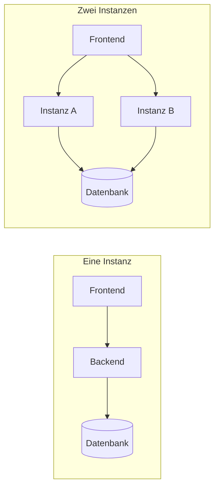

Mit einer Instanz steht der Dienst still, wenn das Backend ausfällt oder neu startet. Mit zwei
antwortet die andere Instanz weiter, und ein Update tauscht die Instanzen nacheinander aus.

Was man davon hat:

- **Ausfallsicherheit:** Fällt eine Instanz aus, beantworten die übrigen die Anfragen weiter.
- **Update ohne Ausfall:** Eine neue Version wird Instanz für Instanz eingespielt, soweit sie die
  laufende neben sich zulässt; OPAA bleibt dabei erreichbar ([Update ohne Ausfall](#update-ohne-ausfall)).
- **Mehr Arbeit gleichzeitig:** Indexierungsläufe und Uploads verteilen sich auf mehr Prozesse.

Was es bewusst nicht ist:

- **Kein automatisches Skalieren.** Die Zahl der Instanzen legt der Betrieb fest; sie ändert sich
  nicht von selbst nach Last.
- **Kein Aktiv/Passiv.** Es gibt keine Reserve-Instanz, die nur im Notfall einspringt. Alle
  Instanzen arbeiten gleichzeitig; eine Reserve müsste beim Umschalten dieselben Aufgaben lösen,
  nur seltener erprobt.
- **Keine Pflicht.** Eine Instanz bleibt die Vorgabe beider Betriebswege. Auch sie trägt sich ins
  [Instanzregister](#das-instanzregister) ein und prüft ihren Konfigurationsabdruck. Bemerkbar wird
  das nur nach einem harten Abbruch: Startet sie danach mit einem geänderten Wert des Abdrucks oder
  als neue Version, verweigert sie den Start, bis die Frist der abgebrochenen Instanz abgelaufen ist;
  danach gelingt der nächste Startversuch.

Eine Person ist an keine Instanz gebunden. Anmeldung und Sitzung stecken in Tokens und Cookies,
nicht im Speicher einer Instanz; gespeicherte Chats lesen ihren Verlauf auf jeder Instanz aus der
Datenbank.

| | Eine Instanz | Mehrere Instanzen |
|---|---|---|
| Vorgabe | Compose-Stapel und Helm-Chart | `docker-compose.multi.yml` bzw. `backend.replicas` ab 2 |
| Schemaänderung | beim Start der Instanz | in einem eigenen Migrationsschritt vor den Instanzen |
| Aktualisierung | kurze Unterbrechung: die alte Instanz endet, bevor die neue startet | ohne Ausfall, eine Instanz nach der anderen, soweit das [Versionsfenster](#gleiche-konfiguration-der-konfigurationsabdruck) es zulässt |
| Ausfall einer Instanz | Dienst steht bis zum Neustart | die übrigen Instanzen antworten weiter |
| Originalablage | Verzeichnis, Netzlaufwerk oder Objektspeicher | Objektspeicher oder eine Ablage, die jede Instanz beschreiben kann |

## Das Gesamtbild

Vor den Backend-Instanzen steht das Frontend. Es nimmt alle Anfragen an und reicht sie an die
Instanzen weiter. Datenbank, Originalablage und die Umsysteme teilen sich alle Instanzen.

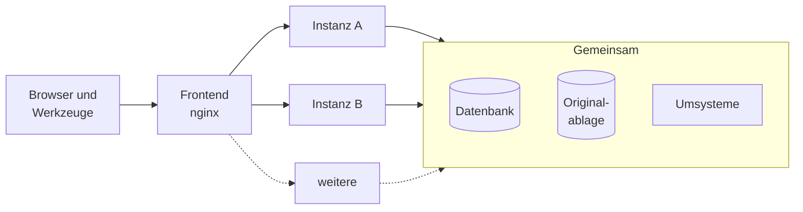

| Baustein | Rolle mit mehreren Instanzen |
|---|---|
| Frontend | hält keinen Zustand und darf selbst mehrfach laufen; verteilt die Anfragen auf die Instanzen |
| Backend-Instanzen | gleichrangig und gleich eingestellt; jede hat ihr eigenes Arbeitsverzeichnis `/tmp` |
| Datenbank | hält alle Daten und ist zugleich der einzige Ort, an dem sich die Instanzen abstimmen |
| Originalablage | muss von jeder Instanz erreichbar sein: ein Objektspeicher oder eine Ablage, die alle Instanzen beschreiben können ([Originalablage](originalablage.md)) |
| Umsysteme | Identitätsanbieter, Mailserver, Quellen und Modelle; jede Instanz spricht sie selbst an |

Das Frontend reicht eine Anfrage an eine Instanz weiter. Nimmt diese keine Verbindung an, etwa weil
sie gerade gestoppt wird, versucht es die Anfrage erneut, bei einer anderen Instanz. Was danach
geschieht, hängt von der Art der Anfrage ab:

- **Anlegen, Fragen, Ändern und Löschen** (`POST`, `PATCH`, `PUT`, `DELETE`), etwa eine Frage im
  Chat, schickt das Frontend nach dem Senden nie ein zweites Mal los. Reißt die Verbindung ab oder
  bleibt die Antwort länger aus als `OPAA_BACKEND_READ_TIMEOUT`, endet die Anfrage mit einem Fehler,
  auch wenn die Instanz sie noch ausgeführt hat.
- **Lesende Anfragen** (`GET`, `HEAD`, `OPTIONS`) kann das Frontend unter Docker Compose in diesen
  Fällen an die andere Instanz geben. Unter Kubernetes erreicht das Frontend die Pods über einen Service und gibt
  eine Anfrage, die einen Pod erreicht hat, nicht weiter.

## Abstimmung nur über die Datenbank

Mehrere Instanzen müssen sich absprechen: Wer startet den nächtlichen Lauf? Wer verschickt die
Erinnerungsmail? Wie erfährt Instanz B, dass auf Instanz A gerade ein Recht entzogen wurde? OPAA
löst das ohne zusätzliche Infrastruktur, ohne Nachrichtenvermittler und ohne Zwischenspeicher-Dienst.
Alles läuft über die Datenbank, die ohnehin da ist, gesichert und überwacht wird.

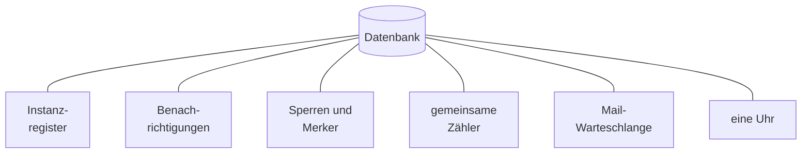

Jedes dieser Werkzeuge hat einen eigenen Abschnitt in diesem Kapitel. Was sie zusammen lösen:

| Ohne Abstimmung … | … mit Abstimmung über die Datenbank |
|---|---|
| Ein Recht wird auf Instanz A entzogen; Instanz B kennt das noch nicht. | Die Änderung meldet sich über die Datenbank, und jede Instanz verwirft ihren Zwischenspeicher ([Änderungen erreichen jede Instanz](#änderungen-erreichen-jede-instanz)). |
| Der nächtliche Lauf startet auf jeder Instanz, Erinnerungsmails gehen doppelt hinaus. | Eine Sperre lässt nur eine Instanz laufen, und jede Mail steht hinter einem Vermerk „schon erledigt“ ([Geplante Läufe laufen genau einmal](#geplante-läufe-laufen-genau-einmal)). |
| Eine neu gestartete Instanz hält die Läufe der anderen für liegengeblieben und bricht sie ab. | Aufgegeben wird nur, was einer Instanz gehört, die nachweislich nicht mehr läuft ([Wenn eine Instanz ausfällt](#wenn-eine-instanz-ausfällt)). |
| Mails warten im Speicher und gehen bei einem Neustart verloren. | Mails stehen in der Datenbank, bis sie zugestellt sind, mit einer Ausnahme ([Mails ohne Verlust](#mails-ohne-verlust)). |
| Zwei Rechner haben leicht verschiedene Uhrzeiten. | Für alles, was Instanzen miteinander vergleichen, zählt die Uhr der Datenbank ([Eine Uhr für alle](#eine-uhr-für-alle)). |
| Jede Instanz zählt ihre eigenen Anfragen; zwei Instanzen lassen doppelt so viele durch. | Die Gesamtgrenzen zählt die Datenbank für alle ([Grenzen und Budgets](#grenzen-und-budgets)). |

## Das Instanzregister

Jede Instanz trägt sich beim Start in ein Register in der Datenbank ein: mit einer Kennung, die bei
jedem Start neu entsteht, dem Namen des Rechners oder Pods, der Version und ihrem
[Konfigurationsabdruck](#gleiche-konfiguration-der-konfigurationsabdruck). Danach meldet sie sich in
kurzen Abständen mit einem Lebenszeichen, dem Herzschlag (`OPAA_INSTANCE_HEARTBEAT_INTERVAL`).

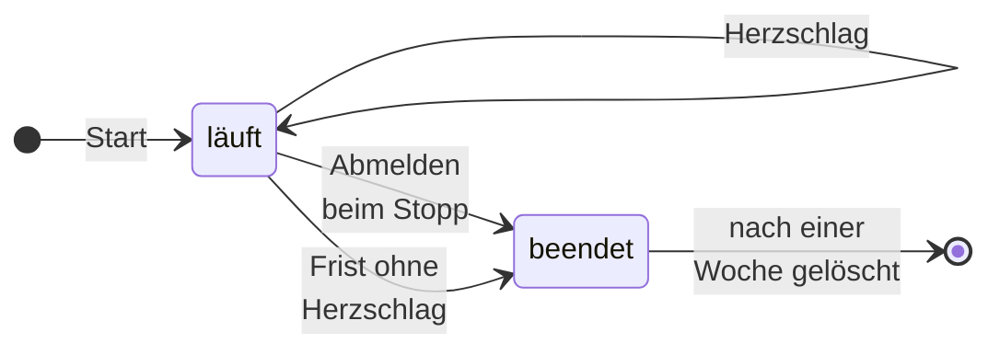

Eine Instanz **läuft**, solange ihr letzter Herzschlag jünger ist als die Frist
`OPAA_INSTANCE_DEAD_AFTER`. Ob das zutrifft, entscheidet die Uhr der Datenbank, nicht die des
Rechners. Eine Instanz, die geordnet stoppt, meldet sich ab und gilt sofort als beendet; eine
abgestürzte erst nach Ablauf der Frist.

- **Die Frist ist bewusst großzügig.** Sie beträgt mindestens das Vierfache des Abstands, sonst
  bricht der Start ab. So übersteht eine Instanz eine kurze Pause der Java-Laufzeit oder einen
  kurzen Aussetzer der Datenbank, ohne für beendet gehalten zu werden; eine wirklich ausgefallene
  gibt ihre Arbeit trotzdem nach wenigen Minuten frei.
- **Selbstschutz.** Kann eine Instanz ihren eigenen Herzschlag länger als die Frist nicht schreiben,
  geht sie davon aus, dass eine andere ihre Arbeit übernommen hat: Ihre Läufe beenden sich selbst.
  Das Protokoll meldet das als Fehler; die Instanz kommt mit einem Neustart wieder dazu.
- **Nachvollziehbar.** Beendete Einträge bleiben eine Woche im Register. Das Protokoll nennt beim
  Start die eigene Kennung und alle laufenden Instanzen; die
  [Auskunft über die Datenerhebung](nachvollziehbarkeit.md) nennt die laufenden Instanzen ebenfalls.

Das Register beantwortet zwei Fragen: „Lebt die Instanz noch, der dieser Lauf gehört?“
([Wenn eine Instanz ausfällt](#wenn-eine-instanz-ausfällt)) und „Ist eine neue Instanz genauso
eingestellt wie die laufenden?“ (der nächste Abschnitt).

## Gleiche Konfiguration: der Konfigurationsabdruck

Zwei Instanzen mit verschiedenen Einstellungen führten zu rätselhaften Fehlern, je nachdem, welche
Instanz eine Anfrage trifft. Ein abweichender Signaturschlüssel ließe etwa jede zweite Anfrage als
„nicht angemeldet“ scheitern, eine abweichende Löschfrist löschte nach der kürzeren. Deshalb vergleicht
eine Instanz beim Start einen Abdruck ihrer wichtigen Einstellungen mit dem der laufenden Instanzen.

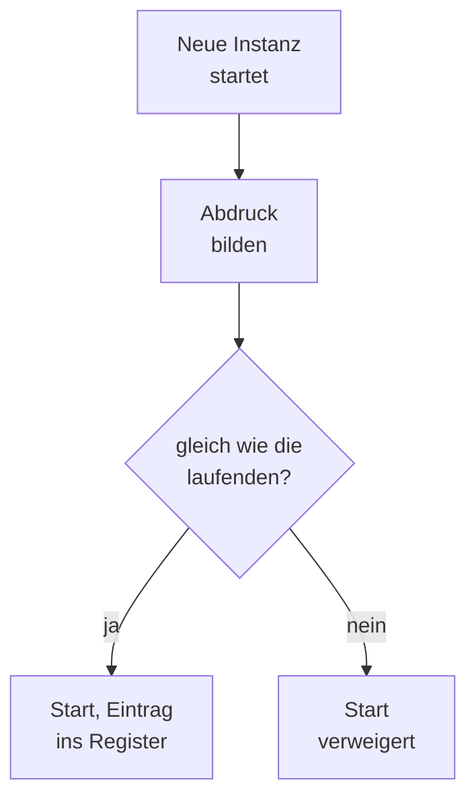

Gespeichert wird je Wert nur ein Prüfwert, nie der Wert selbst. Weicht ein Wert ab, **verweigert die
neue Instanz den Start** und nennt im Protokoll die abweichenden Schlüssel, bei einem Geheimnis nur
den Namen. Die laufenden Instanzen arbeiten ungestört weiter. Prüfen kann immer nur eine Instanz zur
Zeit; zwei, die gleichzeitig starten, prüfen nacheinander.

**Gleich sein muss** auf allen Instanzen:

- jede Einstellung, die auf Daten wirkt, etwa Fristen und Löschregeln
- die Geheimnisse `OPAA_AUTH_JWT_SECRET`, `OPAA_CREDENTIALS_ENCRYPTION_KEY` und
  `OPAA_SETTINGS_ENCRYPTION_KEY`
- Modell, Adresse und Dimension der Einbettung und die Teilung in Chunks
- das Anmeldeprofil, `OPAA_DB_SCHEMA` und die Originalablage
- die Freigabelisten der Zielprüfung, die vertrauten Proxys und `OPAA_PUBLIC_BASE_URL`
- die Funktionsschalter, die Zeitzone und `OPAA_INSTANCE_DEAD_AFTER`

**Je Instanz abweichen dürfen** technische Werte ohne Wirkung auf Daten: Timeouts, die Größe von
Connection- und Thread-Pools, der Abstand des Herzschlags.

**Die Version** darf nur während eines Updates abweichen, und nur innerhalb des
**Versionsfensters**: Jede Version nennt die älteste Version, neben der sie laufen darf. Ein Release
trägt dort sein unmittelbar voriges Release ein, an einer Versionsgrenze ohne Rolling Update nur
sich selbst; die Notizen des Release sagen es. Eine Instanz außerhalb des Fensters startet nicht, ob
sie älter ist oder neuer. **Bis zum ersten Release mit dieser Zusage läuft nur dieselbe Version
nebeneinander.** Images des Stands `main` tragen alle dieselbe Entwicklungsversion: Zwischen ihnen
prüft das Fenster nichts, sie gelten als gleich. Ob sie nebeneinander laufen, sichert nur ihr
Abstand, nicht OPAA.

Einen Wert des Abdrucks ändert deshalb **nur ein Neustart aller Instanzen**: erst alle beenden, dann
mit dem neuen Wert starten. Ein Update, das zugleich einen solchen Wert ändert, bleibt an der ersten
neuen Instanz stehen, ohne dass der Dienst ausfällt. Wurde eine Instanz hart beendet, etwa mit
`SIGKILL`, gilt sie erst nach `OPAA_INSTANCE_DEAD_AFTER` als beendet; bis dahin verweigert eine
Instanz mit geändertem Wert den Start, und der nächste Startversuch danach gelingt.

## Änderungen erreichen jede Instanz

Jede Instanz hält Zwischenspeicher, etwa für Rechte, Gruppenmitgliedschaften oder Anmeldeanbieter.
Ändert sich etwas davon, müssen alle Instanzen ihren Zwischenspeicher verwerfen, nicht nur die, auf
der die Änderung angenommen wurde. Dafür benachrichtigt die Datenbank jede Instanz.

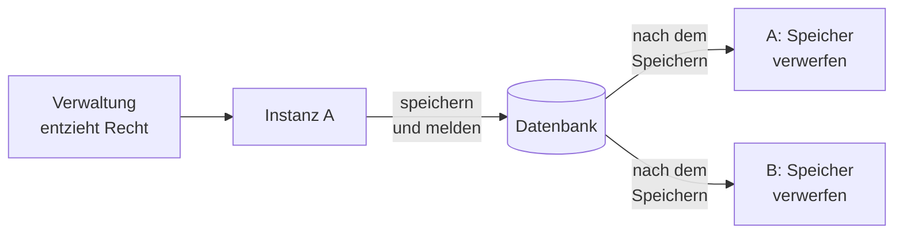

Die Meldung geht erst hinaus, wenn die Änderung gespeichert ist; wird sie verworfen, geht keine
Meldung hinaus. Jede Instanz hält dafür eine eigene, dauerhafte Verbindung zur Datenbank, auf der sie
mithört. Die Meldung enthält keine Daten: Sie nennt nur den Zwischenspeicher, keine Person und keinen
Eintrag, und der Empfänger verwirft ihn ganz. Eine Änderung an Rechten, Anmeldeanbietern oder
Sitzungen gilt so auf jeder Instanz mit deren nächster Anfrage.

- **Wenn die Verbindung reißt:** Jede Instanz prüft ihre Hörverbindung alle fünf Sekunden. Ist sie
  unterbrochen, verwirft die Instanz vorsorglich alle betroffenen Zwischenspeicher und liest direkt
  aus der Datenbank, bis die Verbindung wieder steht. Meldungen aus der Zeit des Abrisses gehen
  verloren; ein Zwischenspeicher kann deshalb veraltet sein, bis die Instanz den Abriss bemerkt, in
  der Regel binnen Sekunden.
- **Abmelden und Sperren wirken überall.** Bei der Abmeldung einer lokalen Sitzung kommt ihr Token
  auf eine Sperrliste in der Datenbank, die jede Instanz bei jeder Anfrage liest. Einen Passwortwechsel,
  eine Sperre, das Zurücksetzen durch die Verwaltung, das Ausschalten der lokalen Konten und ein
  erkannter wiederverwendeter Token beantwortet OPAA, indem es einen Zähler am Konto hochzählt; ein
  Token mit altem Zählerstand gilt auf jeder Instanz als ungültig. Beides braucht keinen Vergleich von
  Uhrzeiten zwischen Rechnern.
- **Voraussetzung an die Datenbank:** Die Hörverbindung braucht eine direkte Verbindung oder einen
  Verbindungs-Proxy im Sitzungsmodus; im Transaktionsmodus kommt sie nicht zustande
  ([Voraussetzungen einer eigenen PostgreSQL](datenbank.md#voraussetzungen-einer-eigenen-postgresql)).

## Geplante Läufe laufen genau einmal

OPAA hat zeitgesteuerte Aufgaben: Indexierung nach Zeitplan, Verzeichnisabgleich, Lösch- und
Aufbewahrungsläufe, Erinnerungen, die Prüfung der Modellrollen. Jede Instanz kennt dieselben
Termine, also wollen alle gleichzeitig loslegen. Zwei Mechanismen verhindern doppelte Arbeit.

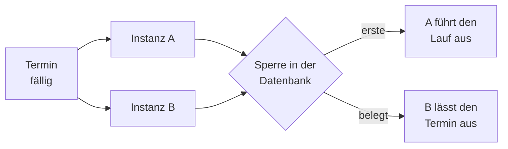

1. **Die Sperre.** Vor dem Start nimmt ein Lauf eine Sperre in der Datenbank, gemessen mit deren
   Uhr. Wer sie zuerst bekommt, läuft; wer sie belegt findet, lässt diesen Termin aus. Die Sperre
   hält länger als jeder Uhrenversatz zwischen den Instanzen und kürzer als der Abstand bis zum
   nächsten Termin. Fällt eine Instanz mitten im Lauf aus, gibt die Sperre den Lauf spätestens nach
   seiner Höchstdauer wieder frei.
2. **Der Merker.** Die Sperre allein trägt die Zusage nicht. Was ein Lauf nach außen bewirkt, also
   Mails, Benachrichtigungen und Einträge in Protokoll und Rechte- oder Sichtbarkeitshistorie, steht
   zusätzlich hinter einem Vermerk in der Datenbank, den nur einer setzen kann. Es entsteht deshalb
   auch dann nur einmal, wenn ein Lauf länger dauert als seine Sperre.

Auch den Termin einer Wissensbibliothek verbucht die Datenbank: Eine Bibliothek startet ihren
geplanten Lauf nur einmal, gleich wie viele Instanzen gleichzeitig nachsehen
([Zeitplan](../arbeitsmittel/wissensbibliotheken/README.md#42-zeitplan)).

## Wenn eine Instanz ausfällt

Jeder laufende Indexierungslauf, jeder Upload in Verarbeitung und die Neueinbettung nach einem
Modellwechsel gehören der Instanz, die sie angenommen hat. Fällt diese Instanz aus, muss ihre Arbeit
freigegeben werden, aber nur dann: Eine andere Instanz, die noch arbeitet, darf nie gestört werden.

- **Geprüft wird minütlich und beim Start**, ob die Besitzerin einer laufenden Arbeit noch lebt.
  Aufgegeben wird nur die Arbeit einer Instanz, die laut Register beendet ist; nie, weil irgendwo
  eine Instanz neu startet. Hat sich die Instanz geordnet abgemeldet, etwa bei einem Update, geht
  das binnen einer Minute; nach einem Absturz erst, wenn ihre Frist abgelaufen ist.
- **Ein totgeglaubter Lauf richtet keinen Schaden an.** Arbeitet eine Instanz doch noch, schreibt
  sie ihren Fortschritt nur, solange der Lauf noch läuft und noch ihr gehört. Ist er aufgegeben,
  merkt sie das beim nächsten Schritt und hört auf, ohne etwas aus dem Bestand zu entfernen.
- **Die Neueinbettung übernimmt eine andere Instanz**, Läufe und Uploads werden aufgegeben und
  lassen sich wiederholen ([Wiederanlauf nach Störungen](../arbeitsmittel/wissensbibliotheken/README.md#45-wiederanlauf-nach-störungen)).
- **Arbeitsdateien** liegen je Instanz in einem eigenen Unterverzeichnis; ein Aufräumlauf entfernt
  die eigenen und die beendeter Instanzen.

Ein geordneter Stopp bricht laufende Indexierungen und Uploads der stoppenden Instanz sofort ab,
lässt aber die Anfragen von Personen zu Ende laufen
([Graceful Shutdown](images-und-laufzeit.md#graceful-shutdown)).

## Eine Uhr für alle

Zwei Rechner gehen trotz Zeitabgleich um Millisekunden bis Sekunden auseinander. Für alles, was eine
Instanz schreibt und eine andere liest und vergleicht, nimmt OPAA deshalb die Uhr der Datenbank.

| Uhr | Wofür |
|---|---|
| Uhr der Datenbank | Herzschlag und Frist, Termine und Sperren der geplanten Läufe, die Mail-Warteschlange, die Fenster der Gesamtgrenzen, Zeitpunkte im Nachweisprotokoll, die Grenzen der Rechtehistorie |
| Uhr der Instanz | was nur diese Instanz vergleicht: eigene Timeouts, die Gültigkeit ihrer Zwischenspeicher, die Fenster der Grenzen je Instanz, der Ablauf von Tokens, die Zeitangaben im Protokoll |
| Zeitzone | Tages-, Monats- und Jahresgrenzen, die Uhrzeiten der Termine und Datumsangaben in Mails; sie gehört zum Konfigurationsabdruck und ist auf allen Instanzen gleich ([Zeitzone](README.md#zeitzone)) |

## Mails ohne Verlust

Eine Mail, auf deren Versand niemand in derselben Anfrage wartet, etwa eine Einladung, ein
Rücksetzlink oder eine Erinnerung, legt OPAA zusammen mit dem Vorgang, den sie meldet, in eine
Warteschlange in der Datenbank. Wird der Vorgang verworfen, verschwindet auch die Mail.

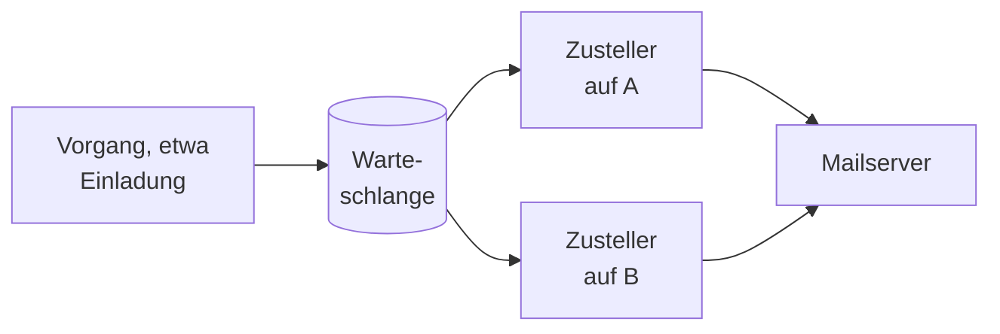

Jede Instanz stellt zu, eine einzelne Mail aber immer nur eine zur selben Zeit. Stoppt oder stürzt
eine Instanz während der Zustellung, übernimmt eine andere die Mail. Die Zusage ist deshalb **jede
Mail kommt mindestens einmal an**: Bricht eine Instanz genau zwischen der Annahme durch den
Mailserver und dem Vermerk ab, kann eine Mail ein zweites Mal ankommen, erkennbar an derselben
Kennung der Nachricht.

Eine Ausnahme sind „Passwort vergessen“ und die Selbstregistrierung: Ihre Bearbeitung samt Mail
wartet zunächst im Speicher der Instanz, nur Millisekunden lang. Stoppt die Instanz genau dann, geht
die Anfrage verloren, und wer keine Mail bekommt, fragt erneut (Betriebsübersicht, „Sanftes
Herunterfahren“). Wiederholungen, Verschlüsselung und die Mails, die OPAA sofort versendet,
beschreibt [E-Mail-Versand](e-mail.md#zustellung-über-die-warteschlange).

## Grenzen und Budgets

OPAA begrenzt an vielen Stellen, wie viel in einem Zeitfenster oder gleichzeitig geschehen darf, etwa
Fragen je Adresse und Konto, gleichzeitige Einbettungen oder Transkriptionen. Mit mehreren Instanzen
stellt sich für jede Grenze die Frage: Gilt sie für die ganze Installation oder je Instanz?

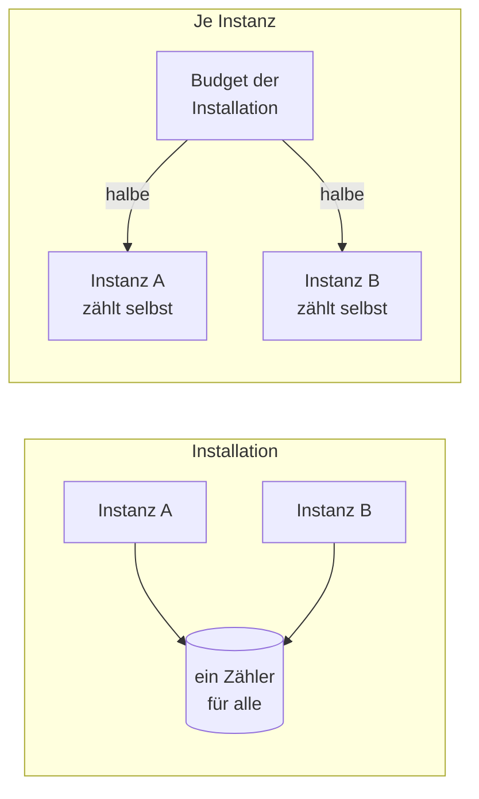

**Für die Installation** zählt die Datenbank, gleich welche Instanz eine Anfrage erreicht: die
Gesamtgrenzen der Rate-Limits (`OPAA_RATE_LIMIT_*_GLOBAL_MAX_REQUESTS`, auch die der lokalen
Anmeldung) und der Abflussalarm der [externen KI-Werkzeuge](../spaces/fremdzugaenge.md). Zwei Instanzen lassen
zusammen also genauso viele Anfragen durch wie eine; den Alarm meldet genau eine von ihnen.

**Je Instanz** zählen alle übrigen Grenzen. Ihr Wert ist deshalb **die Grenze der Installation
geteilt durch die Zahl der Instanzen**: Sollen alle zusammen höchstens sechs Einbettungen
gleichzeitig ausführen, erhält bei zwei Instanzen jede die Hälfte.

| Grenze | Gilt | Was zu tun ist |
|---|---|---|
| Gesamtgrenzen der Rate-Limits (`…_GLOBAL_MAX_REQUESTS`), Abflussalarm | für die Installation | nichts |
| Rate-Limits je Client-Adresse und je E-Mail-Adresse, auch die der lokalen Anmeldung (`…_MAX_REQUESTS`, `…_MAX_REQUESTS_PER_ADDRESS`) | je Instanz | Wert der Installation durch die Zahl der Instanzen teilen |
| Rate-Limits je Konto (`…_MAX_REQUESTS_PER_ACCOUNT`), auch die je Zugangstoken und je Person über alle ihre Tokens | je Instanz | ebenso teilen |
| gleichzeitige Einbettungen (`OPAA_INDEXING_EMBEDDING_CONCURRENCY`), Transkriptionen (`OPAA_TRANSCRIPTION_MAX_CONCURRENT`), Nachextraktionen von Anhängen (`OPAA_DOCUMENTS_ATTACHMENT_EXTRACTION_MAX_CONCURRENT`) | je Instanz | ebenso teilen |
| Stundenkontingent je Zugangstoken | je Instanz | nichts: Die Einstellung der Oberfläche bleibt die Grenze der Installation, jede Instanz gewährt davon ihren Anteil, geteilt durch die Zahl der laufenden Instanzen im Register |
| Pools für Läufe, Uploads, Chat-Titel und Gesprächsnotizen | je Instanz | nicht teilen: Mehr Instanzen sollen mehr Arbeit tragen, dafür gibt es sie |

Die Modellaufrufe der Metadatenextraktion folgen den Pools der Läufe und Uploads und wachsen ebenso
mit jeder Instanz. Warum es neben der Grenze je Adresse eine je Konto gibt und wie Zugangstokens
gezählt werden, steht unter [Suche](../spaces/suche.md#101-ratenbegrenzung).

Unter Docker Compose trägt man den geteilten Wert selbst in `.env.docker` ein; der Helm-Chart rechnet
ihn aus dem Budget der Installation (`backend.installationBudgets`). Ändert sich die Zahl der
Instanzen, ändern sich die geteilten Werte mit; unter Compose sind sie neu einzutragen.

**Anzeigen** der Verwaltung sind auf jeder Instanz gleich: der Zustand von Reranking und
Spracheingabe, die Erreichbarkeit von Chat- und Einbettungsmodell auf der Seite „Suche &
Indexierung“, was ein Bestands- oder Nachlauf zuletzt übersprungen hat, die geschätzte Dauer einer
Neueinbettung und der Sendestatus der Mail (`/actuator/health/mail`). Die Instanz, die einen Endpunkt
prüft oder aufruft, legt ihr Ergebnis in der Datenbank ab; dieselbe Frage wird deshalb auf jeder
Instanz gleich umsortiert oder nicht. **Je Instanz** bleiben der Status eines Anmeldeanbieters in der
Anbieterverwaltung, den die Oberfläche als „auf dieser Instanz“ kennzeichnet, und die Metriken unter
`/actuator/prometheus`, etwa die Zahl laufender Gespräche: Prometheus fragt jede Instanz ab.

## Update ohne Ausfall

Das ist der Hauptgrund für mehrere Instanzen. Statt alles anzuhalten, tauscht man die Instanzen
nacheinander aus. Für kurze Zeit laufen dabei alte und neue Version gleichzeitig gegen dieselbe
Datenbank.

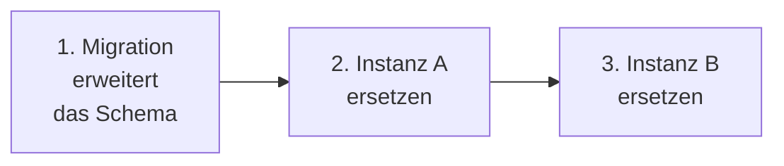

1. **Migration zuerst.** Ein eigener Schritt bringt das Schema auf den Stand der neuen Version und
   endet; die Instanzen selbst migrieren nicht. Die alten Instanzen arbeiten weiter, weil die
   Migration nur erweitert. Scheitert sie, hört man hier auf: Die alten Instanzen laufen unverändert.
2. **Dann eine Instanz nach der anderen.** Eine neue Instanz startet, und die nächste alte endet erst,
   wenn die neue bereit ist. Laufende Anfragen der stoppenden Instanz enden geordnet; neue Anfragen
   gehen an die andere.

Das Frontend ersetzt unter Docker Compose ein eigener, letzter Schritt; unter Kubernetes tauscht
`helm upgrade` es gleichzeitig mit den Backend-Pods aus.

So geht ein Update nur innerhalb des Versionsfensters. Lässt die neue Version die laufende nicht
neben sich zu, verweigert die erste neue Instanz den Start, und die alten antworten weiter; dann
werden alle Instanzen angehalten wie an einer Versionsgrenze (unten). Bis zum ersten Release, das
seine Vorgängerversion zulässt, gilt das für jeden Wechsel zwischen Releases.

Die Befehle stehen unter [Docker Compose](docker-compose.md#update-ohne-ausfall) und
[Kubernetes](kubernetes.md#ablauf-mit-mehreren-backend-pods).

**Erweitern, dann aufräumen.** Während des Wechsels muss die alte Version mit dem neuen Schema
zurechtkommen. Deshalb verteilt sich jede Schemaänderung, die die Vorgängerversion stören würde, auf
zwei Releases:

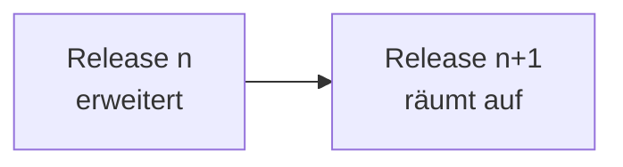

Release n fügt nur hinzu: neue Tabellen und Spalten, zusätzliche erlaubte Werte; alte und neue
Version kommen mit dem erweiterten Schema zurecht. Erst Release n+1 entfernt, benennt um oder
verschärft. Lässt sich ein Bruch nicht vermeiden, ist das Release eine **Versionsgrenze ohne Rolling
Update**, und seine Notizen sagen das. Dann werden alle Instanzen angehalten, die Datenbank migriert
und die Instanzen neu gestartet, mit kurzer Unterbrechung wie bei einer Instanz.

**Rückweg.** Lässt die neue Version die vorige in ihrem Versionsfenster zu, geht es ohne
Rücksicherung zurück: Das Schema wurde nur erweitert, die vorige Version läuft darauf und startet
auch neben Instanzen der neuen, also auch dann, wenn schon alle Instanzen ersetzt sind. Zeigt die
vorige Version danach Fehler, bleibt die Sicherung von vor dem Update der Rückfall. Bis zum ersten
Release mit dieser Zusage und über eine Versionsgrenze hinweg führt der Rückweg nur über diese
Sicherung.

## Docker Compose und Kubernetes

Beide Betriebswege bieten mehrere Instanzen an, jeweils nur unter ihren Voraussetzungen. Auf beiden
bleibt eine Instanz die Vorgabe.

| | Docker Compose | Kubernetes |
|---|---|---|
| Einschalten | `docker-compose.multi.yml` neben `docker-compose.yml`, bei jedem Befehl | `backend.replicas` größer als 1 |
| Rechner | alle Instanzen auf einem Rechner | Pods auf beliebigen Knoten; über Knoten oder Zonen verteilt nur mit `backend.topologySpreadConstraints` oder einer Anti-Affinität |
| Migration | Dienst `backend-migrate`; die Instanzen starten erst danach | ein Job; die Pods warten, bis die Migration durch ist |
| Update | von Hand in der Reihenfolge oben, das Frontend zuletzt | `helm upgrade` tauscht die Backend-Pods selbst nacheinander aus, das Frontend gleichzeitig |
| Originale | Objektspeicher empfohlen; das gemeinsame Verzeichnis genügt, weil alles auf einem Rechner läuft | Objektspeicher oder ein Volume, das alle Pods beschreiben können; sonst verweigert der Chart |
| Grenzen je Instanz | geteilten Wert in `.env.docker` eintragen | der Chart teilt `backend.installationBudgets` auf die Pods |
| Nicht verwenden | `docker compose --scale` | automatisches Skalieren des Backends |

Mehr Instanzen brauchen mehr Datenbankverbindungen: Jede Instanz hält ihren Connection Pool und dazu
die Hörverbindung für die Benachrichtigungen, und während eines Updates läuft kurz eine Instanz mehr.
Die Rechnung steht unter [Verbindungen bei mehreren Instanzen](datenbank.md#verbindungen-bei-mehreren-instanzen).

## Was man wissen sollte

| Eigenheit | Was das praktisch heißt |
|---|---|
| Gespräche ohne gespeicherten Chat | Ihr Verlauf liegt nur auf der Instanz, die sie führt. Beantwortet eine andere Instanz die nächste Frage, fehlt ihr der bisherige Verlauf. Gespeicherte Chats lesen ihn auf jeder Instanz aus der Datenbank |
| Mail im Ausnahmefall doppelt | Bricht eine Instanz genau während der Zustellung ab, kann eine Mail zweimal ankommen. Verloren gehen kann nur eine Anfrage „Passwort vergessen“ oder eine Selbstregistrierung, die beim Stopp noch im Speicher wartet |
| Kurz veralteter Zwischenspeicher | Reißt die Hörverbindung, kann ein Zwischenspeicher veraltet sein, bis die Instanz den Abriss bemerkt, in der Regel binnen Sekunden; danach verwirft sie ihn ganz |
| Grenzen je Instanz sind eine Rechnung | Sie gelten über „Grenze der Installation geteilt durch die Zahl der Instanzen“, nicht durch eine gemeinsame Zählung. Verteilen sich die Anfragen ungleich, greift die Grenze auf einer Instanz früher |
| Konfiguration ändern | Werte des Konfigurationsabdrucks ändert nur ein Neustart aller Instanzen, kein Update im Wechsel |
| Schemaänderungen | Sie verteilen sich auf zwei Releases; ein unvermeidbarer Bruch wird als Versionsgrenze ohne Rolling Update angekündigt |
| Ein Frontend-Container unter Compose | Beim Austausch des Frontends lehnt der Port kurz Verbindungen ab, beantwortet aber keine Anfrage mit einem Fehler. Ein zweiter Frontend-Container braucht eine eigene feste Adresse und einen eigenen Eintrag unter den vertrauten Proxys |
| Fehler trotz ausgeführter Änderung | Bricht eine Instanz während einer Änderung oder Löschung ab oder antwortet sie nicht binnen `OPAA_BACKEND_READ_TIMEOUT`, meldet die Oberfläche einen Fehler, obwohl die Änderung ausgeführt sein kann. Das Frontend schickt sie keiner zweiten Instanz; vor einem neuen Versuch den Stand ansehen ([Das Gesamtbild](#das-gesamtbild)) |
| Versionsfenster | Bis zum ersten Release, das seine Vorgängerversion zulässt, laufen nur Stände derselben Version nebeneinander |

## Begriffe

| Begriff | Bedeutung |
|---|---|
| **Instanz** | ein laufender Backend-Prozess von OPAA; unter Kubernetes ein Pod, unter Compose ein Container |
| **Instanzregister** | das Verzeichnis in der Datenbank, in das sich jede Instanz einträgt und in dem sie sich regelmäßig meldet |
| **Herzschlag** | das regelmäßige Lebenszeichen einer Instanz im Register |
| **Konfigurationsabdruck** | die Prüfwerte der Einstellungen, die auf allen Instanzen gleich sein müssen; weicht einer ab, startet eine neue Instanz nicht |
| **Versionsfenster** | die Versionen, die während eines Updates nebeneinander laufen dürfen |
| **Sperre** | ein Eintrag in der Datenbank, der einen Termin eines geplanten Laufs auf eine Instanz beschränkt |
| **Merker** | ein Vermerk in der Datenbank, den nur einer setzen kann; er macht Mails und Protokolleinträge eines Laufs einmalig |
| **Rolling Update** | ein Update, bei dem die Instanzen nacheinander ersetzt werden |
| **Versionsgrenze ohne Rolling Update** | ein Release, für das alle Instanzen zugleich angehalten werden müssen |

## Konfiguration

Die Werte und Vorgaben stehen in der [Konfiguration](konfiguration.md).

| Parameter | Wirkung |
|---|---|
| `OPAA_INSTANCE_HEARTBEAT_INTERVAL` | Abstand des Herzschlags; darf je Instanz verschieden sein |
| `OPAA_INSTANCE_DEAD_AFTER` | Frist, nach der eine Instanz ohne Herzschlag als beendet gilt; Teil des Konfigurationsabdrucks |
| `OPAA_MODE` | `migrate` für den eigenen Migrationsschritt ([Migration als eigener Schritt](datenbank.md#migration-als-eigener-schritt)) |
| `SPRING_LIQUIBASE_ENABLED` | `false` lässt eine Instanz ohne Migration starten |
| `OPAA_DB_POOL_SIZE` | Verbindungen im Pool einer Instanz |
| `OPAA_SHUTDOWN_TIMEOUT` | Zeitfenster für laufende Anfragen beim Stopp |
| `TZ` | Zeitzone; Teil des Konfigurationsabdrucks |

## Weiterführende Kapitel

- [Docker Compose](docker-compose.md#mehrere-backend-instanzen) und
  [Kubernetes](kubernetes.md#mehrere-backend-instanzen) — mehrere Instanzen einrichten und
  aktualisieren
- [Datenbank](datenbank.md) — Migration als eigener Schritt, Verbindungen bei mehreren Instanzen
