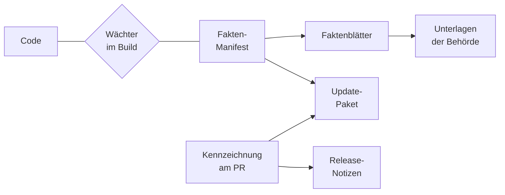

# Nachvollziehbarkeit

Vor einer Einführung und bei jedem Update fragen Datenschutz, Personalrat und
Informationssicherheit dasselbe: Welche Daten speichert OPAA, wie lange, wer sieht sie, was
verlässt die Installation und was ist voreingestellt? Dieses Kapitel beschreibt, wie OPAA diese
Fragen aus dem eigenen Code beantwortet, wo die Antworten liegen und was bei jeder Codeänderung
automatisch geprüft wird, damit sie stimmen. Es gehört zum Teil Betrieb des
[Handbuchs](../README.md).

> **Beispiel.** Die Datenschutzbeauftragte eines Landratsamts will vor dem Pilotbetrieb wissen,
> wohin eine Chatfrage geht und wie lange das Revisionsprotokoll aufbewahrt wird. Der Betrieb
> erzeugt die Faktenblätter zum eingesetzten Stand (siehe [Ein Faktenblatt selbst
> erzeugen](#ein-faktenblatt-selbst-erzeugen)) und gibt ihr `datenfluesse` und `fristen`. Sie
> sieht darin jedes Ziel mit den übermittelten Daten und jede Frist mit ihrem
> Konfigurationsschlüssel, ohne den Code lesen zu müssen. Ein späteres Update, das daran etwas
> ändert, steht in den Release-Notizen unter „Datenrelevante Änderungen“ und im Delta seines
> Update-Pakets.

## Was OPAA automatisch nachweist

Grundlage ist das **Fakten-Manifest**: eine Beschreibung im Code, welche Daten OPAA speichert,
welche Protokollereignisse es schreibt, was jede Rolle über andere sieht, welche Verbindungen nach
außen es aufbaut, welche Voreinstellungen, Standardmodelle und System-Prompts gelten und welche
Fristen laufen. Das Manifest wird wie Code geändert und geprüft. Aus ihm entstehen die
**Faktenblätter**, je Thema eines:

| Faktenblatt | Beantwortet |
|---|---|
| `datenkatalog` | Welche Daten liegen wo, mit welchem Zweck, Personenbezug, welcher Frist und Sichtbarkeit, und wie werden sie gelöscht? Über welche Angaben wird ein Eintrag einer Person zugeordnet, oder warum gehört er nicht zur Selbstauskunft? |
| `protokollereignisse` | Was hält das Revisionsprotokoll fest, bei welchem Anlass, und wer darf es lesen? |
| `rollensicht` | Was sieht jede Systemrolle und Fähigkeit über andere Personen? |
| `datenfluesse` | Was verlässt die Installation, wohin, wann, und lässt es sich abschalten? Mit einem Bild aller Verbindungen nach Gruppen |
| `voreinstellungen` | Welche Einstellungen wirken auf Daten, mit welchem Standardwert? Welche System-Prompts und KI-Funktionen gibt es? |
| `fristen` | Welche Aufbewahrungs- und Löschfristen gelten, mit welchem Konfigurationsschlüssel? |

Jedes Blatt beschreibt die **Voreinstellung einer Version**, nicht die Einstellungen einer
bestimmten Installation. Was eine Installation abweichend konfiguriert hat, zeigt ihre [Auskunft
über die Datenerhebung](#auskunft-über-die-datenerhebung-einer-installation). Was das Manifest
noch nicht beschreibt, steht im Blatt unter „Noch nicht erfasst“, statt zu fehlen.



Die Wächter halten Code und Manifest gleich; ein Pull Request mit roten Wächtern wird nicht
gemergt. Aus dem Manifest entstehen die Faktenblätter, die Unterlagen der Behörde verweisen auf
sie. Die Kennzeichnung am Pull Request führt jede
datenrelevante Änderung in die Release-Notizen. Aus beiden entsteht zu jedem Release das
Update-Paket.

## Pseudonymisierung im Protokoll

Das Revisionsprotokoll hält fest, wer was verwaltet hat, etwa Rechte vergeben, Einstellungen
geändert oder Konten gesperrt. Damit es sich nicht zur Kontrolle von Leistung und Verhalten eignet,
gilt:

- **Pseudonym ab dem Schreiben:** Im Protokoll steht statt eines Namens eine Kennung. Welche Person
  dazu gehört, liegt getrennt in einer eigenen Tabelle (`datenkatalog`, Eintrag `audit-pseudonyms`).
- **Keine Suche nach Personen:** Die Revision fragt nur nach Objekt, Zeitraum, Ereignisart oder
  Vorgang ab, jeweils für einen begrenzten Zeitraum
  ([Berechtigungen](../konten-und-rechte/berechtigungen.md#12-nachweis-rechtehistorie-und-stichtagsauskunft)).
- **Auflösen nur im Einzelfall:** Einer Person zugeordnet wird ein Pseudonym nur über eine
  anlassbezogene Klärung mit Begründung und Freigabe durch eine zweite Person
  ([Berechtigungen](../konten-und-rechte/berechtigungen.md#10-systemrollen-und-vollmachten)).
- **Löschen ohne Eingriff ins Protokoll:** Wird ein Konto gelöscht, entfällt die Zuordnung; das
  Protokoll bleibt unverändert und ist danach keiner Person mehr zuzuordnen
  ([Benutzerverwaltung](../konten-und-rechte/benutzerverwaltung.md#8-löschen-oder-sperren)).
  Ausnahme: Nennt eine anlassbezogene Klärung (Antrag oder Freigabe) die Person, bleibt die
  Zuordnung über diese Klärung bis zu deren Löschfrist bestehen
  ([Berechtigungen](../konten-und-rechte/berechtigungen.md#10-systemrollen-und-vollmachten)).

Pseudonymisierte Daten bleiben personenbezogen, solange die Zuordnung besteht. Sie gehören deshalb
in Verzeichnis, Löschkonzept und Auskunft der Behörde.

## Wo die Faktenblätter liegen

Die Faktenblätter sind nicht eingecheckt, sondern werden neu erzeugt:

- **Für ein Release** im [Update-Paket](#das-update-paket-eines-release) am GitHub-Release der
  Version, Verzeichnis `faktenblaetter/`. Die Blätter tragen die Version des Release.
- **Für den Entwicklungsstand `main`** bei jedem CI-Lauf auf `main`, als Artefakt
  `compliance-faktenblaetter` am letzten Lauf des Workflows „CI“: auf GitHub im Reiter „Actions“ den
  Lauf öffnen, Abschnitt „Artifacts“.

Beide enthalten die Blätter als Markdown und `faktenblaetter.json` mit allen Inhalten für Werkzeuge.

Jedes Blatt nennt in seinem Kopf, wofür es gilt: die OPAA-Version, den Commit, das
Erzeugungsdatum und `erzeugung: generiert`. Im Update-Paket ist das Erzeugungsdatum das Datum des
Commits, sodass ein erneut erzeugtes Paket gleich ausfällt. Die Blätter aus der CI auf `main` tragen
immer die Version `0.0.0-dev`; welchen Stand sie beschreiben, bestimmt der Commit. Unter dem Titel steht
„Fakten aus dem Code; rechtliche Bewertung bleibt bei der Behörde.“ Jeder Eintrag hat einen festen
Anker aus seiner Kennung, sodass eine Unterlage auf genau eine Zeile verweisen kann.

## Das Update-Paket eines Release

Jedes Release, auch ein Vorab-Release, trägt am GitHub-Release ein Update-Paket
`opaa-update-paket-<Version>.tar.gz` mit einer Prüfsummendatei. Es ist für die Stellen gedacht, die
ein Update verantworten, ohne den Code zu lesen:

| Teil | Inhalt |
|---|---|
| `LIESMICH.md` | Version, Commit, Vergleichsstand, Prüfbefehle |
| `delta/` | Was sich an den Fakten seit dem vorigen finalen Release geändert hat, je Änderung vorher und nachher, mit Stufenvorschlag (Bagatelle, Anzeige, Zustimmung) und dem Hinweis, ob Verzeichnis der Verarbeitungstätigkeiten, Datenschutz-Folgenabschätzung oder Sicherheitskonzept betroffen sind; dazu die als datenrelevant gekennzeichneten Änderungen, deren Wirkung nicht im Manifest steht |
| `betrieb/` | Was das Update für den Betrieb bedeutet: ob vorher etwas vorzubereiten ist, ob eine Neuindizierung (mit Dauerschätzung), ein Nachzug oder eine Neueinbettung ansteht, wie viele Schemaänderungen beim Start laufen, welche Ports und Ziele ausgehender Verbindungen neu sind; dazu die Kennzahlen der Suchqualität beider Versionen mit Messdatum. Jede Angabe nennt ihre Quelle; ein fehlender Messwert steht als „nicht gemessen“ da |
| `faktenblaetter/` | die Faktenblätter dieser Version |
| `lizenzen/` | die Lizenzübersicht der ausgelieferten Abhängigkeiten |
| `vorlagen/` | alle Vorlagen für Behörden dieser Version, nach Themen geordnet; ihre Verweise auf Faktenblätter führen auf die Blätter im Paket, Verweise auf weitere Dokumentation auf deren Stand in dieser Version |
| `update-vermerk.md` | Vorlage, in der die Behörde Bewertung je Stelle und Entscheidung festhält; ihre Verweise auf Faktenblätter führen auf die Blätter im Paket |
| `SHA256SUMS` | Prüfsummen aller Dateien |

Vor dem ersten finalen Release vergleicht das Paket mit dem „Stand ohne Fakten-Manifest“; im Delta
erscheint deshalb jeder Eintrag als neu. Stufen und Bezüge sind Vorschläge, die Bewertung trifft die Behörde.

Das Paket ist attestiert wie die Images. Die Provenance prüft:

```bash
gh release download v<Version> --repo criew/opaa --pattern 'opaa-update-paket-*'
gh attestation verify opaa-update-paket-<Version>.tar.gz --repo criew/opaa
```

Der Release-Lauf erzeugt das Paket nur, wenn der Wächter (siehe [Was bei jeder Änderung geprüft
wird](#was-bei-jeder-änderung-geprüft-wird)) besteht; sonst erscheint das Release nicht.

**Mehrere Versionen überspringen.** Das Delta im Paket vergleicht nur mit dem vorigen finalen
Release. Wer etwa von 0.12 auf 0.17 geht, erzeugt das Delta über den ganzen Sprung aus dem Quellcode
mit Tags:

```bash
# Delta, aus backend/
cd backend
./gradlew complianceDelta -PfromRef=v0.12.0 -PtoRef=v0.17.0
# Betriebsfolgen und Suchqualität für denselben Sprung, aus der Wurzel des Checkouts
cd ..
python3 .github/scripts/update_package.py operations --from v0.12.0 --to v0.17.0 \
  --out /tmp/betrieb --delta-json backend/build/compliance/delta/manifest-delta.json
```

Das Delta liegt unter `backend/build/compliance/delta/`, die Betriebsfolgen unter `/tmp/betrieb/`.
Die Vorbereitung aller übersprungenen Versionen steht dort zusammengefasst.

## Ein Faktenblatt selbst erzeugen

Wer den Quellcode der eingesetzten Version ausgecheckt hat, erzeugt die Blätter selbst. Gebraucht
wird nur das Java-Werkzeug des Backends, keine Datenbank:

```bash
# aus backend/
./gradlew complianceDocs -PopaaVersion=<X.Y.Z>
```

Die Blätter liegen danach unter `backend/build/compliance/faktenblaetter/`. Der Commit im Kopf
stammt aus dem ausgecheckten Stand, die Version aus der Angabe `-PopaaVersion`; ohne sie steht dort
`0.0.0-dev`.

## Auskunft über die Datenerhebung einer Installation

Die Faktenblätter beschreiben eine Version. Die **Auskunft über die Datenerhebung** beschreibt eine
laufende Installation: das Fakten-Manifest der eingesetzten Version, verbunden mit den Werten, die
diese Installation tatsächlich verwendet. Sie ist für Datenschutz und Personalrat gedacht, etwa vor
dem Rollout als Anlage einer Dienstvereinbarung oder jährlich als Nachweis, dass sich nichts
stillschweigend verschoben hat.

> **Beispiel.** Der Personalrat will wissen, ob die Dienststelle das Revisionsprotokoll länger als
> voreingestellt aufbewahrt und welche Quellen angebunden sind. Die Systemverwaltung ruft die
> Auskunft als Markdown ab. Unter „Abweichungen von der Voreinstellung“ steht die verlängerte Frist
> mit dem Zeitpunkt ihrer letzten Änderung, unter „Konnektortypen in Gebrauch“ jeder Konnektor, aus
> dem eine Bibliothek liest.

Abrufen darf sie nur die Systemverwaltung, mit dem Zugangstoken einer angemeldeten Sitzung:

```bash
# maschinenlesbar, als Eingang für Werkzeuge
curl -s -H "Authorization: Bearer <token>" \
  https://<host>/api/v1/admin/compliance/data-collection-disclosure > auskunft.json
# lesbar, für Datenschutz und Personalrat
curl -s -H "Authorization: Bearer <token>" \
  https://<host>/api/v1/admin/compliance/data-collection-disclosure/markdown > auskunft.md
```

Ein Konto ohne die Rolle erhält `403`. **Jeder Abruf steht im Revisionsprotokoll**, auch der
abgewiesene, mit dem Format, aber ohne den Inhalt der Auskunft. Die Ereignisart dafür führt das
Faktenblatt `protokollereignisse` wie jede andere.

Die Auskunft enthält:

| Teil | Inhalt |
|---|---|
| Kopf | OPAA-Version, Commit des Images und Zeitpunkt des Abrufs |
| Abweichungen von der Voreinstellung | jede Einstellung mit Datenwirkung, deren Wert in dieser Installation vom ausgelieferten abweicht |
| Einstellungen mit Datenwirkung | alle diese Einstellungen mit Voreinstellung, wirksamem Wert und, bei Fristen aus der Verwaltung, dem Zeitpunkt der letzten Änderung |
| Ausgehende Datenflüsse | jede Verbindung nach außen und ob sie eingeschaltet ist; „nur auf Handlung“, wo sie allein auf eine Aktion der Systemverwaltung hin entsteht. Ein Konnektor gilt als eingeschaltet, sobald eine geteilte Bibliothek aus ihm liest oder ein Zugang private Bibliotheken zulässt |
| Konnektortypen in Gebrauch | je Konnektor die Zahl der geteilten Bibliotheken der eigenen Organisation und der Zugänge; private Bibliotheken zählen nicht, damit sich keine einzelne erkennen lässt |
| Modellanbieter | Adresse und Modell jeder Modellrolle, bei Chat-Modellen jedes angelegte |
| Gespeicherte Daten und Protokoll | der Datenkatalog sowie die Beschreibung des Revisionsprotokolls: Ereignisarten mit Zweck, Felder mit Granularität, Zweck und Frist, die vorhandenen und die ausdrücklich nicht vorhandenen Abfragewege |

Die JSON-Fassung trägt das Manifest in derselben Form wie `faktenblaetter.json`; ein Werkzeug liest
beide gleich.

**Ohne Geheimnisse, Personen und Inhalte.** Ausgegeben wird nur der Wert einer Einstellung, die das
Manifest als datenwirksam führt; Schlüssel, Passwörter und Token gehören nie dazu. Adressen
erscheinen ohne Zugangsdaten, Abfrageteil und Anker. Namen von Personen, Protokollsätze und Inhalte
von Bibliotheken enthält die Auskunft nicht, Zählungen nur je Konnektortyp und ohne private
Bibliotheken.

## Was bei jeder Änderung geprüft wird

Kein Mensch muss daran denken, die Fakten nachzutragen: Mehrere Prüfungen schlagen fehl, wenn
Code und Beschreibung auseinanderlaufen.

| Prüfung | Wann | Was sie erzwingt |
|---|---|---|
| **Wächter im Backend-Build** | bei jedem Build, in der CI jedes Pull Requests, der Backend-Code berührt, und auf `main` | Zu jeder Tabelle und Spalte der Datenbank, jedem Protokollereignis, jeder Rolle und Fähigkeit, jedem System-Prompt, jeder Verbindung nach außen und jeder Einstellung mit Datenwirkung gibt es einen Eintrag im Manifest, und umgekehrt. Ein geänderter Prompt-Text oder Standardwert scheitert, bis der Eintrag bewusst nachgezogen ist. Auch die Voreinstellungen des Helm-Charts werden gegen das Manifest gehalten |
| **Kennzeichnung `data-impact`** | an jedem Pull Request (Prüfung „Datenwirkung“) | Die Beschreibung jedes Pull Requests fragt ab, ob er personenbezogene Daten, Sichtbarkeit, Auswertungen, Fristen, Datenflüsse, Voreinstellungen, Standardmodelle, System-Prompts oder die KI-Einstufung ändert. Trifft etwas zu, trägt er das Label `data-impact` und einen Satz in Alltagssprache. Ändert er Dateien, in denen Datenwirkung typischerweise entsteht, ohne Label und ohne die Angabe „Keine Wirkung“, schlägt die Prüfung fehl. Solche Änderungen erscheinen in den Release-Notizen als erste Rubrik „Datenrelevante Änderungen“ |
| **Verweise der Behördenunterlagen** | bei jeder Änderung an den Unterlagen und am Manifest | Jeder Verweis einer Vorlage auf ein Faktenblatt trifft ein vorhandenes Blatt und einen vorhandenen Eintrag darin |
| **Lizenzprüfung** | an Pull Requests, die Abhängigkeiten berühren, und bei jedem Stand auf `main` | Jede ausgelieferte Abhängigkeit steht unter einer freigegebenen Lizenz oder auf einer begründeten Ausnahmeliste. Die Lizenzübersicht liegt als Artefakt `license-report-backend` bzw. `license-report-frontend` am CI-Lauf und im Update-Paket jedes Release |
| **Wöchentliche Drift-Routine** | einmal je Woche, nach dem Merge | Eine nur lesende Prüfroutine sieht die Änderungen der Woche auf `main` durch: ob ein Pull Request mit Datenwirkung ohne Kennzeichnung blieb, ob ein Eintrag im Manifest sachlich nicht mehr stimmt, ob sich Verhalten ohne Schemaänderung geändert hat und ob eine Vorlage einen geänderten Wert abschreibt. Ihre Befunde gehen an den Maintainer |

Die Prüfungen ergänzen sich: Der Wächter stellt sicher, **dass** es einen Eintrag gibt, nicht, ob
er stimmt. Ob ein Personenbezug, ein Zweck oder eine Sichtbarkeit zutrifft, prüfen das Review jedes
Pull Requests und die Drift-Routine.

## Behördenunterlagen

Im Repository liegen unter `docs/behoerden/` Vorlagen, mit denen eine Behörde ihre eigenen
Unterlagen erstellt, etwa zum Datenschutz, zur Informationssicherheit oder zur KI-Verordnung,
geordnet nach den Schritten von der Entscheidung bis zum Update. Die Vorlagen schreiben keine Werte
ab, sondern verweisen auf das Faktenblatt der eingesetzten Version. Deshalb veralten sie nicht mit
jedem Release. Die Übersicht dort, `docs/behoerden/README.md`, erklärt Aufbau, Kopfvermerk und die
Form der Verweise. Wie Entwickler das Manifest nachpflegen, steht in
`backend/docs/compliance-manifest.md`.

## Was nicht gebaut ist

- Ein Messwert der Suchqualität genau für die Commits eines Release; das Update-Paket nennt die
  Referenzwerte, die im Stand jeder Version gelten, mit ihrem Messdatum.
- Ein Abgleich des Deltas mit der [Auskunft einer
  Installation](#auskunft-über-die-datenerhebung-einer-installation)
  ([#2559](https://github.com/criew/opaa/issues/2559)).
- Ein Abruf der Auskunft in der Oberfläche der Verwaltung; bis dahin gilt der Abruf über die
  Schnittstelle oben.
- Ein Offline-Bündel mit Images, Chart, SBOMs und Update-Paket für Netze ohne Internetzugang
  ([#2557](https://github.com/criew/opaa/issues/2557)).

