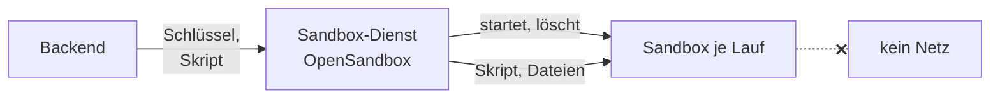

# Sandbox für Agenten

Ein Agent kann mit dem Werkzeug `run_code` ein Python-Skript schreiben und ausführen lassen, etwa
für ein PDF, eine Tabelle oder ein Diagramm. Dieses Skript hat niemand geprüft. Es läuft deshalb
nie im Backend, sondern in einer **Sandbox**: einem Wegwerf-Container ohne Netzausgang, der nur seinen
eigenen Arbeitsordner sieht. Ohne Sandbox bietet OPAA das Werkzeug nicht an.



## So arbeitet sie

- **Eine Sandbox je Agentenlauf.** Der erste Aufruf von `run_code` in einem Lauf startet sie, jeder
  weitere Aufruf desselben Laufs arbeitet im selben Ordner weiter. Am Ende des Laufs nimmt OPAA die
  Dateien aus `/workspace/out` als Anhänge der fragenden Person an die Antwort und löscht die
  Sandbox, auch nach einem Fehler. Der nächste Lauf beginnt leer.
- **Nie geteilt:** Eine Sandbox gehört genau einem Lauf einer Person.
- **Nur was das Skript enthält:** Die Sandbox sieht weder Wissensbasis noch Datenbank noch
  Dateiablage. Was sie verwenden soll, schreibt das Modell ins Skript.
- **Ausgaben sind fremd:** Dateinamen, Größe und Dateityp prüft OPAA wie bei einem Upload. Je Lauf
  werden höchstens fünf Dateien zu je 10 MB angehängt, nur in den Formaten, die auch ein Upload
  annimmt. Bilder gehören nicht dazu: Ein Diagramm kommt als PDF oder in einem Dokument. Lässt sich
  eine Datei nicht abholen, fehlt sie; die Antwort bleibt.
- **Grenzen:** Ein Skript läuft höchstens `OPAA_SANDBOX_RUN_TIMEOUT` und nie über das Laufende
  hinaus, der Start der Sandbox zählt mit; eine Sandbox lebt höchstens `OPAA_SANDBOX_MAX_LIFETIME`.
  Dieser Wert muss die Laufzeit eines Agentenlaufs, zweimal die Dauer eines Schlussaufrufs und zwei Minuten abdecken,
  sonst startet das Backend nicht. Danach entfernt der
  Sandbox-Dienst sie selbst, auch wenn das Backend ausgefallen ist.
- **Kein Nachinstallieren:** Das Image `opaa/sandbox-python` bringt Python mit reportlab, fpdf2,
  python-docx, openpyxl, pandas und matplotlib mit. Ein eigenes Image setzt `OPAA_SANDBOX_IMAGE`.

Der Sandbox-Dienst ist OpenSandbox, ein gepflegter Baustein unter Apache-Lizenz 2.0. Er braucht einen eigenen API-Schlüssel; ohne Schlüssel
oder Adresse startet das Backend mit eingeschalteter Sandbox nicht.

## Docker Compose

Das Overlay `docker-compose.sandbox.yml` startet den Sandbox-Dienst und baut das Image:

```bash
export OPAA_SANDBOX_API_KEY=$(openssl rand -hex 32)
docker compose -f docker-compose.yml -f docker-compose.sandbox.yml up -d --build
```

Die Sandboxen hängen an einem internen Netz ohne Ausgang; das Backend selbst ist nicht in diesem
Netz. Erreichbar sind dort nur der Dienst und andere Sandboxen, beide nur mit Schlüssel oder Token. Der Dienst startet Container über den Docker-Socket des Hosts. Wer den Socket hat, hat den
Host: Den Stapel mit Sandbox auf einer eigenen VM betreiben, unter Linux möglichst mit gVisor
(`runsc`) als Laufzeit der Sandboxen.

## Kubernetes

OpenSandbox wird mit seinem eigenen Chart in eigene Namespaces installiert, etwa der Dienst in
`opensandbox-system` und die Sandboxen in `opensandbox`. Den Schlüssel bekommt der Dienst als
`OPENSANDBOX_SERVER_API_KEY`. Im OPAA-Chart:

| Wert | Bedeutung |
|---|---|
| `sandbox.enabled` | schaltet `run_code` frei |
| `sandbox.baseUrl` | Adresse des Sandbox-Dienstes |
| `secrets.sandboxApiKey` | derselbe Schlüssel wie beim Dienst (Schlüssel `OPAA_SANDBOX_API_KEY` im Secret) |
| `sandbox.namespace` | Namespace der Sandbox-Pods, nie der Namespace von OPAA |
| `sandbox.serverNamespaceSelector`, `sandbox.serverPodSelector` | wo der Dienst läuft |

Das Chart legt im Namespace der Sandboxen eine NetworkPolicy an, die **jeden Ausgang** sperrt und
Eingang nur vom Dienst zulässt, unabhängig von `networkPolicy.*`. Das Release braucht dafür das
Recht, NetworkPolicies in diesem Namespace anzulegen. Das Backend bekommt mit
`networkPolicy.egress.enabled` eine Regel zum Dienst.

**Isolationsstufe:** Wie stark eine Sandbox vom Knoten getrennt ist, legt der Sandbox-Dienst über
seine Laufzeitklasse fest, nicht OPAA:

| Plattform | Empfehlung |
|---|---|
| Kubernetes auf VMware | gVisor (`runsc`) und eigene Knoten für Sandboxen |
| OpenShift auf VMware | Standardlaufzeit mit User Namespaces und eigenen Worker-VMs für Sandboxen |
| OpenShift mit Bare-Metal-Workern | Kata Containers |

## Einschalten für Agenten

Die Sandbox ist nur die Voraussetzung. Ein Agent nutzt `run_code` erst, wenn das Werkzeug in den
Agenten-Einstellungen eingeschaltet und dem Agenten zugeordnet ist.

## Protokolle

Das Backend schreibt zu einem Lauf nur Kennung, Ergebnis und Zahlen ins Anwendungslog, keine
Skripte, Dateinamen oder Inhalte. Die Schritte eines Laufs sieht die Person an ihrer Antwort.

Je Sandbox hält das **Sandboxprotokoll** in der Datenbank fest: Lauf, technische Kennung der
Sandbox, Ergebnis, Dauer, Zahl der Skripte, Zahl und Größe der Dateien und gegebenenfalls den
Abbruchgrund. Kein Konto, kein Skript, kein Dateiinhalt. Es wird nach 7 Tagen gelöscht, einstellbar
1 bis 30 Tage, nie länger als das Schrittprotokoll; Frist und Einsicht beschreibt
[Datenschutz einstellen](../administration/datenschutz.md).

Der Sandbox-Dienst führt ein eigenes Log. Damit keine Skripte darin landen:

- Log-Stufe des Dienstes `INFO` oder höher, nie `DEBUG` (`[log] level` in `sandbox/config.toml`,
  im Chart von OpenSandbox der entsprechende Wert). Ein Test prüft die mitgelieferte Datei.
- Compose rotiert das Log des Dienstes (`logging` in `docker-compose.sandbox.yml`, 3 × 10 MB).
  Die Logs der Sandbox-Container selbst rotiert der Docker-Dienst des Hosts
  (`log-opts` in `/etc/docker/daemon.json`); in Kubernetes rotiert das Kubelet.
