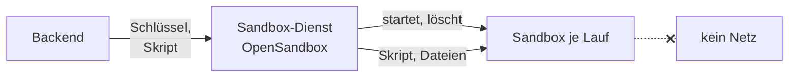

# Sandbox für Agenten

Ein Agent kann mit dem Werkzeug `run_code` ein Python-Skript schreiben und ausführen lassen, etwa
für ein PDF, eine Tabelle oder ein Diagramm. Dieses Skript hat niemand geprüft. Es läuft deshalb nie
im Backend, sondern in einer **Sandbox**: einem Wegwerf-Container ohne Netzausgang, der nur seinen
eigenen Arbeitsordner sieht. Dort befüllt auch das Werkzeug `fill_template` eine
[Dokumentvorlage](../benutzer/vorlage-anlegen.md) mit den Werten des Modells, über ein festes Skript
des Images statt über Code des Modells. Ohne Sandbox bietet OPAA beide Werkzeuge nicht an.



## So arbeitet sie

- **Eine Sandbox je Agentenlauf.** Der erste Aufruf von `run_code` oder `fill_template` in einem
  Lauf startet sie, jeder weitere Aufruf desselben Laufs arbeitet im selben Ordner weiter. Am
  Ende des Laufs nimmt OPAA die Dateien aus `/workspace/out` als Anhänge der fragenden Person an
  die Antwort und löscht die Sandbox, auch nach einem Fehler. Der nächste Lauf beginnt leer.
- **Eigenes Verzeichnis für Vorlagen:** `fill_template` schreibt in ein neues Verzeichnis mit
  Zufallsnamen je Aufruf. OPAA liest dort direkt nach dem Befüllen nur die gemeldete Word-Datei
  und das PDF; nur was gelesen und geprüft ist, meldet es dem Modell als angehängt.
- **Nie geteilt:** Eine Sandbox gehört genau einem Lauf einer Person.
- **Nur was das Skript enthält:** Die Sandbox sieht weder Wissensbasis noch Datenbank noch
  Dateiablage. Was sie verwenden soll, schreibt das Modell ins Skript.
- **Ausgaben sind fremd:** Dateinamen, Größe und Dateityp prüft OPAA wie bei einem Upload. Je Lauf
  werden höchstens fünf Dateien zu je 10 MB angehängt, nur in den Formaten, die auch ein Upload
  annimmt. Bilder gehören nicht dazu: Ein Diagramm kommt als PDF oder in einem Dokument. Jede
  Word-Datei prüft OPAA wie eine hochgeladene Vorlage auf aktive Inhalte (Makros, eingebettete
  Objekte, Felder, die Inhalte nachladen); eine solche wird nicht angehängt. Lässt sich eine Datei
  nicht abholen oder scheitert das Befüllen, fehlt sie; die Antwort bleibt.
- **Restrisiko:** Hat `run_code` im selben Lauf vorher Code ausgeführt, kann ein Prozess dieses
  Codes eine Datei von `fill_template` verändern, bevor OPAA sie liest. Er kann damit nichts
  anhängen, was `run_code` nicht auch selbst hätte anhängen können; die Prüfungen gelten
  unverändert.
- **Grenzen:** Ein Skript läuft höchstens `OPAA_SANDBOX_RUN_TIMEOUT` und nie über das Laufende
  hinaus, der Start der Sandbox zählt mit; eine Sandbox lebt höchstens `OPAA_SANDBOX_MAX_LIFETIME`.
  Dieser Wert muss die Laufzeit eines Agentenlaufs, zweimal die Dauer eines Schlussaufrufs und zwei
  Minuten abdecken, sonst startet das Backend nicht. Danach entfernt der Sandbox-Dienst sie selbst,
  auch wenn das Backend ausgefallen ist.
- **Kein Nachinstallieren:** Das Image `opaa/sandbox-python` bringt Python mit reportlab, fpdf2,
  python-docx, openpyxl, pandas und matplotlib mit, dazu docxtpl, LibreOffice Writer ohne Oberfläche
  für die PDF-Fassung, Schriften mit den Maßen von Arial, Times New Roman, Courier New und Calibri
  sowie das feste Skript für `fill_template`. LibreOffice samt Schriften macht das Image entpackt um
  rund 370 MB größer (amd64). Der Bau des Images prüft das Skript mit eigenen Tests und bricht ab, wenn einer scheitert.
  Die Umwandlung in PDF bekommt einen Teil des Zeitlimits eines Aufrufs; reicht er nicht, bleibt die
  Word-Datei. Ein eigenes Image setzt `OPAA_SANDBOX_IMAGE`; es braucht `python3` und das Kommando
  `env`, für `fill_template` zusätzlich `/opt/opaa/fill_template.py` mit docxtpl und `soffice`.
  Fehlt das Skript, scheitert nur `fill_template`.
- **Ohne Root-Rechte:** Ein Skript läuft als Benutzer ohne Root-Rechte und kennt das Token des
  Ausführungsagenten seiner Sandbox nicht.

Der Sandbox-Dienst ist OpenSandbox, ein gepflegter Baustein unter Apache-Lizenz 2.0. Er braucht
einen eigenen API-Schlüssel; ohne Schlüssel oder Adresse startet das Backend mit eingeschalteter
Sandbox nicht.

## Docker Compose

Das Overlay `docker-compose.sandbox.yml` startet den Sandbox-Dienst und baut das Image:

```bash
export OPAA_SANDBOX_API_KEY=$(openssl rand -hex 32)
docker compose -f docker-compose.yml -f docker-compose.sandbox.yml up -d --build
```

Die Sandboxen hängen an einem internen Netz ohne Ausgang; das Backend selbst ist nicht in diesem
Netz. Erreichbar sind dort nur der Dienst und andere Sandboxen, beide nur mit Schlüssel oder Token.
Der Dienst startet Container über den Docker-Socket des Hosts. Wer den Socket hat, hat den Host: Den
Stapel mit Sandbox auf einer eigenen VM betreiben, unter Linux möglichst mit gVisor (`runsc`) als
Laufzeit der Sandboxen.

## Plattenplatz und Härtung unter Compose

**Plattenplatz:** Eine Sandbox hat eine Grenze für Laufzeit, Speicher und Prozesse, aber keine für
den Plattenplatz. Was ein Skript schreibt, landet im Datenverzeichnis von Docker auf dem Host, bis
die Sandbox gelöscht ist. Ein Skript kann so die Platte füllen, auf der auch die Datenbank des
Stapels liegt. Der Sandbox-Dienst kann Docker keine Größengrenze je Sandbox mitgeben. Deshalb gilt
für jeden Betrieb mit Sandbox:

- **Eigenes Dateisystem für Docker:** Das Datenverzeichnis von Docker (`data-root`, Vorgabe
  `/var/lib/docker`) liegt auf einem eigenen Dateisystem, nicht auf dem des Betriebssystems. Eine
  volle Platte hält dann die Container an, nicht den Host.
- **Grenze je Container, wo Docker sie kann:** Mit dem Speichertreiber `overlay2` auf XFS mit
  Projektquoten (Mount-Option `pquota`) setzt `"storage-opts": ["overlay2.size=2G"]` in
  `/etc/docker/daemon.json` eine Grenze für jeden neuen Container. Andere Aufbauten, etwa der
  containerd-Image-Speicher, übergehen die Angabe teils ohne Meldung. Ob sie wirkt, zeigt dieser
  Befehl; er muss mit „No space left on device“ scheitern:

  ```bash
  docker run --rm --storage-opt size=20m python:3.13-slim \
    sh -c 'dd if=/dev/zero of=/tmp/f bs=1M count=50'
  ```
- **Füllstand überwachen:** Ein Alarm auf den freien Platz dieses Dateisystems, wie für die
  Datenbank.

**Härtung des Dienstes:** Der Sandbox-Dienst läuft mit Read-only Filesystem, ohne Capabilities und
mit `no-new-privileges`. Schreiben darf er nur unter `/tmp` und in sein Volume
`opensandbox-state` mit seinem eigenen Zustand. Die Images des Dienstes und seines
Ausführungsagenten, das Basis-Image von `opaa/sandbox-python` und dessen Python-Pakete sind auf
Version und Prüfsumme festgelegt; ein `docker compose pull` holt deshalb nie still einen anderen
Stand. pip ist im fertigen Image nicht mehr enthalten. Die Pakete von LibreOffice kommen aus dem Debian-Release des Basis-Images mit seinen
Sicherheitsupdates zum Zeitpunkt des Baus. Neue Fassungen kommen mit einem OPAA-Update. Danach den
Stapel mit `up -d --build` neu starten, damit auch das Sandbox-Image neu gebaut wird, und `run_code`
und `fill_template` einmal von einem Agenten ausführen lassen.

## Kubernetes

OpenSandbox wird mit seinem eigenen Chart in eigene Namespaces installiert, etwa der Dienst in
`opensandbox-system` und die Sandboxen in `opensandbox`. Den Schlüssel bekommt der Dienst als
`OPENSANDBOX_SERVER_API_KEY`. Im OPAA-Chart:

| Wert | Bedeutung |
|---|---|
| `sandbox.enabled` | schaltet `run_code` und `fill_template` frei |
| `sandbox.baseUrl` | Adresse des Sandbox-Dienstes |
| `secrets.sandboxApiKey` | derselbe Schlüssel wie beim Dienst (Schlüssel `OPAA_SANDBOX_API_KEY` im Secret) |
| `sandbox.namespace` | Namespace der Sandbox-Pods, nie der Namespace von OPAA |
| `sandbox.serverNamespaceSelector`, `sandbox.serverPodSelector` | wo der Dienst läuft |

Das Chart legt im Namespace der Sandboxen eine NetworkPolicy an, die **jeden Ausgang** sperrt und
Eingang nur vom Dienst zulässt, unabhängig von `networkPolicy.*`. Das Release braucht dafür das
Recht, NetworkPolicies in diesem Namespace anzulegen. Das Backend bekommt mit
`networkPolicy.egress.enabled` eine Regel zum Dienst.

**Isolationsstufe:** Wie stark eine Sandbox vom Knoten getrennt ist, legt der Sandbox-Dienst über
seine Laufzeitklasse fest, nicht OPAA:

| Plattform | Empfehlung |
|---|---|
| Kubernetes auf VMware | gVisor (`runsc`) und eigene Knoten für Sandboxen |
| OpenShift auf VMware | Standardlaufzeit mit User Namespaces und eigenen Worker-VMs für Sandboxen |
| OpenShift mit Bare-Metal-Workern | Kata Containers |

## Einschalten für Agenten

Die Sandbox ist nur die Voraussetzung. Ein Agent nutzt `run_code` oder `fill_template` erst, wenn
die Systemverwaltung Agenten eingeschaltet und das Werkzeug zugelassen hat
([Agenten einschalten](../administration/agenten.md)) und das Werkzeug dem Agenten zugeordnet ist;
`fill_template` zusätzlich nur, solange die Systemverwaltung Vorlagen eingeschaltet hat
([Vorlagen einschalten](../administration/vorlagen.md)). Was sonst vor dem Einschalten der Agenten
zu prüfen ist, steht unter [Agenten betreiben](agenten-betreiben.md#nach-dem-update).

## Protokolle

Das Backend schreibt zu einem Lauf nur Kennung, Ergebnis und Zahlen ins Anwendungslog, keine
Skripte, Dateinamen oder Inhalte. Die Schritte eines Laufs sieht die Person an ihrer Antwort.

Je Sandbox hält das **Sandboxprotokoll** in der Datenbank fest: Lauf, technische Kennung der
Sandbox, Ergebnis, Dauer, Zahl der Skripte, Zahl und Größe der Dateien und gegebenenfalls den
Abbruchgrund. Kein Konto, kein Skript, kein Dateiinhalt. Es wird frühestens nach 7 Tagen und
spätestens am Tag darauf gelöscht, einstellbar 1 bis 30 Tage, nie länger als das Schrittprotokoll;
Frist und Einsicht beschreibt [Datenschutz einstellen](../administration/datenschutz.md).

Der Sandbox-Dienst führt ein eigenes Log. Damit keine Skripte darin landen:

- Log-Stufe des Dienstes `INFO` oder höher, nie `DEBUG` (`[log] level` in `sandbox/config.toml`,
  im Chart von OpenSandbox der entsprechende Wert). Ein Test prüft die mitgelieferte Datei.
- Compose rotiert das Log des Dienstes (`logging` in `docker-compose.sandbox.yml`, 3 × 10 MB).
  Die Logs der Sandbox-Container selbst rotiert der Docker-Dienst des Hosts
  (`log-opts` in `/etc/docker/daemon.json`); in Kubernetes rotiert das Kubelet.
