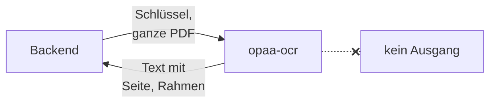

# Texterkennung

Gescannte PDF-Dokumente bestehen oft nur aus Seitenbildern, ohne Textebene. Die Suche findet in
ihnen nichts, bis eine Texterkennung (OCR) den Text aus den Bildern liest. Ein Bauamt mit einem
eingescannten Aktenbestand von 20 Jahren braucht sie, eine Stelle, die nur Text-PDFs und
Office-Dateien ablegt, nicht.

Die Texterkennung ist eine Modellrolle wie Chat oder Embedding. Wie der Betrieb sie freigibt und die
Systemverwaltung sie einträgt, steht unter
[Texterkennung einschalten](modell-endpunkte.md#texterkennung-einschalten). Dieses Kapitel
beschreibt den Dienst dahinter: welchen man nimmt, wie man ihn bemisst und absichert.

## Mitgelieferter Dienst oder eigener Endpunkt

OPAA bringt einen eigenen Dienst mit, `opaa-ocr`: docling-serve für die CPU mit der Texterkennung
RapidOCR und deutschen Modellen. Das Image entsteht mit jedem Release wie Backend und Frontend, mit
SBOM und signierter Provenance ([Images und Laufzeit](images-und-laufzeit.md)).

| Weg | Wann | Einrichtung |
|---|---|---|
| **Mitgelieferter Dienst** | der Regelfall; nichts verlässt das Haus | Compose: [Overlay](docker-compose.md#texterkennung-im-compose-stapel); Kubernetes: [`ocr.service`](kubernetes.md#texterkennung) |
| **Vorhandenes docling-serve** | das Haus betreibt schon eines, etwa mit GPU | Adresse unter Modelle → Texterkennung |
| **Vision-Modell** (OpenAI-kompatibel) | ein Modellserver mit Bildeingang steht bereit | Adresse und Modell unter Modelle → Texterkennung; liefert nur Seiten, keine Rahmen für die Markierung im Original |

Der Betriebsschalter `OPAA_OCR_ENABLED` und der Dienst sind getrennt: Das Compose-Overlay und
`ocr.service` starten den Dienst, der Schalter gibt die Rolle frei. Den Dienst trägt die
Systemverwaltung danach von Hand ein, mit Verbindungstyp **docling-serve**, der Adresse und dem
Schlüssel; einen automatischen Eintrag gibt es nicht.

| Betriebsweg | Adresse des mitgelieferten Dienstes |
|---|---|
| Docker Compose | `http://opaa-ocr:5001` |
| Kubernetes | `http://<Release>-ocr:5001`; `helm install` nennt sie in seinen Hinweisen |

## Ressourcen und Laufzeit

Die Texterkennung ist der teuerste Schritt der Indexierung. Eine gescannte Seite braucht auf der CPU
rund **20 Sekunden Rechenzeit**, je nach Bildqualität und Tabellen; mehr Kerne verkürzen die
Wartezeit je Seite, nicht den Aufwand.

- **Arbeitsspeicher:** Der Dienst lädt seine Modelle beim Start und hält danach rund 3 GiB je
  gleichzeitiger Umwandlung; lange Dokumente brauchen mehr. Ein `OOMKilled` oder Exit-Code `137`
  verlangt ein höheres Limit.
- **Start:** bereit nach Sekunden bis wenigen Minuten, je nach Datenträger. Die Readiness meldet
  sich erst, wenn die Modelle geladen sind.
- **Gleichzeitigkeit:** Je Umwandlung, die der Dienst parallel ausführt (`ocr.service.workers`,
  Compose `OPAA_OCR_WORKERS`), kommt der Speicher einmal dazu. Mehr Durchsatz bringen eher weitere
  Pods (`ocr.service.replicas`) als mehr Umwandlungen in einem.
- **Platz:** Das Image ist entpackt einige Gigabyte groß; `/tmp` braucht Platz für die Seitenbilder
  einer Umwandlung.

**Größenordnung für einen Altbestand:** 10 000 gescannte Seiten sind rund 55 Stunden Rechenzeit auf
einem Kern. Damit ein solcher Bestand nicht jeden Lauf einer Bibliothek für Tage blockiert, sendet
ein Indexierungslauf höchstens `OPAA_OCR_MAX_PAGES_PER_RUN` Seiten; der Rest wartet auf den nächsten
Lauf. Mit der Vorgabe dauert ein solcher Lauf einige Stunden. Ein Dokument über
`OPAA_OCR_MAX_PAGES_PER_DOCUMENT` Seiten wird nicht versucht. Die Zeitgrenzen je Aufruf und je
Dokument (`OPAA_OCR_CALL_TIMEOUT`, `OPAA_OCR_DOCUMENT_TIMEOUT`) und die Wartezeit des Dienstes
(`ocr.service.maxSyncWaitSeconds`, Compose `OPAA_OCR_MAX_SYNC_WAIT`) gehören zusammen: Die
Wartezeit des Dienstes muss die Zeitgrenze eines Aufrufs abdecken. Alle Vorgaben stehen in der
[Konfiguration](../referenz/konfiguration.md#alle-umgebungsvariablen).

Eine Neuindizierung, die die Texterkennung wiederholt, kostet dieselbe Rechenzeit noch einmal.

## Betrieb ohne Internet

Alle Modelle stecken im Image; der Dienst lädt nichts nach und braucht keinen Ausgang. Für eine
Installation ohne Internetzugang kommt `opaa-ocr` wie Backend und Frontend aus dem Offline-Paket
oder aus der eigenen Registry ([Images und Laufzeit](images-und-laufzeit.md)).

## Schlüssel

Der Dienst nimmt nur Anfragen mit seinem Schlüssel an (Header `X-Api-Key`), ohne ihn antwortet er mit
`401`. Der Schlüssel ist Pflicht und hat keine Vorgabe: mindestens 32 Zeichen ohne Leerzeichen,
etwa aus `openssl rand -hex 32`. Ohne ihn bricht Compose ab und der Chart rendert nicht; ein zu
kurzer lässt den Container nicht starten.

Derselbe Wert steht an zwei Stellen: beim Dienst (Compose `OPAA_OCR_API_KEY`, Kubernetes Schlüssel
`ocr-api-key` im Secret) und in der Modellverwaltung unter Modelle → Texterkennung, wo OPAA ihn
verschlüsselt speichert. Ein Schlüsselwechsel ändert beide Stellen nacheinander; dazwischen
scheitern Aufrufe mit „Schlüssel abgelehnt“, die der nächste Lauf wiederholt. Gesichert wird er
mit den übrigen [Geheimnissen](sicherung-und-wiederherstellung.md).

## Netz

- **Nur das Backend erreicht den Dienst.** In Compose liegt er allein mit dem Backend in einem
  internen Netz ohne veröffentlichten Port; vom Host aus ist er nicht erreichbar. In Kubernetes
  lässt seine NetworkPolicy nur die Backend-Pods und den Pod von `helm test` ein.
- **Kein Ausgang.** Das Compose-Netz hat kein Gateway, die NetworkPolicy erlaubt keinen Egress.
- **Zielprüfung:** Die Adresse des mitgelieferten Dienstes steht in beiden Betriebswegen schon in
  der Liste der Modelle (`OPAA_MODEL_TARGET_VALIDATION_ALLOWLIST`). Ein eigener Dienst im internen
  Netz braucht dort einen Eintrag mit Host und Port
  ([Zielprüfung](netz-und-sicherheit.md#zielprüfung-abrufe-des-servers)).
- **Ausgangsproxy:** Hat die Installation einen, gehört der Dienst in seine Ausnahmeliste, sonst
  geht der Aufruf an den Proxy ([Ausgangsproxy](netz-und-sicherheit.md#ausgangsproxy)).

Der Dienst sieht ganze Seiten mit allem, was darauf steht, auch Namen und Vorgänge Dritter, und
speichert nichts: kein Volume, kein Datenbestand, Arbeitsdateien nur in `/tmp`. Ein Dienst außerhalb
des Hauses ist ein neuer Empfänger dieser Daten und wird vorher abgestimmt.

## Aktualisierung

Der Dienst ist zustandslos: Eine neue Version ist ein Neustart mit dem neuen Image, ohne Sicherung
und Migration. Im Chart folgt er der Version des Releases wie Backend und Frontend; im
Compose-Stapel nennt `OPAA_OCR_IMAGE_TAG` die Version. Während des Neustarts scheitern Aufrufe als
„nicht erreichbar“, und der nächste Indexierungslauf versucht die betroffenen Dokumente erneut.

## Fehlerbilder

| Zeichen | Ursache | Abhilfe |
|---|---|---|
| Compose bricht mit `required variable OPAA_OCR_API_KEY is missing a value` ab | Schlüssel nicht gesetzt | in Shell oder `.env` setzen |
| `helm install` bricht mit `secrets.ocrApiKey is required` oder einem Schemafehler ab | Dienst eingeschaltet, Schlüssel fehlt oder zu kurz | `secrets.ocrApiKey` oder Schlüssel `ocr-api-key` in `secrets.existingSecret` |
| Container endet sofort mit Exit-Code `64` | Schlüssel kürzer als 32 Zeichen oder mit Leerzeichen | längeren Schlüssel erzeugen |
| Pod in `CreateContainerConfigError` | `secrets.existingSecret` hat keinen Schlüssel `ocr-api-key` | Schlüssel ins Secret aufnehmen |
| Pod wird nicht bereit, Startup-Probe scheitert | Modelle laden zu langsam, etwa auf langsamem Datenträger | `ocr.service.startupProbe` großzügiger |
| `OOMKilled`, Exit-Code `137` | Speicherlimit zu klein für das Dokument oder die Zahl der Umwandlungen | Limit erhöhen oder Umwandlungen je Pod senken |
| Verbindungstest: „Schlüssel abgelehnt“ | Schlüssel in der Modellverwaltung und beim Dienst verschieden | denselben Wert an beiden Stellen |
| Verbindungstest: „nicht erreichbar“ | Dienst startet noch, Adresse falsch, NetworkPolicy oder Proxy im Weg | Adresse aus diesem Kapitel; Ausgangs-Policy des Backends und Ausnahmeliste des Proxys prüfen |
| Adresse abgelehnt, weil intern | eigener Dienst nicht in der Liste der Modelle | Host und Port in `OPAA_MODEL_TARGET_VALIDATION_ALLOWLIST` |
| Aufrufe enden nach einer Zeitgrenze | Dokument zu lang für die Zeitgrenzen oder Wartezeit des Dienstes kürzer als die Zeitgrenze eines Aufrufs | Wartezeit des Dienstes mindestens so groß wie `OPAA_OCR_CALL_TIMEOUT`; mehr Kerne |
