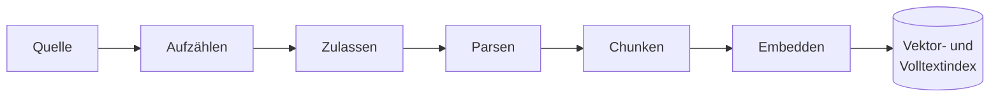
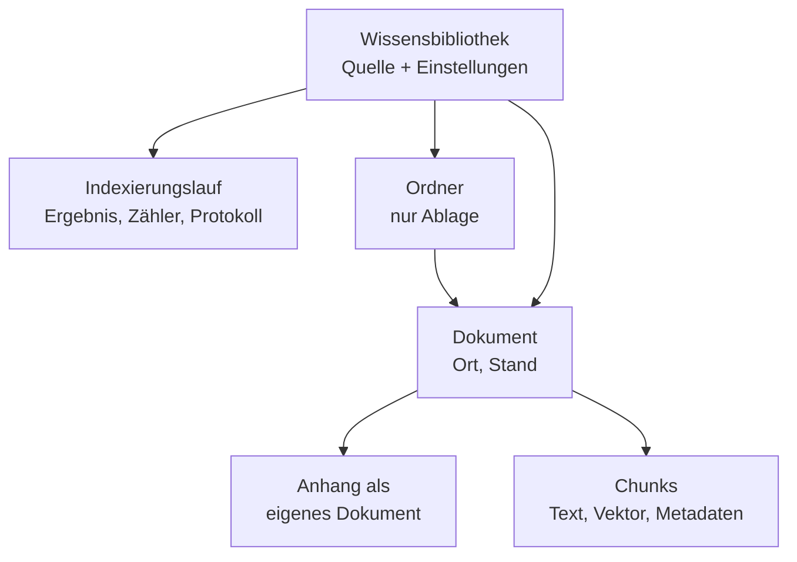
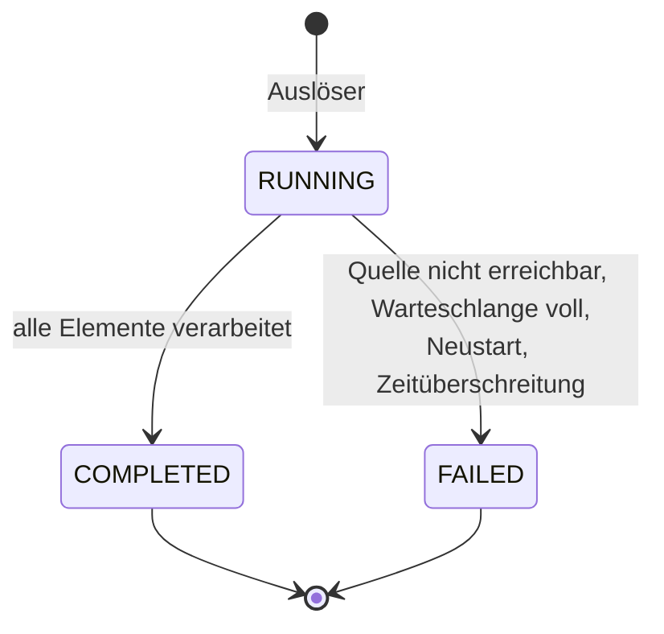
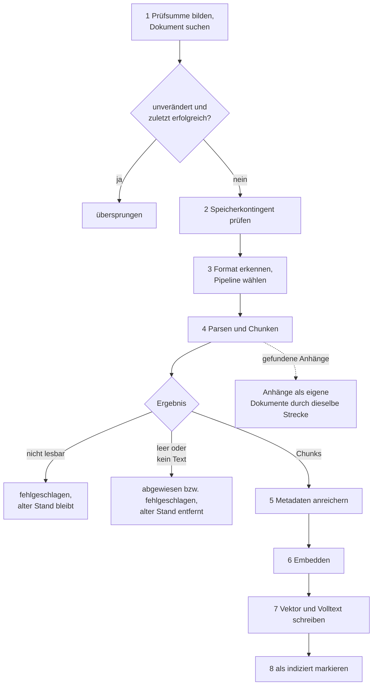
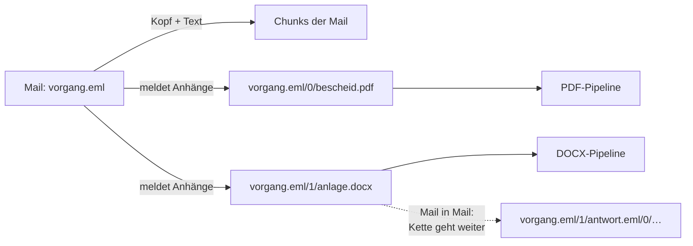
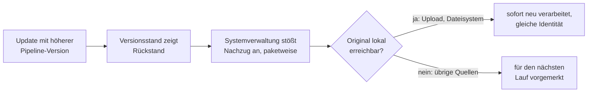

# Indexierung: Vom Dokument zum durchsuchbaren Index

Dieses Kapitel erklärt, wie Dokumente in OPAA durchsuchbar werden: woher sie kommen, wie sie aktuell
bleiben und was mit jedem Dokument geschieht. Es bleibt bei dem, was für alle Quellen gilt. Die
Eigenheiten einer Quelle stehen in den Kapiteln der [Konnektoren](konnektoren/README.md), die
eines Dateiformats in den Kapiteln der [Formate](formate/README.md), die Anmeldung an einer Quelle
im Kapitel [Zugänge](zugaenge.md). Abschnitt 7 bündelt, was der Betrieb über die Aufnahmestrecke
wissen muss.

## 1. Worum es geht

OPAA beantwortet Fragen aus Dokumenten, die zuvor in einen **Index** aufgenommen wurden. Der Index
ist zweierlei: eine **Vektorablage**, die Textstücke nach ihrer Bedeutung findet, und ein
**Volltextindex**, der exakte Wörter, Aktenzeichen und Paragrafen trifft. Beide werden im selben
Arbeitsgang befüllt.

Dokumente gelangen auf zwei Wegen hinein:

- **Upload.** Eine Person lädt Dateien über die Oberfläche hoch. Jede Datei wird sofort verarbeitet;
  das Original bewahrt OPAA selbst auf.
- **Angebundene Quelle.** Die meisten Dokumente einer Organisation liegen schon irgendwo: auf einem
  Netzlaufwerk, in einem Wiki wie Confluence, in einem Cloud-Speicher, in einem Webverzeichnis. Ein
  **Konnektor** bindet ein solches System an, liest es regelmäßig und hält die Bibliothek mit ihm
  in Einklang. Die Dokumente bleiben in ihrer Quelle; OPAA macht sie durchsuchbar. Wie ein
  Konnektor das System liest, hängt von dessen Technik ab — welche es gibt und was sie können,
  zeigt die [Übersicht der Konnektoren](konnektoren/README.md).

Der Weg in den Index ist für jedes Dokument gleich, unabhängig von Herkunft und Format:

**Abbildung 1.1: Der Weg eines Dokuments in den Index**

**Tabelle 1.1: Die Schritte im Überblick**

| Schritt | Frage, die er beantwortet |
|---|---|
| Aufzählen | Welche Dokumente enthält die Quelle gerade? |
| Zulassen | Ist das ein Format, das OPAA verarbeiten kann? |
| Parsen | Welcher Text steckt im Dokument, und wie ist er gegliedert? |
| Chunken | In welche Stücke wird der Text zerlegt, damit die Suche sie einzeln treffen kann? |
| Embedden | Wie sieht jedes Stück als Bedeutungsvektor aus? |
| Indexieren | Wo liegt das Stück, und mit welchen Merkmalen ist es wiederzufinden? |

## 2. Grundbegriffe

Eine **Wissensbibliothek** ist die Einheit, in der Dokumente verwaltet werden. Sie trägt
Berechtigungen und genau eine **Quelle**: entweder Upload oder eine angebundene Quelle mit ihrem
Konnektor. Ob und wie eine angebundene Quelle über einen von der Systemverwaltung vorgegebenen
Zugang läuft, beschreibt das Kapitel [Zugänge](zugaenge.md).

Ein **Indexierungslauf** (kurz Lauf) ist ein Durchgang über eine angebundene Quelle, mit Start,
Ende, Ergebnis, Zählern und Protokoll. Ein **vollständiger** Lauf sieht die ganze Quelle und darf
deshalb entfernen, was es dort nicht mehr gibt. Ein **ergänzender** Lauf sieht nur einen Ausschnitt
— die jüngsten Einträge eines Feeds, die zuletzt geänderten Seiten — und entfernt nie etwas, nur
weil es fehlt. Welche Laufarten eine Quelle kennt, legt ihr Konnektor fest. Uploads haben keine
Läufe.

Ein **Dokument** ist eine Datei, eine Seite oder ein Eintrag der Quelle, so wie OPAA es kennt: mit
seinem Ort in der Quelle, seinem Verarbeitungsstand und den Textstücken (**Chunks**), in die es
zerlegt wurde. Sein Ort in der Quelle ist zugleich seine Identität.

Ein **Anhang** ist ein Dokument in einem Dokument: die Anlage einer E-Mail, die angehängte Datei
einer Confluence-Seite, die verlinkte Anlage eines Feed-Eintrags. OPAA nimmt jeden Anhang als
eigenes Dokument auf, mit Verweis auf das Dokument, aus dem er stammt (Abschnitt 5.9).

Ein **Ordner** gliedert die Dokumente einer Bibliothek. Ordner dienen nur der Ablage: Berechtigungen
hängen immer an der Bibliothek, und die Suche durchsucht stets den ganzen Bestand und nennt zum
Treffer den Ordnerpfad. In einer Upload-Bibliothek legen die Nutzenden Ordner selbst an, benennen
sie um und löschen sie; ein hochgeladener Ordner bringt seine Unterstruktur mit, und das Löschen
eines Ordners löscht nach einer Rückfrage mit der Anzahl auch die Dokumente darin. Bei vielen
angebundenen Quellen spiegelt der Lauf die Ordner der Quelle; dort sind sie nicht bearbeitbar, die
Quelle ist führend. Woher die Ordner bei einer Quelle kommen, steht in ihrem Kapitel.

**Abbildung 2.1: Die Begriffe und ihr Zusammenhang**

## 3. Mit Wissensbibliotheken arbeiten

### 3.1 Im Katalog finden

Die Bibliotheken, die eine Person lesen darf, stehen im **Katalog** der Hauptnavigation; der Filter
„Wissen" grenzt ihn auf Wissensbibliotheken ein. Suche, Filter und Reihenfolge des Katalogs
beschreibt [Bibliotheken und Berechtigungen](bibliotheken-und-berechtigungen.md), Abschnitt 4.

Eine Kachel nennt Name, Beschreibung, eine Freigabe an „Alle Konten", die Zahl der Dokumente, in
wie vielen Räumen die Bibliothek bereitsteht, die zuständige Stelle und ihren Zustand:

**Tabelle 3.1: Zustand einer Wissensbibliothek auf der Kachel**

| Bibliothek | Zustand |
|---|---|
| mit angebundener Quelle | nach ihrem jüngsten Lauf: „Wird aktualisiert", „Aktualisierung fehlgeschlagen" oder „Aktualisiert am" mit dem Datum des letzten erfolgreichen Laufs; ohne Lauf „Noch kein Inhalt" |
| Upload | nach ihren Dokumenten, die erste zutreffende Regel gilt: eines in Verarbeitung, eines gescheitert, eines indexiert, keines |

Dazu kommen Hinweise wie „Nachfolge offen" oder eine Sperre. Fortschritt und Gründe eines Laufs
zeigt erst die Detailansicht.

### 3.2 Die Detailansicht

Ein Klick auf die Kachel öffnet die Detailansicht. Oben steht der **Kopf**: das Etikett „Wissen",
der Quellentyp, die eigene Rolle, Name und Beschreibung, die Kennzahlen und die Aktionen. Darunter
sagt eine Zeile, was die eigene Rolle erlaubt, wo das die Bedienung erklärt („Sie haben in dieser
Bibliothek nur Leserechte").

**Tabelle 3.2: Der Kopf der Detailansicht**

| Element | Inhalt |
|---|---|
| Kopfzeile | Etikett „Wissen", Welt-Symbol bei Freigabe an „Alle Konten", Quellentyp, eigene Rolle — für eine Systemverwaltung ohne eigene Berechtigung „administrativ" —, Favoritenstern, Menü „⋯" |
| Name und Beschreibung | ändert, wer mindestens Verwalter ist, über den Stift „Name und Beschreibung bearbeiten" |
| Nachfolge | eine Zeile, wenn die Nachfolge offen ist ([Bibliotheken und Berechtigungen](bibliotheken-und-berechtigungen.md), Abschnitt 13) |
| Kennzahlen | Dokumente; belegtes Speicherkontingent ab Verwalter; der letzte Lauf mit Ausgang und Zählern ab Bearbeiter; Räume; zuständige Stelle; „Aktualisiert am" |
| Umfang | bei Quellen mit Auswahl (etwa Spaces, Buckets) eine Kurzzeile mit Sprung in den Reiter „Quelle"; eine Warnung über einen unvollständig gelesenen Umfang bleibt im Kopf |
| Aktionen | „Jetzt indizieren" ab Bearbeiter bei einer angebundenen Quelle, wo es ihn gibt „Vollabgleich starten"; im Menü „⋯" „In Space verwenden" für jede lesende Rolle und „Löschen" für den Eigentümer und die Systemverwaltung |

Darunter liegen fünf **Reiter**. Jeder trägt eine eigene Adresse (`?tab=`) und lässt sich verlinken;
ein Reiterwechsel legt keinen Schritt in der Browser-Historie an. Alle Reiter stehen jeder Rolle
offen; was eine Rolle nicht abrufen darf, fehlt innerhalb des Reiters.

**Tabelle 3.3: Die Reiter der Detailansicht**

| Reiter | Inhalt |
|---|---|
| Dokumente | der Bestand der Bibliothek (siehe unten) |
| Quelle | Umfang, Anbindung, Zeitplan und Läufe (siehe unten); fehlt bei einer Upload-Bibliothek |
| Metadaten | die Metadatenfelder der Bibliothek und, ab Verwalter, die modellgestützte Extraktion ([Metadaten](metadaten.md)) |
| Freigaben | Eigentümer, Berechtigungen, externer Zugang, Diagnosesperre und „Warum sehe ich diese Wissensbibliothek?" ([Bibliotheken und Berechtigungen](bibliotheken-und-berechtigungen.md), Abschnitt 4) |
| Zuordnungen | die Räume, in denen die Bibliothek bereitsteht, mit „In Space verwenden" und „Aus Space lösen" |

**Tabelle 3.4: Der Reiter „Quelle"**

| Abschnitt | Inhalt | Sichtbar für |
|---|---|---|
| Umfang | welchen Ausschnitt der Quelle die Bibliothek spiegelt, etwa die gewählten Spaces oder Buckets; nur bei Quellen mit Auswahl | alle Leseberechtigten |
| Anbindung | Adresse und Einstellungen der Quelle, der Zugang, „Bearbeiten" und „Verbindung testen" gegen die gespeicherte Einstellung, je nach Quelle Webhook oder Ereignisse | ab Verwalter |
| Zeitplan | Rhythmus und nächster Termin; eine Warnung, wenn die letzten geplanten Läufe gescheitert sind | ab Verwalter |
| Läufe | das Laufprotokoll (Abschnitt 6.2) | ab Verwalter |

Wer darunter bleibt, sieht den Umfang und einen Satz dazu, wem der Rest vorbehalten ist. Hinweise
auf eine Sperre oder eine getrennte Verbindung stehen für alle Leseberechtigten im Reiter „Quelle";
den Verwaltenden bieten sie die Aktion an, die sie aufhebt ([Zugänge](zugaenge.md)).

Der Reiter **„Dokumente"** zeigt für jede Quelle dieselbe Liste mit Suche, Ordnern, Auswahl und
Blättern; je nach Quelle kommen Zusatzzeilen hinzu (Space, Bucket, Herkunft, Anhänge). Für eine
Auswahl bietet die Leiste die Aktionen an, die für alle ausgewählten Dokumente zulässig sind:
„Feld setzen" ([Metadaten](metadaten.md)) und, nur bei einer Upload-Bibliothek, „Löschen". Das
Sammellöschen fragt einmal nach und meldet danach, wie viele Dokumente gelöscht wurden, und warum
eines stehen blieb. In einer Bibliothek mit angebundener Quelle lassen sich Dokumente nicht
löschen — der nächste Lauf brächte sie zurück.

### 3.3 Eine Wissensbibliothek anlegen

Angelegt wird über **„Neu"** im Katalog: Nach der Wahl der Art „Wissen" führt ein Assistent durch
die Einrichtung. Seine Schritte heißen wie Kopf und Reiter der fertigen Bibliothek; was hier
eingestellt wird, steht später an derselben Stelle.

**Tabelle 3.5: Die Schritte des Assistenten**

| Schritt | Inhalt |
|---|---|
| 1. Art des Wissens | je Quelle eine Kachel. Es erscheinen nur Arten, die die Person anlegen darf: Upload mit dem Recht „Bibliotheken für Uploads anlegen", eine angebundene Quelle, wenn sie für die Person freigegeben und nicht gesperrt ist, mit eigener Adresse oder über einen nutzbaren Zugang. Darf sie keine Art anlegen, verweist der Schritt an die Systemverwaltung |
| 2. Quelle | gegebenenfalls die Wahl des Zugangs, dann Anbindung und Verbindungstest, der Zeitplan und „Erste Indizierung sofort nach dem Anlegen starten"; entfällt bei Upload |
| 3. Name & Beschreibung | der Name ist vorbelegt, wo die Quelle ihn hergibt (ein einzelner Space, der erste Bucket, der letzte Pfadabschnitt, der Hostname) |
| 4. Freigaben | Eigentümer („Mein Konto" oder eine eigene Gruppe) und vorgemerkte Freigaben an Personen und Gruppen; eine Freigabe an „Alle Konten" wird erst an der fertigen Bibliothek erteilt |

Nach „Bibliothek anlegen" öffnet sich die Detailansicht. Konnte eine vorgemerkte Freigabe nicht
erteilt werden, ist die Bibliothek trotzdem angelegt, und ein Hinweis nennt die Empfänger.

## 4. Wie der Bestand aktuell bleibt

### 4.1 Auslöser

**Tabelle 4.1: Wodurch ein Lauf entsteht**

| Auslöser | Beschreibung |
|---|---|
| Manuell | „Jetzt indizieren" an der Bibliothek, ab der Rolle Bearbeiter. Wo die Quelle es kennt, zusätzlich „Vollabgleich starten" |
| Zeitplan | je Bibliothek einstellbar (Abschnitt 4.2) |
| Ereignis der Quelle | manche Quellen melden Änderungen selbst, etwa Confluence per Webhook oder ein Objektspeicher per Benachrichtigung; OPAA holt kurz darauf genau die gemeldeten Dokumente. Ersetzt weder Zeitplan noch Vollabgleich |
| Upload | kein Lauf: Jede Datei wird sofort einzeln verarbeitet, getrennt von laufenden Läufen. Wo das Original liegt, entscheidet der Betrieb ([Originalablage](deployment.md#originalablage)) |
| Nachzug | kein regulärer Lauf: Die Systemverwaltung lässt Dokumente neu verarbeiten, die mit einem älteren Verfahren entstanden sind (Abschnitt 7.2) |

### 4.2 Zeitplan

Jede Bibliothek mit angebundener Quelle kann einen Zeitplan tragen. Verwaltende setzen ihn im
Reiter „Quelle", beim Anlegen im Assistenten.

**Tabelle 4.2: Stufen des Zeitplans**

| Stufe | Einstellungen |
|---|---|
| aus | keine |
| stündlich | keine, jeweils zur vollen Stunde |
| täglich | Uhrzeit |
| wöchentlich | Wochentag und Uhrzeit |

Die Uhrzeit gilt in der Zeitzone des Servers. Drei Regeln:

- **Verpasste Termine werden nicht nachgeholt.** War das Backend zum Termin nicht in Betrieb,
  läuft die Bibliothek erst zum nächsten Termin. Nach einer längeren Wartung lässt sich manuell
  anstoßen.
- **Läuft noch ein Lauf, entsteht kein zweiter.** Der laufende vermerkt „Geplanter Lauf
  übersprungen: Indizierung läuft bereits". Ein Erstlauf, der länger dauert als das Intervall,
  verschluckt so die Termine bis zu seinem Ende.
- **Ein gescheiterter Lauf schaltet den Zeitplan nicht ab.** Scheitern zwei geplante Läufe
  hintereinander, zeigt die Bibliothek ein Warnbanner; manuelle Läufe zählen nicht mit.

Welche Stufe passt, hängt von der Quelle ab: Ein unveränderter Feed kostet je Lauf eine Anfrage und
verträgt stündlich, ein großes Netzlaufwerk eher täglich oder wöchentlich. Quellen mit
Vollabgleich-Rhythmus stellen diesen im Zeitplan zusätzlich ein.

### 4.3 Zustände eines Laufs

**Abbildung 4.1: Zustände eines Laufs**

Je Bibliothek läuft **höchstens ein Lauf**. Ein einzelnes Dokument, das nicht verarbeitet werden
kann, bricht den Lauf nicht ab; es wird gezählt, protokolliert und übersprungen. „Fehlgeschlagen"
heißt, dass der Lauf als Ganzes nicht zu Ende kam.

Ein Lauf kann abgeschlossen und trotzdem **unvollständig** sein: wenn er sein Anfragebudget
verbraucht hat oder ein Dokument am Speicherkontingent abgelehnt wurde. Er endet dann geordnet, und
der nächste Lauf setzt fort; ein unvollständiger Lauf entfernt nichts wegen Abwesenheit. Wie die
Dateiablagen einen Abgleich über mehrere Läufe fortsetzen, beschreibt
[Abgleich der Dateiablagen](konnektoren/datei-abgleich.md).

### 4.4 Änderungen und Löschungen

**Tabelle 4.3: Was eine Änderung in der Quelle bewirkt**

| In der Quelle | In OPAA |
|---|---|
| unverändert | übersprungen, nichts wird neu verarbeitet |
| geändert | neu verarbeitet; das Dokument behält seine Identität, Verweise aus Chats bleiben gültig |
| umbenannt oder verschoben | je nach Quelle: ein neues Dokument, und das alte gilt als entfernt, oder dasselbe Dokument an neuem Ort — das Kapitel der Quelle sagt, was gilt |
| verschwunden | entfernt nach einem vollständigen, erfolgreichen Lauf, oder sofort, wenn die Quelle die Löschung selbst meldet |
| nicht erreichbar oder nicht lesbar | **nichts** wird entfernt |

Die wichtigste Sicherung ist die letzte Zeile: Ein Lauf, der null Dokumente sieht, kann eine leere
Quelle bedeuten oder ein nicht eingebundenes Netzlaufwerk. Deshalb entfernt OPAA nur, wenn der
Konnektor die Quelle **vollständig** aufgezählt hat. Ein abgebrochener Lauf, ein Bereich, den die
Zugangsdaten nicht lesen dürfen, ein erschöpftes Anfragebudget: all das lässt den Bestand stehen.
Ein entzogenes Recht ist kein Löschbefund, und eine Datei, die OPAA abweist (etwa wegen ihres
Formats), gilt als vorhanden. Ergänzende Läufe entfernen nie wegen Abwesenheit — ein Feed zeigt nur
seine jüngsten Einträge, ältere sind damit nicht verschwunden.

Wann genau eine Quelle löscht, steht in ihrem Kapitel; die Übersicht zeigt die
[Konnektoren](konnektoren/README.md), Tabelle 1.2.

### 4.5 Wiederanlauf nach Störungen

Ein hängender Lauf würde seine Bibliothek dauerhaft blockieren. Zwei Aufräumer verhindern das:

- **Beim Start des Backends** werden alle noch laufenden Läufe mit „Durch Neustart abgebrochen"
  beendet (Abschnitt 7.3).
- **Regelmäßig** werden Läufe beendet, die länger als eine Frist (`stale-job-timeout`) keinen
  Fortschritt gemeldet haben. Maßgeblich ist der letzte Fortschritt, nicht der Start: Ein großer
  Erstlauf darf lange dauern, solange er arbeitet.

Ein abgebrochener Lauf lässt den Bestand stehen. Was er fertig verarbeitet hat, bleibt indiziert;
was er nicht erreicht hat, bleibt auf dem alten Stand. Das eine Dokument, das gerade in Arbeit war,
verarbeitet der nächste Lauf erneut.

## 5. Was mit jedem Dokument passiert

Jedes Dokument, gleich welcher Herkunft, durchläuft dieselben Schritte:

**Abbildung 5.1: Die Dokumentstrecke**

### 5.1 Prüfsumme und Identität

Über den Inhalt wird eine Prüfsumme gebildet und das Dokument über seinen Ort in der Quelle
gesucht. Ist der Inhalt unverändert und war das Dokument zuletzt erfolgreich indiziert, ist der Fall
erledigt: **übersprungen**. Das ist der Normalfall jedes Folgelaufs und der Grund, warum Folgeläufe
schnell sind. Titel, Ort und Ordner werden dabei trotzdem aktualisiert.

Hat sich der Inhalt geändert, behält das Dokument seine Identität; nur seine Chunks werden
ausgetauscht, und zwar erst, wenn die neue Fassung gelesen und zerlegt vorliegt. Scheitert das
Lesen, bleibt der alte Stand durchsuchbar.

Der Ort in der Quelle ist auf eine Länge begrenzt (Abschnitt 7.1). Ein längerer wird nicht
gespeichert und erscheint im Protokoll als abgewiesen; der Lauf geht weiter.

### 5.2 Speicherkontingent

Jede Bibliothek hat ein Speicherkontingent; eine private Bibliothek zusätzlich das Kontingent ihrer
Besitzerin über alle ihre privaten Bibliotheken ([Bibliotheken und Berechtigungen](bibliotheken-und-berechtigungen.md),
„Private Bibliotheken"). Geprüft wird der Zuwachs: Bei einer geänderten Datei zählt nur die
Größendifferenz.

Überschreitet ein Dokument ein Kontingent, wird es abgelehnt, und das Protokoll nennt den Grund.
Der Lauf geht weiter und endet als unvollständig. Das abgelehnte Dokument gilt als vorhanden: Eine
bereits aufgenommene Fassung bleibt stehen, und ein späterer Lauf versucht es erneut. Löschungen in
der Quelle werden dagegen übernommen — oft sind es gerade sie, die Platz schaffen. Solange ein
Dokument nicht passt, endet jeder Lauf, der es erreicht, wieder als unvollständig.

Dateiablagen prüfen das Kontingent schon vor dem Download
([Abgleich der Dateiablagen](konnektoren/datei-abgleich.md), Abschnitt 4). Was bei Confluence, beim
Feed und bei E-Mails mit Anhängen eigens gilt, steht in deren Kapiteln.

### 5.3 Format erkennen

Die Formaterkennung schaut in den **Inhalt**, nicht auf die Dateiendung: Eine als `.pdf` benannte
Word-Datei wird als Word-Datei verarbeitet, mit dem Protokollvermerk „Formatabweichung". Für jedes
Format gibt es genau eine **Format-Pipeline**, für Unbekanntes und Strukturloses eine
Auffang-Pipeline. Zugelassen sind grob Text und Markdown, PDF, die Office-Formate von Microsoft und
OpenDocument, Tabellen, HTML und E-Mails. Welche Endungen genau, welche Pipeline sie bedient und was
bewusst nicht aufgenommen wird, steht in der Übersicht der [Formate](formate/README.md).

### 5.4 Parsen und Chunken

Die Format-Pipeline liest den Text und zerlegt ihn entlang seiner Gliederung: nach Überschriften,
Seiten, Folien oder Zeilengruppen. Nur wer das Format kennt, weiß, wo diese Grenzen liegen.

- Jeder Chunk trägt eine **Ortsangabe**, etwa „S. 3 · Abschn. Fristen › Verlängerung", die später
  im Zitat erscheint.
- **Kein Text geht wegen seiner Länge verloren.** Ein zu langer Abschnitt wird geteilt, nie gekürzt;
  jedes Teilstück behält Überschrift und Ortsangabe.
- **Kleinstabschnitte werden zusammengefasst**, etwa viele einzeilige Haushaltstitel unter einer
  gemeinsamen Überschrift. Ein Abschnitt normaler Länge bleibt dagegen ein eigener Chunk, damit
  ein einzelner Paragraf gezielt auffindbar bleibt.
- Das Ergebnis ist entweder eine Liste von Chunks oder einer von drei Befunden: **nicht lesbar**
  (beschädigte Datei; der alte Stand bleibt), **leer** (der alte Stand wird entfernt) oder **kein
  extrahierbarer Text**, typisch für eingescannte PDFs (abgewiesen, der alte Stand wird entfernt).

Die Zielgrößen und Grenzen stehen in Abschnitt 7.1, die Regeln je Format in dessen Kapitel.

### 5.5 Metadaten anreichern

Jeder Chunk bekommt seinen Rahmen: Dokument, Bibliothek, Dateiname, Ortsangabe und die Merkmale aus
der Quelle, etwa Space und Gliederungspfad einer Confluence-Seite. Darüber filtert die Suche später,
zum Beispiel auf die Bibliotheken, die eine Person sehen darf. Hier werden auch die **Kernfelder**
ermittelt — Titel, Dokumentart, Datum ([Metadaten](metadaten.md)).

Für Embedding und Volltext, nicht für den gespeicherten Text, bekommt jeder Chunk einen
**Kontextpräfix**: den Titel des Dokuments, ausgewählte Feldwerte und seinen Gliederungspfad. Ein
Chunk aus `2024-03_Dienstanweisung_Homeoffice.pdf` wird als „Dienstanweisung Homeoffice › …"
eingebettet. So trägt auch ein Detail-Chunk — eine Gebührenzeile, ein einzelner Paragraf — Signal
darüber, wovon das Dokument handelt.

### 5.6 Embedden

Die Chunks gehen paketweise an das Embedding-Modell. Das ist der einzige Aufruf nach außen, der
nicht der Quelle gilt. Ist ein einzelner Chunk zu lang für das Modell — praktisch nur bei Text mit
sehr vielen Tokens je Zeichen, etwa in nicht lateinischen Schriften —, wird von dem Dokument nichts
eingebettet; seine Fehlermeldung nennt die Stelle („Ein Textabschnitt ist zu lang für das
Embedding-Modell (S. 4)").

### 5.7 Vektor und Volltext schreiben

Vektor und Volltext eines Chunks werden gemeinsam geschrieben; es gibt keinen Chunk, den nur eine
der beiden Suchen kennt. Der Volltext wird mit deutscher Wortstammbildung aufgebaut und um erkannte
**Kennungen** wie Paragrafen und Aktenzeichen ergänzt, damit „§ 12 Abs. 3" exakt trifft. Welche
Kennungen erkannt werden, steht im Kapitel [Suche](suche.md), Stufe 5.

### 5.8 Als indiziert markieren

Zuletzt wird das Dokument mit Chunk-Anzahl und Prüfsumme als „indiziert" markiert. Wurde es
währenddessen gelöscht, werden die gerade geschriebenen Chunks wieder entfernt.

### 5.9 Anhänge

Anhänge entstehen auf zwei Arten und münden in denselben Weg: **aus dem Format**, wie die Anlagen
einer E-Mail — gleich, woher die Mail kommt —, oder **aus der Quelle**, wie die angehängten Dateien
einer Confluence-Seite. Wer einen Anhang findet, meldet ihn nur; verarbeitet wird er wie jedes
andere Dokument, mit eigener Prüfsumme, eigener Pipeline und eigenem Protokolleintrag.

**Abbildung 5.2: Eine E-Mail mit Anhängen**

- Der Ort eines Anhangs enthält den Ort seines Elterndokuments und seine Position darin; zwei
  gleichnamige Anhänge kollidieren nicht.
- Anhänge können selbst Anhänge haben (Mail in Mail). Die Tiefe ist begrenzt
  (`attachments.max-depth`); was darüber liegt, wird übersprungen und protokolliert.
- Das Kontingent zählt Anhänge nur einmal: Eine Mail zählt nur Kopf und Text, ihre Anhänge zählen
  als eigene Dokumente.
- Wird das Elterndokument neu verarbeitet und meldet einen früheren Anhang nicht mehr, wird dieser
  entfernt. Bleibt das Elterndokument unverändert, bleiben auch seine Anhänge.
- Beim Löschen werden Anhänge vor ihrem Elterndokument entfernt.
- In der Dokumentliste steht ein Anhang unter seinem Elterndokument. Dokumentzahlen in Liste,
  Ordnern, Kachel und Kennzahlen zählen nur die oberste Ebene; Laufzähler und Bestandszahlen der
  Suchverwaltung zählen Anhänge mit.

## 6. Protokoll und Fehler

### 6.1 Ergebnis je Dokument

Jedes Dokument eines Laufs endet in genau einem von fünf Ergebnissen: **verarbeitet**,
**übersprungen**, **Kontingent überschritten**, **kein extrahierbarer Text** oder
**fehlgeschlagen**. Daraus ergeben sich die Zähler des Laufs; Anhänge zählen mit.

### 6.2 Laufprotokoll

Jeder Lauf führt ein Protokoll mit einer lesbaren Begründung je Eintrag.

**Tabelle 6.1: Kategorien des Laufprotokolls**

| Kategorie | Bedeutung |
|---|---|
| abgewiesen | nicht übernommen: Die Quelle hat es zurückgewiesen, ein Kontingent ist erschöpft, es enthält keinen extrahierbaren Text, oder sein Ort ist zu lang |
| nicht erreichbar | Verbindungsfehler oder Zeitüberschreitung |
| Format nicht unterstützt | das Format wird nicht indiziert |
| Formatabweichung | indiziert, aber Endung und Inhalt passen nicht zusammen |
| Allowlist | der Ort liegt außerhalb der Freigabe |
| Zeitplan übersprungen | fällig, aber ein Lauf lief bereits |
| in der Quelle entfernt | wegen Abwesenheit oder auf Befund der Quelle gelöscht |
| Ratenbegrenzung | die Quelle hat den Lauf gebremst; eine Zeile je Lauf mit Anzahl und Wartezeit |
| Anfragebudget erschöpft | der Lauf endete geordnet unvollständig; die Zeile nennt, wo der nächste fortsetzt |
| Kennzahlen | Anfragen, geladene Bytes, gelistete und verarbeitete Objekte, Dauer; bei Konnektoren, die sie zählen |
| Fehler | Verarbeitung begonnen, unerwartet gescheitert |

- Je Lauf werden höchstens 500 Einträge gespeichert, darüber hinaus nur gezählt („… und N
  weitere"). Notizen über den Lauf als Ganzes zählen nicht gegen diese Grenze.
- Je Bibliothek bleiben die letzten zehn Läufe samt Protokoll erhalten.
- Ein Fehler beim Schreiben des Protokolls bricht den Lauf nie ab.

### 6.3 Wer was sieht

Den **Laufstatus** — letzter Lauf, Zähler — sieht jede leseberechtigte Person. Das **Protokoll** und
die Fehlermeldung eines gescheiterten Laufs sieht erst, wer die Bibliothek verwaltet, weil sie
interne Pfade und Adressen der Quelle enthalten.

Ein Lauf, der geordnet unvollständig endete, trägt das Kennzeichen „unvollständig, wird
fortgesetzt". Hat er Dokumente am Speicherkontingent abgelehnt, heißt es „unvollständig:
Speicherkontingent erschöpft, Dateien übersprungen", und aufgeklappt steht, was Platz schafft:
Dateien in der Quelle löschen, die Quelle eingrenzen oder ein höheres Kontingent. Bei einer privaten
Bibliothek kann das eigene oder das gemeinsame Kontingent der Besitzerin erschöpft sein; welches,
nennt das Protokoll je Datei.

Die Systemverwaltung sieht zusätzlich systemweit die Dokumente ohne einen einzigen Chunk — der
typische Befund für eingescannte PDFs — und den Stand der Pipeline-Versionen je Bibliothek
(Abschnitt 7.2).

## 7. Betrieb

### 7.1 Grenzen und Zuschnitt im Einzelnen

**Tabelle 7.1: Feste Grenzen der Dokumentstrecke**

| Grenze | Wert | Wirkung |
|---|---|---|
| Ort in der Quelle | 2000 Zeichen und 2676 Byte (UTF-8), bei einem Anhang samt Ort des Elterndokuments | darüber abgewiesen, gezählt als übersprungen, nicht gespeichert; eine Dateiablage lädt die Datei gar nicht erst |
| Zielgröße eines Chunks | rund 4.000 Zeichen, etwa 1.000 Tokens | je Abschnitt bei überschriftengetriebenen Formaten, je Seite, Folie oder Zeilengruppe bei den übrigen |
| Höchstgröße eines Chunks | 8.000 Zeichen | greift nur, wenn schon die Überschrift oder der Folientitel zu lang ist |
| Kleinstabschnitt | unter 200 Zeichen samt Überschrift | wird mit benachbarten Kleinstabschnitten derselben übergeordneten Überschrift zu höchstens rund 4.000 Zeichen zusammengelegt |
| Eingabegrenze des Embedding-Modells | 8.191 Tokens abzüglich 10 % Reserve | ein Chunk darüber lässt das ganze Dokument scheitern |
| Kennungen je Chunk | 64 | weitere werden nicht gespeichert |
| Protokolleinträge je Lauf | 500 | weitere nur gezählt |
| aufbewahrte Läufe je Bibliothek | 10 | ältere werden beim Start eines neuen entfernt |

Ein zu langer Abschnitt wird an der gröbsten Grenze geteilt, die sich anbietet: an Leerzeilen, dann
Zeilenumbrüchen, dann Satzenden, zuletzt Leerzeichen; nur eine Zeichenfolge ganz ohne solche Grenze
wird hart geschnitten. Die Chunk-Größen sind je Pipeline fest; die einstellbaren Werte
`chunk-size` und `chunk-overlap` gelten nur für die Auffang-Pipeline und strukturlose Texte, die
nach Tokens mit Überlappung zum Vorgänger geschnitten werden. Seitenzahlen überleben die
Textextraktion als Marker, die vor dem Embedden entfernt werden.

An der Chunk-Anzahl eines fehlgeschlagenen Dokuments ist ablesbar, ob es noch Chunks hat: Scheitert
das Lesen, behält es Chunks und Anzahl; scheitert etwas nach dem Entfernen der alten Chunks — beim
Embedden oder Schreiben —, steht dort 0.

**Restfenster.** Das Entfernen der alten Chunks und das Schreiben der neuen liegen nicht in einer
gemeinsamen Transaktion; dazwischen liegt der Embedding-Aufruf, der bewusst außerhalb jeder
Datenbanktransaktion läuft. Stürzt der Prozess genau darin ab, hat das Dokument kurz keine Chunks,
während es noch als „indiziert" mit der alten Anzahl erscheint. Der nächste Lauf verarbeitet es
erneut, unabhängig von der Prüfsumme. Alte und neue Chunks liegen nie gleichzeitig vor.

Die Grenzwerte für Zahl und Größe der Anhänge je Elterndokument setzt die jeweilige Quelle bzw. das
Format; die Tiefe gilt allgemein.

### 7.2 Pipeline-Versionen und Nachzug

Jede Format-Pipeline hat eine Versionsnummer, und jeder Chunk speichert, mit welcher Pipeline und
Version er entstand. Die Version steigt nur, wenn sich Zuschnitt oder erzeugte Metadaten ändern.
So lässt sich jederzeit sagen, welcher Teil des Bestands nach einem Update noch mit einem älteren
Verfahren im Index liegt.

Der **Nachzug** läuft nicht von selbst. Die Systemverwaltung stößt ihn über die Admin-API an; eine
Oberfläche gibt es noch nicht.

**Tabelle 7.2: Admin-API des Nachzugs**

| Aufruf | Zweck |
|---|---|
| `GET /api/v1/admin/indexing/pipeline-versions` | Versionsstand je Bibliothek: wie viele Chunks unter der aktuellen Version liegen |
| `POST /api/v1/admin/indexing/pipeline-reindex` | ein Paket nachziehen; `belowVersion` (welche Version als veraltet gilt), `batchSize` (1 bis 100, Standard 10) |
| `GET /api/v1/admin/indexing/low-chunk-documents` | Dokumente ohne Chunks, der typische Scan-Befund |

**Abbildung 7.1: Ablauf des Nachzugs**

- Jeder Aufruf wird auditiert, verarbeitet ein Paket und kehrt zurück; für einen großen Bestand
  wird er wiederholt, bis kein Rückstand mehr bleibt.
- Der Nachzug ist unterbrechbar: Die Restmenge wird jedes Mal neu ermittelt. Alte Chunks werden erst
  gelöscht, wenn die neuen vorliegen; verwaiste Chunks ohne Dokument werden mit aufgeräumt.
- Ein Fehlschlag kostet nur das betroffene Dokument. Es behält seine Chunks und steht beim nächsten
  Aufruf wieder in der Restmenge.
- **Ausnahme:** Antwortet der Speicher der hochgeladenen Originale gar nicht, endet das Paket nach
  diesem einen Dokument, statt den Speicher reihum zu befragen. Bis er wieder antwortet, endet jeder
  Aufruf an demselben Dokument, und auch Dokumente dahinter aus anderen Quellen kommen nicht an die
  Reihe.
- Für einen Anhang, der nur in der Quelle erreichbar ist, wird die ganze Kette seiner
  Elterndokumente vorgemerkt.

### 7.3 Genau eine Backend-Instanz

Die Aufnahmestrecke setzt eine **einzelne Backend-Instanz** voraus: Zeitplan, Wiederanlauf,
Thread-Pools und Fortschrittsmeldung leben im Prozess. Eine zweite Instanz würde beim Start die
Läufe der ersten als „durch Neustart abgebrochen" beenden. Skalieren heißt, dieser einen Instanz
mehr Hardware zu geben. Die Aufnahmestrecke braucht keine eigene Worker-Komponente; alles, was sie
erzeugt — Dokumente, Chunks samt Vektoren, Volltext, Protokolle —, liegt in PostgreSQL, und eine
Sicherung der Datenbank ist eine Sicherung des Index.

### 7.4 Nebenläufigkeit

**Tabelle 7.3: Thread-Pools der Aufnahmestrecke**

| Pool | Aufgabe | Standard |
|---|---|---|
| Lauf-Pool | ein Platz je Lauf; Läufe verschiedener Bibliotheken laufen parallel | 2 bis 4 Threads, 20 Wartende |
| Embedding-Pool | parallele Pakete eines großen Dokuments | 3 Threads |
| Upload-Pool | Einzeldateien aus Uploads, getrennt vom Lauf-Pool | eigene Konfiguration |

Sind Lauf-Pool und Warteschlange voll, wird ein neuer Lauf sofort als fehlgeschlagen beendet und
die Anfrage mit HTTP 503 beantwortet.

### 7.5 Konfiguration

**Tabelle 7.4: Schlüssel unter `opaa.indexing.*`**

| Schlüssel | Standard | Wirkung |
|---|---|---|
| `filesystem.allowlist` | leer | freigegebene Basisverzeichnisse; leer schaltet den Dateisystem-Konnektor ab |
| `attachments.max-depth` | 5 | Verschachtelungstiefe von Anhängen, für jede Quelle |
| `attachments.max-per-parent` / `attachments.max-size-bytes` | 10 / 20 MiB | Reserve für Konnektoren ohne eigene Werte, derzeit ohne Wirkung |
| `http.user-agent` / `http.max-rate-limit-retries` / `http.max-retry-after` | `OPAA-Indexer/1.0` / 6 / 2m | `User-Agent` jeder Anfrage an eine fremde Quelle und die 429-Wartezeit von Feed und Webverzeichnis |
| `http.request-budget-per-run` / `http.max-rate-limit-wait-per-run` | 0 (unbegrenzt) / 15m | Anfragen und Summe der 429-Wartezeiten je Lauf bei Feed und Webverzeichnis |
| `chunk-size` / `chunk-overlap` | 1000 / 100 Tokens | nur Auffang-Pipeline und strukturlose Texte |
| `batch-size` | 50 | Chunks je Embedding-Aufruf |
| `embedding-concurrency` | 3 | parallele Embedding-Pakete je Dokument |
| `stale-job-timeout` | 4h | Frist ohne Fortschritt, bis ein Lauf als verwaist gilt |
| `thread-pool.*` | 2 / 4 / 20 | Lauf-Pool |
| `target-validation.*` | aktiv | Zieladressprüfung für Netzquellen |
| je Konnektor und Format, etwa `confluence.*`, `s3.*`, `nextcloud.*`, `mail.*` | siehe dort | Grenzwerte der Quelle bzw. des Formats, jeweils im Abschnitt „Konfiguration" ihres Kapitels |

### 7.6 Was nicht gebaut ist

- **Texterkennung (OCR)** für eingescannte Dokumente. Ein Scan wird erkannt und als „kein
  extrahierbarer Text" abgewiesen. Texterkennung ist ein eigenes Vorhaben und setzt die
  Voruntersuchung eines externen Konvertierungsdienstes (Docling) voraus.
- **Automatischer Nachzug** nach einem Pipeline-Update; ob er selbsttätig oder auf Entscheidung des
  Betriebs läuft, ist offen.

## 8. Weiterführende Kapitel

- [Konnektoren](konnektoren/README.md): alle Quellen im Überblick und je ein Kapitel pro Konnektor;
  der gemeinsame [Abgleich der Dateiablagen](konnektoren/datei-abgleich.md)
- [Zugänge](zugaenge.md): wie sich Quellen anmelden und was die Systemverwaltung vorgibt
- [Formate](formate/README.md): zugelassene Formate und je ein Kapitel pro Format-Pipeline
- [Suche](suche.md): wie der Index abgefragt wird, von der Frage bis zur belegten Antwort
- [Metadaten](metadaten.md): Kernfelder, ihre Ermittlung und Wirkung in der Suche
- [Deployment](deployment.md): Installation, Umgebungsvariablen und was ein Update mit dem Index macht

## Verzeichnis der Tabellen und Abbildungen

- [Abbildung 1.1: Der Weg eines Dokuments in den Index](#1-worum-es-geht)
- [Tabelle 1.1: Die Schritte im Überblick](#1-worum-es-geht)
- [Abbildung 2.1: Die Begriffe und ihr Zusammenhang](#2-grundbegriffe)
- [Tabelle 3.1: Zustand einer Wissensbibliothek auf der Kachel](#31-im-katalog-finden)
- [Tabelle 3.2: Der Kopf der Detailansicht](#32-die-detailansicht)
- [Tabelle 3.3: Die Reiter der Detailansicht](#32-die-detailansicht)
- [Tabelle 3.4: Der Reiter „Quelle"](#32-die-detailansicht)
- [Tabelle 3.5: Die Schritte des Assistenten](#33-eine-wissensbibliothek-anlegen)
- [Tabelle 4.1: Wodurch ein Lauf entsteht](#41-auslöser)
- [Tabelle 4.2: Stufen des Zeitplans](#42-zeitplan)
- [Abbildung 4.1: Zustände eines Laufs](#43-zustände-eines-laufs)
- [Tabelle 4.3: Was eine Änderung in der Quelle bewirkt](#44-änderungen-und-löschungen)
- [Abbildung 5.1: Die Dokumentstrecke](#5-was-mit-jedem-dokument-passiert)
- [Abbildung 5.2: Eine E-Mail mit Anhängen](#59-anhänge)
- [Tabelle 6.1: Kategorien des Laufprotokolls](#62-laufprotokoll)
- [Tabelle 7.1: Feste Grenzen der Dokumentstrecke](#71-grenzen-und-zuschnitt-im-einzelnen)
- [Tabelle 7.2: Admin-API des Nachzugs](#72-pipeline-versionen-und-nachzug)
- [Abbildung 7.1: Ablauf des Nachzugs](#72-pipeline-versionen-und-nachzug)
- [Tabelle 7.3: Thread-Pools der Aufnahmestrecke](#74-nebenläufigkeit)
- [Tabelle 7.4: Schlüssel unter `opaa.indexing.*`](#75-konfiguration)
