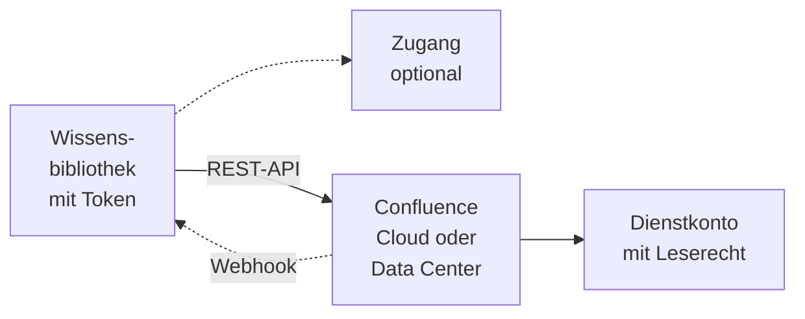
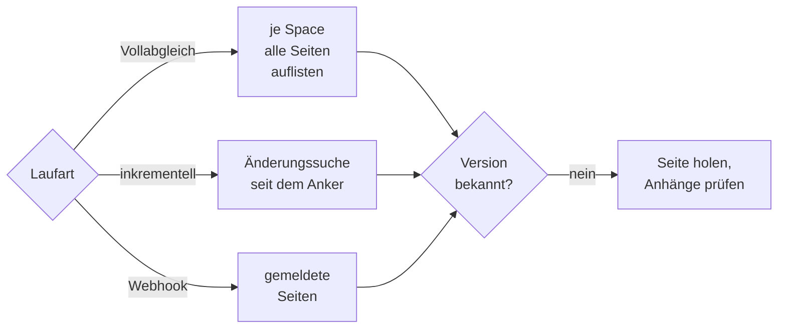

# Konnektor: Confluence

## 1. Was der Konnektor ist

Der Konnektor liest **Seiten und Anhänge ausgewählter Spaces** einer Confluence-Instanz, Cloud oder
Data Center. Er spricht die **Confluence-REST-API**: bei Cloud die Version 2 (`/wiki/api/v2`) und für
die Änderungssuche die CQL-Suche der Version 1, bei Data Center die Version 1 (`/rest/api`). Die
Aufbereitung des Seiteninhalts beschreibt das Kapitel [Confluence-Seite](../formate/confluence.md).



- **Anmeldung:** eigene Zugangsdaten der Bibliothek ([Zugänge](../zugaenge.md), „Eigene
  Zugangsdaten der Bibliothek"): bei Cloud E-Mail-Adresse und API-Token als HTTP Basic, bei Data
  Center ein Personal Access Token als `Bearer`. Ein Zugang ist möglich und darf die Edition
  vorgeben.
- **Liest:** die aktuellen Seiten der gewählten Spaces (bis zu 500) und ihre Anhänge in
  unterstützten Formaten. **Nicht** gelesen werden Blogbeiträge, Kommentare, Whiteboards,
  Datenbanken, archivierte Seiten und der Papierkorb.
- **Dokument:** Jede Seite trägt Space, Gliederungspfad (die Titel der übergeordneten Seiten), Titel
  und Version; die Fundstelle im Chat verlinkt auf die Seite bzw. den Anhang in Confluence.
- **Rechte** aus Confluence übernimmt OPAA nicht: Was das Token in den gewählten Spaces lesen darf,
  sehen alle Leseberechtigten der Bibliothek.

## 2. Einrichtung

1. Selbst betriebene Instanz im privaten Netz: ihren Hostnamen für die
   [Zieladressprüfung](README.md#12-zieladressprüfung) freigeben. Ein eigenes Zertifikat der
   Behörden-CA gehört in den Truststore von OPAA
   ([Zertifikatsprüfung](README.md#13-zertifikatsprüfung)).
2. **Ein Dienstkonto je Leserkreis**, kein persönliches Konto — ein persönliches Token trägt die
   Rechte einer Person und verfällt mit ihrem Austritt. Das Token bestimmt die Obergrenze dessen,
   was in die Bibliothek gelangen kann; die Space-Auswahl grenzt darunter ein.
   - **Cloud:** eine Confluence-Lizenz und „Ansehen" auf jedem Space; ein klassisches, nicht
     bereichsbeschränktes API-Token des Atlassian-Kontos.
   - **Data Center:** „Ansehen" auf jedem Space und ein Personal Access Token (Profil, Personal
     Access Tokens) mit Ablaufdatum im Betriebskalender. Das Konto muss sich per REST anmelden
     dürfen.
3. Optional einen Zugang mit Adresse und Edition anlegen, wenn mehrere Bibliotheken dieselbe Instanz
   lesen. Das Token tragen auch dann die einzelnen Bibliotheken; wer es rotiert, aktualisiert jede.

## 3. Quellkonfiguration

Das Formular „Verbindung zu Confluence" führt in dieser Reihenfolge:

1. **„Adresse der Confluence-Instanz"** — Cloud mit oder ohne `/wiki`, Data Center mit Kontextpfad,
   etwa `https://wiki.behoerde.example/confluence`.
2. **„Edition erkennen"** — OPAA erkennt Cloud oder Data Center ohne Zugangsdaten am
   Antwortverhalten der Instanz, auch hinter eigener Domain. Die Edition ist danach unveränderlich;
   eine migrierte Instanz bekommt eine neue Bibliothek.
3. **Zugangsdaten** im Format der Edition: „E-Mail-Adresse" und „API-Token" bzw. „Personal Access
   Token". Beim Bearbeiten bleibt ein leeres Feld beim hinterlegten Token; eine Adresse auf einem
   anderen Server verlangt ein neues.
4. **„Verbindung testen"**, dann **„Spaces suchen und auswählen"**: Die Auswahl zeigt nur, was das
   Token lesen darf. Darüber steht: „Wer diese Bibliothek lesen darf, sieht alles aus allen
   ausgewählten Spaces."

Den Vollabgleich-Rhythmus setzt „Vollabgleich alle … Tage" im Zeitplan (1 bis 365, leer die Vorgabe der Installation). Edition und
Spaces sieht jede Leseberechtigung; Adresse, Webhook-Zustand und Laufprotokoll nur Verwaltende.

**Über einen Zugang:** Die Adresse liegt unter der Server-Adresse des Zugangs. Gibt der Zugang die
Edition vor, steht sie nur lesbar da, und „Edition erkennen" entfällt. Solange Bibliotheken auf
einem Zugang liegen, lässt
sich seine Edition nicht ändern und keine Bibliothek der anderen Edition zuordnen. Wer eine
Bibliothek vom Zugang löst, behält dessen Edition.

## 4. Betriebsarten und Änderungserkennung

| Laufart | Was passiert | Wann |
|---|---|---|
| **Vollabgleich** | alle gewählten Spaces vollständig auflisten, Neues und Geändertes holen, am Ende entfernen, was fehlt | erster Lauf; nach einer Änderung der Space-Auswahl oder der Adresse; nach einem unterbrochenen Vollabgleich; im Vollabgleich-Rhythmus; „Vollabgleich starten" |
| **Inkrementell** | per Änderungssuche nur die seit dem Anker geänderten Seiten holen; nie wegen Abwesenheit entfernen | jeder andere Lauf und „Jetzt indizieren" |
| **per Webhook** | nur die gemeldeten Seiten holen (Abschnitt 5) | Sekunden nach einer Benachrichtigung |



**Unverändertes erkennen.** Ist die Version einer Seite oder eines Anhangs unverändert und war das
Dokument zuletzt erfolgreich indiziert, entfällt der Abruf. Bei neuer Version, aber gleichem Inhalt
(Titeländerung, Umzug) bleiben die Chunks; Titel und Gliederungspfad werden aktualisiert.

**Anker des inkrementellen Laufs** ist der Start des letzten erfolgreichen Laufs. Das Suchfenster
reicht um `incremental-overlap` weiter zurück und wird in der Uhr der Instanz ausgewertet; so fallen
Uhrenversatz und die Minutengenauigkeit der Suche nicht ins Gewicht. Der Anker rückt nur vor, wenn
keine Seite fehlschlug und das Kontingent nichts abgelehnt hat. Eine Seite, die in einen nicht
gewählten Space verschoben wurde, bleibt bis zum nächsten Vollabgleich stehen.

**Über mehrere Läufe.** Ist das Anfragebudget erschöpft, endet der Lauf als „unvollständig, wird
fortgesetzt". Ein Vollabgleich merkt sich den Fortschritt je Space und setzt mit den offenen fort;
ein inkrementeller Lauf durchsucht dasselbe Fenster erneut. Nach einem Vollabgleich, in dem das
Kontingent etwas ablehnte, ist der nächste Lauf wieder ein Vollabgleich, denn kein inkrementeller
Lauf fände die abgelehnte Seite.

**Größe und Zeitplan.** Eine Seite kostet etwa zwei Anfragen (Inhalt, Anhangsliste) plus ihre
Anhänge und einen Anteil der Auflistung; ein Lauf schafft also rund halb so viele Seiten, wie
`request-budget-per-run` Anfragen erlaubt. Ein großer erster Vollabgleich braucht entsprechend
mehrere Läufe. Ein täglicher Zeitplan ist
üblich; der Vollabgleich läuft in seinem eigenen Rhythmus mit und bleibt auch mit Webhooks nötig,
weil nur er Löschungen nachvollzieht. Sein Rhythmus ist verlängerbar, nicht abschaltbar.

## 5. Benachrichtigungen

Ein Webhook verkürzt die Zeit bis zur Aufnahme einer Änderung auf Sekunden. Ohne ihn ist nichts
falsch, nur später.

**Einrichten.** Unter Quelle → Anbindung, Zeile „Webhook", **„Webhook einrichten"**. OPAA zeigt das
Geheimnis **einmal**, zusammen mit der Adresse des Eingangs
`https://<opaa-host>/api/v1/libraries/<Bibliotheks-ID>/push`. „Geheimnis neu erzeugen" rotiert: Das
alte Geheimnis gilt sofort nicht mehr, und das neue muss in Confluence nachgetragen werden — sonst
gehen Benachrichtigungen still verloren, und nur der Vollabgleich fängt die Änderungen auf.
„Webhook entfernen" schließt den Eingang. Der Eingang muss von Confluence aus erreichbar sein, über
TLS; der vorgelagerte Proxy muss `X-Forwarded-For` setzen
([Vertraute Proxys](../betrieb.md#vertraute-proxys-und-client-adresse)), sonst greift die Ratenbegrenzung je Client nicht.

- **Data Center:** Administration → Webhooks → Webhook erstellen; Adresse und Geheimnis aus OPAA.
  Confluence signiert jede Nachricht (`X-Hub-Signature`), OPAA prüft sie. Ereignisse: Seite
  erstellt, aktualisiert, entfernt, in den Papierkorb verschoben, wiederhergestellt; Anhang
  erstellt, aktualisiert, entfernt.
- **Cloud:** ohne App über eine **Automation-Regel** (Umfang je nach Atlassian-Tarif). Auslöser
  „Seite veröffentlicht" und „Seite aktualisiert", Aktion „Web-Anfrage senden" mit `POST`, Body
  `{"pageId": "{{page.id}}"}` und der Kopfzeile `X-OPAA-Webhook-Secret` mit dem Geheimnis. Eine
  site-weite Regel genügt; Seiten außerhalb der Auswahl lässt OPAA liegen.

**Was eine Nachricht auslöst.** OPAA liest nur Seitenkennungen; was mit der Seite geschah, sagt der
Abruf. Nachrichten werden je Bibliothek gesammelt (`opaa.indexing.events.debounce`) und in **einem**
kurzen Lauf geholt; mehr als `max-pending-keys` Seiten ergeben einen gewöhnlichen Lauf. Läuft gerade
ein Lauf, wartet der Stapel bis zu `max-deferrals` Sammelzeiten und wird dann verworfen — der
nächste Lauf deckt dieselben Seiten ab. Der Anker bewegt sich durch einen Webhook-Lauf nicht. Jede
nicht authentifizierte Anfrage erhält `401`, ein Körper über 256 KiB `413`; der Eingang ist je
Client und Bibliothek sowie insgesamt ratenbegrenzt. Einen Schutz gegen wieder eingespielte
Nachrichten gibt es nicht; für den Index ist das folgenlos.

Probe von Hand (Data-Center-Format):

```bash
BODY='{"event":"page_updated","page":{"id":"102"}}'
SIG=$(printf '%s' "$BODY" | openssl dgst -sha256 -hmac "<geheimnis>" | sed 's/^.* //')
curl -i -X POST "https://<opaa-host>/api/v1/libraries/<id>/push" \
  -H "Content-Type: application/json" -H "X-Hub-Signature: sha256=$SIG" --data "$BODY"
# 202 = angenommen; 401 = Geheimnis oder Signatur falsch, oder kein Webhook eingerichtet
```

## 6. Löscherkennung

Ein Dokument wird nur entfernt, wenn die Instanz selbst den Befund liefert:

- Der **Vollabgleich** entfernt, was in seiner Auflistung fehlt, aber nur, wenn sie vollständig war.
  Ein Space oder eine Anhangsliste, die das Token nicht lesen kann, hält den ganzen Bestand.
- Eine Seite, die die Instanz beim Abruf **im Papierkorb** ausweist, wird samt Anhängen sofort
  entfernt, in jeder Laufart; ebenso der alte Stand einer Seite, die bei Cloud zwischen zwei
  gewählten Spaces umgezogen ist.
- **404 oder 403** beim Einzelabruf entfernen nichts. Ein Rechteentzug oder ein Token-Fehler leert
  den Index nie.
- Inkrementeller Lauf und Webhook entfernen nie wegen Abwesenheit.

Wer den Bestand eines Spaces aus OPAA entfernen will, nimmt ihn aus der Auswahl, startet
„Vollabgleich starten" und prüft, dass dieser Lauf vollständig aufgelistet hat. Sofort wirkt nur das
Löschen der Dokumente oder der Bibliothek.

## 7. Ordner

Keine Ordner. Space und Gliederungspfad stehen am Dokument und erscheinen in Zitat und Protokoll.

## 8. Anhänge

Die Anhänge einer Seite werden je Seite aufgelistet und als eigene Dokumente mit der Seite als
Elterndokument verarbeitet; sie tragen Space und Gliederungspfad der Seite samt deren Titel. Ein
Anhang mit unveränderter Version wird nicht geladen. Die Anhangsliste wird auch für unveränderte
Seiten geholt, weil ein neuer Anhang die Version der Seite nicht erhöht — außer in einem
fortgesetzten Vollabgleich für schon erledigte Spaces. Der inkrementelle Lauf sieht einen neuen
Anhang an einer sonst unveränderten Seite nicht, der Webhook nur, wenn Confluence das Ereignis meldet.
Eine Seite ohne Text bekommt kein eigenes Dokument; ihre Anhänge werden trotzdem indiziert.

## 9. Grenzen und Schutzmechanismen

- **Zieladressprüfung** für Läufe, Verbindungstest und jede Weiterleitung
  ([Konnektoren](README.md#12-zieladressprüfung)).
- **Weiterleitungen:** Ein JSON-Aufruf, der die Instanz verlässt, wird abgelehnt. Einem Anhang auf
  einem fremden Medien-Host (Cloud) wird gefolgt, aber ohne Zugangsdaten.
- **Anonyme Antworten von Data Center.** Data Center weist ein ungültiges Token nicht ab, sondern
  antwortet anonym. Deshalb prüft jeder Lauf und jeder Verbindungstest zuerst, als wer die Instanz
  das Token sieht; ein anonym beantwortetes Token gilt als „nicht angenommen", nie als leere Instanz.
- **Drosselung:** Antwortet Confluence mit 429, wartet der Lauf die Zeit aus `Retry-After` und
  wiederholt, bis zu `max-rate-limit-retries`-mal in Folge. Cloud rechnet mit einem Punktebudget je
  Site, das sich alle Bibliotheken mit demselben Dienstkonto teilen; Data Center bremst ab Werk
  nicht. Andere Fehler, etwa 503 im Wartungsfenster, werden nicht wiederholt.

| Grenze | Parameter oder fester Wert | Bei Überschreitung |
|---|---|---|
| JSON-Antwort | `max-response-bytes` | Anfrage scheitert |
| Anhang | `max-attachment-size-bytes` | dieser Anhang entfällt |
| Seiten je Auflistung | `max-listing-pages` (mal `page-size` Einträge) | Auflistung bricht mit Fehler ab; der Vollabgleich bereinigt nichts |
| Anfragen je Lauf | `request-budget-per-run` | „unvollständig, wird fortgesetzt" |
| Spaces je Bibliothek | 500, fest | wird beim Anlegen abgewiesen |

Zeitlimits: `request-timeout` je JSON-Anfrage, `detection-timeout` je Sonde der Editionserkennung,
fest 30 s Verbindungsaufbau und 120 s bis zur Antwort eines Anhangs. Makros, deren Inhalt erst zur Laufzeit entsteht, fallen weg.

## 10. Protokoll und Fehlerbilder

| Meldung | Bedeutung | Abhilfe |
|---|---|---|
| Verbindungstest: Ziel abgewiesen | Zieladressprüfung blockt die private Adresse | Hostnamen freigeben |
| „Edition erkennen" findet kein Confluence | Kontextpfad fehlt, oder die Instanz liegt hinter einer Anmeldung ohne REST-Zugang | Adresse mit Kontextpfad; `curl <adresse>/rest/api/space?limit=1` aus dem Backend-Netz |
| Data Center: Token „nicht angenommen", obwohl es im Browser geht | Token ungültig oder abgelaufen, oder das Konto darf REST nicht nutzen | neues Token, Rechte prüfen |
| Verbindungstest gut, Space-Auswahl leer | Konto hat auf keinen Space „Ansehen" | Space-Rechte setzen |
| „Seite „…" (Space …) ist für das hinterlegte Dienstkonto nicht lesbar oder nicht mehr vorhanden …" | 404 oder 403 beim Einzelabruf; der Stand bleibt | Rechte prüfen |
| „Space … ist für das hinterlegte Dienstkonto nicht lesbar …" | ganzer Space nicht auflistbar; kein Vollabgleich bereinigt | Rechte prüfen oder Space abwählen |
| „… liegt in einem nicht ausgewählten Space …" | verschoben oder per Webhook außerhalb gemeldet | nichts |
| „Anhänge nicht auflistbar: …" | Auflistung unvollständig | Instanz prüfen |
| „TLS-Verbindung zu … fehlgeschlagen. Das Zertifikat des Servers wird nicht anerkannt …" | Zertifikat einer hauseigenen Zertifizierungsstelle oder auf einen anderen Namen | Zertifizierungsstelle ergänzen ([Zertifikatsprüfung](README.md#13-zertifikatsprüfung)) |
| Meldung der Zugriffsschicht (Zeitüberschreitung, HTTP-Status) | Seite fehlgeschlagen, Anker rückt nicht vor | Instanz und Freigabe prüfen |
| „In Confluence im Papierkorb, entfernt" / „In Confluence in einen anderen Space verschoben, alter Stand entfernt" / „In der Quelle nicht mehr gefunden, entfernt" | positiver Befund | nichts |
| „Die Quelle hat den Lauf n-mal gedrosselt …" (Ratenbegrenzung) | eine Zeile je Lauf | bei Häufung Zeitpläne entzerren |
| „Anfragebudget von … Anfragen erschöpft …" | der nächste Lauf setzt fort | bei Dauerzustand Budget anheben |
| „Das Anfragebudget von … Anfragen reicht für diese Bibliothek nicht aus …" | kein Lauf kommt voran | Budget anheben oder Auswahl aufteilen |
| „Abgleich des Bestands fehlgeschlagen; der nächste Lauf holt ihn nach" | Fehler beim Bereinigen | nichts |
| Lauf fehlgeschlagen | Token nicht angenommen, Edition passt nicht, Auflistung über der Seitengrenze, Drosselung nach allen Wiederholungen, „Ein inkrementeller Abgleich braucht einen abgeschlossenen Vollabgleich" | Ursache laut Meldung beheben |
| Webhook: kein Lauf nach einer Änderung | Eingang nicht erreichbar, Geheimnis falsch (Backend-Log „Rejected Confluence webhook … not authenticated"), keine Seitenkennung, Stapel wartet | Geheimnis neu erzeugen und eintragen, Erreichbarkeit prüfen |
| Webhook: `413` / `429` | Nachricht über 256 KiB / Ratenbegrenzung | Body auf die Seitenkennung beschränken / `OPAA_RATE_LIMIT_WEBHOOK_*` anheben |

Die Laufhistorie zeigt aufgeklappt eine Kennzahlenzeile, etwa „1842 Anfragen an die Quelle · 3-mal
gedrosselt (95 s gewartet) · Anhänge: 120 indiziert, 800 übersprungen, 2 fehlgeschlagen · Dauer 42 min
10 s". Liegt ein Vollabgleich regelmäßig nah am Budget, ist die Auswahl für einen Lauf zu groß.

## 11. Konfiguration

Alle Schlüssel unter `opaa.indexing.confluence.*`, Umgebungsvariablen `OPAA_INDEXING_CONFLUENCE_*`.

| Schlüssel | Standard | Wirkung |
|---|---|---|
| `page-size` | 100 | Seitengröße jeder Auflistung; Cloud kappt bei 250, Data Center bei 200 |
| `request-timeout` | 30s | Zeitlimit je JSON-Anfrage |
| `detection-timeout` | 10s | Zeitlimit je Sonde der Editionserkennung |
| `max-rate-limit-retries` | 6 | aufeinanderfolgende 429-Antworten, die eine Anfrage abwartet |
| `max-retry-after` | 2m | Obergrenze einer Wartezeit aus `Retry-After`; ohne Header fünf Sekunden |
| `max-response-bytes` | 10485760 (10 MiB) | Obergrenze je JSON-Antwort |
| `max-attachment-size-bytes` | 20971520 (20 MiB) | Obergrenze je Anhang |
| `max-listing-pages` | 500 | Seiten je Auflistung, bevor sie abgebrochen wird |
| `full-sync-interval` | 7d | Vorgabe für den Vollabgleich-Rhythmus; je Bibliothek überschreibbar |
| `incremental-overlap` | 10m | Überlappung des Änderungsfensters nach hinten |
| `request-budget-per-run` | 50000 | Anfragen je Lauf; `0` schaltet das Budget ab |

Der Webhook-Eingang teilt sich die Werte mit den S3-Ereignissen (`opaa.indexing.events.*`):

| Schlüssel | Standard | Wirkung |
|---|---|---|
| `events.debounce` | 5s | Sammelzeit je Bibliothek |
| `events.max-pending-keys` | 500 | darüber ein gewöhnlicher Lauf statt Einzelabrufen |
| `events.max-deferrals` | 120 | Wartezyklen, bevor ein Stapel verworfen wird (zehn Minuten) |

Dazu die Ratenbegrenzung des Eingangs (`OPAA_RATE_LIMIT_WEBHOOK_*`,
[Konfiguration](../konfiguration.md#alle-umgebungsvariablen));
der `User-Agent` kommt aus `opaa.indexing.http.user-agent`.

## 12. Nicht gebaut

- Abbildung von Confluence-Rechten auf OPAA-Rechte
- Blogbeiträge, Kommentare, Whiteboards, Datenbanken
- Ordner entlang der Seitenhierarchie
- Schutz gegen wieder eingespielte Nachrichten und Ergebnisrückmeldung für Webhooks
- Koordination des Ratenbudgets über mehrere Bibliotheken derselben Instanz
