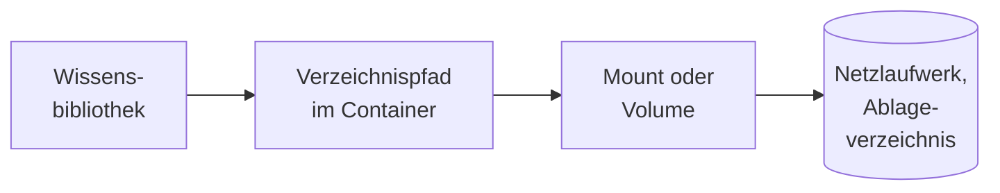

# Konnektor: Verzeichnis im Dateisystem

## 1. Was der Konnektor ist

Der Konnektor liest ein Verzeichnis, das der Backend-Prozess als **lokalen Pfad** sieht: ein
eingebundenes Netzlaufwerk (SMB- oder NFS-Mount im Container), ein Ablageverzeichnis, das ein
Fachverfahren befüllt, oder einen per Docker-Volume durchgereichten Ordner. Eine Netzschnittstelle
gibt es nicht; gelesen wird über das Dateisystem des Containers, mit den Rechten des Prozesses.

- **Anmeldung:** keine. Es gilt das, was die Kennung des Backend-Prozesses lesen darf. Ein
  [Zugang](../zugaenge.md) ist nicht möglich; Zugangsdaten eines Netzlaufwerks gehören in den Mount.
- **Liest:** alle regulären Dateien unter dem Pfad, deren Inhalt ein unterstütztes Format ist, samt
  Unterverzeichnissen. Nicht gelesen werden versteckte Einträge, Windows-Systemordner und was die
  Ausschlussmuster treffen (Abschnitt 3).
- **Dokument:** Der Dateipfad ist die Identität. Die Verzeichnisstruktur erscheint als Ordner der
  Bibliothek.
- **Rechte** aus dem Dateisystem übernimmt OPAA nicht: Wer die Bibliothek lesen darf, sieht alle
  ihre Dokumente.

## 2. Einrichtung

1. **Basisverzeichnisse freigeben.** `opaa.indexing.filesystem.allowlist` nennt die Verzeichnisse,
   unter denen Bibliotheken lesen dürfen. Ab Werk ist sie leer und der Konnektor damit abgeschaltet.
2. **Verzeichnis in den Container bringen**, ein Netzlaufwerk am besten schreibgeschützt.
3. **Leserechte für die Kennung 65532 geben.** Der Backend-Prozess läuft nicht als `root`, sondern
   unter dieser Kennung. Sie muss jedes Verzeichnis betreten (`x`) und jede Datei lesen (`r`)
   dürfen: über die Rechte für „andere" (`chmod -R o+rX`), eine gemeinsame Gruppe oder auf einem
   Netzlaufwerk über die Mount-Optionen (`uid=65532,gid=65532`). Ein `chown` ist der falsche Weg,
   wenn ein Fachverfahren das Verzeichnis befüllt: Es nähme dem Schreiber die Rechte. Einzelheiten
   unter [Nicht-root-Betrieb des Backend-Containers](../docker-compose.md#nicht-root-betrieb-des-backend-containers).
4. **Freigegebene Verzeichnisse vor Endnutzenden schützen.** Die Freigabeprüfung löst symbolische
   Links nicht auf; ein Link nach außen würde beim Lesen verfolgt (Abschnitt 8).
5. Den Bibliotheksverwaltenden die freigegebenen Verzeichnisse nennen; die Oberfläche zeigt sie nicht.

## 3. Quellkonfiguration

| Angabe im Formular | Bedeutung |
|---|---|
| „Verzeichnispfad" | Pflicht. Absoluter Pfad aus Sicht des Backend-Prozesses, also im Container, nicht auf dem Host, und unter einem freigegebenen Basisverzeichnis |
| „Ausschlussmuster (optional)" | eines je Zeile, höchstens 50, je bis 255 Zeichen; Regeln unten |

Beim Speichern weist OPAA einen Pfad außerhalb der Freigabeliste ab („… liegt außerhalb der vom
Betrieb freigegebenen Verzeichnisse"), ebenso jeden Pfad, solange der Betrieb kein Verzeichnis
freigegeben hat („… ist deaktiviert"). Pfad und Muster lassen sich später ändern; die Änderung wirkt
mit dem nächsten Lauf. Pfad und Laufprotokoll sehen nur Verwaltende der Bibliothek.

**„Verbindung testen"** prüft nur, ob sich das Verzeichnis öffnen und auflisten lässt, und antwortet
„Verzeichnis erreichbar." oder nennt den Grund. Unterverzeichnisse, Dateien und Ausschlüsse spielen
für den Test keine Rolle; die Zahl der Dokumente liefert erst der Lauf.

**Ausschlüsse.** Immer ausgeschlossen sind Einträge, deren Name mit einem Punkt beginnt (`.git`,
`.DS_Store`, `.shortcut-targets-by-id`), und die Windows-Systemordner `$RECYCLE.BIN` und
`System Volume Information` ohne Rücksicht auf Groß- und Kleinschreibung. Dazu kommen die Muster der
Bibliothek, bezogen auf den Pfad unterhalb des Verzeichnispfads:

| Regel | Beispiel |
|---|---|
| `*` steht für beliebige Zeichen innerhalb einer Ordnerebene | `*.tmp` trifft nur Dateien direkt im Verzeichnispfad |
| `**` als ganze Ebene steht für beliebig viele Ebenen, auch keine | `**/*.tmp` trifft `notiz.tmp` und `a/b/notiz.tmp` |
| ein abschließendes `/**` schließt den Ordner selbst aus, nie eine gleichnamige Datei | `Archiv*/**` lässt den Ordner `Archiv2020` unbetreten, `Archiv2020.pdf` bleibt |
| `?`, Zeichenklassen `[a-z]`, `[!abc]` und Alternativen `{a,b}` | `{Entwürfe,Papierkorb}/**`, `Plan-20[0-9]?.pdf` |

Die Muster unterscheiden Groß- und Kleinschreibung. Abgewiesen wird ein Muster mit ungültiger Syntax
und eines, das nie treffen kann: führendes oder abschließendes `/`, leere Ebene, Ebene `.` oder `..`,
`**` innerhalb einer Ebene (`**.tmp` statt `**/*.tmp`), Rückwärtsschrägstrich oder mehr als 32
Alternativen. Ein ausgeschlossener Ordner wird nicht betreten;
ausgeschlossene Dateien gehören nicht zur Quelle.

## 4. Betriebsarten und Änderungserkennung

Jeder Lauf ist ein **Vollabgleich**: Er durchläuft den Baum rekursiv, in der Reihenfolge, die das
Dateisystem liefert, ohne Tiefen- oder Mengengrenze. Jede Datei wird anhand ihrer ersten Bytes
klassifiziert, nicht anhand der Endung: unterstützt, abgewiesen oder unterstützt mit dem Hinweis,
dass Endung und Inhalt nicht zusammenpassen.

Eine Vorstufe vor dem Lesen gibt es nicht. Jede Datei wird gelesen und ihre SHA-256-Prüfsumme mit dem
gespeicherten Wert verglichen; unveränderte, zuletzt erfolgreich indizierte Dateien werden
übersprungen. So kommt der Konnektor ohne Änderungsdatum aus, das auf Netzlaufwerken unzuverlässig
sein kann. Ein Erstlauf über ein großes Netzlaufwerk dauert entsprechend; er darf beliebig lange
laufen, solange er Fortschritt meldet.

**Existiert der Pfad nicht**, ist er kein Verzeichnis oder lässt er sich nicht auflisten, scheitert
der Lauf sofort. Ein nicht eingebundenes Netzlaufwerk wird so nie als leerer Bestand gewertet.

## 5. Löscherkennung

Am Ende eines erfolgreichen Laufs werden Dokumente entfernt, deren Pfad nicht mehr gefunden wurde,
auch solche, die erst nachträglich unter ein Ausschlussmuster fallen. Nicht entfernt wird

- nach einem gescheiterten Lauf oder einem Lauf ohne gefundene Datei, auch wenn ein Muster alles
  ausschließt,
- in oder unter einem nicht lesbaren Unterverzeichnis und für eine nicht lesbare Datei samt ihren
  Anhängen, sofern kein Ausschluss sie trifft,
- ein Anhang einer unveränderten Mail.

Ein nicht lesbarer Bereich setzt die Löscherkennung nur für sich selbst aus; verglichen wird nach
ganzen Pfadbestandteilen (`projekte/intern` nicht lesbar lässt `projekte/intern-alt` unberührt). Die
Laufhistorie nennt „N Bereiche nicht lesbar", die Pfade stehen im Protokoll.

## 6. Ordner

Die Verzeichnisstruktur erscheint als schreibgeschützte Ordner der Bibliothek, ohne Tiefengrenze.
Ordner entstehen nur entlang gefundener Dateien und verschwinden am Ende eines erfolgreichen Laufs,
sobald sie kein Dokument mehr halten. Eine verschobene Datei ist ein neues Dokument im neuen Ordner.
Ein Verzeichnisname nur aus Leerraum oder mit Rückwärtsschrägstrich lässt sich nicht als Ordner
darstellen; die Dateien darunter landen in der Wurzel, mit einer Warnung im Log.

## 7. Anhänge

Eine EML- oder MSG-Datei liefert ihre Anhänge als eigene Dokumente, mit den Grenzen des Kapitels
[E-Mail](../formate/mail.md). Eine unveränderte Mail wird nicht neu ausgepackt; ein früher
gescheiterter Anhang wird erst wieder versucht, wenn sich die Mail ändert oder ein Pipeline-Nachzug
angestoßen wird.

## 8. Grenzen und Schutzmechanismen

- **Freigabeliste.** Der Pfad wird normalisiert und muss mit einem Basisverzeichnis beginnen; ein
  `../` bricht nicht aus. Geprüft wird beim Speichern und bei jedem Lauf: Wird die Liste verengt,
  scheitert der nächste Lauf einer nun unzulässigen Bibliothek sofort.
- **Symbolische Links.** Ein Link auf ein Verzeichnis wird nicht betreten, ein Link auf eine Datei
  gelesen. Die Freigabeprüfung löst Links nicht auf; deshalb dürfen freigegebene Verzeichnisse nicht
  von Endnutzenden beschreibbar sein.
- **Leserechte.** Eine Datei, die der Prozess nicht lesen darf, erscheint als „Dateiformat wird
  nicht unterstützt", weil die Formaterkennung sie nicht öffnen kann. **Sieht man diese Meldung für
  fast jede Datei eines Verzeichnisses, liegt es an den Rechten**, nicht am Parser — etwa ein
  Verzeichnis `root:root 0700` oder ein CIFS-Mount mit `uid=0,file_mode=0600`. Der Lauf endet dabei
  nicht mit einem Fehler. Ein Unterverzeichnis, das der Prozess nicht betreten darf, wird mit
  „Nicht lesbar, übersprungen" übersprungen.
- **Keine Größengrenze im Konnektor.** Es wirken die Grenzen der Formate und das Speicherkontingent.

## 9. Protokoll und Fehlerbilder

| Meldung | Bedeutung | Abhilfe |
|---|---|---|
| „Verzeichnispfad liegt außerhalb der vom Betrieb freigegebenen Verzeichnisse" (Kategorie „Allowlist") | Freigabeliste verletzt oder verengt; der Lauf endet sofort | Pfad oder Freigabeliste anpassen |
| Lauf fehlgeschlagen, Pfad fehlt | Netzlaufwerk nicht eingebunden; nichts wird entfernt | Mount prüfen |
| „Dateiformat wird nicht unterstützt" | Inhalt nicht zugelassen oder Datei nicht lesbar | bei Häufung Rechte prüfen (Abschnitt 8) |
| „Dateiendung passt nicht zum erkannten Inhalt (erkannt: …)" | wird trotzdem indiziert | nichts |
| „Nicht lesbar, übersprungen" | Unterverzeichnis darf nicht betreten werden; sein Bestand bleibt | Rechte der Kennung 65532 prüfen |
| „In der Quelle nicht mehr gefunden, entfernt" | Löscherkennung | nichts |
| Kontingent-Meldung, „kein extrahierbarer Text", „Verarbeitung fehlgeschlagen" | wie bei jeder Quelle | Kapitel [Wissensbibliotheken](../wissensbibliotheken.md) |
| „Geplanter Lauf übersprungen: Indizierung läuft bereits" | Zeitplan traf einen laufenden Lauf | nichts |

Eine Datei, die zwischen Aufzählung und Verarbeitung verschwindet oder gesperrt ist, erscheint als
„Format nicht unterstützt" oder „Fehler"; der Lauf geht weiter.

## 10. Konfiguration

| Schlüssel | Umgebungsvariable | Standard | Wirkung |
|---|---|---|---|
| `opaa.indexing.filesystem.allowlist` | `OPAA_INDEXING_FILESYSTEM_ALLOWLIST` | leer | kommagetrennte absolute Basisverzeichnisse; leer schaltet den Konnektor ab |

Thread-Pool, Kontingent, Zerlegung und Einbettung gelten für alle Quellen und stehen im Kapitel
[Wissensbibliotheken](../wissensbibliotheken.md).

## 11. Nicht gebaut

- Einschlussmuster
- Abschalten der Standardausschlüsse
- Übernahme von Zugriffsrechten aus dem Dateisystem
- Schonzeitraum, in dem eine Quelle nicht gelesen wird
- Automatische Drosselung des Zeitplans nach wiederholtem Scheitern; sichtbar ist nur das
  Warnbanner nach zwei fehlgeschlagenen geplanten Läufen
- Aktualisierung durch Dateisystem-Benachrichtigungen
