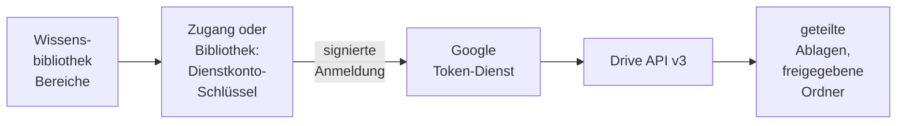

# Konnektor: Google Drive

## 1. Was der Konnektor ist

Der Konnektor liest **geteilte Ablagen und Ordner eines Google-Workspace-Mandanten** über die
**Google Drive API v3** und hält sie über deren Änderungsprotokoll aktuell. Google Drive ist eine der
[Dateiablagen](README.md#2-dateiablagen); was alle Dateiablagen teilen, steht dort.

- **Anmeldung:** mit einem **Dienstkonto-Schlüssel**. Über einen Zugang meldet sich der Zugang
  selbst an ([Zugänge](../zugaenge.md), „Der Zugang meldet sich selbst an"); ohne Zugang trägt die
  Bibliothek den Schlüssel als eigene Zugangsdaten. Gelesen wird mit dem Scope `drive.readonly`. Das
  Dienstkonto sieht, was mit ihm geteilt ist; mit **domänenweiter Delegation** imitiert es ein Konto
  der Domäne und sieht, was dieses sieht. Ein Zugang ist möglich und darf das imitierte Konto
  vorgeben.
- **Liest:** in einem bis fünfzig Bereichen — einer ganzen geteilten Ablage, einem Ordner samt
  Unterordnern oder „Meine Ablage" des imitierten Kontos — Dateien in unterstützten Formaten und
  **Google-Formate als Export**:

  | Typ | Exportiert als | Über der Exportgrenze von Google (10 MB) |
  |---|---|---|
  | Google Docs, Präsentationen | `.docx`, `.pptx` | als Text exportiert, ohne Überschriften und Tabellen |
  | Google Tabellen | `.xlsx` | übersprungen; CSV enthielte nur das erste Blatt |
  | Zeichnungen, Formulare, Websites und weitere | — | übersprungen |

  Verknüpfungen werden nicht verfolgt; ihr Ziel wird nur indiziert, wenn es selbst in einem Bereich
  liegt. Dateien mit gesperrtem Download werden übersprungen.
- **Dokument:** Die Datei-ID ist die Identität; Umbenennen und Verschieben innerhalb der Bereiche
  behalten das Dokument. **„Original öffnen"** führt zu `https://drive.google.com/open?id=<Datei-ID>`;
  wer die Datei dort nicht sehen darf, sieht eine Zugriffsanfrage.
- **Rechte** aus Drive übernimmt OPAA nicht: Wer die Bibliothek lesen darf, liest alles aus allen
  Bereichen.

## 2. Einrichtung

Jede Installation nutzt ihr **eigenes GCP-Projekt**; eine zentrale OPAA-App gibt es nicht. Ein
Dienstkonto, das nur ihm freigegebene Daten liest, braucht keine Verifizierung durch Google.

1. In der Google Cloud Console ein Projekt anlegen und unter „APIs & Dienste" → „Bibliothek" die
   „Google Drive API" aktivieren.
2. Unter „IAM & Verwaltung" → „Dienstkonten" ein Dienstkonto ohne Projektrolle erstellen, dann
   „Schlüssel" → „Schlüssel hinzufügen" → „JSON". Verbietet die Organisationsrichtlinie Schlüssel
   (`iam.managed.disableServiceAccountKeyCreation`), setzt die Administration eine Ausnahme für genau
   dieses Projekt.
3. **Freigaben (Regelfall):** das Dienstkonto als „Betrachter" in jede geteilte Ablage aufnehmen bzw.
   jeden Ordner für seine Adresse `…@….iam.gserviceaccount.com` als „Betrachter" freigeben. Ein
   Dienstkonto besitzt selbst keine Dateien.
4. **Domänenweite Delegation**, nur für „Meine Ablage" eines Kontos: in der Admin-Konsole
   „Sicherheit" → „Zugriffs- und Datenverwaltung" → „API-Steuerung" → „Domainweite Delegation" die
   Client-ID des Dienstkontos mit dem Scope `https://www.googleapis.com/auth/drive.readonly`
   eintragen. Ein solcher Schlüssel kann **jedes** Konto der Domäne lesen: als imitiertes Konto ein
   Funktionskonto wählen und die Delegation über einen Zugang führen, an dem nur die
   Systemverwaltung das Konto festlegt.
5. Unter **Administration → Anbindungen → Zugänge** einen Zugang für Google Drive mit der Anmeldeart
   Dienstkonto-Schlüssel anlegen, die JSON-Datei hochladen und mit „Anmeldung testen" prüfen; die
   Client-ID übernimmt OPAA aus der Datei. Die Quellart und jeder neue Zugang sind ab Werk nur für die
   Systemverwaltung freigegeben ([Berechtigungen](../berechtigungen.md), „Konnektor-Freigabe").

OPAA speichert aus der Datei nur Adresse, Kennung und privaten Schlüssel, verschlüsselt; die Anmeldung
geht immer an `https://oauth2.googleapis.com/token`, die Abrufe an `https://www.googleapis.com`.

## 3. Quellkonfiguration

| Angabe im Formular | Bedeutung |
|---|---|
| „Dienstkonto-Schlüssel (JSON)" | nur ohne Zugang; beim Bearbeiten bleibt der gespeicherte, solange das imitierte Konto gleich bleibt |
| „Imitiertes Konto (optional)" | nur ohne Zugang und nur mit Delegation; eine Änderung verlangt den Schlüssel neu |
| Bereiche | aus der Auflistung gewählt — geteilte Ablagen und freigegebene Ordner, mit imitiertem Konto auch „Meine Ablage" — oder per „Ordner-ID" eingetragen |

Überlappende Bereiche sind erlaubt; eine Datei bleibt ein Dokument, ihr Ordner kommt aus dem ersten
Bereich, der sie listet. Den eigenen
Vollabgleich-Rhythmus setzt „Vollabgleich alle … Tage". **„Verbindung testen"** meldet sich an und
prüft jeden Bereich (Befunde in Abschnitt 9). Eine geänderte Bereichsliste oder ein anderes
imitiertes Konto lassen den nächsten Lauf vollständig abgleichen.

**Über einen Zugang** trägt die Bibliothek nur ihre Bereiche; ein imitiertes Konto an der Bibliothek
weist OPAA ab. Ändert die Systemverwaltung das imitierte Konto am Zugang, nennt OPAA vorher die Zahl
der betroffenen Bibliotheken; danach ist der nächste Lauf jeder Bibliothek ein Vollabgleich, und ihre
Verwaltenden werden benachrichtigt. Läuft gerade eine Bibliothek des Zugangs, lehnt OPAA die Änderung
ab; bei langen Läufen den Zugang vorher sperren. Ein neuer Schlüssel desselben Dienstkontos ändert
nichts an den Bibliotheken. Weist Google den Schlüssel ab, zeigen alle Bibliotheken „Abgelaufen" mit
der Systemverwaltung als zuständig; eine falsch gehende Serveruhr meldet Google wie einen ungültigen
Schlüssel, und OPAA verweist dann auf die Uhrzeit. „Alle Verbindungen trennen" löscht den Schlüssel
in OPAA; bei Google widerruft ihn die Verwaltung in der Cloud Console.

## 4. Betriebsarten und Änderungserkennung

| Laufart | Wann | Was er tut |
|---|---|---|
| **Vollabgleich** | erster Lauf, nach einer Änderung von Bereichen oder imitiertem Konto, nach einer Ordneränderung, nach einem verfallenen Änderungsstand, im Vollabgleich-Rhythmus, „Vollabgleich starten" | listet alle Bereiche und entfernt, was fehlt |
| **Änderungslauf** | jeder Lauf dazwischen und „Jetzt indizieren" | liest das Änderungsprotokoll ab dem gespeicherten Stand und lädt nur Geändertes |

Jede geteilte Ablage hat einen eigenen Änderungsstrom, alle übrigen Bereiche teilen den des Kontos.
Wird ein Ordner umbenannt, verschoben oder gelöscht, ist der nächste Lauf ein Vollabgleich, auch wenn
der Ordner außerhalb der Bereiche liegt.

**Unverändertes erkennen.** Vor dem Download vergleicht OPAA bei hochgeladenen Dateien MD5-Prüfsumme
und Größe, bei Google-Formaten Änderungszeit und Zielformat. Verbindlich bleibt die eigene Prüfsumme.

## 5. Löscherkennung

Entfernt wird im Vollabgleich, wenn die Datei in keinem Bereich mehr vorkommt — nur nach einem
Vollabgleich in **einem** Lauf ([Konnektoren](README.md#23-wann-eine-gelöschte-datei-als-nachgewiesen-gilt)) —,
und im Änderungslauf, wenn Drive sie als gelöscht oder im Papierkorb meldet oder sie in keinem Bereich
mehr liegt. Ein Bereich, den das Konto nicht mehr sieht, führt zu keiner Löschung.

## 6. Ordner

Die Ordnerkette bis zum Bereich erscheint als Ordner der Bibliothek; bei mehreren Bereichen steht der
Name der Ablage bzw. des Ordners vorn. Namen, die keinen Ordner tragen können, und zu tiefe Ketten
folgen den Regeln des Kapitels [Wissensbibliotheken](../wissensbibliotheken.md).

## 7. Anhänge

Eine EML- oder MSG-Datei liefert ihre Anhänge als eigene Dokumente, mit den Grenzen des Kapitels
[E-Mail](../formate/mail.md).

## 8. Grenzen und Schutzmechanismen

- **Kontingente.** Google zählt Einheiten je Projekt und Nutzer, OPAA Anfragen je Lauf. Bei `429`
  oder `403 rateLimitExceeded`/`userRateLimitExceeded` wartet OPAA mit wachsendem Abstand und
  wiederholt; bei `403 dailyLimitExceeded` endet der Lauf, und der nächste geplante setzt an. Vor
  stündlichen Zeitplänen über sehr große Ablagen die Kontingentseite des Projekts prüfen.
- **Kosten eines Laufs.** Ein Änderungslauf ohne Änderungen kostet eine Anfrage je Strom und Bereich,
  die Auflistung eine je Seite; viele Ordnerbereiche kosten je Ordner eine Auflistung.
- **Zu langes Änderungsprotokoll.** Ein Änderungslauf liest das Protokoll aller Ströme bis zum Ende,
  bevor er einen neuen Stand übernimmt. Jede gemeldete Entfernung kostet eine eigene Prüfung; wird
  etwa die Freigabe eines großen Ordners entzogen, reicht das Budget schnell nicht mehr. Dann endet
  jeder Änderungslauf mit „Anfragebudget von … Anfragen erschöpft; der nächste Lauf liest das
  Änderungsprotokoll ab derselben Stelle erneut", und die Bibliothek kommt bis zum nächsten
  Vollabgleich im Rhythmus nicht voran. Nichts wird fälschlich entfernt. Abhilfe:
  `request-budget-per-run` anheben oder geteilte Ablagen auf mehrere Bibliotheken verteilen, die je
  ein eigenes Budget haben.
- **Lange Downloads.** Eine Datei, die `download-timeout` dauerhaft reißt, gilt in jedem Lauf als
  vorübergehend fehlgeschlagen und hält den Änderungsstrom an; dann die Frist erhöhen.
- **Noch nicht an einem echten Workspace bestätigt** und auf die Dokumentation von Google gestützt:
  ob ein Dienstkonto Mitglied einer geteilten Ablage werden kann, wenn die Organisation externe
  Freigaben einschränkt; ob Änderungen in einem nur per Ordnerfreigabe sichtbaren Ordner einer
  geteilten Ablage im Strom des Kontos erscheinen (sonst sieht sie erst der Vollabgleich); das
  Fehlerbild eines Exports über der Grenze (erwartet `exportSizeLimitExceeded`, sonst erscheint die
  Datei als „nicht lesbar"); ob ein unveränderter Export bytegleich wiederkommt (sonst wird ein
  Google-Format nach jeder Änderungszeit neu verarbeitet).

## 9. Protokoll und Fehlerbilder

| Meldung | Bedeutung | Abhilfe |
|---|---|---|
| „Der Dienstkonto-Schlüssel von … wird nicht angenommen" | Schlüssel ungültig, widerrufen oder Dienstkonto gelöscht; auch eine falsch gehende Serveruhr | neuen Schlüssel hinterlegen, Uhr prüfen |
| „Die domänenweite Delegation fehlt" / „Dem Zugriffstoken fehlt der Scope drive.readonly" | Delegation nicht oder ohne Scope eingetragen | Admin-Konsole; unter einem Zugang zuständig: die Systemverwaltung |
| „Das imitierte Konto … ist in der Domäne nicht bekannt" | Tippfehler oder Konto gelöscht | Konto prüfen |
| „Geltungsbereich „…": … nicht sichtbar" | Freigabe oder Mitgliedschaft fehlt, oder die ID ist falsch; der Bestand bleibt | freigeben |
| „Als Text exportiert …" / „Tabelle übersprungen …" | über der Exportgrenze | Datei verkleinern oder hinnehmen |
| „… Verknüpfungen übersprungen" / „… Google-Dateien ohne Exportformat … übersprungen" | Sammelhinweise je Lauf | nichts |
| „Der Download dieser Datei ist in Google Drive gesperrt" | Datei übersprungen | Download freigeben |
| „Google Drive drosselt die Anfragen weiterhin" | nach allen Wiederholungen; der Strom wird erneut gelesen | Zeitplan entzerren |
| „Das Tageskontingent der Drive-API ist erschöpft" | Lauf beendet | abwarten, Kontingent prüfen |
| „Google Drive nimmt den gespeicherten Stand des Änderungsprotokolls nicht mehr an" | nächster Lauf ist ein Vollabgleich | nichts |

## 10. Konfiguration

Alle Schlüssel unter `opaa.indexing.google-drive.*`.

| Schlüssel | Umgebungsvariable | Standard | Wirkung |
|---|---|---|---|
| `page-size` | `OPAA_INDEXING_GOOGLE_DRIVE_PAGE_SIZE` | 1000 | Einträge je Auflistungs- und Änderungsseite; höchstens 1000 |
| `max-file-size-bytes` | `OPAA_INDEXING_GOOGLE_DRIVE_MAX_FILE_SIZE_BYTES` | 52428800 (50 MiB) | Obergrenze je Download oder Export |
| `request-timeout` | `OPAA_INDEXING_GOOGLE_DRIVE_REQUEST_TIMEOUT` | 30s | Timeout je Anfrage |
| `download-timeout` | `OPAA_INDEXING_GOOGLE_DRIVE_DOWNLOAD_TIMEOUT` | 10m | Gesamtfrist je Download oder Export; danach folgt die Datei im nächsten Lauf |
| `max-retries` | `OPAA_INDEXING_GOOGLE_DRIVE_MAX_RETRIES` | 5 | Wiederholungen einer gedrosselten Anfrage |
| `retry-backoff` | `OPAA_INDEXING_GOOGLE_DRIVE_RETRY_BACKOFF` | 1s | Basis des wachsenden Abstands |
| `request-budget-per-run` | `OPAA_INDEXING_GOOGLE_DRIVE_REQUEST_BUDGET_PER_RUN` | 20000 | Anfragen je Lauf |
| `max-files-per-run` | `OPAA_INDEXING_GOOGLE_DRIVE_MAX_FILES_PER_RUN` | 1000000 | gelistete Dateien je Vollabgleich, bevor der Lauf scheitert |
| `download-concurrency` | `OPAA_INDEXING_GOOGLE_DRIVE_DOWNLOAD_CONCURRENCY` | 2 | gleichzeitige Downloads je Lauf |
| `full-sync-interval` | `OPAA_INDEXING_GOOGLE_DRIVE_FULL_SYNC_INTERVAL` | 7d | Rhythmus des Vollabgleichs; je Bibliothek überschreibbar |

Die Obergrenze von fünfzig Bereichen ist fest.

## 11. Nicht gebaut

- Push-Benachrichtigungen (`changes.watch`); der Änderungslauf im Zeitplan ersetzt sie
- Persönliche Ablagen über verbundene Konten
- Export über die Exportgrenze von Google hinaus
- Übernahme von Rechten aus Drive
