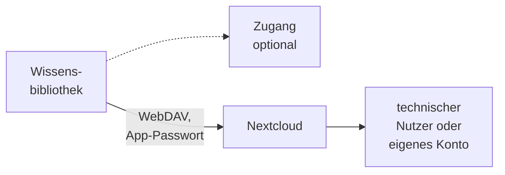
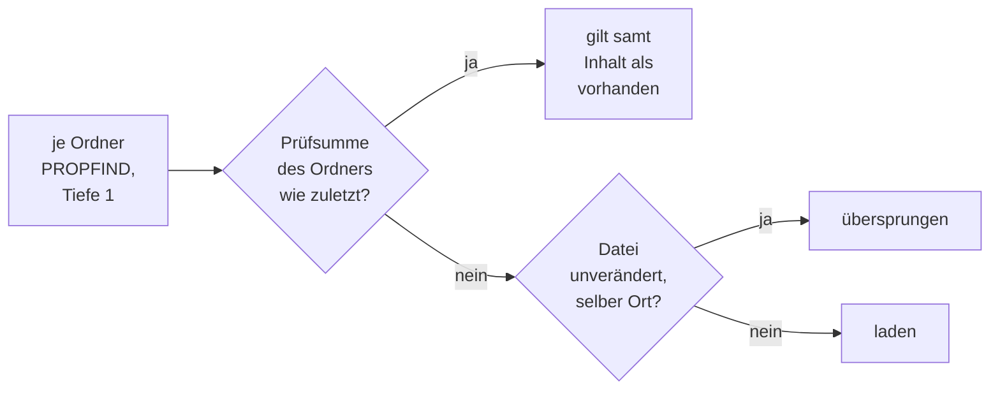

# Konnektor: Nextcloud

## 1. Was der Konnektor ist

Der Konnektor liest **Ordner eines Nextcloud-Nutzers**, auch die Dateiablage von openDesk und
ownCloud 10. Er spricht **WebDAV** (`PROPFIND` auf `/remote.php/dav/files/<Nutzer>`) und sieht, was
der Nutzer sieht: eigene Ordner, **Freigaben an ihn** und **Gruppenordner**, so wie sie in seinem
Dateibaum erscheinen. Nextcloud ist eine der [Dateiablagen](README.md#2-dateiablagen); was alle
Dateiablagen teilen, steht dort.

- **Anmeldung:** Benutzername und App-Passwort als HTTP Basic. Für eine geteilte Bibliothek sind
  das eigene Zugangsdaten der Bibliothek, für eine private Bibliothek ein verbundenes Konto der
  Person ([Zugänge](../zugaenge.md), „Eigene Zugangsdaten der Bibliothek" und „Verbundenes Konto
  einer Person"). Ein Zugang ist möglich; für ein verbundenes Konto ist er nötig.
- **Liest:** die aktuelle Fassung jeder Datei in einem unterstützten Format in einem bis fünfzig
  Ordnern, samt Unterordnern; die Anhänge von Mail-Dateien werden eigene Dokumente.
- **Dokument:** Die Datei-ID der Nextcloud ist die Identität. **Umbenennen und Verschieben** behalten
  das Dokument; die Datei wird einmal neu geladen, aber bei gleichem Inhalt nicht neu verarbeitet.
  Der **Beleg-Link** `<Nextcloud>/index.php/f/<Datei-ID>` öffnet die Datei in der Weboberfläche nach
  deren eigener Anmeldung. **„Original öffnen"** lädt sie durch OPAA, von dem Ort, den der letzte
  Lauf gespeichert hat; eine seither verschobene Datei liefert bis zum nächsten Lauf kein Original.
- **Rechte** aus der Nextcloud übernimmt OPAA nicht: Was das Konto in den Ordnern lesen kann, sehen
  alle Leseberechtigten der Bibliothek.

## 2. Einrichtung

1. Nextcloud im privaten Netz: ihren Hostnamen für die
   [Zieladressprüfung](README.md#12-zieladressprüfung) freigeben.
2. Einen **technischen Nutzer** anlegen, kein persönliches Konto. Er braucht nur Leserechte; OPAA
   schreibt nie. Ordner kommen über **Freigaben** (Lesen genügt) oder als **Gruppenordner** zu ihm.
   Eine Freigabe mit gesperrtem Herunterladen hält OPAA nicht zuverlässig ab.
3. Für ihn ein **App-Passwort** erzeugen: *Persönliche Einstellungen › Sicherheit › Geräte &
   Sitzungen* oder `occ user:auth-tokens:add <nutzer>`. Es lässt sich einzeln widerrufen. Unter LDAP
   dürfen Anmeldename und Nutzer-ID abweichen; OPAA fragt die ID bei der Anmeldung ab.
4. Die Quellart ist ab Werk nur für die Systemverwaltung freigegeben. Wer sonst Bibliotheken anlegen
   soll, bekommt „Konnektorbibliotheken anlegen" für die Quellart oder einen Zugang
   ([Berechtigungen](../berechtigungen.md), „Konnektor-Freigabe").
5. Für private Bibliotheken einen Zugang mit der Besitzart „Person" oder „Bibliothek und Person"
   anlegen und freigeben (Abschnitt 3, „Verbundenes Konto").

## 3. Quellkonfiguration

| Angabe im Formular | Bedeutung |
|---|---|
| „Adresse der Nextcloud" | `http(s)://host[:port][/pfad]`; eine eingefügte WebDAV-Adresse wird auf die Instanzadresse gekürzt |
| „Technischer Nutzer", „App-Passwort" | Benutzername ohne Doppelpunkt und App-Passwort; gehen nur an diese Adresse, eine geänderte Adresse verlangt sie neu |
| „Ordner" | ein bis fünfzig Pfade, wie der Nutzer sie sieht, etwa `/Projekte`; `/` liest alles. Ordner dürfen sich nicht überschneiden; kein Komma, kein `.` oder `..` |

**„Ordner laden"** zeigt die Ordner im Stamm des Nutzers mit dem Zusatz „Freigabe" oder
„Gruppenordner". **„Verbindung testen"** meldet sich an und prüft jeden Ordner. Die Ordner stehen
unter „Umfang" für alle Leseberechtigten. Eine geänderte Ordnerliste lässt den nächsten Lauf alles
listen.

**Über einen Zugang:** Er gibt die Server-Adresse vor. Bei der Besitzart
„Bibliothek" tragen die Verwaltenden Benutzername und App-Passwort des technischen Nutzers ein;
Vorgaben für weitere Einstellungen gibt es nicht.

### Verbundenes Konto

Über einen Zugang mit der Besitzart „Person" bindet eine Person ihre **eigene** Nextcloud an, ohne
technischen Nutzer, und speist daraus eine [private Bibliothek](../private-bibliotheken.md).

1. In der eigenen Nextcloud unter *Persönliche Einstellungen › Sicherheit › Geräte & Sitzungen* ein
   App-Passwort mit einem Namen wie „OPAA" erstellen; es wird nur einmal angezeigt. Das Kontopasswort
   gehört nicht in OPAA.
2. In OPAA unter *Einstellungen › Verbundene Konten* beim Zugang „Verbinden" wählen und Benutzername
   und App-Passwort eintragen. OPAA speichert sie nur, wenn die Anmeldung gelingt
   ([Benutzerverwaltung](../benutzerverwaltung.md), „Verbundene Konten").
3. Im Assistenten im Schritt „Quelle einrichten" unter **„Über mein verbundenes Konto"** den
   Zugang und die Ordner wählen.

Lehnt die Nextcloud das App-Passwort ab, gilt die Verbindung als **abgelaufen**; die Person wird
benachrichtigt, die Bibliothek zeigt „Abgelaufen" mit „Konto neu verbinden", und ihr Bestand bleibt
durchsuchbar. Die Verwaltung sieht am Zugang nur die Zahl verbundener und abgelaufener Konten, kleine
Zahlen als „weniger als N"; Verbinden und Trennen stehen pseudonym im Verbindungsprotokoll. Auch die
Betriebslogs nennen von einer privaten Bibliothek nur ihre Kennung.

## 4. Betriebsarten und Änderungserkennung

Jeder Lauf ist ein **Vollabgleich**; Nextcloud kennt für Dateien kein Änderungsprotokoll. Der Lauf
steigt aber nur in Ordner ab, deren Prüfsumme sich geändert hat.

**Unveränderte Ordner.** Nextcloud ändert die Prüfsumme (ETag) eines Ordners, sobald sich darin oder
darunter etwas ändert, bis zur Wurzel, auch bei Freigaben und Gruppenordnern. OPAA merkt sich nach
jedem vollständigen Lauf die Prüfsumme jedes Ordners; ein Ordner mit gleicher Prüfsumme wird nicht
gelistet. Ein unveränderter Ordner kostet so eine Anfrage, dazu eine für die Anmeldung. Wieder
gelistet wird ein Ordner, der sich geändert hat, umbenannt oder verschoben wurde oder in dem beim
letzten Lauf etwas nicht geladen oder aufgenommen werden konnte oder in OPAA gelöscht wurde. Den
ganzen Baum listet ein Lauf nach einer Änderung von Größengrenze, Formaten, Adresse oder Ordnern,
einmal nach einem Update, das die Grundlage ändert, und spätestens nach `full-descent-interval` — das
fängt Änderungen ab, die Nextcloud nicht weiterträgt, etwa auf externem Speicher.

**Über mehrere Läufe.** Die Ordner werden in Namensreihenfolge abgearbeitet. Reicht das Budget nicht,
endet der Lauf als „unvollständig, wird fortgesetzt", und der nächste setzt an der gemerkten Stelle
fort ([Konnektoren](README.md#22-ein-vollabgleich-über-mehrere-läufe)). Ein Lauf, der an einem Fehler
scheitert, ändert die Stelle nicht. Die Obergrenze `max-entries-per-run` gilt für den ganzen Abgleich.

## 5. Löscherkennung

Entfernt wird nur nach einem Lauf, der **allein** alle Ordner gelistet oder über ihre Prüfsumme
bestätigt hat ([Konnektoren](README.md#23-wann-eine-gelöschte-datei-als-nachgewiesen-gilt)). Ein
Abgleich über mehrere Läufe entfernt nichts, merkt sich aber die Prüfsummen; der nächste Lauf steigt
dann nur in geänderte Ordner ab, passt meist in ein Budget und entfernt, was fehlt. Ändert sich die
Nextcloud so schnell, dass kein Lauf mehr alles allein bestätigt, wird weiter aufgenommen, aber nicht
entfernt.

Ein Ordner, der dauerhaft nicht gelistet werden kann (gelöscht, Freigabe entzogen), macht seinen
Bereich unvollständig: Neue und geänderte Dateien kommen weiter an, entfernt wird nichts, bis der
Ordner wieder listbar ist oder aus der Bibliothek genommen wird. In diesem Zustand listet jeder Lauf
den ganzen Baum, sobald die gemerkten Prüfsummen älter als `full-descent-interval` sind.

## 6. Ordner

Die Ordner unterhalb der konfigurierten Ordner erscheinen als schreibgeschützte Ordner. Bei einem
konfigurierten Ordner ist er die Wurzel, bei mehreren beginnt jede Kette mit seinen Pfadsegmenten. Am
Dokument stehen der konfigurierte Ordner und der Gliederungspfad darunter.

## 7. Anhänge

Eine EML- oder MSG-Datei liefert ihre Anhänge als eigene Dokumente, mit den Grenzen des Kapitels
[E-Mail](../formate/mail.md).

## 8. Grenzen und Schutzmechanismen

- **Zieladressprüfung** ([Konnektoren](README.md#12-zieladressprüfung)). Nennt die Nextcloud eine
  Adresse außerhalb ihrer eigenen Dateien, schickt OPAA dorthin keine Zugangsdaten.
- Eine Ratenbegrenzung (`429`) wartet OPAA ab und wiederholt.
- Ein Ordner mit sehr vielen Einträgen kann die Grenze einer Auflistungsantwort
  (`max-response-bytes`) überschreiten und gilt dann als nicht auflistbar.
- **ownCloud 10** spricht dasselbe WebDAV; von Hand geprüft mit 10.15 (Anmeldung, Datei-ID,
  Ordner-Prüfsummen, Beleg-Link), ohne automatische Testreihe. Eine ownCloud-10-Bibliothek legt man
  als Nextcloud an. **ownCloud Infinite Scale** nutzt eine andere Schnittstelle und wird nicht
  unterstützt.

## 9. Protokoll und Fehlerbilder

| Meldung | Bedeutung | Abhilfe |
|---|---|---|
| „TLS-Verbindung zu … fehlgeschlagen. Das Zertifikat des Servers wird nicht anerkannt …" | Zertifikat einer hauseigenen Zertifizierungsstelle oder auf einen anderen Namen | Zertifizierungsstelle ergänzen ([Zertifikatsprüfung](README.md#13-zertifikatsprüfung)) |
| „Nextcloud hat Benutzername oder App-Passwort abgelehnt (HTTP 401)." | Zugangsdaten falsch oder widerrufen; der Bestand bleibt. Bei einer privaten Bibliothek gilt die Verbindung als abgelaufen | neues App-Passwort eintragen bzw. neu verbinden |
| „Geltungsbereich „/…": Nextcloud kennt den Ordner „/…" nicht (HTTP 404)." | Ordner gelöscht, umbenannt oder Freigabe entzogen; nichts wird entfernt. Ein umbenannter Unterordner ist im nächsten Lauf unter neuem Namen da | konfigurierten Ordner anpassen oder Freigabe wiederherstellen |
| „Nextcloud nannte für … eine Adresse außerhalb der Instanz" | keine Zugangsdaten dorthin; die Datei behält ihre Fassung, ein Ordner macht seinen Bereich unvollständig | Proxy oder Umschreibregeln prüfen |
| „Keine Leseberechtigung für … (HTTP 403)." | die Datei behält ihre Fassung | Freigabe prüfen |
| „Nextcloud kann die Datei … derzeit nicht öffnen (HTTP 503)." | gelistet, aber nicht lesbar; der Ordner wird erneut geprüft | Speicher der Nextcloud prüfen |
| „Unter … antwortet … kein WebDAV einer Nextcloud" | falsche Adresse oder vorgeschaltetes Anmeldeportal | Adresse prüfen |
| „… überschreitet … Bytes (opaa.indexing.nextcloud.max-response-bytes)" | Ordner zu groß für eine Antwort | Grenze anheben oder Ordner aufteilen |
| „unvollständig, wird fortgesetzt" | Budget erschöpft; auch der Lauf, der einen Abgleich über mehrere Läufe abschließt | nichts; dauerhaft: Budget anheben |
| „Vollabgleich über mehrere Läufe abgeschlossen; in der Quelle gelöschte Dateien entfernt erst ein Lauf, der alle Geltungsbereiche allein auflistet" | nichts entfernt | kommt sie bei jedem Lauf: Budget anheben |
| „Der Lauf hat keine Datei neu aufgenommen. Budget anheben …" | die Kette kommt nicht voran | `request-budget-per-run` anheben |
| „Geltungsbereich „/…": Der Fortsetzungspunkt … Die Auflistung dieses Geltungsbereichs beginnt neu." | die gemerkte Stelle passt nicht mehr; nichts wird entfernt. Zweimal hintereinander: der Bereich gilt in diesem Lauf als nicht auflistbar | nichts |

## 10. Konfiguration

Alle Schlüssel unter `opaa.indexing.nextcloud.*`, Umgebungsvariablen `OPAA_INDEXING_NEXTCLOUD_*`.

| Schlüssel | Standard | Wirkung |
|---|---|---|
| `max-file-size-bytes` | 50 MiB | Obergrenze einer Datei, vor und während des Downloads |
| `request-timeout` | 30 s | Zeitlimit je Auflistung |
| `request-budget-per-run` | 20 000 | Anfragen je Lauf |
| `max-entries-per-run` | 1 000 000 | gelistete Dateien je Vollabgleich, auch über mehrere Läufe; darüber scheitert der Lauf |
| `download-concurrency` | 2 | gleichzeitige Downloads je Lauf |
| `max-response-bytes` | 64 MiB | Obergrenze einer Auflistungsantwort, also eines Ordners |
| `full-descent-interval` | 7 Tage | Höchstalter der gemerkten Ordner-Prüfsummen |

## 11. Nicht gebaut

- Ein- und Ausschlussmuster; heute schränken nur die Ordner ein
- Benachrichtigungen der Nextcloud an OPAA
- Anmeldung per OAuth oder Token-Austausch über den Identitätsanbieter für verbundene Konten
- Übernahme von Rechten aus der Nextcloud
