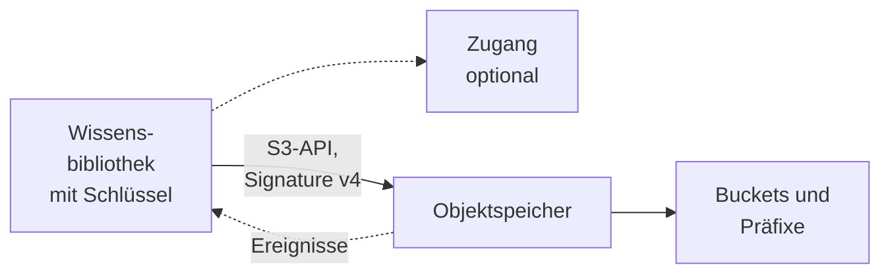
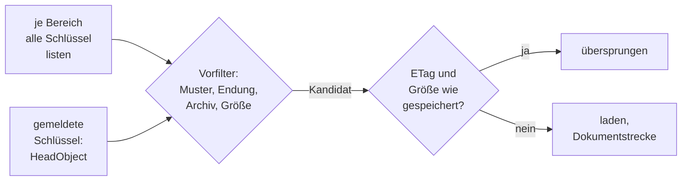

# Konnektor: S3-Objektspeicher

## 1. Was der Konnektor ist

Der Konnektor liest Objekte aus **S3-kompatiblen Objektspeichern**: AWS S3, MinIO, Ceph RGW,
Hetzner Object Storage und jeden weiteren Dienst, der `ListObjectsV2`, `HeadBucket`, `HeadObject` und
`GetObject` der **S3-API mit Signature v4** bedient. Eine Bibliothek zeigt auf **einen** Endpoint mit
**einem** Zugriffsschlüssel und **einem bis fünfzig Geltungsbereichen** — je ein Bucket mit
optionalem Schlüsselpräfix. S3 ist eine der [Dateiablagen](README.md#2-dateiablagen); was alle
Dateiablagen teilen, steht dort.



- **Anmeldung:** eigene Zugangsdaten der Bibliothek ([Zugänge](../zugaenge.md), „Eigene
  Zugangsdaten der Bibliothek"): Access Key und Secret Key, für zeitlich begrenzte STS-Schlüssel
  dazu ein Session-Token. Signiert wird immer mit der konfigurierten Region; Umgebungsvariablen,
  Profile und die Instanzrolle des OPAA-Hosts werden nie befragt. Ein Zugang ist möglich und darf
  Region und Adressstil vorgeben.
- **Liest:** die **aktuelle Version** jedes Objekts in einem unterstützten Format, dessen Schlüssel
  in einem Geltungsbereich liegt und die Muster passiert; die Anhänge von Mail-Objekten werden
  eigene Dokumente. **Nicht** gelesen werden Ordnermarker, Objekte in Archivklassen, ältere
  Versionen, Objektmetadaten und Tags.
- **Dokument:** Bucket und Schlüssel sind die Identität (`s3://<bucket>/<schlüssel>`), der Endpoint
  nur der Weg: Ein Umzug auf einen anderen Endpoint mit denselben Buckets baut den Bestand nicht
  neu. Einen Beleg-Link gibt es nicht, denn eine `s3://`-Adresse öffnet kein Browser. **„Original
  öffnen"** lädt das Objekt im Moment des Klicks durch OPAA aus dem Speicher, ohne eine Kopie
  aufzubewahren, und nur aus einem Geltungsbereich, den die Bibliothek noch hat.
- **Rechte** aus Bucket-Policies und IAM übernimmt OPAA nicht: Was der Schlüssel in den
  Geltungsbereichen lesen darf, sehen alle Leseberechtigten der Bibliothek.

## 2. Einrichtung

1. **Rechte des Schlüssels.** Auf jedem Bucket eines Geltungsbereichs braucht der Schlüssel
   `s3:ListBucket` und `s3:GetObject`. `s3:ListBucket` ist auch nötig, damit ein fehlendes Objekt mit
   `404` statt `403` antwortet — ohne das Recht kann OPAA eine Löschung nie bestätigen.
   `s3:ListAllMyBuckets` braucht nur „Buckets laden" im Formular. Schreibrechte braucht OPAA nie.

   ```json
   {
     "Version": "2012-10-17",
     "Statement": [
       {
         "Effect": "Allow",
         "Action": ["s3:ListBucket", "s3:GetObject"],
         "Resource": ["arn:aws:s3:::dokumente", "arn:aws:s3:::dokumente/*"]
       }
     ]
   }
   ```

2. **Ein Schlüssel je Leserkreis.** Der Schlüssel bestimmt die Obergrenze dessen, was in die
   Bibliothek gelangen kann; die Geltungsbereiche grenzen darunter ein. „Bucket A, aber nicht
   Präfix B" ist eine zweite Bibliothek. Access Key und Secret Key dürfen **keinen Doppelpunkt**
   enthalten.
3. **Speicher im privaten Netz** (MinIO, Ceph im Haus): den Endpoint-Host für die
   [Zieladressprüfung](README.md#12-zieladressprüfung) freigeben, bei Virtual-Host-Adressierung
   zusätzlich jeden Bucket-Host `<bucket>.<endpoint-host>`.
4. Optional einen Zugang mit Endpoint, Region und Adressstil anlegen. Den Schlüssel tragen auch dann
   die Bibliotheken; wer ihn rotiert, aktualisiert jede.

Die Anbietervorlagen im Formular belegen Endpoint, Region und Adressstil vor:

| Anbieter | Endpoint und Region | Adressstil | Besonderheiten |
|---|---|---|---|
| AWS S3 | aus der Region abgeleitet, `https://s3.<region>.amazonaws.com`; Vorschlag `eu-central-1` | Virtual-Host | eine falsche Region antwortet mit `301`; `LIST`-Anfragen kosten Entgelt; Benachrichtigungen über EventBridge |
| MinIO | eigene Adresse, etwa `https://minio.intern.example:9000`; Region `us-east-1` | Path-Style | ein eigener Nutzer, nicht der Root-Schlüssel; „Buckets laden" zeigt bei fehlendem Recht eine leere Liste statt eines Fehlers |
| Ceph RGW | eigene Adresse; Region `us-east-1` | Path-Style, Virtual-Host nur, wenn das Gateway Bucket-Subdomains bedient | ein RGW-Nutzer mit Leserecht |
| Hetzner Object Storage | aus dem Ort abgeleitet (`fsn1`, `nbg1`, `hel1`), `https://<ort>.your-objectstorage.com`; der Ort ist die Region | Virtual-Host | keine Benachrichtigungen; Verschlüsselung nur als SSE-C, die OPAA nicht lesen kann |
| Anderer Anbieter | eigene Adresse; Region leer (`us-east-1`) | Path-Style | jeder Dienst mit den vier Aufrufen oben |

Nextcloud und ownCloud als S3-Primärspeicher sind kein Ziel: Sie legen Dateien unter Objektnamen
ohne Endung ab, Dateinamen und Ordner stehen nur in ihrer Datenbank. Für Nextcloud gibt es den
[Nextcloud-Konnektor](nextcloud.md).

## 3. Quellkonfiguration

Das Formular „Verbindung zum Objektspeicher" fragt in Stufen:

| Angabe | Bedeutung |
|---|---|
| „Anbieter" | Vorlage aus der Tabelle oben; jede Vorbelegung bleibt änderbar |
| Region | leer bedeutet `us-east-1`; bis 64 Zeichen aus Buchstaben, Ziffern und Bindestrichen |
| „Endpoint" | `http(s)://host[:port]` **ohne Pfad**; Bucket und Präfix gehören in die Geltungsbereiche |
| „Path-Style-Adressierung" | an: `endpoint/bucket/key` (MinIO, Ceph); aus: `bucket.endpoint/key` (AWS, Hetzner) |
| „Zugangsdaten" | Access Key, Secret Key und optional ein Session-Token, zusammen höchstens 500 Zeichen; verschlüsselt gespeichert |
| „Geltungsbereiche" | ein bis fünfzig Bereiche aus Bucket und optionalem Präfix (`2025/protokolle/`); zwei Bereiche einer Bibliothek dürfen sich nicht überschneiden. „Buckets laden" bietet an, was der Schlüssel sieht |
| „Einschlussmuster (optional)", „Ausschlussmuster (optional)" | unter „Erweitert", eines je Zeile, höchstens 50; Glob-Muster auf den vollständigen Schlüssel samt Präfix. `*` bleibt in einem Segment, `**` überschreitet Schrägstriche: `**/*.pdf` trifft PDFs in Unterordnern. Ein Ausschlussmuster gewinnt |
| „TLS-Prüfung aussetzen" | unter „Erweitert", nur für ein bekanntes, selbstsigniertes Zertifikat im Hausnetz; besser die Haus-CA in den Truststore des Containers ([Eigene interne CA ergänzen](../docker-compose.md#eigene-interne-ca-ergänzen), unter Kubernetes [Eigene Zertifizierungsstelle](../kubernetes.md#eigene-zertifizierungsstelle)) |

Über dem Bereich steht: „Wer diese Bibliothek lesen darf, sieht alles aus allen Geltungsbereichen."
Die Geltungsbereiche sieht jede Leseberechtigung, alles Übrige und das Laufprotokoll nur Verwaltende.
Ein anderes Schema, ein anderer Host oder Port des Endpoints verwirft die gespeicherten Zugangsdaten.

**„Verbindung testen"** prüft je Bereich, ob der Bucket erreichbar ist, ob er sich auflisten lässt
und ob das erste Objekt lesbar ist, und zählt die Objekte der ersten Seite. Er nennt das fehlende
Recht, eine falsche Region oder einen falschen Adressstil, abgelehnte Zugangsdaten oder ein
gesperrtes Ziel. Bereiche, die das Zeitlimit des Tests nicht mehr erreicht, meldet er als „Nicht
geprüft".

**Über einen Zugang:** Der Endpoint ist mit der Server-Adresse vorbelegt, die Anbietervorlage
entfällt, Access Key und Secret Key tragen die Verwaltenden der Bibliothek ein. Gibt der Zugang Region
oder Path-Style-Adressierung vor, stehen sie nur lesbar da; die TLS-Prüfung gibt der Zugang vor.
Ändert die Systemverwaltung Region oder Adressstil, prüft OPAA vor dem Speichern für jede Bibliothek,
ob sie ihre Ziele noch erreicht, und ändert sonst nichts; danach listet der nächste Lauf jeder
Bibliothek alles von vorn. Ändert sich die Server-Adresse, verwirft OPAA die Zugangsdaten der
Bibliotheken, bis die Verwaltenden sie neu eintragen.

## 4. Betriebsarten und Änderungserkennung

| Laufart | Was passiert | Wann |
|---|---|---|
| **Vollabgleich** | alle Geltungsbereiche vollständig auflisten, Neues und Geändertes laden, Verschwundenes entfernen | jeder geplante Lauf, „Jetzt indizieren", ein übergroßer Ereignisstapel |
| **Ereignislauf** | nur gemeldete Schlüssel mit je einem `HeadObject` prüfen; nie eine Auflistung, nie eine Löschung wegen Abwesenheit | Sekunden nach einer Benachrichtigung (Abschnitt 5) |

Einen inkrementellen Lauf gibt es nicht: S3 kennt keine Änderungssuche, und die Auflistung ist
billig — bis zu 1000 Schlüssel je Aufruf, die Obergrenze von S3, mit ETag, Größe und Zeitstempel. Den Ereignislauf löst nur eine
Benachrichtigung aus; über API oder Zeitplan wird er abgewiesen.



Je gelistetem Schlüssel gilt in dieser Reihenfolge: Ein Schlüssel außerhalb der Muster gehört nicht
zum Bestand. Jeder andere gilt als **vorhanden**, auch wenn er danach übersprungen wird. Ordnermarker
(Schlüssel auf `/`), Endungen ohne unterstütztes Format, Archivklassen und Objekte über der
Größengrenze werden ohne Abruf übersprungen. Ein endungsloser Schlüssel kostet einen `HeadObject`, der
seinen `Content-Type` prüft. Verbindlich ist danach die Formaterkennung aus dem Inhalt.

**Unverändertes erkennen.** Das Änderungsmerkmal ist **ETag und Größe**; stimmt es, entfällt der
Download. `LastModified` zählt nicht, weil eine Kopie oder Metadatenänderung den Zeitstempel neu
setzt, ohne den Inhalt zu ändern; liefert ein Speicher keinen ETag, tritt er an dessen Stelle.
Verbindlich bleibt die SHA-256-Prüfsumme: Ein neuer ETag bei gleichem Inhalt (Multipart-Upload,
Wechsel der Verschlüsselung) behält Dokument und Chunks. S3 kennt kein Umbenennen; ein Objekt unter
neuem Schlüssel ist ein neues Dokument.

**Über mehrere Läufe.** Ist das Anfragebudget erschöpft, endet der Lauf als „unvollständig, wird
fortgesetzt". Der nächste listet **alle** Bereiche erneut, die unvollendeten zuerst, und lädt nur, was
noch fehlt ([Konnektoren](README.md#22-ein-vollabgleich-über-mehrere-läufe)). Faustregel: Ein Lauf
kostet einen Aufruf je Auflistungsseite (`list-page-size` Schlüssel), einen je endungslosem Schlüssel
und einen je geändertem Objekt. Ein unveränderter Bestand kostet also nur die Auflistung; ein großer
Erstbestand braucht mehrere Läufe, je Lauf so viele Downloads, wie `request-budget-per-run` zulässt.

**Zeitplan.** Jeder Lauf listet alles — eine Million Objekte kosten bei voller Seitengröße tausend
Aufrufe, auch wenn sich nichts geändert hat. Bei AWS fallen `LIST`-Anfragen ins Entgelt; ein
stündlicher Plan über einen großen Bucket summiert sich zu 24.000 Aufrufen je Million Objekte und
Tag. Täglich ist für die meisten
Ablagen richtig; mit Benachrichtigungen darf es seltener sein, der Vollabgleich bleibt aber das
Sicherheitsnetz und der einzige Lauf, der Löschungen ohne Benachrichtigung nachvollzieht.

## 5. Benachrichtigungen

Benachrichtigungen verkürzen die Zeit bis zur Aufnahme auf Sekunden. Ohne sie ist nichts falsch, nur
später; ein verlorenes Ereignis holt der nächste Vollabgleich nach. Hetzner kennt keine.

**Einrichten.** Unter Quelle → Anbindung, Zeile „Ereignisbenachrichtigung", **„Benachrichtigung
einrichten"**. OPAA zeigt das Token **einmal**, mit der Adresse
`https://<opaa-host>/api/v1/libraries/<Bibliotheks-ID>/push` und den Befehlen je Anbieter. „Token neu
erzeugen" rotiert: Das alte Token gilt sofort nicht mehr, und das neue muss im Speicher nachgetragen
werden — sonst gehen Benachrichtigungen still verloren, und nur der Vollabgleich fängt die Änderungen
auf. „Benachrichtigung entfernen" schließt den Eingang. Der Eingang muss vom Speicher aus
erreichbar sein, **über TLS**, denn das Token geht im Klartext mit; der vorgelagerte Proxy muss
`X-Forwarded-For` setzen ([Vertraute Proxys](../betrieb.md#vertraute-proxys-und-client-adresse)).

| Anbieter | Weg | Absicherung |
|---|---|---|
| MinIO | `mc admin config set ALIAS notify_webhook:opaa endpoint="<Adresse>" auth_token="<Token>"`, `mc admin service restart ALIAS`, je Bereich `mc event add ALIAS/<bucket> arn:minio:sqs::opaa:webhook --event put,delete --prefix "<präfix>"` | `Authorization: Bearer <Token>` |
| Ceph RGW | Topic mit `push-endpoint=https://opaa:<token>@<opaa-host>/api/v1/libraries/<id>/push`, je Bucket eine Benachrichtigung für `s3:ObjectCreated:*` und `s3:ObjectRemoved:*` | Basic, das Token als Passwort |
| AWS | Benachrichtigungen des Buckets an EventBridge; Verbindung vom Typ „API-Schlüssel" mit Kopfzeile `X-OPAA-Webhook-Secret`; API-Destination mit der Adresse; Regel auf „Object Created" und „Object Deleted" | Kopfzeile `X-OPAA-Webhook-Secret` |

SNS und SQS sind nicht gebaut. Fängt ein Proxy `Bearer`-Kopfzeilen ab, lässt sich bei MinIO auch
`auth_token="Basic <Base64(opaa:Token)>"` hinterlegen.

**Was eine Nachricht auslöst.** OPAA liest Bucket und Schlüssel aus dem S3-Format (`Records`) oder dem
EventBridge-Umschlag; die Ereignisart ist nur ein Hinweis. Schlüssel außerhalb der Bereiche oder
Muster werden verworfen und gezählt. Nachrichten werden je Bibliothek gesammelt
(`opaa.indexing.events.debounce`) und in **einem** Ereignislauf geprüft; über `max-pending-keys`
Schlüsseln wird daraus ein Vollabgleich. Läuft gerade ein Lauf, wartet der Stapel bis zu
`max-deferrals` Sammelzeiten und wird dann verworfen. Je Schlüssel ein `HeadObject`:

- `404` — das Objekt ist weg; das Dokument wird samt Anhängen entfernt.
- `200` — derselbe Weg wie im Vollabgleich; ein Löschereignis für ein noch vorhandenes Objekt
  ändert nichts.
- `403` oder ein anderer Fehler — das Dokument bleibt bis zum nächsten Vollabgleich.

Jede nicht authentifizierte Anfrage erhält `401`, ein Körper über 256 KiB `413`. Ein gestohlenes Token
kann den Bestand nicht leeren, weil der Speicher jede Löschung bestätigen muss. Probe von Hand:

```bash
BODY='{"Records":[{"eventName":"s3:ObjectCreated:Put","s3":{"bucket":{"name":"dokumente"},"object":{"key":"2025/protokolle/sitzung.pdf"}}}]}'
curl -i -X POST "https://<opaa-host>/api/v1/libraries/<id>/push" \
  -H "Content-Type: application/json" -H "Authorization: Bearer <token>" --data "$BODY"
# 202 = angenommen; 401 = Token falsch oder keine Benachrichtigung eingerichtet
```

## 6. Löscherkennung

Es gelten die Regeln der [Dateiablagen](README.md#23-wann-eine-gelöschte-datei-als-nachgewiesen-gilt)
für einen Nachweis in einem Lauf. Für S3 heißt das:

- Der **Vollabgleich** entfernt, was fehlt, nur wenn **jeder** Bereich bis zur letzten Seite gelistet
  wurde. Ein Bereich, dessen Bucket fehlt oder den der Schlüssel nicht auflisten darf, hält den
  ganzen Bestand; der Hinweis steht dauerhaft an der Bibliothek, bis ein Vollabgleich wieder alles
  listet. Auch ein abgewählter Bereich und neu ausgeschlossene Schlüssel fallen erst damit weg.
- `404` beim Abruf — im Vollabgleich zwischen Auflistung und Download, im Ereignislauf beim
  `HeadObject` — entfernt das Dokument samt Anhängen.
- `403` beim Einzelabruf entfernt nichts.

Wer den Bestand eines Bereichs entfernen will, nimmt ihn aus den Geltungsbereichen, startet „Jetzt
indizieren" und prüft, dass dieser Lauf vollständig aufgelistet hat.

## 7. Ordner

Die Präfixsegmente unterhalb des Bereichspräfixes erscheinen als schreibgeschützte Ordner:
`2025/protokolle/q1/sitzung.pdf` ergibt `2025` › `protokolle` › `q1`. Bei einem Bereich ist sein
Präfix die Wurzel; bei mehreren beginnt jede Kette mit dem Bucket und den Segmenten des
Bereichspräfixes. Ab zehn Ebenen liegt ein Objekt im tiefsten zulässigen Ordner. Ein Segment, das
leer ist, `.` oder `..` lautet, einen Rückwärtsschrägstrich oder NUL-Byte enthält oder länger als 255
Zeichen ist, ergibt keinen Ordner; das Objekt liegt dann in der Wurzel. Ordnermarker erzeugen keine
Ordner. Bucket und Gliederungspfad stehen auch am Dokument.

## 8. Anhänge

Anhänge gibt es nur in Mail-Objekten (`.eml`, `.msg`), mit den Grenzen des Kapitels
[E-Mail](../formate/mail.md). Jeder Anhang ist ein eigenes Dokument mit der Mail als Elterndokument,
im Ordner der Mail. Ein unverändertes Mail-Objekt wird samt Anhängen ohne Download übersprungen;
verschwindet es, verschwinden seine Anhänge mit.

## 9. Grenzen und Schutzmechanismen

- **Zieladressprüfung** auf Endpoint-Host und, bei Virtual-Host, auf jedem Bucket-Host — beim
  Speichern, im Verbindungstest und vor jeder Anfrage ([Konnektoren](README.md#12-zieladressprüfung)).
  Weiterleitungen folgt der Konnektor nicht: Ein `301` oder `307` ist ein Konfigurationsfehler.
- **Drosselung:** Bei `503 SlowDown`, `429` und vorübergehenden Transportfehlern wiederholt OPAA mit
  wachsendem Abstand bis höchstens 20 Sekunden. Bleibt eine **Auflistung** gedrosselt, scheitert der
  Lauf; ein **Download** zählt als fehlgeschlagen, und der Lauf geht weiter.
- **Archivklassen:** `GLACIER`, `DEEP_ARCHIVE` und `INTELLIGENT_TIERING` in einer Archivstufe werden
  übersprungen, bis eine Wiederherstellung abgeschlossen ist; `GLACIER_IR` wird gelesen. OPAA stößt
  keine Wiederherstellung an.
- **Verschlüsselung:** SSE-S3 und SSE-KMS sind transparent, sofern der Schlüssel das KMS-Recht hat;
  SSE-C kann OPAA nicht lesen.
- **Versionierung:** nur die aktuelle Version; ein Löschmarker gilt als Löschung.
- **„Original öffnen"** läuft mit dem Schlüssel der Bibliothek, nicht mit dem des Lesers, mit 5
  Sekunden je Versuch und einer Wiederholung. Jeder Klick kostet einen `GetObject` und schreibt das
  ganze Objekt kurz in `temp-directory`; gleichzeitige Abrufe begrenzt die Ratenbegrenzung des
  Abrufs (`OPAA_RATE_LIMIT_DOCUMENT_CONTENT_*`, [Konfiguration](../konfiguration.md#alle-umgebungsvariablen)).
- Bibliotheken gegen denselben Speicher stimmen ihre Läufe nicht ab; Drosselungen treffen alle.

| Grenze | Parameter oder fester Wert | Bei Überschreitung |
|---|---|---|
| Objekt | `max-object-size-bytes` | Vorfilter auf die gelistete Größe und Grenze beim Kopieren; das Objekt entfällt und gilt als vorhanden |
| gelistete Objekte je Lauf | `max-objects-per-run` | der Lauf scheitert sichtbar — eine Notbremse; Präfixe enger fassen oder aufteilen |
| Anfragen je Lauf | `request-budget-per-run` | „unvollständig, wird fortgesetzt" |
| Geltungsbereiche, Muster je Liste, Musterlänge, Präfixlänge | 50, 50, 255, 1024 Zeichen | wird beim Speichern abgewiesen |
| Ereignisnachricht | 256 KiB | `413` |

## 10. Protokoll und Fehlerbilder

| Meldung | Bedeutung | Abhilfe |
|---|---|---|
| Ziel abgewiesen, Meldung nennt `OPAA_INDEXING_TARGET_VALIDATION_ALLOWLIST` | private Adresse des Endpoints oder eines Bucket-Hosts | Hostnamen freigeben |
| „… verweist für den Bucket „…" auf einen anderen Endpoint: Region oder Adressstil … passen nicht" | `301`: falsche Region oder falscher Adressstil | AWS: Region des Buckets; MinIO/Ceph: Path-Style; Hetzner: Ort als Region |
| „Der Endpoint antwortet nicht wie ein S3-Objektspeicher (HTTP 404 auf die Bucket-Liste)." | Endpoint zeigt auf eine Konsole oder einen anderen Dienst | S3-API-Adresse ohne Pfad (MinIO: API-Port) |
| „Der Objektspeicher hat die Zugangsdaten abgelehnt (…)" | Schlüssel ungültig, Session-Token abgelaufen; bei richtigem Schlüssel oft ein Doppelpunkt darin oder ein mitkopiertes Leerzeichen | Schlüssel prüfen |
| „… wegen Zeitabweichung ab (RequestTimeTooSkewed) …" | Uhr des OPAA-Hosts weicht ab | NTP prüfen |
| „Die TLS-Verbindung zum Objektspeicher ist fehlgeschlagen …" | Zertifikat unbekannt | Haus-CA in den Truststore |
| „Geltungsbereich „…": Der Bucket „…" darf mit diesen Zugangsdaten nicht aufgelistet werden (s3:ListBucket fehlt). …" | Bereich nicht listbar, nichts wird entfernt; ebenso „… existiert nicht …" | Policy auf den Bucket selbst ergänzen oder Bereich entfernen |
| „Das Objekt „…" darf mit diesen Zugangsdaten nicht gelesen werden (s3:GetObject fehlt). …" | `403`, der Stand bleibt | Policy auf `bucket/*` ergänzen |
| „… Leserecht konnte mangels Objekt … nicht geprüft werden." | Bereich leer | nichts |
| „Die Bucket-Liste ist mit diesen Zugangsdaten nicht lesbar (s3:ListAllMyBuckets fehlt) …" | erwartbar bei eingeschränktem Schlüssel | Bucket von Hand eintragen |
| „… liegt in der Archivklasse … und ist ohne Wiederherstellung nicht lesbar." / „… überschreitet die Größenobergrenze …" | übersprungen, gilt als vorhanden | wiederherstellen bzw. Grenze anheben oder hinnehmen |
| Sammelnotizen zu Mustern, Ordnermarkern und verworfenen Ereignissen | eine je Lauf | erwartbar; Muster wie `**/*.pdf` ersparen Einzelzeilen zu Bildern und Archiven |
| „Der Objektspeicher drosselt die Anfragen (HTTP 503/429) auch nach 5 Wiederholungen." | dauerhaft überlastet | Zeitpläne entzerren, `download-concurrency` senken |
| „Anfragebudget von … Anfragen erschöpft …" / „… reicht für diese Bibliothek nicht aus …" | der nächste Lauf setzt fort / kommt nicht voran | abwarten / Budget anheben oder Bereiche aufteilen |
| „Die Geltungsbereiche dieser Bibliothek listen mehr als … Objekte …" | Notbremse | Präfixe enger fassen |
| Ereignis: kein Lauf | Eingang nicht erreichbar, Token falsch (Backend-Log „Rejected S3 event notification … not authenticated"), Ereignis außerhalb der Bereiche, Stapel wartet, Hetzner | Token neu erzeugen und hinterlegen; MinIO nach `config set` neu starten |
| Ereignis: `401`, obwohl das Token stimmt | ein vorgelagerter Proxy verändert `Authorization` | Basic-Form oder `X-OPAA-Webhook-Secret` |
| AWS: SNS-Subscription bleibt „pending confirmation" | den SNS-Handshake führt OPAA nicht aus | EventBridge verwenden |
| „Original öffnen": „Das Originaldokument wurde nicht gefunden. …" | Objekt gelöscht, archiviert, zu groß, außerhalb der Bereiche oder nicht lesbar; der Fall steht im Anwendungsprotokoll | ein Vollabgleich räumt Verschwundenes auf |
| „Original öffnen": „Der Objektspeicher dieser Bibliothek ist derzeit nicht erreichbar. …" | Speicher antwortet nicht, drosselt oder lehnt ab | Verbindungstest ausführen |

Die Laufhistorie zeigt aufgeklappt Anfragen, Drosselungen, geladene Megabyte, Anhänge und Dauer; die
Kennzahlen-Zeile im Protokoll zählt gelistete, ausgeschlossene, übersprungene und neu verarbeitete
Objekte und die Dauer je Bereich. Im eingeschwungenen Zustand ist fast alles übersprungen; der Bereich
mit der längsten Dauer ist ein Kandidat für ein engeres Präfix.

## 11. Konfiguration

Alle Schlüssel unter `opaa.indexing.s3.*`, Umgebungsvariablen `OPAA_INDEXING_S3_*`.

| Schlüssel | Standard | Wirkung |
|---|---|---|
| `list-page-size` | 1000 | Schlüssel je Auflistungsaufruf, höchstens 1000 |
| `max-object-size-bytes` | 52428800 (50 MiB) | Obergrenze je Objekt, auch für „Original öffnen" |
| `request-timeout` | 30s | Zeitlimit je Aufruf |
| `max-retries` | 5 | Wiederholungen nach `503`/`429` oder Transportfehler; `0` schaltet ab |
| `retry-backoff` | 500ms | Basis des wachsenden Abstands |
| `request-budget-per-run` | 20000 | Anfragen je Lauf einschließlich Wiederholungen; `0` schaltet ab |
| `max-objects-per-run` | 1000000 | gelistete Objekte je Lauf, bevor er scheitert |
| `download-concurrency` | 2 | gleichzeitige Downloads je Lauf |
| `temp-directory` | Temp-Verzeichnis der JVM | Verzeichnis für Downloads und Abrufe; nur als Umgebungsvariable `OPAA_INDEXING_S3_TEMP_DIRECTORY` |

Der Ereigniseingang teilt sich `opaa.indexing.events.*` und die Ratenbegrenzung
`OPAA_RATE_LIMIT_WEBHOOK_*` mit dem [Confluence-Webhook](confluence.md#11-konfiguration).

## 12. Nicht gebaut

- SQS-Abfrage und SNS-Bestätigungs-Handshake; für AWS ist EventBridge der gebaute Weg
- Übernahme von Rechten aus Bucket-Policies oder IAM
- Schreibender Zugriff, auch keine Wiederherstellung archivierter Objekte
- Objektmetadaten und Tags als Dokumentmetadaten
- Anmeldung über die Instanzrolle des OPAA-Hosts
- Vorsignierte Beleg-Links
- Schutz gegen wieder eingespielte Nachrichten und Ergebnisrückmeldung an den Speicher
- Koordination der Läufe mehrerer Bibliotheken gegen denselben Speicher
