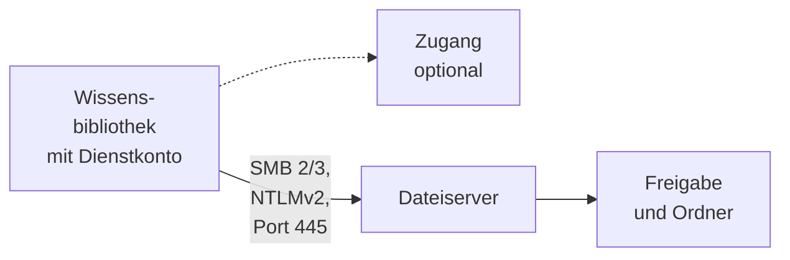
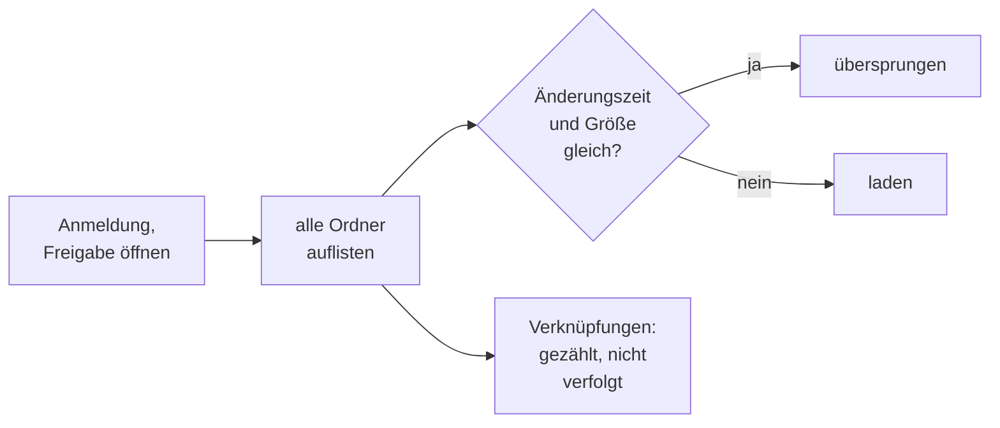

# Konnektor: Windows-Dateifreigabe (SMB)

## 1. Was der Konnektor ist

Der Konnektor liest Ordner einer **Freigabe auf einem Windows-Dateiserver** oder einem anderen
SMB-Server, etwa Samba oder einem NAS. Er spricht **SMB 2 und 3** über die Bibliothek smbj, mit
Pflicht zur Signatur und Verschlüsselung, wo der Server SMB 3 anbietet; SMB 1 spricht er nicht. Ein
Mount im Container ist dafür nicht nötig. SMB ist eine der [Dateiablagen](README.md#2-dateiablagen);
was alle Dateiablagen teilen, steht dort.

- **Anmeldung:** eigene Zugangsdaten der Bibliothek ([Zugänge](../zugaenge.md), „Eigene
  Zugangsdaten der Bibliothek"): Dienstkonto und Passwort, angemeldet mit **NTLMv2**. Kerberos gibt
  es nicht; eine Anmeldung, die der Server nur als Gast annimmt, gilt als abgelehnt. Ein Zugang ist
  möglich.
- **Liest:** die aktuelle Fassung jeder Datei in einem unterstützten Format in einem bis fünfzig
  Ordnern **einer** Freigabe; die Anhänge von Mail-Dateien werden eigene Dokumente.
- **Dokument:** Der Pfad `smb://server/freigabe/ordner/datei` ist die Identität. **Umbenennen oder
  Verschieben** entfernt das alte Dokument und legt ein neues an. Einen Beleg-Link gibt es nicht,
  denn `smb://` öffnet kein Browser; **„Original öffnen"** lädt die Datei durch OPAA vom Pfad des
  Dokuments, nur innerhalb der konfigurierten Ordner und nie über eine Verknüpfung.
- **Rechte** aus der Freigabe übernimmt OPAA nicht: Was das Dienstkonto lesen kann, sehen alle
  Leseberechtigten der Bibliothek.

## 2. Einrichtung

1. Dateiserver im privaten Netz: seinen Hostnamen für die
   [Zieladressprüfung](README.md#12-zieladressprüfung) freigeben. OPAA braucht Port 445 zum Server.
2. Ein **Dienstkonto** anlegen, kein persönliches. Es braucht nur Leserechte, auf der Freigabe und
   im Dateisystem darunter, und das Recht „Auf diesen Computer vom Netzwerk aus zugreifen". Sperrt
   die Domäne NTLM, muss das Konto auf die Ausnahmeliste.
3. **Leserecht auf alles im Bereich.** Ist auf der Freigabe die zugriffsbasierte Aufzählung
   (Access-Based Enumeration) eingeschaltet, zeigt der Server einen Ordner ohne Leserecht gar nicht
   an — für OPAA ist er dann verschwunden, und seine Dokumente werden **entfernt**. Ohne diese
   Aufzählung meldet der Lauf den Ordner als nicht lesbar und entfernt nichts.
4. Auf dem Server SMB 2 oder 3 mit Signatur einschalten.
5. Die Quellart ist ab Werk nur für die Systemverwaltung freigegeben; wer sonst Bibliotheken anlegen
   soll, bekommt „Konnektorbibliotheken anlegen" für die Quellart oder einen Zugang
   ([Berechtigungen](../berechtigungen.md), „Konnektor-Freigabe").

## 3. Quellkonfiguration

| Angabe im Formular | Bedeutung |
|---|---|
| „Adresse der Freigabe" | `smb://server[:port]/freigabe`; ein UNC-Pfad `\\server\freigabe` wird angenommen. Nur Server und Freigabe. Versteckte Freigaben (Name endet auf `$`, also auch `C$` und `ADMIN$`) werden nie angebunden |
| „Dienstkonto", „Passwort" | `DOMÄNE\Benutzer`, `Benutzer@domäne` oder ein lokales Konto des Servers, ohne Doppelpunkt. Ein anderer Server **oder eine andere Freigabe** verlangt das Passwort neu, weil eine Freigabe eine eigene Rechtegrenze ist |
| „Ordner" | ein bis fünfzig Pfade ab der Freigabe, etwa `/Projekte`; `/` oder leer liest die ganze Freigabe. Ordner dürfen sich nicht überschneiden, auch nicht bei anderer Schreibweise; kein Komma, `.`, `..` oder eines der Zeichen `\ : * ? " < > |` |

„Zertifikatsprüfung aussetzen" gibt es bei SMB nicht. **„Ordner laden"** zeigt die Ordner im Stamm
der Freigabe; darf das Konto den Stamm nicht auflisten, lassen sich die Pfade von Hand eintragen.
**„Verbindung testen"** meldet sich an, öffnet die Freigabe und prüft jeden Ordner; jeder Befund hat
einen eigenen Satz (Abschnitt 9). Eine geänderte Ordnerliste verwirft den Abgleichstand.

**Über einen Zugang:** Seine Server-Adresse ist `smb://server[:port]`; jede Bibliothek nennt ihre
Freigabe darunter. Nennt der Zugang schon eine Freigabe, liegen alle Bibliotheken darauf. Dienstkonto
und Passwort tragen die Verwaltenden der Bibliothek ein; Vorgaben für weitere Einstellungen gibt es
nicht.

## 4. Betriebsarten und Änderungserkennung

Jeder Lauf ist ein **Vollabgleich**; SMB kennt kein Änderungsprotokoll. Er listet jeden Ordner
unterhalb der konfigurierten Ordner, in Namensreihenfolge, und lädt Dateien schon, während die
Auflistung weiterläuft. Eine Datei, deren **Änderungszeit und Größe** dem gespeicherten Stand
entsprechen, wird nicht neu geladen. Ordner merkt sich OPAA nicht: Ihre Änderungszeit ändert sich nur,
wenn darin direkt etwas angelegt, gelöscht oder umbenannt wird.

**Über mehrere Läufe.** Reicht das Budget nicht, endet der Lauf als „unvollständig, wird
fortgesetzt", und OPAA merkt sich die Stelle samt nicht lesbaren und schon gesehenen Ordnern. Der
nächste Lauf öffnet nur die Ordner auf dem Weg dorthin erneut und setzt fort
([Konnektoren](README.md#22-ein-vollabgleich-über-mehrere-läufe)). Ein Lauf, der an einem Fehler
scheitert, ändert die Stelle nicht. Die Obergrenze `max-entries-per-run` gilt für den ganzen
Abgleich.

## 5. Löscherkennung

Weil der Pfad die Identität ist, entfernt ein Abgleich, sobald jeder Bereich bis zum Ende gelistet
ist, alle Dokumente, die keiner seiner Läufe gesehen hat — auch über mehrere Läufe
([Konnektoren](README.md#23-wann-eine-gelöschte-datei-als-nachgewiesen-gilt)).

- Ein **nicht lesbarer Unterordner** oder einer tiefer als 64 Ebenen macht seinen Bereich
  unvollständig; dort wird nichts entfernt. Ist der konfigurierte Ordner selbst nicht lesbar, gilt
  der Bereich als nicht auflistbar. Ein Ordner, der dauerhaft nicht lesbar ist, hält die Löschung in
  der **ganzen** Bibliothek an, bis er lesbar ist oder aus dem Bereich genommen wird; neue und
  geänderte Dateien kommen weiter an.
- Ein Ordner, den die Auflistung zeigte, der sich danach aber nicht öffnen lässt, gilt als
  verschwunden.
- **Umbenannt oder verschoben während eines Abgleichs:** Liegt der neue Ort vor der gemerkten Stelle,
  entfernt der Abgleich das Dokument unter dem alten Pfad, bevor der neue gelistet ist; der nächste
  legt es neu an. Dabei gehen Dokument-ID, von Hand gepflegte Metadaten und Schlagwörter verloren,
  und Verweise aus Chats führen ins Leere. Dasselbe gilt für eine Datei, die gelöscht und am selben
  Ort neu angelegt wird, nachdem ihr Ordner gelistet war.

## 6. Ordner

Die Ordner unterhalb der konfigurierten Ordner erscheinen als schreibgeschützte Ordner. Bei einem
konfigurierten Ordner ist er die Wurzel, bei mehreren beginnt jede Kette mit seinen Pfadsegmenten. Am
Dokument stehen der konfigurierte Ordner und der Gliederungspfad darunter.

## 7. Anhänge

Eine EML- oder MSG-Datei liefert ihre Anhänge als eigene Dokumente, mit den Grenzen des Kapitels
[E-Mail](../formate/mail.md).

## 8. Grenzen und Schutzmechanismen

- **Zieladressprüfung** auf den Server ([Konnektoren](README.md#12-zieladressprüfung)). SMB geht nie
  über den Ausgangsproxy.
- **Verknüpfungen** — symbolische Links, Junctions, DFS-Verweise — werden nie verfolgt, weder beim
  Auflisten noch beim Öffnen, und gezählt gemeldet. Ist die Freigabe ein DFS-Namensraum, die
  Zielfreigabe direkt angeben. Samba zeigt Unix-Links oft als gewöhnliche Datei oder Ordner; ein
  Ordner, dem der Abgleich schon unter einem anderen Namen begegnet ist, gilt deshalb als Verknüpfung,
  und in Namensreihenfolge gewinnt der erste Name. Das beendet Schleifen.
- **Ausgelagerte Dateien** (offline, etwa durch ein Archivsystem) werden nicht geladen, weil der
  Abruf die Rückholung auslösen würde; sie gelten als vorhanden. Deduplizierte Dateien werden normal
  gelesen.
- Ein Name mit `/`, `\`, `:` oder Steuerzeichen, den nur ein Nicht-Windows-Server liefern kann, wird
  nicht gelesen und gezählt gemeldet.
- Ein Pfad über 2000 Zeichen oder 2676 Byte, gezählt ab `smb://`, wird wie bei jeder Quelle nicht
  gelesen ([Wissensbibliotheken](../wissensbibliotheken.md), Abschnitt 7.1). Umlaute, Kyrillisch und
  Griechisch belegen zwei Byte, chinesische, japanische und koreanische Zeichen drei.
- **Inhaltsänderung ohne neue Änderungszeit** bemerkt der Lauf nicht, wenn auch die Größe gleich
  bleibt.
- **Sehr viele Ordner in einem Bereich.** Die gemerkte Stelle enthält die Kennungen aller gesehenen
  Ordner. Bei mehreren hunderttausend Ordnern wird sie zu groß zum Speichern („Der Fortsetzungspunkt
  ist mit … Zeichen zu groß …"), und ein Lauf, der am Budget endet, kommt in diesem Bereich nicht
  weiter. Abhilfe: den Bereich aufteilen.
- **Geteilte Datei-ID.** Teilen sich zwei Ordner eine Kennung, etwa bei Samba mit mehreren
  Dateisystemen unter einer Freigabe, hält OPAA den zweiten für eine Verknüpfung; er fehlt ohne
  Befund, und sein Bestand wird entfernt.

## 9. Protokoll und Fehlerbilder

| Meldung | Bedeutung | Abhilfe |
|---|---|---|
| „Der Server „…" hat die Anmeldung von „…" abgelehnt." | Konto, Domäne oder Passwort falsch, Konto gesperrt oder abgelaufen; der Bestand bleibt | Konto prüfen, Passwort neu eintragen |
| „… hat die Anmeldung von „…" verweigert (Zugriff verweigert)." | das Konto darf sich nicht über das Netzwerk anmelden | Recht „Auf diesen Computer vom Netzwerk aus zugreifen" |
| „… lässt keine Anmeldung mit NTLM zu. OPAA unterstützt Kerberos noch nicht …" | NTLM gesperrt | Dienstkonto auf die NTLM-Ausnahmeliste |
| „… hat „…" nur als Gast angemeldet …" | der Server kennt das Konto nicht | Konto und Domäne prüfen |
| „Die Freigabe „…" gibt es auf dem Server „…" nicht." / „Das Dienstkonto darf die Freigabe „…" nicht lesen …" | Name falsch / keine Freigabeberechtigung | Adresse prüfen / „Lesen" für das Konto |
| „Geltungsbereich „/…": Diese Ordner konnte das Dienstkonto nicht lesen: …" | NTFS-Rechte fehlen; im Bereich wird nichts entfernt | Leserecht vererben oder Ordner herausnehmen |
| „… liegen tiefer als 64 Ebenen und wurden nicht gelesen …" | meist eine Schleife | Struktur prüfen |
| „Verknüpfungen … werden nicht verfolgt" / „… liegt hinter einem DFS-Verweis …" / „… führt über mehr als 16 Verknüpfungen (Schleife) …" | Verknüpfung oder DFS | Zielfreigabe direkt angeben, Schleifen bereinigen |
| „… ist von einem anderen Programm gesperrt." | die gespeicherte Fassung bleibt | nichts; der nächste Lauf versucht es erneut |
| „… ist ausgelagert (offline) …" | Datei im Archiv | bei Bedarf auf dem Server zurückholen |
| „Der Server „…" hat nicht rechtzeitig geantwortet." | Netz oder Server überlastet; der Lauf endet | Erreichbarkeit prüfen, `request-timeout` anheben |
| „Die Verbindung zum Server „…" ist gescheitert (SMB 2 oder 3 mit Signatur erforderlich)." | nur SMB 1 oder ohne Signatur | SMB 2/3 mit Signatur einschalten |
| „unvollständig, wird fortgesetzt" / „Der Lauf hat keine Datei neu aufgenommen …" | Budget erschöpft / reicht nicht zum Weiterkommen | nichts / `request-budget-per-run` anheben |
| „Geltungsbereich „/…": Der Fortsetzungspunkt … beginnt neu." | Stelle aus einer anderen Fassung von OPAA; nichts wird entfernt | nichts |

## 10. Konfiguration

Alle Schlüssel unter `opaa.indexing.smb.*`, Umgebungsvariablen `OPAA_INDEXING_SMB_*`.

| Schlüssel | Standard | Wirkung |
|---|---|---|
| `max-file-size-bytes` | 50 MiB | Obergrenze einer Datei, vor und während des Downloads |
| `request-timeout` | 30 s | Zeitlimit für den Verbindungsaufbau und je SMB-Nachricht |
| `request-budget-per-run` | 100 000 | SMB-Nachrichten je Lauf; ein Download kostet mindestens vier, ein Ordner mindestens fünf |
| `max-entries-per-run` | 1 000 000 | gelistete Dateien je Vollabgleich, auch über mehrere Läufe; darüber scheitert der Lauf |
| `download-concurrency` | 2 | gleichzeitige Downloads je Lauf |
| `list-page-size` | 1000 | Einträge, die ein Lauf auflistet, bevor er sie verarbeitet und sich die Stelle merken kann |

## 11. Nicht gebaut

- Kerberos; es bräuchte Kerberos-Konfiguration, einen erreichbaren KDC und eine Keytab
- Ein- und Ausschlussmuster; heute schränken nur die Ordner ein
- Benachrichtigungen des Servers an OPAA
- Übernahme von Rechten aus der Freigabe
