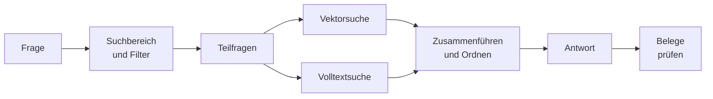

# Wie die Suche arbeitet

Eine Frage geht nicht einfach „an das Sprachmodell“. OPAA sucht zuerst im Index, und nur die
gefundenen Textstücke (Chunks) gehen mit der Frage an das Chat-Modell. Das Modell formuliert, die
Suche entscheidet: **Was nicht gefunden wurde, kann in keiner Antwort stehen.**

## Die Stufen

| Stufe | Was passiert |
|---|---|
| Suchbereich | die Bibliotheken des Space, die die Person lesen darf. Die Rechte stecken in der Datenbankabfrage selbst; eine fremde Bibliothek kommt nie vor, auch nicht für die Systemverwaltung |
| Filter | gesetzte [Metadaten](metadaten.md)-Filter schränken beide Suchwege ein; Dokumente ohne Wert bleiben drin |
| Teilfragen | das Chat-Modell macht aus der Frage eigenständige Suchanfragen: zwei Themen werden zwei Anfragen, „Und bei Bedürftigkeit?“ wird zur vollständigen Frage |
| Vektorsuche | findet Chunks mit ähnlicher **Bedeutung** |
| Volltextsuche | findet die **Wörter**, mit deutscher Wortstammbildung; Paragrafen und Aktenzeichen exakt, sodass „§ 34“ nicht „§ 35“ trifft |
| Fusion | führt beide Listen nach Rang zusammen; wer in beiden steht, gewinnt |
| Reranking | ein eigenes Modell liest Frage und Chunk zusammen und ordnet neu. Ab Werk aus, weil es einen eigenen Endpunkt braucht |
| Relevanzschnitt | schneidet schwache Treffer ab, wenn eingeschaltet |
| Vervollständigung | holt zu einem schon gefundenen Dokument den passenden Detail-Chunk nach |

Vor der Antwort bekommt jeder Treffer seine **Nachbar-Chunks** dazu, damit eine Tabelle oder
Aufzählung an einer Chunk-Grenze nicht abreißt.

## Die Antwort

Das Chat-Modell bekommt die Chunks, die **Anweisung des Space**, die Gesprächsnotiz und den Verlauf.
Es soll nur wiedergeben, was die Dokumente tragen, Fehlendes als „in den vorliegenden Dokumenten
nicht enthalten“ benennen und jede Quelle mit einer Zitiermarke belegen. Der Text der Dokumente
steht als Material, nicht als Anweisung im Prompt; ganz verhindern lässt sich eine untergeschobene
Anweisung nicht, das hängt am Modell.

Je Frage ruft OPAA nach außen höchstens: Chat-Modell für Teilfragen und Antwort, Embedding-Modell
je Teilfrage, Rerank-Modell, falls an. Titel und Gesprächsnotiz eines Chats kosten je einen
weiteren Chat-Aufruf, ohne die Antwort zu verzögern.

## Belege prüfen

Den Zitiermarken glaubt OPAA nicht, es prüft sie ohne weiteren Modellaufruf:

1. **Herkunft:** Zeigt die Marke auf einen Chunk, den die Antwort wirklich gelesen hat?
2. **Fakt:** Steht ein Betrag, Datum oder Paragraf im Satz vor der Marke so auch im Dokument? Nur
   ein abweichender Wert derselben Art stuft herunter.

Was durchfällt, bleibt im Text und heißt an der Fundstelle **„Beleg nicht bestätigt“**. Daraus
folgt der Belegstand der Antwort: **Belegt**, **Teilweise belegt** oder **Nicht belegt**. Er sagt,
worauf sich die Antwort stützt, nicht, ob sie stimmt. Wie man das im Chat liest:
[Belege prüfen](../arbeiten/belege-pruefen.md).

## Wenn etwas nicht gefunden wird

Fast jede schlechte Antwort ist zuerst ein Suchproblem. Die Diagnose unter
[Suche und Indexierung überwachen](../verwalten/suche-und-indexierung.md) zeigt Stufe für Stufe, wo
ein Dokument verloren geht.

| Befund | Übliche Ursache |
|---|---|
| nie gefunden | nicht im Suchbereich, nicht indiziert, Scan ohne Text, Begriff steht so nicht im Dokument |
| gefunden, aber hinten | nur ein Suchweg hat es gefunden; präziser fragen, Reranking einschalten |
| „Beleg nicht bestätigt“ | Modell hat eine Marke erfunden oder einen Wert anders wiedergegeben |
| Reranking „nicht verfügbar“ | Endpunkt nicht erreichbar; die Suche lief ohne weiter |
| viele „ohne Angabe“ unter Filter | Feld im Bestand schwach gefüllt; Metadaten nachpflegen |
| Antwort auf „Danke“ mit Quellen | gewollt: auch eine Bemerkung wird gesucht |

Grenzwerte und Schalter der Suche (`OPAA_SEARCH_*`, `OPAA_QUERY_*`):
[Konfiguration](konfiguration.md#grenzwerte-im-überblick).
