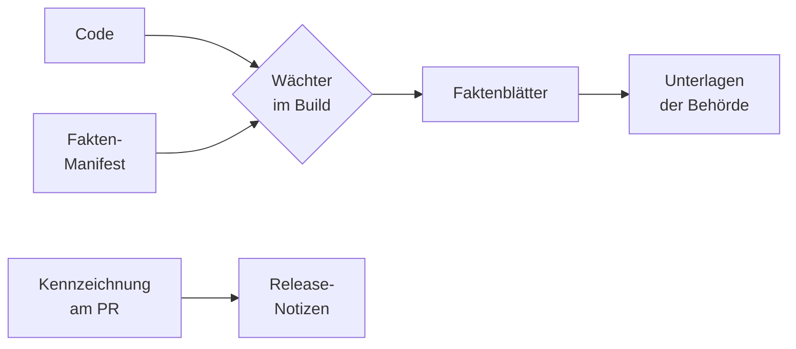

# Nachvollziehbarkeit

> **Entwurf.** Gegen den Code geprüft, vom Maintainer noch nicht abgenommen.

Vor einer Einführung und bei jedem Update fragen Datenschutz, Personalrat und
Informationssicherheit dasselbe: Welche Daten speichert OPAA, wie lange, wer sieht sie, was
verlässt die Installation und was ist voreingestellt? Dieses Kapitel beschreibt, wie OPAA diese
Fragen aus dem eigenen Code beantwortet, wo die Antworten liegen und was bei jeder Codeänderung
automatisch geprüft wird, damit sie stimmen. Es gehört zum Teil Betrieb des
[Handbuchs](README.md).

> **Beispiel.** Die Datenschutzbeauftragte eines Landratsamts will vor dem Pilotbetrieb wissen,
> wohin eine Chatfrage geht und wie lange das Revisionsprotokoll aufbewahrt wird. Der Betrieb lädt
> die Faktenblätter zum eingesetzten Stand herunter und gibt ihr `datenfluesse` und `fristen`. Sie
> sieht darin jedes Ziel mit den übermittelten Daten und jede Frist mit ihrem
> Konfigurationsschlüssel, ohne den Code lesen zu müssen. Ein späteres Update, das daran etwas
> ändert, steht in den Release-Notizen unter „Datenrelevante Änderungen“.

## Was OPAA automatisch nachweist

Grundlage ist das **Fakten-Manifest**: eine Beschreibung im Code, welche Daten OPAA speichert,
welche Protokollereignisse es schreibt, was jede Rolle über andere sieht, welche Verbindungen nach
außen es aufbaut, welche Voreinstellungen, Standardmodelle und System-Prompts gelten und welche
Fristen laufen. Das Manifest wird wie Code geändert und geprüft. Aus ihm entstehen die
**Faktenblätter**, je Thema eines:

| Faktenblatt | Beantwortet |
|---|---|
| `datenkatalog` | Welche Daten liegen wo, mit welchem Zweck, Personenbezug, welcher Frist und Sichtbarkeit, und wie werden sie gelöscht? |
| `protokollereignisse` | Was hält das Revisionsprotokoll fest, bei welchem Anlass, und wer darf es lesen? |
| `rollensicht` | Was sieht jede Systemrolle und Fähigkeit über andere Personen? |
| `datenfluesse` | Was verlässt die Installation, wohin, wann, und lässt es sich abschalten? Mit einem Bild aller Verbindungen nach Gruppen |
| `voreinstellungen` | Welche Einstellungen wirken auf Daten, mit welchem Standardwert? Welche System-Prompts und KI-Funktionen gibt es? |
| `fristen` | Welche Aufbewahrungs- und Löschfristen gelten, mit welchem Konfigurationsschlüssel? |

Jedes Blatt beschreibt die **Voreinstellung einer Version**, nicht die Einstellungen einer
bestimmten Installation. Was eine Installation abweichend konfiguriert hat, prüft der Betrieb in
ihrer [Konfiguration](konfiguration.md). Was das Manifest noch nicht beschreibt, steht im Blatt
unter „Noch nicht erfasst“, statt zu fehlen.



Die Wächter halten Code und Manifest gleich; die Faktenblätter entstehen erst danach, die
Unterlagen der Behörde verweisen auf sie. Die Kennzeichnung am Pull Request führt jede
datenrelevante Änderung in die Release-Notizen.

## Wo die Faktenblätter liegen

Die Faktenblätter sind nicht eingecheckt, sondern werden bei jedem CI-Lauf auf `main` neu erzeugt.
Sie liegen als Artefakt `compliance-faktenblaetter` am letzten Lauf des Workflows „CI“ auf `main`:
auf GitHub im Reiter „Actions“ den Lauf öffnen, Abschnitt „Artifacts“. Das Artefakt enthält die
Blätter als Markdown und `faktenblaetter.json` mit allen Inhalten für Werkzeuge.

Jedes Blatt nennt in seinem Kopf, wofür es gilt: die OPAA-Version (außerhalb eines Release
`0.0.0-dev`), den Commit, das Erzeugungsdatum und `erzeugung: generiert`. Unter dem Titel steht
„Fakten aus dem Code; rechtliche Bewertung bleibt bei der Behörde.“ Jeder Eintrag hat einen festen
Anker aus seiner Kennung, sodass eine Unterlage auf genau eine Zeile verweisen kann.

## Ein Faktenblatt selbst erzeugen

Wer den Quellcode der eingesetzten Version ausgecheckt hat, erzeugt die Blätter selbst. Gebraucht
wird nur das Java-Werkzeug des Backends, keine Datenbank:

```bash
# aus backend/
./gradlew complianceDocs
```

Die Blätter liegen danach unter `backend/build/compliance/faktenblaetter/`. Version und Commit im
Kopf stammen aus dem ausgecheckten Stand.

## Was bei jeder Änderung geprüft wird

Kein Mensch muss daran denken, die Fakten nachzutragen: Mehrere Prüfungen schlagen fehl, wenn
Code und Beschreibung auseinanderlaufen.

| Prüfung | Wann | Was sie erzwingt |
|---|---|---|
| **Wächter im Backend-Build** | bei jedem Build und in der CI jedes Pull Requests | Zu jeder Tabelle und Spalte der Datenbank, jedem Protokollereignis, jeder Rolle und Fähigkeit, jedem System-Prompt, jeder Verbindung nach außen und jeder Einstellung mit Datenwirkung gibt es einen Eintrag im Manifest, und umgekehrt. Ein geänderter Prompt-Text oder Standardwert scheitert, bis der Eintrag bewusst nachgezogen ist. Auch die Voreinstellungen des Helm-Charts werden gegen das Manifest gehalten |
| **Kennzeichnung `data-impact`** | an jedem Pull Request (Prüfung „Datenwirkung“) | Die Beschreibung jedes Pull Requests fragt ab, ob er personenbezogene Daten, Sichtbarkeit, Auswertungen, Fristen, Datenflüsse, Voreinstellungen, Standardmodelle, System-Prompts oder die KI-Einstufung ändert. Trifft etwas zu, trägt er das Label `data-impact` und einen Satz in Alltagssprache. Ändert er Dateien, in denen Datenwirkung typischerweise entsteht, ohne Label und ohne die Angabe „Keine Wirkung“, schlägt die Prüfung fehl. Solche Änderungen erscheinen in den Release-Notizen als erste Rubrik „Datenrelevante Änderungen“ |
| **Verweise der Behördenunterlagen** | bei jeder Änderung an den Unterlagen und am Manifest | Jeder Verweis einer Vorlage auf ein Faktenblatt trifft ein vorhandenes Blatt und einen vorhandenen Eintrag darin |
| **Lizenzprüfung** | an Pull Requests, die Abhängigkeiten berühren, und bei jedem Stand auf `main` | Jede ausgelieferte Abhängigkeit steht unter einer freigegebenen Lizenz oder auf einer begründeten Ausnahmeliste. Die Lizenzübersicht liegt als Artefakt `license-report-backend` bzw. `license-report-frontend` am CI-Lauf |
| **Wöchentliche Drift-Routine** | einmal je Woche, nach dem Merge | Eine nur lesende Prüfroutine sieht die Änderungen der Woche auf `main` durch: ob ein Pull Request mit Datenwirkung ohne Kennzeichnung blieb, ob ein Eintrag im Manifest sachlich nicht mehr stimmt, ob sich Verhalten ohne Schemaänderung geändert hat und ob eine Vorlage einen geänderten Wert abschreibt. Ihre Befunde gehen an den Maintainer |

Die Prüfungen ergänzen sich: Der Wächter stellt sicher, **dass** es einen Eintrag gibt, nicht, ob
er stimmt. Ob ein Personenbezug, ein Zweck oder eine Sichtbarkeit zutrifft, prüfen das Review jedes
Pull Requests und die Drift-Routine.

## Behördenunterlagen

Im Repository liegen unter `docs/behoerden/` Vorlagen, mit denen eine Behörde ihre eigenen
Unterlagen erstellt, etwa zum Datenschutz, zur Informationssicherheit oder zur KI-Verordnung,
geordnet nach den Schritten von der Entscheidung bis zum Update. Die Vorlagen schreiben keine Werte
ab, sondern verweisen auf das Faktenblatt der eingesetzten Version. Deshalb veralten sie nicht mit
jedem Release. Die Übersicht dort, `docs/behoerden/README.md`, erklärt Aufbau, Kopfvermerk und die
Form der Verweise. Wie Entwickler das Manifest nachpflegen, steht in
`backend/docs/compliance-manifest.md`.

## Was nicht gebaut ist

- Ein Update-Paket am GitHub-Release jeder Version mit ihren Faktenblättern, dem Delta zum
  vorigen Release und der Lizenzübersicht, attestiert wie die Images
  ([#2556](https://github.com/criew/opaa/issues/2556)). Bis dahin erzeugt der Betrieb die Blätter
  einer Version selbst aus deren Quellcode.

## Weiterführende Kapitel

- [Betriebsübersicht](betrieb.md) — Bausteine, Ausgangsproxy
- [Konfiguration](konfiguration.md) — die Einstellungen der eigenen Installation
