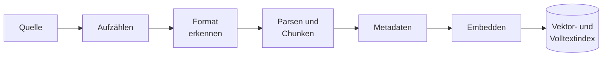

# Wie die Indexierung arbeitet

Eine Wissensbibliothek bekommt ihre Dokumente aus einer angebundenen **Quelle** (über einen
[Konnektor](../benutzer/konnektoren/README.md)) oder per **Upload**. Damit die Suche sie findet, nimmt
OPAA jedes Dokument in zwei Indizes auf: eine **Vektorablage**, die nach Bedeutung findet, und einen
**Volltextindex**, der exakte Wörter, Aktenzeichen und Paragrafen trifft.

## Läufe

Ein **Lauf** ist ein Durchgang über die Quelle, angestoßen von Hand, vom Zeitplan oder von einer
Meldung der Quelle (etwa ein Confluence-Webhook). Je Bibliothek läuft höchstens einer.

| In der Quelle | In OPAA |
|---|---|
| unverändert (gleiche Prüfsumme) | übersprungen; darum sind Folgeläufe schnell |
| geändert | neu verarbeitet, das Dokument behält seine Identität, Belege in Chats bleiben gültig |
| umbenannt oder verschoben | je nach Quelle neues Dokument oder dasselbe an neuem Ort |
| verschwunden | entfernt nach einem Lauf, der die Quelle vollständig gelesen hat, oder sofort, wenn die Quelle die Löschung selbst meldet |
| nicht erreichbar | **nichts** wird entfernt |

Ein einzelnes kaputtes Dokument bricht den Lauf nicht ab; es wird übersprungen und protokolliert.
**Unvollständig** endet ein Lauf, der sein Anfragebudget oder ein Speicherkontingent erreicht hat;
der nächste setzt fort. Bricht eine Backend-Instanz weg, beendet OPAA ihre Läufe von selbst; was
fertig war, bleibt indiziert.

## Was mit jedem Dokument passiert

- **Format** wird am Inhalt erkannt, nicht an der Endung. Welche Formate es gibt:
  [Formate](formate/README.md).
- **Chunks:** Der Text wird entlang seiner Gliederung zerlegt, nach Überschriften, Seiten, Folien
  oder Zeilen. Kein Text geht wegen seiner Länge verloren; zu lange Abschnitte werden geteilt,
  Kleinstabschnitte zusammengelegt. Jeder Chunk trägt eine Ortsangabe wie „S. 3 · Abschn. Fristen“,
  die im Beleg erscheint.
- **Bereinigung:** Unsichtbare Zeichen, die Text vor dem Auge verbergen können, entfernt OPAA;
  Wendungen wie „ignoriere alle vorherigen Anweisungen“ bleiben, werden aber im Laufprotokoll als
  „Auffällige Muster“ gezählt. Ein Treffer ist ein Hinweis, kein Beweis.
- **Metadaten:** Titel, Dokumentart und Datum ([Metadaten](metadaten.md)). Für die Einbettung
  bekommt jeder Chunk Titel und Gliederungspfad vorangestellt, damit auch ein Detail-Chunk sagt,
  wovon das Dokument handelt.
- **Anhänge** (Anlagen einer Mail, Dateien an einer Confluence-Seite) werden eigene Dokumente unter
  ihrem Elterndokument, mit begrenzter Tiefe und Menge.
- **Eingescannte PDFs** ohne Textebene liest die Texterkennung, wenn Betrieb und Systemverwaltung
  sie eingeschaltet haben ([Texterkennung einschalten](../betrieb/modell-endpunkte.md#texterkennung-einschalten)).
  Ihre Abschnitte tragen Seiten, Rahmen auf der Seite und den Vermerk, dass der Text erkannt wurde.
  Ohne Texterkennung werden sie als „kein extrahierbarer Text“ abgewiesen. Ein Scan, den der Dienst
  nicht lesen konnte, wartet auf den nächsten Lauf; einen gesperrten zeigt die Bibliothek über der
  Dokumentliste. Erkennt der Dienst keinen Text, bleibt der Scan ohne Inhalt, bis sich Datei oder
  Dienst ändern.

## Feste Grenzen

| Grenze | Wert | Wirkung |
|---|---|---|
| Ort in der Quelle | 2000 Zeichen bzw. 2676 Byte | darüber wird das Dokument abgewiesen |
| Chunk | Zielgröße einstellbar (ab Werk 4000 Zeichen), höchstens 8000 Zeichen | Abschnitte unter 200 Zeichen werden zusammengelegt |
| Eingabe des Embedding-Modells | 8191 Tokens abzüglich 10 % | ein Chunk darüber lässt das ganze Dokument scheitern |
| Kennungen je Chunk | 64 | weitere werden nicht gespeichert |
| Laufprotokoll | 500 Einträge je Lauf, zehn Läufe je Bibliothek | darüber nur gezählt bzw. gelöscht |
| Seitenbild für das Vision-Modell | 200 dpi in Graustufen, große Seiten gröber bis 72 dpi, höchstens 16 Mio. Pixel; je Bild höchstens 256 MiB Arbeitsspeicher für Daten und Raster, gezählt nach Bytes statt Pixeln, so dass ein Schwarz-Weiß-Scan eines A0-Plans passt, ein Farbbild gleicher Größe nicht; Schattierungen, Funktionen, Transferfunktionen und Farbräume aller Ressourcen einer Seite, auch Standardfarbräume, je Datenstrom bis 8 MiB, abgetastete Funktionen bis rund 1 Mio. Stützwerte; Anmerkungen ohne eigenes Erscheinungsbild werden nicht gezeichnet, weil der Text eines Scans in seinen Bildern steht; höchstens vier verschachtelte Transparenzgruppen, vier ineinander gezeichnete Type-3-Zeichen und kein Kachelmuster in einem Kachelmuster | eine Seite darüber sperrt die Texterkennung des Scans mit Seitennummer |

## Speicherkontingent

Jede Bibliothek hat ein Kontingent: die Obergrenze des Betriebs, ab Werk 10 GiB, für geteilte
Bibliotheken darunter ein hausweiter Wert der Systemverwaltung. Private Bibliotheken teilen sich
zusätzlich ein Kontingent je Person. Gezählt wird nur Zuwachs. Senken löscht nichts: Die
Bibliothek nimmt nur nichts mehr auf, was sie wachsen lässt.

## Laufprotokoll

Das Protokoll sieht, wer die Bibliothek verwaltet, denn es enthält interne Pfade. Jede
leseberechtigte Person sieht, wann zuletzt aktualisiert wurde. Je Lauf bleiben höchstens 500
Einträge, je Bibliothek die letzten zehn Läufe.

| Kategorie | Bedeutung |
|---|---|
| abgewiesen | Quelle lehnt ab, Kontingent voll, kein Text oder Ort zu lang |
| nicht erreichbar | Verbindungsfehler oder Zeitüberschreitung |
| Format nicht unterstützt / Formatabweichung | nicht aufgenommen / aufgenommen, Endung passt nicht |
| Ratenbegrenzung, Budget erschöpft | Quelle bremst oder Anfrage- bzw. Seitenbudget der Texterkennung verbraucht; der nächste Lauf setzt fort |
| Per Texterkennung gelesen | Scan erkannt oder aus dem gespeicherten Erkennungsstand indiziert, auch „ohne erkannten Text“ |
| Texterkennung gescheitert / ausstehend | Dienst nicht verfügbar, nur teilweise umgewandelt oder unerwarteter Fehler bzw. Seitenbudget verbraucht oder kein freier Platz; der Scan wartet auf den nächsten Lauf |
| Texterkennung gesperrt | docling-serve lehnt die Datei ab, das Vision-Modell lehnt eine Seite als zu groß ab (HTTP 413), eine Seite lässt sich nicht in den Grenzen der Bilddarstellung rendern, die Datei ist unlesbar oder liegt über der Seitengrenze; bis zur Freigabe in der Bibliothek |
| in der Quelle entfernt | gelöscht, weil die Quelle es nicht mehr hat |
| Auffällige Muster | aufgenommen, mit Zählung verdächtiger Muster |
| Fehler | unerwartet gescheitert |

Nach einem Update, das das Zerlegen ändert, liegen ältere Chunks noch im alten Verfahren vor. Die
Systemverwaltung sieht den Rückstand im Indexstatus und zieht ihn nach
([Suche und Indexierung überwachen](../administration/suche-und-indexierung.md)). Alles, was die
Indexierung erzeugt, liegt in PostgreSQL: Eine Sicherung der Datenbank sichert den Index mit.
