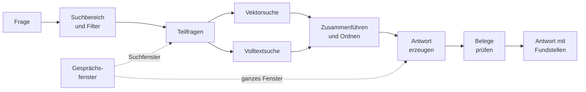
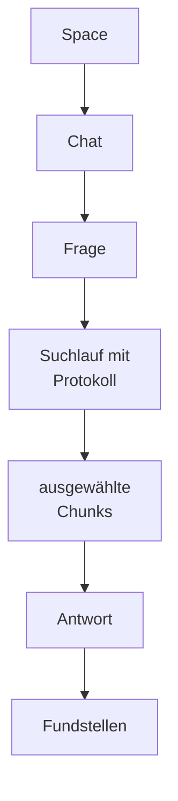
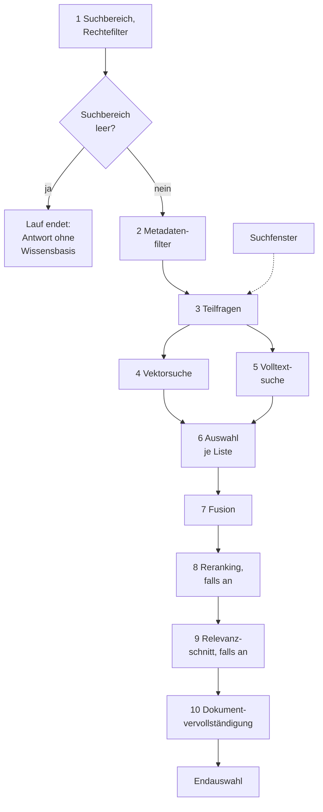
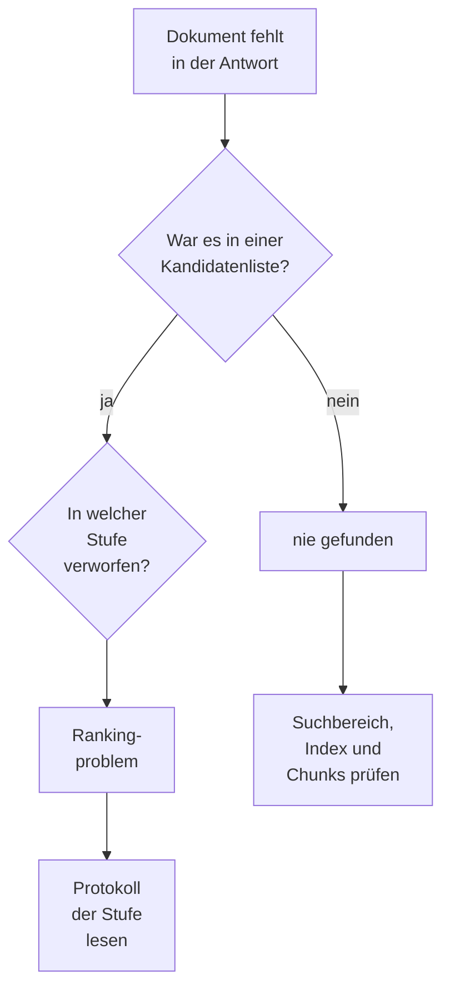

# Suche: Von der Frage zur belegten Antwort

Dieses Kapitel beschreibt die Abfragestrecke (Query-Pipeline) konzeptionell: was
zwischen dem Absenden einer Frage und der Anzeige einer Antwort mit Belegen passiert, welche
Stellschrauben es gibt und wie der Betrieb einer schlechten Antwort auf den Grund geht. Wie die
Dokumente vorher in den Index gelangen, steht im Kapitel [Wissensbibliotheken](wissensbibliotheken.md).

## 1. Überblick in einem Bild

Eine Frage wird nicht „an das Sprachmodell gestellt". Sie läuft zuerst durch eine Suche über den
Index, und erst die dabei ausgewählten Textstücke (Chunks) gehen zusammen mit der Frage an das
Chat-Modell. Das Modell soll aus diesen Stücken antworten und jede benutzte Quelle zitieren.
Erzwungen wird nicht die Antwort, sondern die Prüfbarkeit der Belege: Sie werden geprüft, bevor
die Antwort angezeigt wird.

| Schritt | Frage, die er beantwortet |
|---|---|
| Suchbereich und Filter | In welchen Bibliotheken darf und soll überhaupt gesucht werden? |
| Teilfragen | Wonach wird gesucht: nach der Frage wörtlich, oder nach mehreren eigenständigen Suchanfragen? |
| Vektorsuche | Welche Chunks sind der Frage in der Bedeutung ähnlich? |
| Volltextsuche | Welche Chunks enthalten die Wörter, Paragrafen und Aktenzeichen der Frage wörtlich? |
| Zusammenführen und Ordnen | Welche Chunks bekommt das Modell am Ende zu sehen, und in welcher Reihenfolge? |
| Antwort erzeugen | Was antwortet das Chat-Modell aus diesen Chunks und dem Gesprächsverlauf? |
| Belege prüfen | Zeigt jedes Zitat auf einen Chunk, der wirklich abgerufen wurde, und stimmt der zitierte Wert? |

Drei Dinge sind aus Betriebssicht wichtig, bevor es ins Detail geht:

- **Die Rechte sitzen in der Suche selbst, nicht dahinter.** Jede Suchabfrage trägt den Filter auf
  die Bibliotheken, die die fragende Person lesen darf, als Teil der Datenbankabfrage. Ein Chunk aus
  einer fremden Bibliothek wird nie geladen, nie gerankt und nie aussortiert; er kommt in der
  Abfrage gar nicht vor. Es gibt keinen Administrator-Durchgriff: Auch ein Systemadministrator
  fragt mit seinen eigenen Leserechten.
- **Die Suche entscheidet, das Modell formuliert.** Was nicht unter den ausgewählten Chunks ist,
  kann in keiner Antwort stehen. Fast jede schlechte Antwort ist deshalb zuerst eine Suchfrage
  (Abschnitt 9), keine Modellfrage.
- **Jeder Lauf erklärt sich selbst.** Jede Stufe protokolliert, welche Kandidaten sie gesehen,
  behalten, verworfen oder hinzugefügt hat. Im Chat wird dieses Protokoll verworfen; das
  Diagnosewerkzeug (Abschnitt 8) zeigt es Stufe für Stufe.

## 2. Frage, Chat, Suchbereich, Chunk

Vier Begriffe tragen das Kapitel.

Eine **Frage** ist die einzelne Eingabe einer Person. Sie kommt fast immer aus einem **Chat**: einer
gespeicherten Unterhaltung in einem Space, die ihren Suchbereich, ihren Filter und ihren Verlauf
kennt.

Der Verlauf heißt **Gesprächsfenster**: die letzten 20 Nachrichten des Chats (zehn Runden aus Frage
und Antwort), wörtlich. Suche und Antwort bekommen ihn **unterschiedlich dosiert**:

| | Was davon | Warum |
|---|---|---|
| Antwort (Abschnitt 6) | das ganze Fenster | Kontinuität: „wie vorhin beim Parkausweis" soll noch verstanden werden |
| Suche (Stufe 3) | nur das **Suchfenster**, die letzten zwei Runden | Bezüge auflösen, ohne dass ein altes Thema die Suche weiter färbt |

Zwei Eigenschaften des Fensters sind betrieblich wichtig:

- **Zitiermarken früherer Antworten stehen nicht im Fenster.** Sie werden auf dem Weg hinein
  entfernt — sowohl direkt nach einer Antwort als auch beim Nachladen aus der Datenbank, und
  zwar jede Marke `【source: …】` innerhalb einer Zeile, auch eine fehlerhafte. Der gespeicherte Antworttext
  behält die gültigen Marken; er ist die Grundlage für Fußnoten, Textanker und Belegfenster
  (Abschnitt 7). Ohne Marke im Verlauf kann das Modell keine Marke für ein Dokument wiederholen, das
  in dieser Runde gar nicht im Kontext ist.
- **Ein Neustart ändert nichts an der Aufbereitung.** Nach einem Neustart oder wenn der
  prozessinterne Zwischenspeicher abgelaufen ist, wird das Fenster aus den letzten 20 gespeicherten
  Nachrichten desselben Chats neu gebildet, durch dieselbe Marken-Entfernung — derselbe Chat schickt
  denselben Prompt wie davor. Eine Ausnahme betrifft nicht die Aufbereitung, sondern den Bestand:
  Liefert eine Runde keinen Antworttext (Modellfehler, oder eine Antwort, die nur aus Marken
  bestand), fehlt sie im laufenden Fenster wie im nachgeladenen gleichermaßen.

Beide Breiten sind Konfigurationswerte (Abschnitt 10.3); in einer Verwaltungsoberfläche erscheinen
sie nicht.

Neben dem Fenster führt jeder gespeicherte Chat eine **Gesprächsnotiz**: eine kurze, dauerhafte
Liste von Angaben der fragenden Person, die über das Fenster hinaus gelten. Sie entsteht nach jeder
Antwort aus der **Nutzernachricht** derselben Runde — nie aus Antworten — durch einen nebenläufigen
Aufruf des Chat-Modells (Abschnitt 3).

| Eigenschaft | Regel |
|---|---|
| Inhalt | Rolle, Zuständigkeit, Ort, Zeitraum, Fassung, Organisation, Festlegungen sowie Wünsche zur Antwortform. Keine Themen der Fragen, keine Antwortinhalte, keine Bewertungen über die Person |
| Umfang je Runde | höchstens zwei Punkte; Doppelte (unabhängig von Groß-/Kleinschreibung und Satzzeichen) kommen nicht erneut hinzu |
| Umfang je Chat | höchstens zehn Punkte (Abschnitt 10.3); beim Überlauf fällt der älteste Punkt weg |
| Länge eines Punkts | höchstens 200 Zeichen, längere werden mit „…" gekürzt |
| Wirkung | Die Suche (Stufe 3) sieht nur die Punkte mit Rahmenangaben, die Antwort (Abschnitt 6) alle. Diese Unterscheidung ist intern und wird nicht angezeigt |
| Lebensdauer | die des Chats: mit ihm gelöscht, nur für seinen Autor abrufbar, nicht protokolliert und nicht auswertbar. Eine Anzeige im Chat folgt |

Zwei Punkte sind betrieblich wichtig:

- **Ein neuer Punkt wirkt erst ab der nächsten Frage.** Die Antwort einer Runde trägt den
  Notizstand, der in sie eingeflossen ist — dieselbe Regel wie beim erzeugten Chat-Titel.
- **Eine fehlgeschlagene Verdichtung wird nicht nachgeholt.** Diese Runde steuert dann keine Punkte
  bei; im Log steht eine Warnung ohne Inhalt, und die Metrik `opaa.chat.note.extraction` zählt den
  Grund (Abschnitt 10.2). Ist der Space beim Schreiben des Ergebnisses inzwischen archiviert, wird
  das Ergebnis verworfen — ein archivierter Space nimmt keine Änderung an einem Chat an.

Ein Space enthält genau das, was ihm **zugeordnet** ist: Im Chat sucht er nur in den zugeordneten
Bibliotheken und bietet nur die Prompts der zugeordneten Prompt-Bibliotheken an. Was die Person
lesen darf, aber dem Space nicht zugeordnet ist, bleibt im Chat dieses Space außen vor. Das gilt
ohne Ausnahme, auch für den persönlichen Space „Privater Bereich". Eine Frage braucht immer einen
Space: Wer `POST /api/v1/query` ohne einen eigenen Chat aufruft, bekommt eine Antwort ohne Suche und
ohne Belege. Ohne Space suchen nur der Fremdzugang und `POST /api/v1/search`. Zuordnen dürfen Kuratoren und
Administratoren des Space ([Spaces](spaces.md), Abschnitt 3).

Der **Suchbereich** ist die Menge der Bibliotheken, in denen diese Frage sucht. Er steht in der
Chip-Leiste am Eingabefeld und gilt für den ganzen Chat: „Durchsucht wird, was in der Leiste
steht."

| Leiste | Suchbereich |
|---|---|
| `@Space-Wissen` (Standard) | die dem Space zugeordneten Bibliotheken, geschnitten mit den Leserechten |
| eine oder mehrere Bibliotheken | genau diese, geschnitten mit den Leserechten; zur Auswahl stehen nur zugeordnete Bibliotheken, die die Person lesen darf |
| leer | bewusst ohne Wissensbasis: keine Suche, das Modell antwortet aus dem Gespräch allein |

Eine Bibliothek, die dem Space nicht zugeordnet ist, lässt sich nicht als Chip setzen; das Backend
lehnt einen solchen Bezug ab. Wird eine Zuordnung später gelöst oder ein Leserecht entzogen, bleibt
ihr Chip als „Nicht verfügbare Bibliothek" stehen, durchsucht wird sie nicht mehr.

Der Suchbereich ist **nie weiter als Zuordnung und Leserechte**. Ist er leer, läuft keine Suche,
und das Modell antwortet aus dem Gespräch allein, ohne Belege. Was die Person davon sieht, hängt vom
Grund ab:

| Grund für den leeren Suchbereich | Hinweis über dem Eingabefeld | Hinweis an der Antwort |
|---|---|---|
| dem Space ist kein Wissen zugeordnet | „Diesem Space ist kein Wissen zugeordnet." Kuratoren und Administratoren sehen dazu „Wissen zuordnen", das in die Einstellungen des Space führt; alle anderen den Hinweis, wer zuordnen kann | „Diesem Space ist kein Wissen zugeordnet. Diese Antwort stützt sich auf keine Dokumente." |
| der Space ordnet nur Bibliotheken zu, die die Person nicht lesen darf | „In diesem Space ist für Sie derzeit kein Wissen verfügbar." | derselbe Satz |
| Leiste bewusst geleert | — | „Diese Antwort wurde ohne Wissensbasis erstellt." |

Beide Space-Hinweise nennen keine Zahl: Wie viele zugeordnete Bibliotheken die Person nicht lesen
darf, verrät die Oberfläche nicht. Die private Bibliothek einer anderen Person zählt dabei als nicht
zugeordnet: Ordnet der Space nur sie zu, sehen alle anderen Mitglieder den Hinweis, dass dem
Space kein Wissen zugeordnet ist. Dieselben zwei Hinweise stehen auch auf der Seite des Space.

Wie Prompts im Chat eingesetzt werden, beschreibt das Kapitel
[Prompt-Bibliotheken](prompt-bibliotheken.md), Abschnitt 6; für Suche und Antwort macht ein Prompt
keinen Unterschied. Wie Chats geführt, archiviert und bereinigt werden, beschreibt das Kapitel
[Spaces](spaces.md), Abschnitt 7.

Ein **Chunk** ist ein Textstück aus dem Index, wie die Indexierung es zugeschnitten hat, samt seinen
Metadaten: Dokument, Bibliothek, laufende Nummer, Ortsangabe („S. 3 · Abschn. Fristen") und die
Kernfelder des Dokuments. Die Suche arbeitet ausschließlich auf Chunks. Ein „Dokument" taucht erst
wieder auf, wenn die Fundstellen zusammengefasst werden (Abschnitt 7).

## 3. Was eine Frage nach außen kostet

Die Pipeline läuft im Backend-Prozess und in der Datenbank. Nach außen ruft sie nur die
konfigurierten Modelle. Je Frage sind das im Auslieferungsstand:

| Aufruf | Wann | Modellrolle |
|---|---|---|
| Teilfragen-Zerlegung | einmal, sofern eingeschaltet und der Suchbereich nicht leer ist | Chat-Modell |
| Einbettung der Suchanfrage | einmal je Teilfrage | Embedding-Modell |
| Reranking | einmal, nur wenn Reranking eingeschaltet und der Endpunkt erreichbar ist | Rerank-Modell |
| Antwort | einmal | Chat-Modell |
| Chat-Titel | einmal je neuem gespeicherten Chat, nach der ersten Antwort, nebenläufig | Chat-Modell |
| Gesprächsnotiz verdichten | einmal je Runde eines gespeicherten Chats, nach der Antwort, nebenläufig | Chat-Modell |

Die Volltextsuche, die Vielfaltsauswahl, die Fusion, die Dokument-Vervollständigung und die
Belegprüfung sind reine Datenbank- und Rechenschritte ohne Modellaufruf. Die Latenz einer Frage
besteht deshalb im Wesentlichen aus zwei Chat-Modell-Aufrufen, und bei eingeschaltetem Reranking
aus dessen Antwortzeit (Stufe 8). Die beiden nebenläufigen Aufrufe — Titel und Notiz — liegen
außerhalb des Anfrage-Threads und verlängern die Antwortzeit nicht; sie erhöhen die Modellkosten je
Runde.

## 4. Die Suchstrecke: Stufe für Stufe

Das ist der Kern. Jede Frage durchläuft diese Stufen in dieser Reihenfolge. Die Reihenfolge ist im
Code an genau einer Stelle festgelegt und nicht konfigurierbar.

### Stufe 1: Suchbereich

Der Suchbereich aus Abschnitt 2 wird in den Rechtefilter übersetzt, den jede folgende Suche in
ihre Abfrage einbaut. Diese Stufe ist die einzige, die sich nicht abschalten lässt: Ein Lauf ohne
Rechtefilter wäre keine Variante der Suche, sondern eine Rechteumgehung.

Ist der Suchbereich leer, endet der Lauf hier. Es wird kein Modell für die Zerlegung gerufen und
nichts gesucht; die übrigen Stufen stehen im Protokoll als „nicht erreicht".

Die Leserechte, aus denen der Filter entsteht, werden für die Frage einmal live aus den aktuellen
Berechtigungen berechnet. Parallel dazu führt OPAA eine **Rechtehistorie**, in der jede Änderung an
Berechtigungen, Gruppenmitgliedschaften und Freigaben mit Zeitpunkt festgehalten wird; aus ihr lässt
sich für Prüfer zu jedem Stichtag innerhalb der Aufbewahrungsfrist rekonstruieren, wer worauf
Zugriff hatte (Abschnitt 8.4). Die Historie wird beim
Beantworten einer Frage nicht gelesen: Ein Abgleich beider Rechenwege je Anfrage findet nicht statt.
Dass beide Wege dieselbe Bibliotheksmenge ergeben, sichert die Testsuite für jede Operation ab, die
Leserechte ändert — Berechtigungen, Gruppenmitgliedschaften aus der Verwaltung, dem
Verzeichnisabgleich und dem Anmeldetoken sowie Bestand und Sichtbarkeit einer Bibliothek.

### Stufe 2: Metadatenfilter

Hat die Person im Chat einen Filter gesetzt (Dokumentart, Datum/Stand, ein Bibliotheks- oder
Formatfeld), wird er hier einmal in die Form gebracht, die beide Suchpfade verstehen, und im Lauf
mitgeführt. Ohne Filter passiert nichts, und das Protokoll sagt das.

Der Filter wird dem Rechtefilter **untergeordnet**: Er wird mit UND angehängt und kann die lesbare
Menge nur verkleinern. Ein Dokument ohne Wert im gefilterten Feld wird **nicht** ausgeschlossen
(Leerwert-Regel); es wird gefunden und in der Fundstelle als „ohne Angabe" markiert. Ein unbekannter
Dokumentart-Code wird schon vor dem Lauf mit einer Fehlermeldung abgewiesen, statt still einen
Filter zu erzeugen, der nur Dokumente ohne Wert übrig ließe. Hat die Installation die Metadaten
abgeschaltet, entfällt diese Stufe: Jeder Filter, auch ein am Chat gespeicherter, bleibt ohne
Wirkung. Was Metadaten sonst in der Suche tun, fasst Abschnitt 5 zusammen.

### Stufe 3: Teilfragen

Die Frage wird nicht wörtlich gesucht. Das Chat-Modell formt sie unter Berücksichtigung des
**Suchfensters** — der letzten zwei Runden des Gesprächsfensters, siehe Abschnitt 2 — in **eine oder
mehrere eigenständige Suchanfragen** um, bis zu einer konfigurierten Obergrenze:

- Eine Frage mit zwei Themen („Was kostet ein Anwohnerparkausweis und wie lange ist er gültig?")
  wird in zwei Suchanfragen zerlegt, die jede für sich gesucht werden.
- Eine Rückfrage im Gespräch („Und was gilt bei Bedürftigkeit?") wird zu einer vollständigen
  Frage, in der das Bezugswort durch den Gegenstand aus dem Verlauf ersetzt ist.
- Offensichtliche Tippfehler werden korrigiert. Eine bereits einthemige, eigenständige Frage
  bleibt eine Suchanfrage, bei Bedarf wortgleich.
- Eine Nachricht, in der nichts zu suchen ist — nur ein Wunsch zur Antwortform („Antworte bitte
  kürzer"), ein Dank, eine Zustimmung oder eine Angabe zur eigenen Person, die am Gegenstand des
  Gesprächs nichts ändert —, ergibt **keine** eigene Suchanfrage. Eine Folgefrage ohne
  Fragezeichen („wenn ich über 24 bin", „und für Rentner") zählt dagegen als Frage.

Das Suchfenster erreicht das Modell als **beschrifteter Textblock** in einer einzigen Nachricht
(„Bisheriger Gesprächsverlauf", darunter die Beiträge von Nutzer und Assistent, zuletzt die
„Aktuelle Nutzerfrage"), nicht als Folge von Chat-Nachrichten. Als Chat-Nachrichten liest ein
Chat-Modell lange Antworten im Verlauf als Gespräch, an dem es teilnimmt, und setzt es fort: Statt
einer Suchanfrage kommt ein Antwortsatz zurück, und gesucht wird mit diesem Satz.

Findet das Modell in der Nachricht nichts zu suchen, antwortet es mit einem festen Signalwort. Die
Suche läuft **trotzdem**, mit derselben einzelnen Suchanfrage wie beim Rückfall (letzte Nutzerfrage
des Suchfensters plus Nachricht); das Protokoll vermerkt die Einstufung, die Antwort bekommt eine
eigene Anweisung (Abschnitt 6), und die Metrik `opaa.query.decomposition.no-search` zählt den Fall.
Der Grund: Das Chat-Modell hält Folgefragen ohne Fragezeichen immer wieder für Nachrichten ohne
Suchbedarf, und eine nicht gesuchte Frage bliebe ohne Beleg, während eine gesuchte Bemerkung nur ein
paar unzitierte Quellen kostet. Steht das Signalwort neben einer Suchanfrage, wird mit der
Suchanfrage gesucht.

Kopiert das Modell eine Beschriftung des Textblocks vor eine Suchanfrage („Aktuelle Nutzerfrage: …"),
wird sie abgeschnitten; eine Zeile, die nur aus Beschriftungswörtern besteht, wird verworfen.

Dieser Schritt hat einen **Sicherheitsgurt**: Antwortet das Modell nicht, unparsebar oder mit
Suchanfragen, von denen auch nur eine kein Wort mit dem Kontext gemeinsam hat, den die Zerlegung
bekommen hat (ein kleines Modell ersetzt gelegentlich die Frage durch etwas Eigenes), fällt die
Stufe auf die Frage selbst zurück, und zwar ganz: Eine Teilfrage wegzulassen kostet ein Thema der
Frage, die Frage selbst kostet nur Genauigkeit.

Zusätzlich zum Suchfenster bekommt die Zerlegung die **Rahmen-Punkte der Gesprächsnotiz**
(Abschnitt 2) als eigenen Block, mit der Regel, sie ausschließlich zur Auflösung
rückverweisender oder unterbestimmter Wörter zu verwenden; eine bereits eigenständige Frage
bleibt unverändert. Ohne solche Punkte entfällt der Block ganz. Ist die Zerlegung
abgeschaltet, erreicht die Notiz die Suche gar nicht — der Rückfall baut die Suchanfrage
ohne Modell.

„Der Kontext, den die Zerlegung bekommen hat" ist dabei wörtlich zu nehmen: **genau die Frage,
das Suchfenster und die Notizpunkte**, nicht mehr und nicht weniger. Die Überschrift des
Notiz-Blocks zählt ausdrücklich nicht dazu: Sie ist Text von OPAA, kein Material der Person,
und ein Ankerwort daraus würde den Sicherheitsgurt genau dort lockern, wo er greifen soll.
Die Wörtlichkeit ist nötig, weil eine korrekt aufgelöste Rückfrage mit der Frage oft kein
Wort teilt — „Wie lange dauert das?" wird zu „Bearbeitungsdauer für den
Anwohnerparkausweis", und das Ankerwort steht in der Vorrunde, nicht in der Frage — oder in
der Notiz, etwa wenn der Punkt „Bezugsjahr 2024" die Teilfrage „Anwohnerparkausweis
Gebühren 2024" rechtfertigt. Ein Thema, das älter als das Suchfenster ist, kann eine Teilfrage
umgekehrt nicht mehr rechtfertigen.

Im Rückfall wird der aktuellen Frage die **letzte** Nutzerfrage des Suchfensters vorangestellt; gibt
es im Suchfenster keine Vorrunde, wird die Frage allein gesucht. Ein solcher Rückfall steht als
Warnung im Log, ohne den Fragetext, und zählt auf der Metrik `opaa.query.decomposition.fallback`.
Die Frage scheitert dadurch nie; sie wird nur ungenauer gesucht. Ist die Zerlegung abgeschaltet,
wird immer so gesucht und der Modellaufruf gespart.

### Stufe 4: Vektorsuche

Je Suchanfrage läuft eine Ähnlichkeitssuche über die Vektorablage: Die Suchanfrage wird mit dem
Embedding-Modell eingebettet, und die **`fetch-k` ähnlichsten Chunks** oberhalb einer
Mindest-Ähnlichkeit bilden eine Kandidatenliste. Rechtefilter und
Metadatenfilter sind Teil dieser Abfrage. Die Schwelle ist bewusst niedrig: Sie hält nur
offensichtliches Rauschen fern, damit ein unscharf formulierter Fall nicht schon hier verloren
geht.

Die Suche läuft über einen Näherungsindex (HNSW) und prüft die Filter Eintrag für Eintrag, während
sie den Index durchläuft. Sie läuft weiter, bis `fetch-k` Chunks innerhalb des Filters gefunden
sind, und sortiert sie danach exakt nach Ähnlichkeit. Wie viel der Bestand anderer Bibliotheken
umfasst, ändert deshalb nichts an der Länge der Liste: Wer nur eine kleine Bibliothek lesen darf,
bekommt so viele Kandidaten wie jemand mit Zugriff auf alles. Kürzer wird eine Liste aus drei Gründen: Im
Suchbereich liegen oberhalb der Schwelle nicht mehr Chunks, der Indexdurchlauf erreicht seine
Grenze (die Zahl durchlaufener Einträge `vector-index.max-scan-tuples`, Abschnitt 10.3, oder den
Arbeitsspeicher, den pgvector ihm zugesteht), oder der Index-Graph lässt Einträge vom Einstiegspunkt
aus unerreichbar. Letzteres liegt in der Natur des Näherungsindex und kommt bei echten Embeddings
selten vor. Die Grenze erreicht in der Praxis nur ein
sehr kleiner Suchbereich in einem sehr großen Bestand; für einen solchen Filter wählt PostgreSQL
meist ohnehin die exakte Suche ohne Index. Eine kürzere Liste nennt das Erklärprotokoll mit der
Zahl der gelieferten Kandidaten.

Nach einem Wechsel des Embedding-Modells ist die Vektorsuche bis zum Abschluss der Neueinbettung
ausgesetzt: Frage und Chunks stammten sonst aus verschiedenen Modellen. Die Stufe erscheint im
Erklärprotokoll dann als nicht verfügbar, und die Volltextsuche trägt die Frage allein
([Modell wechseln](modelle.md#modell-wechseln)).

Die Vektorsuche findet, was der Frage **in der Bedeutung** nahe ist, auch wenn kein Wort
übereinstimmt („Parkausweis" trifft „Bewohnerparkberechtigung"). Ihre bekannte Schwäche ist der
umgekehrte Fall: Ein Dokument, das den Suchbegriff wörtlich enthält, aber in einem Chunk, dessen
Bedeutung im Ganzen woanders liegt, rankt zu weit hinten. Dafür gibt es die nächste Stufe.

### Stufe 5: Volltextsuche

Je Suchanfrage läuft zusätzlich eine Volltextsuche über denselben Bestand, mit
demselben Rechte- und Metadatenfilter und demselben Kandidatenbudget `fetch-k`. Die Suchanfrage wird
mit deutscher Wortstammbildung zerlegt (die Wörter sind mit ODER verknüpft, damit auch ein Chunk
gefunden wird, der nur einen Teil der Wörter enthält), und erkannte **Kennungen** (Paragrafen,
Aktenzeichen, Drucksachennummern, E-Mail-Adressen, technische Feldnamen) werden unzerlegt und mit
hohem Gewicht gesucht. Es sind dieselben Muster, mit denen die Indexierung die Kennungen abgelegt hat,
sodass 㤠12 Abs. 3" in Frage und Dokument dieselbe Kennung ergibt. So bleibt 㤠34" von 㤠35"
unterscheidbar, was die Vektorsuche nicht leistet.

Die Liste der Kennungen ist bewusst geschlossen; eine falsch erkannte Kennung erzeugt Rauschen,
eine nicht erkannte einen verpassten Treffer:

| Kennung | Beispiele | Was gespeichert wird |
|---|---|---|
| Paragrafen | `§ 34`, `§§ 34, 35 BauGB`, `§ 3 Abs. 2 VGS` | je Nummer die nackte Form, dazu die Form mit Absatz und mit Gesetzeskürzel |
| Aktenzeichen nach Gerichtsmuster | `4 K 1023/24.NW`, `12 A 45/2023` | die ganze Kennung |
| Aktenzeichen mit Schlüsselwort | `Az. 12/2024`, `Aktenzeichen: 45-2/2023` | die Kennung hinter dem Schlüsselwort |
| Strukturierte Verwaltungsnummern | `BAU-DA-2/2024`, `KAE-07`, `SOZ-DA-1/2023` | die ganze Kennung, auch ohne Schlüsselwort |
| Drucksachen- und Erlassnummern | `Drucksache 19/1234`, `Drs. 19/1234`, `Erlass Nr. 12/2024` | die Nummer; ein bloßes `Nr. 5` gilt als Aufzählung, nicht als Kennung |
| E-Mail-Adressen | `max.mustermann@example.org` | die Adresse; Umlaute in Adressen werden nicht erfasst |

Eine Kennung gilt nur als solche, wenn sie mindestens eine Ziffer und ein Trennzeichen enthält.
„Aktenzeichen der Satzung" erzeugt deshalb nichts. Dieselben Muster laufen auf der Frageseite,
sodass ein Dokument, das „Dienstanweisung mit dem Aktenzeichen BAU-DA-2/2024" schreibt, und eine
Frage nach „BAU-DA-2/2024" dieselbe Kennung erzeugen. Je Chunk werden höchstens 64 Kennungen
gespeichert.

Als **technischer Feldname** gilt ein Wort in einer dieser Formen:

| Form | Beispiele |
|---|---|
| Großbuchstaben mit Unterstrich | `BELEG_NR`, `UST_SCHLUESSEL`, `Z_KASSE_ID` |
| Kleinbuchstabe direkt vor einem Großbuchstaben im Wortinneren | `ZahlungsDatenKV`, `MessageRefId` |
| nur Großbuchstaben, mindestens fünf | `VORORT`, `INHAUS` |

Fragt jemand „Was bedeutet das Feld VORORT?", steht damit der Abschnitt mit diesem Feldnamen vor
Abschnitten, in denen nur „Feld" oder der Name des Handbuchs häufig vorkommen. Eine Ausnahmeliste gibt
es nicht: Auch Abkürzungen wie `ELSTER` oder `KONSENS`, Gesetzeskürzel wie `BauGB` und Überschriften in
Großbuchstaben werden so erfasst, ebenso Wörter mit Binnen-I wie „MitarbeiterInnen". Eine solche
Kennung wirkt nur, wenn die Frage sie ebenfalls enthält. Dann aber hebt sie jeden Abschnitt mit
demselben Wort an: Eine Frage mit „ELSTER" bevorzugt Abschnitte, die „ELSTER" nennen, und eine Frage in
Binnen-I-Schreibung bevorzugt Abschnitte in genau dieser Schreibung vor solchen mit „Mitarbeiterinnen
und Mitarbeiter". Ein Wort **nur aus Großbuchstaben** behält das hohe Gewicht aber nur, solange es
im Suchbereich trennscharf ist: Steht es in mehr Chunks des Suchbereichs (mit Rechte- und
Metadatenfilter), als die Kandidatenliste fasst (`fetch-k`), wird es nur noch als gewöhnliches Wort
der Frage gesucht. Sonst füllten Chunks, die das Wort irgendwo nennen, die ganze Liste, und ein
Chunk, der den Rest der Frage beantwortet, ohne das Wort zu nennen, fiele heraus. Das Protokoll
der Volltextsuche nennt solche Wörter je Liste als herabgestuft, ohne Zahl. Feldnamen der beiden
anderen Formen, Paragrafen, Aktenzeichen, Nummern und E-Mail-Adressen behalten das hohe Gewicht
immer. Ein Gesetzeskürzel innerhalb einer Paragrafenangabe ergibt keine eigene
Feldnamen-Kennung, auch wenn Absatz, Satz, Nummer, Halbsatz oder Buchstabe dazwischenstehen (㤠35
BauGB", 㤠35 Abs. 1 Nr. 4 BauGB", 㤠35 S. 1 BauGB"). So bleiben 㤠34 BauGB" und 㤠35 BauGB"
unterscheidbar. Gewöhnliche
Wörter, auch großgeschriebene am Satzanfang, sind keine Feldnamen. Umlaute werden umgeschrieben,
sodass `PRÜFUNG` und `PRUEFUNG` dieselbe Kennung ergeben, auch wenn der Umlaut im Dokument in zwei
Zeichen zerlegt gespeichert ist, wie es bei PDF-Texten vorkommt.

Je Abschnitt werden höchstens 64 Kennungen geführt. Eine Feldtabelle mit mehr Feldnamen erreicht diese
Grenze. Dann fehlen die späteren Feldnamen, und Überschriften oder Abkürzungen in Großbuchstaben
weiter vorn im Abschnitt belegen Plätze vor ihnen.

Beide Pfade sehen **denselben Bestand**: Die Indexierung schreibt Vektor und Volltext eines Chunks
in einer Transaktion (Kapitel [Wissensbibliotheken](wissensbibliotheken.md), Abschnitt 5.6); auf diesem Weg entsteht
kein Chunk, den nur ein Pfad kennt. Was sich unterscheiden kann, ist allein die **Fassung** des
Volltexts: Ändert ein Software-Update die Volltextzerlegung (etwa neue Kennungsmuster), tragen
ältere Chunks die neuen Bestandteile erst nach dem Nachzug (Kapitel
[Wissensbibliotheken](wissensbibliotheken.md), Abschnitt 7.2). Sie werden bis dahin gefunden, nur nicht über das
Neue. Diesen Rückstand zeigt die Administrationsseite je Bibliothek (Abschnitt 8.1).

Zwei bekannte Grenzen des Pfads:

- PostgreSQL bewertet Treffer mit `ts_rank`, nicht mit BM25. Lange Chunks werden überbewertet,
  seltene Begriffe zu wenig gegenüber häufigen abgesetzt. Die Fusion (Stufe 7) verbraucht nur den
  Rang, nicht den Wert, was diese Schwäche abmildert. Einzelheiten stehen im Kapitel
  [Deployment](datenbank.md#bekannte-grenze-ts_rank-ist-kein-bm25).
- Der Pfad lässt sich per Konfiguration abschalten. Er bleibt dann in der Kette, weist sich im
  Protokoll als abgeschaltet aus, und die Suche läuft rein vektoriell. Auf der Verwaltungs-Evaldomäne
  kostet das gemessen 15 Prozentpunkte Hit Rate@5.

Schlägt die Volltextabfrage fehl, scheitert die Frage — wie bei einem Ausfall der Vektorsuche. Ein
Lauf, der die halbe hybride Suche still verliert, gäbe eine schlechtere Antwort als normale aus; die
Fehlerursache steht im Server-Log.

### Stufe 6: Auswahl je Liste

Jetzt liegen mehrere Kandidatenlisten vor: je Suchanfrage eine aus der Vektorsuche und eine aus
der Volltextsuche. Jede Liste wird auf das **Kandidatenbudget** gekürzt: die endgültige Anzahl
`top-k`, oder das größere Reranking-Fenster, solange Reranking läuft (Stufe 8).

An dieser Stelle sitzt die **Vielfaltsauswahl** (Maximal Marginal Relevance, MMR). Sie ist gebaut,
aber im Auslieferungsstand nicht aktiv: Der Regler `mmr-lambda` steht auf seinem Höchstwert 1,0,
und die Kürzung ist dann eine reine Top-k-Auswahl nach Relevanz. Ein niedrigerer Wert lässt einen Kandidaten, der einen
bereits gewählten inhaltlich nur wiederholt, gegenüber einem weniger ähnlichen, aber thematisch
neuen zurückfallen. Dafür ist kein Modellaufruf nötig: Die Relevanz jedes Kandidaten hat die Suche
schon geliefert, und die Ähnlichkeit der Kandidaten **untereinander** wird aus ihren Vektoren
berechnet, die seit der Indexierung in der Datenbank liegen. Die Stufe liest die Vektoren aller
Kandidaten in einer Abfrage und rechnet die Kosinus-Ähnlichkeit je Paar selbst aus. Die Auswahl
läuft dann Platz für Platz: Zuerst kommt der relevanteste Kandidat, danach jeweils der mit dem
höchsten Wert aus `lambda × Relevanz − (1 − lambda) × größte Ähnlichkeit zu einem bereits
gewählten Chunk`. Bei 1,0 ist der zweite Term null, und die Vektoren werden gar nicht erst gelesen.
Der Default 1,0 ist eine Messentscheidung: Auf
den Mehrthemen-Fällen der Evaluierung war reine Relevanz besser als die Vielfaltsauswahl (siehe
[Konfiguration](konfiguration.md), `OPAA_QUERY_MMR_LAMBDA`). Ein Wert unter 1,0 wirkt zudem auf die
Volltextlisten anders als auf die Vektorlisten, weil deren Relevanzwerte auf einer anderen Skala
liegen; wer ihn setzt, sollte das messen.

### Stufe 7: Fusion

Alle Listen werden zu einer zusammengeführt, und zwar **nach Rang, nie nach Wert**: Eine
Kosinus-Ähnlichkeit aus der Vektorsuche und ein `ts_rank` aus der Volltextsuche sind nicht
vergleichbar, und selbst zwei Vektorlisten verschiedener Teilfragen nicht. Das Verfahren heißt
Reciprocal Rank Fusion: Jeder Chunk bekommt je Liste, in der er vorkommt, einen Beitrag von
`1 / (60 + Rang)`; die Beiträge werden addiert. Ein Chunk, den Vektor- und Volltextsuche beide
gefunden haben, ist damit ein Kandidat mit zwei Beiträgen, kein doppelter, und setzt sich
gegenüber einem Chunk durch, der nur in einer Liste weit vorn stand. Die fusionierte Liste wird auf
das Kandidatenbudget gekürzt: `top-k`, oder das Reranking-Fenster, solange Reranking läuft.

Das ist der Grund, warum die Pipeline keine Gewichtung „Vektor gegen Volltext" kennt: Beide Pfade
sind gleichberechtigte Listen derselben Fusion. Ein Dokument, das nur ein Pfad findet, kann in der
Endauswahl ganz vorn stehen.

### Stufe 8: Reranking

Reranking ist der „zweite Blick": Ein eigenes Rerank-Modell bewertet das fusionierte
Kandidatenfenster noch einmal gegen die Originalfrage, nicht gegen eine Suchanfrage, und kürzt die
Liste auf `top-k`. Ein Reranker liest Frage und Chunk gemeinsam und erkennt dadurch Passung, die weder
Vektor- noch Wortübereinstimmung erfassen. Er ist für die Fälle da, in denen die richtige Fundstelle
im Fenster liegt, aber nicht weit genug oben.

Im Auslieferungsstand ist Reranking **aus** (`OPAA_RERANK_ENABLED=false`): Die Modellrolle ist
gebaut, nicht aktiviert, weil sie Hardware braucht (auf einer CPU Minuten je Frage, auf einer GPU
Sekunden). Die Rolle kennt drei Zustände, die das Protokoll und die
Administrationsseite unterscheiden:

| Zustand | Bedeutung | Was die Suche tut |
|---|---|---|
| abgeschaltet | Betreiber-Entscheidung | Fusion kürzt auf `top-k`; die Stufe ist die Identität |
| eingeschaltet, nicht nutzbar | Endpunkt oder Modell nicht konfiguriert, oder Endpunkt antwortet nicht | wie abgeschaltet, aber als Störung protokolliert („nicht verfügbar") und beim Start als Fehler im Log |
| eingeschaltet, nutzbar | Endpunkt hat zuletzt geantwortet | Fusion behält das Reranking-Fenster, der Reranker wählt `top-k` |

Fällt der Endpunkt **während** einer Frage aus oder überschreitet er das Zeitbudget, behält die
Suche die fusionierte Reihenfolge und kürzt selbst auf `top-k`. Ein Ausfall kostet die Sortierung, nie die
Antwort. Diese Reihenfolge ist allerdings eine dritte, eigene: Weil die früheren Stufen ihr Budget
für den Reranker auf das Reranking-Fenster geweitet hatten, haben in der Fusion mehr Kandidaten mitgespielt als in
einem Lauf ohne Reranking. Wer Reranking einschaltet, sollte deshalb die Erreichbarkeit des
Endpunkts überwachen und nicht nur die Antworten ansehen.

Ist `rerank-candidate-count` **kleiner** als `top-k`, liefert die Fusion trotzdem bis zu `top-k`
Kandidaten (das Kandidatenbudget ist dann das Maximum aus beiden Werten, damit die Antwort nicht
unter `top-k` schrumpft), aber der Reranker bewertet nur die ersten `rerank-candidate-count` davon.
Die Kandidaten dahinter werden **angehängt**, in fusionierter Reihenfolge, nicht verworfen. Im
Auslieferungsstand (`rerank-candidate-count` ≥ `top-k`, Abschnitt 10.3) tritt der Fall nicht ein; erst eine
Konfiguration mit `rerank-candidate-count < top-k` löst ihn aus.

Das Fenster **erweitert die Reichweite der Suche nicht**. Was keine Suchstufe zurückgegeben hat,
kann kein Reranker nach vorn holen. Die Reichweite ist `fetch-k` je Liste mal der Zahl der Listen,
also Teilfragen mal aktive Pfade; bei einer Teilfrage liefern zwei Pfade höchstens doppelt
`fetch-k` verschiedene Kandidaten. Wer das Fenster darüber hinaus vergrößert, muss `fetch-k` mit
anheben. Was zum Einschalten gehört, steht im Kapitel
[Deployment](modelle.md#reranking-einschalten).

### Stufe 9: Relevanzschnitt

Ohne diese Stufe besteht die Auswahl immer aus `top-k` Chunks, ob nun viele Treffer gut passen oder
nur drei und der Rest Rauschen ist. Der Relevanzschnitt kürzt die Auswahl nach den Werten, nach denen
sie geordnet wurde: den Werten der Fusion oder, wenn Reranking lief, denen des Rerankers. Er nimmt
nur weg, ordnet nicht um und unterschreitet nie `relevance-cutoff.min-chunks`; `top-k` bleibt die
Obergrenze. Wer bei gut passenden Fragen mehr Chunks zulassen will, hebt `top-k` an und lässt den
Schnitt den Rest erledigen.

Zwei Verfahren stehen zur Wahl (`relevance-cutoff.mode`):

- **relativ** (`relative`): Ein Chunk bleibt, wenn sein Wert mindestens den Anteil
  `relevance-cutoff.relative-threshold` des besten Werts erreicht.
- **Knick** (`knee`): Die Auswahl endet vor dem ersten Chunk, dessen Wert um mindestens
  `relevance-cutoff.knee-drop` des besten Werts unter dem seines Vorgängers liegt.

Im Auslieferungsstand ist die Stufe **aus** (`fixed`) und steht im Protokoll als abgeschaltet. Die
Werte der Rangfusion taugen nur bedingt als Maßstab: Ein Chunk, den beide Suchpfade gefunden haben,
erreicht etwa den doppelten Wert eines Chunks, den nur einer fand, sodass ein relativer Schnitt vor
allem diese Grenze trifft. Mit Reranking oder der Fusion nach Werten (Stufe 7) bilden die Werte die
Passung besser ab. Wer die Stufe einschaltet, sollte die Wirkung auf die Antworten messen. Das
Protokoll nennt, wie viele Chunks blieben und warum der Schnitt dort lag.

### Stufe 10: Dokument-Vervollständigung

Die letzte Auswahlstufe behebt einen typischen Fehler der Rangordnung: Ein Dokument ist mit seinem
Einleitungs-Chunk in der Auswahl, aber sein Detail-Chunk (die Gebührenzeile, der eine Paragraf)
hat seinen Platz an ein fremdes Dokument verloren. Die Stufe füllt deshalb jedes bereits vertretene
Dokument auf, bis es mit `max-chunks-per-document` Chunks in der Auswahl steht. Nachgezogen wird
nur aus dem Kandidatenpool der Suchstufen, also aus Chunks, die Rechte- und Metadatenfilter
bereits passiert haben.

**Der Wert ist ein Auffüllziel, keine Obergrenze.** Ein Dokument, das aus den Stufen davor schon
mit mehr Chunks kommt, bekommt nichts dazu und wird nie auf den Wert gekürzt. Chunks verliert es
nur, wenn die Verdrängung unten sie für ein anderes Dokument braucht. Die Endauswahl kann deshalb
bei jedem Wert mehr Chunks eines Dokuments enthalten. Beim Standardwert läuft keine Verdrängung,
die Auswahl bleibt unverändert.

Weil die Auswahl nicht über `top-k` wachsen darf, muss dafür etwas weichen, in zwei Stufen: zuerst der
schwächste Chunk eines anderen Dokuments, das selbst schon mit mindestens zwei Chunks vertreten ist (die Zahl
der vertretenen Dokumente bleibt gleich); erst wenn es kein solches gibt, der rangletzte Chunk der
Gesamtauswahl, und nur, wenn das zu vervollständigende Dokument mit seinem besten Chunk strikt
besser rankt. Die zweite Stufe darf ein Dokument ganz aus der Antwort drängen und ist deshalb je
Frage auf ein Viertel von `top-k` solcher Verdrängungen gedeckelt. Das Protokoll unterscheidet
beide Stufen, weil sie für die Diagnose zwei verschiedene Antworten sind.

**Ab Werk zieht die Stufe nichts nach.** Beim Standardwert von `max-chunks-per-document`
(Abschnitt 10.3) ist jedes vertretene Dokument schon „voll“, die Stufe ergänzt keine
Geschwister-Chunks. Die Auswahl bleibt, wie die Stufen davor sie gebildet haben. Den Text um einen
Treffer bringen die Nachbar-Chunks in den Antwortkontext (Abschnitt 6), ohne einen Platz der
Endauswahl zu belegen. Die Stufe läuft trotzdem und vermerkt im Protokoll, dass sie keinen Chunk
nachgezogen hat.

Damit steht die **Endauswahl**: höchstens `top-k` Chunks aus meist mehreren Dokumenten,
in einer Reihenfolge, die für jede Fundstelle dasselbe bedeutet, gleich über welchen Pfad sie kam.

## 5. Wo Metadaten mitspielen

Metadaten sind in der Suche keine eigene Stufe, sondern wirken an vier Stellen, die leicht
verwechselt werden:

| Stelle | Metadatum | Wirkung | Muss jemand etwas tun? |
|---|---|---|---|
| Rechtefilter (Stufe 1) | Bibliothek des Chunks | entscheidet, ob ein Chunk überhaupt in einer Abfrage vorkommt | nein, immer |
| Metadatenfilter (Stufe 2) | Kernfelder Dokumentart und Datum/Stand, Bibliotheks- und Formatfelder | schränkt beide Suchpfade vor dem Ranking ein; Leerwerte bleiben drin und werden als „ohne Angabe" markiert | ja, die Person setzt den Filter im Chat; aus der Frage wird kein Filter abgeleitet |
| Kontextpräfix (Stufen 4 und 5) | Titel des Dokuments, ausgewählte Kernfelder und Bibliotheksfelder, Gliederungspfad des Chunks | steht dem Chunk-Text in Einbettung **und** Volltextindex voran, sodass ein Detail-Chunk trägt, wovon sein Dokument handelt; wirkt auf Ähnlichkeit und Wortsuche, ohne dass jemand filtert | nein, wirkt bei jeder Frage; welche Felder das tun, entscheidet die Bibliothek |
| Fundstelle (Abschnitt 7) | Titel, Dokumentart, Datum/Stand, Ortsangabe, Belegfelder der Bibliothek | ordnet den Beleg ein: welche Fassung, welche Seite | nein |

Der Filter wird nur angeboten, wenn das Feld im Suchbereich der Person ausreichend gefüllt ist:
eine konfigurierte Schwelle je Kernfeld, für die Dokumentart höher als für das Datum; für
Bibliotheksfelder gilt eine eigene Schwelle, gemessen an der eigenen Bibliothek; Formatfelder
werden angeboten, sobald ein Dokument des Suchbereichs einen Wert trägt. Ein Formatfeld bietet
höchstens 20 Werte an und meldet, wenn der Bestand mehr hergibt (siehe [Metadaten](metadaten.md)).
Ein Filter auf ein nur zu einem Bruchteil gefülltes
Feld sähe aus wie eine Einschränkung des Bestands und wäre keine. Die Optionen werden je Person
und Suchbereich für kurze Zeit zwischengespeichert und bei
jeder Rechteänderung verworfen. Ein gesetzter Filter bleibt am Chat und gilt für jede weitere Frage
darin; das Popover sagt das.

Was Metadaten in der Suche **nicht** tun: Sie verändern keine Rangordnung. Ein Dokument mit
gepflegten Kernfeldern rankt nicht besser als eines ohne, sofern kein Filter gesetzt ist und das
Kontextpräfix nicht gerade das fehlende Bedeutungssignal liefert. Freie Schlagworte filtern nie und
erscheinen nicht im Beleg; sie wirken allein über das Kontextpräfix. Woher die Werte kommen, wie sie gepflegt werden und wie sich der
Kontextpräfix über den Bestand nachziehen lässt, steht im Kapitel [Metadaten](metadaten.md).

Hat die Installation die Metadaten abgeschaltet, bleibt von den vier Stellen außer dem Rechtefilter
nur der Titel: im Kontextpräfix neu aufgenommener Dokumente und in der Fundstelle. Filter,
Optionen und alle übrigen Werte entfallen (siehe [Metadaten](metadaten.md#131-metadaten-abschalten)).

## 6. Antwort erzeugen

Die ausgewählten Chunks gehen mit einem Kopf je Chunk (Dateiname und Zitiermarke; Dokument-ID und
Chunk-Nummer stehen nur in der Marke) zusammen mit der **Anweisung des Space**, sofern er eine
trägt (siehe unten), der **Gesprächsnotiz**, dem Gesprächsverlauf und der Frage an
das **systemweit aktive Chat-Modell**. Die Notiz steht als eigener Block vor dem Verlauf und
enthält hier **alle** Punkte, auch die Wünsche zur Antwortform, die die Suche nie sieht
(Abschnitt 2); ohne Punkte entfällt der Block. Die Systemanweisung ist deutsch und weist
das Modell an, immer auf Deutsch zu antworten, auch auf eine englische Frage und bei
englischsprachigen Fundstücken; nach dem letzten Chunk wiederholt eine Zeile diese Vorgabe. Ob ein
Modell ihr folgt, hängt am Modell: Kleine lokale Modelle übernehmen gelegentlich trotzdem eine
englische Passage wörtlich. Die Systemanweisung verpflichtet das Modell außerdem, jede genutzte Quelle mit einer Marke der
Form `【source: <Dokument-ID>#<Chunk-Nummer> | <Dateiname>】` am Satzende zu zitieren und keine
Quellen zu erfinden. Das Modell wird bei jedem Aufruf neu aufgelöst; eine Aktivierung eines anderen
Modells in der Verwaltung wirkt ohne Neustart. Ist kein Chat-Modell aktiv oder antwortet das
Embedding-Modell in Stufe 4 nicht, endet die Frage mit einer deutschen Fehlermeldung; anders als
beim Reranking gibt es für diese beiden Rollen keinen Weiterlauf ohne sie.

**Nachbar-Chunks.** Vor dem Prompt bekommt jeder Chunk der Endauswahl seine Nachbarn im selben
Dokument dazu, die Chunks direkt davor und danach (`neighbor-chunks.radius`). Endauswahl und
Nachbarn zusammen sind der **Antwortkontext**: alles, was das Modell liest. Eine Fundstelle, die
an einer Chunk-Grenze abreißt, etwa eine Aufzählung oder eine Tabelle, erreicht das Modell so
vollständig. Das Zeichenbudget der Nachbarn (`neighbor-chunks.max-added-characters`) wird in zwei
Runden verteilt, damit auch die hinteren Treffer Zusammenhang bekommen: Zuerst erhält jeder Treffer
in der Rangfolge einen direkten Nachbarn, den folgenden Chunk oder, wo es keinen gibt oder er nicht
mehr passt, den vorangehenden. Ein Treffer, an den schon ein anderer Chunk des Antwortkontexts
grenzt, geht in dieser Runde leer aus. Was danach übrig ist, geht nach Rang: erst die übrigen
direkten Nachbarn, dann die ferneren, bis das Budget erschöpft ist. Nachbarn kommen
nur aus Bibliotheken des Suchbereichs. Im Prompt stehen aneinandergrenzende Chunks eines Dokuments als
zusammenhängender Ausschnitt in ihrer Reihenfolge im Dokument. Die Ausschnitte folgen dem Rang ihres
besten Treffers. Jeder Nachbar bleibt ein eigener Chunk mit eigenem Kopf. Das Modell kann ihn
zitieren, die Belegprüfung erkennt das Zitat an, und er erscheint als Fundstelle seines Dokuments
(Abschnitt 7). Endauswahl, Suchtreffer (Abschnitt 7.1) und das Protokoll der Diagnose (Abschnitt 8)
enthalten die Nachbarn nicht. Sie zeigen, was die Suche gefunden hat, nicht, was das Modell gelesen
hat.

**Der Antwortkontext geht ungekürzt in den Prompt.** Sein Umfang ist `top-k` mal die Länge der
gewählten Chunks, dazu höchstens das Zeichenbudget der Nachbarn; nichts kürzt ihn auf das
Kontextfenster des Chat-Modells. Ein höheres `top-k`
bringt mehr Belege in die Antwort und kostet Eingabetokens je Frage, die Laufzeit eines Modells mit
großem Kontextfenster ändert sich dabei kaum. Ein lokales Modell mit kleinem Kontextfenster bekommt
dagegen mehr Text, als es fassen kann: Je nach Anbieter schneidet es den Prompt still ab, oder die
Anfrage scheitert. Für solche Modelle `top-k` senken und die Nachbar-Chunks abschalten; die Empfehlung
steht in Abschnitt 10.3. Wie
viele Tokens eine Antwort verbraucht hat, steht an der Antwort und in den Metriken (Abschnitt 10.2).

Die **feste Systemanweisung** ist nicht konfigurierbar: Sie ist im Code festgelegt und enthält nur
die Rolle, die Vorgabe der Antwortsprache Deutsch, die Anweisung, aus Verlauf und Kontextdokumenten
zu antworten, die Antwortregeln und die Zitierregeln. Die Antwortregeln stehen immer dann, wenn
gesucht wurde und die Nachricht etwas zu suchen hatte, auch wenn die Suche keinen Treffer fand. Eine
Antwort ohne Suche bekommt sie nicht, etwa im Chat, der bewusst ohne Wissensbasis antwortet, bei
einer Frage ohne Chat oder in einem Space ohne lesbares Wissen. Sie lauten: zu Sachfragen nur
wiedergeben, was die Dokumente, der Gesprächsverlauf oder die Gesprächsnotiz tragen, und nichts aus
Allgemeinwissen ergänzen; Fehlendes als „in den vorliegenden Dokumenten nicht enthalten" benennen
statt als „gibt es nicht"; die spezifische Regel vor der allgemeinen; Bedingungen, Ausnahmen,
Geltungsbereich und Stand nennen, wenn sie erheblich sind; Abweichungen zwischen Dokumenten und die
Bezugsgröße von Schwellen, Quoten und Fristen benennen; knapp antworten. Jeder Kontextabschnitt
beginnt mit dem Dokumentnamen und einer Zeile „Zitiermarke:" mit der Zeichenfolge, die das Modell
unverändert übernehmen soll. Die Zitierregeln zeigen ein Beispiel und nennen die abweichenden Formen
(Markdown-Link, eigene Quellenangabe, Hülle um die Marke) als verboten; Markdown-Link und eigene
Quellenangabe werden nicht als Beleg erkannt. Zusammen mit den Antwortregeln steht nach dem letzten
Abschnitt eine kurze Erinnerung an die Zitierregel. Das Zitatformat ist fest, weil Belegprüfung und
Fundstellen darauf aufbauen. Dasselbe gilt für die Anweisung der Teilfragen-Zerlegung (Stufe 3).

**Ergänzen lässt sie sich je Space.** Ein Space trägt optional eine **Anweisung an das Modell** von
höchstens 1000 Zeichen, etwa „Wir sind ein Landkreis, keine kreisfreie Stadt" oder „Nenne bei
Fristen immer die Rechtsgrundlage". Sie wirkt in jedem Chat des Space, auch in Chats von vor der
Änderung, ab der nächsten Frage und nur in der Antwort, nie in der Teilfragen-Zerlegung. Im Prompt
steht sie als eigener Block direkt nach den Zitierregeln und vor der Gesprächsnotiz. Seine
Kopfzeile sagt dem Modell, was der Block ist und was nicht:

- eine Vorgabe des Space, kein Beleg und keine Quelle;
- sie darf Sprache, Tonfall, Form und fachlichen Rahmen festlegen, und eine Sprachvorgabe darin geht
  der Vorgabe Deutsch vor; die wiederholte Sprachzeile nach dem letzten Chunk lässt die Sprache dann
  der Anweisung;
- die Zitierregeln hebt sie nicht auf: Was sie zu Zitiermarken, Zitatformat oder Quellen anders
  verlangt, gilt nicht;
- ein abweichender Wunsch der fragenden Person in diesem Gespräch geht ihr vor.

Belegprüfung und Fundstellen (Abschnitt 7) kennen die Anweisung nicht und arbeiten mit ihr genau wie
ohne sie. Ohne Anweisung entfällt der Block, und der Prompt ist zeichengleich zu dem eines Space, der
nie eine hatte. Wer sie setzen darf und wo sie in der Oberfläche steht, steht in
[Spaces](spaces.md), Abschnitt 4. Im Chat zeigt
die Kopfzeile jedem Mitglied schon vor der ersten Frage die Schaltfläche „Anweisung des Space", die
den Text aufklappt. Eine Anweisung je Bibliothek, je Chat oder je Person gibt es nicht; konfigurierbar
ist außerdem, welches Modell die Anweisung bekommt.

Bei einer leeren Endauswahl (leerer Suchbereich, leere Leiste, nichts über der Schwelle) antwortet
das Modell aus dem Gespräch allein (die Hinweise dazu stehen in Abschnitt 2). Jede Antwort, die
gesucht hat, aber keinen Beleg zitiert, trägt die Zeile **„Durchsucht wurden: …"** mit den Namen
der durchsuchten Bibliotheken, damit die Person sieht, worin nichts gefunden oder nichts verwendet
wurde.

Hat die Teilfragen-Zerlegung in der Nachricht nichts zu suchen gefunden (Stufe 3), steht vor den
Kontextdokumenten die Anweisung, direkt auf die Nachricht einzugehen und nicht zu behaupten, nichts
gefunden zu haben: Auf „Antworte bitte kürzer" soll keine Antwort „dazu habe ich nichts gefunden"
folgen. Die Kontextdokumente der Suche bleiben stehen, und enthält die Nachricht doch eine Frage,
wird sie aus ihnen beantwortet. Quellen und die „Durchsucht wurden"-Zeile erscheinen wie bei jeder
Suche. Die Anweisung hängt allein an der Nachricht, nie an den Leserechten.

Nach der Antwort wird die Nutzernachricht dieser Runde nebenläufig zur Gesprächsnotiz verdichtet
(Abschnitt 2); ein daraus entstehender Punkt wirkt ab der nächsten Frage.

Frage und Antwort werden dem Gesprächsfenster hinzugefügt und bei einem gespeicherten Chat
persistiert — die Antwort im Fenster ohne ihre Zitiermarken, der gespeicherte Text mit ihnen
(Abschnitt 2). Modell, verbrauchte Tokens und Dauer der Frage stehen an der Antwort und in den Metriken
(Abschnitt 10.2).

## 7. Belege prüfen und Fundstellen bilden

Belegprüfung und Fundstellen gehen vom **Antwortkontext** aus (Abschnitt 6), also von der
Endauswahl samt ihren Nachbar-Chunks: von allem, was das Modell gelesen hat.

Bevor die Antwort geprüft, gespeichert oder angezeigt wird, werden **fehlerhafte Marken
repariert**. Kleinere Modelle schreiben gelegentlich den Dateinamen an die Stelle der Dokument-ID,
etwa `【source: 05_schulung.pptx#2 | 05_schulung.pptx】`. Eine solche Marke wird in die gültige Form
umgeschrieben, wenn genau ein Dokument des Antwortkontexts diesen Dateinamen trägt und dessen Chunk mit
dieser Nummer ebenfalls im Antwortkontext steht. Das gilt auch für einen Dateinamen ohne Endung,
der formal wie eine Dokument-ID aussieht, solange er nicht die ID eines Dokuments des Antwortkontexts
ist. Jede andere Marke, die nicht der Form entspricht, wird entfernt: Sie lässt sich keinem Beleg
zuordnen und würde sonst als Rohtext angezeigt. Als Marke gilt dabei nur, was mit `【source:`
beginnt und in derselben Zeile mit `】` schließt; ein Anfang ohne Abschluss bleibt als Text stehen.
Eine formal gültige Marke, die sich keinem Dateinamen zuordnen lässt, bleibt unangetastet, auch
wenn sie auf nichts Abgerufenes zeigt; über sie entscheiden die Prüfungen unten.

Setzt das Modell Marken in runde oder eckige Klammern, die sonst nichts enthalten
(`… zulässig (【source: …】).`), entfallen die Klammern; die Marken bleiben stehen. Sonst zeigte die
Anzeige die Fußnote in Klammern und eine Kopie ohne Belege leere Klammern `()`. Klammern mit
weiterem Text, etwa `(siehe 【source: …】)`, bleiben unverändert. Für bereits gespeicherte Antworten
gilt dieselbe Regel in Anzeige, Kopierformaten und Gesprächsfenster. Ältere gespeicherte Antworten mit solchen Marken zeigen sie
ebenfalls nicht mehr an.

Die Zitiermarken werden nicht dem Modell geglaubt. Zwei deterministische Prüfungen laufen ohne
weiteren Modellaufruf:

1. **Herkunftsprüfung.** Dokument-ID, Chunk-Nummer und Dateiname einer Marke müssen zu ein und
   demselben Chunk des Antwortkontexts passen, also zu etwas, das diese Antwort tatsächlich gesehen hat.
   Groß- und Kleinschreibung sowie die Unicode-Schreibweise von Umlauten im Dateinamen werden dabei
   vergeben; ein abgeschnittener Name, ein Pfad oder eine andere Endung nicht.
2. **Faktenprüfung.** Für eine so bestätigte Marke wird der Satz davor auf den nächstgelegenen
   harten Fakt untersucht (Geldbetrag, Datum, Paragrafenverweis, Zahl mit Tausenderpunkt oder
   Dezimalkomma) und gegen den Text aller abgerufenen Chunks des zitierten Dokuments verglichen.
   Nur ein Wert derselben Gattung mit **abweichendem** Inhalt stuft die Marke zurück. Fehlt die
   Gattung im Dokument ganz, steht eine Näherung im Satz („rund", „etwa", „insgesamt") oder ist
   kein Fakt extrahierbar, bleibt die Marke unangetastet. Die Prüfung ist bewusst konservativ: Ein
   fälschlich beanstandeter richtiger Beleg wiegt schwerer als ein übersehener falscher.

Eine ungültige Marke wird nicht aus dem Antworttext entfernt. Sie wird an der Fundstelle als
**„Beleg nicht bestätigt"** ausgewiesen, mit Warnsymbol. Zeigt eine Marke auf ein Dokument, das gar
nicht im Antwortkontext war, entsteht dafür eine eigene Fundstellenzeile ohne Rang, damit der
erfundene Beleg sichtbar ist und nicht in einer echten Fundstelle untergeht. Jede Antwort mit
mindestens einer ungültigen Marke erzeugt eine Logzeile mit der Anzahl.

Aus den Chunks werden dann die **Fundstellen** gebildet, **eine je Dokument**, in der Reihenfolge
des ersten Auftretens im Antwortkontext:

| Angabe | Bedeutung |
|---|---|
| Rang n | Position in der Fundstellenliste; lückenlos, gleichbedeutend über beide Suchpfade. Es ist keine Ähnlichkeit und kein Prozentwert |
| zitiert / „geprüft, nicht zitiert" | ob das Modell das Dokument in der Antwort belegt hat; nicht zitierte Dokumente waren im Antwortkontext, wurden aber nicht verwendet |
| Trefferzahl | wie viele Chunks des Dokuments im Antwortkontext standen; Nachbar-Chunks zählen mit, auch wenn die Suche sie selbst nicht gefunden hat |
| Ortsangaben | je Chunk die Stelle im Dokument („S. 3 · Abschn. Fristen"), über die eine Fußnote im Text aufgelöst wird |
| Titel · Dokumentart · Datum/Stand | die Kernfelder des Dokuments, dazu die Belegfelder der Bibliothek; ein abgeleiteter Wert ist als „(abgeleitet)" gekennzeichnet |
| „ohne Angabe" | unter aktivem Filter: das Dokument wurde nur durch die Leerwert-Regel gefunden |
| Quelle | Quellentyp und Link zum Dokument bzw. zur Seite in der Quelle, Indexierungszeitpunkt |
| „Stand vom …" | die Bibliothek des Dokuments wurde beim Antworten nicht aktualisiert: gesperrt, Verbindung getrennt oder Zugang entfernt. Das Datum ist ihr letzter erfolgreicher Lauf, nicht der Indexierungszeitpunkt des Dokuments; dazu stehen der Grund und die zuständige Stelle (Systemverwaltung bei einer Sperre, sonst die Verwaltenden der Bibliothek). Siehe Kapitel [Zugänge](zugaenge.md) |

Die Fundstellen stehen im Belegfenster; unter der Antwort steht nur „Belege anzeigen" mit der
Zahl der zitierten Stellen und der weiteren geprüften, nicht zitierten Dokumente. Fährt man mit der Maus über eine
Fußnote im Antworttext, nennt ein Tooltip Dokument und Fundort; ein Klick öffnet das Belegfenster
an der zugehörigen Fundstelle und markiert sie dort. Das
Belegfenster stellt zitierte vor nicht zitierte und zeigt den Auszug jedes Chunks.

**Kopieren.** Rechts unter jeder Antwort steht „Kopieren". Ein Klick legt die Antwort als Markdown in
die Zwischenablage, ohne Fußnotenmarken und ohne Quellenliste. Der Pfeil daneben bietet zwei
Varianten: **„Mit Quellenangaben"** setzt jede Fußnote als Markdown-Fußnote (`[^1]`, dieselbe Nummer
wie im Chat) und hängt die zitierten Dokumente mit Fundort als Fußnotenliste an; **„Nur Text"** gibt
die Antwort ohne Markdown-Zeichen aus, Aufzählungen mit „•", Tabellenzeilen tabulatorgetrennt. Unter
jeder eigenen Frage liegt ein Kopiersymbol, das die Frage unverändert übernimmt, etwa um sie in einem
neuen Chat abgewandelt zu stellen; es erscheint beim Überfahren oder bei Tastaturfokus, auf
Touch-Geräten immer. Ein erfolgreiches Kopieren bestätigt der Knopf selbst („Kopiert"), ein
Screenreader sagt es an; verweigert der Browser die Zwischenablage, meldet ein Hinweis, dass von Hand
markiert werden muss.

**Private Quellen.** Stammt ein Beleg aus einer privaten Bibliothek, trägt er im Belegfenster den Zusatz
„Private Quelle“, auch wenn die Antwort ihn nicht zitiert; stand eine solche Quelle im Kontext, steht
unter der Antwort die Zeile „Private Quellen im Kontext“. Beides sieht nur die Besitzerin, denn nur
sie liest ihre privaten Bibliotheken. Die Kennzeichnung wird mit der Antwort gespeichert; wird die
Bibliothek später gelöscht, heißt der Beleg „Quelle entfernt“. Siehe Kapitel
[Private Bibliotheken](private-bibliotheken.md).

### 7.1 Suchen ohne Antwort

Neben der Abfrage gibt es einen Weg, der **nach der letzten Stufe aufhört**: `POST /api/v1/search` liefert die
Endauswahl als Trefferliste und ruft kein Chat-Modell zur Antworterzeugung auf. Alle Stufen
laufen unverändert — Suchbereich, Metadatenfilter, Teilfragen, Vektor- und Volltextsuche, Auswahl je
Liste, Fusion, Reranking, Relevanzschnitt und Dokument-Vervollständigung, mit dem Rechtefilter in der Suche selbst.
Es gibt keinen zweiten Suchweg: Was hier gefunden wird, hätte dieselbe Person auch über die Abfrage
gefunden, und in derselben Reihenfolge. Eine Regressionsprüfung hält diese Gleichheit fest.

Der Endpunkt steht **jeder angemeldeten Person** offen und hängt nicht am Schalter der Fremdzugänge
— der ist der Notaus des Fremdzugangskanals, nicht der dieses Endpunkts. Gedacht ist er für fremde
Werkzeuge, die die Antwort selbst formulieren; wie diese angebunden werden, steht im Kapitel
[Fremdzugänge](fremdzugaenge.md).

Ein Treffer ist eine **einzelne Fundstelle**, nicht ein Dokument: Trefferkennung, Titel, Auszug der
Passage, Herkunft (Bibliothek, Dokument, Ortsangabe), die Metadaten des Dokuments, der Rangwert und
der Pfad, unter dem das Original heruntergeladen wird. Diesen Pfad bekommt nur eine angemeldete
Person: Ein Aufruf mit Zugangstoken erhält keinen Download-Link, weil der Fremdzugangskanal
Fundstellen herausgibt und keine Originaldateien. Die Trefferkennung ist stabil und nicht
durchzählbar; eine ratbare Kennung machte den Abruf zu einem Auflistungsweg über fremde Bestände,
auch wenn jeder einzelne Abruf richtig geprüft wird. Der Rechtefilter bleibt trotzdem die erste
Schranke.

`GET /api/v1/search/hits/{hitId}` holt den Text hinter einem Treffer. **Vorgabe ist der Abschnitt
mit seinen angrenzenden Abschnitten** samt Überschriftenpfad, nicht das ganze Dokument: Ein
Assistenzwerkzeug arbeitet mit begrenztem Kontextfenster, und wer den Bestand abziehen will, soll es
ausdrücklich verlangen müssen. Das ganze Dokument gibt es mit `full=true`, bis zu einem
serverseitigen Zeichen-Deckel (Abschnitt 10.3). Der Text ist der gespeicherte Chunk-Text — Tabellen
also als Markdown, genau wie ihn der Antwortweg bekommt —, und die Überlappung zweier angrenzender
Abschnitte wird einmal geschrieben, nicht zweimal. Eine Trefferkennung außerhalb der eigenen Sicht
beantwortet der Abruf **genau wie eine unbekannte**; über die Existenz fremder Bestände gibt er
keine Auskunft.

`GET /api/v1/search/libraries` nennt die Bibliotheken, in denen dieser Aufrufer suchen kann —
Kennung, Name, Beschreibung. Für eine angemeldete Person sind das ihre lesbaren Bibliotheken; für
ein Zugangstoken die Schnittmenge aus Rechten, Freigabe und Tokenauswahl, weil dieselbe
Stelle den Suchbereich bestimmt. Es ist die einzige Stelle, an der ein fremdes Werkzeug den Umfang
seines Zugangs erfährt.

Abgeschnitten wird gemeldet: Das Feld `truncated` gilt für **beide** Abrufarten. Mit den
Vorgabewerten bleibt ein Abschnitt samt Nachbarn weit unter dem Deckel — die Zahl der Nachbarn und
die Chunk-Größe lassen sich aber heraufsetzen und der Deckel herabsetzen, deshalb liest ein Client
das Feld, statt es aus `full` zu schließen.

Weder die Suche noch der Abruf noch die Auflistung erzeugt einen Eintrag im Nachweisprotokoll —
dieselbe Zusage, die für die einzelne Abfrage gilt.

### 7.2 Suche in eigenen Chats

Die **Chatsuche** findet eigene Gespräche wieder, die Wissenssuche findet Dokumente. Beide teilen
nichts außer der deutschen Sprachkonfiguration: Die Chatsuche ist eine reine Volltextsuche ohne
Teilfragen, Vektoren, Fusion oder Reranking, und sie berührt keinen Chunk einer Bibliothek.

Erreichbar ist sie über den Suchknopf neben „Neu" in der Chatliste. Er öffnet die Seite „Chats" des
Space mit leerem Suchbegriff: Solange nichts eingegeben ist, listet die Seite alle Chats in den
Reitern „Aktiv" und „Archiv"; ab drei Zeichen treten die Treffer an deren Stelle.

`POST /api/v1/spaces/{spaceId}/chats/search` durchsucht **Titel, Fragen und Antworten** der Chats
im angegebenen Space, archivierte Chats eingeschlossen. Nicht durchsucht werden die Gesprächsnotiz,
der Text der Fundstellen und die Titel zitierter Dokumente — sonst würde die Chatsuche zu einer
Suche über Dokumente an deren Rechten vorbei.

| Eigenschaft | Verhalten |
|---|---|
| Sprache | Konfiguration `german` wie der Volltextpfad der Wissenssuche: Stammformen („Widerspruch" findet „Widersprüche"), Stoppwörter fallen weg; ein Aktenzeichen wie „12/4-2026" bleibt ein Wort |
| Verknüpfung | Alle Wörter des Suchbegriffs müssen in derselben Nachricht oder im Titel stehen; das letzte Wort trifft auch als Wortanfang, damit ein halb getippter Begriff schon findet |
| Treffer | Einer je Chat, die beste Stelle nach Rang; trifft eine Nachricht, wird sie genannt, auch wenn der Titel ebenfalls trifft. Ein reiner Titeltreffer nennt keine Nachricht |
| Reihenfolge | Nach Rang, bei Gleichstand der jüngere Treffer zuerst; Titel und Nachrichten werden mit derselben Funktion gerankt |
| Auszug | Klartext um die Trefferstelle mit den Trefferwörtern als Zeichenbereiche (Anfang, Ende); nie HTML. Markup in einer Nachricht kommt als gewöhnliche Zeichen zurück |
| Seiten | Seitenweise mit „weitere vorhanden", **ohne Gesamtzahl** |
| Suchbegriff | mindestens 3, höchstens 200 Zeichen; sonst `400` mit deutscher Meldung. Feste Werte, nicht einstellbar |

**Index und Speicherbedarf.** Jede Chatnachricht trägt eine generierte Volltextspalte mit
GIN-Index. Sie wird beim Schreiben der Nachricht berechnet — Nachrichten ändern sich danach nicht
mehr — und entfällt mit der Nachricht, also mit dem Chat. Nach dem Löschen eines Chats findet die
Suche nichts mehr aus ihm. Der Bedarf wächst linear mit dem Chatbestand: Spalte und Index
zusammen belegen grob das Doppelte des Nachrichtentexts (gemessen an deutschem Verwaltungstext).
Es gibt keine Einbettungen und keinen eigenen Suchdienst. Titel werden nicht indexiert, sondern je Suche über die eigenen Chats des Space
ausgewertet.

**Rechtefilter in der Abfrage.** Durchsucht werden nur die Chats, die die Person sehen darf — heute
ausschließlich die eigenen. Der Filter ist Teil der Datenbankabfrage: Ein fremder Chat wird nicht
geladen, nicht gerankt, nicht gezählt und verschiebt keine Seitengrenze. Ohne Mitgliedschaft im
Space antwortet der Endpunkt wie die Chatliste des Space (`403`, bei unbekanntem Space `404`).

**Kein Durchgriff.** Weder Space- noch Systemadministratoren durchsuchen fremde Chats; es gibt
dafür keinen Parameter und keine Rolle.

**Nicht über Fremdzugänge.** Die Chatsuche ist nur in der angemeldeten Sitzung erreichbar. Ein
Zugangstoken erhält `403`, und der MCP-Server bietet sie nicht an.

**Keine Protokollierung.** Der Suchbegriff steht im Anfragekörper, nie in der Adresse, und
erscheint deshalb in keinem Zugriffslog eines vorgeschalteten Proxys. Er wird weder ins
Nachweisprotokoll noch ins Anwendungslog (auf keiner Ebene) noch in eine Metrik übernommen. Gezählt
wird nur die Dauer je Suche, ohne Begriff und ohne Person (Abschnitt 10.2). Das gilt auch, wenn
Logger von Spring, Hibernate Validator oder des PostgreSQL-Treibers zur Diagnose auf `DEBUG` oder
`TRACE` gestellt werden: Die Logger, die Anfragekörper, Handler-Argumente oder Bindewerte ausgeben,
stehen fest auf `INFO`.

## 8. Diagnose: warum sieht eine Person ein Dokument nicht?

Das ist die Frage, die im Betrieb tatsächlich gestellt wird, und sie hat zwei völlig verschiedene
Antworten mit zwei verschiedenen Abhilfen:

Beides lässt sich ohne Datenbank- oder Codezugriff auf der Administrationsseite **„Suche &
Indexierung"** feststellen. Sie ist bewusst keine Reglerwand: Sie zeigt und diagnostiziert, stellt
aber nichts ein. Die einzigen Eingriffe dort sind die beiden Chargenläufe der Metadaten
(Bestandslauf und Kontextpräfix-Nachlauf).

### 8.1 Was die Seite zeigt

- **Modellrollen** Chat, Einbettung, Reranking mit Endpunkt, Modellkennung und Erreichbarkeit. Die
  Rerank-Rolle in ihren drei Zuständen (Stufe 8); „eingeschaltet, nicht nutzbar" ist eine
  Störungsmeldung. Ein Zugangsschlüssel erscheint nie, auch nicht gekürzt.
- **Suchpfade** Vektor und Volltext mit Zustand.
- **Indexstatus je Bibliothek**: Dokumente, Chunks, letzter Lauf, Rückstand der Indexierung,
  Fassungs-Rückstand des Volltextindex. Ein Volltext-Rückstand nach einem Update ist hier sichtbar
  und nicht erst an schlechten Antworten spürbar. Private Bibliotheken stehen nicht einzeln da,
  sondern als eine Zeile ohne Namen; unterhalb der Mindestgruppengröße nennt sie nur „weniger als N“
  Bibliotheken und keine Summen (Kapitel
  [Private Bibliotheken](private-bibliotheken.md)).
- **Stand der Kernfelder und des Kontextpräfix** je Bibliothek, mit Start, Anhalten und
  Wiederaufnahme der Chargenläufe (Kapitel [Metadaten](metadaten.md)).

### 8.2 Das Diagnosewerkzeug

Eine Testfrage wird eingegeben, optional mit einem Metadatenfilter, und in einem gewählten
**Rechtekontext** durch die echte Pipeline geschickt. Die Diagnose liest dieselbe Konfiguration wie
eine Chat-Frage, läuft ohne Gesprächsverlauf und erzeugt keine Antwort: Es geht um die Suche, nicht
um die Formulierung. Das Erklärprotokoll wird unverändert angezeigt, nichts wird nachträglich
rekonstruiert.

| Rechtekontext | Wer darf ihn wählen | Was gilt |
|---|---|---|
| eigener Rechtekontext | Systemadministrator | die eigenen Leserechte |
| Rechteprofil (eine Gruppe mit ihrer lesbaren Bibliotheksmenge) | Systemadministrator | Voreinstellung; Installationen, die Rechte nur einzeln statt über Gruppen vergeben, haben keine Profile, und die Seite sagt das |
| Rechteprofil **in einem Space** | Systemadministrator | Sucht die Schnittmenge aus den Bibliotheken des Space und den für die Gruppe lesbaren; ein Space ohne Zuordnung sucht nichts, wie im Chat. Nur zulässig, wenn mindestens `OPAA_MINIMUM_GROUP_SIZE` aktive Konten der Gruppe diesen Space auf irgendeinem Weg erreichen — geprüft beim Lauf, nicht bei der Auswahl; sonst `403` mit dem Hinweis auf den Personenkontext. Jeder solche Lauf erzeugt **einen** Protokolleintrag (Person, Profil, Space, Zeitpunkt) |
| Person („Sicht als") | nur mit einzeln vergebener, befristeter Befugnis, die aus keiner Rolle folgt; ihr Geltungsbereich ist eine Anbietergruppe, die im Moment der Nutzung die Mindestgruppengröße an aktiven Konten erreicht — sonst ist sie nicht nutzbar, bleibt aber gültig | Pflichtbegründung vor dem Lauf, Protokolleintrag, Abzug der diagnosegesperrten Bibliotheken; das Ergebnis wird nirgends gespeichert |

Die Diagnose bleibt Systemadministratoren vorbehalten; keine Anlegerecht-Vergabe öffnet sie. Sie ist
kein Nachweis über vergangene Zugriffe — dafür gibt es die Stichtagsauskunft der Revision
([Berechtigungen](berechtigungen.md), Abschnitt 12).

Die Oberfläche zeigt jede Stufe unter ihrer deutschen Bezeichnung. Referenz zwischen Handbuch,
Spezifikation und dem API-Feld `stage` des Erklärprotokolls ist der technische Name
(`RetrievalStageName`), der vor der 1–10-Zählung dieses Kapitels Bestand hat und der Wert ist, den
`stage` tatsächlich trägt:

| Stufe (dieses Kapitel) | Bezeichnung in der Oberfläche | `stage` (technischer Name) |
|---|---|---|
| 1 Suchbereich | Suchbereich | `SEARCH_SCOPE` |
| 2 Metadatenfilter | Metadatenfilter | `METADATA_FILTER` |
| 3 Teilfragen | Teilfragen | `SUB_QUERY_DECOMPOSITION` |
| 4 Vektorsuche | Vektorsuche | `VECTOR_SEARCH` |
| 5 Volltextsuche | Volltextsuche | `FULL_TEXT_SEARCH` |
| 6 Auswahl je Liste | Auswahl je Liste | `MMR_SELECTION` |
| 7 Fusion | Fusion (RRF) | `RANK_FUSION` |
| 8 Reranking | Neubewertung (Reranking) | `RERANK` |
| 9 Relevanzschnitt | Relevanzschnitt | `RELEVANCE_CUTOFF` |
| 10 Dokument-Vervollständigung | Dokument-Vervollständigung | `DOCUMENT_COMPLETION` |

Für jede Stufe zeigt die Seite Eingang, Ausgang, Status (ausgeführt, abgeschaltet, nicht verfügbar,
nicht erreicht), die Notizen (Suchanfragen, Budgets, Filter) und je Kandidat das Urteil: gefunden über welchen Pfad mit welchem
Rang, behalten, verworfen (außerhalb des Listenbudgets, außerhalb des Fusionsbudgets, unterhalb des
Reranking-Budgets, verdrängt durch Vervollständigung Stufe 1 oder 2) oder als Geschwister-Chunk
nachgezogen. Die Endauswahl steht mit Begründung je Chunk darunter.

**„Dokument verfolgen"** beantwortet die Frage aus dem Bild oben für ein benanntes Dokument: nie
gefunden, oder gefunden und in Stufe X verworfen. Liegt das Dokument außerhalb des durchsuchten
Bereichs, nennt die Antwort weder Dateinamen noch Bibliothek. Eine diagnosegesperrte Bibliothek wird
als „gesperrter Suchbereich" ausgewiesen, ausdrücklich ohne Aussage darüber, ob die Person dort
lesen dürfte.

**„Chunk anzeigen"** öffnet jeden Kandidaten mit Text, Kontextpräfix und Metadaten; der Abschnitt
„Chunks eines Dokuments" zeigt alle Chunks eines Dokuments in Reihenfolge und stellt ihre Zahl der
am Dokument vermerkten gegenüber. Weichen beide ab, ist das selbst der Befund. Vektoren werden dabei
nie ausgeliefert. **Beides braucht ein Leserecht auf die Bibliothek des Dokuments** — ein Chunk ist
der Text des Dokuments, und die Systemrolle allein öffnet ihn nicht; ohne Leserecht nennt die
Ansicht den Grund, statt den Text zu zeigen ([Bibliotheken und
Berechtigungen](berechtigungen.md), Abschnitt 10).

### 8.3 Diagnosesperre und Nachweis

Jede Bibliothek ist im Grundzustand **diagnosegesperrt**. Die Sperre wirkt nur auf den Personenkontext
und hält Bestände, die eine Person nicht zugeordnet sehen soll (etwa Personalvertretung), aus einer
„Sicht als"-Diagnose heraus. Lösen kann sie nur die zuständige Stelle der Bibliothek über die
Bibliotheksdetailseite; ein Systemadministrator, der sich die Eigentümerrolle selbst gegeben hat,
kann das nicht. Eine private Bibliothek bleibt fest gesperrt: „Sicht als“ erreicht sie ohnehin nie,
und die Zahl der gesperrten Bibliotheken, die eine Diagnose nennt, zählt sie nicht mit. Ihre
Dokumente und Chunks beantworten „Dokument verfolgen“ und „Chunk anzeigen“ wie unbekannte. Jede
Diagnose im Personenkontext hinterlässt einen Protokolleintrag mit Begründung
und Rechte-Abbild; die betroffene Person sieht die Einträge zu sich selbst, die Rolle AUDITOR das
Gesamtprotokoll. Die Aufbewahrungsfrist ist einstellbar; abschalten lässt sich die Löschung nicht.
Eine Verkürzung wirkt mit dem nächsten Monatslauf, und zwar vollständig; eine Verlängerung wirkt
sofort, holt aber nicht zurück, was bereits gelöscht ist.

Eine Befugnis endet mit ihrer Frist, mit dem Entzug von Hand — oder mit der Löschung des Kontos, das
sie erteilt hat: Dann entzieht OPAA die noch gültigen Befugnisse dieses Kontos, jede mit eigenem
Nachweiseintrag ([Benutzerverwaltung](benutzerverwaltung.md), Abschnitt 8).

### 8.4 Wie lange die Rechtehistorie liegt

Die Rechtehistorie aus Stufe 1 besteht aus Zeiträumen: je Berechtigung, Gruppenmitgliedschaft und
Reichweite einer Bibliothek einer, mit Beginn und — sobald das Recht endet — Ende. Ein Zeitraum mit
**Ende** wird nach Ablauf der Aufbewahrungshöchstdauer automatisch gelöscht; der Lauf dafür ist
monatlich und lässt sich nicht abschalten. Ein **offener** Zeitraum — ein Recht, das gerade gilt —
wird nie gelöscht, so weit sein Beginn auch zurückliegt.

| Einstellung | Bedeutung | Grenzen |
|---|---|---|
| Aufbewahrungshöchstdauer der Rechtehistorie | Wie lange ein beendeter Zeitraum nach seinem Ende liegen bleibt | 12 bis 120 Monate, ausgeliefert 36 |

Innerhalb der Frist ist die Rekonstruktion **lückenlos**: Wer zu einem Stichtag Zugriff hatte, steht
in der Antwort, und wer nicht darin steht, hatte keinen. **Vor** der Frist trägt dieselbe Antwort
nichts mehr — sie ist leer, und leer heißt dort „nicht mehr vorgehalten", nicht „kein Zugriff".

Das ist eine zweite Achse neben der Löschung des Gegenstands: Ein Zeitraum überlebt das Löschen der
Bibliothek, der Gruppe oder der Berechtigung, auf die er sich bezieht — aber nicht den Ablauf der
Frist. Für Konten heißt das: Die Löschsperre aus [Benutzerverwaltung](benutzerverwaltung.md),
Abschnitt 8, endet, sobald der letzte Zeitraum zu diesem Konto die Frist verlassen hat.

Eine **Verkürzung wirkt mit dem nächsten Lauf**, und zwar vollständig: Wer von drei Jahren auf ein
Jahr geht, hat nach dem nächsten Monatslauf nichts mehr, was älter als ein Jahr ist. Eine
**Verlängerung** wirkt sofort, nimmt aber nichts zurück: Was gelöscht ist, kommt nicht wieder, und
die erreichte Grenze bleibt stehen, wo sie war. Jede Änderung der Frist wird selbst im
Nachweisprotokoll festgehalten.

> **Für den Betrieb:** Der erste Lauf nach einer deutlichen Verkürzung kann viele Zeilen auf einmal
> entfernen — er läuft am Monatsersten um 4 Uhr und in einer Transaktion. Die Löschung geschieht
> vollständig in der Datenbank; laufende Rechteänderungen blockiert sie nicht, und ein Neustart
> mittendrin macht nichts kaputt: Der nächste Lauf holt es nach.

Gesetzt wird die Frist über `GET`/`PUT /api/v1/admin/permission-history/retention`; eine
Bedienoberfläche dafür gibt es noch nicht. Wer die Zeiträume liest und unter welchen Schutzregeln,
steht im Kapitel [Berechtigungen](berechtigungen.md),
Abschnitt 12.

## 9. Typische Befunde

| Befund | Wo er sichtbar wird | Übliche Ursache |
|---|---|---|
| Dokument nie in einer Kandidatenliste | „Dokument verfolgen", Indexstatus | außerhalb des Suchbereichs; Dokument nicht indiziert oder ohne Chunks (Scan); Filter mit Leerwert-Sonderfall; Begriff steht weder wörtlich noch sinngemäß im Chunk |
| gefunden, außerhalb des Listenbudgets | Stufe „Auswahl je Liste" | Rang jenseits von `top-k` in seinem Pfad; hilft: Reranking (weitet das Budget auf das Reranking-Fenster), präzisere Frage, Kontextpräfix |
| gefunden, außerhalb des Fusionsbudgets | Stufe „Fusion" | nur ein Pfad hat es gefunden und andere Kandidaten standen in beiden; hilft: Reranking |
| unterhalb des Relevanzschnitts | Stufe „Relevanzschnitt" | nur bei eingeschaltetem Schnitt: der Wert lag unter dem Anteil des besten Werts oder hinter dem Knick; hilft: präzisere Frage, Schnitt lockern |
| unterhalb des Reranking-Budgets | Stufe „Reranking" | der Reranker hält andere Kandidaten für passender; der Reranker-Wert steht daneben |
| verdrängt durch Vervollständigung Stufe 2 | Stufe „Dokument-Vervollständigung" | ein besser rankendes Dokument hat seinen zweiten Chunk nachgezogen |
| Reranking „nicht verfügbar" | Modellrollen, Stufe „Reranking" | Endpunkt nicht erreichbar oder Zeitbudget überschritten; die Suche lief ohne Reranking weiter |
| Bibliotheken mit Volltext-Rückstand | Indexstatus („Nachzug ausstehend"), Suchpfade | Nachzug nach einem Update noch nicht gelaufen (Kapitel [Wissensbibliotheken](wissensbibliotheken.md), Abschnitt 7.2) |
| Rückfall der Zerlegung | Log-Warnung, Metrik `opaa.query.decomposition.fallback` | das Chat-Modell folgt dem Zerlegungsformat nicht; die Frage wurde wörtlich gesucht |
| Sachfrage als „nichts zu suchen" eingestuft | Stufe „Teilfragen" („nichts zu suchen"), Metrik `opaa.query.decomposition.no-search` | das Chat-Modell hat eine Folgefrage für eine Nachricht ohne Suchbedarf gehalten; gesucht wurde mit der einzelnen Rückfall-Suchanfrage statt mit einer aufgelösten Teilfrage |
| Bemerkung mit Quellen beantwortet | Fundstellen, „Durchsucht wurden"-Zeile unter einer Antwort auf einen Dank oder Formwunsch | beabsichtigt: auch eine Nachricht ohne Suchbedarf wird gesucht |
| „Beleg nicht bestätigt" | Fundstelle | Modell hat eine Marke erfunden oder einen Wert abweichend wiedergegeben |
| Vektorliste kürzer als `fetch-k` | Stufe „Vektorsuche" („… von fetch-k … geliefert") | Suchbereich oder Filter enthalten oberhalb der Ähnlichkeitsschwelle nicht mehr Chunks; selten: sehr kleiner Suchbereich in sehr großem Bestand, dessen Indexdurchlauf an seine Grenze kam, oder Chunks, die der Index-Graph (HNSW) vom Einstiegspunkt aus nicht erreicht |
| viele „ohne Angabe" unter Filter | Fundstellen, Notiz der Suchstufen | Feld im Bestand schwach gefüllt; Bestandslauf oder Pflege (Kapitel [Metadaten](metadaten.md)) |

Zwei bekannte, offene Schwächen gehören hierher, weil sie wie Fehler aussehen:

- **Einchunkige Dokumente** bekommen den Titel nicht ins Kontextpräfix, weil ihr einziger Chunk
  den ganzen Text samt Thema ohnehin enthält; ein Präfix erhalten sie nur aus präfixwirksamen
  Feldwerten. Beim mehrchunkigen Nachbardokument steht das Thema dagegen zweimal im indexierten
  Text, als Titelpräfix und im Inhalt, was seinen Vektor stärker zum Thema hin verschiebt und im
  Volltext ein zusätzliches Wortvorkommen zählt. Bei einer Frage nach diesem Thema rückt das mehrchunkige Dokument
  deshalb nach vorn, und das einchunkige fällt relativ zurück, auch wenn es inhaltlich ebenso
  einschlägig ist. Ob der Titel auch für einchunkige Dokumente netto hilft, ist eine offene
  Messfrage.
- Welcher **Geschwister-Chunk** bei der Vervollständigung nachrückt, folgt bei mehreren Teilfragen
  der Ankunftsreihenfolge der Listen, nicht einer teilfragenübergreifenden Rangordnung. Betroffen
  ist nur die Auswahl innerhalb eines Dokuments, nicht der Wettbewerb zwischen Dokumenten.

## 10. Betriebliche Rahmenbedingungen

### 10.1 Ratenbegrenzung

Fragen sind je IP-Adresse und über alle Adressen zusammen auf eine Anzahl je Zeitfenster begrenzt.
Darüber antwortet das Backend mit HTTP 429. Die Werte stehen unter `opaa.rate-limit.query.*`.

Die Chatsuche (Abschnitt 7.2) hat eine **eigene** Grenze unter `opaa.rate-limit.chat-search.*`,
ebenfalls je IP-Adresse und über alle Adressen. Sie läuft beim Tippen — eine Anfrage je
Tipp-Pause, Enter sucht sofort —, und die Grenze der Fragen wäre dafür nach wenigen Sekunden
erschöpft. Gezählt wird je Adresse über alle Spaces zusammen; ein Wechsel des Space schafft kein
neues Kontingent.

### 10.2 Metriken und Log

| Metrik | Bedeutung |
|---|---|
| `opaa.query.duration` | Dauer je Frage, einschließlich Zerlegung, Suche und Antwort |
| `opaa.query.count` | Fragen, nach Erfolg und Fehler unterschieden |
| `opaa.query.tokens` | verbrauchte Tokens des Chat-Modells |
| `opaa.query.decomposition.fallback` | Rückfälle der Zerlegung, nach Ursache unterschieden |
| `opaa.query.decomposition.no-search` | Nachrichten, in denen die Zerlegung nichts zu suchen fand; gesucht wurde mit der Rückfall-Suchanfrage, die Antwort bekam die Anweisung für Nachrichten ohne Suchbedarf |
| `opaa.chat.search.duration` | Dauer und Anzahl der Chatsuchen (Abschnitt 7.2), ohne Merkmale — weder Suchbegriff noch Person |
| `opaa.chat.note.extraction` | Verdichtungen der Gesprächsnotiz, nach Ausgang unterschieden: `applied`, `empty`, `failed` (Modell nicht erreichbar, Zeitüberschreitung, unparsebar), `discarded` (Space zwischenzeitlich archiviert) und `rejected` (Verdichtungs-Pool erschöpft, die Runde wurde gar nicht erst verdichtet) |

Als Warnung gehen der Rückfall der Zerlegung und die fehlgeschlagene Verdichtung der
Gesprächsnotiz ins Log, beide ohne Inhalt. Ungültige
Belege werden je Antwort mit ihrer Anzahl auf Info-Ebene vermerkt; wer nur auf Warnungen
alarmiert, sieht sie nicht. Fragetext, Suchanfragen und Antwort erscheinen in keiner Logzeile
oberhalb der Debug-Ebene.

### 10.3 Konfiguration

Alle Werte sind benchmark-gehärtete Defaults und bewusst in keiner Verwaltungsoberfläche
einstellbar; wer sie ändert, sollte den Effekt messen. Die Schlüssel unter `opaa.query.*`, mit
Umgebungsvariable im Kapitel [Deployment](konfiguration.md#alle-umgebungsvariablen):

| Schlüssel | Standard | Wirkung |
|---|---|---|
| `top-k` | 20 | Chunks in der Endauswahl (1 bis 100); jeder geht ungekürzt in den Prompt der Antwort (Abschnitt 6). Bei kleinem Kontextfenster des Chat-Modells an dessen Größe binden: etwa 6 bei rund 8.000 Tokens, 12 bei rund 16.000. Bei Ollama begrenzt die Kontextlänge des Servers (`num_ctx`), nicht die des Modells. Die Werte gelten ohne Nachbar-Chunks; bei so kleinem Fenster `neighbor-chunks.radius` auf 0 setzen |
| `fetch-k` | 25 | Kandidaten je Suchanfrage und Pfad (1 bis 200, mindestens `top-k`); die Reichweite der Suche |
| `similarity-threshold` | 0,3 | Mindestähnlichkeit in der Vektorsuche |
| `vector-index.max-scan-tuples` | 20000 | Indexeinträge, die eine Vektorsuche höchstens durchläuft, um `fetch-k` Chunks innerhalb ihres Filters zu finden; Laufzeit kostet ein höherer Wert nur bei Suchen, die ihn brauchen |
| `query-decomposition-enabled` / `max-sub-queries` | an / 3 | Teilfragen-Zerlegung und ihre Obergrenze (1 bis 10) |
| `full-text-search-enabled` | an | Volltextpfad; `false` lässt die Suche rein vektoriell laufen |
| `mmr-lambda` | 1,0 | Vielfaltsauswahl; 1,0 ist reine Relevanz |
| `rerank-candidate-count` | 50 | Reranking-Fenster und Budget der Fusion bei aktivem Reranking (0 bis 200); 0 schaltet die Stufe ab |
| `relevance-cutoff.mode` | `fixed` | Relevanzschnitt: `fixed` behält bis zu `top-k`, `relative` schneidet relativ zum besten Wert, `knee` am ersten großen Abfall |
| `relevance-cutoff.min-chunks` | 10 | Untergrenze des Schnitts (1 bis 100) |
| `relevance-cutoff.relative-threshold` | 0,6 | Anteil des besten Werts, den ein Chunk bei `relative` erreichen muss (über 0 bis 1) |
| `relevance-cutoff.knee-drop` | 0,25 | Abfall zum Vorgänger, gemessen am besten Wert, der bei `knee` den Schnitt setzt (über 0 bis 1) |
| `max-chunks-per-document` | 1 | Auffüllziel der Dokument-Vervollständigung (1 bis 10): bis zu so vielen Chunks füllt sie jedes schon vertretene Dokument aus dem Kandidatenpool auf. Keine Obergrenze, die Endauswahl kann mehr Chunks eines Dokuments enthalten. 1 schaltet die Vervollständigung ab, den Zusammenhang liefern dann die Nachbar-Chunks. Ein höherer Wert gibt Plätze der Endauswahl an weitere Chunks schon vertretener Dokumente und verdrängt dafür andere Treffer |
| `neighbor-chunks.radius` | 1 | Nachbar-Chunks je Seite, die jeder Chunk der Endauswahl in den Prompt mitbringt (0 bis 3); 0 schaltet das Nachladen ab (Abschnitt 6) |
| `neighbor-chunks.max-added-characters` | 40000 | Zeichen, die alle Nachbarn einer Antwort zusammen höchstens hinzufügen (0 bis 1.000.000); kostet entsprechend Eingabetokens je Frage |
| `conversation-window-messages` | 20 | Breite des Gesprächsfensters in Nachrichten (2 bis 100, gerade) — was die Antwort sieht und was bei kaltem Zwischenspeicher nachgeladen wird |
| `search-window-turns` | 2 | Runden des Gesprächsfensters, die die Teilfragen-Zerlegung sieht (0 bis `conversation-window-messages` ÷ 2); 0 heißt „nur die Frage" |
| `metadata-filter.*` | 0,90 / 0,75 / 0,75 / 5m | Füllstandsschwellen für Dokumentart, Datum und Bibliotheksfelder, Cache der Filteroptionen |
| `pipeline.disabled-stages` | leer | ganze Stufen aus der Kette nehmen; nur für Entwicklung und Messung, der Suchbereich ist nicht abschaltbar |

Der Such- und Abrufweg ohne Antwort (Abschnitt 7.1) hat eigene Schlüssel unter `opaa.search.*`:

| Schlüssel | Standard | Wirkung |
|---|---|---|
| `default-max-hits` | 10 | Treffer, wenn die Anfrage keine Zahl nennt; mehr als die Endauswahl (`opaa.query.top-k`) gibt es nie |
| `max-hits` | 50 | serverseitige Obergrenze; eine größere Anfrage wird darauf gekürzt, nicht abgelehnt |
| `excerpt-max-characters` | 1500 | Länge des Auszugs je Treffer |
| `fetch-max-characters` | 200000 | Zeichen-Deckel des Abrufs mit `full=true`; darüber wird abgeschnitten und die Antwort sagt es |
| `context-passages` | 1 | angrenzende Abschnitte je Seite beim Abruf ohne `full` (0 bis 10) |

Die Ratenbegrenzung der Chatsuche (Abschnitt 10.1) steht unter `opaa.rate-limit.chat-search.*`,
mit Umgebungsvariable im Kapitel [Deployment](konfiguration.md#alle-umgebungsvariablen):

| Schlüssel | Standard | Wirkung |
|---|---|---|
| `max-requests` | 60 | Chatsuchen je IP-Adresse und Fenster, über alle Spaces zusammen (`OPAA_RATE_LIMIT_CHAT_SEARCH_MAX_REQUESTS`) |
| `window-seconds` | 60 | Länge des Fensters in Sekunden (`OPAA_RATE_LIMIT_CHAT_SEARCH_WINDOW_SECONDS`) |
| `global-max-requests` | 1200 | Chatsuchen über alle Adressen je Fenster (`OPAA_RATE_LIMIT_CHAT_SEARCH_GLOBAL_MAX_REQUESTS`) |

Ein einziger Wert der Gesprächsnotiz ist einstellbar, und er steht unter einem eigenen Präfix, weil
die Notiz Chatinhalt ist und kein Suchparameter:

| Schlüssel | Standard | Wirkung |
|---|---|---|
| `opaa.chat.note.max-items` | 10 | Höchstzahl der Notizpunkte je Chat (1 bis 50); beim Anhängen darüber hinaus fällt der älteste Punkt weg (`OPAA_CHAT_NOTE_MAX_ITEMS`) |

Die Fristen der automatischen Chat-Bereinigung ([Spaces](spaces.md), Abschnitt 7) stehen unter `opaa.chat.auto-cleanup.*`.
Ein Wert unter der Untergrenze bricht den Start mit einer Meldung im Log ab:

| Schlüssel | Standard | Wirkung |
|---|---|---|
| `archive-after-days` | 90 | Tage ohne Aktivität, nach denen ein nicht angehefteter Chat archiviert wird; mindestens 90 (`OPAA_CHAT_AUTO_CLEANUP_ARCHIVE_AFTER_DAYS`) |
| `delete-after-days` | 365 | Tage im Chat-Archiv, nach denen ein Chat gelöscht wird; mindestens 30 (`OPAA_CHAT_AUTO_CLEANUP_DELETE_AFTER_DAYS`) |

Alles andere an der Notiz ist ein fester Wert ohne Adressaten: zwei Punkte je Runde, 200 Zeichen je
Punkt, die Art eines Punkts, das verwendete Modell (das systemweit aktive Chat-Modell) und die
Tatsache, dass die Verdichtung läuft — einen Schalter dafür gibt es bewusst nicht.

Die Rerank-Rolle wird getrennt konfiguriert (`opaa.rerank.*`: Schalter, Basisadresse, Modell,
Schlüssel, Zeitbudget), weil sie eine Installationsentscheidung über ein Modell ist, kein
Suchparameter. Bei einem Reverse-Proxy muss dessen Antwort-Timeout mindestens dem Zeitbudget
entsprechen.

### 10.4 Was nicht gebaut ist

- **BM25** im Volltextpfad. Ob der Wechsel nötig ist, wird gemessen; die Eintrittsbedingung steht
  im Kapitel [Deployment](datenbank.md#bekannte-grenze-ts_rank-ist-kein-bm25).
- **Reranking und Vielfaltsauswahl als Default.** Beides ist gebaut und per Konfiguration
  aktivierbar; der Auslieferungsstand entscheidet nach Messung, nicht nach Möglichkeit.
- **Ableitung eines Filters aus der Frage** („nur Vermerke aus 2024"). Filter setzt die Person.
- **Eine modellgestützte Belegprüfung** (Stufe 2). Die Belegprüfung bleibt deterministisch.
- **Eine Gewichtung zwischen den Suchpfaden.** Die Fusion behandelt beide gleich; das entspricht
  dem Default der gängigen Suchsysteme.
- **Ein einstellbarer Systemprompt** für Antwort oder Zerlegung, etwa je Installation, Space oder
  Bibliothek.
- **Eine Kürzung der Endauswahl nach Tokens**, etwa passend zum Kontextfenster des aktiven
  Chat-Modells. `top-k` ist eine Zahl von Chunks, unabhängig von ihrer Länge und vom Modell.

## 11. Weiterführende Kapitel

- Wie die Chunks entstehen, die hier gesucht werden: [Wissensbibliotheken](wissensbibliotheken.md)
- Kernfelder, Filter, Kontextpräfix und Beleg-Anzeige: [Metadaten](metadaten.md)
- Umgebungsvariablen: [Konfiguration](konfiguration.md); Reranking einschalten: [Modelle](modelle.md#reranking-einschalten);
  Grenze des Volltextpfads: [Datenbank](datenbank.md#bekannte-grenze-ts_rank-ist-kein-bm25)
- Wie fremde KI-Werkzeuge diesen Such- und Abrufweg benutzen: [Fremdzugänge](fremdzugaenge.md)
- Spaces, Chats und was ihnen zugeordnet ist: [Spaces](spaces.md)
