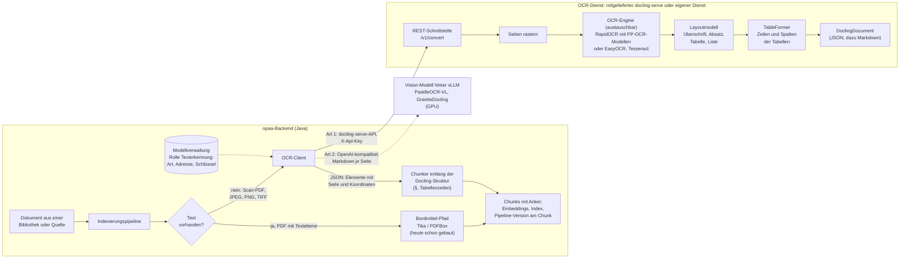

# OCR-PoC: Ergebnis (Stand 06.11.2026)

Messung zu #1062 (Epic #2640). Gemessen wurde, welches OCR-Verfahren gescannte Verwaltungsdokumente am
besten erschließt. Aufbau und Werkzeuge stehen in [README.md](README.md). Rohdaten und Notizen des
GPU-Laufs liegen unter [results/](results/).

## Ergebnis

**Docling mit RapidOCR (PP-OCRv6-Modelle über ONNX) ist der beste Kompromiss.** Es ist die einzige
Variante, die gleichzeitig vier Dinge schafft:

- § wird im synthetischen Korpus zuverlässig erkannt (100 %, an echten Scans 11 von 15, siehe unten).
- Tabellen bleiben vollständig erhalten.
- Im härtesten Profil `schlecht` bleibt die Fehlerrate unter 2 % (GPU-Lauf 1,3 %, CPU-Stichprobe 2,1 %). Bei `fax` liegt sie bei 3,1 %, siehe die fehlenden Absatzzeilen.
- Sie läuft ohne GPU mit rund 3 GB RAM.

PaddleOCR liest Zeichen am genauesten, ist auf der CPU aber drei- bis fünfmal langsamer und braucht
11 GB RAM. EasyOCR (Doclings bisherige Vorgabe) und Tesseract scheiden aus, weil sie § nie richtig
lesen.

**An neun echten Scans bestätigt sich die Wahl** (siehe [Nachmessung mit echten Scans](#nachmessung-mit-echten-scans)):
- **Lesen:** Docling + RapidOCR und PaddleOCR lesen gleich gut (41 und 42 von 48 Prüfstellen).
- **Wo PaddleOCR vorn liegt:** bei §-Angaben (14/15 gegenüber 11/15) und bei der Zeichenfehlerrate der
  Kurztexte.
- **Wo Docling + RapidOCR vorn liegt:** Es erhält Tabellen öfter (6/7 gegenüber 4/7) und braucht halb
  so viel Zeit und ein Viertel des Speichers.
- **Schwäche, die vor der Umsetzung zu klären ist:** Docling + RapidOCR verliert kurze, alleinstehende
  und erste Zeilen.

## So hängen die Teile zusammen

Die Varianten heißen „Docling + EasyOCR“, „Docling + RapidOCR“ und so weiter, weil Docling selbst kein
OCR-Verfahren ist. Docling ist ein Dokumentkonverter: Er zerlegt eine Seite in Blöcke und setzt daraus
ein strukturiertes Dokument zusammen. Den Text liest eine austauschbare OCR-Engine.

Das Schaubild zeigt den Vorschlag für Stufe 1. Gebaut ist davon heute nur der Bordmittel-Pfad.

**Was opaa aufruft.** Der OCR-Dienst ist ein eigener Container im internen Netz, ohne veröffentlichten
Port und mit API-Schlüssel. opaa programmiert gegen die Schnittstelle von `docling-serve`
(`/v1/convert`), nicht gegen einen bestimmten Container. Daraus ergeben sich zwei Betriebswege:

- **Vorgabe:** opaa liefert einen fertig eingestellten Container mit, `docling-serve` mit RapidOCR und
  den Modellen im Image, damit er offline läuft.
- **Eigener Dienst:** Eine Behörde kann einen eigenen Dienst mit derselben Schnittstelle betreiben,
  etwa auf eigener GPU oder beim IT-Dienstleister, und trägt nur Adresse und Schlüssel ein.

Die maßgeblichen Einstellungen würde opaa bei jedem Aufruf mitschicken: OCR erzwingen, OCR-Engine
`rapidocr` mit Sprache `de` und Modellgröße `medium` (wie gemessen), Tabellenerkennung an, Ausgabe als
JSON und Markdown. Ein fremder Dienst verhält sich dann wie der mitgelieferte, sofern er die
RapidOCR-Modelle in derselben Sprache und Größe hat.

Zurück kommt das `DoclingDocument` als JSON. Nur daraus würden die Chunks geschnitten, das Markdown ist
eine flache Ansicht für Vorschau und Fehlersuche. Am Chunk stünde, welches Verfahren den Text geliefert
hat. Fällt der Dienst aus, bliebe das Dokument wie heute als „kein extrahierbarer Text“ stehen.

Gepflegt würde der Dienst als Rolle „Texterkennung“ in der Modellverwaltung der Systemadministration
(verbindlich festgelegt im Epic #2640). Vorgesehen sind zwei Anbindungsarten:

1. **docling-serve-API:** Das ist der mitgelieferte Container oder ein eigener Dienst. Zugang über
   `X-Api-Key`, Ergebnis ist das JSON mit Fundorten.
2. **OpenAI-kompatibles Vision-Modell:** etwa PaddleOCR-VL oder GraniteDocling hinter vLLM. Es liefert
   Markdown je Seite, Fundstellen gibt es dort meist nur als Seitensprung.

Eine Adresse, an die opaa Dokumente schickt, ist sicherheitsrelevant. Deshalb soll nur die
Systemadministration sie eintragen dürfen, und opaa prüft das Ziel wie bei den übrigen Modellrollen.

**Welche Dateien.** Docling verarbeitet nicht nur PDF. Für Scans zählen vor allem die Bildformate:
JPEG, PNG, TIFF (auch mehrseitig, jede Seite einzeln), BMP, WEBP und GIF. Sie laufen durch dieselbe
Pipeline wie ein Scan-PDF, ebenso durch die VLM-Pipeline weiter unten. Heute weist opaa Bilddateien
ab. Mit dem OCR-Dienst würden sie wie Scans indexiert. Die übrigen Formate, die Docling kann (DOCX,
PPTX, XLSX, HTML), liest opaa schon mit eigenen Bordmitteln. Hier bringt Docling nichts Neues.

**Was in Docling passiert.** Docling rechnet in mehreren Stufen. Keine davon ist ein Sprachmodell:

1. **Rastern:** Docling wandelt jede Seite in ein Bild um, bei Bilddateien entfällt das.
2. **OCR:** Die OCR-Engine findet auf dem Bild die Textzeilen und liest sie.
3. **Layout:** Ein Layoutmodell erkennt die Blöcke (Überschrift, Absatz, Liste, Tabelle, Kopf- und
   Fußzeile) und ihre Lage. Docling sortiert die gelesenen Zeilen diesen Blöcken zu. Bei diesem
   Schritt gehen vermutlich die letzten Absatzzeilen verloren, siehe
   [Auffälligkeiten](#auffälligkeiten).
4. **Tabellen:** TableFormer bestimmt in Tabellenblöcken Zeilen und Spalten.
5. **Ausgabe:** Docling baut aus allem das `DoclingDocument`. Jedes Element trägt dort seine Seite und
   seinen Begrenzungsrahmen. Dazu kommen die Lesereihenfolge, die Überschriftenhierarchie und die
   Tabellen als Raster.

Die OCR-Engine ist eine Einstellung von Docling. Deshalb tragen die Varianten zwei Namen:
- **EasyOCR** war bisher Doclings Vorgabe. Heute wählt Docling die Engine automatisch und nimmt
  RapidOCR, wenn onnxruntime installiert ist.
- **RapidOCR** ist eine schlanke Laufzeit für die Erkennungsmodelle von PaddleOCR (PP-OCRv6, als ONNX
  umgewandelt).

**Docling mit Paddle.** Das geht, und es ist genau die empfohlene Variante. Docling + RapidOCR nutzt
die Texterkennung von PaddleOCR, braucht dafür aber nicht das Framework PaddlePaddle. Layout und Tabellen
kommen weiter von Docling. Für die Gegenrichtung gilt:

- **„PaddleOCR“ in der Tabelle** meint die komplette Paddle-Pipeline PP-StructureV3. Sie ersetzt
  Docling ganz, mit eigenem Layout, eigenen Tabellen und eigenem Markdown, und wäre ein eigener Dienst
  (PaddleX-Serving).
- **Eine Paddle-OCR mit Docling-Layout** ist damit schon abgedeckt.
- **Zeichenerkennung und Tabelleninhalte** liegen bei beiden auf ähnlichem Niveau, weil dieselbe
  Modellfamilie liest (PaddleOCR 0,2 % CER, Docling + RapidOCR 0,9 % im Profil `mittel`; im Profil
  `schlecht` umgekehrt 4,0 % gegenüber 1,3 %).
- **Die Unterschiede** liegen im Drumherum: Leerzeichen an Zeilenumbrüchen, Spaltenreihenfolge der
  Tabellen, verlorene Absatzzeilen. Hinzu kommen der Ressourcenbedarf (11 GB gegenüber 3 GB RAM) und
  die Laufzeit auf der CPU (70–85 gegenüber 16–22 s je Seite).

**Bildsprachmodelle (VLM) als zweiter Weg.** Docling hat eine zweite Pipeline. Dort ersetzt ein
kleines Bildsprachmodell Layout und OCR zugleich: Es bekommt das Seitenbild und schreibt das
strukturierte Dokument direkt. Gemessen ist GraniteDocling (258 Mio. Parameter, braucht praktisch eine
GPU). Über dieselbe Pipeline ließe sich auch ein anderes Modell hinter einer OpenAI-kompatiblen
Schnittstelle anbinden, etwa PaddleOCR-VL. Das ist nicht gemessen. Ein VLM erkennt Struktur und Tabellen gut,
kann aber ganze Textteile verlieren, siehe die Ausreißer unten. Für opaa ändert sich an der
Schnittstelle nichts: Die VLM-Pipeline nimmt dieselben Eingaben (Scan-PDF und Bilddateien) und liefert
ebenfalls ein `DoclingDocument`. GraniteDocling gibt dabei Positionsangaben je Element mit aus. Das gilt
für ein VLM innerhalb von `docling-serve` (Art 1). Spricht opaa ein VLM direkt OpenAI-kompatibel an
(Art 2), kommt nur Markdown zurück.

## Fundstellen bei Scans

Ein Beleg springt heute über den Anker des Chunks zur Seite und markiert dort fein über zwei Zitate
(`quoteStart`, `quoteEnd`), die der PDF-Viewer im Textlayer sucht ([ADR-0062](../../docs/decisions/0062-fundstellen-anker-je-chunk.md)). Ein Scan hat
keinen Textlayer. Würde opaa nur das Markdown indexieren, bliebe für einen Scan nur „Seite 3 öffnen“,
ohne Markierung. Entschieden ist deshalb **„Rahmen ohne Kopie“**:

1. **Anker aus dem JSON.** Der Chunker schneidet entlang der Docling-Elemente. Jeder Chunk bekommt
   `pageFrom`/`pageTo`, den vollen Überschriftenpfad (`§ 3 Gebührenbefreiung`) und die Zitate, genau wie
   ein Text-PDF.
2. **Rahmen am Chunk.** Zusätzlich speichert opaa die Begrenzungsrahmen der Elemente des Chunks (Seite
   und Koordinaten aus dem JSON). Der Viewer zeichnet sie als Markierung auf das Original. opaa legt
   dafür keine Kopie des Dokuments ab, das Original kommt wie bisher live von der Quelle. ADR-0062, der
   Bounding-Boxes für Text-PDFs verworfen hat, wird für Scans fortgeschrieben.

**Verworfene Alternativen:**

- **Durchsuchbares PDF (Sandwich, „Anzeigefassung“).** opaa würde aus dem JSON einen unsichtbaren
  Textlayer über das Scanbild legen, wie OCRmyPDF. Der bestehende PDF-Viewer könnte dann über die Zitate
  markieren, und die Suche im Original würde funktionieren.

  Verworfen, weil:
  - opaa je Scan eine abgeleitete Kopie speichern und pflegen müsste, da Originale sonst live von der
    Quelle kommen,
  - das Dokumente in opaa dupliziert, mit Folgen für Speicher, Löschung und Berechtigungen,
  - die Kopie bei jeder Änderung des Originals neu entstehen müsste.
- **Nur Seitensprung ohne Markierung.** Das wäre zu ungenau für mehrseitige Satzungen und Tabellen,
  und das JSON liefert die Koordinaten ohnehin mit.

Das JSON lohnt sich über die Fundstellen hinaus:
- Chunks folgen der §-Gliederung statt einer Zeichenzahl.
- Eine Tabellenzeile wird ein vollständiger Chunk (`Nr. 4 · Zweitausfertigung · 46,00 Euro`) statt
  zerrissenem Fließtext.
- Kopf- und Fußzeilen, Seitenzahlen und Stempel lassen sich als eigene Elementtypen aus dem Index
  heraushalten.

## Korpus und Messumgebung

- 72 synthetische Verwaltungsdokumente aus `eval/corpus/verwaltung`, 230 Seiten: Satzungen mit
  §-Gliederung, Gebührenordnungen mit Gebührentabelle samt Gitterlinien, Dienstanweisungen und
  Formularhinweise.
- Vier Scanprofile:
  - `gut`: 300 dpi, leichtes Rauschen
  - `mittel`: Schräglage, Grauschleier, Unschärfe
  - `fax`: 200 dpi, binarisiert
  - `schlecht`: 150 dpi, ungleichmäßige Ausleuchtung, JPEG mit Qualität 25
- Tesseract lief in der Cloud-Sandbox auf 4 vCPU. Alle anderen Varianten liefen auf einem Notebook
  (Ryzen AI 9 365, 24 GB RAM, Radeon RX 9060 XT mit 16 GB unter ROCm/Windows), siehe
  [results/NOTES.md](results/NOTES.md).
- Docling mit EasyOCR und mit RapidOCR liefen auf der GPU über den ganzen Korpus, GraniteDocling nur im Profil `mittel`. Docling (EasyOCR, RapidOCR) und PaddleOCR liefen
  zusätzlich als CPU-Stichprobe (12 Dokumente, `mittel` und `schlecht`). PaddleOCR gibt es für
  AMD-GPUs nicht, PaddleOCR-VL lief deshalb gar nicht.

## Zahlen

Profil `mittel`. Die Spalte „schlecht“ zeigt die Zeichenfehlerrate (CER) im härtesten Profil.

| Variante | CER | CER schlecht | § erhalten | als Überschrift markiert ⁴ | Tabellenzellen | Antwortstellen | s/Seite CPU ⁵ | RAM |
|---|---|---|---|---|---|---|---|---|
| **Docling + RapidOCR** | **0,9 %** | **1,3 %** | **100 %** | 98 % | 99 % | 27/27 | 16–22 | 3,1 GB |
| PaddleOCR PP-StructureV3 ¹ | 0,2 % | 4,0 % | 100 % | 98 % | 100 % ² | 14/14 | 70–85 ³ | 11,3 GB |
| GraniteDocling (VLM, nur GPU) | 1,4 % | – | 96 % | 99 % | 100 % | 27/27 | – (GPU 17) | 2,5 GB + VRAM |
| Docling + EasyOCR | 4,4 % | 17,7 % | 0 % | 97 % | 90 % | 22/27 | 32–40 | 6,8 GB |
| Tesseract (OCRmyPDF) | 0,2 % | 5,2 % | 0 % | keine Struktur | keine Struktur | 27/27 | 1–1,6 | unter 0,2 GB ⁶ |

¹ nur CPU-Stichprobe mit 12 Dokumenten. ² Inhalt vollständig, aber die Spalten stehen in der falschen
Reihenfolge (`Amtshandlung | Gebühr | Nr.`). ³ oneDNN abgeschaltet, weil paddlepaddle 3.3.1 damit
abstürzt. Mit oneDNN wäre es schneller. ⁴ Unscharfer Abgleich (Ähnlichkeit ab 90 %): eine
Überschrift `8 1 Geltungsbereich` statt `§ 1 Geltungsbereich` zählt noch als markiert. Ob die
§-Gliederung selbst erhalten bleibt, zeigt die Spalte „§ erhalten“. `evaluate.py` misst das inzwischen
auch je Überschrift mit exaktem Präfix `§ N` (`paragraph_headings_marked`). Für die lokalen Läufe liegt
dieser Wert nicht vor, weil ihre Ausgaben nicht eingecheckt sind. ⁵ Tesseract auf 4 vCPU in der Cloud,
alle anderen auf dem Notebook-Prozessor. ⁶ Die Speicherspitze der Tesseract-Prozesse erfasst die
Messung nur ungenau (15 bis 123 MB).

Der BM25-Recall@5 der 49 Golden-Fragen liegt bei allen Varianten zwischen 0,86 und 0,90, gegenüber
0,88 auf dem Solltext. Die Suche verträgt die verbleibenden Fehler. Das Maß trennt die Varianten auf
diesem Korpus aber nicht.

## Abgleich mit den vorgeschlagenen Schwellen (Docling + RapidOCR)

| Kriterium | Schwelle | gemessen | |
|---|---|---|---|
| CER bei mittlerer Scanqualität | ≤ 2 % | 0,9 % | erfüllt |
| §-Überschriften erkannt | ≥ 90 % | § zu 100 % erhalten, Überschriften zu 98 % markiert | erfüllt |
| Tabellenzellen korrekt | ≥ 85 % | 99 % | erfüllt |
| Recall@5 Scan zu Original | ≥ 0,9 × Original | 0,857 / 0,878 = 0,98 | erfüllt |
| Laufzeit CPU | ≤ 3 s/Seite | 16–22 s/Seite | **verfehlt** |
| RAM je Worker | ≤ 8 GB | 3,1 GB | erfüllt |
| Offline-Betrieb | Modelle im Image | nicht gemessen | offen |

Die Laufzeitschwelle war zu optimistisch angesetzt. Bei rund 20 s je Seite braucht ein Worker für
10.000 Scanseiten etwa 55 Stunden. Für den laufenden Zugang neuer Dokumente reicht das, für einen
großen Altbestand braucht es mehrere Worker oder eine GPU-OCR für RapidOCR (`onnxruntime-gpu`,
nicht gemessen). Auf der GPU beschleunigt Docling nur Layout und Tabellen, die OCR selbst rechnet
weiter auf der CPU.

## Auffälligkeiten

- **§ als `$` oder `8`:** EasyOCR und Tesseract lesen das Paragraphenzeichen in keinem einzigen Fall
  richtig. Für Satzungen und Verordnungen ist das ein Ausschlussgrund.
- **Letzte Absatzzeile fehlt:** Bei Docling mit RapidOCR (und bei GraniteDocling) fehlt bei 3–5 % der
  Absätze die letzte Zeile. Die Ursache liegt vermutlich in der Zuordnung der OCR-Zeilen zu den
  Layout-Blöcken in Docling, nicht in der Zeichenerkennung. Deshalb ist `gut` (2,4 %) schlechter als
  `mittel` (0,9 %). Das ist vor einer Umsetzung zu klären (Docling-Option, Seitenrand, Upstream-Issue).
- **GraniteDocling** hatte zwei Ausreißer, einmal 443 s mit rund einem Fünftel Textverlust und einmal
  15 % CER. Im Betrieb bräuchte es eine Abbruch- und Rückfallregel.
- **PaddleOCR** lässt an Zeilenumbrüchen Leerzeichen weg (`2023),beschlossen`). Das treibt die
  Wortfehlerrate (2,5 % bei 0,2 % CER) und schadet der Wortsuche.

## Nachmessung mit echten Scans

**Die Empfehlung hält, mit einer offen benannten Schwäche.** Gemessen wurde an neun echten,
gemeinfreien Scans (17 Seiten).

- **Lesen allgemein:** Docling + RapidOCR und PaddleOCR PP-StructureV3 liegen gleichauf (41 und 42 von
  48 Prüfstellen).
- **Vorsprung von PaddleOCR:** Es erkennt mehr §-Angaben (14/15 gegenüber 11/15) und liest die
  Kurztexte genauer (CER 0,3 % gegenüber 3,3 %).
- **Vorsprung von Docling + RapidOCR:** Es erhält die Tabellenzeilen öfter (6/7 gegenüber 4/7) und
  braucht halb so viel Zeit und ein Viertel des Speichers.
- **EasyOCR und Tesseract** lesen auch auf echten Scans kein einziges §-Zeichen.

### Korpus und Verfahren

| Herkunft | Anzahl | Was |
|---|---|---|
| Bundestagsdrucksachen 1949–1987 | 4 | Bleisatz, Schreibmaschine, Anschreiben mit Aktenzeichen, Gesetzestext mit §, Zahlentabellen |
| Bundesgesetzblatt I 1955 und 1972 | 2 | Inhaltstabellen, Verordnungstext, zum Teil ausgefranste Lettern |
| Ortsrecht und Bekanntmachungen aus dem Amt Güstrow-Land, 2022–2024 | 3 | Bürodruck-Scans mit Unterschrift über dem Text, Stempel, Siegel, Handschrift, grauer Hintergrund, ein Bescheid im Blocksatz |

- **Quellen:** URL, Seiten, Prüfsumme und Rechtsgrundlage (amtliche Werke, § 5 UrhG) stehen in
  [real/SOURCES.md](real/SOURCES.md).
- **Aufbereitung:** `fetch_real.py` lädt die Dokumente, prüft die Prüfsumme und rastert die gewählten
  Seiten neu (300 dpi, ohne die alte OCR-Textebene). Die PDFs liegen nicht im Repository.
- **Sollwerte:** Ich habe sie von Hand aus dem Seitenbild abgelesen ([real/truth/](real/truth/)):
  - 48 Prüfstellen: Beträge, Daten, Aktenzeichen, §-Angaben mit Text, Stempeltext
  - 7 Tabellenzeilen
  - je Dokument ein kurzer Absatz als Solltext
- **Bewertung** durch `evaluate_real.py`:
  - Eine Prüfstelle gilt als gefunden, wenn sie wörtlich im Ergebnis steht. Vorher werden Leerraum,
    Anführungszeichen, Striche und Trennungen am Zeilenende vereinheitlicht.
  - Eine Tabellenzeile zählt nur, wenn alle ihre Zellen in einer Ausgabezeile in richtiger Spaltenfolge
    stehen.
- **Hardware:** Alle Läufe liefen auf der CPU des Notebooks, nur GraniteDocling auf der GPU.

### Zahlen

| Variante | Prüfstellen | davon mit § | Tabellenzeilen | CER Kurztext (Mittel) | s/Seite | RAM |
|---|---|---|---|---|---|---|
| **Docling + RapidOCR** | 41/48 (85 %) | 11/15 | **6/7** | 3,3 % ¹ | **50** | **2,7 GB** |
| PaddleOCR PP-StructureV3 | **42/48 (88 %)** | **14/15** | 4/7 | **0,3 %** | 100 | 11,3 GB |
| GraniteDocling (VLM, GPU) | 36/48 (75 %) | 10/15 | 5/7 | 2,1 % | 48 (GPU) | 2,4 GB + VRAM |
| Tesseract (OCRmyPDF) | 24/48 (50 %) | 0/15 | 0/7 | 5,7 % | 1,9 | 0,2 GB |
| Docling + EasyOCR | 20/48 (42 %) | 0/15 | 1/7 | 3,7 % | 73 | 6,0 GB |

¹ Der Mittelwert kommt fast ganz aus einem Dokument, dem Bescheid zur Flurneuordnung im Blocksatz (CER
32 %). Ohne dieses Dokument liegt er bei rund 0,1 %, der Median ist 0.

Rohdaten mit den verfehlten Prüfstellen je Dokument stehen in
[results/results-real.json](results/results-real.json), die Tabelle in
[results/table-real.md](results/table-real.md).

### Einordnung des §-Abstands

PaddleOCR liegt bei den §-Angaben vorn. Von den vier Fehlern bei Docling + RapidOCR gehen drei auf
einen Lesefehler oder das Blocksatz-Dokument zurück:

- **Bescheid zur Flurneuordnung (Blocksatz), zwei Fehler:**
  - Vor „63 Abs. 2“ fehlt das §.
  - Bei „§ 32 des Flurbereinigungsgesetzes“ ist das § zwar gelesen, der Rest der Zeile aber verstümmelt
    („§ 32 des Éuuur 6m“).
- **Drucksache 11/1000, ein Lesefehler:** „§ 9“ ist als „6 §“ gelesen, der Rahmen des Elements sitzt
  trotzdem richtig.
- **Bundesgesetzblatt 1972, ein echter Verlust:** Die alleinstehende Überschrift „§ 2“ fehlt.

Mit 15 §-Prüfstellen ist der Abstand ein Hinweis, kein belastbarer Unterschied. Dasselbe gilt für den
Tabellenvorteil von Docling + RapidOCR (sieben Tabellenzeilen).

Den Ausschlag geben deshalb drei Punkte:
- **Ressourcen:** Docling + RapidOCR braucht halb so viel Zeit und ein Viertel des Speichers.
- **Gemeinsame Schwächen:** Beide Varianten verlieren Zeilen.
- **Behebbarkeit:** Die Schwäche von Docling + RapidOCR liegt in der Zuordnung von OCR-Zeilen zu
  Layoutblöcken und ist damit ein konkreter, behebbarer Punkt (siehe unten).

### Was bei den einzelnen Varianten auffiel

**Docling + RapidOCR**
- Tabellen werden am vollständigsten erkannt, einschließlich der Haushaltstabellen 1953 und 1987.
  Einmal stehen zwei Zahlenspalten in einer Zelle (`(1 035 000) (1 125 000)`).
- Kurze, alleinstehende Zeilen und erste Zeilen gehen verloren:
  - im Bescheid zur Flurneuordnung (Blocksatz) der Anfang jedes nummerierten Punkts
    (`1. Im Anhörungstermin am 15.12.2022 …`),
  - die §-Überschrift „§ 2“ im Bundesgesetzblatt 1972.
  
  Das ist dasselbe Muster wie die fehlenden letzten Absatzzeilen im synthetischen Korpus. Es ist der
  wichtigste offene Punkt für die Umsetzung.

**PaddleOCR PP-StructureV3**
- § wird am sichersten erkannt, und die Kurztexte sind fast fehlerfrei.
- Paddle verliert aber ebenfalls ganze Zeilen:
  - das Datum im Anschreiben der Drucksache 2/200,
  - zwei Einträge der Inhaltstabelle des Bundesgesetzblatts 1972.
- Inhaltstabellen werden zu zerrissenen Zeilen.
- Umlaut-Großbuchstaben verliert es („Anderung“).
- An Zeilenumbrüchen fehlen wieder Leerzeichen („1954(Haushaltsgesetz“).

**GraniteDocling**
- Struktur und Tabellen sind gut.
- Es lässt aber einzelne Zeilen und Überschriften weg: die Abgeordnetennamen, „§ 1 Dienstsiegel“ und
  die Siegelumschrift.
- Die stempelreiche Jagdsatzung brauchte 321 s für zwei Seiten.

**Tesseract und EasyOCR**
- Beide lesen § auch auf echten Scans ausnahmslos falsch (`$`, `8`, `$8$`).
- Tabellen erkennen sie nicht oder kaum.

**Alle Varianten**
- Den Text im Stempel des Landratsamts („Außenstelle Bad Doberan“, „10. 07. 2023“) erkennt keine
  Variante.
- Handschrift (Datum, Ort, Unterschriften) ist bewusst nicht Teil der Prüfstellen.
- Die Unterschrift quer über „Gleichzeitig“ und dem Datum der Glasewitzer Hauptsatzung stört
  Docling + RapidOCR und PaddleOCR nicht.

### Koordinaten im JSON

Für die Entscheidung „Rahmen ohne Kopie“ habe ich das `DoclingDocument` der Drucksache 11/1000 (drei
Seiten, Text, §-Gliederung, Haushaltstabelle) geprüft und alle Rahmen auf die Seitenbilder gezeichnet.

- **Seite:** Jedes Element trägt `prov[].page_no` (ab 1), einen Rahmen und `charspan`. Auch alle 72
  Tabellenzellen haben einen eigenen Rahmen.
- **Einheit:** PDF-Punkte (1/72 Zoll), bezogen auf `pages[n].size` (hier 595,2 × 841,2 für A4). Die
  Rasterauflösung spielt keine Rolle: Für Pixel bei d dpi wird mit d/72 multipliziert.
- **Ursprung:** gemischt.
  - Die Rahmen der Elemente (`texts`, `tables`, `pictures`) haben `coord_origin: BOTTOMLEFT`.
  - Die Rahmen der Tabellenzellen (`data.table_cells[].bbox`) haben `coord_origin: TOPLEFT`.
  - Opaa muss also je Rahmen das Feld `coord_origin` auswerten und für die Anzeige einheitlich
    umrechnen: `top = Seitenhöhe − t` bei BOTTOMLEFT.
- **Lage:** Umgerechnet sitzen alle Rahmen exakt auf Text, Überschriften und Zellen, auch auf der
  zweispaltigen Seite und in der Tabelle mit Punktführern.

Für Fundstellen reicht das: Ein Chunk kann die Rahmen seiner Elemente (oder Tabellenzellen) mit Seite
speichern, und der Viewer rahmt sie auf dem Original ein.

## Grenzen dieser Messung

- Die Laufzeiten der lokalen Docling-Läufe enthalten noch das Laden der Modelle im jeweils ersten
  Dokument. Das erklärt zum Teil, warum `mittel` in der CPU-Stichprobe langsamer ist als `schlecht`.
  Seit dem Review lädt `setup()` die Modelle vorab. Beim GPU-Lauf `docling-rapidocr/schlecht` stammen
  die Zeiten nach einem Abbruch zum Teil aus einem langsameren Nachlauf, siehe
  [results/NOTES.md](results/NOTES.md). Die Werte für die Laufzeit sind deshalb grobe Größenordnungen.
- Seit dem Review wird jedes Scanprofil mit einem eigenen Startwert erzeugt (`Dokument/Profil`). Ein
  neu gebauter Korpus weicht deshalb im Detail von dem gemessenen ab. Die Profile selbst sind
  unverändert.
- Der Hauptkorpus ist synthetisch: eine Schrift, sauberer Satz, künstliche Scanfehler. Die
  Nachmessung mit neun echten Scans bestätigt die Rangfolge. Sie ist aber klein (48 Prüfstellen), und
  Formulare, Fraktur und Handschrift fehlen weiterhin.
- Die Sekunden je Seite stammen von einem Notebook-Prozessor. Server-Kerne können anders liegen.
- Nicht gemessen: Container-Betrieb (`docling-serve`), Offline-Betrieb mit Modellen im Image und
  PaddleOCR-VL auf NVIDIA.

## Empfehlung

1. Für die Umsetzung Docling mit RapidOCR als Zielvariante setzen, betrieben über `docling-serve`.
   Docling + RapidOCR und PaddleOCR lesen gleich gut. Den Ausschlag geben bei Docling + RapidOCR:
   - Laufzeit und Speicher: halb so viel Zeit und ein Viertel des Speichers,
   - die vollständigeren Tabellen,
   - das JSON mit Rahmen je Element für die Fundstellen.
2. Erledigt sind:
   - die Nachmessung mit echten Scans (bestätigt die Wahl),
   - die Prüfung der Koordinaten im JSON (geeignet, Ursprung je Rahmen auswerten).

   Offen für die Umsetzung bleiben:
   - **verlorene Zeilen:** Ursache der fehlenden ersten und letzten Zeilen und alleinstehenden
     §-Überschriften klären (Docling-Option, Zuordnung der OCR-Zeilen zu Layoutblöcken,
     Upstream-Issue)
   - **`docling-serve` als Container:** Imagegröße, Offline-Start mit `DOCLING_SERVE_ARTIFACTS_PATH`,
     `X-Api-Key`
3. PaddleOCR bleibt die Ausweichoption, falls sich die verlorenen Zeilen nicht beheben lassen.
